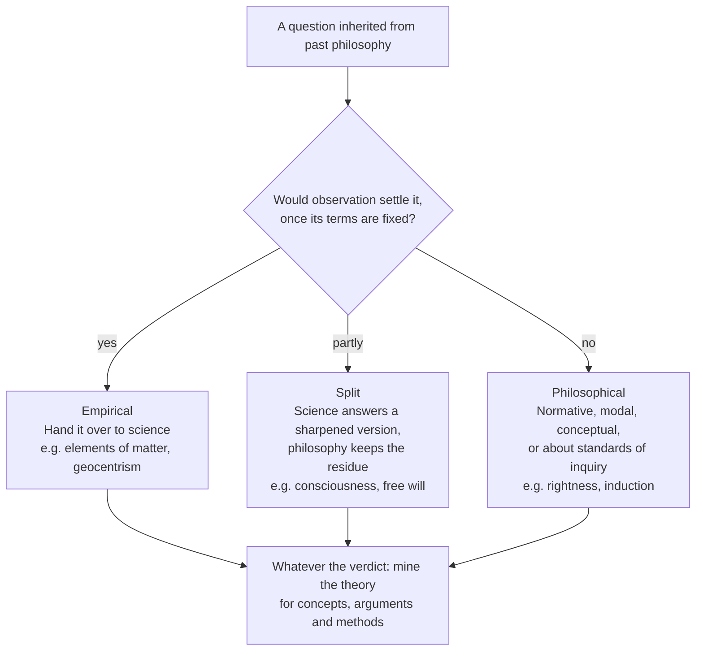
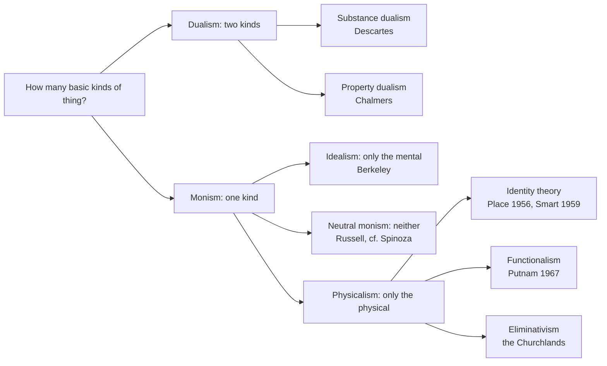

**Resources:**
1. *A New History of Western Philosophy*, Anthony Kenny
2. *The Philosophers Toolkit*, Julian Baggini; Peter S. Fosl
3. *The Voyage of Discovery: A Historical Introduction to Philosophy, 4th Edition*, William F. Lawhead
4. *A History of Philosophy*, Frank Thilly
5. *Introducing Philosophy: A Text with Integrated Readings, 10th Edition*, Robert C. Solomon; Kathleen Marie Higgins; Clancy Martin
6. The Stanford Encyclopedia of Philosophy

## What Is of True Value in the History of Philosophy

### Why Study the History of Philosophy Today?

**Q1: Why and How Should Contemporary Philosophers Study the History of Philosophy?To be more precise, If the purpose of studying philosophy is not merely to remember past ideas but to develop our capacity for philosophical thinking today, what exactly should we learn from the history of philosophy, and how should we learn it?**

**A:** The history of philosophy should be understood not merely as a chronology of thinkers and schools, but as an **intellectual laboratory, a repository of conceptual tools, and an evolving network of philosophical problems and arguments**. Its value lies not simply in preserving past conclusions, but in revealing how philosophical questions arise, how theories are constructed, and how ideas develop through criticism and reinterpretation.

A systematic understanding of philosophical history requires five interconnected approaches:

1. **History of Problems (*Problemgeschichte*).** Begin with the questions philosophers sought to answer, rather than the schools or doctrines to which they belonged. Trace the historical development of fundamental problems, such as the relationship between mind and matter, the foundations of knowledge, the nature of reality, the grounds of normativity, and the relationship between language and the world. Many contemporary debates reformulate earlier problems under new theoretical or scientific conditions.
2. **History of Concepts (*Begriffsgeschichte*).** Trace the origins, transformations, and relationships of philosophical concepts, such as substance and attribute, a priori and a posteriori, appearance and reality, analytic and synthetic judgments, and fact and value. Concepts should be understood within their theoretical contexts rather than treated as fixed definitions detached from their intellectual histories.
3. **History of Arguments.** Reconstruct the reasoning behind philosophical positions rather than merely memorising their conclusions. Study influential methods of philosophical inquiry, including Plato's dialectic, Aristotle's syllogistic logic, Descartes' methodological doubt, Kant's transcendental arguments, Husserl's phenomenological reduction, and Foucault's genealogy. The central task is to understand how an argument proceeds from its assumptions to its conclusions, and how its validity and limitations can be assessed.
4. **Historical Contextualisation.** Understand the intellectual, scientific, political, and cultural circumstances in which philosophical ideas emerged. Identify the debates to which a philosopher was responding, the assumptions available at the time, and the ways subsequent thinkers adopted, challenged, or transformed those ideas. Historical understanding should neither imply uncritical acceptance nor justify dismissing an entire philosophical system because some of its conclusions have become outdated.
5. **Thematic and Structural Organisation.** Organise philosophical history through interconnected **chains of problems**, rather than relying exclusively on chronological periods. Major lines of inquiry include metaphysics and ontology, epistemology, philosophy of mind, philosophy of language, ethics, political philosophy, and freedom and responsibility. Chronology provides historical context, while thematic connections reveal the logical continuity, conceptual transformations, and enduring disagreements within philosophical thought.

**The ultimate goal is to develop a coherent intellectual framework:** for each philosopher or philosophical tradition, identify the central problems, reconstruct the theoretical system and its arguments, situate them within historical debates, evaluate their strengths and limitations, and determine their lasting contributions to philosophical inquiry.

Studying the history of philosophy in this way transforms it from a catalogue of past doctrines into a living resource for critical thinking, theoretical innovation, and contemporary research.

**Further refinements:** five points sharpen this answer.

1. **Keep the two reconstructions apart.** Historical reconstruction asks what a text meant in its own setting; rational reconstruction asks whether its arguments work by our best current standards. Collapse toward the first and you get antiquarianism, accurate but philosophically inert. Collapse toward the second and you get anachronism, or what Herbert Butterfield called "Whig history" (1931): judging the past by how far it led to the present.
2. **Name the genres you are combining.** Richard Rorty's "The Historiography of Philosophy: Four Genres" (1984) distinguishes rational reconstruction (risk: forcing old texts into current debates), historical reconstruction (risk: no verdict on truth), *Geistesgeschichte*, which asks how philosophy's central questions came to be central (risk: a grand narrative that selects its evidence), and doxography, a catalogue of what each thinker held on fixed topics (risk: imposing headings the thinkers did not share). His central claim is that you should do both of the first two, but separately ([Rorty 1984](https://www.cambridge.org/core/books/truth-and-progress/historiography-of-philosophy-four-genres/2C0E4EF1D47F85F76D80B12EF32A3217)). Approach 3 above is rational reconstruction, approach 4 is historical reconstruction, and approaches 1, 2 and 5 drift toward *Geistesgeschichte* when done well and toward doxography when done badly. The balance has recently shifted: Christia Mercer argued in 2019 that contextualism had quietly replaced rational reconstruction among English-speaking historians of early modern philosophy, a claim that is itself contested ([Mercer 2019, via Daily Nous](https://dailynous.com/?p=25191)).
3. **Treat "perennial problems" as a hypothesis.** R. G. Collingwood (*An Autobiography*, 1939) argued that Plato's *Republic* and Hobbes's *Leviathan* are not rival answers to one question about "the state", because the Greek polis and the modern state are different objects. Quentin Skinner ("Meaning and Understanding in the History of Ideas", 1969) named three traps: the mythology of doctrines (crediting authors with views on topics they could not have addressed), of coherence (forcing a tidy system onto exploratory texts), and of prolepsis (reading a text through the significance it acquired later). A useful test: can you state the problem without concepts the earlier thinker lacked? Descartes' mind–body problem depends on matter as mere extension; for Aristotle the soul is the form of a living body, so the interaction problem cannot arise in Cartesian form, which is exactly why contemporary hylomorphists find him useful.
4. **Add reception history as a sixth approach.** Hans-Georg Gadamer's *Truth and Method* (1960) argued that every reading stands inside a history of earlier readings (*Wirkungsgeschichte*). Many late-20th-century analytic philosophers met Kant through Strawson's reading; Aristotle reached the Latin West partly through Arabic commentators such as Avicenna and Averroes. The canon is itself a historical product: the scheme of "Continental Rationalists versus British Empiricists" is largely a later textbook construction (Louis Loeb, *From Descartes to Hume*, 1981), and recent scholarship has restored figures such as Elisabeth of Bohemia, Anne Conway, Margaret Cavendish and Émilie du Châtelet.
5. **Learn by practice, through primary texts.** The answer says what to study; Q9 and Q10 below say what to do while studying. A workable reading sequence: Plato's *Meno*, *Republic* and *Theaetetus*, and Aristotle's *Physics* II, *De Anima* and *Nicomachean Ethics*; Epictetus, Sextus Empiricus and Augustine; Anselm, Aquinas and Ockham; Descartes' *Meditations* with the *Objections and Replies*, then Hobbes, Spinoza, Locke, Leibniz, Berkeley and Hume; Kant's *Prolegomena* and *Critique of Pure Reason*, Hegel, Mill, Kierkegaard, Marx and Nietzsche; Frege, Russell, Husserl, Wittgenstein, Heidegger, Quine, Beauvoir and Rawls. Read each with one guide, such as Anthony Kenny's *A New History of Western Philosophy* (2004–07), Peter Adamson's *History of Philosophy without any gaps*, or the *Stanford Encyclopedia of Philosophy*.

### What Is of Lasting Value in the History of Philosophy?

**Q3: When a philosopher's conclusions have been superseded by later scientific or philosophical developments, what, if anything, remains valuable in their thought?**

**A:** A superseded conclusion usually leaves five things behind: the **problem** it addressed, the **argument** that led to it, the **concepts** it built, the **method** it used, and an **instructive failure** showing which assumption went wrong. Often a sixth survives too: the view turns out to be correct within a limited domain. The key move is to separate a conclusion from the question it answered, the inference pattern that produced it, and the conceptual apparatus it used, and to judge each on its own.

1. **The problem.** Zeno's paradoxes of motion are standardly answered with the calculus of limits and Cantor's theory of the continuum. Yet the questions they opened, such as whether infinitely many tasks can be completed in finite time, remain live (James Thomson's "Tasks and Super-Tasks", 1954).
2. **The argument form.** Descartes' physics of vortices and his pineal-gland account of interaction are gone. His dream and evil-demon arguments survive intact as sceptical scenarios, rebuilt as Putnam's "brain in a vat" (1981).
3. **The concepts.** Aristotle's physics was replaced, but his distinction between efficient and final (functional) explanation still structures how biology talks about functions. Leibniz's theodicy is rarely held, but his "possible worlds" became the semantics of modal logic (Kripke, 1959–63).
4. **The method.** Kant's transcendental argument (showing that something must hold because it is a condition of experience) outlived most of his specific conclusions. Socrates' method of refuting definitions by counterexample is still the engine of Gettier's 1963 paper on knowledge.
5. **The instructive failure.** Kant held that Euclidean geometry is synthetic a priori knowledge of space. Non-Euclidean geometries and general relativity (1915) showed physical space need not be Euclidean. The failure forced a distinction between pure geometry (mathematics) and physical geometry (empirical), and Reichenbach (1920) reworked Kant's idea into "relativized" a priori principles, a line Michael Friedman later developed in *Dynamics of Reason* (2001).
6. **Correctness within a domain.** Hegel argued, in the introduction to his *Lectures on the History of Philosophy*, that refuting a philosophy shows its principle is one-sided, not empty: the refuted system is demoted from an account of the whole to a partial moment. You need not accept Hegel's teleology to use the heuristic. Carlo Rovelli gives a vivid case, arguing that Aristotle's physics is a correct approximation of Newtonian physics for motion in fluids, in the same sense that Newton's theory approximates Einstein's; on his reading it lasted because it was empirically well grounded, not because it was dogma ([Rovelli 2015, arXiv](https://arxiv.org/abs/1312.4057)).

**Worked cases:**

* **Aristotle.** Superseded: natural places, celestial spheres, much of his biology. Survives: virtue and practical wisdom; form and matter; syllogistic as a valid fragment of logic. Lives on in virtue ethics after Anscombe (1958) and in neo-Aristotelian metaphysics.
* **Descartes.** Superseded: vortex physics; interaction via the pineal gland. Survives: methodical doubt; the problem of knowing the external world; analytic geometry. Lives on in the epistemology of scepticism and the dualism debate.
* **Kant.** Superseded: Euclidean geometry and Newtonian physics as a priori; logic "complete since Aristotle". Survives: the transcendental argument; constitutive vs regulative principles; autonomy. Lives on in the relativized a priori and in Kantian ethics (Rawls, Korsgaard).
* **Leibniz.** Superseded: monads; pre-established harmony. Survives: possible worlds; identity of indiscernibles; sufficient reason; the dream of a logical calculus. Lives on in modal semantics, the metaphysics of identity, and the history of logic and computing.
* **Hume.** Superseded: details of his associationist "science of man". Survives: the problem of induction; the is–ought gap; causation as regularity. Lives on in Bayesian epistemology, metaethics and causal inference.
* **Democritus.** Superseded: specific atom shapes explaining tastes and colours. Survives: explaining visible properties by invisible microstructure. Lives on in the explanatory strategy of physics and chemistry.

Kant's confidence about logic is itself a lesson. In the preface to the second edition of the *Critique of Pure Reason* (1787), he said logic had not needed to advance since Aristotle. Frege's *Begriffsschrift* (1879) refuted that within a century, while leaving Aristotle's syllogistic standing as a correct, limited fragment.

**Q4: How can we distinguish the historical, theoretical, and methodological value of a philosophical system?**

**A:** The three are independent dimensions, each answered by a different question and different evidence. A system can score high on one and low on another, so judge each separately before forming an overall view.

1. **Historical value.** Test question: how different would later thought, science or institutions be without it? Evidence: reception, influence, and what later thinkers took from it or reacted against.
2. **Theoretical value.** Test question: would a competent philosopher today defend a version of it? Evidence: current debate, and how its claims fare against the best objections.
3. **Methodological value.** Test question: can I use its way of asking or arguing on problems its author never considered? Evidence: whether the procedure transfers and still produces results.

Bernard Williams drew a related line in the preface to *Descartes: The Project of Pure Enquiry* (1978). The *history of ideas* is history first and asks what a text meant; the *history of philosophy* is philosophy first and asks what is true or coherent in it. Historical value belongs to the first, theoretical value to the second, and methodological value can be assessed in both.

**Where the three come apart** (illustrative judgements, offered to be argued with, not settled facts):

* **Aristotle's physics.** Historical very high; theoretical low as physics; methodological medium. It dominated natural philosophy for two millennia, and its survey of predecessors' views and puzzles is still a model.
* **Descartes' *Meditations*.** Historical very high; theoretical low for substance dualism but high for the sceptical problem; methodological high. Few now hold his dualism, but methodical doubt and the first-person starting point remain tools.
* **Spinoza's *Ethics*.** Historical medium–high; theoretical medium; methodological mixed. His monism and theory of the emotions are revived; the geometric method set an ideal of rigour, but the definitions did most of the work.
* **Hegel's *Phenomenology*.** Historical very high; theoretical and methodological contested. It shaped Marx, existentialism and critical theory; Brandom and McDowell revived it, while others still dismiss it.
* **Logical positivism.** Historical high in the 20th century; theoretical low; methodological high. The verification principle failed, partly by its own standard, but its demand for clarity and formal analysis of science endured.
* **Socrates' *elenchus*.** Historical high; theoretical medium; methodological very high. His intellectualism about weakness of will is still debated, and refutation by counterexample is standard practice.
* **Hume's *Enquiry*.** High on all three: a rare case where they align.

**Four mistakes to avoid:**

1. **Inferring truth from influence.** High historical value says nothing about theoretical value; Aristotle's physics shaped natural philosophy for two millennia and is false as physics.
2. **Inferring no method from false conclusions.** Logical positivism's main thesis failed while its methods reshaped philosophy of science.
3. **Treating methods as neutral.** Methods carry assumptions. Cartesian doubt presupposes that a solitary first-person standpoint is the right place to start; Husserl's phenomenological reduction presupposes we can grasp essences by reflection.
4. **Forgetting a fourth kind: heuristic value.** Some views are worth studying because they were *fruitful*: they generated research even when wrong. Imre Lakatos called such a line of inquiry a "progressive research programme".

**Q5: Beyond particular conclusions, what enduring questions, concepts, methods of argumentation, and frameworks of thought has the history of philosophy contributed?**

**A:** The tradition's most durable legacy is a toolkit in five layers: questions, concepts, argument forms, methods, and frameworks. Each layer outlived most of the particular conclusions it first served.

**Questions:**

* **Being:** What exists, and what is it to exist? (Parmenides; Aristotle's "being as being")
* **Change and persistence:** How can a thing change and remain itself? (Heraclitus; the Ship of Theseus in Plutarch)
* **Universals:** Are there properties shared by many things, and where are they? (Plato, Aristotle, Ockham's nominalism)
* **Knowledge:** What is knowledge, as opposed to true opinion? (Plato's *Theaetetus* and *Meno*)
* **Justification:** Does every belief need a reason, and where does the chain end? (the Agrippan trilemma, preserved by Sextus Empiricus)
* **Mind:** How is thinking related to the body? (Aristotle's *De Anima*, Descartes)
* **Language:** How do words hook onto things? (Plato's *Cratylus*, Frege)
* **Ethics:** How should one live, and what makes actions right? (Socrates onward)
* **Politics:** What makes authority legitimate? (Plato, Hobbes, Locke, Rousseau)
* **Freedom:** Is free action compatible with causal determination? (the Stoics, Augustine, Hobbes, Kant)

**Concepts** (where each was formed → how it lives on):

* **Form and matter** (Aristotle) → structure-based metaphysics; theories of organisation.
* **Potentiality and actuality** (Aristotle) → dispositions and powers; modal metaphysics.
* **Substance and accident** (Aristotle; reworked by Descartes, Spinoza) → objects and properties; bundle theories.
* **Essence and existence** (Avicenna, Aquinas) → modal essentialism (Kripke; Kit Fine, 1994).
* **Truths of reason vs truths of fact** (Leibniz; Hume's "relations of ideas" vs "matters of fact") → Kant's analytic/synthetic; Quine's attack (1951); Kripke's necessary a posteriori.
* **Primary and secondary qualities** (Galileo, Locke) → Sellars's "scientific" vs "manifest" image.
* **Intentionality** (Scholastics; revived by Brentano, 1874) → philosophy of mind; cognitive science.
* **Sense and reference** (Frege, 1892) → semantics; intension vs extension in logic and computing.
* **Autonomy** (Kant) → informed consent; political liberalism.
* **Social contract** (Hobbes, Locke, Rousseau) → Rawls (1971); game-theoretic accounts of cooperation.

**Argument forms:**

* **Reductio ad absurdum.** Assume the opposite and derive a contradiction. Classic instance: Zeno against plurality and motion; now standard in logic and mathematics.
* **Regress argument.** Show that a demand for grounds can never be met. Classic instance: Agrippa, and Aristotle on demonstration; descendant: foundationalism vs coherentism vs infinitism.
* **Counterexample to an analysis.** Find a case that fits the definition but not the concept. Classic instance: Socrates on piety and courage; descendant: Gettier (1963).
* **Thought experiment.** Imagine a case to test a principle. Classic instance: Gyges' ring (*Republic* II) and Descartes' wax; descendant: Jackson's Mary (1982).
* **Parity argument.** Show the opponent's reasoning proves too much. Classic instance: Gaunilo's island against Anselm; descendant: "companions in guilt" arguments in metaethics.
* **Transcendental argument.** X is a condition of experience, so X holds. Classic instance: Kant; descendant: Strawson, and debates since Stroud (1968).

**Methods:**

* ***Elenchus* (Socrates):** test a proposed definition against the speaker's other beliefs.
* **Dialectic of puzzles (Aristotle):** set out reputable opinions and puzzles, then save as many as possible.
* ***Quaestio* or disputation (medieval schools; Aquinas):** objections, counter-authority, answer, replies to each objection.
* **Methodical doubt (Descartes):** suspend whatever can be doubted to find what cannot.
* **Genetic analysis of ideas (Locke, Hume):** trace each idea to its origin in experience.
* **Transcendental method (Kant):** ask what must be true for experience to be possible.
* **Dialectic (Hegel):** develop a concept until its one-sidedness forces a richer one.
* **Genealogy (Nietzsche, 1887; Foucault):** show how a value or practice came to be, to loosen its claim to necessity.
* **Phenomenological reduction (Husserl, 1913):** bracket existence claims to describe the structures of experience.
* **Logical analysis (Frege; Russell's "On Denoting", 1905):** reveal logical form beneath grammatical form.
* **Reflective equilibrium (Goodman, 1955; Rawls, 1971):** adjust principles and case judgements against each other until they cohere.

The scholastic *quaestio* deserves special mention. Its structure (state the strongest objections first, then answer each) is still the best template for a disciplined philosophical essay.

**Frameworks**, the large-scale views that decide which problems look urgent:

* **Platonic:** an intelligible order behind appearances.
* **Aristotelian:** nature as teleological and knowable through its forms.
* **Mechanical philosophy (17th century):** matter in motion, no final causes.
* **Kantian critical philosophy:** the conditions of possible experience.
* **Hegelian historicism:** reason developing through history.
* **Positivism:** only empirical and logical knowledge counts.
* **Pragmatism:** meaning and truth tied to practice.
* **Phenomenology:** start from lived experience.
* **Naturalism:** philosophy continuous with science, as in Quine.

Learning a framework means learning which questions it makes natural and which it makes invisible.

### How Should We Engage with Historical Philosophy in the Age of Modern Science?

**Q6: How can we avoid dismissing an entire philosophical system simply because some of its conclusions are outdated?**

**A:** Treat a system as a structure of claims that support one another, find out what the outdated conclusion actually supports and depends on, and keep whatever does not depend on it. This is a procedure you can run explicitly, not just an attitude of generosity:

1. **Map the dependencies.** Write out which claims serve as premises for which. Mark the load-bearing ones: those many other claims rest on.
2. **Classify the outdated element.** Is it an *empirical premise* (Aristotle's celestial spheres), a *conclusion* drawn from otherwise reasonable premises (Kant on Euclidean space), or a *framework assumption* (Descartes' mechanism)? Each fails in a different way and takes different things down with it.
3. **Trace both directions.** Downstream: what else falls with it? Upstream: if the premises behind it still look plausible, the fault lies in one specific step, and the rest may stand.
4. **Test detachability.** Can the argument be restated without the outdated element and still work?
5. **Ask what problem it solved.** If the problem survives, the system's response remains a candidate solution even if this one move fails.
6. **Distinguish internal from external criticism.** Does the system fail by its own standards, or only by ours? Internal failure points to a structural flaw; external failure may only mark new evidence.

**A model case of detachment, and its cost.** P. F. Strawson's *The Bounds of Sense* (1966) is the classic exercise. He separated what he called Kant's "analytical argument" about the conditions of any possible experience from transcendental idealism, which he judged incoherent. The detached argument fuelled decades of work on transcendental arguments, starting with Barry Stroud's critique (1968).

But detachment has a price. Henry Allison's *Kant's Transcendental Idealism* (1983) argued that the idealism is essential, and that Strawson's extraction changes what the argument proves. The lesson: detachment is a hypothesis about the system's structure, and it must be checked against the text.

**Dismissals that were later reversed:**

* **Aristotle's ethics.** After the Scientific Revolution, moral philosophy turned to rules and principles. Elizabeth Anscombe's "Modern Moral Philosophy" (1958) argued that the modern moral "ought" was a survival of a divine-law framework, and urged a return to Aristotle. Virtue ethics (Foot, MacIntyre, Hursthouse) followed.
* **Hegel.** Russell and Moore's revolt against British Idealism around 1900 made Hegel a byword for obscurity in analytic philosophy. Sellars, Robert Brandom and John McDowell (*Mind and World*, 1994) later recovered Hegelian ideas about concepts and normativity.
* **Medieval philosophy.** Histories that jumped from Aristotle to Descartes missed medieval logic and semantics, whose theories of reference are now recognised as sophisticated.

**The opposite error is apologetics:** treating every failure as a misreading, so the system becomes immune to criticism. Two checks keep charity honest. A charitable reading must still be supported by the text, and it must fit passages you did not use to build it. If it only works by ignoring half the evidence, it is advocacy, not interpretation.

**Q7: How can we evaluate historical philosophical ideas in light of modern science, logic, and philosophical research while remaining sensitive to their historical contexts?**

**A:** Work in separate passes and ask three distinct questions. Most unfair verdicts come from answering the third question while believing you have answered the second.

1. **Meaning.** What question was the text answering, and what was the author *doing* in writing it: refuting, defending, provoking? (Collingwood's question-and-answer logic; Skinner's attention to the act performed by a text.)
2. **Rationality in context.** Given the evidence, concepts and instruments of the time, was the view well supported?
3. **Correctness now.** By current science, logic and philosophical argument, does it hold?

The second and third questions come apart in every combination:

* **Well supported then, largely correct now:** Aristotle placing dolphins apart from fish, because they breathe air and bear live young.
* **Poorly supported then, largely correct now:** Aristarchus's heliocentrism (3rd century BCE); stellar parallax, the decisive evidence, was not observed until Bessel in 1838.
* **Well supported then, incorrect now:** Ptolemaic astronomy, the best predictive model for some 1,400 years; Kant's Euclidean space.
* **Poorly supported then, incorrect now:** Thales' claim that everything is water.

Two lessons follow. A view can be fully rational and false, so falsity alone is no charge against the thinker. And a view can be true but held for poor reasons, so later vindication does not make the earlier thinker right in the same sense: modern atoms are not Democritus's indivisible atoms.

**Reading for context.** Thomas Kuhn describes the turning point of his career in the preface to *The Essential Tension* (1977). Reading Aristotle's *Physics*, he first found it absurd; then he realised Aristotle's *kinēsis* meant change of every kind, including growth and alteration, not just movement through space, and the text suddenly made sense. His resulting maxim, paraphrased: when an important thinker seems absurd, ask how a sensible person could have written it. When you find the answer, passages you thought you understood may change meaning too. Three concrete practices follow:

1. **Read the opponents and correspondents.** Descartes' *Objections and Replies* (1641), the Leibniz–Clarke correspondence (1715–16) and Elisabeth of Bohemia's letters to Descartes (1643) show what contemporaries found weak.
2. **Know the science of the period.** Locke worked with Boyle's corpuscular chemistry; Hume subtitled his *Treatise* as an attempt to bring the experimental method of reasoning into moral subjects; Kant took Newton's physics as the model of secure knowledge.
3. **Watch for false friends** in key terms:

* ***eudaimonia*:** not "happiness" but flourishing, a whole life going well rather than a feeling.
* ***aretē*:** not "virtue" in the narrow moral sense but excellence of any kind, including a knife's or a horse's.
* ***ousia*:** not "substance" as stuff but what a thing most fundamentally is.
* ***epistēmē*, *scientia*:** not "science" in the modern sense but demonstrative knowledge from first principles.
* ***kinēsis*:** not "motion" but any change: growth, alteration, locomotion.
* ***idea*:** not simply a thought in the mind; for Plato, a mind-independent Form; for Locke, any immediate object of thought.
* ***logos*:** not just "word" or "reason" but account, ratio, argument or rational principle, depending on context.

**Evaluating rigorously:**

* **Formalise where it helps, and note the cost.** Formal reconstruction exposes structure, but it fixes one interpretation and can import assumptions. Alvin Plantinga's modal ontological argument (1974), for instance, depends on the modal system S5, where whatever is possibly necessary is necessary.
* **"Modern logic" is plural.** Classical first-order logic is one standard among several. Reading Hegel's talk of contradiction through paraconsistent logic (Graham Priest) gives a different verdict than reading it through classical logic.
* **Let science test empirical premises, not conceptual claims.** Benjamin Libet's experiments (1983) on the timing of decisions bear on what happens in the brain; whether that threatens free will depends on a conceptual question about what freedom requires (Alfred Mele, *Free*, 2014).
* **Apply the same humility to ourselves.** Larry Laudan's "pessimistic meta-induction" (1981) notes that many past successful theories were later rejected. "Outdated" is always relative to a present that will itself be outdated.

**Q8: How can we distinguish philosophical questions that have been overtaken by empirical science from those that remain open, and from theoretical resources that can be reinterpreted and applied today?**

**A:** Ask what would settle the question. If observation and measurement would settle it once its key terms are fixed, it has passed, or can pass, to science. If it is normative, modal, conceptual, or about the standards of inquiry itself, it stays philosophical. Many questions split: science takes a sharpened version and leaves a philosophical residue. The third category in the question cuts across the other two: almost any historical theory can be mined for reusable resources, whether or not its original question is still open.

**A question can leave philosophy in three ways:**

1. **Answered.** Observation settles it. Is the earth at the centre of the cosmos?
2. **Dissolved.** A presupposition turns out false, so the question lapses. Debates over the "vital force" that animates living matter ended when molecular biology showed none was needed.
3. **Transformed.** A vague question is made precise, and the precise version is answered. Hilbert asked for a mechanical procedure to decide all mathematical statements (the *Entscheidungsproblem*). Church and Turing (1936) answered no, but only after defining "mechanical procedure" formally. Whether that definition captures the intuitive notion, the Church–Turing thesis, is not a theorem; it remains a conceptual claim.

Bertrand Russell argued in *The Problems of Philosophy* (1912) that once definite knowledge of a subject becomes possible, the subject leaves philosophy and becomes a science, so philosophy looks unproductive by construction. David Chalmers updates the point: there has been little collective convergence on philosophy's big questions, but much of what was once "philosophy" has moved elsewhere and progressed there ([Chalmers 2015](https://stafforini.com/works/chalmers-2015-why-isn-there/)).

**Examples by status:**

* **What are the basic elements of matter?** (Thales; Empedocles' four elements) *Overtaken.* Chemistry and particle physics took it; what "fundamental" means stays in the metaphysics of science.
* **Is the earth at the centre?** (Aristotle; Ptolemy) *Overtaken* by astronomy.
* **Can there be a vacuum?** (Aristotle denied it) *Mostly overtaken* by Torricelli (1643) and later physics.
* **Is physical space Euclidean?** (Kant held it was, a priori) *Overtaken in physical form* by general relativity; the status of geometry as a priori was transformed, not settled.
* **Would someone born blind, newly sighted, recognise by sight a cube known by touch?** (Molyneux to Locke, 1688) *Partly overtaken.* Held et al. (2011) found newly sighted patients failed to match seen with felt shapes at first but learned within days; critics argue they may not yet have seen 3D shape well enough for the test to bear on the question ([Schwenkler 2012](https://pmc.ncbi.nlm.nih.gov/articles/PMC3485845)).
* **What is life?** (Aristotle's soul as form of a living body; vitalism) *Mostly dissolved* by molecular biology; the definition of life remains conceptual, for instance in astrobiology.
* **How is consciousness related to the brain?** (Descartes; Leibniz's mill, *Monadology* §17) *Split.* Neuroscience finds neural correlates; why physical processes are accompanied by experience stays open.
* **Is there free will?** (Stoics; Augustine; Hobbes; Kant) *Split.* Experiments address how decisions arise; whether freedom is compatible with causation is conceptual.
* **What makes actions right?** (Socrates onward) *Open.* Facts inform moral judgement but cannot settle it alone (Hume's is–ought gap).
* **Is inductive inference justified?** (Hume) *Open.* Bayesian tools reframe it without dissolving it.
* **Do numbers exist?** (Plato) *Open*, in the philosophy of mathematics.

**Five tests for a philosophical residue**, when a question looks "answered by science":

1. Does it ask what *ought* to be, not what is? Then data alone will not close it.
2. Does it ask what *must* or *could* be (necessity, possibility, essence)? Observation reports what is actual.
3. Is the dispute really about what a term should mean? Then more data will not resolve it.
4. Is it about the standards of inquiry themselves (what counts as evidence, explanation or knowledge)? Science cannot settle these without assuming some answer, though Quine's naturalised epistemology (1969) argues the circle is acceptable.
5. Did the science answer *the original* question, or a sharpened neighbour of it? Compare Molyneux's question with the experiment designed to test it.

**Reusable resources, whatever the question's status:**

* **Stoic theory of emotions as judgements** → cognitive behavioural therapy; Albert Ellis and Aaron Beck both credited Epictetus.
* **Aristotle's practical wisdom (*phronēsis*)** → accounts of clinical and professional judgement.
* **Hobbes's state of nature** → game-theoretic models of cooperation and the prisoner's dilemma.
* **Leibniz's possible worlds** → modal logic; David Lewis's counterfactual theory of causation (1973).
* **Hume on causation** → counterfactual and structural models of causal inference (Judea Pearl, *Causality*, 2000).
* **Kant's constitutive principles** → the relativized a priori in philosophy of science.
* **Spinoza on the affects** → affective neuroscience (Antonio Damasio, *Looking for Spinoza*, 2003).

### How Should We Study, Understand, and Practise Philosophy?

**Q9: How can we move beyond memorising philosophers, schools, and doctrines to understanding philosophical problems, theoretical structures, and lines of argument?**

**A:** Organise what you learn around questions, not names. For each problem, build a map of the possible positions, the arguments that push people between them, and the concepts that define the space; then place each philosopher on that map.

**The unit of understanding is the argument.** "Descartes was a dualist" is doxography. Understanding means knowing *why* he concluded that mind and body are distinct (the conceivability argument of *Meditation* VI, and the argument that body is divisible while mind is not), *what it cost* (Elisabeth of Bohemia's question of how an unextended mind can move an extended body), and *what the alternatives were* (Hobbes's materialism in the Third Objections; Spinoza's single substance). A thesis is understood only contrastively: for every claim, ask "as opposed to what?" and "who denied it, and why?"

**Map the logical space.** Take one problem and lay out the possible answers before attaching names to them. The mind–body problem is a good first case: the positions answer how many basic kinds of thing there are (one or two), and which (mental, physical, or neither). Each position comes with a signature argument and a signature objection:

* **Substance dualism (Descartes).** For: mind can be clearly conceived without body. Against: how do two utterly different substances interact?
* **Property dualism (Chalmers).** For: physically identical "zombies" without experience are conceivable. Against: mental properties seem to make no causal difference.
* **Identity theory (Place 1956, Smart 1959).** For: simplicity; mental states are brain states. Against: the same mental state could be realised in different physical systems (Putnam 1967).
* **Functionalism (Putnam).** For: mental states are defined by their causal role, so many materials can realise them. Against: functional duplicates might differ in felt experience (inverted spectrum; Block's "China brain", 1978).
* **Eliminativism (the Churchlands).** For: everyday psychology is a failing theory, like alchemy. Against: denying beliefs seems to undercut the act of asserting it.
* **Idealism (Berkeley).** For: we never encounter anything but perceptions. Against: it makes the regularity of nature hard to explain without God.
* **Neutral monism (Russell 1921).** For: one underlying stuff appears as mental or physical depending on organisation. Against: the neutral stuff is hard to characterise without collapsing into one side.

Once the space is mapped, history becomes legible: you see which positions were invented when, which were unavailable to earlier thinkers, and which arguments moved the field.

**A reconstruction sheet for every text.** Fill one in for each substantial text you read. It converts reading into understanding and leaves you with notes you can compare across centuries:

1. **Question.** What problem is the author addressing, in their own formulation?
2. **Thesis.** One sentence.
3. **Argument.** Numbered premises leading to the conclusion; mark premises the author leaves implicit.
4. **Key concepts.** Define them in the author's terms; flag false friends.
5. **Opponents.** Whom is this written against?
6. **Strongest objection,** then the author's best reply.
7. **Legacy.** Who took it up, transformed it, or refuted it?

**Reading practices:**

* **Primary text first, with one reliable guide.** Then read secondary literature that disagrees with that guide.
* **Read slowly and short.** A few pages read deeply teach more than a survey. Good starting texts: Plato's *Meno*, Descartes' *Meditations*, Hume's *Enquiry* sections 4–7, Kant's *Prolegomena*, Frege's "On Sense and Reference".
* **Use problem-organised references as maps.** The *Stanford Encyclopedia of Philosophy* is organised by problem and position, which makes it a good companion to chronological reading.
* **Compare across epochs on purpose.** Every few weeks, set two treatments of one problem side by side: Plato's *Theaetetus* and Gettier on knowledge; Hobbes and Rawls on legitimacy; Augustine and Frankfurt on freedom of the will.

**Q10: How can we develop the ability to independently reconstruct, critically evaluate, and extend philosophical arguments?**

**A:** These are three distinct skills, each trained by its own exercise. Reconstruction trains charity and precision; evaluation trains finding the weakest point; extension trains seeing what an argument's structure can do elsewhere.

**Reconstruction.** Put the argument in standard form: numbered premises, then the conclusion. Check whether it is valid. If not, add the *minimal* missing premise that makes it valid, and prefer the version the author would most plausibly accept; charity constrains both validity and plausibility. Watch for equivocation, where a key word shifts meaning between premises. J. S. Mill's proof of utility (*Utilitarianism*, ch. 4) is the textbook case: critics since G. E. Moore have argued it slides from "desirable" as *able to be desired* to "desirable" as *worth desiring*.

A worked example, Descartes' argument for the real distinction of mind and body (*Meditation* VI):

1. I can clearly and distinctly conceive my mind existing without my body.
2. Whatever I can clearly and distinctly conceive, God can bring about just as I conceive it.
3. If God can make A exist without B, then A and B are really distinct.
4. Therefore, mind and body are really distinct.

The argument is valid, so evaluation targets the premises. Antoine Arnauld (Fourth Objections) attacked premise 1: one can conceive a right-angled triangle without conceiving that it satisfies Pythagoras' theorem, yet the two cannot come apart. Perhaps Descartes' conception of mind is merely incomplete. Premise 2, with God removed, became the modern debate over whether conceivability implies possibility (Kripke; Chalmers).

**Evaluation:**

* **Validity:** does the conclusion follow?
* **Counterexample:** find a case where a premise is false.
* **Parity ("proves too much"):** build a parallel argument with an absurd conclusion. Gaunilo's "perfect island" against Anselm's ontological argument is the model.
* **Dialectical status:** does a premise assume what is in dispute (begging the question)?
* **Find the crux:** which single premise does the opponent most need to reject? Focus there.
* **Count the costs:** David Lewis held that philosophical theories are rarely refuted outright; instead each has a price, and you compare prices.

**Extension:**

* **Abstract the schema.** The regress argument applies to justification, explanation, reasons for action, and metaphysical grounding alike.
* **Transfer it.** Apply the structure to a domain its author never considered.
* **Vary one premise.** Drop Kant's assumption that a priori principles are fixed, and you get Reichenbach's relativized a priori.
* **Cross it with a modern tool.** John Earman's *Hume's Abject Failure* (2000) re-examined Hume's argument about miracles with probability theory.

**A practice regimen:**

1. **Weekly:** reconstruct one short classic passage (three pages at most) in standard form.
2. **Weekly:** write the strongest objection to it and the author's best reply.
3. **Monthly:** a 1,500-word critical note on one classic paper.
4. **Study model papers** (list below) for how they set up a debate in a page or two.
5. **Argue with someone.** A reading group, a tutor, or Claude asked to defend the position you are attacking.
6. **Learn formal logic:** propositional and first-order logic, basic modal logic, and elementary probability for Bayesian epistemology. P. D. Magnus's free textbook *forall x* is a good start.

**Model papers, and the move each one teaches:**

* **Gettier, "Is Justified True Belief Knowledge?" (1963):** refute an analysis with two counterexamples, in three pages.
* **Frankfurt, "Alternate Possibilities and Moral Responsibility" (1969):** refute a principle with a constructed case.
* **Thomson, "A Defense of Abortion" (1971):** grant the opponent's premise and still block the conclusion.
* **Nagel, "What Is It Like to Be a Bat?" (1974):** isolate what a theory leaves out.
* **Jackson, "Epiphenomenal Qualia" (1982):** a knowledge argument built on a thought experiment.
* **Quine, "Two Dogmas of Empiricism" (1951):** attack a distinction everyone presupposed.

**Q11: How can we apply philosophical concepts, methods of analysis, and theoretical frameworks to scientific inquiry, practical problems, and other disciplines?**

**A:** Philosophy applies to other fields in four ways. Knowing which of the four you are doing keeps the application honest.

1. **Conceptual clarification** sharpens a term already in use. Example: "cause" in epidemiology and machine learning, from Hume's regularities and Lewis's counterfactuals to Pearl's structural causal models.
2. **Foundational analysis** exposes what a method presupposes. Example: interpretations of probability (Ramsey 1926, de Finetti 1937) behind Bayesian vs frequentist statistics.
3. **Normative evaluation** sets standards for right practice. Example: the Belmont Report (1979) on research ethics, built on respect for persons, beneficence and justice.
4. **Formalisation** turns a vague question into a precise one. Example: Hilbert's decision problem answered by Church and Turing (1936); Tarski's definition of truth (1933) founding model theory.

**Science.** Philosophy of science supplies the questions scientists face whenever they argue about method. What separates science from pseudoscience (Popper, 1934)? Can any single hypothesis be tested in isolation, or only together with auxiliary assumptions (Duhem, 1906; Quine)? How do theories change, and are successive theories comparable (Kuhn, 1962)? Should we believe in unobservable entities, or only in a theory's predictive success (the realism debate)? In practice these questions shape experimental design, the reading of evidence, and judgements about when a result is robust.

**Mathematics.** The foundational debates of 1900–1930 still bear on mathematical practice. Logicism (Frege, Russell) tried to reduce mathematics to logic; formalism (Hilbert) treated it as rule-governed symbol manipulation; intuitionism (Brouwer) accepted only constructive proofs. Gödel's incompleteness theorems (1931) set limits on Hilbert's programme. Intuitionistic logic later met computation in the Curry–Howard correspondence, where proofs are programs and propositions are types; Martin-Löf's type theory and proof assistants such as Coq (now Rocq), Agda and Lean descend from this line. Whether numbers exist (Gödel's Platonism against Hartry Field's nominalism, 1980) remains open.

**Computing and AI.** A direct line runs from Leibniz's dream of a reasoning calculus through Boole (1854) and Frege (1879) to Turing (1936). Knowledge representation borrowed from philosophical ontology: Aristotle's categories and Porphyry's tree of genus and species prefigure class hierarchies. Turing's "Computing Machinery and Intelligence" (1950) reframed "Can machines think?" as a testable question; Searle's Chinese Room (1980) argued that symbol manipulation is not understanding. The frame problem (McCarthy and Hayes, 1969) began in AI and became a philosophical problem about relevance. Algorithmic fairness is now a meeting ground: Kleinberg and colleagues (2016) and Chouldechova (2017) proved that several intuitive fairness criteria cannot all be met at once, except in special cases such as equal base rates or perfect prediction, which forces a normative choice no algorithm can make.

**Literature.** Plato's critique of imitation (*Republic* X) and Aristotle's *Poetics* (plot, *mimesis*, *catharsis*) founded the theory of fiction. Hermeneutics, from Schleiermacher and Dilthey to Gadamer and Ricoeur, is a general theory of interpretation that literary study still uses. Analytic aesthetics asks what makes a statement true "in" a fiction (David Lewis, "Truth in Fiction", 1978) and treats fiction as rule-governed make-believe (Kendall Walton, 1990). Narrative identity, the idea that a self is partly constituted by the story it can tell of itself, links ethics and literature (MacIntyre, *After Virtue*, 1981; Ricoeur, *Oneself as Another*, 1990). Martha Nussbaum's *Love's Knowledge* (1990) argues that some moral knowledge is available only in literary form.

**Practical problems:**

* **Law:** legal positivism versus natural law (H. L. A. Hart, *The Concept of Law*, 1961); the mental element of crime draws on theories of intention and responsibility.
* **Medicine:** Beauchamp and Childress (1979) organised clinical ethics around autonomy, beneficence, non-maleficence and justice, principles with Kantian and utilitarian roots.
* **Public policy:** cost–benefit analysis inherits utilitarian assumptions; Rawls's difference principle offers a rival standard for judging inequality.
* **Personal life:** Stoic and Aristotelian ethics were designed as practical guides to living, and are read that way again.

**Three cautions:**

1. **Application requires domain knowledge.** Pronouncements from outside a field without its details are rightly ignored by practitioners.
2. **A label is not an analysis.** Calling something "Kantian" or "Foucauldian" adds nothing unless the concept changes what you can see or do.
3. **The traffic runs both ways.** Game theory reshaped social contract theory; cognitive science reshaped philosophy of mind; experimental philosophy tests intuitions empirically, as in Joshua Knobe's 2003 finding that judgements of intentional action depend on moral evaluation.

**Q12: How Should Philosophers Situate Their Work Within the History of Philosophy?**

**A:** Philosophical self-positioning is not primarily about identifying with or opposing particular historical figures or schools. It is about understanding how one's philosophical problems, concepts, assumptions, and arguments relate to existing intellectual traditions and contemporary debates.

This involves four questions:

1. **Problem:** What philosophical problem am I addressing, and how has it developed historically?
2. **Theoretical Context:** What existing theories attempt to solve this problem, and what are their strengths and limitations?
3. **Argumentative Contribution:** How does my approach extend, revise, challenge, or depart from existing arguments?
4. **Intellectual Lineage:** Which historical traditions, if any, help explain the origins, structure, or significance of my approach?

The aim is not to establish a philosophical identity through association with canonical thinkers, but to develop a clear understanding of one's theoretical commitments, intellectual debts, disagreements, and potential contributions.

**Historical positioning is valuable insofar as it improves philosophical understanding, argumentative rigour, and theoretical innovation.**

**Further refinements:** three additions make positioning more rigorous, followed by two warnings.

1. **Start from the exact question.** Collingwood held that a statement's meaning depends on the question it answers. So positioning begins by stating your question precisely, then checking whether your predecessors were asking the same one. If they were not (see the refinements to Q1–Q2 on perennial problems), say how the questions differ; that difference is often your contribution.
2. **Explain why your rivals failed.** Alasdair MacIntyre (*Whose Justice? Which Rationality?*, 1988) argued that inquiry happens within traditions. One tradition shows itself superior to another when it can explain, in its own terms, why the rival ran into the difficulties it did, and solve problems the rival could not. Applied to your own work: do not just note that earlier approaches fail; diagnose the assumption that made them fail, and show your view does not share it.
3. **Make your presuppositions explicit.** Gadamer argued that understanding always starts from inherited presuppositions (*Vorurteile*, "pre-judgements"); they are conditions of understanding, not just obstacles. Positioning includes stating which presuppositions you bring: a naturalist framework, a commitment to formal methods, a phenomenological starting point.
4. **Beware false novelty.** Search older literature before claiming an idea is new. Gettier-style cases, for example, have precedents in Russell's stopped-clock example (*Human Knowledge*, 1948) and in the 8th-century Buddhist philosopher Dharmottara.
5. **Beware name-dropping.** A lineage claim ("a broadly Kantian approach") is a thesis that needs an argument, not an appeal to authority.

**A positioning worksheet**, to answer for any paper or project:

1. **Problem:** What exactly is the question, in one sentence?
2. **History of the problem:** When did it arise, and how has its formulation changed?
3. **Main rival views:** What are the two to four standard answers?
4. **Shared assumption:** What do the rivals all take for granted?
5. **Diagnosis:** Why do the rivals run into the difficulties they do?
6. **Contribution type:** Do I extend, revise, challenge, or reframe?
7. **Lineage:** Which tradition explains where my approach comes from?
8. **Debts:** Whose concepts or arguments do I use?
9. **Disagreements:** Whom do I reject, and on which premise?
10. **My presuppositions:** What am I assuming that a rival tradition would not?

### Sources and Further Readings

* R. G. Collingwood, *An Autobiography* (1939), chapters on the logic of question and answer.
* Quentin Skinner, "Meaning and Understanding in the History of Ideas", *History and Theory* 8 (1969): 3–53 ([record](https://publikationen.ub.uni-frankfurt.de/frontdoor/index/index/year/2008/docId/16706)).
* Richard Rorty, J. B. Schneewind and Quentin Skinner (eds.), *Philosophy in History* (Cambridge, 1984), especially Rorty's "Four Genres" and the essays by Charles Taylor and Alasdair MacIntyre ([Rorty chapter](https://www.cambridge.org/core/books/truth-and-progress/historiography-of-philosophy-four-genres/2C0E4EF1D47F85F76D80B12EF32A3217)).
* Bernard Williams, *Descartes: The Project of Pure Enquiry* (1978), preface; and "Philosophy as a Humanistic Discipline" (2000).
* Hans-Georg Gadamer, *Truth and Method* (1960), part II.
* Tom Sorell and G. A. J. Rogers (eds.), *Analytic Philosophy and History of Philosophy* (Oxford, 2005).
* Mogens Lærke, Justin E. H. Smith and Eric Schliesser (eds.), *Philosophy and Its History: Aims and Methods in the Study of Early Modern Philosophy* (Oxford, 2013).
* Christia Mercer, "The Contextualist Revolution in Early Modern Philosophy", *Journal of the History of Philosophy* 57 (2019): 529–548 ([discussion](https://dailynous.com/?p=25191)).
* David Chalmers, "Why Isn't There More Progress in Philosophy?", *Philosophy* 90 (2015): 3–31 ([abstract and PDF](https://stafforini.com/works/chalmers-2015-why-isn-there/)).
* Carlo Rovelli, "Aristotle's Physics: A Physicist's Look", *Journal of the American Philosophical Association* 1 (2015): 23–40 ([arXiv](https://arxiv.org/abs/1312.4057)).
* John Schwenkler, "On the Matching of Seen and Felt Shape by Newly Sighted Subjects" (2012) ([PMC](https://pmc.ncbi.nlm.nih.gov/articles/PMC3485845)).

Other references are standard works cited from general scholarly knowledge; check page numbers and editions against the texts themselves.

## Presocratic Philosophy and the Sophists (c. 600–400 BCE)

### Thales (c. 624–546 BCE)

**Position:** Presocratic Philosophy · Milesian School · Early Greek Natural Philosophy

* **Name:** Thales of Miletus (Ancient Greek: Θαλῆς, *Thalēs*; /ˈθeɪliːz/).
* **Life:** Greek thinker from Miletus, Ionia (present-day Turkey). Traditionally counted among the Seven Sages of Greece.
* **Contributions:** Conventionally regarded as one of the earliest figures in Western philosophy. Associated with attempts to explain the natural world through general principles rather than external divine intervention.
* **Primary Sources:** No securely surviving writings. Aristotle, *Metaphysics* I.3 and *De Anima* I.2; Herodotus, *Histories* I.74; later testimonia.

#### Stories about Thales

In the sixth century BCE, the Greek world consisted of independent city-states scattered across the Mediterranean and Black Sea. Miletus, a prosperous trading city in Ionia (on the western coast of modern-day Turkey), was an important centre of commerce and cultural exchange, particularly with Egypt and Mesopotamia. It was here that Thales was born, during a period when Greek thinkers were beginning to develop systematic explanations of the natural world.

Thales became known as a philosopher, mathematician, astronomer, and political adviser. He was recognised as one of the **Seven Sages of Greece** and is traditionally regarded as the first Western philosopher.

According to ancient traditions, Thales travelled to Egypt, where he learned geometry and measured the height of pyramids using their shadows. He was also credited with predicting a solar eclipse in 585 BCE, which reportedly interrupted a battle between the Medes and the Lydians. However, the accuracy of this prediction remains disputed.

Thales proposed that water was the fundamental substance underlying everything in nature. Rather than relying solely on mythological explanations, **he investigated the natural principles governing the world**. This approach became foundational to the Milesian School of philosophy.

Several anecdotes illustrate his character. Plato recounts that Thales once fell into a well while observing the stars, provoking laughter from a servant girl. Aristotle records that he anticipated an abundant olive harvest, secured control of olive presses, and made a considerable profit, demonstrating that philosophers could become wealthy if they wished.

Thales also participated in political affairs, reportedly proposing a federation of Ionian cities to strengthen their collective position. He died around the middle of the sixth century BCE, although the circumstances of his death remain uncertain.

Historical sources: No authentic writings by Thales survive. The principal accounts appear in Herodotus' Histories (1.74–75, 1.170), Plato's Theaetetus (174a–b), Aristotle's Metaphysics (983b) and Politics (1259a), and Diogenes Laertius' Lives of Eminent Philosophers (Book I, 22–44). These works were written after his lifetime, and many biographical details remain uncertain.

#### Philosophy of Thales

**First Principles (*Archē*) and Natural Explanation**
* Water as the primary principle; material explanation; the search for unity beneath natural diversity.
* Why seek a single underlying principle of nature? What distinguishes natural explanation from traditional mythological accounts?

**Cosmology and Animate Nature**
* The Earth resting on water; soul and motion; the attribution that all things are full of gods.
* How reliable are Aristotle's and later writers' reconstructions of Thales' views?

### Anaximander (c. 610–546 BCE)

**Position:** Presocratic Philosophy · Milesian School · Early Cosmology

* **Name:** Anaximander of Miletus (Ancient Greek: Ἀναξίμανδρος, *Anaxímandros*).
* **Life:** Greek philosopher from Miletus, Ionia; traditionally associated with Thales.
* **Contributions:** Introduced the *apeiron* as an explanatory principle and developed an influential account of cosmic generation and order.
* **Primary Sources:** One surviving fragment and later testimonia, especially Simplicius, *Commentary on Aristotle's Physics*.

**The Boundless (*Apeiron*)**
* The indefinite or boundless as the source of things; separation of opposites; generation and destruction.
* Why might no familiar natural substance adequately explain the origin of all other substances?

**Cosmic Order and Necessity**
* Cosmic justice, reciprocal compensation, temporal order, the emergence of worlds.
* How can order and differentiation arise from an indefinite origin without external intervention?

**Early Cosmology**
* The Earth's position in the cosmos, astronomical explanation, geographical representation.

### Anaximenes (fl. mid-6th century BCE)

**Position:** Presocratic Philosophy · Milesian School · Material Monism

* **Name:** Anaximenes of Miletus (Ancient Greek: Ἀναξιμένης, *Anaximénēs*).
* **Life:** Greek philosopher from Miletus, Ionia; traditionally associated with Anaximander.
* **Contributions:** Developed an account of natural change based on a primary substance and processes of transformation.
* **Primary Sources:** Fragments and testimonia, especially later Peripatetic accounts.

**Air as the Primary Principle**
* Air (*Aēr*), material unity, natural transformation.
* How can a single underlying substance account for the diversity of the natural world?

**Rarefaction and Condensation**
* Density, temperature, qualitative change, and the emergence of different natural substances.
* Can qualitative differences be explained through quantitative changes?

### Pythagoras (c. 570–490 BCE)

**Position:** Presocratic Philosophy · Pythagoreanism · Philosophy of Mathematics · Religious and Ethical Tradition

* **Name:** Pythagoras of Samos (Ancient Greek: Πυθαγόρας, *Pythagóras*; UK /paɪˈθæɡərəs/, US /pɪˈθæɡərəs/).
* **Life:** Born on Samos; later established a community at Croton in southern Italy; traditionally said to have died at Metapontum.
* **Contributions:** Founder of the Pythagorean community. His historical teachings must be distinguished from mathematical and metaphysical doctrines subsequently developed within Pythagoreanism.
* **Primary Sources:** No authentic writings survive. Aristotle's accounts of the Pythagoreans; testimonia in later authors.

**Pythagoreanism and the Mathematical Order of Nature**
* Number, proportion, mathematical harmony, musical ratios.
* In what sense can mathematical relationships explain the structure of reality? Which doctrines can reliably be attributed to Pythagoras himself?

**Soul and Religious Philosophy**
* Transmigration of souls (*Metempsychosis*), purification, kinship among living beings.
* How does belief in the soul's transmigration shape ethical obligations?

**Philosophy as a Way of Life**
* The Pythagorean community, discipline, communal practices, philosophical and religious education.

**Historical Influence**
* Pythagoreanism and Plato; the distinction between early Pythagorean practice and later mathematical metaphysics.

### Xenophanes (c. 570–475 BCE)

**Position:** Presocratic Philosophy · Criticism of Traditional Religion · Early Epistemology

* **Name:** Xenophanes of Colophon (Ancient Greek: Ξενοφάνης, *Xenophánēs*).
* **Life:** Greek poet and thinker born in Colophon, Ionia; associated with itinerant intellectual activity.
* **Contributions:** Criticized anthropomorphic representations of the gods and explored the limits of human knowledge.
* **Primary Sources:** Surviving poetic fragments; later testimonia.

**Critique of Anthropomorphism**
* Anthropomorphic gods, religious projection, divine attributes.
* Do human descriptions of gods reveal divine reality or merely human characteristics?

**Divinity and Natural Explanation**
* Conceptions of a supreme god, divine thought, natural phenomena.
* How does philosophical criticism transform traditional religious explanation?

**Epistemology and Human Knowledge**
* Truth, belief, conjecture, limits of certainty.
* Can human beings know the truth, or can they only form increasingly plausible beliefs?

### Heraclitus ✯ (fl. c. 500 BCE)

**Position:** Presocratic Philosophy · Ephesian Philosophy · Philosophy of Change and Cosmic Order

* **Name:** Heraclitus of Ephesus (Ancient Greek: Ἡράκλειτος, *Hērákleitos*; /ˌherəˈklaɪtəs/).
* **Life:** Greek philosopher from Ephesus, Ionia.
* **Contributions:** Developed a distinctive account of change, opposition, order, and the intelligibility of nature.
* **Primary Sources:** Fragments of a lost work traditionally called *On Nature*; testimonia in Plato, Aristotle, and later authors.

**Logos and Cosmic Order**
* *Logos*, rational order, common structure, the unity of the cosmos.
* If everything changes, how can the world possess an intelligible and stable order?

**Flux and Becoming**
* Change, persistence, identity through time, the river fragments.
* What does it mean for something to remain the same while undergoing continuous change?

**Unity of Opposites**
* Oppositional relations, tension, conflict, harmony, the One and the Many.
* Can opposing properties or processes belong to a single coherent reality?

**Fire and Cosmic Process**
* Fire, transformation, measure, cosmic order.
* Is fire a fundamental material substance, a model of transformation, or both?

**Knowledge and Philosophical Method**
* Hidden nature, perception, understanding, human and divine perspectives.
* Why do ordinary perceptions fail to reveal the underlying order of things?

**Philosophical Legacy**
* Change and stability in Plato; Heraclitus in Aristotle, Hegel, Nietzsche, and Heidegger.

### Parmenides ✯ (fl. early 5th century BCE)

**Position:** Presocratic Philosophy · Eleatic Philosophy · Ontology · Metaphysical Monism

* **Name:** Parmenides of Elea (Ancient Greek: Παρμενίδης, *Parmenídēs*).
* **Life:** Greek philosopher from Elea, southern Italy.
* **Contributions:** Developed a rigorous inquiry into being, non-being, necessity, and the conditions of intelligible thought.
* **Primary Works:** Surviving fragments of a philosophical poem conventionally titled *On Nature*.

**Being and Non-Being**
* Being (*To Eon*), non-being, necessity, intelligibility.
* Why must what can genuinely be thought or known be? What is logically problematic about non-being?

**The Way of Truth and the Way of Opinion**
* *Alētheia* and *Doxa*, rational inquiry, appearances and reality.
* Why should reasoning take priority over sensory appearances?

**The Nature of Being**
* Ungenerated and imperishable being; completeness, continuity, indivisibility, immobility.
* Can genuine being undergo generation, destruction, or change?

**Argumentation and Metaphysical Necessity**
* Deductive reasoning, the impossibility of coming-to-be from non-being.
* What follows from the premise that what-is-not cannot be?

**The Problem of Change and Plurality**
* The apparent diversity and motion of things versus the requirements of reason.
* How can natural philosophy respond to the Eleatic challenge?

**Philosophical Legacy**
* Plato's theory of Forms; Aristotle's accounts of being and change; subsequent debates about ontology and identity.

### Zeno of Elea ✯ (c. 490–430 BCE)

**Position:** Presocratic Philosophy · Eleatic School · Dialectical Argumentation · Paradoxes of Motion

* **Name:** Zeno of Elea (Ancient Greek: Ζήνων, *Zēnōn*; /ˈziːnoʊ/).
* **Life:** Greek philosopher from Elea, southern Italy; associated with Parmenides.
* **Contributions:** Developed powerful paradoxical arguments concerning motion, plurality, space, and divisibility.
* **Primary Sources:** Lost writings reconstructed through Aristotle's *Physics*, Plato's *Parmenides*, and later commentators.

**Paradoxes of Motion**
* Dichotomy Paradox, Achilles and the Tortoise, Arrow Paradox, Moving Rows.
* How can motion be possible if space and time admit indefinitely many divisions?

**Paradoxes of Plurality**
* The One and the Many, divisibility, magnitude, finite and infinite collections.
* Can plurality be logically coherent if things are indefinitely divisible?

**Dialectic and Reductio ad Absurdum**
* Indirect argument, contradiction, philosophical defense of Eleatic positions.
* How can the consequences of an opponent's assumptions be used against them?

**Space, Time, and Infinity**
* Continuity, infinite division, mathematical and physical interpretation.
* Does the mathematical treatment of infinite series resolve every difficulty raised by Zeno?

**Philosophical Legacy**
* Aristotle's theory of motion; mathematical infinity; modern discussions of continuity and the philosophy of mathematics.

### Melissus (fl. mid-5th century BCE)

**Position:** Presocratic Philosophy · Eleatic School · Metaphysical Monism

* **Name:** Melissus of Samos (Ancient Greek: Μέλισσος, *Mélissos*).
* **Life:** Greek philosopher and naval commander from Samos.
* **Contributions:** Defended and modified Eleatic arguments concerning the unity and unchanging character of reality.
* **Primary Sources:** Fragments and testimonia, particularly Simplicius and Aristotle.

**Being, Unity, and Infinity**
* Eternal being, unity, spatial infinity, immutability.
* Why must reality be ungenerated and without limits?

**The Denial of Change**
* Motion, plurality, void, appearance and reality.
* What assumptions are required to deny the possibility of genuine change?

### Empedocles (c. 490–430 BCE)

**Position:** Presocratic Philosophy · Pluralist Cosmology · Early Natural Philosophy

* **Name:** Empedocles of Acragas (Ancient Greek: Ἐμπεδοκλῆς, *Empedoklēs*; /emˈpedəkliːz/).
* **Life:** Greek philosopher, poet, and political figure from Acragas, Sicily.
* **Contributions:** Developed a pluralist account of nature that sought to reconcile the permanence of fundamental constituents with observable change.
* **Primary Works:** Poetic fragments traditionally associated with *On Nature* and *Purifications*; the relationship between these works remains debated.

**The Four Roots**
* Earth, air, fire, water; elemental composition; mixture and separation.
* How can change occur if the fundamental constituents of reality do not come into or pass out of existence?

**Love and Strife**
* Love (*Philotēs*), Strife (*Neikos*), cosmic cycles, combination and separation.
* What explains the changing arrangement of permanent elements?

**Perception, Soul, and Purification**
* Perception, bodily constitution, transmigration, religious purification.

### Anaxagoras (c. 500–428 BCE)

**Position:** Presocratic Philosophy · Pluralist Cosmology · Philosophy of Mind

* **Name:** Anaxagoras of Clazomenae (Ancient Greek: Ἀναξαγόρας, *Anaxagóras*).
* **Life:** Greek philosopher born in Clazomenae, Ionia; active for many years in Athens.
* **Contributions:** Introduced *Nous* as a distinct explanatory principle in a cosmology involving an original mixture and subsequent separation.
* **Primary Sources:** Fragments of a lost philosophical work; discussions in Plato's *Phaedo* and Aristotle's *Metaphysics* and *Physics*.

**Nous (Mind or Intellect)**
* Cosmic intellect, knowledge, ordering activity, the initiation of cosmic motion.
* Why is a material explanation alone insufficient to explain the order of the cosmos?

**Mixture and Separation**
* Original mixture, ingredients, divisibility, the principle that everything contains a portion of everything.
* How can distinct things emerge from an initially undifferentiated mixture?

**Cosmology and Causation**
* Rotation, differentiation, material processes, intellectual and mechanical explanation.
* Does the appeal to *Nous* provide a genuine explanation of cosmic order?

**Historical Influence**
* Plato's critique of Anaxagoras in *Phaedo* 97b–99d; Aristotle's assessment of *Nous* and causation.

### Philolaus ✯ (c. 470–390 BCE)

**Position:** Presocratic Philosophy · Pythagoreanism · Mathematical Cosmology

* **Name:** Philolaus of Croton or Tarentum (Ancient Greek: Φιλόλαος, *Philólaos*).
* **Life:** Greek Pythagorean philosopher associated with southern Italy; exact birthplace uncertain.
* **Contributions:** One of the earliest Pythagoreans whose philosophical writing can be partially reconstructed. Developed an influential cosmology based on limiters, unlimiteds, and harmony.
* **Primary Sources:** Authentic fragments of a lost work generally known as *On Nature*; Aristotle's accounts of Pythagorean philosophy.

**Limiters and Unlimiteds**
* Limiters (*Perainonta*), Unlimiteds (*Apeira*), cosmic constitution.
* Why must reality contain both limiting and unlimited principles?

**Harmony and Mathematical Structure**
* Harmony (*Harmonia*), proportion, number, the intelligibility of nature.
* How do numerical relationships make ordered knowledge possible?

**Cosmology and the Central Fire**
* Central Fire, Counter-Earth, planetary motion, mathematical order.
* Why did Philolaus place the Earth in motion around a central fire rather than at the center of the cosmos?

**Pythagorean Philosophy and Plato**
* The philosophical interpretation of number; the relationship between Philolaus' principles and Plato's *Philebus*.

### Leucippus (fl. 5th century BCE)

**Position:** Presocratic Philosophy · Early Atomism · Natural Philosophy

* **Name:** Leucippus (Ancient Greek: Λεύκιππος, *Leúkippos*).
* **Life:** Greek philosopher traditionally associated with the origins of atomism; birthplace and biography uncertain.
* **Contributions:** Conventionally credited with originating Greek atomism, subsequently elaborated by Democritus.
* **Primary Sources:** Lost writings; fragments and testimonia preserved by Aristotle, Theophrastus, and later authors.

**Atoms and the Void**
* Indivisible bodies, void, motion, plurality.
* Can motion and change be explained without violating Eleatic constraints on generation and destruction?

**Necessity and Natural Explanation**
* Mechanical explanation, physical necessity, interactions of atomic bodies.
* Can natural phenomena be explained through the arrangements and movements of fundamental constituents?

### Democritus ✯ (c. 460–370 BCE)

**Position:** Presocratic Philosophy · Ancient Atomism · Materialist Natural Philosophy

* **Name:** Democritus of Abdera (Ancient Greek: Δημόκριτος, *Dēmókritos*).
* **Life:** Greek philosopher from Abdera, Thrace; associated with Leucippus.
* **Contributions:** Developed an influential atomistic approach to cosmology, perception, knowledge, and ethics.
* **Primary Sources:** Fragments and testimonia; Aristotle's *Metaphysics*, *Physics*, *On Generation and Corruption*, and *On the Soul*.

**Atomism**
* Atoms (*Atoma*), Void (*Kenon*), indivisibility, shape, arrangement, position.
* How can qualitative diversity arise from the arrangement of fundamental bodies?

**Motion and Causation**
* Atomic motion, collisions, necessity, non-teleological natural explanation.
* Can the world be explained without appealing to final causes or divine design?

**Perception and Knowledge**
* Sensory qualities, appearance and reality, genuine and obscure cognition.
* If perception depends on atomic interactions, what distinguishes reliable knowledge from sensory appearance?

**Soul and Mind**
* Material constitution of the soul, thought, perception, atomic processes.
* Can mental activity be understood within a materialist account of nature?

**Ethics and the Good Life**
* Cheerfulness (*Euthymia*), moderation, pleasure, practical wisdom.
* What constitutes a good life within a naturalistic understanding of human beings?

**Philosophical Legacy**
* Atomism and Aristotle; Epicureanism and Lucretius; the historical relationship between ancient atomism and later mechanical philosophy.

### Protagoras ✯ (c. 490–420 BCE)

**Position:** Classical Greek Sophism · Relativism · Epistemology · Rhetoric and Civic Education

* **Name:** Protagoras of Abdera (Ancient Greek: Πρωταγόρας, *Prōtagóras*; US /proʊˈtæɡərəs/).
* **Life:** Greek sophist from Abdera, Thrace; active in fifth-century Athens.
* **Contributions:** A leading figure of the sophistic movement; associated with the measure doctrine, competing arguments, and education for civic life.
* **Primary Works:** Lost works traditionally titled *Truth* and *On the Gods*; fragments and testimonia in Plato's *Protagoras* and *Theaetetus*.

**The Measure Doctrine**
* Homo Mensura: "Man is the measure of all things"; perception, truth, relativism.
* Is truth relative to individual perception, human judgment, or shared standards?

**Epistemology and Relativism**
* Appearance, belief, conflicting judgments, the possibility of error.
* If contradictory judgments can both be true relative to their subjects, what becomes of disagreement and expertise?

**Rhetoric and Opposing Arguments**
* Antilogic, competing *Logoi*, argumentative practice.
* Can every question be argued from opposing positions? What distinguishes persuasion from knowledge?

**Virtue and Political Education**
* *Aretē*, civic competence, education, convention, political judgment.
* Can virtue be taught? How can civic education operate without agreement on universal moral standards?

**Philosophical Legacy**
* Plato's critique in *Theaetetus*; sophism and Socratic philosophy; relativism in contemporary epistemology.

### Gorgias (c. 485–380 BCE)

**Position:** Classical Greek Sophism · Rhetoric · Language and Persuasion

* **Name:** Gorgias of Leontini (Ancient Greek: Γοργίας, *Gorgías*).
* **Life:** Greek rhetorician and sophist from Leontini, Sicily.
* **Contributions:** Developed influential rhetorical techniques and provocative arguments concerning being, knowledge, and communication.
* **Primary Works:** *Encomium of Helen*, *Defense of Palamedes*; indirect accounts of *On Non-Being*.

**Being, Knowledge, and Communication**
* Non-being, epistemic possibility, communicability.
* Can reality be known independently of language? Can knowledge be communicated between minds?

**Rhetoric and Persuasion**
* *Logos*, persuasion, speech, emotional influence.
* Can persuasive speech produce conviction independently of truth?

**Language and Philosophical Argument**
* Verbal opposition, paradox, the limits of representation; Plato's *Gorgias* as a critical response.

### Thrasymachus (fl. late 5th century BCE)

**Position:** Classical Greek Sophism · Rhetoric · Ancient Political Thought

* **Name:** Thrasymachus of Chalcedon (Ancient Greek: Θρασύμαχος, *Thrasýmachos*).
* **Life:** Greek rhetorician from Chalcedon; active in the intellectual and political culture of classical Athens.
* **Contributions:** An influential rhetorician represented in Plato's *Republic* as defending a provocative conception of justice and political advantage.
* **Primary Sources:** Rhetorical fragments and testimonia; Plato, *Republic* I.

**Justice and Political Power**
* Justice as the advantage of the stronger; law, rulers, self-interest.
* Is justice an independent moral standard or an instrument serving political power?

**Political Realism and Moral Conventionalism**
* Political authority, advantage, justice and injustice.
* Does the origin of a law in political power determine its moral legitimacy?

**Interpretative Problem**
* How far does Plato's dramatic portrayal establish the philosophical views of the historical Thrasymachus?

## Classical Greek Philosophy and the Socratic Schools (c. 470–300 BCE)

### Socrates ✯ (c. 469–399 BCE)

**Position:** Classical Greek Philosophy · Socratic Philosophy · Moral Philosophy · Dialectical Inquiry

* **Name:** Socrates (Ancient Greek: Σωκράτης, *Sōkrátēs*; /ˈsɒkrətiːz/).
* **Life:** Athenian philosopher; served as a soldier during the Peloponnesian War. Tried in Athens for impiety and corrupting the young; sentenced to death and executed by drinking hemlock in 399 BCE.
* **Contributions:** A foundational figure in Western moral philosophy. Associated with systematic ethical questioning, conceptual definition, examination of beliefs, and the philosophical ideal of the examined life. His influence gave rise to several distinct Socratic schools.
* **Primary Sources:** No writings by Socrates survive. Principal accounts: Plato's *Apology*, *Euthyphro*, *Crito*, *Laches*, *Charmides*, *Meno*; Xenophon's *Memorabilia*, *Apology*, *Symposium*; Aristophanes' *Clouds*; Aristotle's discussions of Socrates.

**The Socratic Problem**
* The Historical Socrates, Socrates in Plato, Xenophon's Socrates, Aristophanes' Socrates.
* To what extent can the philosophical views of the historical Socrates be reconstructed from conflicting literary sources?

**Socratic Method and Elenchus**
* Socratic Elenchus, Dialectic, Definition, Refutation, Aporia, Intellectual Humility.
* How can systematic questioning expose contradictions in apparently reasonable beliefs? Does refutation establish knowledge or merely reveal ignorance?
* *Euthyphro*, *Laches*, *Charmides*, *Meno*.

**Ethics and Moral Intellectualism**
* Virtue (*Aretē*), Knowledge, Wisdom (*Sophia*), the Good (*Agathon*), Moral Intellectualism, Unity of Virtue.
* Is virtue a form of knowledge? Can someone knowingly act against what is good? Are different virtues manifestations of a single underlying wisdom?
* *Protagoras*, *Meno*, *Gorgias*.

**The Examined Life and Care of the Soul**
* The Examined Life, Care of the Soul (*Epimeleia tēs Psychēs*), Self-Knowledge, Moral Improvement.
* Why is philosophical self-examination essential to living well? Why should the condition of the soul matter more than wealth, reputation, or political success?
* *Apology*, *Crito*, *Gorgias*.

**Justice, Law, and Moral Obligation**
* Justice, Moral Integrity, Civic Obligation, Obedience to Law, Civil Disobedience.
* Is it ever permissible to commit injustice in response to injustice? Why does Socrates refuse to escape an unjust sentence?
* *Apology*, *Crito*.

**Philosophy, Education, and Politics**
* Socratic Teaching, Intellectual Humility, Virtue and Education, Philosophical Criticism of Political Authority.
* Can virtue be taught? What distinguishes genuine political expertise from persuasive rhetoric?
* *Apology*, *Meno*, *Gorgias*.

**Death, Religion, and Philosophical Integrity**
* Socrates' Divine Sign (*Daimonion*), Piety, Death, Moral Courage.
* Is death necessarily an evil? How can Socrates' religious commitments be reconciled with rational examination?
* *Euthyphro*, *Apology*, *Phaedo*.

**Philosophical Legacy**
* Plato and the Socratic Dialogues, Cynicism, Cyrenaicism, Megarian Dialectic, Stoicism.
* Why did the Socratic tradition produce fundamentally different philosophical schools?

### Plato ★ (c. 428/427–348/347 BCE)

**Position:** Classical Greek Philosophy · Socratic Tradition · Founder of the Academy · Platonism

* **Name:** Plato (Ancient Greek: Πλάτων, *Plátōn*; /ˈpleɪtoʊ/).
* **Life:** Athenian philosopher, born in Athens or possibly Aegina; died in Athens. A student of Socrates and teacher of Aristotle.
* **Contributions:** One of the foundational figures of Western philosophy. Developed interconnected inquiries into metaphysics, epistemology, ethics, politics, psychology, education, and philosophical method. Founded the Academy in Athens around 387 BCE.
* **Major Works:** *Apology*, *Euthyphro*, *Meno*, *Gorgias*, *Phaedo*, *Symposium*, *Republic*, *Phaedrus*, *Theaetetus*, *Parmenides*, *Sophist*, *Statesman*, *Timaeus*, *Philebus*, *Laws*.

**Philosophical Method and Dialectic**
* Socratic Elenchus, Dialectic, Definition and Refutation, Aporia, Collection and Division.
* How can philosophical questioning expose false beliefs and produce genuine knowledge? What distinguishes dialectic from rhetoric and sophistry?
* *Euthyphro*, *Meno*, *Gorgias*, *Phaedrus*, *Sophist*.

**Metaphysics and Ontology**
* Theory of Forms, Universals and Particulars, Being and Becoming, Participation (*Methexis*), the One and the Many, the Form of the Good.
* Do Forms exist independently of sensible objects? How do particular things participate in Forms? Why should intelligible reality be more fundamental than the changing sensible world?
* *Phaedo*, *Republic* VI–VII, *Parmenides*, *Sophist*.

**Epistemology**
* Knowledge (*Epistēmē*) and Opinion (*Doxa*), Recollection (*Anamnēsis*), Rational Inquiry, Perception, True Belief, Logos.
* How is knowledge possible? Can perception produce knowledge? What distinguishes knowledge from true belief? How can inquiry begin without already knowing its object?
* *Meno*, *Republic* V–VII, *Theaetetus*.

**Ethics and Moral Philosophy**
* Virtue (*Aretē*), the Good (*Agathon*), Justice (*Dikaiosynē*), Happiness and Flourishing (*Eudaimonia*), Moral Intellectualism.
* What makes a life genuinely good? Is virtue a form of knowledge? Why should justice be intrinsically valuable? Is the just person necessarily happier than the unjust person?
* *Protagoras*, *Gorgias*, *Meno*, *Republic* I–IV and VIII–IX.

**Psychology and Theory of the Soul**
* Soul (*Psychē*), Tripartite Soul, Reason, Spirit and Appetite, Immortality, Psychological Conflict.
* What is the soul? Why do reason and desire conflict? Can the soul exist independently of the body? How does the order of the soul determine moral character?
* *Phaedo*, *Republic* IV and IX, *Phaedrus*.

**Political Philosophy and Education**
* Philosopher-Rulers, Ideal City (*Kallipolis*), Justice in the City, Political Authority, Rule of Law, Education (*Paideia*).
* Why should philosophers govern? Does knowledge of the Good justify political authority? How does justice in the city correspond to justice in the soul? What is the relationship between ideal government and practical legislation?
* *Republic* II–VIII, *Statesman*, *Laws*.

**Love, Beauty, and Aesthetics**
* Love (*Eros*), the Form of Beauty, the Ascent of Love, Beauty and the Good, Mimesis, Art and Poetry.
* How does love lead the soul toward philosophical understanding? Is beauty objectively real? Why does Plato criticize poetry and artistic imitation?
* *Symposium*, *Phaedrus*, *Republic* II–III and X.

**Cosmology and Teleology**
* Demiurge, World Soul, Cosmic Order, Necessity, Mathematical Structure, Teleological Explanation.
* How can an ordered cosmos arise from disorder? What role do mathematics, reason, and necessity play in explaining nature? Is the cosmos structured according to the Good?
* *Timaeus*, *Philebus*, *Phaedo*.

**Mathematics and Philosophical Education**
* Mathematical Knowledge, Geometry, Abstraction, Divided Line, Allegory of the Cave, Dialectical Education.
* Why is mathematical reasoning essential to philosophical education? How does mathematics prepare the mind for dialectic? What distinguishes mathematical hypotheses from philosophical first principles?
* *Meno*, *Republic* VI–VII.

**Critical Examination of the Forms and Philosophical Development**
* Third Man Argument, Critique of Forms, Infinite Regress, Non-Being and Difference, False Statements, Unity and Multiplicity.
* Does the *Parmenides* undermine the theory of Forms? How can false statements be possible? Did Plato's later dialogues substantially revise his earlier commitments?
* *Parmenides*, *Theaetetus*, *Sophist*, *Philebus*.

**Interpretation and Philosophical Legacy**
* Socratic Problem, Developmentalist and Unitarian Interpretations, Dialogue Form, Platonic and Socratic Doctrines, Platonism and Neoplatonism.
* Can Plato's dialogues be reconstructed into a unified philosophical system? How did Aristotle criticize Plato? How did later Platonists reinterpret his philosophy?
* Comparative study of Aristotle, Speusippus, Xenocrates, and Plotinus.

### Aristotle ★ (384–322 BCE)

**Position:** Classical Greek Philosophy · Peripatetic School · Aristotelianism · Logic · Metaphysics · Natural Philosophy

* **Name:** Aristotle (Ancient Greek: Ἀριστοτέλης, *Aristotélēs*; /ˈærɪstɒtəl/).
* **Life:** Born in Stagira, Chalcidice; studied at Plato's Academy in Athens. Later tutored Alexander of Macedon and founded his own school at the Lyceum around 335 BCE. Died in Chalcis, Euboea.
* **Contributions:** A central architect of systematic Western philosophy. Developed foundational theories of logic, demonstration, substance, causation, nature, the soul, ethics, politics, and rhetoric. Pursued extensive empirical investigations, particularly in zoology.
* **Major Works:** *Categories*, *On Interpretation*, *Prior Analytics*, *Posterior Analytics*, *Topics*, *Physics*, *Metaphysics*, *On the Soul (De Anima)*, *Nicomachean Ethics*, *Eudemian Ethics*, *Politics*, *Rhetoric*, *Poetics*, *Parts of Animals*, *Generation of Animals*.

**Logic and the Theory of Demonstration**
* Syllogistic Logic, Categorical Propositions, Validity, Demonstration (*Apodeixis*), Induction (*Epagōgē*), First Principles.
* What makes an argument deductively valid? How does scientific demonstration differ from ordinary reasoning? How can knowledge of first principles be acquired?
* *Prior Analytics*, *Posterior Analytics*, *Topics*, *Sophistical Refutations*.

**Categories and the Structure of Predication**
* Categories (*Katēgoriai*), Substance, Predication, Universals and Particulars.
* What are the fundamental kinds of things that can be said to exist? How do linguistic and logical distinctions relate to ontological distinctions?
* *Categories*, *On Interpretation*, *Metaphysics*.

**Metaphysics and the Science of Being**
* Being Qua Being, Substance (*Ousia*), Essence (*To ti ēn einai*), Form (*Eidos*), Matter (*Hylē*), Unity and Identity.
* What does it mean to study being as being? What is substance? Are forms independently existing entities or principles intrinsic to particular things?
* *Metaphysics* IV, VII–IX, XII.

**Hylomorphism and the Theory of Substance**
* Hylomorphism, Matter and Form, Primary Substance, Essence, Individuation.
* How do matter and form together constitute a particular entity? Which has explanatory and ontological priority?
* *Categories*, *Metaphysics* VII–IX, *Physics* I–II.

**Causation and Explanation**
* Four Causes (*Aitiai*): Material, Formal, Efficient, Final; Explanation and Teleology.
* What does it mean to explain why something exists or changes? Are the four causes genuinely distinct? Why are final causes necessary in Aristotle's natural philosophy?
* *Physics* II, *Metaphysics* I and V, *Parts of Animals* I.

**Potentiality, Actuality, and Change**
* Potentiality (*Dynamis*), Actuality (*Energeia* and *Entelecheia*), Generation, Motion (*Kinēsis*), Privation.
* How can something change while remaining the same entity? How does the distinction between potentiality and actuality respond to Eleatic arguments against change?
* *Physics* I–III, *Metaphysics* IX.

**Natural Philosophy and Cosmology**
* Nature (*Physis*), Natural Motion, Place, Time, Continuity, Infinity, Celestial Motion, Unmoved Mover.
* What distinguishes natural objects from artifacts? How are motion and time related? Why does Aristotle posit an unmoved mover?
* *Physics* III–VIII, *On the Heavens*, *Metaphysics* XII.

**Psychology and Philosophy of Mind**
* Soul (*Psychē*) as the Form of a Living Body, Nutritive Soul, Perceptual Soul, Rational Soul, Perception, Intellect (*Nous*).
* What makes a living body alive? How are perception and thought possible? Can intellect exist independently of the body?
* *On the Soul*, *On Sense and the Sensible*, *On Memory and Recollection*.

**Biology and Philosophy of Nature**
* Biological Classification, Animal Parts and Functions, Reproduction, Functional Explanation, Comparative Zoology.
* How should living organisms be investigated? Why does Aristotle explain biological structures in terms of their functions? What role should observation play in scientific explanation?
* *History of Animals*, *Parts of Animals*, *Generation of Animals*.

**Epistemology and Philosophy of Science**
* Scientific Knowledge (*Epistēmē*), Demonstrative Knowledge, Induction, Definition, Intellect, Explanatory Understanding.
* What distinguishes knowing that something is the case from knowing why it is the case? How do scientific disciplines establish their starting principles?
* *Posterior Analytics*, *Metaphysics* I, *Nicomachean Ethics* VI.

**Ethics and Human Flourishing**
* Happiness and Flourishing (*Eudaimonia*), Virtue (*Aretē*), Function Argument (*Ergon*), Doctrine of the Mean, Practical Wisdom (*Phronēsis*), Deliberation.
* What is the human good? How are virtues acquired? How does practical wisdom guide action? What is the relationship between virtuous activity and happiness?
* *Nicomachean Ethics* I–VI and X, *Eudemian Ethics*.

**Moral Responsibility, Friendship, and Justice**
* Voluntary Action, Choice (*Prohairesis*), Akrasia, Friendship (*Philia*), Distributive and Corrective Justice, Equity (*Epieikeia*).
* When is an agent morally responsible? How is weakness of will possible? How does friendship contribute to the good life? What distinguishes justice from equity?
* *Nicomachean Ethics* III, V, VII–IX.

**Political Philosophy**
* Human Beings as Political Animals, Polis, Citizenship, Constitutions (*Politeiai*), Natural Justice, Political Justice, Education.
* Why does political community exist? What makes a constitution just? Who should count as a citizen? Can Aristotle's account of natural hierarchy be justified?
* *Politics*, *Nicomachean Ethics* V and X.

**Rhetoric, Poetics, and Aesthetics**
* Rhetorical Proof, Ethos, Pathos, Logos, Enthymeme, Mimesis, Tragedy, Catharsis.
* How does rhetoric differ from demonstration? How can artistic imitation contribute to understanding? What is the function of tragedy?
* *Rhetoric*, *Poetics*.

**Criticism of Plato and Philosophical Legacy**
* Critique of Separate Forms, Substance and Universals, Teleology, Peripatetic Philosophy, Aristotelian Logic.
* Why does Aristotle reject separate Platonic Forms? Which aspects of Plato's philosophy does he nevertheless preserve? How were his theories transformed by later Greek, Arabic, and Latin philosophical traditions?
* *Metaphysics* I, VII, XIII–XIV; comparative study of Plato, Theophrastus, Avicenna, and Thomas Aquinas.

### Xenophon (c. 430–354 BCE)

**Position:** Classical Greek Thought · Socratic Literature · Political and Ethical Writing

* **Name:** Xenophon of Athens (Ancient Greek: Ξενοφῶν, *Xenophōn*; /ˈzenəfən/).
* **Life:** Athenian soldier, historian, and writer; an associate of Socrates.
* **Contributions:** One of the most important surviving sources on Socrates. Developed influential discussions of leadership, education, household management, political authority, and practical virtue.
* **Major Works:** *Memorabilia*, *Apology of Socrates*, *Symposium*, *Oeconomicus*, *Cyropaedia*, *Anabasis*, *Hellenica*.

**Socratic Ethics and Practical Wisdom**
* Virtue, Self-Control (*Enkrateia*), Practical Knowledge, Education.
* How does Xenophon's portrayal of Socrates differ from Plato's?

**Leadership, Political Authority, and Education**
* Political Leadership, Persuasion, Obedience, Political Education, Exemplary Rulership.
* What constitutes effective and legitimate political leadership?
* *Cyropaedia*, *Memorabilia*.

**Household Management and Economic Thought**
* Household Management (*Oikonomia*), Division of Labor, Property, Practical Expertise.
* How are economic activity, character, and good judgment related?
* *Oeconomicus*.

### Antisthenes (c. 445–365 BCE)

**Position:** Socratic Philosophy · Early Cynic Tradition · Ethics and Philosophy of Language

* **Name:** Antisthenes of Athens (Ancient Greek: Ἀντισθένης, *Antisthénēs*).
* **Life:** Athenian philosopher and associate of Socrates; traditionally linked to the origins of Cynicism.
* **Contributions:** Emphasized virtue, self-sufficiency, moral discipline, and philosophical criticism of conventional values. His precise relationship to the formation of Cynicism remains disputed.
* **Primary Sources:** Fragmentary testimonia; Xenophon's *Symposium* and *Memorabilia*; Diogenes Laertius, *Lives of Eminent Philosophers* VI.

**Virtue, Self-Sufficiency, and Moral Discipline**
* Virtue, Self-Sufficiency (*Autarkeia*), Ascetic Training (*Askēsis*), Moral Independence.
* Is virtue sufficient for happiness? How should a philosophical life be organized?

**Language, Definition, and Knowledge**
* Definition, Predication, Contradiction, the Proper Account (*Oikeios Logos*).
* Can things be defined through descriptions, or only identified through their proper accounts?

### Euclid of Megara (fl. c. 400 BCE)

**Position:** Socratic Philosophy · Megarian School · Dialectic

* **Name:** Euclid of Megara (Ancient Greek: Εὐκλείδης, *Eukleídēs*).
* **Life:** Greek philosopher from Megara; an associate of Socrates. Not to be confused with Euclid of Alexandria, the mathematician.
* **Contributions:** Traditionally regarded as the founder of the Megarian school, which combined Socratic ethical concerns with an emphasis on logical argumentation.
* **Primary Sources:** Lost writings; testimonia in Diogenes Laertius and later authors.

**The Unity of the Good**
* The Good, Unity, Socratic Ethics, Eleatic Influence.
* Can apparently distinct virtues be understood as expressions of a single good?

**Dialectic and Argumentation**
* Refutation, Logical Opposition, Megarian Dialectic.
* How does the examination of contradictions contribute to philosophical inquiry?

### Aristippus of Cyrene (c. 435–356 BCE)

**Position:** Socratic Philosophy · Cyrenaic School · Hedonism

* **Name:** Aristippus of Cyrene (Ancient Greek: Ἀρίστιππος, *Arístippos*).
* **Life:** Greek philosopher from Cyrene, North Africa; a follower of Socrates.
* **Contributions:** A principal figure in the origins of Cyrenaic philosophy. His own ethical views must be distinguished from the more systematic hedonism subsequently developed by the Cyrenaic school.
* **Primary Sources:** Fragmentary testimonia; Xenophon's *Memorabilia* II.1; Diogenes Laertius, *Lives of Eminent Philosophers* II.

**Pleasure and the Good Life**
* Pleasure (*Hēdonē*), Pain, Happiness, Practical Wisdom.
* What role should pleasure play in a good life? Is pleasure intrinsically valuable or one good among others?

**Freedom and Self-Control**
* Independence, Adaptability, Mastery of Desires, Social Conventions.
* Does the pursuit of pleasure require surrendering self-control?

**The Origins of Cyrenaic Philosophy**
* Socratic Ethics, Cyrenaic Hedonism, the Historical Aristippus and Later Cyrenaic Doctrine.
* How did the original teachings associated with Aristippus develop into a systematic philosophy of pleasure and perception?

### Diogenes of Sinope (c. 412/404–323 BCE)

**Position:** Socratic Philosophy · Cynicism · Philosophy as a Way of Life

* **Name:** Diogenes of Sinope (Ancient Greek: Διογένης ὁ Σινωπεύς, *Diogénēs ho Sinōpeús*).
* **Life:** Greek philosopher from Sinope on the Black Sea; traditionally associated with Antisthenes and the Cynic tradition.
* **Contributions:** A central figure in ancient Cynicism. Developed a distinctive conception of philosophical freedom through self-sufficiency, rejection of unnecessary conventions, public provocation, and practical ethical discipline.
* **Primary Sources:** No securely surviving philosophical works. Diogenes Laertius, *Lives of Eminent Philosophers* VI; later testimonia and anecdotes of uncertain historical reliability.

**Nature and Convention**
* Nature (*Physis*), Convention (*Nomos*), Social Criticism, Moral Independence.
* Which human needs are natural, and which are produced by social conventions?

**Self-Sufficiency and Ascetic Training**
* Self-Sufficiency (*Autarkeia*), Ascetic Discipline (*Askēsis*), Simplicity, Virtue.
* Can freedom be achieved by reducing one's dependence on external goods?

**Parrhesia and Philosophical Practice**
* Frank Speech (*Parrhēsia*), Shamelessness (*Anaideia*), Public Provocation, Embodied Philosophy.
* Can philosophical arguments be demonstrated through one's actions rather than through systematic theoretical writing?

**Cosmopolitanism and Political Criticism**
* Cosmopolitanism (*Kosmopolitēs*), Civic Identity, Social Hierarchy, Freedom.
* Can moral identity transcend membership in a particular city or political community?

**Historical Interpretation and Legacy**
* The Historical Diogenes, Cynic Anecdotes, Crates of Thebes, Early Stoicism.
* How did Cynicism influence Stoic ethics and the ideal of living according to nature?

### Speusippus (c. 410–339 BCE)

**Position:** Early Academy · Academic Platonism · Metaphysics

* **Name:** Speusippus of Athens (Ancient Greek: Σπεύσιππος, *Speúsippos*).
* **Life:** Athenian philosopher and Plato's nephew; succeeded Plato as head of the Academy in 348/347 BCE.
* **Contributions:** Reconsidered central aspects of Platonic metaphysics and helped shape the philosophical development of the Early Academy.
* **Primary Sources:** Fragmentary testimonia, particularly Aristotle's *Metaphysics* and later accounts of the Academy.

**First Principles and Mathematical Reality**
* The One, Multiplicity, Mathematical Numbers, Ontological Hierarchy.
* How should the different levels of reality be explained? Can mathematical principles replace separate Forms?

**The Transformation of Platonism**
* Criticism of Platonic Forms, First Principles, Early Academic Metaphysics.
* How did Plato's immediate successor depart from Plato's apparent philosophical commitments?

### Xenocrates (c. 396–314 BCE)

**Position:** Early Academy · Academic Platonism · Metaphysics and Philosophical Classification

* **Name:** Xenocrates of Chalcedon (Ancient Greek: Ξενοκράτης, *Xenokrátēs*).
* **Life:** Born in Chalcedon; succeeded Speusippus as head of the Academy in 339/338 BCE.
* **Contributions:** Developed and systematized aspects of Early Academic philosophy. Associated with the influential tripartite division of philosophy into physics, ethics, and logic.
* **Primary Sources:** Fragmentary testimonia; Aristotle's discussions of Academic metaphysics; later doxographical accounts.

**Metaphysics and First Principles**
* Unity, Multiplicity, Mathematical Entities, Forms, Ontological Structure.
* How can the principles of unity and multiplicity explain the organization of reality?

**The Classification of Philosophy**
* Physics, Ethics, Logic; Early Academic Systematization.
* Why divide philosophy into distinct but related domains of inquiry?

**Platonism and Its Later Development**
* Early Academy, Middle Platonism, Neoplatonism.
* Which elements of later Platonism originated in the early institutional development of Plato's Academy?

### Eubulides of Miletus (fl. mid-4th century BCE)

**Position:** Megarian School · Dialectic · Ancient Logic and Paradox

* **Name:** Eubulides of Miletus (Ancient Greek: Εὐβουλίδης, *Euboulídēs*).
* **Life:** Greek philosopher and dialectician associated with the Megarian school; a contemporary and critic of Aristotle.
* **Contributions:** Traditionally credited with several influential logical and semantic paradoxes, including the Liar and Sorites paradoxes.
* **Primary Sources:** Lost writings; reports in Diogenes Laertius and later commentators.

**The Liar Paradox**
* Truth, Falsity, Self-Reference, Semantic Paradox.
* Can a statement about its own falsity consistently be assigned a truth value?

**The Sorites Paradox**
* Vagueness, Predication, Borderline Cases, Indeterminate Boundaries.
* How can gradual quantitative changes produce a qualitative difference?

**Identity and Knowledge Paradoxes**
* The Masked Man, the Veiled Man, Identity and Knowledge.
* How do differences in knowledge and description affect claims about identity?

### Aristotle the Younger of Cyrene / Aristippus the Younger (fl. 4th century BCE)

**Position:** Cyrenaic School · Hedonism · Ancient Epistemology

* **Name:** Aristippus the Younger (Ancient Greek: Ἀρίστιππος ὁ Μητροδίδακτος, *Arístippos ho Mētrodídaktos*).
* **Life:** Grandson of Aristippus of Cyrene; traditionally educated by his mother, Arete of Cyrene.
* **Contributions:** Associated with the more systematic formulation of Cyrenaic hedonism and its distinctive theory of immediate experience.
* **Primary Sources:** Later testimonia, especially Diogenes Laertius, *Lives of Eminent Philosophers* II.

**Pleasure as the End of Action**
* Particular Pleasures, Present Experience, Bodily Pleasure, the Highest Good (*Telos*).
* Is pleasure the ultimate object of rational choice? Why privilege present pleasure over the happiness of an entire life?

**Cyrenaic Epistemology**
* Affective Experiences (*Pathē*), Immediate Awareness, Knowledge of External Objects.
* Can we know anything beyond our own immediate experiences?

### Crates of Thebes (c. 365–285 BCE)

**Position:** Cynicism · Socratic Ethical Tradition · Early Stoic Influences

* **Name:** Crates of Thebes (Ancient Greek: Κράτης, *Krátēs*).
* **Life:** Greek Cynic philosopher from Thebes; associated with Hipparchia of Maroneia and traditionally regarded as a teacher of Zeno of Citium.
* **Contributions:** An influential representative of Cynic ethics and an important figure in the transmission of Cynic ideals to early Stoicism.
* **Primary Sources:** Fragmentary testimonia; Diogenes Laertius, *Lives of Eminent Philosophers* VI.

**Cynic Ethics and the Philosophical Life**
* Self-Sufficiency, Simplicity, Freedom from Convention, Moral Training.
* How can the rejection of wealth and social status contribute to virtue?

**The Transition from Cynicism to Stoicism**
* Living According to Nature, Virtue, Zeno of Citium.
* Which elements of Cynic moral practice were incorporated into the theoretical framework of Stoicism?

### Theophrastus ✯ (c. 371–287 BCE)

**Position:** Peripatetic School · Aristotelian Philosophy · Logic · Metaphysics · Natural Science

* **Name:** Theophrastus of Eresos (Ancient Greek: Θεόφραστος, *Theóphrastos*).
* **Life:** Born in Eresos on Lesbos; close colleague and successor of Aristotle as head of the Lyceum.
* **Contributions:** Extended, revised, and systematized important aspects of Aristotelian philosophy. Made foundational contributions to botany and natural inquiry and pursued original investigations in logic, metaphysics, psychology, and ethics.
* **Major Works:** *Enquiry into Plants*, *On the Causes of Plants*, *Characters*, *Metaphysics*; fragments of logical, physical, and ethical works.

**Logic and Modal Reasoning**
* Syllogistic Logic, Modal Propositions, Hypothetical Reasoning, Logical Consequence.
* How can Aristotelian syllogistic logic be extended to more complex forms of reasoning?
* Fragmentary logical works; later testimonia.

**Metaphysics and First Principles**
* First Principles, Causation, Teleology, the Limits of Explanation.
* Are purposive explanations applicable throughout nature? Does every feature of the cosmos require a final cause?
* *Metaphysics*.

**Botany and Empirical Natural Science**
* Plant Classification, Morphology, Growth, Reproduction, Environmental Conditions.
* How should observational evidence be organized into systematic scientific knowledge?
* *Enquiry into Plants*, *On the Causes of Plants*.

**Psychology and Perception**
* Soul, Sensation, Perceptual Processes, Mental Activity.
* How can Aristotle's theory of the soul be developed through detailed investigations of perception?

**Ethics and Moral Character**
* Virtue, Happiness, External Goods, Character Types.
* How do circumstances and external goods affect human flourishing?
* *Characters*; fragmentary ethical works.

**The Development of Peripatetic Philosophy**
* Aristotle's Lyceum, Systematic Inquiry, Logic, Empirical Research, Hellenistic Philosophy.
* How did the Peripatetic school preserve, criticize, and transform Aristotle's philosophical and scientific program?

## Hellenistic and Roman Philosophy (c. 300 BCE–200 CE)

### Diodorus Cronus ✯ (d. c. 284 BCE)

**Position:** Dialectical School · Ancient Logic · Modal Logic · Philosophy of Time

* **Name:** Diodorus Cronus (Ancient Greek: Διόδωρος Κρόνος, *Diódōros Krónos*).
* **Life:** Greek dialectician born in Iasos, Caria; active during the late fourth and early third centuries BCE. Traditionally associated with the Megarian tradition, although his precise school affiliation is disputed.
* **Contributions:** Developed influential arguments concerning possibility, necessity, time, motion, and logical consequence. His Master Argument became a central problem in ancient modal logic.
* **Primary Sources:** Lost writings; testimonia in Epictetus, *Discourses* II.19; Cicero, *On Fate*; Aristotle and later commentators.

**The Master Argument**
* The Necessity of the Past, Possibility and Actuality, Logical Consequence, Modal Incompatibility.
* Can something be possible if it never happens? Are truths about the past necessarily true?

**Modality and Determinism**
* Diodorean Possibility, Necessity, Fatalism, Future Truth.
* Does identifying the possible with what is or will be true eliminate genuine alternatives?

**Motion, Time, and Change**
* Indivisibility, Temporal Structure, Arguments Against Motion.
* Can change be explained without contradiction?

**Philosophical Legacy**
* Megarian and Dialectical Logic, Stoic Modality, Chrysippus, Later Temporal Logic.

### Pyrrho of Elis ✯ (c. 360–270 BCE)

**Position:** Hellenistic Philosophy · Ancient Skepticism · Origins of Pyrrhonism

* **Name:** Pyrrho of Elis (Ancient Greek: Πύρρων, *Pýrrhōn*).
* **Life:** Greek philosopher from Elis; traditionally said to have accompanied Alexander's expedition eastward.
* **Contributions:** Associated with the origins of Pyrrhonian skepticism and the pursuit of tranquillity through a transformation of one's attitude toward beliefs and appearances. His precise doctrines remain historically uncertain.
* **Primary Sources:** No surviving writings by Pyrrho. Aristocles' report of Timon's account; Diogenes Laertius, *Lives of Eminent Philosophers* IX; later Pyrrhonian sources.

**Reality, Appearance, and Belief**
* Indeterminacy, Appearances, Judgment, Dogmatism.
* Can the nature of things be determined? What follows if ordinary judgments are unreliable?

**Tranquillity and the Philosophical Life**
* Tranquillity (*Ataraxia*), Indifference, Freedom from Disturbance.
* Can intellectual non-commitment contribute to psychological tranquillity?

**The Historical Pyrrho and Later Pyrrhonism**
* Timon's Testimonies, Suspension of Judgment, the Pyrrhonian Tradition.
* To what extent can the systematic skepticism of Sextus Empiricus be attributed to Pyrrho himself?

**Philosophical Legacy**
* Timon of Phlius, Aenesidemus, Sextus Empiricus, Ancient and Modern Skepticism.

### Epicurus ✯ (341–270 BCE)

**Position:** Hellenistic Philosophy · Epicureanism · Atomism · Hedonistic Ethics · Empiricism

* **Name:** Epicurus (Ancient Greek: Ἐπίκουρος, *Epíkouros*; /ˌepɪˈkjʊərəs/).
* **Life:** Born on Samos to Athenian parents; founded the Garden (*Kēpos*) in Athens around 306 BCE; died in Athens.
* **Contributions:** Established an integrated philosophical system combining atomistic physics, empirical epistemology, and an ethical theory centered on pleasure, tranquillity, and freedom from fear.
* **Major Works:** *Letter to Herodotus*, *Letter to Menoeceus*, *Letter to Pythocles*, *Principal Doctrines*, *Vatican Sayings*; fragments of *On Nature*.

**Atomism and Natural Philosophy**
* Atoms and Void, Atomic Motion, Weight, the Atomic Swerve (*Clinamen*, particularly in the later Epicurean tradition), Natural Explanation.
* How can all natural phenomena be explained through atoms and void? Can atomism accommodate contingency and agency?
* *Letter to Herodotus*, *On Nature*; Lucretius, *On the Nature of Things*.

**Epistemology and the Canon**
* Sensation (*Aisthēsis*), Preconceptions (*Prolēpseis*), Feelings (*Pathē*), Truth and Error.
* Why are sensations treated as criteria of truth? How can false beliefs arise if sensations are reliable?
* *Letter to Herodotus*, *Principal Doctrines*.

**Pleasure and the Good Life**
* Pleasure (*Hēdonē*), Absence of Pain (*Aponia*), Tranquillity (*Ataraxia*), Happiness (*Eudaimonia*).
* Is pleasure the highest good? Why does the Epicurean pursuit of pleasure require moderation and self-restraint?
* *Letter to Menoeceus*, *Principal Doctrines*.

**Desire and Practical Wisdom**
* Natural and Necessary Desires, Unnecessary Desires, Prudence (*Phronēsis*), Self-Sufficiency.
* How should desires be classified? Which desires contribute to happiness, and which generate anxiety?
* *Letter to Menoeceus*, *Vatican Sayings*.

**Death, Religion, and the Fear of Punishment**
* Mortality, Dissolution of the Soul, Fear of Death, Divine Non-Intervention.
* Why should death not be feared? How can a materialist philosophy free human beings from religious anxiety?
* *Letter to Menoeceus*, *Principal Doctrines*.

**Justice, Friendship, and Political Society**
* Justice as Mutual Advantage, Social Agreements, Friendship, Security.
* Is justice a natural and universal property or a relationship grounded in mutual benefit? Why is friendship essential to happiness?
* *Principal Doctrines* XXXI–XL.

**Philosophical Legacy**
* Democritus, Lucretius, Philodemus, Epicureanism and Stoicism, Early Modern Materialism.

### Zeno of Citium ✯ (c. 334–262 BCE)

**Position:** Hellenistic Philosophy · Founder of Stoicism · Stoic Ethics · Logic and Natural Philosophy

* **Name:** Zeno of Citium (Ancient Greek: Ζήνων ὁ Κιτιεύς, *Zēnōn ho Kitieús*).
* **Life:** Born in Citium, Cyprus; studied philosophical traditions in Athens and established the school later known as the Stoa.
* **Contributions:** Founded Stoicism, establishing an influential philosophical tradition integrating logic, physics, and ethics around the ideal of living in agreement with nature.
* **Primary Sources:** Lost writings, including a work traditionally titled *Republic*; testimonia in Diogenes Laertius, Cicero, and later Stoic sources.

**Living in Agreement with Nature**
* Nature (*Physis*), Reason (*Logos*), Virtue (*Aretē*), the End of Life (*Telos*).
* Why should living according to nature constitute the highest human good?

**Virtue and Happiness**
* Virtue as the Only Good, Wisdom, Moral Excellence, Indifferents (*Adiaphora*).
* Can virtue alone guarantee happiness independently of wealth, health, and social position?

**Stoic Epistemology**
* Impressions (*Phantasiai*), Assent (*Synkatathesis*), Cognitive Impressions (*Phantasiai Katalēptikai*).
* How can the mind distinguish trustworthy impressions from misleading appearances?

**Physics and Cosmic Rationality**
* Active and Passive Principles, Divine Reason, Providence, Materialism.
* How does rational order operate within a material universe?

**Political and Ethical Cosmopolitanism**
* Community, Natural Law, Rational Society, the Stoic Sage.
* What would a political community organized according to reason and virtue look like?

**Philosophical Legacy**
* Cynicism, Cleanthes, Chrysippus, Roman Stoicism.

### Cleanthes (c. 330–230 BCE)

**Position:** Early Stoicism · Stoic Theology · Cosmology and Ethics

* **Name:** Cleanthes of Assos (Ancient Greek: Κλεάνθης, *Kleánthēs*).
* **Life:** Greek philosopher from Assos in Asia Minor; succeeded Zeno as head of the Stoic school.
* **Contributions:** Helped consolidate early Stoicism, particularly its religious and cosmological conception of a rationally ordered universe.
* **Primary Sources:** *Hymn to Zeus*; fragments and testimonia in later Stoic literature.

**Divine Reason and Cosmic Order**
* Zeus, Logos, Providence, Fate, Cosmic Unity.
* How can divine governance be identified with the rational structure of nature?
* *Hymn to Zeus*.

**Virtue and Human Conduct**
* Living According to Nature, Rational Obedience, Moral Discipline.
* What does it mean to align human judgment and action with cosmic order?

**Early Stoic Development**
* Zeno's Legacy, Chrysippus, Stoic Physics and Ethics.

### Timon of Phlius (c. 320–230 BCE)

**Position:** Ancient Skepticism · Early Pyrrhonian Tradition · Philosophical Satire

* **Name:** Timon of Phlius (Ancient Greek: Τίμων, *Tímōn*).
* **Life:** Greek philosopher and poet from Phlius; a follower of Pyrrho.
* **Contributions:** One of the principal sources for the philosophical outlook associated with the historical Pyrrho.
* **Primary Sources:** Fragments of *Silloi* and other works; testimonia preserved by later authors.

**Pyrrhonian Attitudes Toward Knowledge**
* Appearances, Judgment, Dogmatic Belief, Tranquillity.
* How did Timon characterize Pyrrho's approach to philosophical disagreement?

**Philosophical Satire and Criticism**
* *Silloi*, Criticism of Dogmatism, Philosophical Authority.
* How can satire function as a method of philosophical criticism?

### Arcesilaus ✯ (c. 316–241 BCE)

**Position:** Hellenistic Philosophy · Academic Skepticism · Platonic Academy

* **Name:** Arcesilaus of Pitane (Ancient Greek: Ἀρκεσίλαος, *Arkesílaos*).
* **Life:** Greek philosopher born in Pitane, Asia Minor; became head of Plato's Academy in Athens.
* **Contributions:** Led the Academy toward a skeptical approach to knowledge and judgment, challenging Stoic claims about reliable cognition.
* **Primary Sources:** No surviving writings; Cicero, *Academica*; Sextus Empiricus, *Outlines of Pyrrhonism*; Diogenes Laertius.

**Academic Skepticism**
* Skeptical Inquiry, Suspension of Judgment (*Epochē*), Refutation, Socratic Dialectic.
* Can philosophical inquiry proceed without affirming positive doctrines?

**Critique of Stoic Epistemology**
* Cognitive Impressions, Assent, the Criterion of Truth.
* Can any impression guarantee its own truth?

**Reasonable Action Without Knowledge**
* Practical Reasoning, Rational Action, Suspension of Assent.
* How can agents act rationally when certainty is unavailable?

**The Transformation of Plato's Academy**
* Socratic Ignorance, Academic Skepticism, the Relationship Between Platonism and Skepticism.

### Chrysippus ✯ (c. 279–206 BCE)

**Position:** Early Stoicism · Stoic Systematization · Propositional Logic · Ethics and Determinism

* **Name:** Chrysippus of Soli (Ancient Greek: Χρύσιππος, *Chrýsippos*).
* **Life:** Born in Soli, Cilicia; became the third head of the Stoic school in Athens.
* **Contributions:** The principal systematizer of early Stoicism. Made foundational contributions to propositional logic, epistemology, metaphysics, causal determinism, moral psychology, and ethical theory.
* **Primary Sources:** Extensive lost writings reconstructed from fragments and testimonia in Diogenes Laertius, Cicero, Plutarch, Galen, and Sextus Empiricus.

**Stoic Propositional Logic**
* Propositions (*Axiōmata*), Logical Connectives, Conditionals, Disjunctions, Negation, the Five Indemonstrables.
* How do logical relations between propositions differ from Aristotle's syllogistic relations between terms? What makes a conditional valid?

**Logical Consequence and Paradoxes**
* Stoic Syllogistic, Argument Forms, Logical Validity, the Liar Paradox, the Sorites Paradox.
* How can complex arguments be reduced to fundamental valid forms? Can semantic paradoxes be resolved without contradiction?

**Epistemology and Assent**
* Impressions, Cognitive Impressions, Assent, Knowledge, the Stoic Sage.
* How is knowledge possible within a materialist theory of cognition?

**Determinism and Responsibility**
* Fate (*Heimarmenē*), Causal Determinism, Compatibilism, Internal and External Causes.
* If every event has a cause, how can human action remain voluntary and morally responsible?

**Stoic Physics and Ontology**
* Corporeal Reality, Pneuma, Active and Passive Principles, Incorporeals, Cosmic Providence.
* What exists in a Stoic materialist universe? How can incorporeal entities such as time and propositions be accommodated?

**Moral Psychology and the Emotions**
* Passions (*Pathē*), Judgment, Assent, Rational Agency, Emotional Disturbance.
* Are emotions fundamentally judgments? How does mistaken evaluation produce destructive passions?

**Stoic Ethics and the Good Life**
* Virtue, Happiness, Preferred Indifferents, Appropriate Actions (*Kathēkonta*), Rational Consistency.
* Why is virtue sufficient for happiness? How should rational agents evaluate external goods?

**Philosophical Legacy**
* Zeno, Cleanthes, Academic Skepticism, Roman Stoicism, Ancient Logic and Modern Reconstructions of Stoic Logic.

### Carneades ✯ (214–129 BCE)

**Position:** Academic Skepticism · Epistemology · Dialectical Ethics

* **Name:** Carneades of Cyrene (Ancient Greek: Καρνεάδης, *Karneádēs*).
* **Life:** Born in Cyrene, North Africa; became head of the Academy in Athens.
* **Contributions:** An influential Academic skeptic who developed sophisticated critiques of Stoic epistemology, theology, and ethics.
* **Primary Sources:** No surviving writings; Clitomachus' reports preserved indirectly; Cicero, *Academica* and *On the Nature of the Gods*; Sextus Empiricus.

**Critique of the Criterion of Truth**
* Cognitive Impressions, Fallibility, Skeptical Argument, Stoic Epistemology.
* Can any impression be guaranteed to correspond to reality?

**Persuasive Impressions and Practical Judgment**
* Persuasive Impressions (*Pithanai Phantasiai*), Degrees of Credibility, Rational Action.
* Can practical decision-making be justified without certainty?

**Dialectical Examination of Ethics**
* The Highest Good, Virtue, Pleasure, Natural Advantage, Ethical Disagreement.
* How can competing ethical theories be tested without committing to a single doctrine?

**Criticism of Stoic Theology**
* Divine Providence, Rational Design, Skeptical Arguments Against Dogmatic Theology.
* What rational evidence can establish divine governance of the universe?

**Philosophical Legacy**
* Clitomachus, Cicero, Later Academic Skepticism, the History of Epistemic Justification.

### Polybius ✯ (c. 200–118 BCE)

**Position:** Hellenistic Political Thought · Historiography · Constitutional Theory · Republicanism

* **Name:** Polybius of Megalopolis (Ancient Greek: Πολύβιος, *Polýbios*).
* **Life:** Greek historian and political thinker from Megalopolis, Arcadia; lived for many years in Rome.
* **Contributions:** Developed an influential theory of constitutional cycles and mixed government, providing an important link between Greek political philosophy and Roman republican thought.
* **Major Work:** *Histories*, especially Book VI.

**Constitutional Cycles (*Anacyclosis*)**
* Monarchy, Kingship, Tyranny, Aristocracy, Oligarchy, Democracy, Mob Rule.
* Why do political constitutions degenerate? Can political change be explained through recurring structural patterns?

**Mixed Constitution**
* Monarchical, Aristocratic, and Democratic Elements; Institutional Balance.
* Can political stability be secured by combining different constitutional principles?

**Political Institutions and Historical Explanation**
* Roman Republican Institutions, Institutional Constraints, Political Stability.
* Why did Roman political institutions appear more resilient than competing systems?

**Philosophical Legacy**
* Aristotle, Cicero, Machiavelli, Montesquieu, Republican Political Theory.

### Panaetius (c. 185–109 BCE)

**Position:** Middle Stoicism · Roman Reception of Greek Philosophy · Practical Ethics

* **Name:** Panaetius of Rhodes (Ancient Greek: Παναίτιος, *Panaítios*).
* **Life:** Greek Stoic philosopher from Rhodes; associated with the Scipionic circle in Rome; later head of the Stoic school at Athens.
* **Contributions:** Developed a practically oriented interpretation of Stoic ethics and significantly influenced Roman moral and political philosophy.
* **Primary Sources:** Lost work *On Appropriate Action* (*Peri Kathēkontos*); later testimonia, especially Cicero's *On Duties*.

**Appropriate Action and Moral Duties**
* Appropriate Action (*Kathēkon*), Virtue, Social Roles, Practical Deliberation.
* How can Stoic ethics guide ordinary decisions rather than merely describe the ideal sage?

**Stoicism and Roman Political Life**
* Public Service, Social Responsibility, Civic Obligation.
* How can philosophical virtue be reconciled with political participation?

**Philosophical Legacy**
* Middle Stoicism, Cicero, Roman Concepts of Duty, Early Modern Moral Philosophy.

### Posidonius ✯ (c. 135–51 BCE)

**Position:** Middle Stoicism · Moral Psychology · Cosmology · Natural Philosophy

* **Name:** Posidonius of Apamea (Ancient Greek: Ποσειδώνιος, *Poseidṓnios*).
* **Life:** Greek philosopher born in Apamea, Syria; associated with Rhodes, where he established an influential philosophical school.
* **Contributions:** Expanded Stoic philosophy through investigations of emotion, psychology, cosmology, geography, and natural science.
* **Primary Sources:** Lost writings, including *On the Emotions*; testimonia in Galen, Cicero, Strabo, and Seneca.

**The Nature of the Soul**
* Rational and Non-Rational Powers, Psychological Conflict, Stoic and Platonic Psychology.
* Can human emotions be adequately explained as judgments, or must psychology include non-rational motivational capacities?

**Emotions and Moral Psychology**
* Passions, Reason, Desire, Character Formation.
* Why do emotions sometimes resist rational correction?

**Cosmology and Universal Sympathy**
* Cosmic Order, Pneuma, Universal Sympathy (*Sympatheia*), Causation.
* How are different parts of the cosmos causally interconnected?

**Natural Science and Philosophical Explanation**
* Geography, Meteorology, Astronomy, Empirical Inquiry.
* How should observational investigation contribute to systematic natural philosophy?

**Philosophical Legacy**
* Chrysippus, Plato, Cicero, Seneca, Later Stoic Psychology.

### Philo of Larissa (c. 159–84 BCE)

**Position:** Academic Skepticism · Late Hellenistic Platonism · Epistemology

* **Name:** Philo of Larissa (Ancient Greek: Φίλων ὁ Λαρισαῖος, *Phílōn ho Larisaîos*).
* **Life:** Greek philosopher from Larissa, Thessaly; head of the Academy and teacher of Cicero.
* **Contributions:** Reconsidered Academic skepticism and the relationship between fallible cognition, practical inquiry, and knowledge.
* **Primary Sources:** Lost writings; testimonia in Cicero's *Academica* and later sources.

**Academic Skepticism and Fallible Cognition**
* Knowledge, Fallibility, Rational Assent, the Criterion of Truth.
* Can knowledge be possible without an infallible cognitive criterion?

**The Evolution of the Academy**
* Carneades, Skeptical Platonism, Antiochus of Ascalon.
* Did the later Academy move toward a more moderate epistemology?

### Antiochus of Ascalon ✯ (c. 130–68 BCE)

**Position:** Late Academy · Early Middle Platonism · Ethics and Epistemology

* **Name:** Antiochus of Ascalon (Ancient Greek: Ἀντίοχος ὁ Ἀσκαλωνίτης, *Antíochos ho Askalōnítēs*).
* **Life:** Greek philosopher born in Ascalon; studied in Athens and became an influential critic of Academic skepticism.
* **Contributions:** Advocated a return to the supposedly original doctrines of Plato's Academy, interpreting Platonic, Aristotelian, and Stoic philosophy as sharing important principles.
* **Primary Sources:** Lost writings; Cicero, *Academica*, *On Moral Ends*, and other testimonia.

**The Critique of Academic Skepticism**
* Knowledge, Cognitive Certainty, Anti-Skeptical Argument.
* Can philosophical knowledge survive the skeptical arguments developed by the later Academy?

**The Unity of the Ancient Philosophical Tradition**
* Plato, Aristotle, Early Academy, Stoicism, Philosophical Agreement.
* To what extent can different philosophical systems be reconstructed as expressions of a common tradition?

**Ethics and the Highest Good**
* Virtue, Happiness, Natural Goods, Human Flourishing.
* Is virtue alone sufficient for happiness, or are bodily and external goods also necessary?

**The Transition to Middle Platonism**
* Renewed Dogmatic Platonism, the Interpretation of Plato, Eclecticism.
* How did the rejection of Academic skepticism contribute to the revival of systematic Platonic metaphysics?

### Philodemus (c. 110–35 BCE)

**Position:** Roman Epicureanism · Ethics · Aesthetics · Philosophy of Rhetoric

* **Name:** Philodemus of Gadara (Ancient Greek: Φιλόδημος, *Philódēmos*).
* **Life:** Greek Epicurean philosopher from Gadara; studied in Athens under Zeno of Sidon and later worked in Italy.
* **Contributions:** Preserved and developed Epicurean discussions of ethics, religion, rhetoric, poetry, and philosophical education. Many writings survive on carbonized papyri from Herculaneum.
* **Major Works:** *On Piety*, *On Death*, *On Rhetoric*, *On Poems*, *On the Good King According to Homer*, *On Frank Criticism*.

**Epicurean Ethics and Philosophical Therapy**
* Desire, Anger, Death, Moral Improvement, Frank Criticism (*Parrhēsia*).
* How can philosophical discussion transform beliefs and emotions?

**Poetry, Rhetoric, and Philosophical Education**
* Literary Criticism, Rhetorical Expertise, Aesthetic Judgment.
* Can poetry and rhetoric contribute to philosophical understanding?

**Philosophical Legacy**
* Epicureanism in Rome, Herculaneum Papyri, Roman Literary Culture.

### Cicero ✯ (106–43 BCE)

**Position:** Roman Philosophy · Academic Skepticism · Political Philosophy · Natural Law · Ethics

* **Name:** Marcus Tullius Cicero (Latin: Marcus Tullius Cicero; /ˈsɪsəroʊ/).
* **Life:** Born in Arpinum, Roman Republic; Roman statesman, orator, and philosopher. Executed during the political proscriptions of 43 BCE.
* **Contributions:** An influential transmitter and critical interpreter of Greek philosophical traditions. Developed major treatments of political justice, natural law, duty, skepticism, ethics, and religion in Latin.
* **Major Works:** *On the Republic (De Re Publica)*, *On the Laws (De Legibus)*, *On Duties (De Officiis)*, *On Moral Ends (De Finibus)*, *Academica*, *Tusculan Disputations*, *On the Nature of the Gods (De Natura Deorum)*, *On Fate (De Fato)*, *On Divination (De Divinatione)*.

**Academic Skepticism and Philosophical Method**
* Skeptical Inquiry, Probability and Persuasiveness, Suspension of Assent, Dialectical Examination.
* How should philosophical judgments be formed when certainty is unavailable?
* *Academica*.

**Natural Law and Political Justice**
* Natural Law (*Lex Naturalis*), Justice, Reason, Political Community, Civic Duty.
* Does justice depend on political convention, or is there a rational moral law that binds all communities?
* *On the Republic*, *On the Laws*.

**Republicanism and Constitutional Government**
* The Commonwealth (*Res Publica*), Mixed Government, Civic Virtue, Political Obligation.
* What makes a political community legitimate? How can institutional arrangements preserve liberty and stability?
* *On the Republic*.

**Moral Duties and Practical Ethics**
* Duty (*Officium*), the Honourable (*Honestum*), Utility (*Utile*), Virtue, Moral Conflict.
* Can apparent conflicts between moral obligation and self-interest be resolved?
* *On Duties*, *On Moral Ends*.

**Emotion, Mortality, and the Philosophical Life**
* Passions, Grief, Death, Moral Therapy, Human Happiness.
* How can philosophical reflection reduce suffering and emotional disturbance?
* *Tusculan Disputations*.

**Philosophy of Religion**
* Natural Theology, Providence, Divination, Fate, Skepticism.
* Can the existence and nature of the gods be established through rational argument?
* *On the Nature of the Gods*, *On Divination*, *On Fate*.

**Philosophical Legacy**
* Plato, Aristotle, Stoicism, Academic Skepticism, Roman Republicanism, Augustine, Renaissance Humanism, Early Modern Political Philosophy.

### Lucretius ✯ (c. 99–55 BCE)

**Position:** Roman Epicureanism · Atomism · Materialism · Philosophy of Nature

* **Name:** Titus Lucretius Carus (Latin: T. Lucretius Carus; /luːˈkriːʃəs/).
* **Life:** Roman philosopher and poet; biographical details remain uncertain.
* **Contributions:** Produced the most extensive surviving systematic exposition of Epicurean physics, psychology, and ethics in Latin poetry.
* **Major Work:** *On the Nature of Things (De Rerum Natura)*.

**Atomism and Material Reality**
* Atoms, Void, Motion, Atomic Structure, Natural Processes.
* How can the diversity of the natural world be explained through the motion and combination of atoms?
* *On the Nature of Things* I–II.

**The Atomic Swerve**
* *Clinamen*, Indeterminacy, Causal Necessity, Voluntary Motion.
* Why might atomic motion require an unpredictable deviation? Can the swerve explain voluntary action?
* *On the Nature of Things* II.

**Perception, Mind, and Soul**
* Sensory Images (*Simulacra*), Perception, Material Soul, Mortality.
* How do material interactions produce perception and thought? Can the soul survive bodily death?
* *On the Nature of Things* III–IV.

**Fear, Religion, and Death**
* Fear of Death, Religious Superstition, Philosophical Liberation.
* Why does understanding nature eliminate irrational fear?
* *On the Nature of Things* III and V.

**Cosmology, Evolution, and Human Society**
* Natural Origins, Cosmic Development, Biological Adaptation, Language and Social Institutions.
* Can complex natural and social phenomena develop without purposive divine design?
* *On the Nature of Things* V–VI.

**Philosophical Legacy**
* Epicurus, Roman Materialism, Renaissance Atomism, Early Modern Natural Philosophy.

### Aenesidemus ✯ (fl. 1st century BCE)

**Position:** Pyrrhonian Skepticism · Ancient Epistemology · Critique of Causation

* **Name:** Aenesidemus of Cnossos (Ancient Greek: Αἰνησίδημος, *Ainēsídēmos*).
* **Life:** Greek philosopher traditionally associated with Cnossos, Crete; biographical details and dates uncertain.
* **Contributions:** An important figure in the revival of Pyrrhonian skepticism and the systematic use of skeptical arguments against dogmatic philosophy.
* **Primary Sources:** Lost *Pyrrhonian Discourses*; summaries and testimonia in Photius and Sextus Empiricus.

**The Ten Modes of Skepticism**
* The Ten Modes, Variability of Perception, Relativity, Disagreement, Suspension of Judgment.
* How do differences among perceivers, circumstances, and appearances undermine claims to certainty?

**Causation and Explanation**
* Criticism of Causal Explanation, Hidden Causes, Philosophical Dogmatism.
* Can causal relationships be established beyond what experience directly reveals?

**Pyrrhonism and Academic Skepticism**
* Pyrrhonian Inquiry, Academic Skepticism, Suspension of Assent.
* Why distinguish continued skeptical inquiry from the assertion that knowledge is impossible?

**Philosophical Legacy**
* Sextus Empiricus, the Modes of Skepticism, Later Skeptical Epistemology.

### Philo of Alexandria ✯ (c. 20 BCE–50 CE)

**Position:** Hellenistic Jewish Philosophy · Platonism · Stoic Influences · Philosophical Theology

* **Name:** Philo of Alexandria (Greek: Φίλων ὁ Ἀλεξανδρεύς, *Phílōn ho Alexandreús*; also known as Philo Judaeus).
* **Life:** Jewish philosopher born and active in Alexandria, Roman Egypt.
* **Contributions:** Developed a philosophical interpretation of Jewish scripture through concepts drawn especially from Platonism and Stoicism. An important figure in the historical encounter between Greek philosophy and later theological traditions.
* **Major Works:** *On the Creation (De Opificio Mundi)*, *Allegorical Interpretation*, *On the Migration of Abraham*, *On the Special Laws*, *On the Contemplative Life*.

**Logos and Divine Mediation**
* Logos, Divine Reason, Creation, Intelligible Order, Divine Transcendence.
* How can a transcendent God be related to the created world?
* *On the Creation*.

**Platonism and the Interpretation of Scripture**
* Allegorical Interpretation, Intelligible Reality, Forms, Philosophical Exegesis.
* How can philosophical concepts be used to interpret religious texts?

**Ethics, Reason, and Spiritual Development**
* Virtue, Passions, Rational Life, Contemplation.
* How can philosophical reasoning support ethical and religious transformation?

**Philosophical Legacy**
* Middle Platonism, Clement of Alexandria, Origen, Early Christian Philosophical Theology.

### Seneca ✯ (c. 1 BCE–65 CE)

**Position:** Roman Stoicism · Moral Philosophy · Philosophy of Emotions · Practical Ethics

* **Name:** Lucius Annaeus Seneca (Latin: Lucius Annaeus Seneca; /ˈsenɪkə/).
* **Life:** Born in Corduba, Roman Hispania; Roman statesman, dramatist, and Stoic philosopher. Ordered by Nero to take his own life in 65 CE.
* **Contributions:** Developed influential Stoic reflections on virtue, emotion, moral responsibility, mortality, practical wisdom, and the philosophical life.
* **Major Works:** *Moral Letters to Lucilius (Epistulae Morales)*, *On Anger*, *On the Shortness of Life*, *On the Happy Life*, *On Tranquillity of Mind*, *On Benefits*, *Natural Questions*.

**Virtue and the Good Life**
* Virtue, Wisdom, Happiness, Moral Progress, Self-Examination.
* How can philosophical understanding transform everyday conduct?
* *Moral Letters*, *On the Happy Life*.

**The Emotions and Moral Judgment**
* Anger, Fear, Grief, Passion, Rational Control, Moral Psychology.
* How do emotions arise? Can emotional disturbance be reduced through changes in judgment?
* *On Anger*, *On Consolation*.

**Time, Death, and the Value of Life**
* Mortality, Time, Attention, the Philosophical Use of Life.
* Why does human life seem short? What makes a life well spent?
* *On the Shortness of Life*, *Moral Letters*.

**Freedom, Fate, and Moral Responsibility**
* Providence, Fortune, Internal Freedom, Practical Agency.
* How can individuals remain morally free within an order governed by fate?

**Ethics and Social Relationships**
* Beneficence, Gratitude, Friendship, Moral Obligation, Universal Human Fellowship.
* What obligations do individuals owe one another?
* *On Benefits*, *Moral Letters*.

**Philosophical Legacy**
* Roman Stoicism, Christian Moral Thought, Renaissance Humanism, Modern Virtue Ethics.

### Plutarch ✯ (c. 46–120 CE)

**Position:** Middle Platonism · Moral Philosophy · Philosophical Biography · Philosophy of Religion

* **Name:** Plutarch of Chaeronea (Ancient Greek: Πλούταρχος, *Ploútarchos*).
* **Life:** Greek philosopher, biographer, and priest at Delphi, born in Chaeronea, Boeotia.
* **Contributions:** An influential Middle Platonist who developed interpretations of Platonic metaphysics, psychology, ethics, and theology while criticizing competing Hellenistic schools.
* **Major Works:** *Moralia*, *Parallel Lives*, *On the Generation of the Soul in the Timaeus*, *On the Face in the Moon*, *On Moral Virtue*, *Against the Stoics on Common Conceptions*.

**Platonic Metaphysics and Cosmology**
* World Soul, Demiurge, Reason and Necessity, Metaphysical Dualism.
* How should Plato's account of the cosmos and the world soul be interpreted?
* *On the Generation of the Soul in the Timaeus*.

**Moral Psychology and Virtue**
* Rational and Non-Rational Elements of the Soul, Passions, Moral Education.
* How should reason govern emotions and desires?
* *On Moral Virtue*.

**Philosophical Theology**
* Divine Providence, Evil, the Soul, Religious Interpretation.
* How can divine goodness be reconciled with imperfection and suffering?

**Platonism and the Criticism of Other Schools**
* Stoicism, Epicureanism, Moral and Metaphysical Disagreement.
* Why does Plutarch reject central doctrines of Stoic and Epicurean philosophy?

**Philosophical Biography and Ethical Exemplarity**
* Character, Virtue, Political Judgment, Exemplary Lives.
* How can biographical narrative contribute to ethical understanding?
* *Parallel Lives*.

**Philosophical Legacy**
* Middle Platonism, Plotinus, Christian Platonism, Renaissance Moral Thought.

### Epictetus ✯ (c. 50–135 CE)

**Position:** Roman Stoicism · Practical Ethics · Moral Psychology · Philosophy as a Way of Life

* **Name:** Epictetus (Ancient Greek: Ἐπίκτητος, *Epíktētos*; /ˌepɪkˈtiːtəs/).
* **Life:** Born in Hierapolis, Phrygia; lived as an enslaved person in Rome and later taught philosophy at Nicopolis in Greece.
* **Contributions:** Developed an influential account of rational agency, moral freedom, the disciplined use of impressions, and the practical cultivation of Stoic virtue.
* **Primary Sources:** *Discourses* and *Enchiridion (Handbook)*, recorded and compiled by his student Arrian.

**What Is Up to Us**
* What Is Up to Us (*Eph' Hēmin*), Judgment, Agency, External Circumstances.
* Which aspects of human life are genuinely within our power? Why does confusing agency with external control produce suffering?
* *Enchiridion* 1; *Discourses* I.

**Prohairesis and Moral Freedom**
* Moral Purpose (*Prohairesis*), Rational Choice, Assent, Moral Responsibility.
* Can a person remain free under political domination or physical constraint?
* *Discourses* I–II.

**Impressions, Assent, and Emotion**
* Impressions (*Phantasiai*), Assent, Judgment, Desire, Emotional Disturbance.
* How do judgments transform external events into psychological suffering?
* *Discourses* II–III.

**The Three Disciplines**
* Discipline of Desire, Discipline of Action, Discipline of Assent.
* How can Stoic philosophy be transformed into a systematic program of practical training?
* *Discourses* III.

**Ethics, Social Roles, and Human Relationships**
* Appropriate Actions, Duties, Social Relationships, Cosmopolitanism.
* How should rational individuals fulfill social obligations while maintaining moral independence?

**Philosophy as Practical Training**
* Philosophical Exercises, Moral Progress, Self-Examination, the Stoic Sage.
* Is philosophical knowledge sufficient for virtue, or must it be cultivated through disciplined practice?

**Philosophical Legacy**
* Socrates, Chrysippus, Marcus Aurelius, Roman Stoicism, Modern Stoic Ethics.

### Marcus Aurelius (121–180 CE)

**Position:** Roman Stoicism · Practical Ethics · Moral Self-Examination

* **Name:** Marcus Aurelius Antoninus (Latin: Marcus Aurelius Antoninus; /ˌmɑːrkəs ɔːˈriːliəs/).
* **Life:** Born in Rome; Roman emperor from 161 to 180 CE; died during a military campaign, probably at Vindobona or Sirmium.
* **Contributions:** Produced a distinctive record of philosophical self-examination through which Stoic principles became instruments of moral discipline and reflection.
* **Major Work:** *Meditations (Ta eis heauton)*.

**Stoic Self-Examination**
* Rational Judgment, Self-Discipline, Attention, Moral Character.
* How can philosophical principles be continually applied to everyday experience?

**Impermanence, Nature, and Duty**
* Mortality, Transience, Cosmic Order, Social Obligation.
* How should awareness of impermanence transform human priorities?

**Internal Freedom and Ethical Conduct**
* Rational Agency, Emotional Restraint, Public Duty.
* How can personal integrity be maintained amid political responsibility?

### Numenius of Apamea ✯ (fl. mid-2nd century CE)

**Position:** Middle Platonism · Neopythagorean Influences · Metaphysics · Forerunner of Neoplatonism

* **Name:** Numenius of Apamea (Ancient Greek: Νουμήνιος, *Noumēnios*).
* **Life:** Greek philosopher associated with Apamea in Syria; active during the second century CE.
* **Contributions:** Developed an influential interpretation of Platonic metaphysics emphasizing hierarchical divine principles, the intelligible world, and the relationship between God, intellect, and matter. A major intellectual predecessor of Plotinus.
* **Primary Sources:** Fragments of *On the Good* and other lost works, preserved especially by Eusebius, Porphyry, and later Platonists.

**The Hierarchy of Divine Principles**
* The First God, Demiurgic Intellect, the Intelligible Realm, Ontological Hierarchy.
* How can a transcendent first principle be related to the intelligible and sensible worlds?

**The Good and the Demiurge**
* The Good, Intellect (*Nous*), Creation, the Relationship Between Being and Becoming.
* How should Plato's Form of the Good be related to the Demiurge of the *Timaeus*?

**Soul, Matter, and Metaphysical Dualism**
* Soul, Matter, Rational Order, the Source of Evil.
* How can an immaterial rational principle govern a material cosmos?

**Plato, Pythagoreanism, and Philosophical Tradition**
* Platonic Metaphysics, Pythagorean Principles, Theological Interpretation.
* Can apparently different philosophical traditions be understood as expressions of a common metaphysical truth?

**The Transition to Neoplatonism**
* Middle Platonism, Plotinus, Porphyry, Metaphysical Emanation.
* Which concepts associated with Neoplatonism were already present in the work of earlier Platonists?

### Sextus Empiricus ✯ (fl. late 2nd–early 3rd century CE)

**Position:** Pyrrhonian Skepticism · Epistemology · Ancient Logic · Criticism of Dogmatism

* **Name:** Sextus Empiricus (Ancient Greek: Σέξτος Ἐμπειρικός, *Séxtos Empeirikós*).
* **Life:** Greek physician and philosopher, probably active during the second or early third century CE; exact birthplace and dates unknown.
* **Contributions:** Produced the most extensive surviving systematic presentation of Pyrrhonian skepticism. Preserved and critically examined numerous arguments from ancient epistemology, logic, physics, and ethics.
* **Major Works:** *Outlines of Pyrrhonism (Pyrrhōneioi Hypotypōseis)*, *Against the Mathematicians (Adversus Mathematicos)*.

**The Structure of Pyrrhonian Skepticism**
* Skeptical Inquiry (*Skepsis*), Suspension of Judgment (*Epochē*), Equipollence (*Isostheneia*), Tranquillity (*Ataraxia*).
* What distinguishes skepticism from dogmatic philosophy? Can suspension of judgment be rationally justified without becoming another doctrine?
* *Outlines of Pyrrhonism* I.

**The Modes of Skepticism**
* Ten Modes of Aenesidemus, Five Modes of Agrippa, Disagreement, Infinite Regress, Circularity, Hypothesis.
* How do skeptical modes undermine claims to justified knowledge?
* *Outlines of Pyrrhonism* I.

**The Problem of the Criterion**
* Criterion of Truth, Justification, Dogmatism, Circular Reasoning.
* How can a criterion of truth be established without presupposing another criterion?
* *Outlines of Pyrrhonism* II.

**Skeptical Criticism of Logic and Explanation**
* Logical Demonstration, Signs, Causation, Proof, Conceptual Disagreement.
* Can valid reasoning establish truths about reality without relying on unproven premises?
* *Against the Logicians*, *Against the Physicists*.

**Skepticism and Practical Life**
* Appearance, Ordinary Practice, Customs, Skills, the Fourfold Observance.
* Can a skeptic act coherently without holding philosophical beliefs?
* *Outlines of Pyrrhonism* I.

**Pyrrhonian and Academic Skepticism**
* Suspension of Judgment, Claims About Knowledge, Continued Inquiry, Negative Dogmatism.
* What distinguishes the Pyrrhonian skeptic from someone who asserts that knowledge is impossible?

**Philosophical Legacy**
* Pyrrho, Aenesidemus, Montaigne, Descartes, Hume, Early Modern Skepticism, Contemporary Epistemology.

## Late Ancient Philosophy and Early Christian Thought (c. 200–600 CE)

### Galen ✯ (129–c. 216 CE)

**Position:** Roman Imperial Philosophy · Ancient Medicine · Aristotelian and Platonic Psychology · Logic · Philosophy of Science

* **Name:** Galen of Pergamum (Ancient Greek: Γαληνός, *Galēnós*; /ˈɡeɪlən/).
* **Life:** Born in Pergamum, Roman Asia Minor; practiced medicine in Rome and served several Roman emperors.
* **Contributions:** One of antiquity's most influential physicians and scientific thinkers. Integrated empirical investigation, logical demonstration, causal explanation, and philosophical theories of the soul into medical research.
* **Major Works:** *On the Doctrines of Hippocrates and Plato*, *On the Natural Faculties*, *On the Usefulness of the Parts*, *Introduction to Logic*, *That the Faculties of the Soul Follow the Mixtures of the Body*.

**Logic and Scientific Demonstration**
* Demonstration (*Apodeixis*), Syllogistic Reasoning, Scientific Evidence, Definition.
* What distinguishes demonstrative knowledge from probable opinion? How should logic guide scientific investigation?
* *Introduction to Logic*; fragments of *On Demonstration*.

**Causation and Medical Explanation**
* Natural Faculties, Teleology, Physical Causes, Anatomical Functions.
* How can bodily functions be explained through observation and philosophical reasoning?
* *On the Natural Faculties*, *On the Usefulness of the Parts*.

**Psychology and the Mind–Body Relationship**
* Tripartite Soul, Bodily Constitution, Rational and Non-Rational Faculties, Emotion.
* How are psychological capacities related to the physical organization of the body?
* *On the Doctrines of Hippocrates and Plato*, *That the Faculties of the Soul Follow the Mixtures of the Body*.

**Philosophical Method and Medical Knowledge**
* Empirical Observation, Rational Explanation, Criticism of Dogmatism.
* How should competing theories be evaluated when both philosophical arguments and observational evidence are available?

**Philosophical Legacy**
* Plato, Aristotle, Stoicism, Medieval Medicine, Philosophy of Science, Historical Mind–Body Theories.

### Clement of Alexandria ✯ (c. 150–215 CE)

**Position:** Early Christian Philosophy · Alexandrian Christianity · Christian Platonism · Philosophical Theology

* **Name:** Titus Flavius Clemens, commonly known as Clement of Alexandria (Ancient Greek: Κλήμης ὁ Ἀλεξανδρεύς).
* **Life:** Early Christian philosopher and teacher associated with Alexandria, Roman Egypt; exact birthplace uncertain.
* **Contributions:** Developed an influential synthesis of Christian teaching, Greek philosophical education, ethics, and scriptural interpretation.
* **Major Works:** *Protrepticus (Exhortation to the Greeks)*, *Paedagogus (The Instructor)*, *Stromata (Miscellanies)*.

**Faith, Reason, and Philosophy**
* Faith (*Pistis*), Knowledge (*Gnōsis*), Philosophical Preparation, Christian Wisdom.
* Can Greek philosophy contribute to the understanding of Christian truth?
* *Stromata*.

**Christian Gnosis and Moral Perfection**
* Knowledge, Virtue, Spiritual Development, Moral Education.
* What distinguishes genuine knowledge from intellectual speculation or religious belief alone?

**Ethics and the Philosophical Life**
* Self-Control, Passions, Rational Discipline, the Ideal Christian Sage.
* How can Greek ethical ideals be transformed within a Christian conception of the good life?
* *Paedagogus*, *Stromata*.

**Philosophical Legacy**
* Plato, Stoicism, Origen, Alexandrian Christian Philosophy.

### Tertullian (c. 155–220 CE)

**Position:** Early Latin Christian Thought · Apologetics · Philosophical Theology

* **Name:** Quintus Septimius Florens Tertullianus, commonly known as Tertullian (/tərˈtʌliən/).
* **Life:** Born in Carthage, Roman North Africa; Latin Christian writer and theologian.
* **Contributions:** An early architect of Latin Christian theological vocabulary and a significant critic of the relationship between pagan philosophy and Christian doctrine.
* **Major Works:** *Apologeticus*, *De Anima (On the Soul)*, *De Praescriptione Haereticorum*, *Adversus Praxean*.

**Faith, Philosophy, and Authority**
* Faith, Reason, Revelation, Philosophical Inquiry.
* What authority should philosophical argument possess in matters of religious belief?

**Soul, Body, and Materiality**
* Corporeality of the Soul, Human Nature, Moral Responsibility.
* Can the soul be understood as a kind of body?
* *De Anima*.

**Philosophical and Theological Terminology**
* Substance (*Substantia*), Person (*Persona*), Trinitarian Language.
* How can philosophical concepts be adapted to articulate Christian doctrines?

### Alexander of Aphrodisias ✯ (fl. c. 200 CE)

**Position:** Peripatetic Philosophy · Aristotelian Commentary · Metaphysics · Philosophy of Mind · Free Will

* **Name:** Alexander of Aphrodisias (Ancient Greek: Ἀλέξανδρος ὁ Ἀφροδισιεύς, *Aléxandros ho Aphrodisieús*).
* **Life:** Philosopher associated with Aphrodisias in Caria, Roman Asia Minor; held a philosophical teaching position at Athens.
* **Contributions:** The leading ancient commentator on Aristotle, traditionally known as "the Commentator." Developed influential interpretations of Aristotelian logic, metaphysics, psychology, causation, and moral responsibility.
* **Major Works:** *On Fate*, *On the Soul (De Anima)*, *On Mixture*, *Ethical Problems*, *Problems and Solutions*, commentaries on Aristotle's *Metaphysics*, *Prior Analytics*, *Topics*, and other works.

**Aristotelian Metaphysics and Explanation**
* Substance, Form and Matter, Potentiality and Actuality, Causation.
* How can Aristotle's metaphysical doctrines be reconstructed into a coherent explanatory system?
* *Commentary on the Metaphysics*.

**Intellect and the Human Soul**
* Potential Intellect, Actual Intellect, Active Intellect, Immortality.
* What is the relationship between human thought and the separate intellect discussed in Aristotle's *De Anima* III.5?
* *On the Soul*.

**Fate, Determinism, and Free Will**
* Fate (*Heimarmenē*), Causal Determinism, Contingency, Voluntary Action.
* Can human beings act otherwise under identical prior circumstances? What distinguishes natural causation from fatalistic necessity?
* *On Fate*.

**Aristotelianism and Philosophical Commentary**
* Textual Interpretation, Logical Consistency, Philosophical Exegesis.
* Can authoritative philosophical texts be interpreted systematically without suppressing internal difficulties?

**Philosophical Legacy**
* Aristotle, Plotinus, Simplicius, Arabic Aristotelianism, Medieval Theories of Intellect.

### Origen ✯ (c. 185–253 CE)

**Position:** Early Christian Philosophy · Alexandrian Theology · Biblical Hermeneutics · Christian Platonism

* **Name:** Origen of Alexandria (Ancient Greek: Ὠριγένης, *Ōrigénēs*; /ˈɒrɪdʒən/).
* **Life:** Born in Alexandria, Roman Egypt; later established a teaching center at Caesarea. Died following imprisonment and persecution.
* **Contributions:** A foundational figure in systematic Christian philosophical theology. Developed influential accounts of God, rational creatures, free will, creation, salvation, and scriptural interpretation.
* **Major Works:** *On First Principles (Peri Archon)*, *Against Celsus*, *On Prayer*, *Commentary on John*, *Commentary on Matthew*.

**God, Logos, and Divine Reality**
* Divine Transcendence, Logos, Divine Wisdom, Trinity, Incorporeality.
* How can a transcendent God be understood as the source of an intelligible and ordered reality?
* *On First Principles* I.

**Free Will and Rational Agency**
* Free Choice, Moral Responsibility, Divine Foreknowledge, Providence.
* How can human beings possess genuine freedom within a divinely governed cosmos?
* *On First Principles* III.

**Soul, Creation, and Restoration**
* Rational Souls, Embodiment, Spiritual Development, Restoration (*Apokatastasis*).
* What is the relationship between rational souls and material existence? Can divine justice and goodness support universal restoration?
* *On First Principles* II–III.

**Philosophical Hermeneutics**
* Literal and Spiritual Interpretation, Allegory, Scriptural Meaning.
* How can a text convey multiple levels of meaning without becoming arbitrary?
* *On First Principles* IV.

**Philosophical Legacy**
* Platonism, Clement of Alexandria, Gregory of Nyssa, Augustine, Christian Philosophical Theology.

### Plotinus ✯ (c. 204–270 CE)

**Position:** Late Ancient Platonism · Founder of Neoplatonism · Metaphysics · Philosophical Mysticism

* **Name:** Plotinus (Ancient Greek: Πλωτῖνος, *Plōtînos*; /plɒˈtaɪnəs/).
* **Life:** Probably born in Roman Egypt; studied under Ammonius Saccas in Alexandria and later established a philosophical school in Rome. Died in Campania.
* **Contributions:** Developed one of antiquity's most influential metaphysical systems, centered on the One, Intellect, and Soul. Reinterpreted Plato and Aristotle within a systematic account of reality, consciousness, causation, goodness, and philosophical ascent.
* **Major Works:** *Enneads*, comprising 54 treatises arranged into six groups of nine by Porphyry.

**The One and the First Principle**
* The One (*To Hen*), the Good (*Agathon*), Absolute Simplicity, Transcendence, Ineffability.
* Why must ultimate reality be absolutely simple? How can the One be the source of everything while remaining beyond being and thought?
* *Enneads* V.1, V.3, V.4, VI.9.

**The Three Hypostases**
* The One, Intellect (*Nous*), Soul (*Psychē*), Ontological Hierarchy.
* Why does reality consist of different levels? How do the three primary principles relate to one another?
* *Enneads* V.1, V.2.

**Procession and the Generation of Reality**
* Procession (*Prohodos*), Causation, Unity and Multiplicity, Ontological Dependence.
* How can multiplicity arise from perfect unity? Does the production of lower levels diminish the perfection of higher principles?
* *Enneads* V.2, V.4.

**Intellect, Forms, and Being**
* Intellect, Platonic Forms, Intelligible Reality, Self-Thinking Thought.
* Why are Forms understood as contents of Intellect? How are thought and being related?
* *Enneads* V.5, V.9, VI.2.

**Soul and the Structure of Consciousness**
* World Soul, Individual Souls, Discursive Reasoning, Perception, Embodiment.
* How does the soul mediate between intelligible and sensible reality? Can the soul remain connected to Intellect while animating a body?
* *Enneads* IV.3, IV.8.

**Matter, Evil, and Privation**
* Matter (*Hylē*), Privation, Evil, Ontological Deficiency.
* Is evil a positive reality or a deficiency of goodness? How can evil arise from a fundamentally good first principle?
* *Enneads* I.8, II.4.

**Beauty and the Ascent of the Soul**
* Beauty (*Kallos*), Contemplation (*Theōria*), Purification, Intelligible Beauty.
* How does beauty reveal the structure of reality? Why can aesthetic experience become a path toward metaphysical understanding?
* *Enneads* I.6, V.8.

**Virtue, Happiness, and Ethical Development**
* Virtue, Self-Purification, Happiness (*Eudaimonia*), Philosophical Life.
* What makes a person genuinely happy? How does ethical purification prepare the soul for intellectual contemplation?
* *Enneads* I.2, I.4.

**Mystical Union and the Limits of Knowledge**
* Union with the One (*Henōsis*), Negative Theology, Transcendence of Discursive Thought.
* Can ultimate reality be known conceptually? What is the relationship between intellectual understanding and non-discursive union?
* *Enneads* VI.9.

**Philosophical Legacy**
* Plato, Aristotle, Porphyry, Iamblichus, Proclus, Augustine, Pseudo-Dionysius, Renaissance Platonism.

### Porphyry ✯ (c. 234–305 CE)

**Position:** Neoplatonism · Aristotelian Logic · Philosophy of Religion · Ethics

* **Name:** Porphyry of Tyre (Ancient Greek: Πορφύριος, *Porphýrios*; /ˈpɔːrfəri/).
* **Life:** Born in Tyre, Roman Phoenicia; studied with Longinus in Athens and Plotinus in Rome.
* **Contributions:** Edited Plotinus' writings into the *Enneads* and played a major role in transmitting and systematizing Neoplatonism. His logical introduction to Aristotle became foundational for medieval discussions of universals.
* **Major Works:** *Isagoge*, *Life of Plotinus*, *Sentences*, *On Abstinence from Animal Food*, *Letter to Marcella*, *Life of Pythagoras*, *Against the Christians* (fragments).

**Universals and Logical Classification**
* Genus, Species, Differentia, Property, Accident, the Problem of Universals, the Porphyrian Tree.
* Do genera and species exist independently of thought, or are they concepts derived from particular things?
* *Isagoge*.

**Aristotle and Plato**
* Logical Classification, Ontology, Philosophical Harmony.
* Can Aristotelian logic be reconciled with Platonic metaphysics?

**The Soul and Ethical Purification**
* Embodiment, Virtue, Purification, Intellectual Ascent.
* How does ethical discipline prepare the soul for higher forms of understanding?
* *Sentences*, *On Abstinence*.

**Religion and Philosophical Reason**
* Religious Practice, Theurgy, Divination, Philosophical Theology.
* Can ritual practices contribute to the soul's ascent, or is philosophical understanding sufficient?
* *Letter to Anebo* (fragmentary).

**Philosophical Legacy**
* Plotinus, Iamblichus, Boethius, Medieval Logic, the Problem of Universals.

### Iamblichus ✯ (c. 242–325 CE)

**Position:** Syrian Neoplatonism · Neopythagoreanism · Metaphysics · Theurgy

* **Name:** Iamblichus of Chalcis (Ancient Greek: Ἰάμβλιχος, *Iámblichos*).
* **Life:** Born in Chalcis in Roman Syria; studied with Porphyry and established an influential philosophical teaching tradition.
* **Contributions:** Transformed Neoplatonism through a more elaborate hierarchy of divine principles, a distinctive psychology, and a philosophical defense of theurgy.
* **Major Works:** *On the Mysteries (De Mysteriis)*, *On the Pythagorean Life*, *Protrepticus*, *On General Mathematical Science*, fragments of *On the Soul*.

**Metaphysical Hierarchy**
* The One, Intelligible and Intellective Orders, Divine Principles, Ontological Mediation.
* Why must the metaphysical structure of reality contain additional levels beyond Plotinus' three primary hypostases?

**The Soul and Its Embodiment**
* Soul, Embodiment, Human and Divine Intellect, Descent and Ascent.
* Is the human soul permanently connected to the intelligible realm, or does embodiment fundamentally alter its condition?

**Theurgy and Philosophical Knowledge**
* Theurgy (*Theourgia*), Ritual, Divine Symbols, Purification, Spiritual Ascent.
* Can rational contemplation alone unite the soul with divine reality?
* *On the Mysteries*.

**Mathematics and Pythagorean Philosophy**
* Number, Mathematical Structure, Harmony, Philosophical Education.
* Why does mathematical reasoning possess a privileged place in philosophical and spiritual education?

**Philosophical Legacy**
* Plotinus, Porphyry, Proclus, Damascius, Later Neoplatonism.

### Marius Victorinus (c. 300–after 363 CE)

**Position:** Latin Neoplatonism · Early Christian Philosophy · Philosophical Translation

* **Name:** Gaius Marius Victorinus.
* **Life:** Roman rhetorician and philosopher, probably born in Roman North Africa; taught in Rome and converted to Christianity late in life.
* **Contributions:** Helped transmit Greek logical and Neoplatonic concepts into Latin philosophical theology. His work contributed to the intellectual environment of Augustine.
* **Major Works:** *Against Arius (Adversus Arium)*, *To Candidus the Arian*, commentaries on Pauline letters; translations of Greek logical works, largely lost.

**Neoplatonic Metaphysics and Christian Theology**
* Being, Unity, Divine Intellect, Substance, Trinitarian Relations.
* How can Neoplatonic concepts of unity and differentiation illuminate Christian theology?

**Logic, Language, and Philosophical Translation**
* Greek Logical Terminology, Latin Philosophical Vocabulary, Conceptual Translation.
* How does the translation of philosophical terminology reshape later intellectual traditions?

### Gregory of Nyssa ✯ (c. 335–395 CE)

**Position:** Cappadocian Christianity · Christian Platonism · Philosophical Anthropology · Metaphysics

* **Name:** Gregory of Nyssa (Ancient Greek: Γρηγόριος Νύσσης, *Grēgórios Nýssēs*).
* **Life:** Born in Cappadocia, Roman Asia Minor; Christian bishop and philosopher, traditionally associated with Basil of Caesarea and Gregory of Nazianzus as the Cappadocian Fathers.
* **Contributions:** Developed an influential Christian philosophical account of divine infinity, the soul, human nature, freedom, evil, and continuous spiritual development.
* **Major Works:** *On the Soul and the Resurrection*, *On the Making of Man*, *The Life of Moses*, *Against Eunomius*, *The Great Catechism*.

**Divine Infinity and the Limits of Knowledge**
* Divine Infinity, Negative Theology, Human Finitude, Incomprehensibility.
* Can an infinite divine reality ever be completely comprehended by a finite intellect?
* *The Life of Moses*, *Against Eunomius*.

**The Soul and Human Nature**
* Soul, Body, Resurrection, Rationality, Human Dignity.
* What constitutes human identity? How can the soul and body form a unified human being?
* *On the Soul and the Resurrection*, *On the Making of Man*.

**Freedom, Evil, and Moral Responsibility**
* Free Will, Evil as Privation, Human Choice, Moral Development.
* Why does evil arise in a world created by a good God?

**Epektasis and Infinite Spiritual Progress**
* *Epektasis*, Spiritual Ascent, Infinite Perfection, Desire for the Good.
* If ultimate goodness is infinite, can spiritual perfection ever be complete?
* *The Life of Moses*.

**Philosophical Legacy**
* Plato, Origen, Christian Neoplatonism, Pseudo-Dionysius, Medieval Mystical Theology.

### Augustine of Hippo ★ (354–430 CE)

**Position:** Patristic Philosophy · Latin Christian Philosophy · Augustinianism · Neoplatonic Influences · Philosophy of Religion

* **Name:** Augustine of Hippo (Latin: Aurelius Augustinus Hipponensis; /ˈɔːɡəstiːn/).
* **Life:** Born in Thagaste, Roman Numidia (present-day Algeria); studied rhetoric, taught in Carthage, Rome, and Milan, converted to Christianity, and became bishop of Hippo Regius. Died during the Vandal siege of Hippo.
* **Contributions:** One of the most influential philosophers of Late Antiquity and a foundational figure in medieval Western thought. Developed an extensive philosophical theology encompassing knowledge, self-consciousness, free will, evil, grace, time, language, history, political community, and divine reality.
* **Major Works:** *Confessions*, *The City of God*, *On the Trinity*, *On Free Choice of the Will*, *On the Teacher*, *On True Religion*, *On Christian Doctrine*, *On the Literal Meaning of Genesis*, *Against the Academicians*, *On Nature and Grace*.

**Philosophical Method and the Search for Truth**
* Interior Inquiry, Self-Examination, Dialectic, Skepticism, Certainty, Faith and Reason.
* How can the mind establish certainty despite skeptical objections? What role does inward reflection play in philosophical knowledge?
* *Against the Academicians*, *Soliloquies*, *On True Religion*.

**Epistemology and Divine Illumination**
* Divine Illumination, Eternal Truths, Intellectual Knowledge, Judgment, Certainty.
* How can finite and mutable minds apprehend necessary and immutable truths? What explanatory role does divine illumination play?
* *On the Teacher*, *On Free Choice of the Will* II, *On the Trinity*.

**Metaphysics of God and Creation**
* Divine Simplicity, Eternity, Creation *Ex Nihilo*, Being and Goodness, Ontological Dependence.
* Why must created beings depend on an uncreated source? How can a timeless God create a temporal world?
* *Confessions* XI–XII, *The City of God* XI, *On the Trinity*.

**The Problem of Evil**
* Evil as Privation (*Privatio Boni*), Divine Goodness, Corruption, Moral Evil, Natural Evil.
* If God is perfectly good and omnipotent, why does evil exist? Is evil a positive entity or a deficiency in what is good?
* *Confessions* VII, *On Free Choice of the Will*, *The City of God* XI–XII.

**Free Will, Sin, and Divine Grace**
* Free Choice (*Liberum Arbitrium*), Freedom (*Libertas*), Moral Responsibility, Original Sin, Grace, Predestination.
* How can human beings be responsible for evil if their wills are weakened by sin? Can genuine freedom coexist with divine foreknowledge and grace?
* *On Free Choice of the Will*, *On Nature and Grace*, *On Grace and Free Will*.

**Memory, Self-Consciousness, and the Inner Life**
* Memory (*Memoria*), Self-Knowledge, Consciousness, Introspection, Personal Identity.
* How does the mind know itself? What is the relationship between memory, understanding, and the will?
* *Confessions* X, *On the Trinity* IX–XV.

**The Philosophy of Time**
* Time (*Tempus*), Eternity (*Aeternitas*), Memory, Attention, Expectation, Distension of the Mind (*Distentio Animi*).
* What is time? How can past and future exist if only the present is immediately experienced? Does time depend on consciousness?
* *Confessions* XI.

**The Will, Desire, and Moral Psychology**
* Will (*Voluntas*), Love (*Amor*), Desire, Habit, Divided Will, Moral Conflict.
* Why can a person recognize the good yet fail to act accordingly? How do habits and disordered desires shape agency?
* *Confessions* VIII, *On the Trinity*.

**Love, Virtue, and the Moral Order**
* Ordered Love (*Ordo Amoris*), Charity (*Caritas*), Self-Love, Pride, Happiness.
* What makes a desire rightly ordered? Can human happiness be achieved through finite goods?
* *On Christian Doctrine*, *The City of God* XIV–XIX.

**Language, Signs, and Interpretation**
* Signs (*Signa*), Things (*Res*), Meaning, Communication, Scriptural Hermeneutics.
* How do signs convey meaning? Can words teach independently of the learner's understanding? What distinguishes literal from figurative interpretation?
* *On the Teacher*, *On Christian Doctrine*.

**Political Philosophy and the Two Cities**
* City of God (*Civitas Dei*), Earthly City (*Civitas Terrena*), Political Authority, Justice, Peace, Community.
* What distinguishes political order from genuine justice? Can any earthly political community embody the highest good?
* *The City of God* II, IV, XIV, XIX.

**History, Providence, and Human Destiny**
* Historical Time, Providence, Universal History, Moral Agency, Eschatology.
* Does history possess an intelligible direction? How can divine providence coexist with contingent human action?
* *The City of God* XI–XXII.

**Trinity and Philosophical Theology**
* Trinity, Relation, Substance, Person, Divine Simplicity, Psychological Analogies.
* How can divine unity coexist with personal distinctions? What can the structure of the human mind reveal about divine reality?
* *On the Trinity*.

**Philosophical Development and Internal Tensions**
* Manichaeism, Academic Skepticism, Neoplatonism, Christian Conversion, Anti-Pelagian Controversies.
* How did Augustine's understanding of freedom, grace, evil, and knowledge change across his intellectual career?

**Philosophical Legacy**
* Plato, Plotinus, Porphyry, Anselm, Thomas Aquinas, Descartes, Phenomenology, Medieval Political Theology.
* How did Augustine transform ancient philosophical problems into the central questions of Latin medieval philosophy?

### Hypatia (c. 355–415 CE)

**Position:** Alexandrian Neoplatonism · Ancient Mathematics · Philosophy and Scientific Education

* **Name:** Hypatia of Alexandria (Ancient Greek: Ὑπατία, *Hypatía*; /haɪˈpeɪʃə/).
* **Life:** Greek philosopher and mathematician born in Alexandria, Roman Egypt; daughter of Theon of Alexandria. Murdered by a Christian mob in 415 CE.
* **Contributions:** An influential teacher associated with the Alexandrian philosophical and mathematical tradition. Her own philosophical doctrines are difficult to reconstruct because her writings have not survived.
* **Primary Sources:** Letters of Synesius of Cyrene; Socrates Scholasticus, *Ecclesiastical History*; later accounts.

**Neoplatonic Philosophy and Mathematical Education**
* Philosophical Teaching, Mathematical Knowledge, Alexandrian Platonism.
* What role did mathematics play in late ancient philosophical education?

**Historical Evidence and Intellectual Authority**
* Women in Ancient Philosophy, Philosophical Schools, Religious and Civic Conflict.
* What can reliably be reconstructed about Hypatia's philosophical views from surviving testimonia?

### Macrobius (fl. early 5th century CE)

**Position:** Late Latin Platonism · Philosophical Commentary · Medieval Transmission of Ancient Cosmology

* **Name:** Ambrosius Theodosius Macrobius.
* **Life:** Latin writer and intellectual active during Late Antiquity; birthplace and biographical details uncertain.
* **Contributions:** An important transmitter of Platonic cosmology, psychology, and philosophical education to medieval Latin readers.
* **Major Works:** *Commentary on the Dream of Scipio (Commentarii in Somnium Scipionis)*, *Saturnalia*.

**Cosmology and the Structure of the Universe**
* Cosmic Order, Celestial Spheres, Harmony, the World Soul.
* How can the cosmos be interpreted as an intelligible and hierarchically ordered whole?

**Soul and Philosophical Ascent**
* Descent and Ascent of the Soul, Moral Purification, Immortality.
* What relationship exists between moral development and the soul's place in the cosmos?

**Philosophical Transmission**
* Plato, Cicero, Neoplatonism, Medieval Cosmology and Education.

### Syrianus (d. c. 437 CE)

**Position:** Athenian Neoplatonism · Platonic Metaphysics · Commentary on Aristotle

* **Name:** Syrianus (Ancient Greek: Συριανός, *Syrianós*).
* **Life:** Neoplatonist philosopher active in Athens; succeeded Plutarch of Athens as head of the Athenian school and taught Proclus.
* **Contributions:** Helped establish the systematic metaphysical approach developed by the later Athenian Neoplatonists.
* **Major Works:** *Commentary on Aristotle's Metaphysics* (surviving portions), commentaries and teachings transmitted through later authors.

**Plato and Aristotle**
* Platonic Forms, Mathematical Entities, First Principles, Criticism of Aristotle.
* Can Plato's metaphysics withstand Aristotle's objections?
* *Commentary on Aristotle's Metaphysics*.

**Metaphysical Hierarchy**
* The One, Intelligible Principles, Unity and Multiplicity.
* How should different ontological levels be derived from first principles?

**Philosophical Legacy**
* Iamblichus, Proclus, Athenian Neoplatonism.

### Ammonius, Son of Hermias ✯ (c. 440–520 CE)

**Position:** Alexandrian Neoplatonism · Aristotelian Commentary · Ancient Logic · Philosophical Education

* **Name:** Ammonius, son of Hermias (Ancient Greek: Ἀμμώνιος ὁ Ἑρμείου).
* **Life:** Neoplatonist philosopher active in Alexandria; studied under Proclus in Athens and later taught in Alexandria.
* **Contributions:** A central figure in the Alexandrian commentary tradition. Developed influential interpretations of Aristotle's logic and helped transmit late antique philosophical methods to subsequent generations.
* **Major Works:** *Commentary on Aristotle's On Interpretation*; other commentaries and lectures transmitted through students.

**Logic and Philosophical Interpretation**
* Predication, Propositions, Logical Opposition, Language and Truth.
* How should Aristotelian logic be understood within a Neoplatonic philosophical curriculum?
* *Commentary on On Interpretation*.

**Future Contingents and Determinism**
* Future-Tense Propositions, Truth Values, Contingency, Necessity.
* Are statements about future contingent events already true or false?

**The Harmony of Plato and Aristotle**
* Philosophical Agreement, Metaphysics, Commentarial Method.
* Can Aristotelian logical and physical doctrines be integrated into a Platonic metaphysical system?

**Philosophical Legacy**
* Proclus, Simplicius, John Philoponus, Alexandrian Neoplatonism, Medieval Logical Commentary.

### Proclus ✯ (412–485 CE)

**Position:** Athenian Neoplatonism · Systematic Metaphysics · Platonic Theology · Philosophy of Mathematics

* **Name:** Proclus, also known as Proclus Lycius (Ancient Greek: Πρόκλος, *Próklos*).
* **Life:** Born in Constantinople; studied and taught in Athens, where he became head of the Neoplatonic school.
* **Contributions:** One of the most systematic philosophers of Late Antiquity. Developed an elaborate metaphysical hierarchy and a rigorous account of causation, participation, unity, procession, and reversion.
* **Major Works:** *Elements of Theology*, *Platonic Theology*, *Commentary on Plato's Timaeus*, *Commentary on Plato's Parmenides*, *Commentary on the First Book of Euclid's Elements*.

**The One and Metaphysical Hierarchy**
* The One, Henads, Divine Orders, Intelligible and Intellective Reality.
* How can the absolute unity of the first principle generate a differentiated structure of reality?
* *Elements of Theology*, *Platonic Theology*.

**Remaining, Procession, and Reversion**
* Remaining (*Monē*), Procession (*Prohodos*), Reversion (*Epistrophē*), Causal Dependence.
* Why must every effect remain related to its cause while becoming distinct from it? How can what proceeds from a principle return to that principle?
* *Elements of Theology*.

**Participation and Ontological Dependence**
* Participation (*Methexis*), Participated and Unparticipated Principles, Causal Series.
* How can a single universal principle be present in many distinct beings?

**Being, Life, and Intellect**
* Being, Life, Intellect, Ontological Triads.
* What explanatory role do triadic structures play in the organization of reality?
* *Elements of Theology*.

**The Soul and Philosophical Ascent**
* Soul, Contemplation, Purification, Reversion, Divine Knowledge.
* How does the soul return toward its intelligible causes?

**Mathematics and Philosophical Demonstration**
* Mathematical Objects, Hypotheses, Demonstration, Geometry.
* How are mathematical reasoning and metaphysical explanation related?
* *Commentary on the First Book of Euclid's Elements*.

**Platonic Exegesis and Theological Philosophy**
* Plato's *Parmenides*, *Timaeus*, Divine Hierarchy, Metaphysical Interpretation.
* Can Plato's dialogues be reconstructed as a unified theological-metaphysical system?

**Philosophical Legacy**
* Plotinus, Iamblichus, Damascius, Pseudo-Dionysius, Medieval Neoplatonism, Renaissance Platonism.

### Pseudo-Dionysius the Areopagite ✯ (fl. c. 500 CE)

**Position:** Christian Neoplatonism · Negative Theology · Mystical Theology · Metaphysical Hierarchy

* **Name:** Pseudo-Dionysius the Areopagite (Greek: Ψευδο-Διονύσιος ὁ Ἀρεοπαγίτης).
* **Life:** Anonymous Christian writer active around the late fifth or early sixth century CE. Wrote under the identity of Dionysius the Areopagite, traditionally identified as a convert of Paul.
* **Contributions:** Developed a highly influential synthesis of Neoplatonic metaphysics and Christian theology, especially through negative theology, divine hierarchy, participation, and the limits of theological language.
* **Major Works:** *The Divine Names*, *Mystical Theology*, *Celestial Hierarchy*, *Ecclesiastical Hierarchy*, *Letters*.

**Negative and Affirmative Theology**
* Apophatic Theology, Cataphatic Theology, Divine Transcendence, Ineffability.
* Can God be adequately described through positive concepts? Why might negation provide a more appropriate form of theological discourse?
* *The Divine Names*, *Mystical Theology*.

**Divine Names and Metaphysical Causation**
* Goodness, Being, Life, Wisdom, Divine Causality, Participation.
* How can the divine possess many names while transcending every conceptual determination?
* *The Divine Names*.

**Hierarchy and the Structure of Reality**
* Celestial Hierarchy, Ecclesiastical Hierarchy, Mediation, Illumination.
* Why should spiritual reality be organized through hierarchical relations?
* *Celestial Hierarchy*, *Ecclesiastical Hierarchy*.

**Mystical Union and the Limits of Knowledge**
* Divine Darkness, Transcendence of Intellect, Union, Unknowing.
* Can the highest form of knowledge require transcending conceptual understanding?
* *Mystical Theology*.

**Philosophical Legacy**
* Proclus, John Scotus Eriugena, Thomas Aquinas, Meister Eckhart, Medieval Mystical Philosophy.

### Boethius ✯ (c. 475–526 CE)

**Position:** Late Latin Philosophy · Neoplatonic Aristotelianism · Logic · Philosophy of Providence · Medieval Transmission

* **Name:** Anicius Manlius Severinus Boethius (Latin: Anicius Manlius Severinus Boethius; /boʊˈiːθiəs/).
* **Life:** Born into the Roman aristocracy; served as a statesman under the Ostrogothic king Theodoric. Imprisoned and executed following political accusations.
* **Contributions:** A crucial intermediary between ancient Greek philosophy and the Latin Middle Ages. Translated and commented on Aristotelian logic and developed influential arguments concerning happiness, fate, freedom, divine foreknowledge, eternity, and universals.
* **Major Works:** *The Consolation of Philosophy*, *Second Commentary on Porphyry's Isagoge*, *Commentary on Aristotle's On Interpretation*, *De Topicis Differentiis*, *Theological Tractates (Opuscula Sacra)*.

**Happiness and the Highest Good**
* Happiness (*Felicitas*), Fortune, the Highest Good (*Summum Bonum*), Self-Sufficiency.
* Why can external goods never provide complete happiness? What makes happiness genuinely secure?
* *The Consolation of Philosophy* II–III.

**Providence, Fate, and Freedom**
* Providence (*Providentia*), Fate (*Fatum*), Contingency, Free Will.
* How can human freedom coexist with an ordered universe governed by divine providence?
* *The Consolation of Philosophy* IV–V.

**Divine Eternity and Foreknowledge**
* Eternity (*Aeternitas*), Divine Knowledge, Future Contingents, Necessity.
* If God eternally knows every future action, can human choices remain contingent?
* *The Consolation of Philosophy* V.

**Logic and the Problem of Universals**
* Genus, Species, Predication, Universals, Logical Classification.
* Do universal concepts correspond to independently existing realities?
* *Commentary on Porphyry's Isagoge*.

**Philosophical Theology**
* Substance, Person, Trinity, Divine Simplicity.
* How can philosophical logic clarify theological propositions?
* *Theological Tractates*.

**The Relationship Between Philosophy and Religion**
* Philosophical Consolation, Rational Argument, Religious Commitment.
* Why does *The Consolation of Philosophy* rely predominantly on classical philosophical reasoning rather than explicit Christian doctrine?

**Philosophical Legacy**
* Aristotle, Porphyry, Augustine, Abelard, Scholastic Logic, Medieval Theories of Providence.

### Cassiodorus (c. 485–585 CE)

**Position:** Late Latin Intellectual Tradition · Liberal Arts Education · Transmission of Ancient Philosophy

* **Name:** Flavius Magnus Aurelius Cassiodorus Senator.
* **Life:** Born in Roman Italy, probably at Scylacium; served the Ostrogothic administration and later established the religious and educational community of Vivarium.
* **Contributions:** Played an important role in preserving and organizing classical learning within early medieval Latin educational institutions.
* **Major Works:** *Institutiones Divinarum et Saecularium Litterarum (Institutions of Divine and Secular Learning)*, *De Anima (On the Soul)*, *Variae*.

**The Liberal Arts and Philosophical Education**
* Trivium, Quadrivium, Logic, Philosophical Curriculum.
* How should classical intellectual disciplines be incorporated into Christian education?
* *Institutiones*.

**Soul and Moral Knowledge**
* Soul, Reason, Human Nature, Theological Anthropology.
* How can philosophical accounts of the soul support religious and ethical education?
* *De Anima*.

**Transmission of Classical Philosophy**
* Manuscript Preservation, Monastic Education, Late Antiquity and the Early Middle Ages.

### Damascius ✯ (c. 458–after 538 CE)

**Position:** Late Athenian Neoplatonism · First Principles · Metaphysics · Negative Theology

* **Name:** Damascius (Ancient Greek: Δαμάσκιος, *Damáskios*).
* **Life:** Born in Damascus, Roman Syria; became the last known head of the late antique philosophical school in Athens before imperial restrictions disrupted its activities.
* **Contributions:** Developed one of the most sophisticated late Neoplatonic investigations of first principles, especially the limits of metaphysical explanation and conceptual thought.
* **Major Works:** *Problems and Solutions Concerning First Principles*, *Commentary on Plato's Parmenides*, *Life of Isidore* (fragments).

**The Ineffable First Principle**
* The Ineffable (*To Arrhēton*), the One, First Principles, Negative Theology.
* Can the ultimate source of reality be identified even with unity, or must it transcend all conceptual distinctions?
* *Problems and Solutions Concerning First Principles*.

**The Limits of Metaphysical Explanation**
* Causal Explanation, Conceptual Determination, Transcendence, Aporia.
* Can metaphysics explain the first principle without presupposing categories that are inapplicable to it?

**Unity, Multiplicity, and Causation**
* The One, the Unified, Intelligible Reality, Ontological Dependence.
* How can a completely transcendent principle account for a differentiated reality?

**Critical Reassessment of Neoplatonism**
* Plotinus, Iamblichus, Proclus, Skeptical Method within Metaphysics.
* Does Neoplatonic system-building ultimately reach the limits of rational articulation?

**Philosophical Legacy**
* Late Athenian Neoplatonism, Simplicius, Negative Theology, Later Metaphysical Traditions.

### Simplicius ✯ (c. 490–560 CE)

**Position:** Late Neoplatonism · Aristotelian Commentary · Natural Philosophy · Ancient Philosophical Historiography

* **Name:** Simplicius of Cilicia (Ancient Greek: Σιμπλίκιος, *Simplíkios*).
* **Life:** Born in Cilicia, Roman Asia Minor; studied with Ammonius in Alexandria and Damascius in Athens.
* **Contributions:** One of the most important ancient commentators on Aristotle. Preserved extensive fragments of earlier Greek philosophers and developed sophisticated interpretations of Aristotelian physics, cosmology, and metaphysics.
* **Major Works:** *Commentary on Aristotle's Physics*, *Commentary on Aristotle's On the Heavens*, *Commentary on Aristotle's Categories*, *Commentary on Epictetus' Enchiridion*.

**Aristotelian Physics and Natural Philosophy**
* Nature, Motion, Change, Time, Place, Continuity.
* How should Aristotle's physical principles be interpreted in light of earlier Greek philosophy?
* *Commentary on Aristotle's Physics*.

**The Eternity of the World**
* Cosmic Eternity, Creation, Causation, Time.
* Can an eternal universe be philosophically defended against arguments for temporal creation?

**Plato and Aristotle**
* Philosophical Harmony, Exegesis, Metaphysical and Physical Explanation.
* Are the apparent conflicts between Plato and Aristotle substantive or interpretative?

**The Preservation of Presocratic Philosophy**
* Historical Testimony, Philosophical Fragments, Doxography.
* How much of early Greek philosophy can be reconstructed from later philosophical commentaries?

**Stoic Ethics and Practical Philosophy**
* Epictetus, Virtue, Rational Freedom, the Philosophical Life.
* How can Stoic ethical practice be interpreted within a Neoplatonic account of the soul?
* *Commentary on Epictetus' Enchiridion*.

**Philosophical Legacy**
* Aristotle, Alexander of Aphrodisias, Damascius, Presocratic Studies, Medieval Aristotelianism.

### John Philoponus ✯ (c. 490–570 CE)

**Position:** Alexandrian Neoplatonism · Christian Aristotelianism · Natural Philosophy · Criticism of Ancient Physics

* **Name:** John Philoponus (Ancient Greek: Ἰωάννης ὁ Φιλόπονος, *Iōánnēs ho Philóponos*; also known as John the Grammarian).
* **Life:** Christian philosopher and scholar active in Alexandria, Roman Egypt; studied under Ammonius, son of Hermias.
* **Contributions:** Developed influential critiques of Aristotelian physics and the eternity of the world. His arguments concerning motion, the finite past, and creation became important in medieval natural philosophy and cosmological debates.
* **Major Works:** *Against Proclus on the Eternity of the World*, *Against Aristotle on the Eternity of the World* (fragments), *On the Creation of the World*, commentaries on Aristotle's *Physics*, *On the Soul*, and other works.

**Criticism of Aristotelian Physics**
* Motion, Force, Natural and Violent Motion, Physical Causation.
* Can Aristotle's account of projectile motion explain motion after contact with the mover has ceased?
* *Commentary on Aristotle's Physics*.

**The Theory of Impressed Force**
* Impressed Force, Projectile Motion, Resistance, Motion without Continuous Contact.
* Can motion persist because of a force imparted to a moving object rather than a continuously acting external mover?

**The Eternity of the World**
* Temporal Beginning, Creation, Actual Infinity, Causal Explanation.
* Can the past contain an actually infinite succession of events? Is an eternal universe logically possible?
* *Against Proclus on the Eternity of the World*.

**Infinity and Cosmological Argument**
* Infinite Regress, Infinite Magnitude, Finite Time, Cosmic Generation.
* Can arguments involving infinity establish that the universe must have a beginning?

**Aristotle and Christian Creation**
* Aristotelian Philosophy, Creation *Ex Nihilo*, Philosophical Theology.
* Can Aristotle's conceptual framework be retained while rejecting his conclusions about the cosmos?

**Philosophical Commentary as Criticism**
* Aristotelian Authority, Rational Argument, Theoretical Revision.
* When should an interpreter reject an authoritative philosophical doctrine rather than attempt to reconcile it with competing commitments?

**Philosophical Legacy**
* Aristotle, Proclus, Simplicius, Arabic Natural Philosophy, Medieval Cosmology, History of Mechanics.

## Medieval and Scholastic Philosophy (c. 600–1400)

### John Scotus Eriugena ✯ (c. 815–877 CE)

**Position:** Early Medieval Philosophy · Carolingian Renaissance · Christian Neoplatonism · Metaphysics

* **Name:** John Scotus Eriugena (Latin: *Iohannes Scottus Eriugena*).
* **Life:** Irish philosopher, theologian, and translator; active at the court of Charles the Bald in the Carolingian Empire. His later life and death remain uncertain.
* **Contributions:** Developed one of the most ambitious philosophical systems of the early Middle Ages, integrating Greek Neoplatonism, Christian theology, dialectic, and theories of creation.
* **Major Works:** *Periphyseon (On the Division of Nature)*, *On Divine Predestination*, translations of Pseudo-Dionysius and Maximus the Confessor.

**The Division of Nature**
* Nature (*Natura*), the Four Divisions of Nature, Creation and Non-Creation, Being and Non-Being.
* How can the totality of reality be understood through a systematic division of nature?
* *Periphyseon* I–V.

**God, Creation, and Divine Transcendence**
* Negative Theology, Divine Manifestation, Creation *Ex Nihilo*, Theophany.
* How can God be the source of everything while transcending the categories of being?
* *Periphyseon* I–III.

**Procession and Return**
* Procession (*Processio*), Return (*Reditus*), Causal Order, Universal Restoration.
* Why does the metaphysical explanation of reality involve both emanation from and return to the first principle?
* *Periphyseon* II–V.

**Reason, Authority, and Philosophical Interpretation**
* Dialectic, Scriptural Interpretation, Reason and Authority.
* What should happen when an authoritative religious interpretation conflicts with rational argument?

**Philosophical Legacy**
* Augustine, Pseudo-Dionysius, Maximus the Confessor, Neoplatonism, Medieval Mystical Theology.

### Al-Farabi ✯ (c. 870–950 CE)

**Position:** Medieval Arabic Aristotelianism · Neoplatonic Influences · Logic · Political Philosophy · Philosophy of Religion

* **Name:** Abū Naṣr al-Fārābī (Arabic: أبو نصر الفارابي; Latin: *Alfarabius*).
* **Life:** Philosopher active principally in Baghdad and later in Syria. His precise birthplace and early biography remain uncertain.
* **Contributions:** An influential interpreter of Aristotle and Plato who developed original accounts of logic, knowledge, intellect, political organization, and the relationship between philosophical demonstration and religion.
* **Major Works:** *Enumeration of the Sciences*, *The Virtuous City*, *Political Regime*, *Attainment of Happiness*, *Book of Letters*, *On the Intellect*.

**Logic and the Classification of Knowledge**
* Aristotelian Logic, Demonstration, Dialectic, Rhetoric, the Classification of Sciences.
* How are different sciences distinguished by their objects and methods? Why does demonstrative reasoning possess a privileged epistemic status?
* *Enumeration of the Sciences*, *Book of Letters*.

**Intellect and Human Knowledge**
* Potential Intellect, Actual Intellect, Acquired Intellect, Active Intellect.
* How does human understanding develop from potentiality into actual intellectual knowledge?
* *On the Intellect*.

**Metaphysics and Cosmology**
* First Cause, Intellect, Emanation, Ontological Hierarchy.
* How can a multiplicity of beings arise from a single first principle?

**Political Philosophy and the Virtuous City**
* Virtuous City, Human Happiness, Philosophical Leadership, Political Community.
* What makes a political community genuinely virtuous? Why does political leadership require knowledge of the highest good?
* *The Virtuous City*, *Political Regime*.

**Philosophy, Religion, and Political Education**
* Demonstration, Imagination, Prophecy, Religion, Philosophical Truth.
* Can philosophical and religious discourse communicate the same truths through different methods?
* *Attainment of Happiness*.

**Philosophical Legacy**
* Plato, Aristotle, Avicenna, Maimonides, Medieval Political Philosophy.

### Avicenna ✯ (980–1037 CE)

**Position:** Medieval Arabic Philosophy · Avicennian Metaphysics · Aristotelianism · Neoplatonic Influences · Epistemology

* **Name:** Avicenna, also known as Ibn Sīnā (Arabic: ابن سينا; Latin: *Avicenna*).
* **Life:** Born near Bukhara in the Samanid realm, in present-day Uzbekistan; Persian philosopher, physician, and polymath. Died in Hamadan, present-day Iran.
* **Contributions:** Developed one of the most influential philosophical systems of the Middle Ages. His theories of existence, essence, necessity, causation, intellect, and the soul profoundly shaped subsequent Arabic and Latin philosophy.
* **Major Works:** *The Book of Healing (Kitāb al-Shifāʾ)*, *The Book of Salvation (Kitāb al-Najāt)*, *Pointers and Reminders (Al-Ishārāt wa-l-Tanbīhāt)*, *The Canon of Medicine*.

**Essence and Existence**
* Essence (*Māhiyya*), Existence (*Wujūd*), Quiddity, Ontological Dependence.
* What distinguishes what a thing is from the fact that it exists? Why is this distinction fundamental to metaphysics?
* *The Healing: Metaphysics*.

**Necessary and Contingent Existence**
* Necessary Existent (*Wājib al-Wujūd*), Possible Existent, Necessity, Contingency.
* Why must contingent beings ultimately depend on a necessary existent?
* *The Healing: Metaphysics*.

**The Proof of the Necessary Existent**
* Contingency Argument, First Principle, Causal Explanation.
* Can the existence of a necessary being be established through an analysis of existence itself?

**The Soul and the Floating Man**
* Self-Awareness, Immaterial Soul, Personal Identity, the Floating Man Thought Experiment.
* Can a person be aware of their own existence without any bodily sensation?
* *The Healing: On the Soul*.

**Intellect and Knowledge**
* Abstraction, Active Intellect, Intellectual Development, Universal Knowledge.
* How does the human intellect acquire universal concepts from experience?

**Causation and Emanation**
* Efficient Causation, Necessity, Emanation, Cosmic Intellects.
* How does a necessary first principle account for a contingent and differentiated universe?

**Philosophical Legacy**
* Al-Farabi, Al-Ghazali, Averroes, Albert the Great, Thomas Aquinas, Duns Scotus, Latin Scholastic Metaphysics.

### Anselm of Canterbury ✯ (1033–1109 CE)

**Position:** Early Scholastic Philosophy · Augustinianism · Philosophical Theology · Philosophy of Religion

* **Name:** Anselm of Canterbury (Latin: *Anselmus Cantuariensis*; /ˈænsɛlm/).
* **Life:** Born in Aosta; joined the Benedictine community at Bec in Normandy and later became Archbishop of Canterbury. Died in Canterbury.
* **Contributions:** Developed influential arguments for God's existence, divine attributes, truth, freedom, moral responsibility, and the relationship between faith and rational understanding.
* **Major Works:** *Monologion*, *Proslogion*, *On Truth*, *On Freedom of Choice*, *On the Fall of the Devil*, *Why God Became Man*, *On the Agreement of Foreknowledge, Predestination, and Grace with Free Choice*.

**Faith Seeking Understanding**
* Faith Seeking Understanding (*Fides Quaerens Intellectum*), Rational Inquiry, Philosophical Theology.
* How can reason investigate truths initially accepted through faith?
* *Proslogion*.

**The Ontological Argument**
* That Than Which Nothing Greater Can Be Thought, Necessary Existence, Existence in the Understanding and in Reality.
* Can the existence of God be established from the concept of God alone?
* *Proslogion* II–III.

**Divine Attributes and Perfection**
* Divine Simplicity, Eternity, Omnipotence, Goodness, Necessity.
* What properties must belong to a supremely perfect being?
* *Monologion*, *Proslogion*.

**Truth and Rectitude**
* Truth (*Veritas*), Rectitude (*Rectitudo*), Judgment, Will.
* What unifies truth in thought, language, and action?
* *On Truth*.

**Free Will and Moral Responsibility**
* Freedom of Choice, Rectitude of Will, Moral Agency, Sin.
* Is freedom the ability to choose between good and evil, or the capacity to preserve the rightness of one's will?
* *On Freedom of Choice*.

**Divine Foreknowledge and Human Freedom**
* Necessity, Contingency, Foreknowledge, Predestination.
* Can a future human action remain free if God already knows it?

**The Ontological Argument and Its Critics**
* Gaunilo's Objection, Kant's Criticism, Modern Modal Ontological Arguments.
* Does conceptual analysis establish real existence?

### Solomon Ibn Gabirol ✯ (c. 1021–1058 CE)

**Position:** Medieval Jewish Neoplatonism · Metaphysics · Universal Hylomorphism · Latin Philosophical Transmission

* **Name:** Solomon Ibn Gabirol (Hebrew: שלמה אבן גבירול; Latin: *Avicebron*).
* **Life:** Jewish philosopher and poet born in Málaga, al-Andalus; active principally in Muslim Spain.
* **Contributions:** Developed an influential Neoplatonic metaphysics of universal matter and form. His *Fons Vitae* entered Latin scholastic philosophy under the name Avicebron.
* **Major Works:** *Fountain of Life (Fons Vitae / Yanbuʿ al-Ḥayāh)*, *The Improvement of the Moral Qualities*.

**Universal Hylomorphism**
* Matter, Form, Universal Matter, Spiritual Substances.
* Are all created substances, including immaterial beings, composed of matter and form?
* *Fons Vitae*.

**The First Principle and Divine Will**
* First Cause, Divine Will, Emanation, Metaphysical Unity.
* How can an absolutely unified source produce a differentiated world?

**Metaphysical Hierarchy**
* Ontological Levels, Participation, Spiritual and Material Reality.
* What explains the relationship between different grades of existence?

**Philosophical Legacy**
* Neoplatonism, Medieval Jewish Philosophy, Franciscan Scholasticism, Bonaventure, Thomas Aquinas.

### Al-Ghazali ✯ (c. 1058–1111 CE)

**Position:** Medieval Islamic Philosophical Theology · Criticism of Aristotelianism · Epistemology · Philosophy of Religion

* **Name:** Abū Ḥāmid al-Ghazālī (Arabic: أبو حامد الغزالي; Latin: *Algazel*).
* **Life:** Born in Tus, Khurasan, in present-day Iran; philosopher, theologian, and scholar associated with Baghdad and other centers of learning.
* **Contributions:** Developed major critiques of Avicennian metaphysics and philosophical accounts of causation, eternity, and divine knowledge. His works also contributed to the transmission of Arabic philosophical doctrines into Latin scholasticism.
* **Major Works:** *The Incoherence of the Philosophers*, *The Aims of the Philosophers*, *Deliverance from Error*, *The Revival of the Religious Sciences*.

**Critique of Philosophical Necessity**
* Causation, Necessity, Contingency, Divine Power.
* Are causal connections necessarily established by the natures of things?
* *The Incoherence of the Philosophers*, Discussion 17.

**Causation and Occasionalism**
* Occasionalism, Divine Agency, Natural Regularity, Miracles.
* Can natural regularities be explained without necessary causal connections? Must al-Ghazali's argument be interpreted as a commitment to universal occasionalism?

**Criticism of the Eternity of the World**
* Temporal Creation, Cosmic Eternity, Divine Will.
* Can philosophical arguments establish that the universe has existed eternally?

**Knowledge, Certainty, and Skeptical Inquiry**
* Certainty, Sense Perception, Rational Knowledge, Intellectual Doubt.
* How can a thinker move from doubt toward justified certainty?
* *Deliverance from Error*.

**Philosophical Legacy**
* Avicenna, Averroes, Causation Debates, Medieval Latin Reception of Arabic Philosophy.

### Peter Abelard ✯ (1079–1142 CE)

**Position:** Twelfth-Century Scholasticism · Dialectic · Logic · Philosophy of Language · Ethics

* **Name:** Peter Abelard (Latin: *Petrus Abaelardus*; /ˈæbəlɑːrd/).
* **Life:** Born near Nantes in Brittany; taught in Paris and other French schools. Later entered monastic life. Died at the Priory of Saint-Marcel.
* **Contributions:** A leading figure of twelfth-century scholastic philosophy who made original contributions to logic, universals, language, philosophical methodology, and intention-based ethics.
* **Major Works:** *Dialectica*, *Logica Ingredientibus*, *Sic et Non*, *Ethics (Scito te Ipsum)*, *Theologia Summi Boni*, *Historia Calamitatum*.

**The Problem of Universals**
* Universals, Nominalism, Predication, Common Natures, Linguistic Signification.
* What makes a universal term applicable to many distinct individuals?
* *Logica Ingredientibus*.

**Logic and the Theory of Language**
* Propositions, Meaning, Predication, Entailment, Semantic Analysis.
* How can logic distinguish the structure of language from the structure of reality?
* *Dialectica*.

**Dialectic and the Scholastic Method**
* Contradictory Authorities, Questioning, Logical Resolution.
* How can apparently contradictory authoritative statements be reconciled through disciplined reasoning?
* *Sic et Non*.

**Ethics of Intention**
* Intention, Consent, Sin, Moral Responsibility, Moral Evaluation.
* Does the morality of an action depend principally on its consequences, its external performance, or the agent's intention?
* *Ethics*.

**Reason and Theology**
* Rational Explanation, Divine Attributes, Philosophical Theology.
* How far can philosophical argument clarify religious doctrine?

**Philosophical Legacy**
* Boethius, Early Scholastic Logic, Héloïse, Peter Lombard, Medieval Nominalism.

### Hildegard of Bingen (1098–1179 CE)

**Position:** Medieval Christian Thought · Natural Philosophy · Cosmology · Philosophical Theology

* **Name:** Hildegard of Bingen (Latin: *Hildegardis Bingensis*).
* **Life:** Born in the Rhineland, Holy Roman Empire; Benedictine abbess, writer, composer, and natural philosopher.
* **Contributions:** Developed an influential vision of cosmic order, human embodiment, nature, and the relationships between moral, spiritual, and natural life.
* **Major Works:** *Scivias*, *Book of Divine Works*, *Book of Life's Merits*, *Physica*, *Causes and Cures*.

**Cosmology and the Living Universe**
* Cosmic Order, Creation, Harmony, Human Nature, *Viriditas*.
* How are life, nature, and moral order related?
* *Book of Divine Works*.

**Human Nature and Moral Responsibility**
* Soul and Body, Virtue, Freedom, Moral Development.
* What is the relationship between bodily life and spiritual agency?

### Héloïse ✯ (c. 1090–1164 CE)

**Position:** Twelfth-Century Ethical Thought · Philosophy of Intention · Moral Psychology

* **Name:** Héloïse (Latin: *Heloisa*).
* **Life:** French scholar and abbess; associated with Paris, Peter Abelard, and the Paraclete.
* **Contributions:** Developed philosophically significant reflections on moral intention, love, consent, obligation, and the distinction between outward conduct and inward motivation.
* **Primary Works:** *The Letters of Abelard and Héloïse*; associated writings concerning religious community and conduct.

**Intention and Moral Worth**
* Intention, Consent, Moral Responsibility, Sincerity.
* Can an action possess moral worth if it is performed without sincere consent?

**Love, Duty, and Moral Obligation**
* Selfless Love, Personal Commitment, Duty, Religious Vows.
* Can love be genuinely unconditional? What happens when personal commitments conflict with institutional obligations?

**Philosophical Legacy**
* Abelard's Ethics, Medieval Moral Psychology, the History of Women's Philosophy.

### Peter Lombard ✯ (c. 1100–1160 CE)

**Position:** Twelfth-Century Scholasticism · Systematic Theology · Scholastic Method

* **Name:** Peter Lombard (Latin: *Petrus Lombardus*).
* **Life:** Italian theologian and scholar active in Paris; became bishop of Paris.
* **Contributions:** Organized major theological and philosophical questions into a systematic teaching text that became central to medieval university education.
* **Major Work:** *Four Books of Sentences (Libri Quattuor Sententiarum)*.

**The Scholastic Organization of Knowledge**
* Systematic Questions, Authorities, Distinctions, Argumentative Resolution.
* How can a body of inherited doctrines be reconstructed into an organized system of philosophical and theological problems?

**God, Creation, and the Human Person**
* Divine Attributes, Free Will, Human Nature, Sin, Moral Responsibility.
* How can competing accounts of divine causation and human agency be reconciled?

**The Sentences Commentary Tradition**
* Scholastic Debate, University Education, Philosophical Commentary.
* How did commentary on the *Sentences* become a medium for philosophical innovation?

**Philosophical Legacy**
* Abelard, Bonaventure, Aquinas, Duns Scotus, Ockham, Medieval University Philosophy.

### John of Salisbury (c. 1120–1180 CE)

**Position:** Twelfth-Century Humanism · Political Philosophy · Philosophical Education

* **Name:** John of Salisbury (Latin: *Ioannes Saresberiensis*).
* **Life:** English scholar, diplomat, and churchman; studied in France and later became bishop of Chartres.
* **Contributions:** Developed influential reflections on education, logic, political authority, moral responsibility, and the commonwealth.
* **Major Works:** *Metalogicon*, *Policraticus*.

**Logic and Philosophical Education**
* Trivium, Dialectic, Liberal Education, Practical Wisdom.
* Why is logical education important for public and moral judgment?
* *Metalogicon*.

**Political Authority and the Commonwealth**
* The Body Politic, Legitimate Authority, Tyranny, Justice.
* What distinguishes a legitimate ruler from a tyrant?
* *Policraticus*.

### Averroes ✯ (1126–1198 CE)

**Position:** Medieval Arabic Aristotelianism · Aristotelian Commentary · Metaphysics · Philosophy of Mind

* **Name:** Averroes, also known as Ibn Rushd (Arabic: ابن رشد; Latin: *Averroes*).
* **Life:** Born in Córdoba, al-Andalus; philosopher, physician, and jurist. Died in Marrakesh.
* **Contributions:** One of the most influential medieval interpreters of Aristotle. His commentaries profoundly shaped Latin scholastic philosophy, especially debates concerning intellect, knowledge, natural philosophy, and the relationship between philosophy and religion.
* **Major Works:** *The Incoherence of the Incoherence*, *The Decisive Treatise*, *Great Commentary on Aristotle's De Anima*, *Great Commentary on Aristotle's Metaphysics*, other Aristotelian commentaries.

**Aristotelian Philosophy and Demonstration**
* Aristotelian Method, Demonstration, Scientific Knowledge, Philosophical Commentary.
* How should Aristotle's doctrines be interpreted as a coherent philosophical system?

**The Unity of the Intellect**
* Material Intellect, Active Intellect, Universal Knowledge, Individual Cognition.
* Is the intellect shared by all human beings, or does each person possess an individual intellect?
* *Great Commentary on De Anima*.

**Eternity and Natural Causation**
* Eternal World, Motion, Causation, First Principles.
* Can philosophical reasoning establish the eternity of the cosmos?

**Philosophy and Religious Interpretation**
* Demonstration, Allegorical Interpretation, Religion, Philosophical Truth.
* How should apparent conflicts between philosophical demonstration and religious scripture be addressed?
* *The Decisive Treatise*.

**Criticism of Al-Ghazali**
* Causal Necessity, Divine Knowledge, Creation, Philosophical Consistency.
* Does al-Ghazali's criticism undermine the foundations of Aristotelian metaphysics?
* *The Incoherence of the Incoherence*.

**The Latin Averroist Tradition**
* Unity of Intellect, Philosophical Autonomy, Siger of Brabant, Thomas Aquinas.
* Why did Averroes' interpretation of Aristotle provoke major disputes within Latin scholasticism?

### Maimonides ✯ (1138–1204 CE)

**Position:** Medieval Jewish Aristotelianism · Philosophy of Religion · Negative Theology · Philosophical Hermeneutics

* **Name:** Moses Maimonides, also known as Moses ben Maimon (Hebrew: משה בן מימון; Arabic: موسى بن ميمون; commonly called *Rambam*).
* **Life:** Born in Córdoba, al-Andalus; Jewish philosopher, physician, and legal scholar. Later settled in Egypt, where he died.
* **Contributions:** Developed an influential philosophical interpretation of Jewish theology through Aristotelian and Arabic philosophical traditions. His work shaped medieval debates about divine attributes, creation, causation, prophecy, and the limits of human knowledge.
* **Major Works:** *The Guide of the Perplexed*, *Mishneh Torah*, *Commentary on the Mishnah*, *Treatise on Logic* (traditional attribution).

**Negative Theology**
* Divine Simplicity, Negative Attributes, Equivocal Language, Transcendence.
* Can positive attributes meaningfully describe God's essence?
* *The Guide of the Perplexed* I.

**Creation and the Eternity of the World**
* Creation, Cosmic Eternity, Aristotelian Demonstration, Philosophical Uncertainty.
* Can the eternity of the world be demonstrated, or does the question remain philosophically undecidable?
* *The Guide of the Perplexed* II.

**Reason, Revelation, and Interpretation**
* Allegorical Interpretation, Philosophy and Law, Rational Understanding.
* How should religious texts be interpreted when their literal meanings conflict with philosophical argument?

**Knowledge, Prophecy, and Intellect**
* Human Intellect, Active Intellect, Prophetic Knowledge, Intellectual Perfection.
* What distinguishes prophetic insight from philosophical knowledge?

**Providence and the Problem of Evil**
* Divine Providence, Moral Responsibility, Evil, Human Perfection.
* How can providence be understood in a world containing suffering and contingency?

**Philosophical Legacy**
* Aristotle, Al-Farabi, Avicenna, Aquinas, Spinoza, Medieval Jewish and Christian Philosophy.

### Robert Grosseteste ✯ (c. 1175–1253 CE)

**Position:** Early English Scholasticism · Aristotelian Natural Philosophy · Metaphysics of Light · Philosophy of Science

* **Name:** Robert Grosseteste (/ˈɡroʊsteɪst/).
* **Life:** English philosopher, theologian, and bishop of Lincoln; associated with Oxford.
* **Contributions:** Developed original theories concerning light, natural causation, mathematical explanation, and scientific knowledge. An important figure in the medieval reception of Aristotle.
* **Major Works:** *On Light (De Luce)*, *On Lines, Angles, and Figures*, *On Truth*, *Commentary on Aristotle's Posterior Analytics*.

**Metaphysics of Light**
* Light (*Lux*), Matter and Form, Bodily Extension, Cosmic Generation.
* How can light function as a fundamental principle explaining the constitution of physical reality?
* *On Light*.

**Mathematics and Natural Explanation**
* Geometry, Causal Explanation, Mathematical Structure.
* Why should geometry play a central role in explaining natural phenomena?
* *On Lines, Angles, and Figures*.

**Scientific Knowledge and Demonstration**
* Aristotelian Demonstration, Induction, Observation, Explanatory Knowledge.
* How can scientific inquiry proceed from observed facts toward explanatory principles?
* *Commentary on the Posterior Analytics*.

**Divine Illumination and Epistemology**
* Illumination, Truth, Knowledge, Eternal Reasons.
* How should Augustinian illumination be reconciled with Aristotelian theories of knowledge?

**Philosophical Legacy**
* Augustine, Aristotle, Roger Bacon, Medieval Natural Philosophy.

### Albert the Great ✯ (c. 1200–1280 CE)

**Position:** High Scholasticism · Aristotelianism · Natural Philosophy · Christian Philosophy

* **Name:** Albert the Great (Latin: *Albertus Magnus*; also known as Albert of Cologne).
* **Life:** German Dominican philosopher, theologian, and natural investigator; taught in Paris and Cologne.
* **Contributions:** A major architect of the Latin reception of Aristotle and Arabic Aristotelian philosophy. Developed extensive treatments of logic, metaphysics, psychology, ethics, and natural science.
* **Major Works:** *Metaphysics*, *On the Causes and the Procession of the Universe*, *On Animals*, *On the Soul*, *On Intellect and the Intelligible*, commentaries on Aristotle.

**The Aristotelian System of Knowledge**
* Logic, Metaphysics, Natural Philosophy, Ethics, Demonstration.
* How can Aristotelian philosophy be reconstructed and taught as an integrated system?

**Metaphysics and Causation**
* Substance, Essence, Form and Matter, First Cause.
* How should Aristotle's metaphysics be understood in relation to Neoplatonic and Avicennian thought?

**Soul, Intellect, and Cognition**
* Active Intellect, Potential Intellect, Abstraction, Intellectual Perfection.
* How does human intellectual knowledge emerge from sensory experience?

**Natural Philosophy and Biological Inquiry**
* Natural Causes, Observation, Animals, Mineralogy, Biological Classification.
* How can empirical investigation contribute to systematic philosophical understanding?

**Philosophical Legacy**
* Aristotle, Avicenna, Averroes, Thomas Aquinas, Medieval Scientific Inquiry.

### Bonaventure ✯ (c. 1217–1274 CE)

**Position:** High Scholasticism · Franciscan Philosophy · Augustinianism · Christian Neoplatonism

* **Name:** Bonaventure (Latin: *Bonaventura*; born Giovanni di Fidanza).
* **Life:** Born in Bagnoregio, Italy; Franciscan philosopher and theologian, active in Paris. Died in Lyon.
* **Contributions:** Developed an influential synthesis of Augustinian illumination, Franciscan theology, metaphysical exemplarism, and the philosophical ascent of the mind toward God.
* **Major Works:** *The Journey of the Mind into God*, *Commentary on the Sentences*, *The Reduction of the Arts to Theology*, *Collations on the Six Days of Creation*.

**Exemplarism and Divine Ideas**
* Exemplarism, Divine Ideas, Participation, Creation.
* How can created things be understood as expressions of divine exemplars?

**Divine Illumination and Knowledge**
* Illumination, Certainty, Eternal Reasons, Intellectual Judgment.
* Why does reliable human knowledge require reference to immutable truth?

**The Journey of the Mind into God**
* Contemplation, Philosophical Ascent, the Soul, Divine Transcendence.
* How does knowledge progress from sensible reality through self-knowledge toward the first principle?
* *The Journey of the Mind into God*.

**Metaphysics of Creation and Return**
* Emanation, Exemplarity, Consummation, Ontological Dependence.
* How can the created world be understood through its origin, intelligible structure, and ultimate end?

**Faith, Reason, and Philosophical Method**
* Augustinianism, Aristotelian Philosophy, Rational Inquiry, Theology.
* What are the limits of philosophical reasoning independent of theological understanding?

**Philosophical Legacy**
* Augustine, Pseudo-Dionysius, Franciscan Scholasticism, Duns Scotus.

### Roger Bacon (c. 1214–1292 CE)

**Position:** Medieval Natural Philosophy · Oxford Scholasticism · Optics · Scientific Method

* **Name:** Roger Bacon (Latin: *Rogerus Baconus*).
* **Life:** English Franciscan philosopher and scholar, associated with Oxford and Paris.
* **Contributions:** Advocated the importance of mathematics, languages, observation, and experience in the acquisition of knowledge. Developed influential work on optics and the organization of scientific inquiry.
* **Major Works:** *Opus Majus*, *Opus Minus*, *Opus Tertium*, *Perspectiva*.

**Experience and Scientific Knowledge**
* Experience (*Experientia*), Observation, Experimentation, Demonstration.
* What role should experience play in establishing natural knowledge?
* *Opus Majus*.

**Mathematics, Optics, and Explanation**
* Mathematics, Perspective, Light, Natural Causation.
* Why are mathematical principles essential to understanding physical phenomena?

**Philosophical Education and Intellectual Reform**
* Languages, Logical Training, Scientific Knowledge, Scholastic Criticism.
* How should philosophical education be reorganized to improve the reliability of knowledge?

### Thomas Aquinas ★ (1225–1274 CE)

**Position:** High Scholasticism · Aristotelianism · Thomism · Metaphysics · Natural Law Theory · Philosophical Theology

* **Name:** Thomas Aquinas (Latin: *Thomas Aquinas* or *Thomas de Aquino*; /əˈkwaɪnəs/).
* **Life:** Born in the Kingdom of Sicily near Aquino, in present-day Italy; Dominican philosopher and theologian. Studied under Albert the Great and taught at the University of Paris and other institutions. Died at Fossanova Abbey.
* **Contributions:** One of the central systematic philosophers of medieval Western thought. Integrated Aristotelian metaphysics, philosophical theology, theories of knowledge, ethics, political philosophy, natural law, and philosophical psychology into an influential intellectual framework.
* **Major Works:** *Summa Theologiae*, *Summa Contra Gentiles*, *On Being and Essence (De Ente et Essentia)*, *On Truth (De Veritate)*, *On Power (De Potentia)*, *On the Unity of the Intellect*, commentaries on Aristotle and Boethius.

**Philosophical Method and Scholastic Argumentation**
* Scholastic Disputation (*Quaestio Disputata*), Objections and Replies, Demonstration, Philosophical Analysis.
* How can competing philosophical positions be examined systematically? What distinguishes a philosophical argument from an appeal to theological authority?
* *Summa Theologiae*, *Disputed Questions on Truth*.

**Being and Essence**
* Being (*Ens*), Essence (*Essentia*), Act of Existence (*Esse*), Substance.
* What distinguishes what a thing is from its act of existing? Why must finite beings depend on a cause of their existence?
* *On Being and Essence*, *Summa Theologiae* I.

**The Analogy of Being**
* Analogy (*Analogia*), Univocity, Equivocity, Divine Predication.
* How can the concept of being apply both to God and to creatures without having exactly the same meaning?
* *Summa Theologiae* I, q. 13.

**Act, Potency, and Hylomorphism**
* Act (*Actus*), Potency (*Potentia*), Matter and Form, Substance and Accidents.
* How do actuality and potentiality explain change and the constitution of finite beings?
* *On Being and Essence*, commentaries on Aristotle's *Physics* and *Metaphysics*.

**The Five Ways**
* Cosmological Arguments, Motion, Efficient Causation, Contingency, Degrees of Perfection, Final Causation.
* Can God's existence be demonstrated from features of the natural world? How should the five arguments be reconstructed?
* *Summa Theologiae* I, q. 2, a. 3.

**Divine Simplicity, Perfection, and Causation**
* Divine Simplicity, Necessity, Perfection, Eternity, First Cause.
* Why must the first cause be free from metaphysical composition? How can divine simplicity coexist with distinct divine attributes?
* *Summa Theologiae* I, qq. 3–13.

**Natural Theology and the Limits of Reason**
* Natural Theology, Demonstration, Faith and Reason, Theological Knowledge.
* Which truths about God are accessible to natural reason, and which depend on revelation?
* *Summa Contra Gentiles* I.

**Theory of Knowledge and Abstraction**
* Sense Perception, Intellect, Abstraction, Intelligible Species, Truth.
* How does human knowledge arise from sensory experience? How can the intellect know universal truths?
* *Summa Theologiae* I, qq. 84–89.

**The Soul and the Human Person**
* Hylomorphism, Rational Soul, Unity of the Human Being, Intellectual Operations, Immortality.
* How can the soul be the form of the body while also possessing operations not reducible to bodily processes?
* *Summa Theologiae* I, qq. 75–89.

**Free Will and Human Action**
* Intellect, Will (*Voluntas*), Choice (*Electio*), Voluntary Action, Moral Responsibility.
* How do intellect and will jointly produce free action? Can divine foreknowledge and providence coexist with human freedom?
* *Summa Theologiae* I–II, qq. 6–17.

**Natural Law and Moral Philosophy**
* Eternal Law, Natural Law (*Lex Naturalis*), Human Law, Divine Law, Practical Reason.
* How can universal moral principles be derived from human nature and rational practical judgment? What makes a law morally binding?
* *Summa Theologiae* I–II, qq. 90–97.

**Virtue, Happiness, and the Highest Good**
* Happiness (*Beatitudo*), Virtue, Practical Wisdom (*Prudentia*), Moral and Theological Virtues.
* What constitutes the ultimate human good? How are acquired virtues related to grace and moral perfection?
* *Summa Theologiae* I–II, qq. 1–5 and 55–67.

**Justice and Political Authority**
* Justice (*Iustitia*), Common Good (*Bonum Commune*), Political Community, Legitimate Authority.
* Why is political authority necessary? How are justice, law, and the common good related?
* *Summa Theologiae* II–II, qq. 57–79; *On Kingship*.

**Causation, Providence, and Evil**
* Primary and Secondary Causes, Divine Providence, Evil as Privation, Contingency.
* How can created things possess genuine causal powers if God is the primary cause of everything? Why does evil exist?
* *Summa Theologiae* I, qq. 22–23 and 48–49.

**Creation and the Eternity of the World**
* Creation *Ex Nihilo*, Cosmic Eternity, Temporal Beginning, Metaphysical Dependence.
* Does creation require a temporal beginning? Can an eternally existing universe nonetheless depend on a creator?
* *On the Eternity of the World*, *Summa Theologiae* I, qq. 44–46.

**Criticism of Earlier Philosophical Systems**
* Plato's Forms, Aristotle's Metaphysics, Avicenna's Necessary Existent, Averroes' Unity of Intellect.
* Which elements of ancient and Arabic philosophy does Aquinas preserve, modify, or reject?
* *On the Unity of the Intellect*, *On Being and Essence*.

**Philosophical Legacy**
* Thomism, Duns Scotus, Ockham, Suarez, Natural Law Theory, Modern Philosophy of Religion, Contemporary Virtue Ethics.

### Ramon Llull ✯ (1232–1316 CE)

**Position:** Medieval Logic · Combinatorial Reasoning · Philosophical Theology · History of Formal Methods

* **Name:** Ramon Llull (Latin: *Raimundus Lullus*; also known as Raymond Lully).
* **Life:** Born in Palma, Majorca, Crown of Aragon; philosopher and writer who composed works in Catalan and Latin, with some Arabic-language activity or composition reported.
* **Contributions:** Developed an original combinatorial system, the *Ars*, intended to generate and test relationships among fundamental concepts. An important figure in the history of systematic reasoning and the development of formal methods.
* **Major Works:** *Ars Magna*, *Ars Brevis*, *Ars Demonstrativa*, *Ars Generalis Ultima*, *The Book of the Gentile and the Three Wise Men*.

**The Combinatorial Art**
* *Ars*, Combinatorial Figures, Logical Relationships, Conceptual Generation.
* Can complex philosophical questions be investigated through a finite system of formal combinations?
* *Ars Magna*, *Ars Brevis*.

**Fundamental Principles and Divine Attributes**
* Divine Dignities, Metaphysical Principles, Relations.
* Can a system of fundamental concepts provide a universal framework for knowledge?

**Demonstration and Rational Persuasion**
* Demonstration, Disputation, Interreligious Dialogue, Philosophical Method.
* Can shared rational principles resolve disagreements between competing philosophical and religious traditions?

**The History of Formal Reasoning**
* Symbolic Representation, Combinatorial Systems, Leibniz, Formal Methods.
* In what respects does Llull's *Ars* anticipate later projects of systematic logical calculation, and where are the important differences?

### Siger of Brabant ✯ (c. 1240–1284 CE)

**Position:** Latin Aristotelianism · Parisian Arts Faculty · Latin Averroism · Philosophy of Mind

* **Name:** Siger of Brabant (Latin: *Sigerus de Brabantia*).
* **Life:** Philosopher from the region of Brabant; taught in the arts faculty at the University of Paris. His death and its circumstances remain uncertain.
* **Contributions:** A major figure in the thirteenth-century controversies concerning Aristotle, Averroes, the unity of intellect, and the intellectual autonomy of philosophy.
* **Major Works:** *On the Intellectual Soul*, *Questions on the Third Book of De Anima*, *Questions on the Metaphysics*, *Questions on the Physics*.

**The Unity of the Intellect**
* Material Intellect, Active Intellect, Individuation, Universal Thought.
* Is there a single intellect shared by all human beings?
* *Questions on De Anima*.

**Aristotelian Philosophy and Religious Doctrine**
* Philosophical Demonstration, Theological Authority, Intellectual Autonomy.
* How should philosophical conclusions be handled when they appear to contradict religious doctrine?

**The Latin Averroist Controversy**
* Averroes, Aquinas, University Philosophy, the Condemnations of 1270 and 1277.
* Why did the reception of Aristotle generate disputes about the limits of philosophical inquiry?

**Philosophical Legacy**
* Averroes, Aquinas, Medieval Philosophy of Mind, Scholastic Intellectual Freedom.

### Meister Eckhart ✯ (c. 1260–1328 CE)

**Position:** German Mysticism · Scholastic Philosophy · Neoplatonism · Negative Theology

* **Name:** Meister Eckhart (Latin: *Eckhartus de Hochheim*).
* **Life:** German Dominican theologian and philosopher from Thuringia; taught in Paris and held important positions within the Dominican Order. Died during the controversy surrounding his teachings.
* **Contributions:** Developed a sophisticated account of divine being, the ground of the soul, detachment, intellectual union, and the relationship between human selfhood and divine reality.
* **Major Works:** *Parisian Questions*, *Commentary on Exodus*, *Commentary on John*, *German Sermons*, *Book of Divine Consolation*.

**Being, God, and the Godhead**
* Being (*Esse*), Godhead (*Gottheit*), Divine Simplicity, Transcendence.
* How should the relationship between God and being be understood?
* *Parisian Questions*, *Commentary on Exodus*.

**The Ground of the Soul**
* Ground (*Grund*), Intellect, Inner Self, Divine Presence.
* What is the deepest foundation of human selfhood?
* *German Sermons*.

**Detachment and Spiritual Freedom**
* Detachment (*Abgeschiedenheit*), Self-Emptying, Freedom from Created Attachments.
* How can freedom arise through the relinquishment of attachment to finite things?

**Knowledge, Language, and Negative Theology**
* Ineffability, Negation, Metaphysical Language.
* Can ordinary concepts adequately express divine reality?

**Philosophical Legacy**
* Augustine, Pseudo-Dionysius, Neoplatonism, German Mysticism, Later Philosophical Interpretations of Selfhood.

### John Duns Scotus ✯ (c. 1265–1308 CE)

**Position:** High Scholasticism · Franciscan Philosophy · Scotism · Metaphysics · Modal Philosophy

* **Name:** John Duns Scotus (Latin: *Ioannes Duns Scotus*; traditionally called *Doctor Subtilis*, the Subtle Doctor).
* **Life:** Scottish Franciscan philosopher and theologian; taught in Oxford, Paris, and Cologne. Died in Cologne.
* **Contributions:** Developed highly original theories of being, individuation, formal distinction, modality, divine freedom, and human will. One of the central figures of later medieval metaphysics.
* **Major Works:** *Ordinatio*, *Lectura*, *Reportatio Parisiensis*, *Questions on Aristotle's Metaphysics*, *Questions on Porphyry's Isagoge*.

**The Univocity of Being**
* Univocity (*Univocitas Entis*), Being, Metaphysical Concepts, Divine and Created Reality.
* Must being have a common concept when applied to God and creatures?
* *Ordinatio* I.

**The Formal Distinction**
* Formal Distinction (*Distinctio Formalis*), Real Distinction, Conceptual Distinction.
* Can two aspects of one thing be objectively distinct without constituting separate entities?

**Common Nature and Individuation**
* Common Nature (*Natura Communis*), Haecceity (*Haecceitas*), Individuality.
* What makes a particular individual numerically distinct from every other individual?
* *Ordinatio* II.

**Modality and Possibility**
* Possibility, Necessity, Contingency, Possible Worlds, Divine Freedom.
* Can alternative possibilities be genuine even if they never become actual?

**The Will and Moral Freedom**
* Intellect, Will, Contingent Choice, Moral Responsibility.
* How does the will exercise freedom? Must every rational choice be determined by intellectual judgment?

**Natural Theology**
* Infinite Being, First Cause, Metaphysical Demonstration.
* Can reason establish the existence of an infinite first principle?

**Ethics and Divine Commands**
* Natural Law, Divine Will, Moral Necessity, Contingent Obligations.
* Which moral principles are necessary, and which depend on divine decisions?

**Philosophical Legacy**
* Avicenna, Aquinas, Ockham, Scotism, Modern Modal Metaphysics.

### Marguerite Porete (d. 1310 CE)

**Position:** Medieval Mystical Philosophy · Ethical Thought · Philosophy of Love

* **Name:** Marguerite Porete (Old French: *Marguerite Porete*).
* **Life:** French-speaking religious writer associated with the Hainaut region. Executed for heresy in Paris in 1310.
* **Contributions:** Developed an original account of the soul's spiritual freedom, self-transformation, love, and the limits of rational moral discipline.
* **Major Work:** *The Mirror of Simple Souls*.

**Reason, Love, and Spiritual Freedom**
* Reason, Love, Will, Moral Transformation.
* Can the highest form of moral freedom transcend rule-governed ethical judgment?

**The Annihilation of the Self**
* Self-Renunciation, Divine Union, Detachment.
* What becomes of personal agency in a condition of complete spiritual surrender?

### Marsilius of Padua ✯ (c. 1275–1343 CE)

**Position:** Medieval Political Philosophy · Aristotelian Political Thought · Constitutional Theory

* **Name:** Marsilius of Padua (Latin: *Marsilius Patavinus*).
* **Life:** Born in Padua; philosopher and political theorist active in Paris and later associated with the court of Ludwig of Bavaria.
* **Contributions:** Developed an influential theory of political authority, legislation, civil government, and the distinction between temporal and ecclesiastical power.
* **Major Works:** *Defender of Peace (Defensor Pacis)*, *Defensor Minor*.

**The Human Legislator**
* Human Legislator (*Legislator Humanus*), Political Authority, Law, the People.
* From whom does legitimate legislative authority originate?
* *Defensor Pacis* I.

**Political Community and the Common Good**
* Political Peace, Civic Order, Collective Decision-Making.
* What makes a political community stable and legitimate?

**Church and State**
* Ecclesiastical Power, Temporal Government, Jurisdiction.
* What limits should be placed on religious institutions exercising coercive political authority?
* *Defensor Pacis* II.

**Philosophical Legacy**
* Aristotle, Medieval Political Theology, Constitutionalism, Early Modern Political Thought.

### William of Ockham ✯ (c. 1287–1347 CE)

**Position:** Late Scholasticism · Nominalism · Logic · Epistemology · Political Philosophy

* **Name:** William of Ockham (Latin: *Guillelmus de Ockham*; /ˈɒkəm/).
* **Life:** English Franciscan philosopher and theologian; studied and taught at Oxford and later lived in Munich under imperial protection.
* **Contributions:** Developed influential theories of logic, mental language, universals, intuitive cognition, metaphysical economy, and political authority.
* **Major Works:** *Summa of Logic (Summa Logicae)*, *Ordinatio*, *Quodlibetal Questions*, *Exposition of Aristotle's Physics*, *Dialogus*, *Breviloquium de Principatu Tyrannico*.

**Nominalism and the Problem of Universals**
* Nominalism, Universals, Particulars, Mental Concepts.
* Do universals exist outside the mind, or are they signs that can stand for many individuals?
* *Summa Logicae* I.

**Ockham's Razor**
* Principle of Parsimony, Ontological Economy, Explanatory Necessity.
* When is it justified to posit additional entities in a philosophical explanation?

**Mental Language**
* Mental Language (*Lingua Mentalis*), Concepts, Signification, Logical Structure.
* Can thought possess a logical language independent of conventional spoken or written languages?
* *Summa Logicae*.

**Supposition Theory and Semantics**
* Supposition (*Suppositio*), Reference, Terms, Propositions.
* How do terms refer to objects in different logical contexts?

**Intuitive and Abstractive Cognition**
* Intuitive Cognition, Abstractive Cognition, Knowledge of Particulars.
* How can the mind directly know particular existing objects?

**Causation, Necessity, and Divine Freedom**
* Contingency, Omnipotence, Natural Causation.
* What can reason establish about causal necessity independently of experience?

**Political Authority and Individual Rights**
* Papal Power, Secular Authority, Freedom, Political Obligation.
* What limits should constrain ecclesiastical and political power?

**Philosophical Legacy**
* Duns Scotus, Medieval Logic, Nominalist Traditions, Early Modern Epistemology.

### John Buridan ✯ (c. 1300–1360 CE)

**Position:** Late Scholasticism · Terminist Logic · Philosophy of Language · Natural Philosophy

* **Name:** John Buridan (Latin: *Ioannes Buridanus*).
* **Life:** French philosopher who taught at the University of Paris; exact birth and death dates uncertain.
* **Contributions:** One of the most influential philosophers of the fourteenth century. Developed sophisticated theories of logic, semantics, motion, causation, and rational choice.
* **Major Works:** *Summulae de Dialectica*, *Sophismata*, *Questions on Aristotle's Physics*, *Questions on Aristotle's Metaphysics*, *Questions on the Nicomachean Ethics*.

**Term Logic and Semantics**
* Terminist Logic, Supposition Theory, Signification, Propositions.
* How can logical validity be analyzed through the semantic functions of terms?
* *Summulae de Dialectica*.

**Logical Paradoxes**
* Liar Paradox, Self-Reference, Semantic Inconsistency.
* How can paradoxical propositions be evaluated without abandoning consistent logical principles?
* *Sophismata*.

**Impetus Theory**
* Impetus, Projectile Motion, Resistance, Natural Causation.
* Why does a projectile continue moving after losing contact with its mover?
* *Questions on Aristotle's Physics*.

**Natural Philosophy and the Criticism of Aristotle**
* Motion, Celestial Physics, Causal Explanation.
* Can Aristotelian natural philosophy be revised using alternative physical principles?

**Freedom and Rational Choice**
* Will, Deliberation, Rational Choice, Competing Goods.
* How does rational choice operate when alternatives appear equally attractive?
* *Questions on the Nicomachean Ethics*.

**Philosophical Legacy**
* Aristotle, Ockham, Medieval Logic, Impetus Theory, Late Medieval Natural Philosophy.

### Nicole Oresme (c. 1320–1382 CE)

**Position:** Late Medieval Natural Philosophy · Mathematics · Cosmology · Political Economy

* **Name:** Nicole Oresme (Latin: *Nicolaus Oresmius*).
* **Life:** French philosopher, mathematician, and bishop of Lisieux; associated with the University of Paris.
* **Contributions:** Made influential contributions to mathematical representations of change, cosmology, natural philosophy, and monetary theory.
* **Major Works:** *On the Configurations of Qualities and Motions*, *On the Heavens and the World*, *On the Origin, Nature, Law, and Alterations of Money*.

**Mathematical Representation of Change**
* Quantification, Latitude of Forms, Graphical Representation, Motion.
* How can variations in physical properties be represented mathematically?

**Cosmology and the Motion of the Earth**
* Celestial Motion, Relative Motion, Cosmological Hypotheses.
* Can observational evidence distinguish a rotating Earth from a rotating heaven?

**Money and Political Authority**
* Monetary Value, Coinage, Sovereign Power, Economic Justice.
* What limits should constrain a ruler's authority to alter the currency?

### John Wycliffe ✯ (c. 1328–1384 CE)

**Position:** Late Scholasticism · Metaphysical Realism · Political Theology · Early Reform Thought

* **Name:** John Wycliffe (Latin: *Ioannes Wyclif*).
* **Life:** English philosopher and theologian associated with Oxford; later active in Lutterworth.
* **Contributions:** Defended an influential form of metaphysical realism and developed controversial theories concerning divine dominion, political authority, property, and ecclesiastical legitimacy.
* **Major Works:** *De Universalibus*, *De Ente Praedicamentali*, *De Civili Dominio*, *De Ecclesia*, *De Veritate Sacrae Scripturae*.

**Realism and the Problem of Universals**
* Real Universals, Predication, Metaphysical Structure.
* Do universal natures possess genuine existence independently of particular human concepts?
* *De Universalibus*.

**Being, Truth, and Divine Knowledge**
* Being, Truth, Divine Ideas, Necessary Relations.
* How can metaphysical realism be integrated with a theory of divine knowledge?

**Dominion, Property, and Political Authority**
* Dominion, Grace, Property, Legitimate Rule.
* What makes political and ecclesiastical authority morally legitimate?
* *De Civili Dominio*.

**Reason, Scripture, and Institutional Criticism**
* Religious Authority, Interpretation, Institutional Reform.
* How should philosophical and theological reasoning evaluate institutional claims to authority?

**Philosophical Legacy**
* Medieval Realism, Scholastic Political Thought, the Lollard Movement, Later Religious Reform.

## Renaissance Philosophy and the Origins of Early Modern Thought (c. 1400–1650)

### Francesco Petrarch (1304–1374)

**Position:** Early Renaissance Humanism · Classical Revival · Moral Philosophy · Christian Humanism

* **Name:** Francesco Petrarca, commonly known as Petrarch (/ˈpiːtrɑːrk/).
* **Life:** Born in Arezzo, Italy; poet, scholar, and humanist associated with Avignon, Vaucluse, and northern Italy. Died in Arquà.
* **Contributions:** A foundational figure of early Renaissance humanism. Revived the study of classical Latin literature and developed a conception of intellectual life centered on moral reflection, historical scholarship, and self-examination.
* **Major Works:** *Secretum (My Secret Book)*, *On His Own Ignorance and That of Many Others*, *On the Solitary Life*, *Remedies for Fortune Fair and Foul*, *Familiar Letters*.

**Humanism and the Revival of Classical Learning**
* *Studia Humanitatis*, Classical Antiquity, Moral Education, Rhetoric, Historical Consciousness.
* Why should the study of classical literature contribute to philosophical and moral education?

**Self-Knowledge and Moral Philosophy**
* Introspection, Moral Conflict, Human Desire, Christian Ethics.
* How can philosophical self-examination reveal the contradictions between moral ideals and actual desires?
* *Secretum*.

**Humanism and Scholastic Philosophy**
* Practical Wisdom, Eloquence, Criticism of Scholastic Dialectic.
* Is philosophical learning valuable primarily for theoretical demonstration or for the improvement of human life?

### George Gemistos Plethon (c. 1355–1452)

**Position:** Byzantine Platonism · Renaissance Reception of Greek Philosophy · Platonic Revival

* **Name:** George Gemistos Plethon (Greek: Γεώργιος Γεμιστὸς Πλήθων).
* **Life:** Byzantine Greek philosopher associated with Mistra in the Peloponnese; participated in the Council of Florence.
* **Contributions:** An important representative of late Byzantine Platonism whose teaching contributed to renewed Western European interest in Plato.
* **Major Works:** *On the Differences Between Aristotle and Plato*, *Book of Laws* (surviving fragments).

**Plato and Aristotle**
* Platonic Metaphysics, Aristotelian Criticism, First Principles.
* In what respects does Plato offer a more satisfactory metaphysical system than Aristotle?
* *On the Differences Between Aristotle and Plato*.

**The Renaissance Reception of Platonism**
* Byzantine Scholarship, Greek Texts, Intellectual Transmission.
* How did renewed access to Greek philosophical traditions reshape Renaissance philosophy?

### Christine de Pizan ✯ (c. 1364–1430)

**Position:** Late Medieval and Early Renaissance Political Thought · Humanism · Moral Philosophy · Women's Intellectual History

* **Name:** Christine de Pizan (also Christine de Pisan; /də piːˈzɑːn/).
* **Life:** Born in Venice; raised and worked in France. Writer and political thinker associated with the French royal court.
* **Contributions:** Developed original arguments concerning women's intellectual capacities, moral education, political justice, ethical leadership, and the authority of inherited social conventions.
* **Major Works:** *The Book of the City of Ladies*, *The Book of the Three Virtues*, *The Book of the Body Politic*, *The Book of Peace*.

**Women, Reason, and Intellectual Equality**
* Rational Capacity, Education, Gender, Social Prejudice, Intellectual Authority.
* Are alleged differences in intellectual ability grounded in nature or produced by education and convention?
* *The Book of the City of Ladies*.

**Moral Virtue and Women's Education**
* Virtue, Practical Wisdom, Moral Agency, Social Expectations.
* How can moral education challenge inherited assumptions about women's capabilities and social roles?
* *The Book of the Three Virtues*.

**Political Community and the Common Good**
* Political Justice, Social Order, the Body Politic, Civic Responsibility.
* What makes a ruler legitimate? What duties bind members of a political community?
* *The Book of the Body Politic*.

**Peace, Justice, and Political Leadership**
* Peace, Prudence, Just Government, Political Counsel.
* How should political leaders balance authority, justice, and the preservation of peace?
* *The Book of Peace*.

**Philosophical Legacy**
* Medieval Virtue Ethics, Renaissance Humanism, Women's Political Thought, the History of Equality and Education.

### Nicholas of Cusa ✯ (1401–1464)

**Position:** Renaissance Philosophy · Christian Neoplatonism · Philosophical Theology · Epistemology

* **Name:** Nicholas of Cusa (Latin: *Nicolaus Cusanus*; German: Nikolaus von Kues).
* **Life:** Born in Kues in the Holy Roman Empire; philosopher, theologian, mathematician, and cardinal. Died in Todi, Italy.
* **Contributions:** Developed an influential philosophical account of human knowledge, divine infinity, conceptual limits, and the relationship between unity and multiplicity.
* **Major Works:** *On Learned Ignorance (De Docta Ignorantia)*, *On Conjectures*, *On the Vision of God*, *On the Possible-Actual (De Possest)*, *On the Non-Other*.

**Learned Ignorance**
* Learned Ignorance (*Docta Ignorantia*), Epistemic Limits, Finite Intellect, Infinite Truth.
* Why must genuine philosophical understanding begin with recognition of the limits of human knowledge?
* *On Learned Ignorance*.

**The Coincidence of Opposites**
* Coincidence of Opposites (*Coincidentia Oppositorum*), Infinity, Unity, Contradiction.
* Can apparently contradictory predicates coincide in an infinite reality?
* *On Learned Ignorance*.

**God, Infinity, and Metaphysical Unity**
* Absolute Maximum, Divine Infinity, Participation, Being.
* How can finite beings be related to an infinite first principle?

**Conjecture and Human Knowledge**
* Conjecture (*Coniectura*), Symbolic Understanding, Mathematical Analogy.
* Can finite human knowledge approximate truth without completely comprehending it?
* *On Conjectures*.

**Mathematics and Philosophical Method**
* Geometrical Analogy, Infinity, Intellectual Intuition, Symbolic Reasoning.
* How can mathematical concepts help explain realities that transcend ordinary experience?

**Philosophical Legacy**
* Neoplatonism, Pseudo-Dionysius, Renaissance Metaphysics, Later Debates About Infinity and Human Knowledge.

### Lorenzo Valla ✯ (c. 1406–1457)

**Position:** Renaissance Humanism · Philology · Philosophy of Language · Criticism of Scholastic Logic

* **Name:** Lorenzo Valla (Latin: *Laurentius Valla*).
* **Life:** Born in Rome; Italian humanist, philosopher, and philologist active in Pavia, Naples, and Rome.
* **Contributions:** Developed a powerful linguistic and philological criticism of scholastic philosophy. Demonstrated the philosophical importance of historical textual analysis and ordinary linguistic usage.
* **Major Works:** *Dialectical Disputations (Repastinatio Dialectice et Philosophie)*, *Elegances of the Latin Language*, *On Pleasure (De Voluptate)*, *On Free Will*, *Discourse on the Forgery of the Alleged Donation of Constantine*.

**Language and the Criticism of Scholastic Logic**
* Ordinary Language, Classical Latin, Dialectic, Predication, Conceptual Analysis.
* Should philosophical categories be determined by formal scholastic systems or by the actual usage of language?
* *Dialectical Disputations*.

**Philology and Historical Truth**
* Textual Criticism, Linguistic Evidence, Historical Authenticity.
* How can linguistic analysis expose errors in supposedly authoritative historical documents?
* *Discourse on the Forgery of the Alleged Donation of Constantine*.

**Ethics and Pleasure**
* Pleasure, Virtue, Happiness, Epicureanism, Christian Ethics.
* Is pleasure necessarily opposed to moral virtue?
* *On Pleasure*.

**Free Will and Divine Foreknowledge**
* Free Choice, Divine Knowledge, Necessity, Moral Responsibility.
* Can human freedom be reconciled with God's foreknowledge?
* *On Free Will*.

**Philosophical Method and Humanism**
* Rhetoric, Philosophical Argument, Historical Context, Linguistic Precision.
* What are the philosophical consequences of treating language and historical context as essential to conceptual inquiry?

**Philosophical Legacy**
* Renaissance Humanism, Erasmus, Biblical Philology, Early Modern Criticism of Scholasticism.

### Marsilio Ficino ✯ (1433–1499)

**Position:** Renaissance Platonism · Florentine Platonism · Christian Neoplatonism · Metaphysics

* **Name:** Marsilio Ficino (Latin: *Marsilius Ficinus*).
* **Life:** Born in Figline Valdarno near Florence; Italian philosopher, translator, physician, and priest associated with the Medici circle.
* **Contributions:** A principal architect of Renaissance Platonism. Translated Plato's dialogues and major Neoplatonic works into Latin and developed an influential synthesis of Platonic metaphysics, Christian theology, theories of the soul, and philosophical love.
* **Major Works:** *Platonic Theology (Theologia Platonica)*, *Commentary on Plato's Symposium (De Amore)*, *Three Books on Life*, *Commentary on Plato's Philebus*, translations of Plato and Plotinus.

**The Revival of Platonism**
* Plato, Plotinus, Neoplatonism, Ancient Theology (*Prisca Theologia*).
* How can Platonic philosophy be reconstructed as a coherent intellectual and spiritual tradition?

**Metaphysical Hierarchy**
* God, Angelic Mind, Rational Soul, Quality, Body.
* How is reality organized into different levels of being?
* *Platonic Theology*.

**The Immortality of the Soul**
* Immortality, Rational Soul, Intellect, Ontological Mediation.
* Why should the human soul be considered immortal? What makes the soul central to the structure of reality?
* *Platonic Theology*.

**Love, Beauty, and Spiritual Ascent**
* Platonic Love, *Eros*, Beauty, Contemplation, Intellectual Ascent.
* How does love direct the soul from sensible beauty toward intelligible reality?
* *De Amore*.

**Platonism and Christianity**
* Divine Transcendence, Creation, Ancient Theology, Religious Truth.
* Can Platonic philosophy and Christian theology be understood as mutually illuminating traditions?

**Philosophical Legacy**
* Plato, Plotinus, Giovanni Pico della Mirandola, Renaissance Platonism, Later Aesthetic and Metaphysical Traditions.

### Pietro Pomponazzi ✯ (1462–1525)

**Position:** Renaissance Aristotelianism · Natural Philosophy · Philosophical Psychology · Naturalism

* **Name:** Pietro Pomponazzi (Latin: *Petrus Pomponatius*).
* **Life:** Born in Mantua, Italy; philosopher active principally at the universities of Padua and Bologna.
* **Contributions:** A leading Renaissance Aristotelian who critically examined the immortality of the soul, natural causation, fate, and the independence of philosophical inquiry from theological premises.
* **Major Works:** *On the Immortality of the Soul*, *On Fate, Free Will, and Predestination*, *On Incantations*, *On Nutrition and Growth*.

**The Mortality of the Soul**
* Aristotelian Psychology, Human Intellect, Soul–Body Dependence, Immortality.
* Can the immortality of the individual human soul be demonstrated through natural philosophy?
* *On the Immortality of the Soul*.

**Philosophical Reason and Religious Faith**
* Natural Reason, Revelation, Philosophical Demonstration, Doctrinal Authority.
* What should philosophers conclude when natural reasoning cannot establish a religious doctrine?

**Natural Causation and Miracles**
* Natural Explanation, Extraordinary Phenomena, Causal Regularity.
* Can apparently miraculous events be explained through natural causes?
* *On Incantations*.

**Fate, Free Will, and Moral Responsibility**
* Determinism, Divine Foreknowledge, Human Freedom.
* Can voluntary action coexist with a causally ordered natural world?
* *On Fate, Free Will, and Predestination*.

**Moral Philosophy and Human Happiness**
* Virtue, Moral Motivation, Human Flourishing, Rewards and Punishments.
* Can virtue remain intrinsically valuable if the soul is not immortal?

**Philosophical Legacy**
* Aristotle, Alexander of Aphrodisias, Averroes, Thomas Aquinas, Renaissance Naturalism.

### Giovanni Pico della Mirandola (1463–1494)

**Position:** Renaissance Humanism · Renaissance Platonism · Philosophical Syncretism · Christian Kabbalah

* **Name:** Giovanni Pico della Mirandola.
* **Life:** Born in Mirandola, Italy; philosopher and scholar associated with Florence and other Italian intellectual centers. Died in Florence.
* **Contributions:** Developed an ambitious project to reconcile different philosophical and religious traditions. His philosophical work combines Platonic, Aristotelian, scholastic, and esoteric materials.
* **Major Works:** *900 Conclusions*, *Oration on the Dignity of Man* (conventional posthumous title), *On Being and the One*, *Heptaplus*, *Disputations Against Divinatory Astrology*.

**Philosophical Concord**
* Concordism, Platonism, Aristotelianism, Scholasticism, Philosophical Disputation.
* Can apparently contradictory philosophical systems be reconciled through a deeper conceptual synthesis?
* *900 Conclusions*, *On Being and the One*.

**Human Freedom and Spiritual Transformation**
* Human Self-Formation, Freedom, Intellectual Ascent, Moral Transformation.
* What distinguishes the human condition from fixed natural hierarchies? How should Pico's account of human transformation be understood within its religious and metaphysical setting?
* *Oration*.

**Philosophy, Theology, and Esoteric Traditions**
* Christian Kabbalah, Ancient Wisdom, Natural Magic, Philosophical Theology.
* What role do esoteric traditions play in Pico's project of philosophical reconciliation?

**Criticism of Astrology**
* Human Freedom, Causal Determinism, Divination.
* Can astrological prediction be reconciled with rational agency?
* *Disputations Against Divinatory Astrology*.

### Desiderius Erasmus ✯ (c. 1466–1536)

**Position:** Renaissance Humanism · Christian Humanism · Moral Philosophy · Biblical Philology

* **Name:** Desiderius Erasmus of Rotterdam (Latin: *Desiderius Erasmus Roterodamus*).
* **Life:** Born in Rotterdam or nearby in the Burgundian Netherlands; humanist scholar who worked across Western Europe. Died in Basel.
* **Contributions:** A leading Northern Renaissance humanist whose writings transformed approaches to education, moral reform, textual scholarship, religious criticism, and the relationship between human freedom and divine grace.
* **Major Works:** *In Praise of Folly*, *The Education of a Christian Prince*, *On Free Will (De Libero Arbitrio)*, *Handbook of the Christian Soldier*, *Colloquies*, *Adages*, editions of the Greek New Testament.

**Christian Humanism and Moral Education**
* *Philosophia Christi*, Moral Education, Classical Learning, Ethical Reform.
* How can classical education contribute to moral and religious improvement?

**Free Will and Divine Grace**
* Free Choice, Grace, Moral Responsibility, Divine Foreknowledge.
* Does human salvation involve genuine freedom of choice?
* *On Free Will*.

**Textual Scholarship and Historical Criticism**
* Greek New Testament, Philology, Manuscript Comparison, Historical Interpretation.
* Why is textual accuracy essential to philosophical and theological reasoning?

**Satire and the Criticism of Dogmatism**
* Folly, Institutional Corruption, Intellectual Humility, Religious Authority.
* How can satire expose the weaknesses of supposedly authoritative intellectual institutions?
* *In Praise of Folly*.

**Education and Political Ethics**
* Moral Character, Princely Education, Christian Political Responsibility.
* Should effective political leadership be grounded primarily in moral virtue?
* *The Education of a Christian Prince*.

**Philosophical Legacy**
* Lorenzo Valla, Renaissance Humanism, Martin Luther, Early Modern Education and Religious Reform.

### Niccolò Machiavelli ✯ (1469–1527)

**Position:** Renaissance Political Philosophy · Republicanism · Political Realism · Historical Political Analysis

* **Name:** Niccolò di Bernardo dei Machiavelli (/ˌmækiəˈveli/).
* **Life:** Born in Florence, Republic of Florence; diplomat, civil servant, political theorist, and writer. Died in Florence.
* **Contributions:** One of the foundational figures of modern political thought. Developed original analyses of political power, conflict, institutional stability, republican liberty, historical contingency, and the relationship between morality and political action.
* **Major Works:** *The Prince*, *Discourses on Livy*, *The Art of War*, *Florentine Histories*, *Mandragola*.

**Political Realism and the Nature of Power**
* Political Realism, Effective Truth (*Verità Effettuale*), Power, Political Necessity.
* Should political theory describe ideal government or explain how political power actually operates?
* *The Prince* XV.

**Virtù and Fortuna**
* *Virtù*, *Fortuna*, Political Agency, Contingency, Strategic Judgment.
* How can political leaders shape outcomes in an uncertain world? What are the limits of deliberate political action?
* *The Prince* VI–VII, XXV.

**Political Ethics and Necessity**
* Moral Conflict, Political Survival, Cruelty, Deception, Prudence.
* Can conduct normally regarded as immoral be justified by political necessity?
* *The Prince* XV–XVIII.

**Republican Liberty and Political Institutions**
* Republicanism, Liberty (*Libertà*), Civic Virtue, Political Participation.
* What institutional conditions preserve political freedom?
* *Discourses on Livy*.

**Political Conflict and Institutional Stability**
* Social Conflict, Elite Ambition, Popular Interests, Constitutional Orders.
* Can conflict between social groups contribute to liberty rather than destroy it?
* *Discourses on Livy* I.

**Political Corruption and Renewal**
* Corruption, Institutional Decay, Political Reform, Founding.
* Why do republics decline? Under what conditions can political orders be renewed?

**Religion and Political Order**
* Civil Religion, Public Morality, Social Cohesion, Political Legitimacy.
* What political functions can religion perform independently of theological truth?

**Machiavelli's Political Method**
* Historical Exempla, Comparative Political Analysis, Roman History, Political Experience.
* How does Machiavelli combine historical observation with general explanations of political behavior?

**Interpretative Controversies**
* The Prince and the Discourses, Republicanism versus Princely Rule, Political Realism.
* Can Machiavelli's writings be reconstructed as a coherent theory of politics?

**Philosophical Legacy**
* Classical Republicanism, Hobbes, Montesquieu, Rousseau, Modern Political Realism.

### Nicolaus Copernicus (1473–1543)

**Position:** Renaissance Astronomy · Mathematical Cosmology · Scientific Revolution

* **Name:** Nicolaus Copernicus (Latin: *Nicolaus Copernicus*; Polish: Mikołaj Kopernik).
* **Life:** Born in Toruń, Royal Prussia; astronomer and mathematician active primarily in Warmia. Died in Frombork.
* **Contributions:** Developed a heliocentric astronomical system that transformed subsequent debates about physical reality, mathematical explanation, observational evidence, and scientific theory.
* **Major Works:** *On the Revolutions of the Heavenly Spheres (De Revolutionibus Orbium Coelestium)*, *Commentariolus*.

**Heliocentrism and Cosmological Structure**
* Heliocentric System, Planetary Motion, Earth's Motion, Mathematical Astronomy.
* Can a mathematical system explain celestial phenomena more coherently by placing the Sun near the center of planetary motion?

**Mathematical Models and Physical Reality**
* Mathematical Explanation, Observational Evidence, Astronomical Hypotheses.
* When should a mathematical model be regarded as a description of physical reality rather than merely a predictive instrument?

**Philosophical Legacy**
* Aristotelian Cosmology, Kepler, Galileo, Descartes, Newton, the Scientific Revolution.

### Thomas More ✯ (1478–1535)

**Position:** Renaissance Humanism · Political Philosophy · Utopian Literature · Social Criticism

* **Name:** Sir Thomas More (Latin: *Thomas Morus*).
* **Life:** Born in London, England; lawyer, humanist, political official, and Lord Chancellor. Executed following his refusal to accept Henry VIII's religious supremacy.
* **Contributions:** Developed one of the most influential works of utopian political thought, examining property, social institutions, justice, labor, religion, and the relationship between ideal society and political reality.
* **Major Works:** *Utopia*, *The History of King Richard III*, *Dialogue of Comfort Against Tribulation*.

**Utopian Political Philosophy**
* Utopia, Ideal Political Community, Institutional Design, Social Justice.
* Can an ideal society be constructed through rational institutional arrangements?
* *Utopia*.

**Property, Wealth, and Social Inequality**
* Private Property, Economic Distribution, Labor, Poverty.
* Does private property produce social injustice? What alternatives are available?

**Political Institutions and Human Nature**
* Law, Punishment, Education, Religious Toleration, Political Authority.
* Can institutional reform improve human behavior and political stability?

**Humanism and Social Criticism**
* Political Satire, Dialogue, Rhetoric, Philosophical Ambiguity.
* Does *Utopia* present a political ideal to be adopted or a critical instrument for evaluating existing institutions?

**Philosophical Legacy**
* Plato's *Republic*, Renaissance Humanism, Utopian Socialism, Modern Political Utopianism.

### Martin Luther (1483–1546)

**Position:** Protestant Reformation · Reformation Theology · Freedom and Moral Agency · Criticism of Scholastic Theology

* **Name:** Martin Luther.
* **Life:** Born in Eisleben, Holy Roman Empire; German theologian and religious reformer associated with Wittenberg. Died in Eisleben.
* **Contributions:** Initiated the Protestant Reformation and transformed Western debates about authority, conscience, salvation, free will, and the relationship between religious and political institutions.
* **Major Works:** *Ninety-Five Theses*, *The Freedom of a Christian*, *The Bondage of the Will*, *To the Christian Nobility of the German Nation*, *Heidelberg Disputation*.

**Free Will and Divine Grace**
* The Bondage of the Will, Grace, Moral Agency, Divine Omnipotence.
* Can human beings freely choose salvation, or is the will dependent on divine grace?
* *The Bondage of the Will*.

**Faith, Reason, and Religious Authority**
* Justification by Faith, Scriptural Authority, Conscience, Criticism of Scholastic Theology.
* What authority should philosophical reasoning possess in matters of religious belief?

**Political and Institutional Authority**
* Temporal Authority, Spiritual Authority, Conscience, Obedience.
* How should religious authority and civil government be distinguished?

### Francisco de Vitoria ✯ (c. 1483–1546)

**Position:** School of Salamanca · Late Scholasticism · Natural Law · Political Philosophy · Law of Nations

* **Name:** Francisco de Vitoria.
* **Life:** Spanish Dominican philosopher and theologian, probably born in Burgos or Vitoria; taught at the University of Salamanca.
* **Contributions:** A central figure in the School of Salamanca who developed influential arguments concerning political community, natural law, just war, the law of nations, and the moral and legal status of Indigenous peoples.
* **Major Works:** *On the American Indians (De Indis)*, *On the Law of War (De Iure Belli)*, *On Civil Power (De Potestate Civili)*.

**Natural Law and Political Community**
* Natural Law, Political Authority, Common Good, Human Sociability.
* What makes political communities legitimate? How does natural law constrain political power?

**The Rights and Political Authority of Indigenous Peoples**
* Dominion (*Dominium*), Political Sovereignty, Property, Indigenous Peoples.
* Can religious or cultural differences justify the conquest or dispossession of independent peoples?
* *De Indis*.

**The Law of Nations**
* *Ius Gentium*, Natural Law, Relations Between Political Communities.
* What principles should govern relations between politically independent communities?

**Just War Theory**
* Just Cause, Political Authority, Proportionality, Noncombatant Protection.
* Under what conditions can war be morally justified?
* *De Iure Belli*.

**Conquest and the Limits of Imperial Power**
* Imperial Authority, Religious Conversion, Colonialism, Political Legitimacy.
* Can imperial expansion be justified without violating the rights of other communities?

**Philosophical Legacy**
* Thomas Aquinas, School of Salamanca, Francisco Suárez, Hugo Grotius, Natural Law Traditions.

### Huldrych Zwingli (1484–1531)

**Position:** Protestant Reformation · Reformed Theology · Political and Religious Authority

* **Name:** Huldrych Zwingli (also Ulrich Zwingli).
* **Life:** Born in Wildhaus, Old Swiss Confederacy; religious reformer active in Zürich. Killed during the Second War of Kappel.
* **Contributions:** An important architect of the Swiss Reformation whose writings addressed scriptural authority, providence, moral reform, and the relationship between religious and civic institutions.
* **Major Works:** *Sixty-Seven Articles*, *Commentary on True and False Religion*, *On Providence*.

**Religious Authority and Interpretation**
* Scriptural Authority, Religious Reform, Interpretation, Institutional Legitimacy.
* What should determine the legitimacy of religious doctrines and institutions?

**Providence and Human Freedom**
* Divine Providence, Predestination, Moral Responsibility.
* How can human agency be understood within a comprehensive doctrine of divine providence?

**Political and Religious Community**
* Civic Reform, Political Authority, Religious Obligation.
* What relationship should exist between religious reform and civil government?

### John Calvin (1509–1564)

**Position:** Protestant Reformation · Reformed Theology · Predestination · Political and Moral Thought

* **Name:** John Calvin (French: Jean Calvin; Latin: *Ioannes Calvinus*).
* **Life:** Born in Noyon, France; theologian and reformer active primarily in Geneva. Died in Geneva.
* **Contributions:** Systematized Reformed theology and influenced subsequent debates about free will, predestination, moral discipline, political authority, and religious institutions.
* **Major Works:** *Institutes of the Christian Religion*, *Treatise on the Eternal Predestination of God*, biblical commentaries.

**Predestination and Divine Sovereignty**
* Predestination, Providence, Divine Grace, Salvation.
* Can divine predestination coexist with meaningful human moral responsibility?
* *Institutes of the Christian Religion*.

**Human Nature and the Will**
* Human Depravity, Moral Agency, Freedom, Divine Grace.
* In what sense can human beings be morally accountable if the will is constrained by sin?

**Law, Ethics, and Political Authority**
* Moral Law, Civil Government, Church Discipline, Political Obedience.
* What duties bind political rulers and religious communities?

### Bernardino Telesio ✯ (1509–1588)

**Position:** Renaissance Naturalism · Renaissance Natural Philosophy · Anti-Aristotelian Philosophy · Early Empiricism

* **Name:** Bernardino Telesio.
* **Life:** Born in Cosenza, Kingdom of Naples; philosopher and natural investigator active in southern Italy. Died in Cosenza.
* **Contributions:** Developed an influential critique of Aristotelian natural philosophy and defended the investigation of nature according to its own principles.
* **Major Works:** *On the Nature of Things According to Their Own Principles (De Rerum Natura Iuxta Propria Principia)*, shorter works on natural phenomena.

**Nature According to Its Own Principles**
* Naturalism, Sensory Experience, Material Explanation, Anti-Aristotelian Method.
* Why should natural phenomena be explained through principles derived from nature itself rather than inherited metaphysical systems?
* *De Rerum Natura*.

**Matter, Heat, and Cold**
* Matter, Heat, Cold, Natural Forces, Physical Change.
* Can natural change be explained through fundamental material principles and opposing physical forces?

**Sensation and Knowledge**
* Sensation, Perception, Experience, Natural Understanding.
* What role should sensory experience play in establishing knowledge of nature?

**Philosophical Method and the Rejection of Scholastic Authority**
* Criticism of Aristotle, Empirical Inquiry, Natural Causation.
* How can natural philosophy become more independent of authoritative texts?

**Philosophical Legacy**
* Renaissance Aristotelianism, Giordano Bruno, Tommaso Campanella, Francis Bacon, Early Modern Natural Philosophy.

### Jean Bodin ✯ (c. 1530–1596)

**Position:** Renaissance Political Philosophy · Sovereignty Theory · Legal and Constitutional Thought · Historical Method

* **Name:** Jean Bodin (/boʊˈdæn/ or /bəˈdæ̃/).
* **Life:** French jurist, political theorist, and philosopher born in Angers; active during the French Wars of Religion. Died in Laon.
* **Contributions:** Developed a foundational theory of sovereignty and influential methods for the historical and comparative study of political institutions.
* **Major Works:** *Six Books of the Commonwealth (Les Six Livres de la République)*, *Method for the Easy Comprehension of History*, *Theater of Universal Nature*.

**Sovereignty**
* Sovereignty (*Souveraineté*), Absolute and Perpetual Power, Political Authority.
* What makes sovereignty the defining feature of a commonwealth? Can sovereign power be absolute while remaining subject to natural and divine law?
* *Six Books of the Commonwealth*.

**Political Institutions and Constitutional Theory**
* Monarchy, Aristocracy, Democracy, Political Unity, Government.
* How should the location of sovereignty be distinguished from the administration of government?

**Natural Law and the Limits of Sovereign Power**
* Natural Law, Property, Justice, Legitimate Authority.
* Which principles constrain political power even when sovereignty is legally supreme?

**Historical and Comparative Political Method**
* Comparative History, Political Institutions, Legal Traditions.
* How can historical evidence contribute to systematic political theory?
* *Method for the Easy Comprehension of History*.

**Religion and Political Stability**
* Religious Conflict, Toleration, Political Order.
* How should political authority respond to deep religious disagreement?

**Philosophical Legacy**
* Machiavelli, Hobbes, Early Modern Sovereignty Theory, Modern Legal and Political Philosophy.

### Michel de Montaigne ✯ (1533–1592)

**Position:** Renaissance Humanism · Renaissance Skepticism · Moral Philosophy · Philosophical Anthropology

* **Name:** Michel Eyquem de Montaigne (/mɒnˈteɪn/).
* **Life:** Born near Bordeaux, France; philosopher, essayist, and political figure. Died at the Château de Montaigne.
* **Contributions:** Developed a distinctive form of philosophical inquiry grounded in the examination of ordinary experience, human judgment, intellectual uncertainty, moral diversity, and self-knowledge.
* **Major Work:** *Essays (Essais)*.

**Skepticism and the Limits of Knowledge**
* Pyrrhonian Skepticism, Epistemic Humility, Judgment, Doubt.
* What can human beings know with certainty? How should philosophical inquiry proceed when inherited doctrines conflict?
* *Essays* II.12, *Apology for Raymond Sebond*.

**The Question "What Do I Know?"**
* *Que Sais-Je?*, Self-Examination, Intellectual Fallibility, Reflective Judgment.
* Can recognition of one's ignorance improve the quality of philosophical judgment?

**Human Nature and Self-Knowledge**
* Self-Observation, Human Variability, Habit, Identity, Personal Experience.
* Can the study of one individual reveal general truths about human nature?
* *Essays*.

**Custom, Convention, and Cultural Difference**
* Custom, Cultural Relativism, Ethnocentrism, Social Norms.
* How much of what people regard as natural is determined by habit or culture?
* *Essays* I.23, I.31.

**Moral Psychology and Practical Wisdom**
* Desire, Fear, Emotion, Mortality, Prudence.
* How should one live when human nature is unstable and philosophical certainty is limited?

**Death and the Philosophical Life**
* Mortality, Philosophical Preparation, Acceptance, Human Finitude.
* Is learning to die essential to learning how to live?
* *Essays* I.20 and III.12.

**Education and the Formation of Judgment**
* Education, Independent Judgment, Experience, Intellectual Authority.
* Should education prioritize the acquisition of information or the cultivation of judgment?
* *Essays* I.26.

**Philosophical Legacy**
* Sextus Empiricus, Renaissance Skepticism, Descartes, Pascal, Hume, Modern Philosophical Self-Examination.

### Justus Lipsius ✯ (1547–1606)

**Position:** Renaissance Humanism · Neostoicism · Moral Philosophy · Political Thought

* **Name:** Justus Lipsius (Dutch: Joost Lips).
* **Life:** Born in Overijse in the Habsburg Netherlands; Flemish humanist and classical scholar, active at universities including Leiden and Leuven. Died in Leuven.
* **Contributions:** A principal founder of Neostoicism. Reinterpreted Roman Stoic philosophy in relation to Christian ethics, political stability, and the moral challenges of religious conflict.
* **Major Works:** *On Constancy (De Constantia)*, *Politics (Politicorum Sive Civilis Doctrinae Libri Sex)*, *Guide to Stoic Philosophy*, *Stoic Physics*.

**Neostoicism and Moral Constancy**
* Neostoicism, Constancy (*Constantia*), Rational Self-Control, Emotional Discipline.
* How can Stoic philosophy help individuals confront political instability and personal adversity?
* *On Constancy*.

**The Emotions and Rational Judgment**
* Passions, Fear, Grief, Moral Psychology.
* How can rational judgment reduce emotional disturbance?

**Political Prudence and Authority**
* Prudence, Political Stability, Statecraft, Public Duty.
* How should rulers preserve political order under conditions of conflict?
* *Politics*.

**Stoicism and Christianity**
* Providence, Fate, Freedom, Christian Ethics.
* Can Stoic determinism and theories of providence be reconciled with Christian moral doctrines?

**Philosophical Legacy**
* Seneca, Epictetus, Renaissance Neostoicism, Early Modern Moral and Political Philosophy.

### Giordano Bruno ✯ (1548–1600)

**Position:** Renaissance Natural Philosophy · Renaissance Hermeticism · Metaphysics · Infinite Cosmology

* **Name:** Giordano Bruno (born Filippo Bruno).
* **Life:** Born in Nola, Kingdom of Naples; Italian philosopher, former Dominican friar, and writer. Executed for heresy in Rome in 1600.
* **Contributions:** Developed a highly original metaphysical and cosmological system emphasizing the infinity of the universe, the plurality of worlds, and the unity of reality.
* **Major Works:** *On the Infinite Universe and Worlds*, *On Cause, Principle and Unity*, *The Ash Wednesday Supper*, *The Expulsion of the Triumphant Beast*, *On the Heroic Frenzies*.

**The Infinite Universe**
* Infinite Universe, Plurality of Worlds, Cosmological Decentering.
* Why should the universe be spatially infinite? Can the cosmos possess a unique center?
* *On the Infinite Universe and Worlds*.

**The Unity of Being**
* Metaphysical Unity, Substance, Matter, Form, Ontological Infinity.
* How can the diversity of natural things be understood as expressions of a unified reality?
* *On Cause, Principle and Unity*.

**Immanence and Divine Reality**
* Divine Immanence, Infinite Nature, Metaphysical Causation.
* What is the relationship between divine reality and the natural universe?

**Knowledge, Imagination, and Philosophical Method**
* Intellectual Intuition, Imagination, Symbolism, Memory.
* How do symbolic and imaginative practices contribute to philosophical understanding?

**The Copernican System and Bruno's Cosmology**
* Copernican Astronomy, Infinite Worlds, Aristotelian Cosmology.
* Which aspects of Bruno's cosmology follow from Copernican astronomy, and which depend on independent metaphysical assumptions?

**Philosophical Legacy**
* Nicholas of Cusa, Renaissance Naturalism, Early Modern Debates About Infinity and Nature.

### Francisco Suárez ✯ (1548–1617)

**Position:** Late Scholasticism · School of Salamanca · Suárezian Metaphysics · Natural Law Theory · Early Modern Philosophy

* **Name:** Francisco Suárez (Latin: *Franciscus Suárez*).
* **Life:** Born in Granada, Spain; Jesuit philosopher and theologian who taught at several institutions in Spain, Italy, and Portugal. Died in Lisbon.
* **Contributions:** One of the most important philosophers connecting medieval scholasticism with early modern metaphysics. Developed an extensive metaphysical system and influential accounts of causation, law, political authority, and moral obligation.
* **Major Works:** *Metaphysical Disputations (Disputationes Metaphysicae)*, *On Laws and God the Lawgiver (De Legibus)*, *On the Soul*, *Defence of the Catholic Faith*.

**Metaphysics as the Science of Being**
* Being as Being (*Ens Inquantum Ens*), Metaphysical Object, Transcendental Concepts.
* What is the proper subject matter of metaphysics? How can metaphysics be organized systematically without following Aristotle's text chapter by chapter?
* *Metaphysical Disputations* I–II.

**The Concept of Being**
* Being (*Ens*), Objective Concept, Formal Concept, Unity of Being.
* How can the concept of being apply to both finite and infinite beings?

**Essence and Existence**
* Essence, Existence, Metaphysical Distinction.
* Are essence and existence really distinct in finite beings, or conceptually distinguishable aspects of one reality?

**Substance, Accidents, and Individuation**
* Substance, Accident, Individual Unity, Individuation.
* What makes a substance an individual? How do accidental properties relate to substantial identity?

**Causation and Metaphysical Explanation**
* Efficient Causes, Final Causes, Formal Causes, Material Causes.
* How are different types of causal explanation related? What grounds the distinction between cause and effect?

**Modality and Contingency**
* Possibility, Necessity, Contingency, Divine Power.
* What makes possible beings possible? How are metaphysical possibilities related to divine knowledge?

**Natural Law and Legal Obligation**
* Natural Law, Eternal Law, Human Law, Legal Validity, Moral Obligation.
* What makes a law binding? How does legal authority depend on rational and moral principles?
* *On Laws and God the Lawgiver*.

**Political Authority and the Community**
* Political Community, Consent, Sovereignty, Legitimate Government.
* Where does political authority originally reside? Under what conditions can governmental power be legitimate?

**Scholasticism and Early Modern Metaphysics**
* Thomism, Scotism, Systematic Metaphysics, Conceptual Analysis.
* Which medieval metaphysical distinctions were preserved or transformed in seventeenth-century philosophy?

**Philosophical Legacy**
* Thomas Aquinas, Duns Scotus, Descartes, Leibniz, Christian Wolff, Early Modern Metaphysics and Legal Philosophy.

### Francis Bacon ✯ (1561–1626)

**Position:** Early Modern Philosophy · Philosophy of Science · Empiricism · Scientific Method · Natural Philosophy

* **Name:** Francis Bacon, 1st Viscount St Alban (/ˈbeɪkən/).
* **Life:** Born in London, England; philosopher, lawyer, statesman, and Lord Chancellor of England. Died in Highgate.
* **Contributions:** Developed an influential program for the reform of knowledge and natural philosophy. Emphasized systematic experimentation, organized natural history, collaborative research, the investigation of causes, and the practical transformation of human life through knowledge.
* **Major Works:** *The Advancement of Learning*, *Novum Organum*, *The Great Instauration (Instauratio Magna)*, *New Atlantis*, *Essays*, *The Wisdom of the Ancients*, *De Augmentis Scientiarum*.

**The Great Instauration**
* *Instauratio Magna*, Reform of Knowledge, Scientific Progress, Intellectual Renewal.
* Why does existing philosophy fail to produce reliable and practically useful knowledge?
* *The Great Instauration*.

**The Idols of the Mind**
* Idols of the Tribe, Cave, Marketplace, Theatre; Cognitive Error and Methodological Bias.
* How do human psychology, language, social environments, and inherited doctrines distort inquiry?
* *Novum Organum* I.

**Induction and the Interpretation of Nature**
* Baconian Induction, Elimination, Tables of Presence and Absence, Degrees of Variation.
* How can general explanatory principles be established from systematically organized observations?
* *Novum Organum* II.

**Experimentation and Natural History**
* Experimentation, Natural History, Controlled Intervention, Experimental Design.
* Why should experiments actively intervene in nature rather than merely observe it?
* *Novum Organum*, *Natural and Experimental History*.

**Forms and Causal Explanation**
* Forms, Latent Processes, Causal Powers, Material Transformation.
* What does Bacon mean by the discovery of forms, and how does his conception differ from Aristotelian formal causes?
* *Novum Organum* II.

**The Advancement and Classification of Learning**
* Memory, Imagination, Reason, Classification of Knowledge.
* How should human knowledge be organized to identify gaps and coordinate inquiry?
* *The Advancement of Learning*.

**Knowledge, Power, and Technology**
* Knowledge and Power, Applied Science, Technological Intervention, Human Welfare.
* Why should the acquisition of knowledge increase human power over natural processes?
* *Novum Organum*, *New Atlantis*.

**Scientific Institutions and Collective Inquiry**
* Collaborative Research, Scientific Organization, Research Programs, Salomon's House.
* What kinds of institutions are needed to support continuous scientific discovery?
* *New Atlantis*.

**Bacon and the Aristotelian Tradition**
* Criticism of Scholasticism, Aristotle's *Organon*, Methodological Reform.
* How does Bacon's *Novum Organum* challenge earlier theories of demonstration and scientific explanation?

**Philosophical Legacy**
* Renaissance Natural Philosophy, Experimental Philosophy, Royal Society, Empiricism, Scientific Methodology, Modern Philosophy of Science.

### Galileo Galilei ✯ (1564–1642)

**Position:** Early Modern Natural Philosophy · Mathematical Physics · Scientific Revolution · Philosophy of Science

* **Name:** Galileo Galilei (/ˌɡælɪˈleɪoʊ ˌɡælɪˈleɪ/).
* **Life:** Born in Pisa, Duchy of Florence; Italian natural philosopher, mathematician, and astronomer. Tried by the Roman Inquisition in 1633 and spent his remaining years under house arrest. Died near Florence.
* **Contributions:** Transformed natural philosophy through mathematical analysis, controlled observation, thought experiments, and criticism of Aristotelian physics and geocentric cosmology.
* **Major Works:** *The Starry Messenger*, *The Assayer*, *Dialogue Concerning the Two Chief World Systems*, *Discourses and Mathematical Demonstrations Relating to Two New Sciences*, *Letter to the Grand Duchess Christina*.

**The Mathematical Structure of Nature**
* Mathematical Natural Philosophy, Quantification, Geometry, Physical Explanation.
* Why should mathematics be regarded as essential to understanding the natural world?
* *The Assayer*.

**Motion and the Critique of Aristotelian Physics**
* Acceleration, Inertia, Falling Bodies, Projectile Motion, Kinematics.
* How can the motion of bodies be explained mathematically rather than through Aristotelian theories of natural place?
* *Two New Sciences*.

**Experience, Experiment, and Demonstration**
* Sensory Experience, Mathematical Demonstration, Thought Experiments, Idealization.
* How should observations, experiments, mathematical reasoning, and idealized models interact in physical inquiry?

**Primary and Secondary Qualities**
* Shape, Motion, Size, Number, Sensory Qualities.
* Which properties belong to bodies independently of perceivers, and which depend on perceptual processes?
* *The Assayer*.

**Astronomical Observation and Cosmology**
* Telescopic Observation, Heliocentrism, Moons of Jupiter, Phases of Venus, Lunar Topography.
* How can new instruments transform the evidential basis of scientific theories?
* *The Starry Messenger*, *Dialogue Concerning the Two Chief World Systems*.

**Scientific Realism and Mathematical Models**
* Realism, Instrumentalism, Theory and Observation, Physical Explanation.
* When should mathematical models be interpreted as accounts of actual physical structures?

**Science, Authority, and Interpretation**
* Scriptural Interpretation, Aristotelian Authority, Philosophical Autonomy.
* How should apparent conflicts between natural inquiry and scriptural interpretation be resolved?
* *Letter to the Grand Duchess Christina*.

**Philosophical Legacy**
* Aristotle, Copernicus, Kepler, Descartes, Newton, Modern Mathematical Physics, Philosophy of Science.

### Tommaso Campanella (1568–1639)

**Position:** Renaissance Naturalism · Philosophical Theology · Political Utopianism · Anti-Aristotelian Philosophy

* **Name:** Tommaso Campanella (born Giovanni Domenico Campanella).
* **Life:** Born in Stilo, Calabria, Kingdom of Naples; Dominican philosopher and writer. Imprisoned for many years under Spanish rule and later lived in France. Died in Paris.
* **Contributions:** Developed original theories of natural knowledge, sensation, metaphysics, philosophical theology, and ideal political organization.
* **Major Works:** *The City of the Sun*, *Philosophia Sensibus Demonstrata*, *Metaphysics*, *On the Sense of Things and Magic*, *Apology for Galileo*.

**Sensation and Natural Knowledge**
* Sensation, Self-Awareness, Naturalism, Criticism of Aristotelianism.
* Can knowledge of nature be grounded principally in sensation?
* *Philosophia Sensibus Demonstrata*.

**Metaphysics and the Primalities**
* Power, Wisdom, Love; Being, Self-Preservation, Universal Sensibility.
* Can fundamental features of reality be explained through a small set of metaphysical principles?
* *Metaphysics*.

**Utopian Political Philosophy**
* Ideal City, Collective Life, Education, Political Organization.
* Can political institutions be organized around a comprehensive conception of natural and moral order?
* *The City of the Sun*.

### Johannes Kepler (1571–1630)

**Position:** Scientific Revolution · Mathematical Astronomy · Philosophy of Nature · Cosmology

* **Name:** Johannes Kepler (/ˈkeplər/).
* **Life:** Born in Weil der Stadt, Holy Roman Empire; German mathematician, astronomer, and natural philosopher. Died in Regensburg.
* **Contributions:** Developed mathematical laws of planetary motion and influential arguments connecting astronomical explanation with physical causation and mathematical order.
* **Major Works:** *New Astronomy (Astronomia Nova)*, *Harmony of the World (Harmonices Mundi)*, *Epitome of Copernican Astronomy*, *Mysterium Cosmographicum*.

**Mathematical Laws and Physical Explanation**
* Planetary Motion, Elliptical Orbits, Mathematical Laws, Astronomical Evidence.
* How can mathematical regularities explain the actual motions of celestial bodies?
* *New Astronomy*.

**Cosmic Harmony and Mathematical Order**
* Harmony, Geometrical Proportion, Cosmic Structure.
* Is the mathematical structure of the cosmos merely descriptive or evidence of deeper rational order?
* *Harmony of the World*.

**The Transformation of Natural Philosophy**
* Copernican Astronomy, Physical Causation, Theory and Observation.
* How did Kepler contribute to the transition from geometrical astronomical models toward a physically explanatory astronomy?

**Philosophical Legacy**
* Plato, Copernicus, Galileo, Newton, Mathematical Natural Philosophy.

## Seventeenth-Century Rationalism and Empiricism (c. 1600–1720)

### Hugo Grotius ✯ (1583–1645)

**Position:** Early Modern Natural Law Theory · Political Philosophy · Philosophy of Law · Law of Nations

* **Name:** Hugo Grotius (Dutch: Hugo de Groot; Latin: *Hugo Grotius*; /ˈɡroʊʃiəs/).
* **Life:** Born in Delft, Dutch Republic; Dutch jurist, philosopher, diplomat, and political thinker. Died in Rostock.
* **Contributions:** One of the principal architects of early modern natural law theory. Developed influential accounts of rights, obligations, property, political authority, war, and the legal relations between political communities.
* **Major Works:** *The Free Sea (Mare Liberum)*, *On the Law of War and Peace (De Iure Belli ac Pacis)*, *The Law of Prize and Booty (De Iure Praedae)*.

**Natural Law and Right Reason**
* Natural Law (*Ius Naturale*), Right Reason, Moral Obligation, Human Sociability.
* Can fundamental moral obligations be discovered through reason independently of political institutions?
* *On the Law of War and Peace*, Prolegomena.

**Rights, Property, and Justice**
* Natural Rights, Property, Ownership, Restitution, Contractual Obligation.
* What makes an individual entitled to possess or transfer property? How do rights generate corresponding obligations?

**The Law of Nations**
* *Ius Gentium*, State Sovereignty, International Obligations, Treaty Law.
* Can independent political communities be bound by common legal principles without a superior political authority?

**Just War Theory**
* Just Cause, Legitimate Authority, Necessity, Proportionality, Conduct in War.
* Under what circumstances may a political community legitimately resort to war?
* *On the Law of War and Peace*.

**Freedom of the Seas**
* Common Use, Maritime Freedom, Property and Jurisdiction.
* Can the sea legitimately become the exclusive property of a political community?
* *The Free Sea*.

**Natural Law and Divine Authority**
* Moral Necessity, Divine Will, the Independence of Natural Law.
* Would natural law retain its normative force independently of divine commands?

**Philosophical Legacy**
* Francisco de Vitoria, Thomas Hobbes, Samuel Pufendorf, John Locke, Natural Rights Theory, International Legal Philosophy.

### Thomas Hobbes ✯ (1588–1679)

**Position:** Early Modern Philosophy · Materialism · Mechanistic Philosophy · Social Contract Theory · Political Absolutism

* **Name:** Thomas Hobbes (/hɒbz/).
* **Life:** Born in Westport, Wiltshire, England; philosopher, political theorist, and translator. His intellectual career was profoundly shaped by the English Civil Wars. Died at Hardwick Hall, Derbyshire.
* **Contributions:** Developed an integrated philosophical system grounded in materialism, mechanistic explanation, human psychology, and political theory. One of the foundational figures of modern social contract philosophy.
* **Major Works:** *The Elements of Law*, *On the Citizen (De Cive)*, *Leviathan*, *On Body (De Corpore)*, *On Man (De Homine)*, *Behemoth*.

**Materialism and Metaphysics**
* Materialism, Body, Motion, Corporeal Substance, Mechanistic Explanation.
* Can all existing things, including human minds, be understood in material terms?
* *De Corpore*, *Leviathan* I.

**Human Nature and Moral Psychology**
* Appetite, Aversion, Desire, Fear, Self-Preservation, Deliberation.
* How do desire and fear explain human behavior? Can practical reasoning be understood mechanistically?
* *Leviathan* I.

**The State of Nature**
* State of Nature, Equality, Competition, Diffidence, Glory, Insecurity.
* Why does the absence of common political authority produce conflict? What makes rational individuals seek peace?
* *Leviathan* XIII.

**Natural Right and Laws of Nature**
* Right of Nature (*Ius Naturale*), Laws of Nature (*Leges Naturales*), Self-Preservation, Rational Obligation.
* What distinguishes a natural liberty from a rational obligation?
* *Leviathan* XIV–XV.

**Social Contract and Political Authority**
* Social Contract, Authorization, Representation, Sovereignty.
* How can political authority arise from agreements between individuals? Why should individuals authorize a common sovereign?
* *Leviathan* XVII–XVIII.

**Sovereignty and Political Obligation**
* Absolute Sovereignty, Political Unity, Law, Coercion, Civil Peace.
* Why does Hobbes argue that sovereign authority must remain undivided? What limits, if any, constrain political obedience?

**Freedom, Determinism, and Responsibility**
* Necessitarianism, Voluntary Action, Liberty, Causation.
* Is freedom compatible with causal necessity?
* *Leviathan* XXI; *Of Liberty and Necessity*.

**Language, Reason, and Scientific Method**
* Names, Definitions, Calculation, Demonstration, Scientific Explanation.
* Why does Hobbes understand reasoning partly as a form of calculation?
* *De Corpore*, *Leviathan* IV–V.

**Religion and Political Authority**
* Religious Authority, Scriptural Interpretation, Civil Sovereignty.
* Why does political peace require regulation of competing claims to religious authority?
* *Leviathan* III–IV.

**Philosophical Legacy**
* Machiavelli, Grotius, Pufendorf, Locke, Rousseau, Modern Contractarianism, Political Realism.

### Pierre Gassendi ✯ (1592–1655)

**Position:** Early Modern Empiricism · Neo-Epicureanism · Atomism · Experimental Natural Philosophy

* **Name:** Pierre Gassendi (Latin: *Petrus Gassendus*).
* **Life:** Born in Champtercier, France; philosopher, astronomer, scientist, and Catholic priest. Died in Paris.
* **Contributions:** Revived and transformed Epicurean atomism, developed an influential empiricist approach to knowledge, and offered major criticisms of Cartesian metaphysics.
* **Major Works:** *Exercitationes Paradoxicae Adversus Aristoteleos*, *Fifth Objections* to Descartes' *Meditations*, *Animadversiones*, *Syntagma Philosophicum* (posthumous).

**Empiricism and the Sources of Knowledge**
* Sensation, Experience, Induction, Fallibility, Empirical Justification.
* Can knowledge of the external world be established independently of sensory experience?
* *Syntagma Philosophicum*.

**Atomism and the Mechanical Philosophy**
* Atoms, Void, Motion, Corpuscular Explanation.
* Can material phenomena be explained through the motion and arrangement of fundamental particles?

**Criticism of Cartesian Rationalism**
* Innate Ideas, Clear and Distinct Perception, the Cogito, Substance Dualism.
* Can intellectual certainty be established through purely rational reflection?
* *Fifth Objections*.

**Scientific Method and Probable Knowledge**
* Experimental Evidence, Hypothesis, Probability, Scientific Explanation.
* How can scientific inquiry produce warranted beliefs without guaranteeing certainty?

**Epicureanism and Christian Philosophy**
* Ancient Atomism, Creation, Immortal Soul, Ethical Pleasure.
* How can Epicurean natural philosophy be revised to accommodate Christian philosophical commitments?

**Philosophical Legacy**
* Epicurus, Descartes, Robert Boyle, Locke, Newton, Early Modern Empiricism.

### René Descartes ★ (1596–1650)

**Position:** Early Modern Philosophy · Cartesianism · Rationalism · Substance Dualism · Mechanistic Natural Philosophy

* **Name:** René Descartes (Latin: *Renatus Cartesius*; /deɪˈkɑːrt/).
* **Life:** Born in La Haye en Touraine, Kingdom of France; philosopher, mathematician, and natural scientist. Lived for many years in the Dutch Republic and died in Stockholm, Sweden.
* **Contributions:** A foundational figure of modern philosophy. Developed a program of methodological doubt, theories of knowledge and rational justification, a dualistic account of mind and body, mechanistic natural philosophy, and analytic geometry.
* **Major Works:** *Rules for the Direction of the Mind*, *Discourse on the Method*, *Meditations on First Philosophy*, *Principles of Philosophy*, *The Passions of the Soul*, *The World*, *Treatise on Man*, *Objections and Replies*.

**Philosophical Method and Rational Inquiry**
* Methodological Doubt, Analysis and Synthesis, Clear and Distinct Perception, Rules of Reasoning.
* Can philosophy attain the certainty traditionally associated with mathematics? How can inquiry proceed from indubitable principles toward reliable knowledge?
* *Rules for the Direction of the Mind*, *Discourse on the Method*.

**Methodological Skepticism**
* Method of Doubt, Dream Argument, Evil Demon Hypothesis, Radical Skepticism.
* Is any belief immune to systematic doubt? Can sensory experience establish the existence of an external world?
* *Meditations* I.

**The Cogito and Self-Knowledge**
* Cogito Ergo Sum, Thinking Thing (*Res Cogitans*), Self-Awareness, Certainty.
* Why is the existence of the thinking subject certain even under radical doubt? Does the Cogito depend on inference or immediate intellectual awareness?
* *Discourse on the Method* IV, *Meditations* II.

**Epistemology and the Criterion of Truth**
* Clear and Distinct Perception, Intuition, Deduction, Rational Knowledge.
* What makes an idea clear and distinct? How can rational certainty be distinguished from psychological conviction?
* *Meditations* III–V, *Principles of Philosophy* I.

**Innate Ideas and Rationalism**
* Innate Ideas, Intellectual Representation, Mathematical Truth, the Idea of God.
* Are fundamental concepts derived from experience or grounded in the mind's own cognitive capacities?
* *Meditations* III, *Objections and Replies*.

**God and the Foundations of Knowledge**
* Trademark Argument, Ontological Argument, Divine Perfection, Divine Non-Deception.
* Can God's existence be demonstrated through reason? Why does divine non-deception matter to the possibility of knowledge?
* *Meditations* III and V.

**The Cartesian Circle**
* Epistemic Justification, Divine Guarantee, Circular Reasoning.
* Does Descartes rely on clear and distinct perception to prove God's existence while relying on God to guarantee the truth of clear and distinct perceptions?
* *Meditations* III–V, *Objections and Replies*.

**Substance Dualism**
* Mind (*Res Cogitans*), Body (*Res Extensa*), Real Distinction, Thought, Extension.
* Why does Descartes distinguish mental and material substance? Can two substances with fundamentally different attributes causally interact?
* *Meditations* II and VI.

**The Mind–Body Problem**
* Mind–Body Interaction, Causal Explanation, the Pineal Gland, the Union of Mind and Body.
* How can an immaterial mind move a material body? Does Cartesian dualism contain an unresolved causal problem?
* *Meditations* VI, *Passions of the Soul*, *Correspondence with Elisabeth*.

**The External World and Perception**
* Sensory Ideas, Representation, Material Bodies, Primary and Secondary Qualities.
* How can the mind establish that sensory ideas correspond to an external world?
* *Meditations* VI, *Principles of Philosophy* II.

**Mechanistic Natural Philosophy**
* Matter as Extension, Laws of Motion, Mechanical Causation, Corpuscular Explanation.
* Can natural phenomena be explained exclusively through matter, motion, and mathematical laws?
* *Principles of Philosophy* II–IV, *The World*.

**Animals, Physiology, and Mechanism**
* Animal-Machine Doctrine, Reflexes, Bodily Mechanisms, Sensation.
* Can animal behavior be explained mechanistically? What distinguishes human thought from animal behavior?
* *Treatise on Man*, *Discourse on the Method* V.

**Mathematics and Analytic Geometry**
* Coordinate Geometry, Algebraic Representation, Geometrical Problems, Mathematical Method.
* How can geometrical problems be transformed into algebraic equations?
* *La Géométrie*.

**The Passions and Moral Philosophy**
* Passions, Will, Judgment, Generosity, Moral Discipline.
* How do emotions arise from the interaction of mind and body? Can reason regulate the passions?
* *Passions of the Soul*, *Correspondence with Elisabeth*.

**Freedom, Will, and the Problem of Error**
* Free Will, Intellectual Judgment, Volition, Error, Divine Foreknowledge.
* Why do human beings make errors if God is not a deceiver? Does error arise when the will exceeds the understanding?
* *Meditations* IV.

**Philosophical Legacy and Criticism**
* Elisabeth of Bohemia, Gassendi, Arnauld, Hobbes, Spinoza, Malebranche, Leibniz, Locke, Kant.
* Which Cartesian problems became foundational for subsequent metaphysics, epistemology, and philosophy of mind?

### Antoine Arnauld ✯ (1612–1694)

**Position:** Cartesian Philosophy · Port-Royal Logic · Jansenism · Early Modern Epistemology

* **Name:** Antoine Arnauld (also known as the Great Arnauld; French: *Le Grand Arnauld*).
* **Life:** Born in Paris, France; philosopher, theologian, and logician associated with Port-Royal. Died in Liège.
* **Contributions:** An important critic and interlocutor of Descartes, Malebranche, and Leibniz. Co-authored the influential Port-Royal Logic and developed original analyses of ideas, knowledge, truth, and free will.
* **Major Works:** *Logic, or the Art of Thinking* (with Pierre Nicole), *On True and False Ideas*, *Fourth Objections* to Descartes' *Meditations*, *Correspondence with Leibniz*.

**The Port-Royal Logic**
* Ideas, Judgments, Reasoning, Method, Logical Analysis.
* How should the operations of the mind be analyzed to explain valid reasoning?
* *Logic, or the Art of Thinking*.

**Ideas and Representation**
* Ideas, Perception, Intentionality, Representational Content.
* Are ideas distinct objects perceived by the mind, or are they acts and modifications of thinking?
* *On True and False Ideas*.

**Criticism of Descartes**
* Mind–Body Distinction, Knowledge, the Cartesian Circle.
* Does Descartes successfully establish a real distinction between mind and body?
* *Fourth Objections*.

**Criticism of Malebranche**
* Vision in God, Occasionalism, Direct Perception.
* Must all human knowledge depend on perceiving ideas in God?

**The Debate with Leibniz**
* Individual Substance, Complete Concepts, Freedom, Contingency.
* Does a complete concept of an individual determine everything that individual will ever do?
* *Correspondence with Leibniz*.

**Philosophical Legacy**
* Descartes, Port-Royal Logic, Malebranche, Leibniz, Early Modern Theories of Ideas.

### Henry More ✯ (1614–1687)

**Position:** Cambridge Platonism · Early Modern Metaphysics · Philosophy of Mind · Philosophy of Space

* **Name:** Henry More.
* **Life:** Born in Grantham, England; philosopher associated with Christ's College, Cambridge. Died in Cambridge.
* **Contributions:** A leading Cambridge Platonist who developed a distinctive account of spirit, space, divine presence, and the relationship between mechanism and immaterial reality.
* **Major Works:** *The Immortality of the Soul*, *Enchiridion Metaphysicum*, *An Antidote Against Atheism*, correspondence with Descartes.

**Spirit and Substance**
* Spiritual Substance, Material Substance, Extension, Immaterial Reality.
* Can immaterial substances possess extension?
* *The Immortality of the Soul*.

**Absolute Space and Divine Presence**
* Space, Infinity, Divine Omnipresence, Metaphysical Extension.
* Is space independent of material bodies? What is the relationship between infinite space and divine existence?
* *Enchiridion Metaphysicum*.

**Criticism of Cartesian Mechanism**
* Cartesian Matter Theory, Mechanical Explanation, Spirit.
* Can the natural world be explained exclusively through the motion of matter?

**Philosophical Legacy**
* Descartes, Cambridge Platonism, Anne Conway, Ralph Cudworth, Early Modern Philosophy of Space.

### Ralph Cudworth ✯ (1617–1688)

**Position:** Cambridge Platonism · Moral Rationalism · Metaphysics · Philosophy of Religion

* **Name:** Ralph Cudworth.
* **Life:** Born in Aller, Somerset, England; philosopher and theologian associated with Cambridge, where he became Master of Christ's College.
* **Contributions:** A central Cambridge Platonist who criticized materialism and voluntarism and defended rational moral principles, immaterial reality, and an intelligible order of nature.
* **Major Works:** *The True Intellectual System of the Universe*, *A Treatise Concerning Eternal and Immutable Morality*, *A Treatise of Freewill*.

**Eternal and Immutable Morality**
* Moral Realism, Rational Morality, Moral Truth, Ethical Objectivity.
* Are moral distinctions grounded in reason, or do they depend entirely on divine or human commands?
* *A Treatise Concerning Eternal and Immutable Morality*.

**Criticism of Materialism**
* Materialism, Atheism, Divine Intellect, Immaterial Reality.
* Can a purely materialist ontology explain knowledge, moral truth, and cosmic order?

**Plastic Nature and Natural Explanation**
* Plastic Nature, Providence, Natural Causation, Divine Agency.
* How can nature exhibit rational organization without requiring continuous direct divine intervention?

**Freedom and Moral Agency**
* Free Will, Rational Agency, Determinism.
* What makes an action genuinely free?

**Philosophical Legacy**
* Platonism, Hobbes, Cambridge Platonism, Early Modern Moral Rationalism.

### Elisabeth, Princess of Bohemia ✯ (1618–1680)

**Position:** Early Modern Cartesian Debates · Philosophy of Mind · Causation · Moral Psychology

* **Name:** Elisabeth, Princess Palatine of Bohemia (also known as Princess Elisabeth of Bohemia).
* **Life:** Born in Heidelberg, Holy Roman Empire; member of the Palatine royal family and later abbess of Herford Abbey. Died in Herford.
* **Contributions:** Developed influential philosophical objections to Cartesian substance dualism, particularly concerning mind–body causation. Her exchanges with Descartes also addressed emotion, ethics, freedom, and political judgment.
* **Primary Sources:** *Correspondence between Princess Elisabeth and René Descartes* (1643–1650).

**The Mind–Body Interaction Problem**
* Substance Dualism, Immaterial Mind, Material Body, Causal Interaction.
* How can an unextended mind cause motion in an extended body?
* *Correspondence with Descartes*, letters of 1643.

**The Nature of the Mind**
* Thought, Extension, Causation, Mental Substance.
* Must the mind be entirely unextended? What conception of causation is required for mental agency?

**Emotion and Moral Psychology**
* Passions, Bodily Conditions, Rational Control, Human Vulnerability.
* Can emotional disturbances always be corrected through rational judgment alone?

**Freedom and Moral Responsibility**
* Free Will, Providence, Practical Deliberation.
* How can rational agency be understood within a causally ordered world?

**Philosophical Legacy**
* Descartes, the Mind–Body Problem, Early Modern Causation and Moral Psychology.

### Margaret Cavendish ✯ (1623–1673)

**Position:** Early Modern Natural Philosophy · Materialism · Vitalism · Philosophy of Mind

* **Name:** Margaret Cavendish, Duchess of Newcastle.
* **Life:** Born in Colchester, England; philosopher, poet, and writer. Spent part of the English Civil War period in exile and later lived in England. Died in London.
* **Contributions:** Developed an original materialist and vitalist philosophy of nature, criticizing Cartesian dualism, mechanistic atomism, and several assumptions of contemporary experimental science.
* **Major Works:** *Philosophical Letters*, *Observations upon Experimental Philosophy*, *Philosophical and Physical Opinions*, *The Blazing World*, *Grounds of Natural Philosophy*.

**Materialism and Vitalist Natural Philosophy**
* Materialism, Self-Moving Matter, Rational and Sensitive Matter, Vitalism.
* Can matter possess inherent capacities for motion, perception, and rational activity?
* *Observations upon Experimental Philosophy*.

**Criticism of Mechanistic Atomism**
* Atomism, Mechanical Philosophy, Natural Continuity.
* Can the behavior of organized natural beings be explained through collisions between passive particles?

**Perception and Self-Knowledge in Nature**
* Perception, Sensitive Matter, Rational Matter, Natural Knowledge.
* Does perception require an immaterial mind?

**Criticism of Experimental Philosophy**
* Scientific Instruments, Microscopy, Observation, Experimental Limitations.
* Do scientific instruments reveal reality directly, or can they distort the phenomena being studied?

**Philosophical Imagination**
* Fiction, Thought Experiments, Possible Worlds, Scientific Speculation.
* Can imaginative fiction contribute to philosophical inquiry?
* *The Blazing World*.

**Philosophical Legacy**
* Hobbes, Descartes, Robert Boyle, Early Modern Materialism, Philosophy of Biology.

### Blaise Pascal ✯ (1623–1662)

**Position:** Early Modern Philosophy · Mathematical Probability · Philosophy of Religion · Skepticism · Moral Psychology

* **Name:** Blaise Pascal (/pæˈskæl/).
* **Life:** Born in Clermont-Ferrand, France; mathematician, physicist, inventor, and religious philosopher. Died in Paris.
* **Contributions:** Made major contributions to probability theory and mathematical physics while developing a distinctive philosophical analysis of rationality, uncertainty, human nature, faith, and the limits of reason.
* **Major Works:** *Pensées*, *The Provincial Letters*, *On the Geometrical Spirit*, *On the Art of Persuasion*, correspondence with Pierre de Fermat.

**The Limits of Reason**
* Rational Knowledge, Skepticism, Geometrical Reasoning, Intellectual Finitude.
* What can human reason establish with certainty? Where does demonstrative reasoning reach its limits?
* *Pensées*.

**Pascal's Wager**
* Decision Under Uncertainty, Expected Utility, Rational Choice, Religious Belief.
* Can belief or religious commitment be rationally justified through the evaluation of possible outcomes?
* *Pensées*.

**Probability and Decision Theory**
* Probability, Expected Value, Mathematical Expectation, Risk.
* How should rational agents choose when outcomes are uncertain?

**The Human Condition**
* Greatness and Wretchedness, Self-Deception, Diversion (*Divertissement*), Mortality.
* Why do human beings avoid confronting their own condition?

**The Heart and the Order of Reason**
* First Principles, Intuition, Geometrical Spirit, Spirit of Finesse (*Esprit de Finesse*).
* Are all forms of understanding reducible to deductive demonstration?

**Religion and Philosophical Anthropology**
* Faith, Grace, Human Finitude, Moral Transformation.
* Can philosophical reflection explain the human need for religious meaning?

**Philosophical Legacy**
* Montaigne, Descartes, Probability Theory, Kierkegaard, Existential Philosophy, Decision Theory.

### Robert Boyle ✯ (1627–1691)

**Position:** Early Modern Experimental Philosophy · Corpuscularianism · Philosophy of Science · Natural Philosophy

* **Name:** Robert Boyle.
* **Life:** Born at Lismore Castle, Ireland; Anglo-Irish natural philosopher and chemist associated with Oxford and London. Died in London.
* **Contributions:** An important architect of experimental philosophy and corpuscularian natural explanation. Criticized scholastic theories of matter and developed influential methods for investigating physical phenomena.
* **Major Works:** *The Sceptical Chymist*, *The Origin of Forms and Qualities*, *New Experiments Physico-Mechanical, Touching the Spring of the Air*, *A Free Enquiry into the Vulgarly Received Notion of Nature*.

**Corpuscularianism**
* Corpuscles, Motion, Shape, Texture, Mechanical Explanation.
* Can observable properties be explained through the structure and motion of microscopic particles?
* *The Origin of Forms and Qualities*.

**Experimental Philosophy**
* Experimental Design, Instruments, Reproducibility, Empirical Evidence.
* What makes an experimental result reliable? How should observational evidence support theoretical conclusions?

**Primary and Secondary Qualities**
* Physical Properties, Sensory Qualities, Perception, Material Structure.
* How do the properties of material bodies explain their perceived qualities?

**The Mechanical Philosophy and Its Limits**
* Mechanical Causation, Matter, Motion, Natural Laws.
* Can all natural phenomena be reduced to mechanical interactions?

**Philosophical Legacy**
* Gassendi, Descartes, Locke, Newton, Experimental Philosophy, Modern Chemistry.

### Anne Conway ✯ (1631–1679)

**Position:** Cambridge Platonism · Early Modern Metaphysics · Vitalism · Criticism of Cartesian Dualism

* **Name:** Anne Conway, Viscountess Conway (née Anne Finch).
* **Life:** Born in London, England; philosopher associated with Henry More and the Cambridge Platonist tradition. Died at Ragley Hall, Warwickshire.
* **Contributions:** Developed an original metaphysical system rejecting strict Cartesian mind–body dualism and mechanistic materialism. Emphasized the unity, vitality, and transformability of created substance.
* **Major Work:** *The Principles of the Most Ancient and Modern Philosophy* (published posthumously).

**Substance and Ontological Unity**
* Substance, Spirit, Body, Unity, Metaphysical Continuity.
* Can mind and body be understood as different manifestations of a continuous created reality?
* *Principles*.

**Criticism of Cartesian Dualism**
* Mind–Body Distinction, Causal Interaction, Extension, Spiritual Substance.
* Does strict substance dualism make the interaction between mind and body unintelligible?

**Vitalism and the Nature of Matter**
* Living Matter, Self-Motion, Perception, Organic Nature.
* Must matter be understood as passive and inert?

**Metaphysical Transformation**
* Change, Continuity, Spiritual Development, the Unity of Creation.
* How can created beings undergo transformation while retaining an underlying metaphysical continuity?

**God, Creation, and Evil**
* Divine Goodness, Creation, Metaphysical Hierarchy, Evil.
* How can an imperfect world originate from a perfectly good first principle?

**Philosophical Legacy**
* Henry More, Descartes, Spinoza, Leibniz, Early Modern Vitalist Metaphysics.

### Baruch Spinoza ★ (1632–1677)

**Position:** Early Modern Rationalism · Spinozism · Substance Monism · Philosophical Naturalism · Determinism

* **Name:** Baruch Spinoza (also Benedictus de Spinoza; /spɪˈnoʊzə/).
* **Life:** Born in Amsterdam, Dutch Republic, into a Portuguese Jewish community. Excommunicated from the Amsterdam Portuguese Jewish congregation in 1656. Worked as a lens grinder and philosopher; died in The Hague.
* **Contributions:** Developed one of the most systematic metaphysical and ethical philosophies of the seventeenth century. Argued for the existence of a single infinite substance, identified God with Nature, and integrated determinism, the theory of mind, emotions, human freedom, and political philosophy into a unified philosophical system.
* **Major Works:** *Ethics*, *Theological-Political Treatise*, *Political Treatise*, *Treatise on the Emendation of the Intellect*, *Short Treatise on God, Man, and His Well-Being*, *Principles of Cartesian Philosophy*.

**The Geometrical Method**
* Definitions, Axioms, Propositions, Demonstrations, Geometrical Order.
* Why does Spinoza present philosophy through a deductive structure modeled on geometry? Does the formal organization of the *Ethics* establish the truth of its premises?
* *Ethics*.

**Substance Monism**
* Substance, Attributes, Modes, Self-Causation (*Causa Sui*), Ontological Independence.
* Why does Spinoza conclude that only one substance exists? What distinguishes substance from its modes?
* *Ethics* I.

**God or Nature**
* God or Nature (*Deus Sive Natura*), Immanence, Infinity, Necessary Existence.
* In what sense are God and Nature identical? Does Spinoza's concept of God preserve or reject traditional theism?
* *Ethics* I.

**Attributes and Modes**
* Thought, Extension, Infinite Attributes, Finite Modes.
* How can a single substance possess infinitely many attributes? How are finite things related to the infinite substance?
* *Ethics* I–II.

**Necessitarianism and Determinism**
* Necessity, Causal Determination, Contingency, Divine Nature.
* Why does Spinoza deny the existence of genuine metaphysical contingency? Could the world have been otherwise?
* *Ethics* I.

**Causation and Immanent Explanation**
* Immanent Cause, Efficient Causation, Causal Order, Natural Necessity.
* How can God be the cause of all things without existing outside the natural world?
* *Ethics* I.

**Mind and Body**
* Mind–Body Parallelism, Thought and Extension, the Human Mind, the Idea of the Body.
* Are mind and body causally interacting entities or different expressions of the same reality?
* *Ethics* II.

**Epistemology and the Three Kinds of Knowledge**
* Imagination, Reason, Intuitive Knowledge (*Scientia Intuitiva*), Adequate and Inadequate Ideas.
* What distinguishes imagination from rational knowledge? How is adequate knowledge possible within a deterministic system?
* *Ethics* II and V.

**Truth and Error**
* Adequate Ideas, Inadequate Ideas, Error, Intellectual Activity.
* Why does error arise from inadequate cognition rather than from a positive faculty of false judgment?
* *Ethics* II.

**Conatus and the Persistence of Being**
* *Conatus*, Self-Preservation, Essence, Power (*Potentia*), Desire.
* Why does each thing strive to persevere in its being? How does this principle explain human motivation?
* *Ethics* III.

**Affects and Moral Psychology**
* Affects (*Affectus*), Desire, Joy, Sadness, Active and Passive Affects.
* How do emotions arise from changes in an individual's power of acting? Why are human beings subject to emotional bondage?
* *Ethics* III–IV.

**Freedom and Human Bondage**
* Freedom, Necessity, Rational Activity, Self-Understanding.
* How can human freedom be possible if every action is causally determined?
* *Ethics* IV–V.

**Ethics and the Good Life**
* Rational Self-Interest, Human Flourishing, Virtue, Power, Cooperation.
* What makes an action virtuous? Why does living according to reason promote both individual well-being and social cooperation?
* *Ethics* IV.

**The Intellectual Love of God**
* Intellectual Love of God (*Amor Dei Intellectualis*), Eternity, Intuitive Knowledge, Blessedness.
* How does understanding the necessity of nature transform human experience? What does Spinoza mean by the eternity of the mind?
* *Ethics* V.

**Criticism of Teleology**
* Final Causes, Anthropomorphism, Natural Explanation, Human Projection.
* Why does Spinoza reject the claim that nature acts for purposes?
* *Ethics* I, Appendix.

**Religion and Biblical Criticism**
* Scriptural Interpretation, Prophecy, Miracles, Religious Authority.
* How should religious texts be studied historically? Can philosophical inquiry be separated from theological authority?
* *Theological-Political Treatise*.

**Political Philosophy**
* Natural Right, Power, Sovereignty, Democracy, Political Freedom.
* How are political rights related to natural power? What makes democratic institutions compatible with human freedom?
* *Theological-Political Treatise*, *Political Treatise*.

**Freedom of Thought and Expression**
* Freedom to Philosophize (*Libertas Philosophandi*), Toleration, Political Stability.
* Why should political authorities protect philosophical inquiry and freedom of expression?

**Philosophical Legacy and Criticism**
* Descartes, Leibniz, German Idealism, Hegel, Marx, Nietzsche, Deleuze.
* Can Spinoza's system reconcile necessity, individuality, freedom, and ethical responsibility?

### Samuel Pufendorf ✯ (1632–1694)

**Position:** Early Modern Natural Law Theory · Political Philosophy · Moral Philosophy · Law of Nations

* **Name:** Samuel von Pufendorf (Latin: *Samuel Pufendorfius*).
* **Life:** Born in Dorfchemnitz, Saxony; German jurist, historian, and political philosopher. Died in Berlin.
* **Contributions:** Systematized modern natural law theory and developed influential accounts of moral entities, sociability, obligation, political authority, and relations between states.
* **Major Works:** *On the Law of Nature and Nations*, *On the Duty of Man and Citizen According to Natural Law*, *Elements of Universal Jurisprudence*.

**Natural Law and Moral Obligation**
* Natural Law, Moral Duty, Right Reason, Human Nature.
* What makes moral obligations binding independently of positive legal institutions?

**Sociability and Political Community**
* Sociability (*Socialitas*), Natural Equality, Mutual Obligation.
* Why does human vulnerability generate duties of social cooperation?

**Moral Entities**
* Moral Entities (*Entia Moralia*), Social Roles, Institutional Status, Legal Persons.
* How do norms and institutions create obligations and social relationships that are not reducible to physical properties?

**Political Sovereignty**
* Social Contract, Political Authority, Civil Government.
* How can legitimate political power arise from agreements between individuals?

**Philosophical Legacy**
* Grotius, Hobbes, Locke, Natural Law Theory, the Scottish Enlightenment, Kant.

### John Locke ✯ (1632–1704)

**Position:** Early Modern Empiricism · Epistemology · Liberal Political Philosophy · Social Contract Theory

* **Name:** John Locke (/lɒk/).
* **Life:** Born in Wrington, Somerset, England; philosopher, physician, and political theorist. Studied and worked at Oxford and spent periods in exile in the Dutch Republic. Died in Essex.
* **Contributions:** A central figure in modern empiricism and liberal political thought. Developed influential theories of ideas, knowledge, personal identity, property, government by consent, and religious toleration.
* **Major Works:** *An Essay Concerning Human Understanding*, *Two Treatises of Government*, *A Letter Concerning Toleration*, *Some Thoughts Concerning Education*, *The Reasonableness of Christianity*.

**The Rejection of Innate Ideas**
* Innate Ideas, Innate Principles, Experience, Mental Development.
* Does the mind possess knowledge independently of experience?
* *Essay* I.

**Empiricist Theory of Ideas**
* Sensation, Reflection, Simple Ideas, Complex Ideas.
* How does experience generate the contents of the human understanding?
* *Essay* II.

**Primary and Secondary Qualities**
* Primary Qualities, Secondary Qualities, Corpuscularianism, Perception.
* Which properties exist in objects independently of perceivers?
* *Essay* II.viii.

**Substance and the Limits of Understanding**
* Substance, Support of Qualities, Nominal Essence, Real Essence.
* What do we know when we claim to know a substance?
* *Essay* II–III.

**Knowledge, Probability, and Judgment**
* Intuitive Knowledge, Demonstrative Knowledge, Sensitive Knowledge, Probability.
* What distinguishes knowledge from probable belief?
* *Essay* IV.

**Personal Identity**
* Consciousness, Memory, Personhood, Psychological Continuity.
* What makes a person the same person over time?
* *Essay* II.xxvii.

**Language and Abstract Ideas**
* General Terms, Abstraction, Meaning, Nominal Essences.
* How do words acquire general meanings?
* *Essay* III.

**Natural Rights and Political Authority**
* Natural Rights, State of Nature, Consent, Political Obligation.
* Why do individuals establish government? What limits constrain political authority?
* *Second Treatise of Government*.

**Property and Labor**
* Self-Ownership, Labor, Appropriation, Property Rights.
* How can private ownership arise from initially unowned resources?
* *Second Treatise* V.

**Government, Resistance, and Revolution**
* Trust, Limited Government, Legislative Authority, Right of Resistance.
* When does a government lose its legitimacy?
* *Second Treatise*.

**Religious Toleration**
* Freedom of Conscience, Religious Authority, Civil Government.
* Why should coercive political power be limited in matters of religious belief?
* *A Letter Concerning Toleration*.

**Education and Human Development**
* Habit, Experience, Moral Education, Character Formation.
* How do education and environment shape the development of human understanding?
* *Some Thoughts Concerning Education*.

**Philosophical Legacy**
* Descartes, Gassendi, Boyle, Berkeley, Hume, Rousseau, Liberalism, Modern Epistemology.

### Nicolas Malebranche ✯ (1638–1715)

**Position:** Cartesian Philosophy · Occasionalism · Augustinianism · Early Modern Epistemology

* **Name:** Nicolas Malebranche (/mælˈbrɑːnʃ/).
* **Life:** Born in Paris, France; philosopher and Oratorian priest. Died in Paris.
* **Contributions:** Developed an influential philosophical system combining Cartesian metaphysics with Augustinian theology, especially through his doctrines of occasionalism and vision in God.
* **Major Works:** *The Search After Truth*, *Treatise on Nature and Grace*, *Dialogues on Metaphysics and Religion*, *Treatise on Ethics*, *On True and False Ideas* (the Arnauld controversy).

**Vision in God**
* Vision in God, Ideas, Divine Intellect, Representation.
* How do human beings perceive external objects? Must ideas be located in the divine intellect?
* *The Search After Truth*.

**Occasionalism**
* Occasional Causes, Divine Causation, Creaturely Causal Inefficacy.
* Are created things genuine causes, or does God alone produce causal effects?
* *The Search After Truth*, *Dialogues on Metaphysics and Religion*.

**The Mind–Body Problem**
* Cartesian Dualism, Causal Interaction, Divine Agency.
* Can occasionalism resolve the problem of interaction between mental and material substances?

**The General Will of God**
* General Volitions, Particular Volitions, Natural Laws, Providence.
* Why does God govern the world through general laws rather than constant particular interventions?

**Error and the Search for Truth**
* Attention, Sensory Error, Intellectual Judgment, Cognitive Limitations.
* Why do human beings form false judgments?
* *The Search After Truth*.

**Philosophical Legacy**
* Augustine, Descartes, Arnauld, Leibniz, Berkeley, Hume.

### Isaac Newton ✯ (1642–1727)

**Position:** Early Modern Natural Philosophy · Mathematical Physics · Philosophy of Science · Scientific Revolution

* **Name:** Sir Isaac Newton (/ˈnjuːtən/).
* **Life:** Born in Woolsthorpe, Lincolnshire, England, in 1642 under the Julian calendar (1643 in the Gregorian calendar). Mathematician, natural philosopher, and physicist; died in London.
* **Contributions:** Established a mathematical framework for classical mechanics and universal gravitation, transforming philosophical conceptions of space, time, causation, scientific law, and mathematical explanation.
* **Major Works:** *Mathematical Principles of Natural Philosophy (Philosophiæ Naturalis Principia Mathematica)*, *Opticks*, *De Gravitatione*, *The System of the World*.

**The Laws of Motion**
* Inertia, Force, Mass, Acceleration, Action and Reaction.
* How can the motion of terrestrial and celestial bodies be explained through universal mathematical principles?
* *Principia*.

**Universal Gravitation**
* Gravitational Force, Mathematical Law, Celestial Mechanics.
* Can one universal law explain both planetary motion and falling bodies?

**Absolute Space and Time**
* Absolute Space, Relative Space, Absolute Time, Motion.
* Does space exist independently of physical objects? Can absolute motion be distinguished from relative motion?
* *Principia*, Scholium to the Definitions.

**Scientific Method**
* Mathematical Demonstration, Empirical Evidence, Induction, Rules of Reasoning.
* How can scientific laws be justified by phenomena without requiring complete knowledge of underlying mechanisms?

**Hypotheses and Scientific Explanation**
* *Hypotheses Non Fingo*, Explanation, Causal Mechanisms, Mathematical Description.
* Can a scientific theory be valid without identifying the underlying cause of a force?
* *General Scholium* to the *Principia*.

**Optics and Experimental Inquiry**
* Light, Color, Experimentation, Theory and Observation.
* How can experiments distinguish competing explanations of natural phenomena?
* *Opticks*.

**The Newton–Leibniz Debate**
* Absolute versus Relational Space, Divine Agency, Sufficient Reason, Cosmology.
* Must space and time be understood as independent entities or as relations between things?
* *Leibniz–Clarke Correspondence*.

**Philosophical Legacy**
* Descartes, Leibniz, Locke, Berkeley, Hume, Kant, Modern Philosophy of Science.

### Gottfried Wilhelm Leibniz ★ (1646–1716)

**Position:** Early Modern Rationalism · Leibnizian Metaphysics · Monadology · Logic · Philosophy of Mathematics

* **Name:** Gottfried Wilhelm Leibniz (also Leibnitz; /ˈlaɪbnɪts/).
* **Life:** Born in Leipzig, Electorate of Saxony; German philosopher, mathematician, logician, diplomat, and scholar. Worked principally in Hanover and died there.
* **Contributions:** One of the most influential systematic philosophers of the early modern period. Developed an extensive philosophical system integrating logic, metaphysics, mathematics, epistemology, natural philosophy, ethics, and theology. Independently developed differential and integral calculus alongside Newton.
* **Major Works:** *Discourse on Metaphysics*, *Monadology*, *Principles of Nature and Grace*, *New Essays on Human Understanding*, *Theodicy*, *Primary Truths*, *Correspondence with Arnauld*, *Leibniz–Clarke Correspondence*.

**The Principle of Sufficient Reason**
* Principle of Sufficient Reason (PSR), Explanation, Grounding, Necessity.
* Why must there be a sufficient reason why something exists or occurs rather than otherwise?
* *Monadology*, *Principles of Nature and Grace*.

**The Principle of Non-Contradiction**
* Non-Contradiction, Logical Necessity, Rational Truth.
* What makes necessary truths necessarily true?
* *Monadology*.

**Truths of Reason and Truths of Fact**
* Necessary Truths, Contingent Truths, Analytic Truth, Infinite Analysis.
* How do necessary propositions differ from contingent propositions? Can every truth be understood through conceptual analysis?
* *Monadology*, *Primary Truths*.

**The Predicate-in-Notion Principle**
* Complete Concepts, Subject–Predicate Analysis, Individual Substance.
* Does the complete concept of an individual contain every truth about that individual?
* *Discourse on Metaphysics*, *Correspondence with Arnauld*.

**The Identity of Indiscernibles**
* Identity of Indiscernibles, Individuality, Qualitative Difference.
* Can two numerically distinct substances possess exactly the same properties?
* *Discourse on Metaphysics*, *Monadology*.

**Monadology**
* Monads, Simple Substances, Indivisibility, Perception, Appetition.
* Why must ultimate substances be simple rather than composite? How can a simple substance represent a complex world?
* *Monadology*.

**Perception and Appetition**
* Perception, Appetition, Representation, Degrees of Consciousness.
* How do simple substances represent the universe? What explains their internal changes?
* *Monadology*.

**Petites Perceptions and Consciousness**
* Minute Perceptions, Apperception, Consciousness, Mental Continuity.
* Can mental representations exist without conscious awareness?
* *New Essays on Human Understanding*.

**Pre-Established Harmony**
* Pre-Established Harmony, Mind–Body Coordination, Non-Interaction.
* How can mind and body correspond perfectly without directly influencing one another?
* *Monadology*, *New System of the Nature and Communication of Substances*.

**The Rejection of Material Substance as Fundamental**
* Substance, Matter, Aggregates, Force, Unity.
* Why does Leibniz regard material bodies as aggregates rather than ultimate substances?
* *Monadology*, *Discourse on Metaphysics*.

**Possible Worlds and Modal Metaphysics**
* Possible Worlds, Compossibility, Necessity, Contingency.
* What makes a possible world metaphysically possible? Why cannot every individually possible thing coexist with every other?
* *Theodicy*, *Monadology*.

**The Best of All Possible Worlds**
* Divine Choice, Principle of the Best, Perfection, Optimization.
* Why would a perfectly rational and good God choose the best possible world?
* *Theodicy*.

**The Problem of Evil**
* Theodicy, Moral Evil, Physical Evil, Metaphysical Evil.
* How can evil exist in the best of all possible worlds?
* *Theodicy*.

**Freedom and Determinism**
* Contingency, Rational Choice, Inclination Without Necessitation, Moral Responsibility.
* Are free actions possible if their occurrence has a sufficient reason?
* *Discourse on Metaphysics*, *Theodicy*.

**Innate Ideas and Rational Knowledge**
* Innate Dispositions, Necessary Truths, Experience, Rational Understanding.
* Does experience provide the source of all ideas, or merely the occasion for their development?
* *New Essays on Human Understanding*.

**Space and Time**
* Relational Space, Relational Time, Absolute Space, Identity of Indiscernibles.
* Are space and time independent entities or systems of relations among things?
* *Leibniz–Clarke Correspondence*.

**Dynamics and the Concept of Force**
* Force (*Vis*), Activity, Motion, Conservation, Dynamical Explanation.
* Why does Leibniz criticize Cartesian accounts of matter and motion?

**Logic and the Universal Characteristic**
* *Characteristica Universalis*, *Calculus Ratiocinator*, Symbolic Representation, Formal Reasoning.
* Can reasoning be transformed into a systematic symbolic calculation? How far can philosophical disagreement be resolved through formal methods?

**Mathematics and the Infinitesimal Calculus**
* Infinitesimals, Continuity, Differential Calculus, Mathematical Foundations.
* What justifies the manipulation of infinitesimal quantities?
* Mathematical writings and correspondence.

**The Labyrinths of Philosophy**
* Freedom and Necessity, Continuity and Infinity, Rational Explanation.
* Why does Leibniz regard freedom and the continuum as two especially difficult philosophical problems?

**Philosophical Legacy and Criticism**
* Descartes, Spinoza, Arnauld, Locke, Newton, Christian Wolff, Kant, Modern Modal Logic, Analytic Metaphysics.
* Is Leibniz's philosophical system internally consistent across its logical, metaphysical, scientific, and theological commitments?

### Pierre Bayle ✯ (1647–1706)

**Position:** Early Enlightenment Skepticism · Philosophical Criticism · Philosophy of Religion · Religious Toleration

* **Name:** Pierre Bayle.
* **Life:** Born in Carla-le-Comte, France; philosopher, historian, and Protestant intellectual who settled in Rotterdam. Died in Rotterdam.
* **Contributions:** Developed influential skeptical criticism of metaphysical and theological systems. His work became an important source for Enlightenment philosophy and stimulated Leibniz's *Theodicy*.
* **Major Works:** *Historical and Critical Dictionary*, *Various Thoughts on the Occasion of a Comet*, *Philosophical Commentary*, *Continuation of Various Thoughts*.

**Skepticism and Philosophical Criticism**
* Skeptical Argument, Contradiction, Rational Uncertainty, Philosophical Disagreement.
* Can comprehensive metaphysical systems withstand rigorous criticism?
* *Historical and Critical Dictionary*.

**The Problem of Evil**
* Divine Goodness, Omnipotence, Human Suffering, Theodicy.
* Can reason reconcile the existence of evil with divine perfection?

**Religious Toleration**
* Freedom of Conscience, Religious Disagreement, Persecution, Moral Obligation.
* Can coercion produce genuine religious belief?
* *Philosophical Commentary*.

**Morality and Religious Belief**
* Moral Conduct, Atheism, Virtue, Social Order.
* Is religious belief necessary for moral behavior?
* *Various Thoughts on the Occasion of a Comet*.

**Faith and Reason**
* Rational Limits, Religious Mystery, Philosophical Skepticism.
* Must faith conform to the conclusions of philosophical reason?

**Philosophical Legacy**
* Montaigne, Spinoza, Leibniz, Hume, Enlightenment Skepticism, Religious Toleration.

### Mary Astell ✯ (1666–1731)

**Position:** Early Modern Cartesian Philosophy · Women's Education · Moral Philosophy · Political Thought

* **Name:** Mary Astell.
* **Life:** Born in Newcastle upon Tyne, England; philosopher and writer who spent much of her adult life in London. Died in London.
* **Contributions:** Developed influential arguments for women's rational capacities and education, while critically examining marriage, domination, freedom, and the relationship between reason and moral independence.
* **Major Works:** *A Serious Proposal to the Ladies*, *Some Reflections upon Marriage*, *The Christian Religion, as Professed by a Daughter of the Church of England*, *Letters Concerning the Love of God*.

**Reason and Women's Education**
* Rational Capacity, Intellectual Equality, Education, Self-Improvement.
* If women possess the same fundamental rational capacities as men, what justifies denying them comparable education?
* *A Serious Proposal to the Ladies*.

**Cartesianism and the Mind**
* Mind, Reason, Judgment, Intellectual Independence.
* What implications does a Cartesian understanding of mind have for claims about gender and intellectual ability?

**Freedom and Domination**
* Liberty, Authority, Marriage, Dependence.
* Can social institutions legitimately subject rational individuals to arbitrary authority?
* *Some Reflections upon Marriage*.

**Virtue and Moral Autonomy**
* Virtue, Reason, Self-Discipline, Moral Education.
* How can rational self-government be cultivated under restrictive social conditions?

**Philosophical Legacy**
* Descartes, Malebranche, Early Modern Political Philosophy, Women's Intellectual History, Modern Feminist Philosophy.

### George Berkeley ✯ (1685–1753)

**Position:** Early Modern Empiricism · Immaterialism · Idealism · Philosophy of Perception

* **Name:** George Berkeley (/ˈbɑːrkli/).
* **Life:** Born near Kilkenny, Ireland; Irish philosopher and Anglican bishop. Studied at Trinity College Dublin and later became Bishop of Cloyne. Died in Oxford.
* **Contributions:** Developed a distinctive immaterialist metaphysics, critically transformed Locke's empiricism, and made influential contributions to perception, language, philosophy of science, and philosophical theology.
* **Major Works:** *An Essay Towards a New Theory of Vision*, *A Treatise Concerning the Principles of Human Knowledge*, *Three Dialogues Between Hylas and Philonous*, *De Motu*, *Alciphron*, *Siris*.

**Immaterialism**
* Immaterialism, Idealism, Ideas, Spirits, Material Substance.
* Can the existence of material substance be established independently of perception?
* *Principles of Human Knowledge*.

**Esse Est Percipi**
* Being and Perception, Sensible Objects, Ideal Existence.
* What does it mean to say that the existence of sensible things consists in being perceived?
* *Principles of Human Knowledge*.

**Criticism of Material Substance**
* Substance, Representation, Perception, Conceivability.
* Why does Berkeley reject the idea of a material substratum existing independently of perceivers?

**Primary and Secondary Qualities**
* Extension, Shape, Motion, Color, Sensation.
* Can primary qualities exist independently of minds if secondary qualities cannot?

**Criticism of Abstract Ideas**
* Abstraction, General Ideas, Meaning, Language.
* Does the mind possess abstract general ideas independently of particular representations?
* *Principles*, Introduction.

**The New Theory of Vision**
* Visual Distance, Spatial Perception, Learned Associations, Sensory Coordination.
* How do visual experiences provide information about distance and spatial relationships?
* *An Essay Towards a New Theory of Vision*.

**God and the Continuity of Experience**
* Divine Perception, Natural Regularity, Immaterialism.
* How can objects continue to exist when no finite mind perceives them?

**Causation and Natural Laws**
* Spirits as Causes, Ideas as Passive, Regularity, Scientific Explanation.
* Can physical science describe reliable regularities without identifying material causal powers?
* *Principles*, *De Motu*.

**Philosophy of Language**
* Meaning, Representation, Generality, Linguistic Function.
* Must every meaningful word correspond to a distinct idea?

**Criticism of Mathematical Foundations**
* Infinitesimals, Fluxions, Mathematical Demonstration.
* Are infinitesimal methods conceptually coherent?
* *The Analyst*.

**Philosophical Legacy**
* Locke, Malebranche, Newton, Hume, Kant, Idealism, Modern Philosophy of Perception.

## Enlightenment Philosophy and Kant (c. 1700–1805)

### Giambattista Vico ✯ (1668–1744)

**Position:** Italian Enlightenment · Philosophy of History · Historical Epistemology · Rhetoric and Humanistic Philosophy

* **Name:** Giambattista Vico (/ˈviːkoʊ/).
* **Life:** Born and died in Naples, Kingdom of Naples; Italian philosopher, rhetorician, and professor of rhetoric.
* **Contributions:** Developed an original philosophy of history and human institutions, emphasizing the distinct methods required for understanding nature and the human world. An important precursor to later historicism and the human sciences.
* **Major Works:** *The New Science (Scienza Nuova)*, *On the Study Methods of Our Time*, *On the Most Ancient Wisdom of the Italians*, *Universal Law*.

**The Verum–Factum Principle**
* *Verum Ipsum Factum*, Truth and Making, Historical Knowledge, Human Understanding.
* Why might human beings understand what they have made more adequately than what exists independently of them?
* *On the Most Ancient Wisdom of the Italians*.

**The New Science of Human Society**
* Civil World, Historical Inquiry, Social Institutions, Human Nature.
* Can the development of human societies be investigated through systematic principles?
* *The New Science*.

**The Course and Recourse of Nations**
* *Corsi e Ricorsi*, Historical Development, Institutional Transformation, Recurrence.
* Do societies undergo recurrent patterns of development without following an identical historical trajectory?

**Poetic Wisdom and the Origins of Thought**
* Poetic Wisdom (*Sapienza Poetica*), Myth, Imagination, Language, Early Human Consciousness.
* How do imaginative and mythological forms of understanding contribute to the development of civilization?

**History, Language, and Social Institutions**
* Language, Law, Religion, Custom, Collective Mentality.
* How do institutions and systems of meaning emerge from historically situated human activity?

**Philosophical Legacy**
* Renaissance Humanism, Montesquieu, Herder, Hegel, Historicism, Philosophy of Culture.

### Bernard Mandeville ✯ (1670–1733)

**Position:** British Enlightenment · Moral Psychology · Social Philosophy · Political Economy

* **Name:** Bernard Mandeville.
* **Life:** Born in Rotterdam, Dutch Republic; Dutch-born physician, satirist, and philosopher who worked in England. Died in London.
* **Contributions:** Developed a provocative account of the relationship between individual motives, commercial society, moral conventions, and unintended social consequences.
* **Major Works:** *The Fable of the Bees: or, Private Vices, Publick Benefits*, *An Enquiry into the Origin of Moral Virtue*, *A Letter to Dion*.

**Private Vices and Public Benefits**
* Self-Interest, Luxury, Commercial Society, Unintended Consequences.
* Can actions motivated by private vice produce beneficial consequences for society?
* *The Fable of the Bees*.

**The Origins of Moral Virtue**
* Moral Conventions, Social Approval, Pride, Moral Education.
* Are moral distinctions natural, or are they shaped by social institutions and political interests?

**Commercial Society and Social Order**
* Division of Labor, Consumption, Economic Interdependence.
* Can social order emerge without being deliberately designed to promote the common good?

**Philosophical Legacy**
* Shaftesbury, Hutcheson, Hume, Adam Smith, Political Economy, Theories of Spontaneous Order.

### Anthony Ashley Cooper, Third Earl of Shaftesbury ✯ (1671–1713)

**Position:** British Enlightenment · Moral Sense Theory · Ethical Sentimentalism · Aesthetics

* **Name:** Anthony Ashley Cooper, 3rd Earl of Shaftesbury.
* **Life:** Born in London, England; philosopher and political writer associated with the Whig tradition. Died in Naples.
* **Contributions:** Developed an influential account of moral judgment, virtue, natural sociability, aesthetic harmony, and the relationship between moral and aesthetic evaluation.
* **Major Works:** *Characteristics of Men, Manners, Opinions, Times*, *An Inquiry Concerning Virtue or Merit*, *The Moralists*, *Sensus Communis*.

**The Moral Sense**
* Moral Sense, Moral Approval, Reflective Affections, Moral Motivation.
* How can individuals evaluate their own motives and dispositions?
* *An Inquiry Concerning Virtue or Merit*.

**Virtue and Natural Sociability**
* Benevolence, Social Affections, Virtue, the Common Good.
* Is concern for others a natural part of human psychology?

**Moral Beauty and Aesthetic Harmony**
* Beauty, Harmony, Proportion, Moral Excellence.
* What connects the perception of beauty with the evaluation of moral character?

**Criticism of Egoism**
* Self-Interest, Moral Motivation, Natural Affections.
* Can moral conduct be explained exclusively through self-interest?

**Philosophical Legacy**
* Hutcheson, Hume, Adam Smith, Moral Sentimentalism, Eighteenth-Century Aesthetics.

### Christian Wolff ✯ (1679–1754)

**Position:** German Enlightenment · Wolffian Rationalism · Systematic Metaphysics · Logic

* **Name:** Christian Wolff (Latin: *Christianus Wolfius*).
* **Life:** Born in Breslau, Silesia; German philosopher and mathematician who taught principally at Halle and Marburg. Died in Halle.
* **Contributions:** The most influential German systematic philosopher between Leibniz and Kant. Established a comprehensive philosophical curriculum and helped standardize the distinctions among ontology, rational psychology, rational cosmology, and natural theology.
* **Major Works:** *German Logic*, *German Metaphysics*, *Philosophia Prima sive Ontologia*, *Psychologia Empirica*, *Psychologia Rationalis*, *Cosmologia Generalis*, *Theologia Naturalis*.

**The Mathematical Method in Philosophy**
* Demonstration, Definition, Axioms, Deductive System, Philosophical Certainty.
* Can philosophy achieve scientific certainty through systematic demonstration?

**Ontology and the Science of Being**
* Ontology, Possibility, Essence, Existence, Substance.
* What are the most general principles applying to every possible being?
* *Philosophia Prima sive Ontologia*.

**The Principle of Sufficient Reason**
* Sufficient Reason, Explanation, Necessity, Ground.
* Does everything require a sufficient reason for its existence or determination?

**General and Special Metaphysics**
* Ontology, Rational Psychology, Rational Cosmology, Natural Theology.
* How should metaphysics be organized into a systematic science?

**Empirical and Rational Psychology**
* Consciousness, Mental Faculties, Empirical Observation, Rational Explanation.
* How should observational psychology relate to a priori accounts of the soul?
* *Psychologia Empirica*, *Psychologia Rationalis*.

**The Wolffian Background of Kant**
* Leibnizian-Wolffian Metaphysics, Rational Demonstration, Dogmatic Metaphysics.
* Which assumptions of Wolffian philosophy become targets of Kant's critical investigation?

**Philosophical Legacy**
* Leibniz, Baumgarten, German University Philosophy, Kant, Post-Kantian Metaphysics.

### Montesquieu ✯ (1689–1755)

**Position:** French Enlightenment · Political Philosophy · Constitutionalism · Comparative Political Theory

* **Name:** Charles-Louis de Secondat, Baron de La Brède et de Montesquieu (/ˌmɒntəˈskjuː/).
* **Life:** Born near Bordeaux, France; philosopher, jurist, and political theorist. Died in Paris.
* **Contributions:** Developed influential analyses of political liberty, constitutional government, the distribution of political power, and the social and geographical conditions of legal institutions.
* **Major Works:** *The Spirit of the Laws*, *Persian Letters*, *Considerations on the Causes of the Greatness of the Romans and Their Decline*.

**The Separation of Powers**
* Legislative Power, Executive Power, Judicial Power, Institutional Checks.
* Why does political liberty require preventing the concentration of power?
* *The Spirit of the Laws* XI.

**Political Liberty and Constitutional Government**
* Political Liberty, Rule of Law, Constitutional Moderation.
* What institutional conditions make citizens secure against arbitrary power?

**The Nature and Principles of Government**
* Republic, Monarchy, Despotism, Virtue, Honor, Fear.
* How do different political systems operate through different motivational principles?
* *The Spirit of the Laws* II–III.

**The Spirit of the Laws**
* Positive Law, Custom, Geography, Commerce, Religion, Political Institutions.
* Why must laws be understood in relation to the circumstances of particular societies?

**Climate and Political Explanation**
* Climate, Geography, Human Behavior, Institutional Adaptation.
* To what extent do environmental conditions influence social and political institutions?

**Commerce and Political Moderation**
* Commerce, Interdependence, Peace, Social Relations.
* Can commercial exchange moderate political conflict?

**Philosophical Legacy**
* Aristotle, Machiavelli, Locke, Rousseau, Constitutionalism, Comparative Political Science.

### Joseph Butler ✯ (1692–1752)

**Position:** British Moral Philosophy · Moral Rationalism · Conscience · Moral Psychology

* **Name:** Joseph Butler.
* **Life:** Born in Wantage, England; Anglican philosopher and bishop. Died in Bath.
* **Contributions:** Developed influential arguments against psychological egoism and offered a hierarchical account of human motivation and conscience.
* **Major Works:** *Fifteen Sermons Preached at the Rolls Chapel*, *The Analogy of Religion*, *Of the Nature of Virtue*.

**The Structure of Human Motivation**
* Self-Love, Benevolence, Particular Passions, Human Nature.
* Are all voluntary human actions ultimately motivated by self-interest?
* *Fifteen Sermons*.

**Conscience and Moral Authority**
* Conscience, Moral Reflection, Practical Authority.
* Why should conscience possess authority over particular desires?

**Self-Love and Benevolence**
* Self-Interest, Concern for Others, Moral Motivation.
* Can benevolence be genuinely independent of self-love?

**Philosophical Legacy**
* Hobbes, Shaftesbury, Hume, Reid, British Moral Philosophy.

### Francis Hutcheson ✯ (1694–1746)

**Position:** Scottish Enlightenment · Moral Sense Theory · Moral Sentimentalism · Aesthetics

* **Name:** Francis Hutcheson.
* **Life:** Born in Ulster, Ireland; philosopher and professor of moral philosophy at the University of Glasgow. Died in Dublin.
* **Contributions:** A foundational figure of the Scottish Enlightenment. Systematically developed moral sense theory and influenced Hume, Adam Smith, and subsequent debates concerning moral judgment and benevolence.
* **Major Works:** *An Inquiry into the Original of Our Ideas of Beauty and Virtue*, *An Essay on the Nature and Conduct of the Passions and Affections*, *A System of Moral Philosophy*.

**The Moral Sense**
* Moral Sense, Moral Approval, Sentiment, Moral Perception.
* Do moral judgments arise from rational inference or from a distinctive affective capacity?
* *Inquiry into Beauty and Virtue*.

**Benevolence and Moral Motivation**
* Benevolence, Self-Interest, Moral Character, Virtue.
* Can an action be morally virtuous if it is motivated entirely by self-interest?

**The Greatest Happiness Principle**
* General Happiness, Benevolence, Consequences, Moral Evaluation.
* How should actions be evaluated according to their contribution to the happiness of others?

**Aesthetic Perception**
* Internal Sense, Beauty, Uniformity Amid Variety.
* Why do certain forms produce the experience of beauty?

**Philosophical Legacy**
* Shaftesbury, Hume, Adam Smith, Scottish Moral Philosophy, Utilitarian Thought.

### Voltaire (1694–1778)

**Position:** French Enlightenment · Philosophical Criticism · Religious Toleration · Deism

* **Name:** Voltaire (born François-Marie Arouet; /vɒlˈtɛər/).
* **Life:** Born and died in Paris, France; philosopher, writer, and public intellectual.
* **Contributions:** An influential Enlightenment advocate of religious toleration, freedom of thought, critical inquiry, and opposition to persecution and dogmatic authority.
* **Major Works:** *Philosophical Letters*, *Treatise on Tolerance*, *Philosophical Dictionary*, *Candide*, *Elements of Newton's Philosophy*.

**Religious Toleration and Freedom of Thought**
* Toleration, Freedom of Conscience, Religious Persecution.
* Why should political institutions protect freedom of religious belief?
* *Treatise on Tolerance*.

**Philosophical Criticism and Deism**
* Deism, Natural Religion, Rational Criticism, Religious Dogmatism.
* Can rational religion be distinguished from revealed doctrines and institutional authority?

**The Problem of Evil and Optimism**
* Evil, Providence, Philosophical Optimism, Human Suffering.
* Can suffering be reconciled with the claim that this is the best possible world?
* *Candide*, *Poem on the Lisbon Disaster*.

### David Hartley (1705–1757)

**Position:** British Associationism · Empiricist Psychology · Philosophy of Mind

* **Name:** David Hartley.
* **Life:** Born in Halifax, England; physician and philosopher. Died in Bath.
* **Contributions:** Developed an influential associationist account of mental processes, connecting psychology with physiological mechanisms.
* **Major Work:** *Observations on Man, His Frame, His Duty, and His Expectations*.

**Association of Ideas**
* Associationism, Habit, Mental Development, Learning.
* Can complex mental phenomena arise from associations among elementary experiences?

**Psychology and Physiology**
* Vibrations, Nervous Processes, Sensation, Mental Mechanisms.
* How might physical processes account for perception and thought?

**Philosophical Legacy**
* Locke, Hume, James Mill, John Stuart Mill, Nineteenth-Century Association Psychology.

### Julien Offray de La Mettrie (1709–1751)

**Position:** French Enlightenment · Materialism · Mechanistic Philosophy · Philosophy of Mind

* **Name:** Julien Offray de La Mettrie.
* **Life:** Born in Saint-Malo, France; physician and philosopher. Died in Potsdam, Prussia.
* **Contributions:** Advanced a radical materialist account of human beings, criticizing substance dualism and emphasizing physiological explanations of mental life.
* **Major Works:** *Man a Machine (L'Homme Machine)*, *Natural History of the Soul*, *Discourse on Happiness*.

**The Human Being as a Machine**
* Mechanistic Materialism, Physiology, Mind–Body Relations.
* Can human thought and behavior be explained through bodily organization alone?
* *Man a Machine*.

**Consciousness and the Body**
* Sensation, Mental Functions, Material Organization.
* Does consciousness require a distinct immaterial substance?

**Pleasure and Human Nature**
* Pleasure, Happiness, Natural Desire, Moral Conventions.
* What follows for ethics if human beings are understood as entirely natural organisms?

### Thomas Reid ✯ (1710–1796)

**Position:** Scottish Enlightenment · Scottish Common-Sense Philosophy · Direct Realism · Epistemology

* **Name:** Thomas Reid.
* **Life:** Born in Strachan, Scotland; philosopher and minister who taught at King's College Aberdeen and the University of Glasgow. Died in Glasgow.
* **Contributions:** Developed an influential response to Humean skepticism and the theory of ideas. Defended direct realism, the reliability of natural cognitive faculties, and a distinctive account of human agency.
* **Major Works:** *An Inquiry into the Human Mind on the Principles of Common Sense*, *Essays on the Intellectual Powers of Man*, *Essays on the Active Powers of Man*.

**The Philosophy of Common Sense**
* First Principles of Common Sense, Natural Beliefs, Epistemic Justification.
* Which fundamental beliefs are rationally justified without inferential proof?
* *Inquiry into the Human Mind*.

**Direct Realism and Perception**
* Direct Perception, Representationalism, Sensation, External Objects.
* Do we perceive external objects directly or only through representations?
* *Inquiry into the Human Mind*, *Intellectual Powers*.

**Criticism of the Theory of Ideas**
* Ideas, Mental Representation, Skepticism.
* Why might the assumption that we directly perceive only ideas generate unnecessary skeptical problems?

**Memory, Identity, and Knowledge**
* Memory, Personal Identity, Continuity, Evidence.
* How does memory provide knowledge of past events?

**Active Powers and Free Will**
* Agent Causation, Volition, Moral Responsibility, Freedom.
* Can free action be explained through an agent's causal power rather than prior determining events?
* *Essays on the Active Powers of Man*.

**Moral Judgment**
* Moral Faculties, Duty, Moral Principles, Conscience.
* Are moral judgments reducible to sentiments or grounded in objective principles?

**Philosophical Legacy**
* Hume, Scottish Common-Sense Philosophy, American Philosophy, Contemporary Epistemology.

### David Hume ★ (1711–1776)

**Position:** Scottish Enlightenment · Empiricism · Philosophical Skepticism · Naturalism · Moral Sentimentalism

* **Name:** David Hume (/hjuːm/).
* **Life:** Born in Edinburgh, Scotland; philosopher, historian, and essayist. Lived and worked in Scotland, England, and France. Died in Edinburgh.
* **Contributions:** One of the most influential philosophers of the modern period. Developed original analyses of causation, induction, belief, personal identity, moral judgment, religion, and the limits of rational justification. His skeptical and naturalistic philosophy decisively shaped Kant, modern epistemology, and philosophy of science.
* **Major Works:** *A Treatise of Human Nature*, *An Enquiry Concerning Human Understanding*, *An Enquiry Concerning the Principles of Morals*, *Dialogues Concerning Natural Religion*, *The Natural History of Religion*, *Essays, Moral, Political, and Literary*.

**The Science of Human Nature**
* Experimental Method of Reasoning, Human Nature, Naturalism, Psychological Explanation.
* Can philosophy be reconstructed as a systematic investigation of human cognitive and motivational capacities?
* *Treatise*, Introduction.

**Impressions and Ideas**
* Impressions, Ideas, Copy Principle, Simple and Complex Perceptions.
* How are the contents of human thought derived from experience?
* *Treatise* I.i, *Enquiry Concerning Human Understanding* II.

**The Association of Ideas**
* Resemblance, Contiguity, Cause and Effect, Associative Psychology.
* What psychological principles explain the connections among ideas?
* *Treatise* I.i, *Enquiry* III.

**Relations of Ideas and Matters of Fact**
* Relations of Ideas, Matters of Fact, Demonstrative Reasoning, Probable Reasoning.
* What distinguishes necessary truths from empirical propositions?
* *Enquiry* IV.

**Causation and Necessary Connection**
* Causation, Constant Conjunction, Necessary Connection, Causal Inference.
* Do we perceive causal necessity in the world, or does the expectation of necessary connection arise from the mind's habits?
* *Treatise* I.iii, *Enquiry* VII.

**The Problem of Induction**
* Inductive Reasoning, Uniformity of Nature, Circular Justification, Habit.
* What justifies expecting unobserved events to resemble observed events? Can inductive inference be defended without circular reasoning?
* *Enquiry* IV–V.

**Custom, Habit, and Belief**
* Custom, Habit, Belief Formation, Natural Expectation.
* Why do human beings form causal expectations even when reason cannot demonstrate their reliability?
* *Enquiry* V.

**The Limits of Rational Justification**
* Skepticism, Probability, Fallibility, Natural Belief.
* How can inquiry continue when central beliefs cannot be rationally justified through deduction?

**The External World**
* External Objects, Perception, Imagination, Continued and Distinct Existence.
* Why do human beings believe in an enduring external world? Can that belief be philosophically justified?
* *Treatise* I.iv.

**Personal Identity and the Bundle Theory**
* Self, Perceptions, Bundle Theory, Psychological Continuity, Memory.
* Is there an enduring self underlying experience, or only a succession of related perceptions?
* *Treatise* I.iv.6, Appendix.

**Space, Time, and Abstract Ideas**
* Space, Time, Divisibility, Abstraction, Mental Representation.
* What can experience justify about spatial and temporal structure?
* *Treatise* I.ii.

**Liberty and Necessity**
* Determinism, Necessity, Freedom, Moral Responsibility, Compatibilism.
* Can human freedom be reconciled with causal regularity?
* *Enquiry* VIII.

**Reason, Passion, and Motivation**
* Reason, Passions, Desire, Moral Motivation.
* Can reason alone motivate action? What role do passions play in practical deliberation?
* *Treatise* II.

**Moral Sentimentalism**
* Moral Sentiment, Sympathy, Moral Approval, Virtue and Vice.
* Are moral distinctions discovered through reason or constituted through human sentiments?
* *Treatise* III, *Enquiry Concerning the Principles of Morals*.

**The Is–Ought Problem**
* Descriptive and Normative Claims, Moral Inference, Justification.
* Can normative conclusions follow from purely descriptive premises without additional normative assumptions?
* *Treatise* III.i.1.

**Natural and Artificial Virtues**
* Natural Virtues, Artificial Virtues, Justice, Property, Promise-Keeping.
* Why do certain virtues depend on social conventions?
* *Treatise* III.

**Justice, Convention, and Political Society**
* Justice, Convention, Utility, Social Cooperation, Political Allegiance.
* Can stable norms of property and obligation emerge without an explicit social contract?
* *Treatise* III, *Essays*.

**Aesthetics and the Standard of Taste**
* Beauty, Taste, Sentiment, Aesthetic Judgment, Qualified Critics.
* Can judgments of taste have standards despite variation in personal responses?
* *Of the Standard of Taste*.

**Miracles and Testimony**
* Miracles, Testimonial Evidence, Probability, Rational Belief.
* When should testimony be considered sufficient evidence for an extraordinary event?
* *Enquiry* X.

**Natural Theology and Religious Belief**
* Design Argument, Divine Attributes, Evil, Natural Religion.
* Can the existence or attributes of God be inferred from observation of the world?
* *Dialogues Concerning Natural Religion*.

**Skepticism and Naturalism**
* Mitigated Skepticism, Natural Belief, Human Cognitive Limitations.
* Does Hume's philosophy recommend abandoning philosophical inquiry or restricting it to what human understanding can support?
* *Enquiry* XII.

**Interpretative Controversies**
* Humean Skepticism, Skeptical Realism, Causal Realism, Naturalism.
* Does Hume deny necessary causal powers in reality, or merely deny that human beings can understand their nature?

**Philosophical Legacy**
* Locke, Berkeley, Hutcheson, Adam Smith, Thomas Reid, Kant, Logical Empiricism, Popper, Contemporary Epistemology.

### Jean-Jacques Rousseau ✯ (1712–1778)

**Position:** French Enlightenment · Social Contract Theory · Republicanism · Moral and Political Philosophy

* **Name:** Jean-Jacques Rousseau (/ruːˈsoʊ/).
* **Life:** Born in Geneva, an independent republic; philosopher, writer, and composer active in France and Switzerland. Died in Ermenonville, France.
* **Contributions:** Developed influential theories of freedom, inequality, political legitimacy, democratic sovereignty, education, and moral psychology. His political philosophy became a major influence on Kant and later republican and democratic thought.
* **Major Works:** *Discourse on the Sciences and Arts*, *Discourse on the Origin and Foundations of Inequality Among Men*, *The Social Contract*, *Émile, or On Education*, *Julie, or the New Heloise*, *Reveries of the Solitary Walker*.

**The State of Nature**
* State of Nature, Natural Freedom, Human Needs, Social Development.
* What can a hypothetical state of nature reveal about human beings and political society?
* *Discourse on Inequality*.

**The Origins of Inequality**
* Natural Inequality, Moral and Political Inequality, Property, Social Dependence.
* How does social inequality emerge from historical processes rather than immutable human nature?

**Amour de Soi and Amour-Propre**
* Self-Love (*Amour de Soi*), Comparative Self-Love (*Amour-Propre*), Recognition, Social Competition.
* How does social comparison transform human motivation?

**Perfectibility and Human Development**
* Perfectibility (*Perfectibilité*), Human Plasticity, Culture, Historical Change.
* Why does the human capacity for development produce both progress and corruption?

**The Social Contract**
* Social Contract, Political Legitimacy, Civil Freedom, Collective Association.
* How can individuals enter political society without surrendering their freedom?
* *The Social Contract* I.

**The General Will**
* General Will (*Volonté Générale*), Common Good, Sovereignty, Popular Self-Government.
* How does the general will differ from the will of all?
* *The Social Contract* II.

**Freedom and Political Autonomy**
* Natural Liberty, Civil Liberty, Moral Freedom, Political Participation.
* Why might obedience to a law one prescribes to oneself constitute freedom?

**Sovereignty and Legislation**
* Popular Sovereignty, Inalienability, Indivisibility, the Legislator.
* Can sovereign authority be delegated without compromising political freedom?

**Education and Human Nature**
* Natural Education, Moral Development, Autonomy, Socialization.
* How can education cultivate independence in a society structured by dependence?
* *Émile*.

**Civil Religion and Political Community**
* Civic Unity, Religious Belief, Public Morality, Toleration.
* What role should shared beliefs play in sustaining political obligation?

**Criticism of Civilization and Progress**
* Science, Arts, Luxury, Inequality, Corruption.
* Does material and intellectual progress necessarily produce moral improvement?
* *Discourse on the Sciences and Arts*.

**Philosophical Legacy**
* Hobbes, Locke, Montesquieu, Kant, German Idealism, Republicanism, Democratic Theory.

### Denis Diderot (1713–1784)

**Position:** French Enlightenment · Encyclopedism · Materialism · Moral and Aesthetic Philosophy

* **Name:** Denis Diderot (/ˈdiːdəroʊ/).
* **Life:** Born in Langres, France; philosopher, writer, and principal editor of the *Encyclopédie*. Died in Paris.
* **Contributions:** A major figure of the French Enlightenment whose work connected materialist natural philosophy, criticism of religious authority, moral psychology, aesthetics, and the organization of knowledge.
* **Major Works:** *Encyclopédie* (with Jean le Rond d'Alembert), *D'Alembert's Dream*, *Philosophical Thoughts*, *Rameau's Nephew*, *Supplement to Bougainville's Voyage*.

**Materialism and the Living World**
* Materialism, Sensibility, Biological Organization, Natural Transformation.
* Can thought and consciousness emerge from organized matter?
* *D'Alembert's Dream*.

**Knowledge and the Encyclopédie**
* Classification of Knowledge, Scientific Progress, Critical Inquiry.
* How should human knowledge be organized and made publicly accessible?
* *Encyclopédie*.

**Morality, Convention, and Human Nature**
* Moral Convention, Social Criticism, Human Desire.
* To what extent are moral norms products of particular social institutions?
* *Supplement to Bougainville's Voyage*.

### Étienne Bonnot de Condillac ✯ (1714–1780)

**Position:** French Enlightenment · Empiricism · Sensationalism · Philosophy of Mind

* **Name:** Étienne Bonnot de Condillac.
* **Life:** Born in Grenoble, France; philosopher and Catholic abbé. Died near Beaugency.
* **Contributions:** Developed an influential theory of sensation and mental development, extending Locke's empiricism through a systematic account of how cognitive faculties arise from sensory experience.
* **Major Works:** *Essay on the Origin of Human Knowledge*, *Treatise on Sensations*, *Treatise on Systems*, *The Language of Calculations*.

**Sensationalism**
* Sensation, Perception, Mental Faculties, Empirical Knowledge.
* Can all cognitive capacities be explained as transformations of sensation?
* *Treatise on Sensations*.

**The Statue Thought Experiment**
* Statue Thought Experiment, Sensory Development, Memory, Attention.
* What mental abilities would arise in an organism possessing only one sensory modality?

**Language and the Development of Thought**
* Signs, Language, Abstraction, Concept Formation.
* Does language merely communicate thought, or does it help constitute higher cognitive capacities?

**Criticism of Abstract Systems**
* Empirical Method, Conceptual Explanation, Philosophical Systems.
* Why should philosophical explanation begin with carefully analyzed experience?

**Philosophical Legacy**
* Locke, French Sensationalism, Psychology, Nineteenth-Century Empiricism.

### Alexander Gottlieb Baumgarten ✯ (1714–1762)

**Position:** German Enlightenment · Wolffian Rationalism · Aesthetics · Epistemology

* **Name:** Alexander Gottlieb Baumgarten.
* **Life:** Born in Berlin, Prussia; philosopher who taught at Halle and Frankfurt an der Oder. Died in Frankfurt an der Oder.
* **Contributions:** Established aesthetics as a distinct philosophical discipline concerned with sensory cognition and its perfection. His textbooks and terminology played an important role in Kant's philosophical education.
* **Major Works:** *Aesthetica*, *Metaphysica*, *Meditationes Philosophicae de Nonnullis ad Poema Pertinentibus*, *Ethica Philosophica*.

**Aesthetics as the Science of Sensory Cognition**
* Aesthetics (*Aesthetica*), Sensory Cognition, Sensible Perfection.
* Can sensory knowledge possess standards of excellence different from those of logical demonstration?
* *Aesthetica*.

**Beauty and Cognitive Perfection**
* Beauty, Perfection, Sensory Representation, Clarity and Confusion.
* What makes an aesthetic representation successful?

**Metaphysics and Wolffian Philosophy**
* Ontology, Rational Psychology, Cosmology, Natural Theology.
* How should metaphysical inquiry be systematized?
* *Metaphysica*.

**The Background of Kantian Aesthetics**
* Sensibility, Cognition, Judgment, Beauty.
* How does Kant transform the meaning and philosophical role of aesthetics?

**Philosophical Legacy**
* Leibniz, Wolff, Kant, Modern Aesthetics.

### Claude-Adrien Helvétius (1715–1771)

**Position:** French Enlightenment · Sensationalism · Utilitarian Moral Thought · Social Philosophy

* **Name:** Claude-Adrien Helvétius.
* **Life:** Born and died in Paris, France; philosopher and writer.
* **Contributions:** Developed an influential materialist and sensationalist account of moral motivation, self-interest, education, and the social formation of character.
* **Major Works:** *On Mind (De l'Esprit)*, *On Man, His Intellectual Faculties and His Education*.

**Self-Interest and Moral Motivation**
* Self-Interest, Pleasure, Pain, Moral Evaluation.
* Can human behavior be explained through the pursuit of pleasure and avoidance of pain?
* *On Mind*.

**Education and the Formation of Character**
* Education, Environment, Habit, Individual Differences.
* To what extent are human capacities and moral dispositions shaped by social circumstances?

**Morality and Public Utility**
* Utility, Social Reform, Legislation, Collective Happiness.
* Can moral and political institutions be justified through their effects on human welfare?

### Jean le Rond d'Alembert (1717–1783)

**Position:** French Enlightenment · Encyclopedism · Mathematical Philosophy · Philosophy of Science

* **Name:** Jean le Rond d'Alembert.
* **Life:** Born and died in Paris, France; mathematician, philosopher, and co-editor of the *Encyclopédie*.
* **Contributions:** Developed influential reflections on the organization of scientific knowledge, mathematical explanation, and the relationship between empirical science and philosophy.
* **Major Works:** *Preliminary Discourse to the Encyclopédie*, *Treatise on Dynamics*, *Essay on the Elements of Philosophy*.

**The Organization of Knowledge**
* Encyclopedism, Classification of Sciences, Human Understanding.
* How should scientific and philosophical disciplines be organized?
* *Preliminary Discourse to the Encyclopédie*.

**Mathematical Method and Scientific Explanation**
* Mathematical Physics, Demonstration, Scientific Principles.
* What makes mathematics especially powerful in the natural sciences?

**Philosophical Legacy**
* Bacon's Classification of Knowledge, Diderot, French Scientific Enlightenment.

### Adam Smith ✯ (1723–1790)

**Position:** Scottish Enlightenment · Moral Sentimentalism · Political Economy · Social Philosophy

* **Name:** Adam Smith (/smɪθ/).
* **Life:** Born in Kirkcaldy, Scotland; philosopher and political economist who taught at the University of Glasgow. Died in Edinburgh.
* **Contributions:** Developed influential and interconnected theories of moral judgment, sympathy, social institutions, commercial society, economic coordination, and political economy.
* **Major Works:** *The Theory of Moral Sentiments*, *An Inquiry into the Nature and Causes of the Wealth of Nations*, *Essays on Philosophical Subjects*, *Lectures on Jurisprudence*.

**Sympathy and Moral Judgment**
* Sympathy, Fellow-Feeling, Imaginative Perspective-Taking, Moral Approval.
* How do observers evaluate the feelings and conduct of others?
* *The Theory of Moral Sentiments*.

**The Impartial Spectator**
* Impartial Spectator, Conscience, Moral Self-Evaluation.
* How can individuals assess their own behavior from a standpoint less distorted by self-interest?

**Virtue and Moral Character**
* Prudence, Justice, Beneficence, Self-Command.
* What virtues sustain individual flourishing and social cooperation?

**Self-Interest and Social Coordination**
* Self-Interest, Exchange, Mutual Advantage, Social Cooperation.
* How can the pursuit of individual interests support mutually beneficial exchange?

**The Division of Labor**
* Specialization, Productivity, Exchange, Economic Development.
* Why does the division of labor increase productive capacity?
* *The Wealth of Nations* I.

**The Invisible Hand**
* Unintended Consequences, Economic Coordination, Social Order.
* Under what conditions can decentralized behavior generate beneficial outcomes without centralized design?

**Justice and Political Institutions**
* Property, Law, Government, Public Goods, Political Economy.
* What legal and institutional conditions make commercial society possible?

**Moral Philosophy and Political Economy**
* Sympathy, Self-Interest, Justice, Commercial Society.
* How should Smith's theory of moral sentiments be related to his account of economic conduct?

**Philosophical Legacy**
* Hutcheson, Hume, Mandeville, Classical Political Economy, Moral Psychology, Social Theory.

### Paul-Henri Thiry, Baron d'Holbach (1723–1789)

**Position:** French Enlightenment · Philosophical Materialism · Atheism · Determinism

* **Name:** Paul-Henri Thiry, Baron d'Holbach.
* **Life:** Born in Edesheim in the Electoral Palatinate; French-German philosopher and writer based in Paris. Died in Paris.
* **Contributions:** Developed a systematic materialist and naturalistic worldview, rejecting supernatural explanation and defending causal determinism.
* **Major Works:** *The System of Nature*, *Good Sense*, *The Social System*, *Universal Morality*.

**Materialism and Naturalism**
* Matter, Motion, Natural Causation, Ontological Naturalism.
* Can all phenomena be explained through natural causes alone?
* *The System of Nature*.

**Determinism and Human Action**
* Necessity, Human Behavior, Causal Laws, Freedom.
* If human actions are causally determined, what becomes of moral responsibility?

**Religion and the Critique of Supernatural Explanation**
* Atheism, Superstition, Religious Authority.
* Is religious belief necessary to explain morality and social order?

### Immanuel Kant ★ (1724–1804)

**Position:** German Enlightenment · Critical Philosophy · Transcendental Idealism · Kantian Ethics · Modern Epistemology

* **Name:** Immanuel Kant (/kænt/).
* **Life:** Born and died in Königsberg, Kingdom of Prussia (present-day Kaliningrad). Philosopher and professor at the University of Königsberg.
* **Contributions:** One of the most influential philosophers in the history of Western thought. Developed critical philosophy, transforming epistemology, metaphysics, moral philosophy, aesthetics, teleology, and political philosophy through a systematic investigation of the conditions and limits of human reason.
* **Major Works:** *Critique of Pure Reason*, *Prolegomena to Any Future Metaphysics*, *Groundwork of the Metaphysics of Morals*, *Critique of Practical Reason*, *Critique of the Power of Judgment*, *The Metaphysics of Morals*, *Religion within the Boundaries of Mere Reason*, *Toward Perpetual Peace*, *Anthropology from a Pragmatic Point of View*.

**The Critical Project**
* Critical Philosophy, Transcendental Inquiry, Conditions of Possibility, Limits of Reason.
* What must be true of human cognition for experience and knowledge to be possible? Why must reason examine its own capacities before attempting metaphysics?
* *Critique of Pure Reason*, Prefaces and Introduction.

**The Copernican Revolution**
* Copernican Revolution, Object and Cognition, Transcendental Method.
* What follows if objects of possible experience must conform to the conditions of human cognition, rather than cognition simply conforming to independently given objects?
* *Critique of Pure Reason*, B Preface.

**Analytic and Synthetic Judgments**
* Analytic Judgments, Synthetic Judgments, Conceptual Containment.
* What distinguishes judgments that explicate concepts from those that extend knowledge?
* *Critique of Pure Reason*, Introduction.

**A Priori and A Posteriori Knowledge**
* *A Priori*, *A Posteriori*, Necessity, Universality, Experience.
* Can knowledge be independent of experience while still concerning objects of experience?

**Synthetic A Priori Knowledge**
* Synthetic A Priori Judgments, Mathematics, Natural Science, Metaphysics.
* How are synthetic a priori judgments possible?
* *Critique of Pure Reason*, Introduction.

**Transcendental Idealism**
* Transcendental Idealism, Empirical Realism, Appearance, Thing in Itself.
* What can human beings know about objects as they appear under the conditions of experience? What remains beyond theoretical cognition?
* *Critique of Pure Reason*, Transcendental Aesthetic and Analytic.

**The Transcendental Aesthetic**
* Sensibility (*Sinnlichkeit*), Intuition (*Anschauung*), Space, Time.
* Why does Kant regard space and time as a priori forms of sensible intuition?
* *Critique of Pure Reason*, Transcendental Aesthetic.

**Space and Time**
* Pure Intuition, Spatial Representation, Temporal Order, Transcendental Ideality.
* Are space and time properties of things in themselves, or conditions under which human beings experience objects?

**The Understanding and the Categories**
* Understanding (*Verstand*), Categories, Concepts, Judgment.
* How do pure concepts of the understanding make the cognition of objects possible?
* *Critique of Pure Reason*, Transcendental Analytic.

**The Metaphysical Deduction**
* Forms of Judgment, Categories, Logical Functions.
* How does Kant derive the categories from the logical functions of judgment?

**The Transcendental Deduction**
* Objective Validity, Categories, Apperception, Unity of Experience.
* Why must the categories necessarily apply to all possible objects of experience?
* *Critique of Pure Reason*, A and B Transcendental Deductions.

**The Transcendental Unity of Apperception**
* Transcendental Apperception, Self-Consciousness, Synthetic Unity, the "I Think."
* Why must representations be capable of belonging to a single self-conscious subject?

**Schematism**
* Transcendental Schematism, Time Determination, Categories, Sensible Application.
* How can pure intellectual concepts apply to sensible intuitions?
* *Critique of Pure Reason*, Schematism.

**The Principles of Pure Understanding**
* Axioms of Intuition, Anticipations of Perception, Analogies of Experience, Postulates of Empirical Thought.
* Which a priori principles structure all possible experience?

**Causality and the Second Analogy**
* Objective Succession, Causal Law, Temporal Order, Necessity.
* How can an objective temporal sequence be distinguished from a merely subjective sequence of perceptions?
* *Critique of Pure Reason*, Second Analogy.

**The Refutation of Idealism**
* External Objects, Inner Experience, Temporal Determination.
* Does self-consciousness require the experience of objects outside oneself?
* *Critique of Pure Reason*, B Refutation of Idealism.

**Phenomena and Noumena**
* Phenomena, Noumena, Things in Themselves, Limits of Cognition.
* What can legitimately be thought beyond possible experience, and what cannot be known?

**Transcendental Dialectic**
* Transcendental Illusion, Reason (*Vernunft*), Unconditioned, Ideas of Reason.
* Why does reason necessarily seek the unconditioned beyond possible experience?
* *Critique of Pure Reason*, Transcendental Dialectic.

**The Paralogisms of Pure Reason**
* Rational Psychology, Soul, Substance, Personal Identity.
* Why does the unity of self-consciousness fail to establish knowledge of the soul as a substance?

**The Antinomies of Pure Reason**
* Antinomies, Cosmology, Infinity, Freedom, Necessity.
* Why does speculative reason generate apparently compelling arguments for contradictory conclusions concerning the world as a whole?

**The Ideal of Pure Reason**
* God, Rational Theology, Ontological and Cosmological Arguments.
* Can the existence of God be established through speculative reason?

**The Regulative Use of Reason**
* Regulative Principles, Systematic Unity, Scientific Inquiry.
* How can ideas that do not yield knowledge of transcendent objects nevertheless guide rational investigation?

**The Practical Philosophy of Reason**
* Practical Reason, Moral Law, Freedom, Obligation.
* What makes moral requirements binding on rational agents?
* *Groundwork*, *Critique of Practical Reason*.

**The Good Will**
* Good Will, Moral Worth, Duty, Moral Motivation.
* Why is a good will good without qualification?
* *Groundwork* I.

**Duty and Moral Worth**
* Duty (*Pflicht*), Inclination, Respect for the Law.
* What distinguishes acting in accordance with duty from acting from duty?

**The Categorical Imperative**
* Categorical Imperative, Hypothetical Imperative, Unconditional Obligation.
* How can reason establish a moral principle binding on every rational agent?
* *Groundwork* II.

**The Formula of Universal Law**
* Universalization, Maxims, Contradiction in Conception, Contradiction in Will.
* Can a maxim be rationally willed as a universal law?

**The Formula of Humanity**
* Humanity as an End in Itself, Dignity, Rational Nature, Respect.
* Why must rational persons always be treated as ends and never merely as means?

**Autonomy and the Kingdom of Ends**
* Autonomy, Heteronomy, Rational Self-Legislation, Kingdom of Ends.
* How can obedience to moral law constitute freedom rather than submission to external authority?

**Freedom and the Moral Law**
* Transcendental Freedom, Practical Freedom, Autonomy, Causal Determination.
* How can moral responsibility be possible in a naturally determined world?
* *Groundwork* III, *Critique of Practical Reason*.

**The Fact of Reason**
* Fact of Reason (*Faktum der Vernunft*), Moral Consciousness, Practical Justification.
* What epistemic role does consciousness of the moral law play in Kant's practical philosophy?

**The Postulates of Practical Reason**
* Freedom, Immortality, God, Highest Good.
* Why does practical reason justify certain beliefs that theoretical reason cannot establish as knowledge?
* *Critique of Practical Reason*.

**Virtue and Moral Character**
* Virtue, Moral Strength, Duties of Virtue, Self-Perfection.
* How does a moral agent cultivate the capacity to act from duty?
* *Metaphysics of Morals*, Doctrine of Virtue.

**Philosophy of Right**
* Right (*Recht*), External Freedom, Coercion, Property, Juridical Duties.
* What makes coercive law compatible with the freedom of persons?
* *Metaphysics of Morals*, Doctrine of Right.

**Political Philosophy and Republicanism**
* Republican Government, Public Right, Citizenship, Political Authority.
* What political institutions can secure equal external freedom under universal laws?

**Cosmopolitan Right and Perpetual Peace**
* Perpetual Peace, Federation of States, Cosmopolitan Right, Hospitality.
* What principles are required for legitimate and peaceful relations between states?
* *Toward Perpetual Peace*.

**Aesthetic Judgment**
* Judgment of Taste, Disinterested Pleasure, Subjective Universality, Purposiveness Without Purpose.
* How can aesthetic judgments claim universal validity if they are grounded in subjective pleasure?
* *Critique of the Power of Judgment*, Critique of Aesthetic Judgment.

**The Beautiful and the Sublime**
* Beauty, Sublimity, Imagination, Reason, Reflective Judgment.
* Why do beauty and sublimity involve different relationships between human cognitive faculties?

**Reflective Judgment and Teleology**
* Reflective Judgment, Natural Purposiveness, Organisms, Teleological Explanation.
* Why do living organisms appear to require purposive explanations?
* *Critique of the Power of Judgment*, Critique of Teleological Judgment.

**The Unity of the Three Critiques**
* Theoretical Reason, Practical Reason, Judgment, Nature and Freedom.
* How does the third Critique mediate between the domains of natural necessity and moral freedom?

**Enlightenment and Public Reason**
* Enlightenment (*Aufklärung*), Autonomy, Public Use of Reason, Intellectual Independence.
* What does it mean to emerge from self-incurred immaturity?
* *An Answer to the Question: What Is Enlightenment?*

**History, Progress, and Human Development**
* Historical Progress, Unsocial Sociability, Cosmopolitan Order, Moral Development.
* Can history be understood as an intelligible process without assuming that progress is inevitable?
* *Idea for a Universal History with a Cosmopolitan Aim*.

**Religion within the Limits of Reason**
* Radical Evil, Moral Religion, Ethical Community, Rational Faith.
* How can religion be reconstructed within a framework of practical reason?
* *Religion within the Boundaries of Mere Reason*.

**Interpretative Controversies**
* Two-Objects versus Two-Aspects Interpretations, Transcendental Idealism, Conceptualism and Nonconceptualism, Kantian Constructivism.
* Does Kant's philosophical system depend on controversial distinctions between appearances and things in themselves?

**Kant's Intellectual Development**
* Pre-Critical Philosophy, Leibnizian-Wolffian Rationalism, Humean Skepticism, Critical Philosophy.
* Which philosophical problems led Kant to abandon key assumptions of traditional metaphysics?

**Philosophical Legacy**
* Leibniz, Wolff, Hume, Rousseau, Fichte, Schelling, Hegel, Neo-Kantianism, Phenomenology, Analytic Philosophy, Contemporary Moral Philosophy.

### Edmund Burke ✯ (1729–1797)

**Position:** British Political Philosophy · Conservatism · Political Prudence · Aesthetics

* **Name:** Edmund Burke.
* **Life:** Born in Dublin, Ireland; political thinker and statesman active in Great Britain. Died in Beaconsfield, England.
* **Contributions:** Developed influential reflections on political authority, tradition, institutional continuity, revolutionary change, prudence, and aesthetic experience.
* **Major Works:** *Reflections on the Revolution in France*, *A Philosophical Enquiry into the Origin of Our Ideas of the Sublime and Beautiful*, *Thoughts on the Cause of the Present Discontents*.

**Tradition and Political Prudence**
* Tradition, Inherited Institutions, Prudence, Political Judgment.
* Why might inherited institutions possess practical knowledge unavailable to abstract political theory?
* *Reflections on the Revolution in France*.

**Criticism of Revolutionary Rationalism**
* Abstract Rights, Revolution, Institutional Continuity.
* Can political institutions be legitimately reconstructed from abstract principles alone?

**Liberty and Constitutional Government**
* Constitutional Liberty, Representation, Political Obligation.
* How can liberty be preserved through gradual institutional reform?

**The Beautiful and the Sublime**
* Beauty, Sublimity, Terror, Pleasure, Emotion.
* What psychological responses distinguish the beautiful from the sublime?
* *Philosophical Enquiry*.

**Philosophical Legacy**
* British Constitutionalism, Modern Conservatism, Romantic Aesthetics, Political Criticism of the French Revolution.

### Gotthold Ephraim Lessing ✯ (1729–1781)

**Position:** German Enlightenment · Philosophy of Religion · Aesthetics · Literary Theory

* **Name:** Gotthold Ephraim Lessing.
* **Life:** Born in Kamenz, Electoral Saxony; German writer, critic, and philosopher. Died in Braunschweig.
* **Contributions:** A major figure of the German Enlightenment who influenced debates about reason, historical evidence, religious toleration, aesthetics, and the relationship between literature and philosophy.
* **Major Works:** *Laocoön*, *The Education of the Human Race*, *Nathan the Wise*, *On the Proof of the Spirit and of Power*.

**Reason and Historical Revelation**
* Historical Truth, Rational Truth, Religious Knowledge.
* Can contingent historical facts provide adequate grounds for necessary truths of reason?
* *On the Proof of the Spirit and of Power*.

**The Education of Humanity**
* Historical Development, Religious Education, Rational Progress.
* Can religious traditions be interpreted as stages in humanity's intellectual development?
* *The Education of the Human Race*.

**Religious Toleration**
* Religious Pluralism, Moral Conduct, Toleration.
* How should competing religious traditions be evaluated?

**Aesthetics and Artistic Representation**
* Poetry, Painting, Spatial and Temporal Arts, Representation.
* What distinguishes the expressive possibilities of different artistic media?
* *Laocoön*.

**Philosophical Legacy**
* German Enlightenment, Herder, Philosophy of Religion, German Idealism, Aesthetics.

### Moses Mendelssohn ✯ (1729–1786)

**Position:** German Enlightenment · Jewish Enlightenment (Haskalah) · Rationalism · Philosophy of Religion

* **Name:** Moses Mendelssohn.
* **Life:** Born in Dessau, Prussia; Jewish philosopher and writer active in Berlin. Died in Berlin.
* **Contributions:** A leading philosopher of the German and Jewish Enlightenments. Developed influential accounts of rational religion, immortality, aesthetics, religious toleration, and the limits of state authority.
* **Major Works:** *Phaedon*, *Jerusalem, or On Religious Power and Judaism*, *Morning Hours*, *Philosophical Writings*.

**Reason and Religious Knowledge**
* Rational Religion, Natural Theology, Philosophical Demonstration.
* Can fundamental religious truths be established independently of revelation?
* *Morning Hours*.

**The Immortality of the Soul**
* Soul, Immortality, Personal Identity, Rational Psychology.
* Can reason demonstrate the soul's survival after death?
* *Phaedon*.

**Religious Liberty and Political Authority**
* Freedom of Conscience, Religious Communities, Coercive Authority.
* What limits should constrain the state's authority over religious belief?
* *Jerusalem*.

**The Pantheism Controversy**
* Spinozism, Rationalism, Faith, Metaphysical Explanation.
* Does consistent rationalism lead toward Spinozism?

**Philosophical Legacy**
* Leibniz, Wolff, Lessing, Jacobi, Kant, Jewish Enlightenment, German Idealism.

### Johann Georg Hamann ✯ (1730–1788)

**Position:** German Enlightenment · Criticism of Rationalism · Philosophy of Language · Religious Philosophy

* **Name:** Johann Georg Hamann.
* **Life:** Born and died in Königsberg, Prussia; German philosopher and writer closely associated with Kant's intellectual environment.
* **Contributions:** Developed influential criticisms of abstract rationalism and emphasized the constitutive roles of language, history, embodiment, faith, and experience in human understanding.
* **Major Works:** *Socratic Memorabilia*, *Aesthetica in Nuce*, *Metacritique on the Purism of Reason*, *Golgotha and Scheblimini*.

**Language and Thought**
* Language, Reason, Meaning, Representation, Embodiment.
* Can thought be separated from the linguistic forms through which it is articulated?

**Criticism of Pure Reason**
* Metacritique, Rationalism, Abstraction, Human Finitude.
* Can reason examine itself independently of language, history, and experience?
* *Metacritique on the Purism of Reason*.

**Faith, Knowledge, and Interpretation**
* Faith, Trust, Experience, Religious Understanding.
* Are rational knowledge and belief as sharply separable as Enlightenment rationalists assume?

**History and Particularity**
* Historical Context, Cultural Difference, Concrete Human Experience.
* Why might abstract universal concepts fail to capture historically situated thought?

**Philosophical Legacy**
* Hume, Kant, Herder, German Romanticism, Philosophy of Language.

### Thomas Paine ✯ (1737–1809)

**Position:** Enlightenment Political Philosophy · Republicanism · Rights Theory · Democratic Radicalism

* **Name:** Thomas Paine.
* **Life:** Born in Thetford, England; political writer and revolutionary active in Britain, North America, and France. Died in New York.
* **Contributions:** Developed influential arguments for political independence, republican government, equal rights, hereditary power's illegitimacy, and social provision.
* **Major Works:** *Common Sense*, *Rights of Man*, *The Age of Reason*, *Agrarian Justice*.

**Natural Rights and Political Legitimacy**
* Natural Rights, Equality, Republican Government, Consent.
* Why should political authority be grounded in equal rights rather than hereditary status?
* *Rights of Man*.

**Representative Government**
* Representation, Constitutional Authority, Popular Sovereignty.
* How can legitimate institutions embody the sovereignty of the people?

**Property, Poverty, and Social Provision**
* Property, Common Inheritance, Redistribution, Social Security.
* Does private appropriation generate obligations to those excluded from common resources?
* *Agrarian Justice*.

**Philosophical Legacy**
* Locke, Republicanism, Democratic Theory, Modern Rights Discourse.

### Cesare Beccaria ✯ (1738–1794)

**Position:** Italian Enlightenment · Philosophy of Criminal Law · Penal Reform · Utilitarian Legal Thought

* **Name:** Cesare Beccaria.
* **Life:** Born and died in Milan, Duchy of Milan; Italian philosopher, jurist, and political economist.
* **Contributions:** A foundational figure in modern criminal justice theory. Criticized torture, arbitrary punishment, and the death penalty while developing influential arguments about deterrence, proportionality, and legitimate penal authority.
* **Major Work:** *On Crimes and Punishments (Dei Delitti e delle Pene)*.

**The Legitimacy of Punishment**
* Social Contract, Penal Authority, Legal Justification.
* What gives a political community the right to punish?
* *On Crimes and Punishments*.

**Proportionality and Deterrence**
* Proportional Punishment, Deterrence, Social Utility.
* Why should punishment be proportionate to the seriousness of an offense?

**Criticism of Torture and Capital Punishment**
* Torture, Death Penalty, Human Rights, Penal Necessity.
* Can severe punishment be justified when less harmful alternatives can protect society?

**Legality and the Rule of Law**
* Legality, Predictability, Equality Before the Law.
* Why must punishment depend on publicly established laws rather than arbitrary judicial discretion?

**Philosophical Legacy**
* Montesquieu, Helvétius, Bentham, Modern Penal Theory, Criminal Law Reform.

### Marquis de Condorcet ✯ (1743–1794)

**Position:** French Enlightenment · Philosophy of Progress · Political Mathematics · Social Choice Theory

* **Name:** Marie Jean Antoine Nicolas de Caritat, Marquis de Condorcet.
* **Life:** Born in Ribemont, France; philosopher, mathematician, and political thinker. Died in custody during the French Revolution.
* **Contributions:** Developed influential theories of historical progress, public education, political equality, probabilistic reasoning, and collective decision-making.
* **Major Works:** *Sketch for a Historical Picture of the Progress of the Human Mind*, *Essay on the Application of Analysis to the Probability of Majority Decisions*, political writings on education and rights.

**The Progress of the Human Mind**
* Historical Progress, Reason, Science, Education, Human Improvement.
* Can the history of human knowledge be understood as a cumulative process of progress?
* *Sketch for a Historical Picture of the Progress of the Human Mind*.

**The Condorcet Paradox**
* Majority Voting, Preference Cycles, Collective Rationality.
* Can individually rational preferences produce collectively inconsistent outcomes?

**The Condorcet Jury Theorem**
* Probability, Majority Decisions, Independent Judgments, Epistemic Aggregation.
* Under what conditions can collective judgment be more reliable than individual judgment?

**Political Equality and Education**
* Public Education, Equality, Rights, Institutional Reform.
* What educational and institutional conditions are necessary for meaningful political equality?

**Philosophical Legacy**
* Enlightenment Progress, Social Choice Theory, Democratic Epistemology, Modern Voting Theory.

### Johann Gottfried Herder ✯ (1744–1803)

**Position:** German Enlightenment · Philosophy of Language · Philosophy of History · Hermeneutics · Cultural Philosophy

* **Name:** Johann Gottfried Herder (later Johann Gottfried von Herder).
* **Life:** Born in Mohrungen, East Prussia; German philosopher, theologian, and literary critic. Died in Weimar.
* **Contributions:** Developed highly influential theories of language, interpretation, historical understanding, culture, human development, and the relationship between thought and social life.
* **Major Works:** *Treatise on the Origin of Language*, *This Too a Philosophy of History*, *Ideas for the Philosophy of the History of Humanity*, *On the Cognition and Sensation of the Human Soul*, *Metacritique of the Critique of Pure Reason*.

**The Origin and Nature of Language**
* Origin of Language, Human Reflection, Meaning, Expression.
* How does human language arise? What distinguishes linguistic thought from animal communication?
* *Treatise on the Origin of Language*.

**Language and Thought**
* Linguistic Mediation, Concept Formation, Meaning, Cognition.
* Can human thought exist independently of language?

**Hermeneutics and Historical Understanding**
* Interpretation, Historical Context, Cultural Difference, Understanding.
* How should texts and practices be interpreted within their original historical contexts?

**Philosophy of History**
* Historical Development, Humanity (*Humanität*), Cultural Transformation.
* Can historical processes be understood without assuming that every society develops according to one universal model?
* *Ideas for the Philosophy of the History of Humanity*.

**Culture and Human Diversity**
* Culture, Language, Tradition, Social Practices.
* How do historical and linguistic communities shape human thought and values?

**Criticism of Abstract Universalism**
* Historical Particularity, Human Nature, Enlightenment Rationalism.
* Can philosophical theories of humanity adequately account for cultural and historical differences?

**The Metacritique of Kant**
* Sensibility, Language, Cognition, Conceptual Abstraction.
* Does Kant's theory of cognition abstract too sharply from the linguistic and historical conditions of thought?

**Philosophical Legacy**
* Hamann, Kant, Goethe, German Romanticism, Hegel, Schleiermacher, Dilthey, Modern Hermeneutics.

### Jeremy Bentham ✯ (1748–1832)

**Position:** Classical Utilitarianism · Consequentialism · Philosophy of Law · Political Reform

* **Name:** Jeremy Bentham (/ˈbenθəm/).
* **Life:** Born in London, England; philosopher, jurist, and political reformer. Died in London.
* **Contributions:** Established the most systematic early formulation of classical utilitarianism and developed influential approaches to legislation, punishment, legal rights, political institutions, and social welfare.
* **Major Works:** *An Introduction to the Principles of Morals and Legislation*, *A Fragment on Government*, *The Rationale of Punishment*, *The Principles of the Civil Code*, *Constitutional Code*.

**The Principle of Utility**
* Principle of Utility, Greatest Happiness Principle, Consequences, Moral Evaluation.
* Why should actions and institutions be evaluated according to their effects on happiness?
* *An Introduction to the Principles of Morals and Legislation*.

**Hedonism and Human Motivation**
* Pleasure, Pain, Psychological Hedonism, Ethical Hedonism.
* Are pleasure and pain the ultimate determinants of human motivation and moral value?

**The Felicific Calculus**
* Intensity, Duration, Certainty, Propinquity, Fecundity, Purity, Extent.
* Can the moral value of actions be assessed through a systematic calculation of expected pleasures and pains?

**Act Consequentialism and Legal Evaluation**
* Consequences, Utility, Moral Obligation, Institutional Design.
* How should a legislator compare policies affecting many individuals?

**Punishment and Deterrence**
* Punishment, Deterrence, Prevention, Proportionality.
* Under what conditions can the deliberate infliction of suffering be morally justified?

**The Critique of Natural Rights**
* Legal Rights, Natural Rights, Positive Law, Political Authority.
* Can rights exist independently of legal institutions?

**Legal Positivism and Jurisprudence**
* Law, Sovereignty, Legal Obligation, Codification.
* How should the existence and content of law be distinguished from its moral desirability?

**Political Reform and Institutional Accountability**
* Democracy, Representation, Transparency, Accountability.
* How can political institutions be designed to reduce abuses of power?

**The Panopticon and Social Control**
* Inspection, Surveillance, Institutional Architecture, Discipline.
* Can systematic visibility promote accountability, or does it generate new forms of domination?
* *Panopticon Writings*.

**Philosophical Legacy**
* Hume, Helvétius, Beccaria, James Mill, John Stuart Mill, Henry Sidgwick, Consequentialism, Modern Legal Philosophy.

### Mary Wollstonecraft ✯ (1759–1797)

**Position:** Enlightenment Political Philosophy · Feminist Philosophy · Moral Rationalism · Philosophy of Education

* **Name:** Mary Wollstonecraft (/ˈwʊlstənkrɑːft/).
* **Life:** Born in London, England; philosopher, political writer, and advocate of women's education and rights. Died in London following childbirth.
* **Contributions:** A foundational figure in feminist political philosophy. Developed influential arguments concerning rational equality, education, virtue, independence, political rights, and the social construction of unequal opportunities.
* **Major Works:** *A Vindication of the Rights of Men*, *A Vindication of the Rights of Woman*, *Mary: A Fiction*, *Letters Written During a Short Residence in Sweden, Norway, and Denmark*, *Maria: or, The Wrongs of Woman*.

**Rational Equality**
* Rational Agency, Moral Equality, Human Rights, Universal Reason.
* If moral agency depends on reason, how can unequal rights be justified on the basis of gender?
* *A Vindication of the Rights of Woman*.

**Education and the Development of Reason**
* Education, Rational Autonomy, Intellectual Development, Social Institutions.
* To what extent are apparent differences between men and women consequences of unequal education?

**Virtue and Moral Independence**
* Virtue, Moral Character, Independence, Self-Government.
* Can genuine virtue develop under conditions of systematic dependence?

**Criticism of Rousseau**
* Rousseau's Educational Philosophy, Gender Roles, Rational Equality.
* Why does Wollstonecraft reject Rousseau's account of women's education?
* *A Vindication of the Rights of Woman*.

**Rights and Political Participation**
* Political Rights, Citizenship, Equality, Representation.
* Can a political order claim to embody universal rights while excluding women from full civic participation?

**Marriage, Property, and Dependence**
* Marriage, Economic Dependence, Social Power, Personal Freedom.
* How do social and economic institutions constrain women's autonomy?

**Reason, Sentiment, and Moral Psychology**
* Reason, Sensibility, Emotion, Moral Judgment.
* How should rational education and emotional development be integrated?

**Philosophical Legacy**
* Locke, Rousseau, Enlightenment Rights Theory, John Stuart Mill, Feminist Ethics, Contemporary Political Philosophy.

## German Idealism and Nineteenth-Century Philosophy (c. 1790–1900)

### Friedrich Heinrich Jacobi ✯ (1743–1819)

**Position:** German Philosophy · Criticism of Rationalism · Philosophy of Faith · Pantheism Controversy

* **Name:** Friedrich Heinrich Jacobi.
* **Life:** Born in Düsseldorf; German philosopher and writer. Died in Munich.
* **Contributions:** An influential critic of systematic rationalism whose arguments concerning Spinozism, faith, and the limits of demonstration helped shape the transition from Kant to German Idealism.
* **Major Works:** *On the Doctrine of Spinoza in Letters to Moses Mendelssohn*, *David Hume on Faith, or Idealism and Realism*, *Jacobi to Fichte*.

**The Pantheism Controversy**
* Pantheism Controversy (*Pantheismusstreit*), Spinozism, Determinism, Rationalism.
* Does consistent philosophical rationalism lead to Spinozist necessitarianism?

**Faith and Immediate Certainty**
* Faith (*Glaube*), Immediate Knowledge, Reason, Philosophical Justification.
* Must all genuine knowledge be established through demonstration?

**The Critique of Philosophical Systems**
* Systematic Philosophy, Nihilism, Mediation, Immediate Reality.
* Can a comprehensive philosophical system preserve the reality of freedom and individuality?

**The Transition to German Idealism**
* Kant, Reinhold, Fichte, Schelling, Hegel.
* Why did Jacobi's criticism of rationalism become a major challenge for post-Kantian philosophy?

### William Godwin ✯ (1756–1836)

**Position:** British Radical Enlightenment · Political Philosophy · Philosophical Anarchism · Consequentialist Ethics

* **Name:** William Godwin.
* **Life:** Born in Wisbech, England; philosopher, novelist, and political writer. Died in London.
* **Contributions:** Developed a radical account of political justice, rational moral improvement, individual freedom, and the critique of coercive institutions.
* **Major Works:** *An Enquiry Concerning Political Justice*, *Things as They Are; or, The Adventures of Caleb Williams*, *Of Population*.

**Political Justice and Rational Improvement**
* Political Justice, Moral Progress, Rational Reform, Human Perfectibility.
* Can political institutions be progressively replaced by voluntary cooperation among rational individuals?
* *Political Justice*.

**The Critique of Government**
* Political Authority, Coercion, Individual Judgment, Institutional Power.
* When, if ever, is coercive political authority justified?

**Impartiality and Moral Obligation**
* Consequentialism, Impartiality, Beneficence, Individual Rights.
* Must moral agents always act to produce the greatest overall benefit?

**Education and Human Character**
* Education, Environment, Rational Development, Social Reform.
* How much of human behavior can be transformed by changing institutions and education?

**Philosophical Legacy**
* Enlightenment Rationalism, Classical Utilitarianism, Philosophical Anarchism, Nineteenth-Century Political Radicalism.

### Karl Leonhard Reinhold ✯ (1757–1823)

**Position:** Post-Kantian Philosophy · Elementary Philosophy · German Idealism · Epistemology

* **Name:** Karl Leonhard Reinhold.
* **Life:** Born in Vienna, Habsburg Monarchy; philosopher who taught at Jena and Kiel. Died in Kiel.
* **Contributions:** Played a decisive role in the early reception of Kant and attempted to establish philosophy on a single foundational principle.
* **Major Works:** *Letters on the Kantian Philosophy*, *Essay on a New Theory of the Human Faculty of Representation*, *Contributions Toward the Correction of Previous Misunderstandings of Philosophers*.

**The Principle of Consciousness**
* Principle of Consciousness (*Satz des Bewusstseins*), Representation, Subject, Object.
* Can philosophy be grounded in a single immediately evident principle?
* *Essay on a New Theory of the Human Faculty of Representation*.

**The Theory of Representation**
* Representation (*Vorstellung*), Consciousness, Subject–Object Relation.
* What conditions must hold for a representation to be conscious?

**The Search for a First Principle**
* Foundationalism, Systematic Philosophy, Transcendental Justification.
* Why might Kant's critical philosophy require a more fundamental starting point?

**Philosophical Legacy**
* Kant, Schulze, Fichte, Early German Idealism.

### Johann Gottlieb Fichte ✯ (1762–1814)

**Position:** German Idealism · Transcendental Philosophy · Wissenschaftslehre · Philosophy of Self-Consciousness

* **Name:** Johann Gottlieb Fichte (/ˈfɪktə/).
* **Life:** Born in Rammenau, Electorate of Saxony; German philosopher who taught at Jena and Berlin. Died in Berlin.
* **Contributions:** Transformed Kantian philosophy by attempting to derive experience, knowledge, and practical agency from a fundamental account of self-conscious activity.
* **Major Works:** *Foundations of the Entire Science of Knowledge*, *The Vocation of Man*, *The System of Ethics*, *Foundations of Natural Right*, *Addresses to the German Nation*, *Introductions to the Wissenschaftslehre*.

**The Wissenschaftslehre**
* *Wissenschaftslehre*, Science of Knowledge, Foundational Principle, Systematic Philosophy.
* Can the conditions of all possible knowledge be derived from a single first principle?
* *Foundations of the Entire Science of Knowledge*.

**The Self-Positing I**
* Self-Positing I, *Tathandlung*, Self-Consciousness, Activity.
* What makes self-consciousness possible? Why must the I be understood as an activity rather than a pre-existing object?

**The I and the Not-I**
* I (*Ich*), Not-I (*Nicht-Ich*), Limitation, Opposition.
* How can a conscious subject experience an apparently independent world?

**The Anstoß and the Limits of Activity**
* *Anstoß*, Limitation, Resistance, Finitude.
* Why must finite self-consciousness encounter a limitation on its activity?

**Theoretical and Practical Philosophy**
* Representation, Agency, Striving, Moral Action.
* Why does Fichte give practical activity a foundational role in explaining experience?

**Freedom and Moral Autonomy**
* Freedom, Duty, Rational Self-Determination, Moral Vocation.
* How does moral freedom arise from the structure of rational agency?
* *The System of Ethics*.

**Recognition and Intersubjectivity**
* Recognition (*Anerkennung*), Other Rational Agents, Mutual Limitation.
* Why does individual self-consciousness require relations with other rational beings?
* *Foundations of Natural Right*.

**Right and Political Philosophy**
* Natural Right, Property, Political Authority, Social Relations.
* How can a system of legal rights arise from the reciprocal freedom of individuals?

**Later Development of the Wissenschaftslehre**
* Absolute Knowledge, Being, Appearance, Philosophical Development.
* How did Fichte's later formulations revise the subject-centered language of his early philosophy?

**Philosophical Legacy**
* Kant, Reinhold, Jacobi, Schelling, Hegel, German Idealism, Theories of Recognition.

### Georg Wilhelm Friedrich Hegel ★ (1770–1831)

**Position:** German Idealism · Hegelianism · Absolute Idealism · Dialectical Philosophy · Philosophy of History

* **Name:** Georg Wilhelm Friedrich Hegel (/ˈheɪɡəl/).
* **Life:** Born in Stuttgart, Duchy of Württemberg; German philosopher who taught at Jena, Heidelberg, and Berlin. Died in Berlin.
* **Contributions:** One of the most systematic philosophers in Western intellectual history. Developed an integrated account of logic, metaphysics, self-consciousness, recognition, freedom, political institutions, history, art, religion, and philosophical knowledge.
* **Major Works:** *Phenomenology of Spirit*, *Science of Logic*, *Encyclopaedia of the Philosophical Sciences*, *Elements of the Philosophy of Right*, *Faith and Knowledge*, *The Difference Between Fichte's and Schelling's Systems of Philosophy*. Lectures on history, aesthetics, religion, and the history of philosophy were published in edited forms after his death.

**The Philosophical Project of Absolute Idealism**
* Absolute Idealism, Thought and Being, Rationality, Systematic Philosophy.
* Can reality be understood through the immanent development of its conceptual structure? How does Hegel attempt to overcome the separation of thought and being?
* *Phenomenology of Spirit*, *Science of Logic*.

**The Critique of Kantian Philosophy**
* Thing in Itself, Subject–Object Dualism, Limits of Knowledge, Conceptual Mediation.
* Why does Hegel reject the idea that reality in itself must remain inaccessible to knowledge?
* *Phenomenology of Spirit*, *Encyclopaedia Logic*.

**Dialectic and Determinate Negation**
* Dialectic, Determinate Negation (*Bestimmte Negation*), Contradiction, Immanent Critique.
* How can the limitations of a concept generate the need for a more adequate concept? What distinguishes dialectical development from arbitrary contradiction?
* *Phenomenology of Spirit*, *Science of Logic*.

**Aufhebung and Conceptual Development**
* *Aufhebung*, Sublation, Preservation, Negation, Development.
* How can a philosophical position be overcome without simply being discarded?

**The Phenomenology of Spirit**
* Shapes of Consciousness, Experience (*Erfahrung*), Knowledge, Spirit.
* How does consciousness develop from immediate certainty toward philosophical self-understanding?
* *Phenomenology of Spirit*.

**Sense-Certainty, Perception, and Understanding**
* Sense-Certainty, Perception, Understanding, Universality.
* Why does apparently immediate knowledge depend on conceptual structures?
* *Phenomenology of Spirit*, Consciousness.

**Self-Consciousness and Recognition**
* Self-Consciousness (*Selbstbewusstsein*), Recognition (*Anerkennung*), Intersubjectivity.
* Why does self-consciousness require recognition by another self-conscious being?
* *Phenomenology of Spirit*, Self-Consciousness.

**Lordship and Bondage**
* Lordship and Bondage (*Herrschaft und Knechtschaft*), Dependence, Labor, Recognition.
* How can a relationship of domination transform the self-understanding of both parties?
* *Phenomenology of Spirit*, Self-Consciousness.

**Freedom and the Development of Spirit**
* Spirit (*Geist*), Freedom, Social Institutions, Historical Development.
* Why is freedom realized through social and historical practices rather than through isolated subjective choice?

**The Structure of the Science of Logic**
* Being (*Sein*), Essence (*Wesen*), Concept (*Begriff*), Logical Development.
* Why does Hegel organize logic through the progression from being to essence and concept?
* *Science of Logic*.

**Being, Nothing, and Becoming**
* Pure Being, Pure Nothing, Becoming.
* Why does the attempt to think completely indeterminate being lead to a transition toward becoming?
* *Science of Logic*, Doctrine of Being.

**Essence and Appearance**
* Essence, Appearance, Ground, Identity, Difference, Contradiction.
* Why can essence not be understood independently of its appearances?
* *Science of Logic*, Doctrine of Essence.

**The Concept and Objectivity**
* Concept (*Begriff*), Judgment, Syllogism, Objectivity.
* What makes the concept more than a subjective representation?
* *Science of Logic*, Doctrine of the Concept.

**The Absolute Idea**
* Absolute Idea, Conceptual Self-Determination, Method, Systematic Completion.
* What does it mean for thought to become comprehensively self-determining?
* *Science of Logic*, Conclusion.

**The Encyclopaedic System**
* Logic, Philosophy of Nature, Philosophy of Spirit.
* How are the logical, natural, and spiritual dimensions of philosophical explanation related?
* *Encyclopaedia of the Philosophical Sciences*.

**Philosophy of Nature**
* Nature, Externality, Mechanism, Organism, Teleology.
* Why must nature be understood as a distinct form of the realization of the Idea?

**Subjective, Objective, and Absolute Spirit**
* Subjective Spirit, Objective Spirit, Absolute Spirit.
* How does Hegel distinguish individual mental life, social institutions, and the highest cultural forms of self-understanding?
* *Encyclopaedia*, Philosophy of Spirit.

**The Actualization of Freedom**
* Abstract Freedom, Concrete Freedom, Social Freedom, Rational Agency.
* Why is freedom not simply the absence of external constraint?

**Abstract Right**
* Personhood, Property, Contract, Wrong, Legal Personality.
* Why does individual freedom require publicly recognized rights?
* *Elements of the Philosophy of Right*, Abstract Right.

**Morality and the Subjective Will**
* Morality (*Moralität*), Intention, Responsibility, Conscience.
* Why is individual moral conviction insufficient to constitute an adequate ethical order?
* *Philosophy of Right*, Morality.

**Ethical Life**
* Ethical Life (*Sittlichkeit*), Family, Civil Society, State.
* How do social institutions make freedom concrete and effective?
* *Philosophy of Right*, Ethical Life.

**Civil Society**
* Civil Society (*Bürgerliche Gesellschaft*), System of Needs, Labor, Markets, Poverty.
* How can a society organized through individual interests create both interdependence and structural inequality?

**The State and Political Authority**
* State, Constitution, Sovereignty, Citizenship, Rational Institutions.
* In what sense can political institutions embody objective freedom?
* *Philosophy of Right*.

**Philosophy of History**
* World History, Freedom, Historical Development, World-Historical Individuals.
* Can history be understood as a rational process? Does Hegel's account impose a predetermined direction on historical events?
* *Lectures on the Philosophy of World History*.

**Art and Aesthetic Philosophy**
* Art, Sensuous Appearance, Beauty, Symbolic–Classical–Romantic Art.
* How does art express historically developed forms of self-understanding?
* *Lectures on Aesthetics*.

**Religion and Philosophical Knowledge**
* Religion, Representation (*Vorstellung*), Absolute Knowing, Conceptual Understanding.
* How do religion and philosophy represent or comprehend ultimate reality differently?

**The History of Philosophy**
* Historical Development of Concepts, Philosophical Systems, Rational Reconstruction.
* Why does Hegel regard the history of philosophy as internally related to philosophy itself?
* *Lectures on the History of Philosophy*.

**Internal Criticism and Interpretative Controversies**
* Metaphysical versus Non-Metaphysical Hegel, Dialectical Necessity, Absolute Knowledge.
* Does Hegel propose an ontology of absolute reality, a theory of conceptual norms, or both? How compelling are the transitions in his dialectical arguments?

**Philosophical Legacy**
* Fichte, Schelling, Feuerbach, Marx, British Idealism, Kierkegaard, Pragmatism, Critical Theory, Contemporary Theories of Recognition.

### Friedrich Wilhelm Joseph Schelling ✯ (1775–1854)

**Position:** German Idealism · Philosophy of Nature · Identity Philosophy · Philosophy of Freedom

* **Name:** Friedrich Wilhelm Joseph Schelling.
* **Life:** Born in Leonberg, Duchy of Württemberg; German philosopher who taught at Jena, Würzburg, Munich, Erlangen, and Berlin. Died in Bad Ragaz.
* **Contributions:** Developed several interconnected but evolving philosophical systems addressing nature, self-consciousness, the Absolute, freedom, evil, and the limits of rational explanation.
* **Major Works:** *Ideas for a Philosophy of Nature*, *System of Transcendental Idealism*, *Presentation of My System of Philosophy*, *Philosophical Investigations into the Essence of Human Freedom*, *The Ages of the World*, lectures on positive philosophy.

**Naturphilosophie**
* Philosophy of Nature (*Naturphilosophie*), Organic Nature, Productivity, Natural Development.
* Can nature be understood as self-organizing activity rather than passive matter?
* *Ideas for a Philosophy of Nature*.

**Transcendental Idealism**
* Self-Consciousness, Subject–Object Relation, Intellectual Intuition.
* How can the development of consciousness and objective nature be understood within one philosophical framework?
* *System of Transcendental Idealism*.

**Identity Philosophy**
* Identity Philosophy (*Identitätsphilosophie*), Absolute Identity, Subject and Object.
* How can thought and being arise from an underlying unity?
* *Presentation of My System of Philosophy*.

**The Philosophy of Art**
* Art, Intellectual Intuition, Conscious and Unconscious Production.
* Why does Schelling treat artistic creation as an important expression of philosophical truth?

**Freedom and Evil**
* Freedom, Ground of Existence, Moral Evil, Divine Life.
* How can genuine freedom and evil exist within a rationally ordered universe?
* *Philosophical Investigations into Human Freedom*.

**Negative and Positive Philosophy**
* Negative Philosophy, Positive Philosophy, Existence, Reason and Revelation.
* Can purely rational deduction establish that reality exists?

**Philosophical Development**
* Early Fichteanism, Nature Philosophy, Identity Philosophy, Philosophy of Freedom, Late Positive Philosophy.
* How do Schelling's successive systems revise earlier accounts of the Absolute?

**Philosophical Legacy**
* Kant, Fichte, Hegel, Romanticism, Kierkegaard, Heidegger, Philosophy of Nature.

### Bernard Bolzano ✯ (1781–1848)

**Position:** Nineteenth-Century Logic · Philosophy of Mathematics · Epistemology · Anti-Psychologism

* **Name:** Bernard Bolzano.
* **Life:** Born and died in Prague, Bohemia, Habsburg Monarchy; philosopher, mathematician, and Catholic priest.
* **Contributions:** Developed influential theories of propositions, logical consequence, objective truth, and mathematical foundations. An essential predecessor of modern logic and anti-psychologism.
* **Major Works:** *Theory of Science (Wissenschaftslehre)*, *Contributions to a Better-Grounded Presentation of Mathematics*, *Paradoxes of the Infinite*.

**Propositions in Themselves**
* Propositions in Themselves (*Sätze an Sich*), Objective Truth, Meaning, Judgment.
* Can propositions be objectively true independently of whether anyone thinks or expresses them?
* *Theory of Science*.

**Ideas in Themselves**
* Ideas in Themselves (*Vorstellungen an Sich*), Representation, Conceptual Content.
* What distinguishes objective conceptual content from an individual psychological representation?

**Logical Consequence and Variations**
* Deductibility (*Ableitbarkeit*), Variations of Ideas, Logical Relations.
* How can relations of logical consequence be defined without appealing to psychological acts?

**Grounding and Explanation**
* Ground and Consequence (*Abfolge*), Explanation, Objective Dependence.
* How does explanatory grounding differ from merely deductive consequence?

**Anti-Psychologism**
* Logic, Objective Truth, Psychology, Validity.
* Why should the laws of logic not be reduced to facts about human thinking?

**Infinity and Mathematical Foundations**
* Infinite Collections, Mathematical Analysis, Continuity.
* How can infinite structures be investigated without contradiction?
* *Paradoxes of the Infinite*.

**Philosophical Legacy**
* Kant, Mathematical Logic, Brentano, Husserl, Tarski, Modern Theories of Propositions and Grounding.

### Arthur Schopenhauer ✯ (1788–1860)

**Position:** Post-Kantian Philosophy · Metaphysics of the Will · Philosophical Pessimism · Ethics of Compassion

* **Name:** Arthur Schopenhauer (/ˈʃoʊpənhaʊər/).
* **Life:** Born in Danzig, Kingdom of Prussia; German philosopher. Died in Frankfurt am Main.
* **Contributions:** Developed an influential metaphysics identifying will as the inner nature of reality, together with original accounts of suffering, motivation, aesthetic experience, compassion, and the denial of the will.
* **Major Works:** *The World as Will and Representation*, *On the Fourfold Root of the Principle of Sufficient Reason*, *On the Basis of Morality*, *On the Freedom of the Will*, *Parerga and Paralipomena*.

**The World as Representation**
* Representation (*Vorstellung*), Subject and Object, Principle of Sufficient Reason.
* Why is the world as experienced always structured through a relation between subject and object?
* *The World as Will and Representation* I.

**The Fourfold Root of the Principle of Sufficient Reason**
* Becoming, Knowing, Being, Acting; Explanatory Grounds.
* What different forms of explanation organize the world of representation?

**The World as Will**
* Will (*Wille*), Thing in Itself, Metaphysical Striving.
* Can the inner nature of reality be understood through the experience of willing?
* *The World as Will and Representation* II.

**Objectification of the Will**
* Grades of Objectification, Natural Forces, Living Organisms.
* How does one underlying will manifest in different forms of nature?

**Suffering and Philosophical Pessimism**
* Desire, Dissatisfaction, Boredom, Suffering.
* Why does the structure of willing generate persistent dissatisfaction?

**Aesthetic Contemplation**
* Aesthetic Experience, Platonic Ideas, Disinterested Perception.
* How can aesthetic contemplation temporarily free the subject from the demands of willing?
* *The World as Will and Representation* III.

**Music and Metaphysics**
* Music, Representation, Expression of Will.
* Why does Schopenhauer assign music a distinctive metaphysical status?

**Compassion and Moral Philosophy**
* Compassion (*Mitleid*), Egoism, Justice, Moral Motivation.
* Why is compassion fundamental to morality?
* *On the Basis of Morality*.

**Freedom and Determinism**
* Empirical Character, Intelligible Character, Necessity, Freedom.
* Can individuals act freely if their actions follow from a fixed character and motives?
* *On the Freedom of the Will*.

**Asceticism and the Denial of the Will**
* Asceticism, Renunciation, Salvation, Denial of the Will.
* Can suffering be overcome through a transformation of desire?
* *The World as Will and Representation* IV.

**Philosophical Legacy**
* Kant, Nietzsche, Wagner, Freud, Philosophy of Pessimism, Aesthetics.

### William Whewell ✯ (1794–1866)

**Position:** Nineteenth-Century Philosophy of Science · Inductivism · History of Science · Scientific Methodology

* **Name:** William Whewell (/ˈhjuːəl/).
* **Life:** Born in Lancaster, England; philosopher, scientist, and historian of science at Cambridge. Died in Cambridge.
* **Contributions:** Developed influential theories of induction, scientific discovery, conceptual organization, and the historical development of scientific knowledge.
* **Major Works:** *History of the Inductive Sciences*, *Philosophy of the Inductive Sciences*, *Novum Organon Renovatum*.

**The Colligation of Facts**
* Colligation of Facts, Conceptual Organization, Scientific Discovery.
* How does a scientific concept unify previously disconnected observations?
* *Philosophy of the Inductive Sciences*.

**Induction and Scientific Discovery**
* Induction, Hypothesis Formation, Explanatory Principles.
* How does scientific discovery involve more than simple generalization from observations?

**Consilience of Inductions**
* Consilience, Independent Evidence, Theory Confirmation.
* Why is a theory supported when principles established in one domain successfully explain another?

**Necessary Truths and Scientific Concepts**
* Fundamental Ideas, Scientific Explanation, Conceptual Frameworks.
* What roles do a priori concepts play in empirical scientific knowledge?

**Philosophical Legacy**
* Bacon, Newton, John Stuart Mill, Peirce, Philosophy of Scientific Discovery.

### Auguste Comte ✯ (1798–1857)

**Position:** Nineteenth-Century Positivism · Philosophy of Science · Social Philosophy · Early Sociology

* **Name:** Isidore Auguste Marie François Xavier Comte (/kɒmt/).
* **Life:** Born in Montpellier, France; philosopher and founder of positivism. Died in Paris.
* **Contributions:** Developed an influential theory of scientific knowledge, the classification of sciences, social inquiry, and historical intellectual development.
* **Major Works:** *Course of Positive Philosophy*, *System of Positive Polity*, *A General View of Positivism*.

**The Law of Three Stages**
* Theological Stage, Metaphysical Stage, Positive Stage.
* Does human intellectual development follow a progression from supernatural to scientific explanation?
* *Course of Positive Philosophy*.

**The Hierarchy of the Sciences**
* Mathematics, Astronomy, Physics, Chemistry, Biology, Sociology.
* Can scientific disciplines be classified according to their complexity and dependence on other sciences?

**Positivism and the Limits of Knowledge**
* Positive Knowledge, Scientific Laws, Criticism of Metaphysics.
* Should philosophical inquiry restrict itself to observable phenomena and their lawful relations?

**Social Physics and Sociology**
* Social Statics, Social Dynamics, Scientific Study of Society.
* Can social phenomena be investigated through systematic scientific methods?

**Order and Progress**
* Social Order, Historical Development, Institutional Reform.
* Can scientific knowledge provide the basis for a stable and progressive society?

**The Religion of Humanity**
* Humanity, Moral Community, Secular Religion.
* Why did Comte attempt to construct a non-theistic system of moral and social integration?

**Philosophical Legacy**
* Saint-Simon, John Stuart Mill, Durkheim, Sociology, Logical Positivism.

### Ralph Waldo Emerson ✯ (1803–1882)

**Position:** American Transcendentalism · Moral Philosophy · Individualism · Philosophy of Nature

* **Name:** Ralph Waldo Emerson.
* **Life:** Born and died in the Boston area, Massachusetts, United States; philosopher, essayist, and lecturer.
* **Contributions:** A leading figure of American Transcendentalism whose writings influenced theories of self-reliance, moral independence, nature, experience, and the development of American pragmatism.
* **Major Works:** *Nature*, *Essays: First Series*, *Essays: Second Series*, *The Conduct of Life*, *Representative Men*.

**Self-Reliance**
* Self-Reliance, Intellectual Independence, Conformity, Authenticity.
* Why should individuals resist social conformity in matters of judgment and conduct?
* *Self-Reliance*.

**Nature and Spiritual Reality**
* Nature, Experience, the Over-Soul, Moral Insight.
* What relationship exists between individual consciousness and the natural world?
* *Nature*, *The Over-Soul*.

**Moral Perfectionism**
* Self-Development, Moral Growth, Character, Transformation.
* Can moral life be understood as an open-ended process of self-improvement?

**Philosophical Legacy**
* German Idealism, Romanticism, Thoreau, Nietzsche, William James, American Pragmatism.

### Ludwig Feuerbach ✯ (1804–1872)

**Position:** Post-Hegelian Philosophy · Left Hegelianism · Philosophical Anthropology · Criticism of Religion

* **Name:** Ludwig Andreas Feuerbach (/ˈfɔɪərbɑːx/).
* **Life:** Born in Landshut, Bavaria; German philosopher. Died near Nuremberg.
* **Contributions:** Developed an anthropological critique of religion and idealism that became crucial to the philosophical development of Marx and later materialist social theory.
* **Major Works:** *The Essence of Christianity*, *Principles of the Philosophy of the Future*, *Preliminary Theses on the Reform of Philosophy*, *The Essence of Religion*.

**Religion as Human Projection**
* Projection, Religious Consciousness, Human Essence.
* Are divine attributes external realities or projections of human capacities and ideals?
* *The Essence of Christianity*.

**The Critique of Hegelian Idealism**
* Speculative Philosophy, Abstraction, Human Sensibility.
* Does Hegelian philosophy transform concrete human existence into abstract conceptual structures?

**Philosophical Anthropology**
* Human Nature, Embodiment, Sensuous Existence, Intersubjectivity.
* Why should philosophy begin with concrete human beings rather than abstract metaphysical principles?

**Alienation and the Recovery of Human Powers**
* Alienation, Objectification, Religious Estrangement.
* How can human beings recover capacities attributed to transcendent powers?

**Philosophical Legacy**
* Hegel, Marx, Engels, Criticism of Religion, Modern Philosophical Anthropology.

### Alexis de Tocqueville ✯ (1805–1859)

**Position:** Nineteenth-Century Political Philosophy · Liberalism · Democratic Theory · Comparative Politics

* **Name:** Alexis Charles Henri Clérel, Comte de Tocqueville (/ˈtoʊkvɪl/).
* **Life:** Born in Paris, France; political philosopher, historian, and statesman. Died in Cannes.
* **Contributions:** Developed influential analyses of democracy, equality, liberty, civic associations, political centralization, and the social conditions of democratic institutions.
* **Major Works:** *Democracy in America*, *The Old Regime and the Revolution*, *Recollections*.

**Democracy and Equality of Conditions**
* Equality of Conditions, Democratic Society, Social Structure.
* How does increasing social equality transform political life?
* *Democracy in America*.

**The Tyranny of the Majority**
* Majority Rule, Social Pressure, Individual Rights, Public Opinion.
* How can democratic society threaten freedom without abandoning electoral government?

**Individualism and Civil Associations**
* Individualism, Civic Associations, Civil Society, Social Trust.
* How can voluntary associations preserve liberty in democratic societies?

**Soft Despotism and Centralization**
* Administrative Centralization, Paternalism, Political Dependence.
* Can democratic citizens lose meaningful freedom through increasingly centralized administration?

**Religion and Democratic Society**
* Religious Belief, Moral Norms, Democratic Stability.
* How can religion shape political culture without directly governing the state?

**Comparative Political Method**
* Historical Comparison, Institutional Analysis, Political Culture.
* How can the comparison of political societies generate explanatory insights?

**Philosophical Legacy**
* Montesquieu, Liberal Political Theory, Civil Society, Democratic Theory.

### John Stuart Mill ✯ (1806–1873)

**Position:** Nineteenth-Century Liberalism · Utilitarianism · Empiricism · Inductive Logic · Political Philosophy

* **Name:** John Stuart Mill.
* **Life:** Born in London, England; philosopher, political economist, and Member of Parliament. Died in Avignon, France.
* **Contributions:** A central systematic philosopher of nineteenth-century Britain. Transformed classical utilitarianism, developed an influential account of individual liberty, advanced inductive logic, and defended political and social equality.
* **Major Works:** *A System of Logic*, *Principles of Political Economy*, *On Liberty*, *Utilitarianism*, *Considerations on Representative Government*, *The Subjection of Women*, *An Examination of Sir William Hamilton's Philosophy*, *Autobiography*.

**Utilitarianism and the Greatest Happiness Principle**
* Utilitarianism, Consequentialism, Happiness, Impartiality.
* Why should the morality of actions be evaluated through their contribution to general happiness?
* *Utilitarianism*.

**Higher and Lower Pleasures**
* Qualitative Hedonism, Competent Judges, Human Flourishing.
* Can pleasures differ qualitatively rather than merely in intensity or duration?

**The Proof of the Principle of Utility**
* Desirability, Happiness, Moral Justification.
* Can the desirability of happiness establish the principle of utility?

**The Harm Principle**
* Harm Principle, Individual Liberty, Coercion, Self-Regarding Conduct.
* When may society legitimately interfere with an individual's freedom?
* *On Liberty*.

**Freedom of Thought and Discussion**
* Free Speech, Fallibility, Truth, Open Debate.
* Why should freedom of expression be protected even when an opinion appears false or offensive?
* *On Liberty* II.

**Individuality and Self-Development**
* Individuality, Autonomy, Experiments in Living, Character.
* Why is individual self-development a central component of human well-being?
* *On Liberty* III.

**Representative Government**
* Political Participation, Representation, Democratic Institutions.
* How can representative government promote both public welfare and civic development?

**Equality and Women's Rights**
* Gender Equality, Social Institutions, Marriage, Political Rights.
* Why does the subordination of women conflict with liberty and moral progress?
* *The Subjection of Women*.

**Inductive Logic**
* Induction, Mill's Methods, Causal Inquiry, Scientific Explanation.
* How can causal relationships be investigated through structured comparisons?
* *A System of Logic*.

**The Methods of Experimental Inquiry**
* Method of Agreement, Difference, Joint Method, Residues, Concomitant Variations.
* Under what conditions can patterns of observed differences support causal conclusions?

**Political Economy and Social Reform**
* Production, Distribution, Property, Institutions, Economic Welfare.
* Which economic arrangements are governed by physical constraints, and which depend on changeable social institutions?

**Philosophical Legacy**
* Bentham, James Mill, Harriet Taylor Mill, Whewell, Sidgwick, Liberalism, Utilitarianism, Contemporary Political Philosophy.

### Harriet Taylor Mill ✯ (1807–1858)

**Position:** Nineteenth-Century Liberalism · Feminist Political Philosophy · Moral and Social Reform

* **Name:** Harriet Taylor Mill (née Harriet Hardy).
* **Life:** Born and died in London, England; philosopher and writer who collaborated closely with John Stuart Mill.
* **Contributions:** Made influential contributions to arguments concerning women's equality, marriage, economic independence, and social institutions. The precise division of intellectual contributions between Taylor Mill and J. S. Mill remains historically debated.
* **Major Works:** *The Enfranchisement of Women*, writings and correspondence concerning marriage, equality, and political reform.

**Women's Political and Social Equality**
* Equality, Political Rights, Education, Civil Status.
* How do laws and customs institutionalize inequalities between men and women?
* *The Enfranchisement of Women*.

**Marriage and Economic Independence**
* Marriage, Property, Economic Autonomy, Social Power.
* Can legal equality be meaningful without economic independence?

**Individuality and Social Reform**
* Individual Development, Liberty, Social Institutions.
* How should social arrangements change to enable equal opportunities for self-development?

**Philosophical Legacy**
* Mary Wollstonecraft, John Stuart Mill, Liberal Feminism, Nineteenth-Century Political Reform.

### Søren Kierkegaard ✯ (1813–1855)

**Position:** Nineteenth-Century Existential Philosophy · Christian Philosophy · Subjectivity · Philosophy of Religion

* **Name:** Søren Aabye Kierkegaard (/ˈkɪərkəɡɑːrd/).
* **Life:** Born and died in Copenhagen, Denmark; philosopher, theologian, and writer.
* **Contributions:** Developed original analyses of subjective existence, freedom, anxiety, despair, faith, ethical commitment, and the limitations of systematic philosophy.
* **Major Works:** *Either/Or*, *Fear and Trembling*, *Philosophical Fragments*, *The Concept of Anxiety*, *Concluding Unscientific Postscript*, *The Sickness Unto Death*, *Works of Love*.

**Subjectivity and Truth**
* Subjectivity, Existential Appropriation, Inwardness, Objective Knowledge.
* What does it mean to say that subjectivity is truth? Why might objective knowledge be insufficient for questions concerning existence?
* *Concluding Unscientific Postscript*.

**The Individual and the System**
* The Single Individual, Existence, Systematic Philosophy.
* Can the lived experience of an individual be adequately comprehended within an abstract philosophical system?

**The Aesthetic, Ethical, and Religious**
* Aesthetic Existence, Ethical Commitment, Religious Existence.
* How do different forms of life organize human choices and values?
* *Either/Or*, *Stages on Life's Way*.

**Faith and the Ethical**
* Faith, the Absolute, Ethical Universality, the Teleological Suspension of the Ethical.
* Can religious commitment require actions that appear incompatible with ordinary ethical obligations?
* *Fear and Trembling*.

**Anxiety and Freedom**
* Anxiety (*Angest*), Possibility, Freedom, Choice.
* Why does the possibility of freedom generate anxiety?
* *The Concept of Anxiety*.

**Despair and the Self**
* Despair, Self-Relation, Finitude and Infinitude, Possibility and Necessity.
* What does it mean for the self to fail to become itself?
* *The Sickness Unto Death*.

**Indirect Communication**
* Pseudonymous Authorship, Irony, Existential Communication.
* Why does Kierkegaard communicate many philosophical positions through distinct literary pseudonyms?

**Philosophical Legacy**
* Socrates, Hegel, Jaspers, Heidegger, Sartre, Existential Philosophy, Philosophy of Religion.

### Hermann Lotze ✯ (1817–1881)

**Position:** Nineteenth-Century Metaphysics · Logic · Philosophy of Mind · Theory of Value

* **Name:** Rudolf Hermann Lotze.
* **Life:** Born in Bautzen, Saxony; German philosopher and physician who taught at Göttingen and Berlin. Died in Berlin.
* **Contributions:** Developed influential theories of logic, metaphysics, knowledge, and value, connecting post-Hegelian philosophy to Neo-Kantianism and later phenomenology.
* **Major Works:** *Microcosmus*, *Logic*, *Metaphysics*, *Medical Psychology*.

**Logic and Validity**
* Validity (*Geltung*), Objective Meaning, Logical Laws.
* Why should the validity of propositions be distinguished from psychological acts of thinking?
* *Logic*.

**Metaphysics and Relations**
* Substance, Relations, Interaction, Ontological Dependence.
* How can individual things form an interconnected reality?

**Mind and Psychophysical Relations**
* Mental Activity, Physiology, Consciousness, Interaction.
* How are mental and physical processes related?
* *Medical Psychology*.

**Value and Philosophical Explanation**
* Value, Meaning, Reality, Moral Significance.
* Can a complete account of reality be given through causal explanation alone?

**Philosophical Legacy**
* Leibniz, German Idealism, Brentano, Neo-Kantianism, Frege, Husserl.

### Karl Marx ★ (1818–1883)

**Position:** Nineteenth-Century Social Philosophy · Marxism · Historical Materialism · Critique of Political Economy · Critical Social Theory

* **Name:** Karl Heinrich Marx (/mɑːrks/).
* **Life:** Born in Trier, Kingdom of Prussia; philosopher, political economist, journalist, and revolutionary theorist. Lived in Germany, France, Belgium, and Britain. Died in London.
* **Contributions:** Developed a far-reaching critique of modern capitalist society, connecting philosophical anthropology, social relations, economic structures, historical development, ideology, labor, class conflict, and possibilities of human emancipation.
* **Major Works:** *Economic and Philosophic Manuscripts of 1844*, *Theses on Feuerbach*, *The German Ideology* (with Friedrich Engels), *The Communist Manifesto* (with Engels), *Grundrisse*, *A Contribution to the Critique of Political Economy*, *Capital*, *Critique of the Gotha Programme*, *The Eighteenth Brumaire of Louis Bonaparte*.

**The Philosophical Foundations of Marx's Thought**
* Hegelian Dialectic, Feuerbach's Materialism, Political Economy, Historical Explanation.
* Which aspects of German Idealism and classical political economy does Marx retain, transform, or reject?

**The Critique of Hegel**
* Idealism, State, Civil Society, Speculative Philosophy.
* Why does Marx argue that philosophical explanation must begin with actual human social relations rather than speculative conceptual structures?
* *Critique of Hegel's Philosophy of Right*.

**The Critique of Feuerbach**
* Materialism, Sensuous Human Activity, Practice (*Praxis*).
* Why does Marx criticize materialism that treats human beings primarily as passive objects of contemplation?
* *Theses on Feuerbach*.

**Praxis and Social Transformation**
* Praxis, Human Activity, Theory and Practice, Social Change.
* What makes practical activity central to understanding human beings and transforming society?

**Alienated Labor**
* Alienation (*Entfremdung*), Labor, Product, Production, Species-Being.
* How can individuals become alienated from their products, activities, fellow human beings, and capacities?
* *Economic and Philosophic Manuscripts of 1844*.

**Species-Being and Human Nature**
* Species-Being (*Gattungswesen*), Human Powers, Social Relations, Human Flourishing.
* Does Marx presuppose a universal conception of human nature?

**Historical Materialism**
* Historical Materialism, Material Production, Social Relations, Historical Change.
* How do the material conditions of social life shape historical development?
* *The German Ideology*, *A Contribution to the Critique of Political Economy*.

**Forces and Relations of Production**
* Productive Forces, Relations of Production, Modes of Production.
* How do technological capacities and social relations interact in historical change?

**Base and Superstructure**
* Economic Structure, Political Institutions, Law, Ideology.
* How should the relationship between economic organization and political or cultural institutions be understood?

**Class and Class Struggle**
* Class Relations, Class Conflict, Bourgeoisie, Proletariat.
* How are social classes constituted through relations of production? Why does class conflict matter to historical explanation?
* *The Communist Manifesto*.

**Ideology and Social Consciousness**
* Ideology, Dominant Ideas, Social Power, Mystification.
* How can prevailing social relations shape what individuals regard as natural, rational, or inevitable?
* *The German Ideology*.

**The Critique of Political Economy**
* Political Economy, Capital, Labor, Value, Social Relations.
* Why does Marx regard the categories of classical political economy as historically specific rather than universally valid?
* *Grundrisse*, *Capital*.

**The Commodity**
* Commodity, Use-Value, Value, Exchange-Value.
* What makes a product of labor a commodity? Why must the social organization of production be analyzed through the commodity form?
* *Capital* I, Chapter 1.

**The Value-Form**
* Value-Form, Exchange, Money, Socially Necessary Labor Time.
* How is value expressed through relations between commodities?
* *Capital* I, Chapters 1–3.

**Commodity Fetishism**
* Commodity Fetishism, Reification, Social Relations, Appearance.
* Why do social relationships between producers appear as relationships between things?
* *Capital* I, Chapter 1.

**Labor and Labor-Power**
* Labor, Labor-Power, Wage Labor, Commodity Exchange.
* Why must Marx distinguish labor from labor-power to explain capitalist exploitation?
* *Capital* I, Chapters 4–6.

**Surplus Value and Exploitation**
* Surplus Value, Necessary Labor, Surplus Labor, Exploitation.
* How can exploitation arise through exchanges that appear legally equal?
* *Capital* I.

**The Capitalist Labor Process**
* Cooperation, Division of Labor, Machinery, Control of Production.
* How does capitalist production transform the organization of work and the position of workers?

**Capital Accumulation**
* Capital Accumulation, Reinvestment, Concentration, Centralization.
* Why does capitalist competition generate pressures toward expanded accumulation?
* *Capital* I.

**Capitalist Crisis and Contradiction**
* Crisis, Overproduction, Profitability, Accumulation, Structural Instability.
* What mechanisms within capitalist production contribute to recurrent economic instability?

**The State and Political Power**
* State, Class Relations, Political Representation, Institutional Autonomy.
* How should political institutions be understood in relation to class power?
* *The Eighteenth Brumaire of Louis Bonaparte*, *The Civil War in France*.

**Freedom and Human Emancipation**
* Political Emancipation, Human Emancipation, Individual Development.
* Why does Marx distinguish legal-political equality from more extensive forms of human emancipation?
* *On the Jewish Question*.

**Capitalism and Social Domination**
* Market Dependence, Structural Domination, Wage Labor, Social Power.
* How can individuals be subject to social constraints that are not reducible to direct personal coercion?

**Communism and Post-Capitalist Society**
* Communism, Common Ownership, Social Cooperation, Human Development.
* What can be established about Marx's conception of a post-capitalist society without attributing a detailed institutional blueprint to him?
* *Critique of the Gotha Programme*, *The German Ideology*.

**Historical Necessity and Human Agency**
* Historical Development, Contradiction, Class Agency, Contingency.
* Does Marx's theory imply that historical outcomes are inevitable?

**Normativity and the Problem of Justice**
* Exploitation, Justice, Moral Criticism, Immanent Critique.
* Does Marx condemn capitalism through universal moral principles, historically specific standards, or an immanent critique of capitalist society?

**Continuity and Development in Marx's Thought**
* Early Marx, Mature Marx, Philosophical Anthropology, Economic Analysis.
* How should the relationship between the early writings on alienation and the later critique of political economy be understood?

**Philosophical Legacy**
* Hegel, Feuerbach, Engels, Marxism, Critical Theory, Western Marxism, Political Economy, Social Ontology, Contemporary Theories of Ideology and Domination.

### Friedrich Engels ✯ (1820–1895)

**Position:** Marxism · Historical Materialism · Social Theory · Philosophy of Nature

* **Name:** Friedrich Engels (/ˈeŋɡəlz/).
* **Life:** Born in Barmen, Kingdom of Prussia; philosopher, social theorist, and collaborator of Karl Marx. Died in London.
* **Contributions:** A major co-developer of Marxist social theory who helped systematize historical materialism, analyzed industrial capitalism, and edited Marx's later volumes of *Capital*.
* **Major Works:** *The Condition of the Working Class in England*, *Anti-Dühring*, *Socialism: Utopian and Scientific*, *Dialectics of Nature* (unfinished), *The Origin of the Family, Private Property and the State*.

**Historical Materialism**
* Material Production, Class Relations, Historical Explanation.
* How should social development be explained through changing material conditions?
* *Anti-Dühring*.

**Dialectics and Natural Philosophy**
* Dialectics of Nature, Change, Contradiction, Scientific Explanation.
* Can dialectical principles be applied to natural processes independently of historical society?
* *Dialectics of Nature*.

**Class, Industry, and Social Conditions**
* Industrial Capitalism, Working-Class Conditions, Social Inequality.
* How do economic institutions shape everyday human life?
* *The Condition of the Working Class in England*.

**Family, Property, and the State**
* Kinship, Property Relations, State Formation.
* How are political and familial institutions related to economic organization?
* *The Origin of the Family, Private Property and the State*.

**Engels and the Interpretation of Marx**
* Marxism, Economic Determinism, Dialectical Materialism, Intellectual Collaboration.
* Which philosophical positions are shared by Marx and Engels, and which reflect distinct emphases?

**Philosophical Legacy**
* Marx, Historical Materialism, Socialist Theory, Twentieth-Century Marxism.

### Henry David Thoreau (1817–1862)

**Position:** American Transcendentalism · Political Resistance · Environmental Philosophy · Moral Individualism

* **Name:** Henry David Thoreau.
* **Life:** Born and died in Concord, Massachusetts, United States; philosopher, writer, and naturalist.
* **Contributions:** Developed influential reflections on conscience, individual independence, political resistance, voluntary simplicity, and humanity's relationship with nature.
* **Major Works:** *Walden*, *Resistance to Civil Government* (commonly known as *Civil Disobedience*), *Walking*.

**Conscience and Civil Disobedience**
* Conscience, Political Obligation, Noncompliance, Individual Responsibility.
* When should individuals refuse to obey unjust laws?
* *Resistance to Civil Government*.

**Simplicity and Self-Reliance**
* Voluntary Simplicity, Autonomy, Consumer Society.
* Can the reduction of material needs increase personal freedom?
* *Walden*.

**Nature and Human Life**
* Nature, Environmental Value, Observation, Human Flourishing.
* What can the experience of nature contribute to moral and intellectual development?

### Herbert Spencer (1820–1903)

**Position:** Nineteenth-Century Evolutionary Philosophy · Social Theory · Philosophical Naturalism

* **Name:** Herbert Spencer.
* **Life:** Born in Derby, England; philosopher and social theorist. Died in Brighton.
* **Contributions:** Developed a comprehensive evolutionary philosophy applying general principles of development to biology, psychology, society, and morality.
* **Major Works:** *First Principles*, *Principles of Biology*, *Principles of Sociology*, *Principles of Ethics*, *Social Statics*.

**Evolutionary Philosophy**
* Evolution, Differentiation, Integration, Social Development.
* Can a general conception of evolution explain developments across nature and society?

**Individual Freedom and Social Organization**
* Individual Liberty, Social Cooperation, State Intervention.
* What limits should constrain political interference with individual action?

**Philosophical Legacy**
* Positivism, Evolutionary Social Theory, Liberal Individualism, Social Darwinism Debates.

### Wilhelm Dilthey ✯ (1833–1911)

**Position:** Historicism · Philosophy of the Human Sciences · Hermeneutics · Philosophy of Life

* **Name:** Wilhelm Dilthey (/ˈdɪltaɪ/).
* **Life:** Born in Biebrich, Duchy of Nassau; German philosopher and historian who taught in Basel, Kiel, Breslau, and Berlin. Died in Seis am Schlern.
* **Contributions:** Developed a foundational account of the human sciences (*Geisteswissenschaften*) and emphasized lived experience, historical understanding, interpretation, and the distinctive character of human social reality.
* **Major Works:** *Introduction to the Human Sciences*, *The Formation of the Historical World in the Human Sciences*, *Descriptive and Analytic Psychology*, *The Essence of Philosophy*.

**The Human Sciences**
* Human Sciences (*Geisteswissenschaften*), Historical Inquiry, Social Knowledge.
* What distinguishes the investigation of human life from the natural sciences?
* *Introduction to the Human Sciences*.

**Explanation and Understanding**
* Explanation (*Erklären*), Understanding (*Verstehen*), Interpretation.
* Why might human actions require understanding meanings rather than identifying causal laws alone?

**Lived Experience**
* Lived Experience (*Erlebnis*), Expression (*Ausdruck*), Understanding.
* How is meaning constituted through lived human experience?

**Historical Consciousness**
* Historicism, Historical Context, Cultural Forms.
* Can human ideas and institutions be understood independently of their historical development?

**Hermeneutics**
* Interpretation, Texts, Historical Meaning, Understanding.
* How can an interpreter understand forms of life different from their own?

**The Grounding of the Human Sciences**
* Epistemology of History, Historical Objectivity, Relativism.
* Can the human sciences achieve objective knowledge while remaining historically situated?

**Philosophical Legacy**
* Schleiermacher, Hegel, Husserl, Heidegger, Gadamer, Modern Hermeneutics.

### Thomas Hill Green ✯ (1836–1882)

**Position:** British Idealism · Moral Philosophy · Political Liberalism · Philosophy of Freedom

* **Name:** Thomas Hill Green, commonly known as T. H. Green.
* **Life:** Born in Birkin, Yorkshire, England; philosopher who taught at the University of Oxford. Died in Oxford.
* **Contributions:** A major figure in British Idealism who developed influential theories of self-consciousness, moral freedom, rights, political obligation, and the common good.
* **Major Works:** *Prolegomena to Ethics*, *Lectures on the Principles of Political Obligation*, *Introduction to Hume's Treatise of Human Nature* (with T. H. Grose).

**Self-Consciousness and Experience**
* Self-Consciousness, Relations, Knowledge, Idealism.
* Why might an intelligible world of experience require a unifying self-consciousness?
* *Prolegomena to Ethics*.

**Freedom as Self-Realization**
* Positive Freedom, Rational Agency, Self-Realization.
* Why is genuine freedom more than the absence of interference?

**Rights and the Common Good**
* Rights, Political Obligation, Social Recognition, Common Good.
* How are individual rights grounded in the conditions of a shared moral life?

**The State and Moral Development**
* State, Social Institutions, Education, Welfare.
* When can collective institutions legitimately expand the capacities of individuals?

**Philosophical Legacy**
* Kant, Hegel, British Idealism, Modern Liberalism, Theories of Positive Freedom.

### Franz Brentano ✯ (1838–1917)

**Position:** Descriptive Psychology · Philosophy of Mind · Intentionality · Foundations of Phenomenology

* **Name:** Franz Clemens Brentano.
* **Life:** Born in Marienberg am Rhein, German Confederation; philosopher and psychologist who taught at Würzburg and Vienna. Died in Zürich.
* **Contributions:** Revived the philosophical significance of intentionality and developed influential approaches to descriptive psychology, perception, judgment, and mental phenomena.
* **Major Works:** *Psychology from an Empirical Standpoint*, *The Origin of Our Knowledge of Right and Wrong*, *The Classification of Mental Phenomena*, *Descriptive Psychology*.

**Intentionality**
* Intentionality, Intentional Inexistence, Directedness, Mental Phenomena.
* What distinguishes mental phenomena from physical phenomena?
* *Psychology from an Empirical Standpoint*.

**Descriptive Psychology**
* Descriptive Psychology, Inner Perception, Mental Acts.
* Can psychology investigate the essential structures of mental experience without reducing them to physiology?

**Presentation, Judgment, and Emotion**
* Presentation (*Vorstellung*), Judgment (*Urteil*), Love and Hate.
* How should mental acts be classified?

**The Theory of Judgment**
* Acceptance and Rejection, Existential Judgment, Mental Acts.
* Is judgment fundamentally the combination of concepts or the acceptance or rejection of what is presented?

**Ethics and Correct Emotion**
* Correct Love and Hate, Moral Evaluation, Intrinsic Value.
* Can ethical truths be understood through the correctness of certain emotional attitudes?

**Philosophical Legacy**
* Aristotle, Bolzano, Husserl, Meinong, Twardowski, Phenomenology, Analytic Philosophy of Mind.

### Henry Sidgwick ✯ (1838–1900)

**Position:** Classical Utilitarianism · Normative Ethics · Moral Epistemology · Political Philosophy

* **Name:** Henry Sidgwick.
* **Life:** Born in Skipton, Yorkshire, England; philosopher and academic associated with the University of Cambridge. Died in Cambridge.
* **Contributions:** Developed one of the most rigorous systematic analyses of normative ethics, examining the competing claims of egoism, intuitionism, and utilitarianism.
* **Major Works:** *The Methods of Ethics*, *The Principles of Political Economy*, *The Elements of Politics*, *Outlines of the History of Ethics*.

**The Methods of Ethics**
* Ethical Methods, Rational Choice, Moral Principles.
* What different methods can rational agents use to determine what they ought to do?
* *The Methods of Ethics*.

**Egoism, Intuitionism, and Utilitarianism**
* Rational Egoism, Intuitionism, Universalistic Hedonism.
* Can different moral principles be reconciled within a single rational ethical system?

**The Dualism of Practical Reason**
* Rational Egoism, Impartial Benevolence, Practical Reason.
* What should a rational agent do when personal happiness conflicts with universal happiness?

**Moral Intuition and Self-Evidence**
* Moral Axioms, Rational Intuition, Ethical Justification.
* Which moral principles, if any, are genuinely self-evident?

**The Evaluation of Pleasure**
* Hedonism, Happiness, Value, Well-Being.
* Is pleasure the only intrinsic good?

**Utilitarianism and Justice**
* Utility, Distribution, Fairness, Moral Obligation.
* Can impartial maximization of happiness adequately account for justice?

**Philosophical Legacy**
* Bentham, Mill, G. E. Moore, R. M. Hare, Derek Parfit, Contemporary Consequentialism.

### Hermann Cohen ✯ (1842–1918)

**Position:** Neo-Kantianism · Marburg School · Epistemology · Philosophy of Science · Ethics

* **Name:** Hermann Cohen.
* **Life:** Born in Coswig, Anhalt; German philosopher who taught at Marburg and later worked in Berlin. Died in Berlin.
* **Contributions:** A leading founder of the Marburg School of Neo-Kantianism. Reinterpreted Kant through the logic of scientific knowledge and developed systematic accounts of ethics, law, and rational idealism.
* **Major Works:** *Kant's Theory of Experience*, *The Logic of Pure Knowledge*, *Ethics of Pure Will*, *Aesthetics of Pure Feeling*, *Religion of Reason Out of the Sources of Judaism*.

**Neo-Kantianism and the Marburg School**
* Neo-Kantianism, Transcendental Method, Scientific Knowledge.
* How should Kant's critical philosophy be reconstructed in light of modern science?

**The Logic of Pure Knowledge**
* Pure Knowledge, Scientific Concepts, Rational Construction.
* How can scientific objectivity be grounded in conceptual relations rather than unmediated sensory givens?

**The Transcendental Method**
* Conditions of Knowledge, Validity, Scientific Objectivity.
* What conditions make objective scientific knowledge possible?

**Ethics and Pure Will**
* Ethical Idealism, Law, Duty, Rational Agency.
* How can moral principles be developed through a critical account of practical reason?

**Philosophical Legacy**
* Kant, Marburg Neo-Kantianism, Paul Natorp, Ernst Cassirer, Philosophy of Science.

### Friedrich Nietzsche ★ (1844–1900)

**Position:** Nineteenth-Century Philosophy · Genealogical Critique · Philosophy of Value · Perspectivism · Philosophical Naturalism

* **Name:** Friedrich Wilhelm Nietzsche (/ˈniːtʃə/).
* **Life:** Born in Röcken, Kingdom of Prussia; German philosopher and classical philologist. Taught at the University of Basel before retiring because of illness. Experienced a severe mental collapse in 1889 and remained incapacitated until his death in Weimar.
* **Contributions:** One of the most influential critics of Western morality, religion, metaphysics, and philosophical assumptions about truth and value. Developed original approaches to genealogy, psychological explanation, perspectivism, self-overcoming, cultural criticism, and the affirmation of life.
* **Major Works:** *The Birth of Tragedy*, *Human, All Too Human*, *Daybreak*, *The Gay Science*, *Thus Spoke Zarathustra*, *Beyond Good and Evil*, *On the Genealogy of Morality*, *Twilight of the Idols*, *The Antichrist*, *Ecce Homo*.

**The Critique of Western Philosophy**
* Metaphysical Assumptions, Moral Prejudices, Rationalism, Philosophical Psychology.
* Which psychological and evaluative commitments lie behind apparently objective philosophical theories?
* *Beyond Good and Evil*, *Twilight of the Idols*.

**The Death of God**
* Death of God, Secularization, Collapse of Transcendent Authority, Crisis of Value.
* What happens to morality and meaning when inherited religious foundations lose their authority?
* *The Gay Science*, *Thus Spoke Zarathustra*.

**Nihilism**
* Nihilism, Loss of Meaning, Devaluation of Values, Modernity.
* Why might the collapse of inherited values undermine the motivation to act and live?

**The Revaluation of Values**
* Revaluation of All Values (*Umwertung aller Werte*), Value Creation, Critique of Morality.
* How can values be reassessed when traditional foundations are no longer accepted?

**Genealogy as Philosophical Method**
* Genealogy, Historical Explanation, Psychological Interpretation, Critical Diagnosis.
* How can the historical formation of values expose their hidden assumptions and functions?
* *On the Genealogy of Morality*.

**Master Morality and Slave Morality**
* Master Morality, Slave Morality, Noble Values, Reactive Evaluation.
* How do different social and psychological conditions generate competing moral systems?
* *On the Genealogy of Morality* I.

**Ressentiment**
* *Ressentiment*, Reactive Emotions, Moral Inversion, Psychological Compensation.
* How can the experience of powerlessness shape moral evaluation?
* *On the Genealogy of Morality* I.

**Guilt, Debt, and Bad Conscience**
* Guilt, Debt, Punishment, Bad Conscience (*Schlechtes Gewissen*).
* How do practices of punishment and social discipline contribute to the internalization of aggression?
* *On the Genealogy of Morality* II.

**The Ascetic Ideal**
* Ascetic Ideal, Suffering, Meaning, Self-Denial.
* Why can an interpretation that gives suffering meaning become psychologically powerful even when it condemns life?
* *On the Genealogy of Morality* III.

**The Will to Power**
* Will to Power (*Wille zur Macht*), Drives, Power, Resistance, Self-Overcoming.
* Does the will to power describe a fundamental metaphysical principle, a psychological tendency, an interpretative framework, or several related ideas?
* *Beyond Good and Evil*, *Thus Spoke Zarathustra*, published works and notebooks considered separately.

**Perspectivism**
* Perspectivism, Interpretation, Situated Knowledge, Affect and Cognition.
* Can knowledge be objective without being independent of all perspectives?
* *Beyond Good and Evil*, *On the Genealogy of Morality* III.

**Truth and the Value of Truth**
* Truth, Interpretation, Error, Intellectual Conscience, Will to Truth.
* Why should truth be valued? Can the pursuit of truth itself be subjected to philosophical criticism?
* *Beyond Good and Evil*, *The Gay Science*.

**The Critique of the Subject**
* Subject, Agency, Grammar, Causation, the Doer and the Deed.
* Does the concept of a stable agent arise from linguistic and psychological assumptions?
* *Beyond Good and Evil*, *On the Genealogy of Morality* I.

**Consciousness, Drives, and Psychology**
* Consciousness, Drives (*Triebe*), Affects, Self-Interpretation.
* To what extent is conscious thought shaped by drives and motivations not transparent to the thinker?

**The Übermensch**
* *Übermensch*, Self-Overcoming, Value Creation, Human Development.
* What form of human transformation does Nietzsche's ideal of self-overcoming represent?
* *Thus Spoke Zarathustra*.

**Eternal Recurrence**
* Eternal Recurrence (*Ewige Wiederkunft*), Repetition, Affirmation, Existential Evaluation.
* Could a person affirm their life if required to live it again in every detail?
* *The Gay Science* 341, *Thus Spoke Zarathustra* III.

**Amor Fati**
* *Amor Fati*, Affirmation, Necessity, Acceptance.
* What does it mean to affirm one's life rather than merely endure it?
* *The Gay Science*, *Ecce Homo*.

**Life-Affirmation and Philosophical Pessimism**
* Life-Affirmation, Pessimism, Suffering, Resilience.
* Can suffering be integrated into an affirmative evaluation of existence?
* *The Birth of Tragedy*, *The Gay Science*.

**The Apollonian and the Dionysian**
* Apollonian, Dionysian, Tragedy, Artistic Creation.
* How does Greek tragedy express the tension between individuation and the dissolution of individuality?
* *The Birth of Tragedy*.

**Aesthetics and the Justification of Existence**
* Art, Tragedy, Creativity, Aesthetic Evaluation.
* Can artistic experience provide an affirmative response to the suffering inherent in life?

**Criticism of Christianity**
* Christian Morality, Asceticism, Guilt, Self-Denial.
* Why does Nietzsche regard certain Christian moral ideals as expressions of life-denial?
* *The Antichrist*, *On the Genealogy of Morality*.

**Criticism of Egalitarianism and Modern Morality**
* Equality, Herd Morality, Individual Excellence, Cultural Values.
* Why does Nietzsche criticize some egalitarian moral commitments? What are the political implications and limitations of his critique?

**The Free Spirit**
* Free Spirit (*Freier Geist*), Independence, Experimentation, Intellectual Courage.
* What distinguishes philosophical independence from mere rejection of tradition?
* *Human, All Too Human*, *Beyond Good and Evil*.

**Nietzsche's Philosophical Development**
* Early Tragic Philosophy, Middle-Period Naturalism, Later Genealogy and Value Criticism.
* How do Nietzsche's central questions and methods change across his published writings?

**Interpretative and Editorial Problems**
* Published Works, Notebooks, Posthumous Fragments, *The Will to Power* Compilation.
* Which claims are supported by Nietzsche's authorized publications, and which depend primarily on posthumously assembled notes?

**Philosophical Legacy**
* Schopenhauer, Kierkegaard, Freud, Heidegger, Foucault, Deleuze, Existentialism, Genealogy, Contemporary Moral Psychology.

### Francis Herbert Bradley ✯ (1846–1924)

**Position:** British Idealism · Absolute Idealism · Metaphysics · Logic · Moral Philosophy

* **Name:** Francis Herbert Bradley, commonly known as F. H. Bradley.
* **Life:** Born in Clapham, England; philosopher and fellow of Merton College, Oxford. Died in Oxford.
* **Contributions:** One of the leading British Idealists whose metaphysical and logical theories became central targets of criticism in the emergence of analytic philosophy.
* **Major Works:** *Appearance and Reality*, *The Principles of Logic*, *Ethical Studies*, *Essays on Truth and Reality*.

**Appearance and Reality**
* Appearance, Reality, Contradiction, the Absolute.
* Why does Bradley argue that ordinary concepts of independently existing things and relations are inadequate?
* *Appearance and Reality*.

**Internal Relations**
* Internal Relations, Relational Structure, Ontological Dependence.
* Are relations external connections between independently existing things, or do they partly constitute the things related?

**The Absolute**
* Absolute Idealism, Unity, Experience, Coherence.
* Can reality form a single internally coherent whole?

**Logic and Judgment**
* Judgment, Meaning, Truth, Logical Relations.
* How should logical judgment be understood independently of mere psychological association?

**Ethics and Self-Realization**
* Self-Realization, Moral Duty, Social Identity.
* Is moral life fundamentally a matter of realizing one's place within an ethical community?
* *Ethical Studies*.

**Philosophical Legacy**
* Hegelianism, British Idealism, G. E. Moore, Bertrand Russell, the Origins of Analytic Philosophy.

### Wilhelm Windelband ✯ (1848–1915)

**Position:** Southwest German Neo-Kantianism · Philosophy of History · Theory of Values · Philosophical Methodology

* **Name:** Wilhelm Windelband.
* **Life:** Born in Potsdam, Prussia; German philosopher who taught at Zürich, Freiburg, Strasbourg, and Heidelberg. Died in Heidelberg.
* **Contributions:** A principal founder of the Southwest or Baden School of Neo-Kantianism. Developed influential distinctions between natural-scientific and historical methods and emphasized validity and value as philosophical problems.
* **Major Works:** *History of Philosophy*, *History and Natural Science*, *Preludes (Präludien)*.

**Nomothetic and Idiographic Inquiry**
* Nomothetic Method, Idiographic Method, Scientific Generalization, Historical Particularity.
* Why do different sciences pursue different kinds of knowledge?
* *History and Natural Science*.

**Philosophy and Value**
* Validity, Normativity, Truth, Moral and Aesthetic Values.
* How should philosophy investigate norms that cannot be reduced to empirical facts?

**The History of Philosophical Problems**
* *Problemgeschichte*, Historical Development, Philosophical Problems.
* Can the history of philosophy be organized around enduring problems rather than successive doctrinal systems?

**Philosophical Legacy**
* Kant, Southwest Neo-Kantianism, Heinrich Rickert, Philosophy of History, Methodology of the Human Sciences.

### Heinrich Rickert ✯ (1863–1936)

**Position:** Southwest Neo-Kantianism · Epistemology · Philosophy of Culture · Philosophy of History

* **Name:** Heinrich Rickert.
* **Life:** Born in Danzig, Kingdom of Prussia; German philosopher who taught at Freiburg and Heidelberg. Died in Heidelberg.
* **Contributions:** A leading systematic thinker of the Southwest Neo-Kantian school who developed influential accounts of scientific concept formation, value-relevance, cultural knowledge, and historical individuality.
* **Major Works:** *The Object of Knowledge*, *The Limits of Concept Formation in Natural Science*, *The Philosophy of Life*, *General Theory of Values*.

**The Distinction Between Natural and Cultural Sciences**
* Natural Sciences, Cultural Sciences, Generalization, Individualization.
* Why do different domains of inquiry require different forms of conceptual organization?
* *The Limits of Concept Formation in Natural Science*.

**Value-Relevance and Historical Knowledge**
* Value-Relevance (*Wertbeziehung*), Historical Selection, Cultural Significance.
* How do values guide the selection of historically significant phenomena without necessarily determining judgments of truth?

**Concept Formation and Scientific Objectivity**
* Concept Formation, General Concepts, Historical Individuals.
* How can historical knowledge be objective while focusing on unique events?

**Validity and Epistemology**
* Validity, Judgment, Transcendental Method.
* What makes an objectively valid judgment possible?
* *The Object of Knowledge*.

**Philosophical Legacy**
* Kant, Windelband, Dilthey, Max Weber, Heidegger, Philosophy of the Human Sciences

## Pragmatism and the Origins of Modern Logic (c. 1830–1930)

### Augustus De Morgan ✯ (1806–1871)

**Position:** Nineteenth-Century Mathematical Logic · Algebraic Logic · Foundations of Formal Reasoning

* **Name:** Augustus De Morgan (/də ˈmɔːrɡən/).
* **Life:** Born in Madurai, British India; British mathematician and logician who taught at University College London. Died in London.
* **Contributions:** Helped establish modern symbolic and relational logic by extending traditional syllogistic reasoning and developing formal principles governing negation and logical operations.
* **Major Works:** *Formal Logic*, *On the Syllogism* (series of memoirs), *A Budget of Paradoxes*.

**De Morgan's Laws**
* Negation, Conjunction, Disjunction, Logical Equivalence.
* How does negation transform conjunctions and disjunctions? Why are these laws fundamental to symbolic reasoning?
* *Formal Logic*.

**Relations and the Extension of Syllogistic Logic**
* Relational Reasoning, Logical Forms, Classical Syllogistic.
* Why is traditional subject–predicate logic insufficient for reasoning about relations?
* *On the Syllogism*.

**The Algebraic Treatment of Logic**
* Symbolic Operations, Logical Calculation, Formal Validity.
* Can logical inference be represented through mathematical operations?

**Philosophical Legacy**
* Aristotle, George Boole, Charles Sanders Peirce, Ernst Schröder, Modern Mathematical Logic.

### George Boole ✯ (1815–1864)

**Position:** Mathematical Logic · Boolean Algebra · Algebraic Logic · Foundations of Computation

* **Name:** George Boole (/buːl/).
* **Life:** Born in Lincoln, England; mathematician and logician who became professor of mathematics at Queen's College Cork, Ireland. Died in Cork.
* **Contributions:** Established the algebraic treatment of logic, demonstrating how classes and logical relationships can be represented through formal symbolic operations. His work became foundational for Boolean algebra, mathematical logic, and digital computation.
* **Major Works:** *The Mathematical Analysis of Logic*, *An Investigation of the Laws of Thought*, *A Treatise on Differential Equations*.

**The Algebra of Logic**
* Boolean Algebra, Logical Operations, Symbolic Calculation, Classes.
* Can logical reasoning be represented through algebraic equations?
* *The Mathematical Analysis of Logic*.

**The Laws of Thought**
* Logical Laws, Symbolic Representation, Classes, Propositions.
* What formal structures underlie valid reasoning?
* *An Investigation of the Laws of Thought*.

**Classes and Logical Operations**
* Class Operations, Intersection, Complement, Logical Identity.
* How do operations on classes correspond to logical relationships?

**Logic and Probability**
* Probability, Inference, Logical Conditions, Uncertainty.
* Can probabilistic reasoning be developed within an algebraic framework?

**The Limits of Algebraic Logic**
* Classical Logic, Relational Logic, Quantification, Formal Expressiveness.
* Which logical relationships cannot be adequately represented by elementary class algebra?

**Philosophical Legacy**
* De Morgan, Peirce, Schröder, Frege, Boolean Logic, Digital Circuit Theory.

### Richard Dedekind ✯ (1831–1916)

**Position:** Foundations of Mathematics · Philosophy of Arithmetic · Set Theory · Mathematical Structuralism

* **Name:** Julius Wilhelm Richard Dedekind (/ˈdeɪdəkaɪnt/).
* **Life:** Born and died in Braunschweig, Germany; mathematician associated with Göttingen and the Polytechnic School in Braunschweig.
* **Contributions:** Developed foundational accounts of real numbers, continuity, natural numbers, and infinite systems. His work helped transform arithmetic from an intuitive discipline into an explicitly structured mathematical theory.
* **Major Works:** *Continuity and Irrational Numbers*, *What Are Numbers and What Should They Be?*, writings on algebraic number theory.

**Dedekind Cuts and the Real Numbers**
* Dedekind Cuts, Real Numbers, Continuity, Rational Numbers, Completeness.
* How can irrational numbers be defined rigorously using the rational numbers?
* *Continuity and Irrational Numbers*.

**The Structure of the Natural Numbers**
* Natural Numbers, Successor Function, Induction, Simple Infinite Systems.
* What structural properties characterize the natural number sequence?
* *What Are Numbers and What Should They Be?*

**Infinity and Dedekind-Infiniteness**
* Infinite Sets, One-to-One Correspondence, Proper Subsets.
* What distinguishes infinite collections from finite collections?

**Numbers and Abstract Structure**
* Abstraction, Mathematical Objects, Structural Relations.
* Are numbers independently existing objects, or are they characterized by their positions within a system?

**Mathematical Proof and Foundations**
* Axiomatization, Deduction, Mathematical Rigor, Consistency.
* How can mathematics be reconstructed using explicit logical and structural principles?

**Philosophical Legacy**
* Cantor, Frege, Peano, Russell, Mathematical Structuralism, Modern Foundations of Arithmetic.

### Ernst Mach ✯ (1838–1916)

**Position:** Empiricism · Philosophy of Science · Critical Philosophy of Physics · Theory of Sensations

* **Name:** Ernst Mach (/mɑːx/).
* **Life:** Born near Brno in the Austrian Empire; physicist and philosopher who taught at Graz, Prague, and Vienna. Died near Munich.
* **Contributions:** Developed a critical approach to scientific concepts, challenged Newtonian assumptions about absolute space and motion, and advanced an influential account of sensory elements and the economy of scientific thought.
* **Major Works:** *The Science of Mechanics*, *The Analysis of Sensations*, *Knowledge and Error*, *The Principles of the Theory of Heat*, *Popular Scientific Lectures*.

**The Analysis of Sensations**
* Sensory Elements, Perception, Physical and Psychological Relations.
* Can the distinction between physical and mental phenomena be reconstructed in terms of relations among experiential elements?
* *The Analysis of Sensations*.

**The Economy of Thought**
* Economy of Thought, Scientific Abstraction, Conceptual Simplification.
* Why should scientific theories organize experience with the greatest possible explanatory economy?

**Criticism of Absolute Space and Motion**
* Absolute Space, Relative Motion, Inertia, Newtonian Mechanics.
* Can motion be explained without reference to an independently existing absolute space?
* *The Science of Mechanics*.

**Scientific Concepts and Metaphysical Assumptions**
* Scientific Concepts, Observation, Theoretical Entities, Metaphysical Economy.
* When do scientific concepts clarify experience, and when do they introduce unnecessary metaphysical assumptions?

**Causation and Scientific Laws**
* Functional Relations, Regularities, Laws of Nature.
* Should science discover underlying necessities or formulate relations among observable phenomena?

**Philosophical Legacy**
* Hume, Newtonian Criticism, Poincaré, Einstein, Logical Empiricism, Philosophy of Scientific Explanation.

### Charles Sanders Peirce ★ (1839–1914)

**Position:** Classical American Pragmatism · Founder of Pragmatism · Mathematical Logic · Semiotics · Philosophy of Science · Scientific Realism

* **Name:** Charles Sanders Peirce (/pɜːrs/).
* **Life:** Born in Cambridge, Massachusetts, United States; philosopher, logician, mathematician, and scientist. Worked for the United States Coast Survey and taught briefly at Johns Hopkins University. Died in Milford, Pennsylvania.
* **Contributions:** One of the most original American philosophers and a foundational figure in pragmatism, modern logical theory, semiotics, and the philosophy of scientific inquiry. Developed an interconnected philosophical system involving inference, meaning, signs, reality, truth, continuity, fallibilism, and the methods of scientific investigation.
* **Major Works:** *The Fixation of Belief*, *How to Make Our Ideas Clear*, *Questions Concerning Certain Faculties Claimed for Man*, *Some Consequences of Four Incapacities*, *The Doctrine of Chances*, *The Architecture of Theories*, *A Guess at the Riddle*, *The Law of Mind*, *The Essentials of Pragmatism*, *A Neglected Argument for the Reality of God*. Major posthumous collections include *Collected Papers of Charles Sanders Peirce*, *The Essential Peirce*, and *Writings of Charles S. Peirce: A Chronological Edition*.

**The Architecture of Peirce's Philosophy**
* Architectonic Philosophy, Phenomenology (*Phaneroscopy*), Normative Sciences, Metaphysics, Scientific Inquiry.
* How are logic, ethics, aesthetics, metaphysics, and the sciences related within a systematic philosophical framework?
* *The Architecture of Theories*, *A Guess at the Riddle*.

**The Critique of Cartesianism**
* Anti-Cartesianism, Radical Doubt, Intuition, Self-Knowledge, Inference.
* Can philosophical inquiry begin from complete doubt? Why does Peirce reject the Cartesian search for indubitable foundations?
* *Questions Concerning Certain Faculties Claimed for Man*, *Some Consequences of Four Incapacities*.

**The Fixation of Belief**
* Belief, Doubt, Inquiry, Tenacity, Authority, A Priori Method, Scientific Method.
* How do human beings move from doubt to settled belief? Why is the scientific method preferable to other methods of fixing belief?
* *The Fixation of Belief*.

**The Pragmatic Maxim**
* Pragmatic Maxim, Meaning, Conceivable Practical Effects, Conceptual Clarification.
* How can the meaning of a concept be clarified by examining its conceivable practical consequences? What distinguishes conceptual meaning from immediate usefulness?
* *How to Make Our Ideas Clear*.

**Pragmatism and Pragmaticism**
* Pragmatism, Pragmaticism, Meaning, Intellectual Purport, Scientific Inquiry.
* Why did Peirce distinguish his mature pragmaticism from other forms of pragmatism?

**Belief, Doubt, and the Logic of Inquiry**
* Genuine Doubt, Belief as Habit, Inquiry, Cognitive Motivation.
* Why does inquiry require genuine doubt rather than merely verbal or methodological skepticism?

**The Three Forms of Inference**
* Deduction, Induction, Abduction, Logical Inference.
* What distinguishes necessary inference, empirical testing, and explanatory hypothesis formation?

**Abduction and Hypothesis Formation**
* Abduction (*Retroduction*), Explanatory Hypotheses, Surprising Facts, Discovery.
* How can an unexpected observation justify considering a new explanatory hypothesis? What distinguishes a promising hypothesis from an established conclusion?

**Deduction and Prediction**
* Deduction, Logical Consequence, Testable Implications, Predictions.
* How can hypotheses be transformed into consequences that can be evaluated empirically?

**Induction and Experimental Testing**
* Induction, Statistical Reasoning, Sampling, Experimental Investigation.
* How can repeated tests provide evidence for or against explanatory hypotheses without guaranteeing certainty?

**The Logic of Scientific Discovery**
* Abduction–Deduction–Induction, Self-Correcting Inquiry, Theory Revision.
* How do hypothesis generation, deduction, and empirical testing function together in scientific investigation?

**Fallibilism**
* Fallibilism, Epistemic Uncertainty, Revisability, Rational Inquiry.
* Can knowledge develop without absolute certainty? Why does the possibility of error support continued inquiry rather than radical skepticism?

**Truth and the Community of Inquiry**
* Truth, Reality, Long-Run Inquiry, Convergence, Public Investigation.
* What relationship exists between truth and the hypothetical outcome of unlimited rational inquiry? Can truth remain objective independently of any particular individual's beliefs?

**Scientific Realism**
* Reality, Mind-Independence, Universals, Laws of Nature.
* What does it mean for reality to be independent of individual thought? Why does Peirce defend a form of scholastic realism?

**The Categories of Firstness, Secondness, and Thirdness**
* Firstness, Secondness, Thirdness, Possibility, Actuality, Mediation.
* What are the most general categories through which phenomena can be understood? Why are triadic relations philosophically fundamental?
* *A Guess at the Riddle*.

**Firstness**
* Quality, Possibility, Immediacy, Suchness.
* What is the character of a quality considered independently of its actual occurrence or relation to anything else?

**Secondness**
* Reaction, Resistance, Actuality, Brute Fact, Dyadic Relation.
* What makes the experience of resistance and encounter fundamental to reality?

**Thirdness**
* Mediation, Law, Habit, Generality, Representation.
* How do general laws and meaningful relations connect particular events?

**Semiotics and the General Theory of Signs**
* Semiotics (*Semeiotic*), Sign, Object, Interpretant, Semiosis.
* What makes something function as a sign? Why must meaning involve a triadic relation rather than a simple connection between a sign and an object?

**Icons, Indices, and Symbols**
* Icon, Index, Symbol, Resemblance, Existential Connection, Convention.
* How do different types of signs represent their objects? Why is this distinction important for language, scientific measurement, and representation?

**Interpretants and the Development of Meaning**
* Immediate Interpretant, Dynamical Interpretant, Final Interpretant, Interpretation.
* How can signs generate further interpretation without producing arbitrary or uncontrolled meaning?

**Logic of Relations and Quantification**
* Logic of Relatives, Quantification, Predicate Logic, Existential Graphs.
* How can formal logic represent relations involving multiple objects? What limitations of traditional syllogistic and algebraic logic does Peirce overcome?

**Existential Graphs**
* Existential Graphs, Diagrammatic Logic, Logical Representation, Graphical Inference.
* Can diagrams provide a rigorous system for logical reasoning?

**The Continuity Doctrine: Synechism**
* Synechism, Continuity, Generality, Metaphysical Development.
* Why does Peirce regard continuity as a fundamental philosophical principle?

**Tychism and Objective Chance**
* Tychism, Chance, Indeterminism, Spontaneity.
* Must every event be strictly determined by prior conditions? Can objective chance play a role in the evolution of natural laws?

**Agapism and Evolutionary Love**
* Agapism, Evolutionary Love, Creative Development, Habit Formation.
* How does Peirce attempt to explain the evolution of order and generality?

**Habit-Taking and Natural Laws**
* Habit-Taking, Regularity, Evolutionary Cosmology, General Laws.
* Can laws of nature themselves emerge through processes of development?

**Normative Sciences**
* Esthetics, Ethics, Logic, Normative Evaluation.
* Why does Peirce regard logic as part of a larger structure of normative inquiry?

**Peirce's Classification of the Sciences**
* Classification of Sciences, Mathematics, Philosophy, Special Sciences.
* What relationships of dependence exist among different forms of knowledge?

**The Philosophy of Mathematics**
* Mathematical Reasoning, Diagrammatic Experimentation, Necessity, Hypothetical Construction.
* Why does mathematics provide knowledge of necessary relationships through constructive reasoning?

**Probability and Statistical Reasoning**
* Probability, Frequencies, Long-Run Behavior, Rational Decision.
* How should uncertain propositions be evaluated through the structure of repeated inquiry?

**Peirce and the Limits of Systematic Reconstruction**
* Chronological Development, Published Papers, Unpublished Manuscripts, Interpretative Reconstruction.
* Which parts of Peirce's philosophy form a coherent system, and where did his terminology or commitments change over time?

**Philosophical Legacy**
* Kant, Scholastic Realism, Boole, De Morgan, William James, John Dewey, Mathematical Logic, Pragmatism, Scientific Methodology, Semiotics, Contemporary Theories of Inference.

### Ernst Schröder (1841–1902)

**Position:** Algebraic Logic · Logic of Relations · History of Mathematical Logic

* **Name:** Friedrich Wilhelm Karl Ernst Schröder.
* **Life:** Born in Mannheim, Germany; mathematician and logician who taught at the Karlsruhe Polytechnic. Died in Karlsruhe.
* **Contributions:** Systematized the algebraic logic tradition and helped develop relational logic before the widespread adoption of Fregean and Russellian logical notation.
* **Major Works:** *Lectures on the Algebra of Logic (Vorlesungen über die Algebra der Logik)*, *The Algebra of Logic (Der Operationskreis des Logikkalkuls)*.

**The Algebra of Logic**
* Logical Algebra, Symbolic Calculation, Classes, Relations.
* How can logical reasoning be developed as a systematic algebraic discipline?

**The Logic of Relations**
* Relations, Relational Composition, Logical Operations.
* Why does relational reasoning require more expressive resources than traditional class logic?

**The Transition to Modern Logic**
* Boole, Peirce, Frege, Russell.
* How did algebraic logic contribute to the development of modern formal logic?

### William James ✯ (1842–1910)

**Position:** Classical American Pragmatism · Radical Empiricism · Philosophy of Mind · Psychology · Philosophy of Religion

* **Name:** William James (/dʒeɪmz/).
* **Life:** Born in New York City, United States; philosopher and psychologist who taught at Harvard University. Died in Chocorua, New Hampshire.
* **Contributions:** A foundational figure of pragmatism and modern psychology. Developed influential theories of consciousness, belief, truth, experience, free will, pluralism, and the philosophical significance of religious experience.
* **Major Works:** *The Principles of Psychology*, *The Will to Believe*, *The Varieties of Religious Experience*, *Pragmatism*, *A Pluralistic Universe*, *The Meaning of Truth*, *Essays in Radical Empiricism* (posthumous).

**Pragmatism as a Philosophical Method**
* Pragmatism, Practical Consequences, Conceptual Disputes, Experience.
* How can the practical consequences of competing ideas clarify philosophical disagreements?
* *Pragmatism*.

**The Pragmatic Theory of Truth**
* Truth, Verification, Practical Consequences, Experience.
* How does a belief become validated through experience? Does pragmatic truth imply that truth is merely whatever is convenient?

**The Will to Believe**
* Belief, Evidence, Genuine Options, Intellectual Risk.
* Can adopting a belief be rationally permissible when conclusive evidence is unavailable?
* *The Will to Believe*.

**Radical Empiricism**
* Radical Empiricism, Pure Experience, Experienced Relations.
* Why should relations between experiences be regarded as part of experience itself?
* *Essays in Radical Empiricism*.

**The Stream of Consciousness**
* Stream of Consciousness, Continuity, Personal Thought, Mental Life.
* Why does consciousness resist division into isolated, independent mental states?
* *The Principles of Psychology*.

**Attention, Habit, and the Self**
* Attention, Habit, Selfhood, Personal Identity.
* How are consciousness and behavior shaped by selective attention and learned habits?

**Freedom and the Open Future**
* Free Will, Indeterminism, Moral Choice, Practical Commitment.
* Can a genuinely open future be defended philosophically?

**Religious Experience**
* Religious Experience, Conversion, Mysticism, Psychological Interpretation.
* What can first-person religious experiences establish about human psychology and reality?
* *The Varieties of Religious Experience*.

**Pluralism and Meliorism**
* Pluralism, Meliorism, Open-Ended Reality.
* Can reality contain genuinely independent centers of experience and action? Is improvement possible without being historically guaranteed?
* *A Pluralistic Universe*.

**Peirce and James**
* Pragmatic Maxim, Meaning, Truth, Practical Consequences.
* How do Peirce's and James's accounts of pragmatism differ?

**Philosophical Legacy**
* Peirce, Dewey, Bergson, Whitehead, Phenomenology, Philosophy of Psychology, Neopragmatism.

### Georg Cantor ✯ (1845–1918)

**Position:** Set Theory · Philosophy of Mathematics · Transfinite Mathematics · Foundations of Infinity

* **Name:** Georg Ferdinand Ludwig Philipp Cantor (/ˈkæntɔːr/).
* **Life:** Born in Saint Petersburg, Russian Empire; mathematician who worked principally at the University of Halle. Died in Halle.
* **Contributions:** Founded transfinite set theory and transformed mathematical and philosophical understanding of infinity, cardinality, and the structure of infinite collections.
* **Major Works:** *On a Property of the Collection of All Real Algebraic Numbers*, *Foundations of a General Theory of Manifolds*, *Contributions to the Founding of the Theory of Transfinite Numbers*.

**Actual and Potential Infinity**
* Actual Infinity, Potential Infinity, Infinite Collections.
* Can completed infinite totalities be treated as legitimate mathematical objects?

**Cardinality and One-to-One Correspondence**
* Cardinality, Equinumerosity, Infinite Sets, Countability.
* How can two infinite collections be compared in size?

**Countable and Uncountable Infinity**
* Countability, Uncountability, Diagonal Argument, Real Numbers.
* Why are some infinities strictly larger than others?

**Ordinal and Cardinal Numbers**
* Ordinal Numbers, Cardinal Numbers, Transfinite Arithmetic.
* How do order and size differ in infinite mathematics?

**The Continuum Hypothesis**
* Continuum Hypothesis, Cardinality of the Reals, Set-Theoretic Independence.
* Is there a cardinality strictly between the natural numbers and the real numbers?

**Mathematical Existence and Foundations**
* Mathematical Objects, Abstraction, Consistency, Ontological Commitment.
* Under what conditions should a mathematically defined collection be accepted as an object?

**Philosophical Legacy**
* Dedekind, Frege, Russell, Hilbert, Zermelo, Gödel, Modern Set Theory.

### Gottlob Frege ★ (1848–1925)

**Position:** Founder of Modern Mathematical Logic · Foundations of Analytic Philosophy · Logicism · Philosophy of Language · Philosophy of Mathematics

* **Name:** Friedrich Ludwig Gottlob Frege (/ˈfreɪɡə/).
* **Life:** Born in Wismar, German Confederation; mathematician, logician, and philosopher who taught at the University of Jena. Died in Bad Kleinen.
* **Contributions:** One of the founders of modern logic and analytic philosophy. Developed an expressive formal logical system, a rigorous theory of quantification, an influential account of sense and reference, and a comprehensive attempt to derive arithmetic from logic.
* **Major Works:** *Begriffsschrift (Concept Script)*, *The Foundations of Arithmetic*, *The Basic Laws of Arithmetic*, *Function and Concept*, *On Sense and Reference*, *On Concept and Object*, *The Thought*, *Negation*, *Compound Thoughts*.

**The Transformation of Logic**
* Modern Logic, Predicate Calculus, Quantification, Formal Inference.
* Why was traditional syllogistic logic inadequate for the foundations of mathematics? How did Frege transform the expressive power of logic?
* *Begriffsschrift*.

**The Begriffsschrift**
* Concept Script, Formal Language, Logical Notation, Proof System.
* How can inference be represented through a formal language whose structure makes logical dependencies explicit?

**Functions and Arguments**
* Function, Argument, Logical Structure, Function–Argument Analysis.
* Why does Frege replace the traditional subject–predicate model with function–argument analysis?
* *Function and Concept*.

**Concepts and Objects**
* Concept (*Begriff*), Object (*Gegenstand*), Saturation, Unsaturated Functions.
* What distinguishes a concept from an object? Why does Frege characterize concepts as unsaturated?
* *On Concept and Object*.

**Quantification**
* Universal Quantification, Existential Quantification, Bound Variables, Logical Scope.
* How can general statements involving multiple logical variables be analyzed rigorously?
* *Begriffsschrift*.

**Higher-Order Logic**
* First-Level Concepts, Second-Level Concepts, Higher-Order Quantification.
* Why does mathematical reasoning require quantification over concepts and relations, not merely individual objects?

**Judgment and Assertion**
* Judgment, Assertion, Truth, Propositional Content.
* How does asserting a proposition differ from merely considering its content?

**The Context Principle**
* Context Principle, Meaning, Propositional Context, Semantic Analysis.
* Why should the meaning of a word be investigated within the context of a complete proposition?
* *The Foundations of Arithmetic*.

**Sense and Reference**
* Sense (*Sinn*), Reference (*Bedeutung*), Modes of Presentation.
* How can two expressions have the same reference while differing in cognitive significance?
* *On Sense and Reference*.

**Identity Statements and Cognitive Value**
* Identity, Informativeness, Co-Referential Expressions.
* Why can an identity statement convey new knowledge even when both expressions refer to the same object?
* *On Sense and Reference*.

**The Reference of Sentences**
* Truth Values, Sentential Reference, Truth and Falsity.
* Why does Frege identify the reference of a complete declarative sentence with its truth value?

**Thoughts and Objective Meaning**
* Thoughts (*Gedanken*), Objective Content, Truth, Propositions.
* Can thoughts possess objective validity independently of individual psychological acts?
* *The Thought*.

**Compositionality**
* Compositionality, Semantic Structure, Complex Expressions.
* How does the semantic contribution of an expression depend on its constituent expressions?

**Indirect Speech and Semantic Contexts**
* Indirect Reference, Reported Speech, Propositional Attitudes.
* Why can expressions behave differently within belief reports and other indirect contexts?
* *On Sense and Reference*.

**Logicism**
* Logicism, Arithmetic, Logical Foundations, Reduction.
* Can arithmetic be derived from purely logical principles?
* *The Foundations of Arithmetic*, *The Basic Laws of Arithmetic*.

**The Definition of Number**
* Numbers as Objects, Equinumerosity, Cardinal Numbers, Abstraction.
* What does it mean to define a number logically rather than psychologically or empirically?
* *The Foundations of Arithmetic*.

**Hume's Principle**
* Hume's Principle, Equinumerosity, Numerical Identity.
* Why should two concepts have the same number if and only if their instances can be placed in one-to-one correspondence?

**The Julius Caesar Problem**
* Referential Identity, Abstraction Principles, Identity Criteria.
* Can a principle governing numerical identity fully determine which objects numbers are?
* *The Foundations of Arithmetic*.

**Basic Law V**
* Basic Law V, Value-Ranges, Extensions of Concepts, Logical Abstraction.
* Why does Frege's treatment of extensions become central to his reconstruction of arithmetic?
* *The Basic Laws of Arithmetic*.

**Russell's Paradox**
* Russell's Paradox, Self-Membership, Inconsistency, Extensions.
* Why does unrestricted reasoning about extensions generate contradiction? Which assumptions of Frege's system are undermined?
* *The Basic Laws of Arithmetic*, Appendix to Volume II.

**Anti-Psychologism**
* Anti-Psychologism, Logical Validity, Objective Truth, Psychology.
* Why must the laws of logic be distinguished from empirical laws describing human thought?
* *The Foundations of Arithmetic*, *The Thought*.

**The Critique of Formalism and Empiricism**
* Formalism, Empiricism, Mathematical Objectivity.
* Why does Frege reject the treatment of numbers as mental constructions, physical collections, or meaningless symbols?

**Frege's Philosophical Legacy**
* Peano, Russell, Wittgenstein, Carnap, Tarski, Quine, Modern Semantics, Analytic Philosophy.
* Which parts of Frege's system remain foundational despite the inconsistency of his original logicist construction?

### Henri Poincaré ✯ (1854–1912)

**Position:** Philosophy of Science · Conventionalism · Philosophy of Mathematics · Scientific Epistemology

* **Name:** Jules Henri Poincaré (/pwæ̃kɑːˈreɪ/).
* **Life:** Born in Nancy, France; mathematician, theoretical physicist, and philosopher of science. Died in Paris.
* **Contributions:** Developed influential accounts of scientific conventionalism, mathematical intuition, scientific discovery, and the relationship between mathematical theories and empirical reality.
* **Major Works:** *Science and Hypothesis*, *The Value of Science*, *Science and Method*, *Last Essays*.

**Conventionalism in Geometry**
* Geometric Conventionalism, Euclidean and Non-Euclidean Geometry, Physical Measurement.
* Is the geometry of physical space determined by experience or by conventions adopted within a broader physical theory?
* *Science and Hypothesis*.

**Mathematical Intuition**
* Mathematical Intuition, Proof, Creativity, Logical Reasoning.
* Does mathematical reasoning depend on forms of intuition that cannot be reduced to formal logic?

**Criticism of Logicism**
* Logicism, Arithmetic, Mathematical Induction, Construction.
* Can all mathematical truths be derived from purely logical definitions?

**Scientific Hypotheses and Explanation**
* Hypotheses, Conventions, Empirical Evidence, Theoretical Structure.
* How should scientists distinguish empirical claims from conventional assumptions?

**Scientific Realism and Structural Knowledge**
* Scientific Structure, Relations, Objectivity, Theory Change.
* Can scientific knowledge remain objective when theories undergo substantial conceptual changes?

**Scientific Discovery and Creativity**
* Mathematical Discovery, Unconscious Thought, Intuition, Verification.
* How are new mathematical ideas generated and subsequently justified?
* *Science and Method*.

**Philosophical Legacy**
* Kant, Mach, Einstein, Logical Empiricism, Philosophy of Geometry, Structural Realism.

### Josiah Royce ✯ (1855–1916)

**Position:** American Idealism · Absolute Idealism · Pragmatism · Philosophy of Community

* **Name:** Josiah Royce.
* **Life:** Born in Grass Valley, California, United States; philosopher who taught at Harvard University. Died in Cambridge, Massachusetts.
* **Contributions:** A major American idealist who developed influential accounts of error, knowledge, interpretation, loyalty, community, and the relationship between idealism and pragmatism.
* **Major Works:** *The Religious Aspect of Philosophy*, *The World and the Individual*, *The Philosophy of Loyalty*, *The Problem of Christianity*.

**The Argument from Error**
* Error, Objective Truth, Judgment, the Absolute.
* How is error possible unless judgments can be evaluated against standards beyond individual opinion?
* *The Religious Aspect of Philosophy*.

**Absolute Idealism**
* Absolute Knowledge, Finite Minds, Reality, Unity.
* Can finite knowledge be understood through its relationship to an ideal of complete knowledge?

**Interpretation and Community**
* Interpretation, Signs, Intersubjectivity, Community of Interpretation.
* How does interpretation connect individuals within a shared intellectual community?
* *The Problem of Christianity*.

**Loyalty and Ethical Life**
* Loyalty, Community, Moral Commitment, Social Identity.
* What makes loyalty a central ethical virtue?
* *The Philosophy of Loyalty*.

**Philosophical Legacy**
* Hegel, Peirce, William James, American Idealism, Philosophy of Community.

### Giuseppe Peano ✯ (1858–1932)

**Position:** Mathematical Logic · Axiomatic Arithmetic · Foundations of Mathematics · Symbolic Notation

* **Name:** Giuseppe Peano (/peɪˈɑːnoʊ/).
* **Life:** Born near Cuneo, Kingdom of Sardinia; Italian mathematician and logician who taught at the University of Turin. Died in Turin.
* **Contributions:** Made major contributions to the axiomatization of arithmetic and mathematical symbolism. His formal notation and logical methods influenced Russell and the development of twentieth-century mathematical logic.
* **Major Works:** *Arithmetices Principia, Nova Methodo Exposita*, *Formulario Mathematico*, *The Principles of Arithmetic Presented by a New Method*.

**The Peano Axioms**
* Natural Numbers, Successor Function, Zero, Induction, Axiomatization.
* What minimal structural assumptions characterize the natural number system?
* *Arithmetices Principia*.

**Mathematical Induction**
* Induction, Arithmetic Proof, Successor Structure.
* Why is mathematical induction essential to reasoning about natural numbers?

**Formal Mathematical Language**
* Symbolic Notation, Formalization, Logical Precision.
* How can mathematical propositions be expressed in an unambiguous symbolic language?

**Peano and the Foundations of Arithmetic**
* Dedekind, Frege, Russell, Mathematical Logic.
* How did Peano's formalism contribute to the modern reconstruction of arithmetic?

### John Dewey ✯ (1859–1952)

**Position:** Classical American Pragmatism · Instrumentalism · Naturalism · Philosophy of Education · Democratic Theory

* **Name:** John Dewey (/ˈduːi/).
* **Life:** Born in Burlington, Vermont, United States; philosopher, psychologist, and educational theorist who taught at the University of Chicago and Columbia University. Died in New York City.
* **Contributions:** One of the major systematic philosophers of American pragmatism. Developed influential theories of inquiry, experience, naturalism, democracy, education, ethics, aesthetics, and social reconstruction.
* **Major Works:** *Democracy and Education*, *Reconstruction in Philosophy*, *Human Nature and Conduct*, *Experience and Nature*, *The Public and Its Problems*, *The Quest for Certainty*, *Logic: The Theory of Inquiry*, *Art as Experience*, *How We Think*.

**Instrumentalism**
* Instrumentalism, Concepts as Instruments, Problem-Solving, Inquiry.
* How do concepts and theories function as instruments for resolving practical and intellectual problems?

**The Theory of Inquiry**
* Inquiry, Indeterminate Situations, Problem Formulation, Experimental Operations.
* How does inquiry transform an indeterminate situation into a more determinate one?
* *Logic: The Theory of Inquiry*.

**The Logic of Problem-Solving**
* Problem Identification, Hypothesis, Experimentation, Evaluation.
* How are problems constituted through inquiry rather than simply discovered as fully formed questions?

**Warranted Assertibility**
* Warranted Assertibility, Justification, Experimental Inquiry, Fallibilism.
* When is a conclusion sufficiently justified to be responsibly asserted?

**Experience and Nature**
* Experience, Naturalism, Organism–Environment Interaction, Continuity.
* Why does Dewey reject the sharp separation between subjective experience and objective nature?
* *Experience and Nature*.

**Habit and Human Conduct**
* Habit, Impulse, Intelligence, Social Environment.
* How do habits organize action, and how can reflective inquiry reconstruct them?
* *Human Nature and Conduct*.

**Ethics as Practical Inquiry**
* Moral Problems, Deliberation, Consequences, Conflicting Values.
* Why should ethical judgment be understood as contextual and experimental?

**Democracy as a Way of Life**
* Democracy, Communication, Cooperation, Shared Inquiry.
* Why is democracy more than a system of electoral institutions?
* *Democracy and Education*, *The Public and Its Problems*.

**Education and Experiential Learning**
* Experiential Education, Reflective Thinking, Growth, Social Learning.
* How should education develop the capacity for intelligent inquiry rather than the passive acquisition of information?
* *Democracy and Education*.

**The Public and Political Institutions**
* Publics, Indirect Consequences, Political Participation, Institutional Reform.
* How do shared consequences generate publics requiring collective political action?
* *The Public and Its Problems*.

**The Critique of the Quest for Certainty**
* Certainty, Theory and Practice, Fallibilism.
* Why does the pursuit of absolute certainty distort philosophy's understanding of knowledge?
* *The Quest for Certainty*.

**Aesthetic Experience**
* Aesthetic Experience, Art, Expression, Integration of Experience.
* Why should artistic experience be understood through its continuity with ordinary life?
* *Art as Experience*.

**Pragmatism and Social Reconstruction**
* Social Reform, Public Reasoning, Practical Intelligence, Institutional Change.
* How can philosophical inquiry contribute to the improvement of social institutions?

**Philosophical Legacy**
* Hegel, Peirce, William James, Jane Addams, George Herbert Mead, Pragmatism, Philosophy of Education, Democratic Theory.

### Henri Bergson ✯ (1859–1941)

**Position:** Philosophy of Life · Process Philosophy · Philosophy of Time · Metaphysics · Philosophy of Consciousness

* **Name:** Henri-Louis Bergson (/ˈbɜːrɡsən/).
* **Life:** Born and died in Paris, France; philosopher who taught at the Collège de France. Awarded the Nobel Prize in Literature in 1927.
* **Contributions:** Developed an influential philosophical system centered on duration, memory, intuition, creativity, and the dynamic character of reality.
* **Major Works:** *Time and Free Will*, *Matter and Memory*, *An Introduction to Metaphysics*, *Creative Evolution*, *The Two Sources of Morality and Religion*, *The Creative Mind*.

**Duration**
* Duration (*Durée*), Lived Time, Continuity, Qualitative Multiplicity.
* How does lived time differ from the spatialized time used in mathematical measurement?
* *Time and Free Will*.

**Time and Consciousness**
* Consciousness, Temporal Continuity, Psychological Change.
* Why does consciousness resist analysis into separate instantaneous states?

**Intuition and Intellectual Analysis**
* Intuition, Conceptual Analysis, Immediate Experience.
* Can intuition reveal aspects of reality that analytic concepts obscure?
* *An Introduction to Metaphysics*.

**Memory and Perception**
* Pure Memory, Habit Memory, Perception, Embodiment.
* How are memory and perception related to the body?
* *Matter and Memory*.

**Freedom and Creative Action**
* Freedom, Duration, Human Agency, Novelty.
* What makes an action free if consciousness develops continuously through time?

**Creative Evolution**
* Creative Evolution, *Élan Vital*, Novelty, Biological Development.
* Can biological evolution be understood as a creative process not exhausted by mechanistic or finalistic explanation?
* *Creative Evolution*.

**The Critique of Spatialized Time**
* Spatialization, Quantification, Conceptual Abstraction.
* Why might treating time as a measurable series of positions distort the experience of change?

**Morality and Religion**
* Closed Morality, Open Morality, Static Religion, Dynamic Religion.
* How do different social and spiritual forms organize moral life?
* *The Two Sources of Morality and Religion*.

**Philosophical Legacy**
* James, Whitehead, Deleuze, Process Philosophy, Phenomenology, Philosophy of Time.

### Jane Addams ✯ (1860–1935)

**Position:** Classical American Pragmatism · Social Ethics · Democratic Philosophy · Feminist Philosophy

* **Name:** Jane Addams.
* **Life:** Born in Cedarville, Illinois, United States; philosopher, social reformer, and co-founder of Hull House in Chicago. Died in Chicago. Awarded the Nobel Peace Prize in 1931.
* **Contributions:** Developed an original pragmatist approach to social ethics, democratic participation, knowledge through community engagement, and the moral responsibilities of social institutions.
* **Major Works:** *Democracy and Social Ethics*, *Newer Ideals of Peace*, *Twenty Years at Hull-House*, *The Spirit of Youth and the City Streets*, *A New Conscience and an Ancient Evil*.

**Democracy and Social Ethics**
* Democratic Ethics, Social Cooperation, Moral Responsibility.
* Why should moral evaluation extend beyond individual conduct to social relationships and institutions?
* *Democracy and Social Ethics*.

**Situated Knowledge and Social Experience**
* Community Experience, Social Inquiry, Practical Knowledge.
* What can direct engagement with disadvantaged communities reveal that abstract social theory misses?

**Democracy as Social Practice**
* Participation, Inclusion, Collective Problem-Solving.
* How can democratic practices transform relationships among different social groups?

**Ethics and Social Reform**
* Poverty, Labor, Inequality, Education, Social Institutions.
* How should philosophical understanding guide institutional reform?

**Peace and International Ethics**
* Peace, Cooperation, International Conflict, Social Justice.
* Can peace be established through democratic cooperation rather than coercive domination?
* *Newer Ideals of Peace*.

**Philosophical Legacy**
* Dewey, American Pragmatism, Feminist Social Philosophy, Democratic Ethics.

### Alfred North Whitehead ✯ (1861–1947)

**Position:** Mathematical Logic · Process Philosophy · Philosophy of Science · Process Metaphysics

* **Name:** Alfred North Whitehead (/ˈwaɪthed/).
* **Life:** Born in Ramsgate, England; mathematician and philosopher who taught at Cambridge, London, and Harvard University. Died in Cambridge, Massachusetts.
* **Contributions:** Made foundational contributions to mathematical logic in collaboration with Bertrand Russell and subsequently developed one of the most comprehensive modern systems of process metaphysics.
* **Major Works:** *A Treatise on Universal Algebra*, *Principia Mathematica* (with Bertrand Russell), *An Enquiry Concerning the Principles of Natural Knowledge*, *The Concept of Nature*, *Science and the Modern World*, *Process and Reality*, *Symbolism: Its Meaning and Effect*, *Adventures of Ideas*.

**Mathematical Logic and Principia Mathematica**
* Logicism, Formal Systems, Logical Types, Mathematical Foundations.
* How can mathematics be reconstructed through formal logical principles?
* *Principia Mathematica*.

**The Philosophy of Nature**
* Nature, Events, Physical Relations, Scientific Abstraction.
* How should the natural world be understood independently of the traditional division between matter and mind?
* *The Concept of Nature*.

**The Critique of the Bifurcation of Nature**
* Bifurcation of Nature, Primary and Secondary Qualities, Experience.
* Why does Whitehead reject the division between a supposedly objective physical world and a merely subjective experienced world?
* *The Concept of Nature*, *Science and the Modern World*.

**The Fallacy of Misplaced Concreteness**
* Misplaced Concreteness, Abstraction, Scientific Concepts.
* What happens when abstract theoretical models are mistaken for concrete reality?
* *Science and the Modern World*.

**Process and Reality**
* Process Metaphysics, Becoming, Actuality, Relational Ontology.
* Why should becoming rather than static substance be considered fundamental to reality?
* *Process and Reality*.

**Actual Occasions**
* Actual Occasions, Actual Entities, Events, Metaphysical Units.
* What are the fundamental constituents of reality in Whitehead's philosophy?

**Prehension**
* Prehension, Relational Experience, Causal Reception.
* How does an actual occasion incorporate aspects of other actual occasions into its own becoming?

**Concrescence**
* Concrescence, Integration, Becoming, Actualization.
* How do multiple prehensions form a new unified actual occasion?

**Eternal Objects**
* Eternal Objects, Pure Potentials, Forms, Actualization.
* How do abstract possibilities become relevant to concrete processes?

**Creativity and Novelty**
* Creativity, Emergence, Novelty, Causal Order.
* How can genuine novelty arise in an interconnected world?

**God and Metaphysical Order**
* Primordial Nature of God, Consequent Nature of God, Possibility, Value.
* What role does God play within Whitehead's metaphysical account of creativity and order?

**Science, Value, and Experience**
* Scientific Explanation, Value, Experience, Aesthetics.
* Can natural science and philosophical reflection on value be integrated into a coherent worldview?

**Philosophical Legacy**
* Russell, Bergson, James, Process Philosophy, Philosophy of Religion, Contemporary Process Metaphysics.

### George Herbert Mead ✯ (1863–1931)

**Position:** Classical American Pragmatism · Social Philosophy · Philosophy of Mind · Social Psychology

* **Name:** George Herbert Mead.
* **Life:** Born in South Hadley, Massachusetts, United States; philosopher and social psychologist who taught at the University of Chicago. Died in Chicago.
* **Contributions:** Developed influential theories of the social origins of mind and self-consciousness, symbolic communication, role-taking, and the relationship between individuals and social institutions.
* **Major Works:** *Mind, Self, and Society* (posthumously edited from student notes), *The Philosophy of the Present*, *The Philosophy of the Act*.

**The Social Origins of the Self**
* Self, Social Interaction, Recognition, Communication.
* How can individual self-consciousness emerge through social relationships?
* *Mind, Self, and Society*.

**The I and the Me**
* The I, the Me, Social Self, Agency.
* What distinguishes spontaneous agency from the internalized social organization of the self?

**The Generalized Other**
* Generalized Other, Social Norms, Role-Taking.
* How do individuals acquire the capacity to understand themselves from the standpoint of a community?

**Significant Symbols and Communication**
* Significant Symbols, Gestures, Meaning, Language.
* How does meaningful symbolic communication emerge from social interaction?

**Pragmatist Social Psychology**
* Action, Habit, Social Experience, Reflective Intelligence.
* How do social practices shape cognition and human conduct?

**The Philosophy of the Present**
* Emergence, Temporality, Social Reality.
* How does the present transform the significance of the past and the possibilities of the future?

**Philosophical Legacy**
* James, Dewey, Symbolic Interactionism, Social Ontology, Intersubjectivity, Habermas.

### Bertrand Russell ★ (1872–1970)

**Position:** Founder of Analytic Philosophy · Mathematical Logic · Logicism · Logical Atomism · Philosophy of Language · Epistemology

* **Name:** Bertrand Arthur William Russell, 3rd Earl Russell (/ˈrʌsəl/).
* **Life:** Born in Trellech, Wales, United Kingdom; British philosopher, logician, mathematician, and public intellectual associated with Cambridge and other academic institutions. Died in Penrhyndeudraeth, Wales. Awarded the Nobel Prize in Literature in 1950.
* **Contributions:** One of the founders of analytic philosophy and a central figure in modern mathematical logic. Developed foundational work on logical analysis, the foundations of mathematics, definite descriptions, types, logical atomism, knowledge, and the relationship between language and reality.
* **Major Works:** *The Principles of Mathematics*, *On Denoting*, *Principia Mathematica* (with Alfred North Whitehead), *The Problems of Philosophy*, *Our Knowledge of the External World*, *The Philosophy of Logical Atomism*, *Introduction to Mathematical Philosophy*, *The Analysis of Mind*, *The Analysis of Matter*, *Human Knowledge: Its Scope and Limits*.

**The Origins of Analytic Philosophy**
* Analytic Philosophy, Logical Analysis, Philosophical Clarity, Anti-Idealism.
* Why should philosophical problems be investigated through the logical analysis of propositions and concepts?

**The Rejection of British Idealism**
* Absolute Idealism, Internal Relations, Realism, Pluralism.
* Why does Russell reject the idealist conception of reality as one internally related whole?

**The Method of Logical Analysis**
* Logical Analysis, Logical Form, Philosophical Reconstruction.
* How can complex philosophical claims be clarified by identifying their underlying logical structure?

**Logicism**
* Logicism, Mathematical Foundations, Reduction, Logical Definition.
* Can arithmetic be derived from logic?
* *The Principles of Mathematics*, *Principia Mathematica*.

**Principia Mathematica**
* Formal Logic, Axiomatic Systems, Mathematical Derivation, Logical Types.
* What would be required to derive significant parts of mathematics from a formally specified logical system?
* *Principia Mathematica*.

**Russell's Paradox**
* Russell's Paradox, Self-Membership, Set-Theoretic Contradiction.
* Why does unrestricted collection formation lead to contradiction?
* *The Principles of Mathematics*.

**The Theory of Types**
* Type Theory, Logical Hierarchy, Predicative Restrictions, Vicious-Circle Principle.
* Can logical paradoxes be avoided by restricting the formation and application of expressions according to types?
* *Principia Mathematica*.

**The Theory of Definite Descriptions**
* Definite Descriptions, Quantification, Logical Form, Denoting.
* How can a sentence containing a non-referring description remain meaningful and possess a truth value?
* *On Denoting*.

**The Problem of Nonexistent Objects**
* Nonexistent Objects, Reference, Existence, Logical Analysis.
* Does meaningful discourse about nonexistent objects require their existence as entities?

**Logical Form and Ordinary Grammar**
* Logical Form, Grammatical Form, Philosophical Confusion.
* Why can the grammatical structure of a sentence conceal its actual logical structure?

**Knowledge by Acquaintance and Description**
* Knowledge by Acquaintance, Knowledge by Description, Epistemic Access.
* How does direct awareness differ from knowledge acquired through descriptive propositions?
* *The Problems of Philosophy*.

**Sense-Data and Perception**
* Sense-Data, External Objects, Perceptual Knowledge.
* What is immediately given in perception? How can knowledge of the physical world be justified?

**The Construction of the External World**
* Logical Constructions, Physical Objects, Scientific Knowledge.
* Can claims about physical objects be reconstructed from more basic elements of experience?
* *Our Knowledge of the External World*.

**Logical Atomism**
* Logical Atomism, Atomic Facts, Atomic Propositions, Logical Structure.
* Can reality be analyzed into independently existing facts represented by logically simple propositions?
* *The Philosophy of Logical Atomism*.

**Relations and the Structure of Reality**
* Relations, External Relations, Relational Facts, Pluralism.
* Why are relations irreducible to the properties of isolated individual objects?

**Propositions, Facts, and Truth**
* Facts, Propositions, Truth, Correspondence.
* What is the relationship between a true proposition and the fact that makes it true?

**Logical Construction and Ontological Economy**
* Logical Constructions, Incomplete Symbols, Ontological Commitment.
* How can philosophical analysis reduce apparent commitments to problematic entities?

**Neutral Monism**
* Neutral Monism, Mind and Matter, Experience, Ontological Neutrality.
* Can mental and physical phenomena be understood as different organizations of elements that are intrinsically neither mental nor physical?
* *The Analysis of Mind*, *The Analysis of Matter*.

**Knowledge, Probability, and Induction**
* Induction, Probability, Scientific Knowledge, Epistemic Justification.
* What principles support inference beyond immediately observed facts?
* *Human Knowledge: Its Scope and Limits*.

**Russell and Frege**
* Logicism, Quantification, Arithmetic, Sense and Reference, Logical Foundations.
* How does Russell extend and criticize Frege's logical and mathematical philosophy?

**Russell and Wittgenstein**
* Logical Atomism, Propositions, Logical Form, Meaning.
* How did Wittgenstein's early philosophical work challenge and transform Russell's approach to logical analysis?

**The Development of Russell's Philosophy**
* Early Idealism, Realism, Logicism, Logical Atomism, Neutral Monism, Scientific Epistemology.
* How do Russell's changing philosophical positions relate to his underlying commitment to logical analysis?

**Political and Ethical Philosophy**
* Liberty, Peace, Rational Social Organization, Education.
* How should Russell's political writings be distinguished from, and related to, his technical philosophical work?

**Philosophical Legacy**
* Frege, G. E. Moore, Whitehead, Wittgenstein, Carnap, Tarski, Quine, Analytic Philosophy, Modern Logic.

### G. E. Moore ✯ (1873–1958)

**Position:** Founder of Analytic Philosophy · Metaethics · Ethical Non-Naturalism · Common-Sense Realism

* **Name:** George Edward Moore (/mʊər/).
* **Life:** Born in London, England; philosopher who studied and taught at the University of Cambridge. Died in Cambridge.
* **Contributions:** One of the founders of analytic philosophy. Developed influential criticisms of idealism, arguments for common-sense realism, and foundational approaches to twentieth-century metaethics.
* **Major Works:** *Principia Ethica*, *The Refutation of Idealism*, *A Defence of Common Sense*, *Proof of an External World*, *Some Main Problems of Philosophy*, *Ethics*.

**The Rejection of Idealism**
* Anti-Idealism, Realism, Consciousness, Objective Reality.
* Why does Moore reject the claim that existence or reality depends on being experienced?
* *The Refutation of Idealism*.

**Philosophical Analysis**
* Conceptual Analysis, Propositions, Meaning, Logical Clarity.
* How can philosophical problems be clarified through careful conceptual distinctions?

**Principia Ethica**
* Intrinsic Value, Goodness, Moral Philosophy, Ethical Non-Naturalism.
* What is the proper subject matter of ethics?
* *Principia Ethica*.

**The Naturalistic Fallacy**
* Naturalistic Fallacy, Goodness, Definition, Ethical Reduction.
* Can the property of goodness be defined in terms of natural or psychological properties?

**The Open Question Argument**
* Open Question Argument, Goodness, Analytic Definition, Moral Concepts.
* Why does the question of whether a natural property is good remain intelligible even after that property has been described?
* *Principia Ethica*.

**The Indefinability of Good**
* Goodness, Simple Properties, Non-Natural Properties.
* Why does Moore regard goodness as a simple, indefinable property?

**Organic Unities**
* Organic Unities, Intrinsic Value, Holistic Evaluation.
* Can the value of a whole differ from the sum of the values of its parts?

**Ideal Utilitarianism**
* Ideal Utilitarianism, Intrinsic Goods, Consequences, Impartiality.
* Must the good consist exclusively in pleasure?

**Common-Sense Philosophy**
* Common-Sense Beliefs, Knowledge, External World, Skepticism.
* Can some ordinary beliefs be more certain than the philosophical arguments offered against them?
* *A Defence of Common Sense*.

**Proof of an External World**
* External World, Demonstration, Knowledge, Skeptical Doubt.
* Does Moore's argument establish the existence of an external world without presupposing what it seeks to prove?
* *Proof of an External World*.

**Internal and External Relations**
* Internal Relations, External Relations, Idealism, Ontological Independence.
* Are the properties and identities of objects wholly determined by their relations to other things?

**The Moorean Shift**
* Moorean Shift, Modus Tollens, Epistemic Priority.
* When should a common-sense belief be retained despite an apparently powerful skeptical argument?

**Philosophical Legacy**
* Bradley, Russell, Wittgenstein, Ethical Non-Naturalism, Metaethics, Analytic Epistemology.

## Phenomenology, Existentialism, and Hermeneutics (c. 1900–1980)

### Edmund Husserl ★ (1859–1938)

**Position:** Founder of Modern Phenomenology · Transcendental Phenomenology · Epistemology · Philosophy of Consciousness · Philosophy of Logic

* **Name:** Edmund Gustav Albrecht Husserl (/ˈhʊsərl/).
* **Life:** Born in Proßnitz, Moravia, Austrian Empire (present-day Prostějov, Czech Republic); studied mathematics and philosophy, including with Franz Brentano. Taught at Halle, Göttingen, and Freiburg. Died in Freiburg, Germany.
* **Contributions:** Founded the modern phenomenological movement and developed a comprehensive investigation of intentionality, consciousness, logical validity, knowledge, intersubjectivity, time, and the lifeworld. His philosophy transformed twentieth-century continental philosophy and remains important to contemporary philosophy of mind and epistemology.
* **Major Works:** *Philosophy of Arithmetic*, *Logical Investigations*, *Ideas Pertaining to a Pure Phenomenology and to a Phenomenological Philosophy* (*Ideas I*), *Cartesian Meditations*, *Formal and Transcendental Logic*, *The Crisis of European Sciences and Transcendental Phenomenology*, *The Phenomenology of Internal Time-Consciousness* (edited from lectures and manuscripts), *Experience and Judgment* (posthumously edited).

**The Philosophical Project of Phenomenology**
* Phenomenology, First-Person Experience, Consciousness, Intentionality, Evidential Givenness.
* What makes experience possible and intelligible? Can philosophy investigate the structures of experience without reducing them to empirical psychology?
* *Logical Investigations*, *Ideas I*.

**The Principle of Returning to the Things Themselves**
* The Things Themselves (*Zu den Sachen Selbst*), Description, Intuitive Evidence, Philosophical Presuppositions.
* How can philosophical investigation remain faithful to what is given in experience rather than imposing inherited theoretical assumptions?
* *Logical Investigations*.

**The Critique of Psychologism**
* Psychologism, Logic, Objectivity, Ideal Meaning, Logical Validity.
* Why can logical laws not be reduced to empirical laws governing human thinking? How can objective logical contents be grasped through individual mental acts?
* *Logical Investigations*, Prolegomena.

**Intentionality**
* Intentionality, Directedness, Intentional Objects, Conscious Acts.
* Why is consciousness characteristically consciousness of something? How can an experience be directed toward an object that does not exist?
* *Logical Investigations*, Investigation V.

**Intentional Acts and Their Objects**
* Intentional Act, Intentional Object, Act-Quality, Act-Matter.
* What distinguishes perceiving, judging, imagining, remembering, and desiring the same object?
* *Logical Investigations*.

**Signification and Meaning**
* Meaning (*Bedeutung*), Expression, Indication, Ideal Meaning.
* How can different speakers express the same meaning through distinct psychological acts?
* *Logical Investigations*, Investigation I.

**The Distinction Between Empty and Fulfilled Intentions**
* Empty Intention, Fulfillment, Intuition, Evidence.
* How does an initially unfulfilled meaning-intention become fulfilled through experience?
* *Logical Investigations*, Investigation VI.

**Categorial Intuition**
* Categorial Intuition, States of Affairs, Predication, Ideal Objects.
* Can relationships, properties, and logical structures be intuitively given rather than merely inferred?
* *Logical Investigations*, Investigation VI.

**The Natural Attitude**
* Natural Attitude (*Natürliche Einstellung*), World-Belief, Everyday Experience.
* Why do ordinary life and empirical science take the existence of the world for granted?
* *Ideas I*.

**The Phenomenological Epoché**
* *Epoché*, Bracketing, Suspension of the Natural Attitude, Reflective Inquiry.
* What happens when the philosopher suspends the ordinary assumption of the world's existence? Does bracketing involve denying or doubting reality?
* *Ideas I*, *Cartesian Meditations*.

**The Phenomenological Reduction**
* Phenomenological Reduction, Transcendental Reduction, Intentional Correlation.
* How does the reduction disclose the relationship between experiencing subjectivity and experienced objects?
* *Ideas I*, *Cartesian Meditations*.

**Eidetic Reduction and Free Variation**
* Essence (*Eidos*), Eidetic Intuition, Free Imaginative Variation, Invariant Structures.
* How can essential features of an experience be distinguished from merely accidental characteristics?
* *Ideas I*.

**Noesis and Noema**
* Noesis, Noema, Noematic Sense, Intentional Correlation.
* How should the activity of consciousness be distinguished from the object as intended?
* *Ideas I*.

**Constitution**
* Constitution (*Konstitution*), Meaning-Constitution, Objectivity, Intentional Synthesis.
* How does an object acquire its experienced identity and meaning through interconnected acts of consciousness?
* *Ideas I*, *Cartesian Meditations*.

**Transcendental Subjectivity**
* Transcendental Ego, Subjectivity, Self-Consciousness, Constituting Consciousness.
* What must be presupposed for an objective world to appear as meaningful and valid?
* *Cartesian Meditations*.

**Transcendental Idealism**
* Transcendental Idealism, Empirical Realism, World-Constitution, Objectivity.
* In what sense does the world depend upon transcendental subjectivity? Does Husserl's idealism imply that physical reality is a private mental construction?
* *Ideas I*, *Cartesian Meditations*.

**Internal Time-Consciousness**
* Retention, Primal Impression, Protention, Temporal Continuity.
* How can consciousness experience duration and succession rather than disconnected instantaneous states?
* *The Phenomenology of Internal Time-Consciousness*.

**Passive and Active Synthesis**
* Passive Synthesis, Association, Habit, Active Judgment, Temporal Synthesis.
* How do pre-reflective experiential structures make deliberate cognition possible?
* *Analyses Concerning Passive and Active Synthesis*, *Experience and Judgment*.

**The Lived Body**
* Lived Body (*Leib*), Physical Body (*Körper*), Kinesthesia, Embodiment.
* How does the experienced body differ from the body considered as a physical object?
* *Ideas II*.

**Intersubjectivity**
* Intersubjectivity, Empathy (*Einfühlung*), Other Subjects, Shared Objectivity.
* How can the existence and experience of others be understood from a first-person standpoint?
* *Cartesian Meditations*, Fifth Meditation.

**The Constitution of an Objective World**
* Intersubjective Verification, Objectivity, Shared World, Communal Experience.
* Why does objectivity require possibilities of confirmation extending beyond an individual subject?

**The Lifeworld**
* Lifeworld (*Lebenswelt*), Pre-Theoretical Experience, Cultural Meaning, Everyday Practices.
* What world is already presupposed whenever scientific investigation begins?
* *The Crisis of European Sciences and Transcendental Phenomenology*.

**The Crisis of the European Sciences**
* Scientific Objectivism, Mathematical Idealization, Crisis of Meaning.
* How can highly successful sciences lose sight of their foundations in human experience?
* *The Crisis of European Sciences*.

**History, Tradition, and the Sedimentation of Meaning**
* Sedimentation, Historical Transmission, Reactivation, Scientific Tradition.
* How do originally meaningful intellectual achievements become inherited procedures whose foundations are no longer understood?
* *The Origin of Geometry*.

**The Relation Between Phenomenology and Psychology**
* Phenomenological Psychology, Transcendental Phenomenology, Naturalism.
* What distinguishes describing the structures of experience from explaining consciousness through empirical causal processes?

**The Development of Husserl's Philosophy**
* Early Descriptive Phenomenology, Transcendental Turn, Genetic Phenomenology, Lifeworld Analysis.
* How did Husserl's methodological and metaphysical commitments change between *Logical Investigations* and *The Crisis*?

**Philosophical Legacy**
* Brentano, Bolzano, Frege, Scheler, Heidegger, Stein, Ingarden, Sartre, Merleau-Ponty, Levinas, Gadamer, Ricoeur.
* Can phenomenology establish objective philosophical knowledge from the structures of lived experience?

### Max Scheler ✯ (1874–1928)

**Position:** Early Phenomenology · Value Ethics · Philosophical Anthropology · Personalism

* **Name:** Max Ferdinand Scheler (/ˈʃeɪlər/).
* **Life:** Born in Munich, German Empire; philosopher who worked in Jena, Munich, Göttingen, Cologne, and Frankfurt. Died in Frankfurt am Main.
* **Contributions:** Developed an original phenomenological ethics grounded in the experience of values, together with influential theories of emotion, love, resentment, personhood, and human nature.
* **Major Works:** *Formalism in Ethics and Non-Formal Ethics of Values*, *The Nature of Sympathy*, *Ressentiment*, *The Human Place in the Cosmos*, *Problems of a Sociology of Knowledge*.

**Material Value Ethics**
* Material Value Ethics, A Priori Values, Moral Experience, Value Objectivity.
* Can objective moral values be disclosed through emotional experience rather than derived from universal formal laws?
* *Formalism in Ethics and Non-Formal Ethics of Values*.

**The Hierarchy of Values**
* Sensory Values, Vital Values, Spiritual Values, Holy Values.
* Do values possess an objective order of importance?
* *Formalism in Ethics*.

**Emotional Intentionality**
* Feeling, Value-Perception, Emotional Acts, Intentionality.
* Can emotions reveal objective features of reality?

**Love, Sympathy, and Personhood**
* Love (*Liebe*), Sympathy (*Mitgefühl*), Personhood, Moral Responsibility.
* How does love disclose the individuality and value of another person?
* *The Nature of Sympathy*.

**Ressentiment and Moral Psychology**
* *Ressentiment*, Value Distortion, Emotional Repression, Moral Judgment.
* How can persistent reactive emotions distort an individual's perception of moral values?
* *Ressentiment*.

**Philosophical Anthropology**
* Human Nature, Spirit (*Geist*), Life, Human Distinctiveness.
* What distinguishes human beings from other living organisms?
* *The Human Place in the Cosmos*.

**Philosophical Legacy**
* Husserl, Kant, Nietzsche, Stein, Hartmann, Personalism, Phenomenological Ethics.

### Martin Buber ✯ (1878–1965)

**Position:** Dialogical Philosophy · Philosophical Anthropology · Philosophy of Religion · Existential Thought

* **Name:** Martin Buber (/ˈbuːbər/).
* **Life:** Born in Vienna, Austria-Hungary; Jewish philosopher and educator who worked in Germany and later emigrated to Mandatory Palestine. Died in Jerusalem.
* **Contributions:** Developed a distinctive relational philosophy centered on dialogue, interpersonal encounter, and the difference between instrumental and genuinely reciprocal forms of human relation.
* **Major Works:** *I and Thou (Ich und Du)*, *Between Man and Man*, *The Problem of Man*, *Eclipse of God*, *Paths in Utopia*.

**The I–Thou Relation**
* I–Thou (*Ich–Du*), Dialogue, Encounter, Reciprocity.
* What makes a relationship genuinely dialogical rather than instrumental?
* *I and Thou*.

**The I–It Relation**
* I–It (*Ich–Es*), Objectification, Instrumentality, Experience.
* Why does objectifying another person transform the quality of the relationship?

**The Relational Constitution of the Self**
* Relational Identity, Intersubjectivity, Presence, Responsibility.
* Does the self emerge through relationships rather than exist as an isolated substance?

**Dialogue and the Between**
* The Between (*Das Zwischen*), Communication, Mutual Presence.
* What distinguishes genuine dialogue from the exchange of information?
* *Between Man and Man*.

**Religion and the Eternal Thou**
* Eternal Thou, Divine Relation, Religious Encounter.
* How does Buber reinterpret religious life through the structure of dialogue?

**Philosophical Legacy**
* Kierkegaard, Feuerbach, Levinas, Dialogical Ethics, Philosophy of Education.

### Nicolai Hartmann ✯ (1882–1950)

**Position:** Critical Ontology · Phenomenological Metaphysics · Value Ethics · Philosophy of Knowledge

* **Name:** Nicolai Hartmann.
* **Life:** Born in Riga, Russian Empire (present-day Latvia); philosopher who taught at Marburg, Cologne, Berlin, and Göttingen. Died in Göttingen.
* **Contributions:** Developed a comprehensive critical ontology and an influential theory of value, emphasizing the layered structure of reality and the independence of ontological problems from purely epistemological questions.
* **Major Works:** *The Problem of Spiritual Being*, *Ethics*, *The Foundations of Ontology*, *Possibility and Actuality*, *The Structure of the Real World*, *Metaphysics of Knowledge*.

**Critical Ontology**
* Critical Ontology, Being, Ontological Categories, Reality.
* Can the structure of reality be investigated without reducing being to the conditions of human knowledge?
* *The Foundations of Ontology*.

**The Stratification of Reality**
* Inorganic, Organic, Psychic, and Spiritual Levels; Stratification.
* How can different levels of reality possess distinctive principles while remaining interconnected?
* *The Structure of the Real World*.

**Emergence and Categorical Laws**
* Categorical Dependence, Emergence, Ontological Novelty.
* How can higher-order phenomena depend on lower levels without being reducible to them?

**Possibility, Actuality, and Necessity**
* Real Possibility, Actuality, Necessity, Modal Structure.
* How do modal concepts operate within the structure of real being?
* *Possibility and Actuality*.

**Value Ethics**
* Objective Values, Value Hierarchy, Moral Conflict, Ethical Personality.
* How should conflicts between objective values be understood?
* *Ethics*.

**Philosophical Legacy**
* Kant, Husserl, Scheler, Ontology, Phenomenological Realism.

### Adolf Reinach ✯ (1883–1917)

**Position:** Early Realist Phenomenology · Social Ontology · Philosophy of Law · Theory of Social Acts

* **Name:** Adolf Reinach.
* **Life:** Born in Mainz, German Empire; philosopher associated with Husserl's phenomenological circle at Göttingen. Killed during the First World War.
* **Contributions:** Developed a pioneering phenomenological theory of social acts and the a priori structures underlying promises, claims, obligations, and legal relationships.
* **Major Works:** *The A Priori Foundations of Civil Law*, *Concerning Phenomenology*, *On the Theory of Negative Judgment*.

**Social Acts**
* Social Acts (*Soziale Akte*), Communication, Address, Performance.
* What distinguishes social acts from purely private mental experiences?
* *The A Priori Foundations of Civil Law*.

**Promises and Obligations**
* Promises, Claims, Obligations, Normative Relations.
* How can the act of promising create an obligation that did not previously exist?

**A Priori Structures of Social Reality**
* A Priori Law, Social Ontology, Necessary Relations.
* Can certain structures of legal and social life be investigated independently of enacted legal rules?

**Speech and Institutional Reality**
* Performative Acts, Social Relations, Normative Consequences.
* How do linguistic acts contribute to the formation of social and legal institutions?

**Philosophical Legacy**
* Husserl, Early Phenomenology, J. L. Austin, Speech Act Theory, Contemporary Social Ontology.

### Karl Jaspers ✯ (1883–1969)

**Position:** Existential Philosophy · Philosophical Anthropology · Philosophy of Religion · Philosophy of History

* **Name:** Karl Theodor Jaspers (/ˈjæspərz/).
* **Life:** Born in Oldenburg, German Empire; psychiatrist and philosopher who taught at Heidelberg and Basel. Died in Basel.
* **Contributions:** Developed a distinctive existential philosophy addressing freedom, transcendence, authentic existence, communication, and the limits of scientific and objective understanding.
* **Major Works:** *General Psychopathology*, *Psychology of Worldviews*, *Philosophy*, *Reason and Existenz*, *The Question of German Guilt*, *The Origin and Goal of History*, *Philosophical Faith*.

**Existenz and Human Existence**
* *Existenz*, Empirical Existence (*Dasein*), Freedom, Selfhood.
* What distinguishes authentic existential selfhood from the objective description of human beings?
* *Philosophy*.

**Boundary Situations**
* Boundary Situations (*Grenzsituationen*), Death, Suffering, Struggle, Guilt.
* Why do unavoidable limits of human existence disclose philosophical questions that ordinary problem-solving cannot resolve?
* *Philosophy* II.

**Freedom and Existential Choice**
* Existential Freedom, Responsibility, Self-Realization.
* How does a person become aware of their freedom?

**Existential Communication**
* Existential Communication, Reciprocity, Self-Disclosure.
* Why is genuine communication essential to the development of Existenz?

**Transcendence and Philosophical Faith**
* Transcendence, Philosophical Faith, Existential Orientation.
* Can human beings relate to transcendence without possessing objective knowledge of it?

**The Encompassing**
* The Encompassing (*Das Umgreifende*), Modes of Being, Limits of Objectification.
* Why can ultimate reality not be reduced to an object of knowledge?

**The Axial Age and World History**
* Axial Age (*Achsenzeit*), Historical Consciousness, World Philosophy.
* How should the emergence of major philosophical and religious traditions be understood historically?
* *The Origin and Goal of History*.

**Political Responsibility and Collective Guilt**
* Moral Guilt, Political Guilt, Criminal Guilt, Metaphysical Guilt.
* How should responsibility be assessed after collective political wrongdoing?
* *The Question of German Guilt*.

**Philosophical Legacy**
* Kierkegaard, Nietzsche, Heidegger, Existential Philosophy, Philosophical Anthropology.

### José Ortega y Gasset ✯ (1883–1955)

**Position:** Spanish Philosophy · Perspectivism · Philosophy of Life · Historical Reason · Social Philosophy

* **Name:** José Ortega y Gasset.
* **Life:** Born and died in Madrid, Spain; philosopher, essayist, and professor at the University of Madrid.
* **Contributions:** Developed a philosophical system centered on lived circumstances, perspective, historical reason, and the critique of modern mass society.
* **Major Works:** *Meditations on Quixote*, *The Revolt of the Masses*, *What Is Philosophy?*, *History as a System*, *Man and People*.

**Perspectivism**
* Perspectivism, Situated Knowledge, Viewpoint, Objectivity.
* How can different perspectives contribute to knowledge without implying that all interpretations are equally valid?
* *Meditations on Quixote*.

**The Self and Its Circumstances**
* Circumstance (*Circunstancia*), Lived Reality, Situated Existence.
* Why is individual existence inseparable from the circumstances in which it unfolds?

**Vital Reason**
* Vital Reason (*Razón Vital*), Life, Reason, Experience.
* How can rational inquiry be grounded in the concrete activity of living?

**Historical Reason**
* Historical Reason (*Razón Histórica*), Human Development, Cultural Context.
* Why must human beings be understood historically rather than through a fixed abstract essence?
* *History as a System*.

**The Revolt of the Masses**
* Mass Society, Cultural Authority, Expertise, Democratic Modernity.
* What changes when mass participation transforms the organization of political and cultural life?
* *The Revolt of the Masses*.

**Philosophical Legacy**
* Nietzsche, Dilthey, Phenomenology, Spanish Existential Thought, Philosophy of Culture.

### Martin Heidegger ★ (1889–1976)

**Position:** Fundamental Ontology · Existential Phenomenology · Hermeneutic Phenomenology · Philosophy of Being · Philosophy of Technology

* **Name:** Martin Heidegger (/ˈhaɪdɛɡər/).
* **Life:** Born in Meßkirch, German Empire; philosopher who taught at Marburg and Freiburg. Joined the Nazi Party in 1933 and served as rector of the University of Freiburg in 1933–1934; remained a party member until 1945. His political involvement and antisemitic writings form an essential part of scholarly assessments of his work. Died in Freiburg.
* **Contributions:** One of the most influential philosophers of the twentieth century. Reformulated the question of Being through an analysis of human existence, temporality, practical involvement, interpretation, and the historical disclosure of reality. His later philosophy critically examined metaphysics, technology, art, language, and the history of Being.
* **Major Works:** *Being and Time*, *Kant and the Problem of Metaphysics*, *Introduction to Metaphysics*, *The Basic Problems of Phenomenology*, *The Origin of the Work of Art*, *Contributions to Philosophy (Of the Event)*, *Letter on Humanism*, *The Question Concerning Technology*, *What Is Called Thinking?*, *On the Way to Language*, *The End of Philosophy and the Task of Thinking*.

**The Question of Being**
* Being (*Sein*), Beings (*Seiendes*), Meaning of Being (*Sinn von Sein*), Fundamental Ontology.
* Why has the question of Being been neglected by traditional philosophy? What does it mean to ask about Being rather than merely cataloging beings?
* *Being and Time*, Introduction.

**The Ontological Difference**
* Ontological Difference, Being and Beings, Ontic and Ontological Inquiry.
* Why must Being be distinguished from particular beings?
* *Being and Time*, *The Basic Problems of Phenomenology*.

**Fundamental Ontology**
* Fundamental Ontology, Existential Analytic, Conditions of Intelligibility.
* Why does investigating the meaning of Being require an analysis of the kind of being that understands Being?

**Dasein**
* *Dasein*, Existence (*Existenz*), Understanding of Being, Possibility.
* What distinguishes the being of Dasein from the being of ordinary objects?
* *Being and Time*.

**Being-in-the-World**
* Being-in-the-World (*In-der-Welt-sein*), Situated Existence, Practical Involvement.
* Why does Heidegger reject the picture of an isolated subject confronting an external world?
* *Being and Time* I.

**Worldhood**
* Worldhood (*Weltlichkeit*), Significance (*Bedeutsamkeit*), Referential Totality.
* What makes a world intelligible as a context of meaningful activities?

**Readiness-to-Hand and Presence-at-Hand**
* Readiness-to-Hand (*Zuhandenheit*), Presence-at-Hand (*Vorhandenheit*), Equipment.
* Why do objects first appear as things involved in practical activities rather than as neutral entities possessing properties?
* *Being and Time* §§15–16.

**Equipment and the Structure of Practical Activity**
* Equipmental Totality, Involvement (*Bewandtnis*), Practical Significance.
* How does the use of one tool presuppose an interconnected network of purposes and activities?

**Breakdown and Theoretical Reflection**
* Equipmental Breakdown, Conspicuousness, Practical Disruption.
* How does a breakdown in ordinary activity disclose the normally unnoticed structures of the world?

**Being-with and Social Existence**
* Being-with (*Mitsein*), Others (*Mitdasein*), Sociality.
* Why is being with others constitutive of human existence rather than an optional relationship?
* *Being and Time* §26.

**The They**
* The They (*Das Man*), Social Norms, Everyday Conformity, Publicness.
* How do anonymous social expectations shape everyday understanding and conduct?
* *Being and Time* §27.

**Everydayness and Falling**
* Everydayness (*Alltäglichkeit*), Falling (*Verfallen*), Idle Talk, Curiosity, Ambiguity.
* How can ordinary social involvement obscure a person's distinctive possibilities of existence?

**Thrownness**
* Thrownness (*Geworfenheit*), Facticity, Historical Situatedness.
* What does it mean that individuals always find themselves within conditions they did not choose?

**Projection and Understanding**
* Projection (*Entwurf*), Possibility, Understanding (*Verstehen*).
* Why does understanding consist partly in projecting possibilities for action and existence?

**Disposedness and Mood**
* Disposedness (*Befindlichkeit*), Attunement (*Stimmung*), Mood.
* How do moods disclose the meaningful character of a situation before explicit reflection?

**Anxiety**
* Anxiety (*Angst*), Uncanniness, Individuation, Existential Disclosure.
* How does anxiety differ from fear of a determinate object?
* *Being and Time* §40.

**Care as the Structure of Dasein**
* Care (*Sorge*), Thrown Projection, Falling, Existential Unity.
* Why does Heidegger regard care as the fundamental unified structure of Dasein?
* *Being and Time* §41.

**Authenticity and Inauthenticity**
* Authenticity (*Eigentlichkeit*), Inauthenticity (*Uneigentlichkeit*), Self-Ownership.
* What distinguishes owning one's possibilities from understanding oneself primarily through anonymous social expectations?

**Being-toward-Death**
* Being-toward-Death (*Sein-zum-Tode*), Finitude, Ownmost Possibility, Individuality.
* Why does anticipation of death play a central role in the analysis of authentic existence?
* *Being and Time* §§46–53.

**Conscience and Resoluteness**
* Call of Conscience, Guilt (*Schuld*), Resoluteness (*Entschlossenheit*).
* How does conscience disclose the possibility of taking responsibility for one's existence?

**Temporality**
* Temporality (*Zeitlichkeit*), Future, Having-Been, Present.
* Why does Heidegger regard temporality as the ontological meaning of care?
* *Being and Time* II.

**Historicity**
* Historicity (*Geschichtlichkeit*), Heritage, Inheritance, Historical Possibility.
* How is human existence structured through its relation to an inherited past?

**Phenomenological Method**
* Phenomenology, Hermeneutics, Formal Indication, Ontological Interpretation.
* How does Heidegger transform Husserlian phenomenology into an interpretation of the structures of Being?

**The Hermeneutic Circle**
* Hermeneutic Circle, Fore-Structure of Understanding, Interpretation.
* Why does interpretation always begin from a prior understanding of what it interprets?
* *Being and Time* §32.

**Truth as Unconcealment**
* Truth (*Alētheia*), Unconcealment, Disclosure (*Erschlossenheit*).
* How does the disclosure of beings relate to propositional truth as correctness?
* *Being and Time* §44; later essays.

**The Destruction of the History of Ontology**
* Destruction (*Destruktion*), Historical Retrieval, Metaphysical Concepts.
* How can the inherited concepts of Western ontology be critically reinterpreted?
* *Being and Time*, Introduction.

**The Kehre**
* The Turn (*Kehre*), History of Being, Reorientation of Philosophical Inquiry.
* How does Heidegger's later thought alter the emphasis of *Being and Time*? Is the turn a fundamental break or a development within a continuous philosophical project?

**The History of Being**
* History of Being (*Seinsgeschichte*), Epochs of Disclosure, Metaphysics.
* How do different historical periods disclose beings through different fundamental understandings of Being?

**Ereignis**
* *Ereignis*, Appropriation, Event of Disclosure, Human Belonging.
* How should the relationship between human existence and the disclosure of Being be understood?
* *Contributions to Philosophy*.

**The Question Concerning Technology**
* Technology, Revealing, Enframing (*Gestell*), Standing-Reserve (*Bestand*).
* Why is modern technology more than a collection of instruments? How does technological thinking transform the way beings become intelligible?
* *The Question Concerning Technology*.

**Art and the Disclosure of a World**
* Work of Art, World, Earth, Truth, Disclosure.
* How can a work of art transform a community's understanding of reality?
* *The Origin of the Work of Art*.

**Language and Being**
* Language, Disclosure, Poetry, Naming.
* How does language participate in the disclosure of Being?
* *Letter on Humanism*, *On the Way to Language*.

**Dwelling and Non-Technological Thinking**
* Dwelling (*Wohnen*), The Fourfold (*Geviert*), Releasement (*Gelassenheit*).
* Can human beings cultivate forms of thinking not governed by technological calculation?

**Heidegger and National Socialism**
* Nazi Party Membership, Freiburg Rectorship, Antisemitism, *Black Notebooks*, Political Responsibility.
* How should Heidegger's political commitments and antisemitic statements affect the interpretation and evaluation of his philosophy?

**Interpretative Controversies**
* Existential Ontology, Pragmatic Interpretation, History of Being, Continuity and Discontinuity.
* Is Heidegger primarily investigating the structures of human intelligibility, the meaning of Being, or the historical conditions under which worlds become intelligible?

**Philosophical Legacy**
* Husserl, Aristotle, Kant, Kierkegaard, Nietzsche, Sartre, Arendt, Gadamer, Levinas, Derrida, Foucault, Contemporary Ontology and Philosophy of Technology.

### Gabriel Marcel ✯ (1889–1973)

**Position:** Christian Existential Philosophy · Personalism · Philosophical Anthropology · Ethics

* **Name:** Gabriel Marcel.
* **Life:** Born and died in Paris, France; philosopher, playwright, and critic.
* **Contributions:** Developed a distinctive philosophy of embodied existence, interpersonal fidelity, hope, participation, and the limits of objectifying thought.
* **Major Works:** *Metaphysical Journal*, *Being and Having*, *The Mystery of Being*, *Homo Viator*, *The Philosophy of Existentialism*.

**Being and Having**
* Being, Having, Possession, Objectification.
* How does treating human existence as a collection of possessions distort the understanding of personhood?
* *Being and Having*.

**Problem and Mystery**
* Problem, Mystery, Participation, Existential Involvement.
* What distinguishes a problem that can be objectively solved from a mystery in which the investigator is personally involved?
* *The Mystery of Being*.

**Embodiment and Participation**
* Embodiment, Incarnation, Lived Experience.
* Why cannot the human person be adequately understood as a detached consciousness?

**Fidelity, Hope, and Presence**
* Fidelity, Hope, Availability (*Disponibilité*), Interpersonal Presence.
* What forms of commitment constitute genuine human relationships?

**Existential Philosophy and Objectification**
* Existential Reflection, Freedom, Alienation, Technological Society.
* What dimensions of human existence are obscured by purely instrumental reasoning?

**Philosophical Legacy**
* Kierkegaard, Jaspers, Buber, Ricoeur, Christian Existential Philosophy.

### Edith Stein ✯ (1891–1942)

**Position:** Early Phenomenology · Phenomenology of Empathy · Philosophical Anthropology · Thomistic Phenomenology

* **Name:** Edith Stein (religious name: Teresa Benedicta of the Cross).
* **Life:** Born in Breslau, German Empire (present-day Wrocław, Poland); student and assistant of Husserl, philosopher, educator, and later Carmelite nun. Murdered at Auschwitz in 1942.
* **Contributions:** Developed original theories of empathy, embodied personhood, emotions, community, and the metaphysics of human existence. Later integrated phenomenological investigation with Thomistic philosophy.
* **Major Works:** *On the Problem of Empathy*, *Philosophy of Psychology and the Humanities*, *The Structure of the Human Person*, *Finite and Eternal Being*, *Potency and Act*.

**The Problem of Empathy**
* Empathy (*Einfühlung*), Other Minds, Intentional Experience, Intersubjectivity.
* How can another person's experience be given to consciousness without becoming identical with one's own experience?
* *On the Problem of Empathy*.

**Embodiment and the Human Person**
* Lived Body, Physical Body, Personhood, Agency.
* How does embodiment shape the experience of oneself and others?

**Emotion and Personal Identity**
* Emotional Life, Value, Motivation, Personal Depth.
* How do emotional experiences reveal the distinctive structure of a person?

**Individual and Community**
* Community (*Gemeinschaft*), Society (*Gesellschaft*), Social Relations, Shared Experience.
* What distinguishes genuine communal life from instrumental social association?
* *Philosophy of Psychology and the Humanities*.

**Phenomenology and Thomistic Metaphysics**
* Essence, Existence, Potency, Act, Being.
* Can phenomenological description be integrated with Aristotelian-Thomistic metaphysics?
* *Finite and Eternal Being*.

**Philosophical Anthropology**
* Human Nature, Freedom, Personhood, Spiritual Life.
* What constitutes the unity of bodily, psychological, and spiritual existence?
* *The Structure of the Human Person*.

**Philosophical Legacy**
* Husserl, Scheler, Aquinas, Phenomenological Anthropology, Ethics of Empathy.

### Roman Ingarden ✯ (1893–1970)

**Position:** Realist Phenomenology · Ontology · Aesthetics · Philosophy of Literature

* **Name:** Roman Witold Ingarden.
* **Life:** Born in Kraków, Austria-Hungary; Polish philosopher who studied with Husserl and taught principally in Lwów and Kraków. Died in Kraków.
* **Contributions:** Developed an extensive realist phenomenological ontology and a foundational account of the structure and identity of literary and artistic works.
* **Major Works:** *The Literary Work of Art*, *The Cognition of the Literary Work of Art*, *The Controversy over the Existence of the World*, *The Ontology of the Work of Art*.

**Realism and Transcendental Idealism**
* Realism, Idealism, Mind-Independence, Intentionality.
* Does Husserlian constitution imply that the world depends on consciousness for its existence?
* *The Controversy over the Existence of the World*.

**Modes of Being**
* Modes of Being, Existential Dependence, Ontological Structure.
* What different forms of existence and dependence characterize different kinds of objects?

**The Ontology of Literary Works**
* Literary Work, Intentional Object, Textual Structure, Artistic Identity.
* What kind of entity is a literary work? Is it identical to a physical book, an author's mental activity, or a reader's experience?
* *The Literary Work of Art*.

**Strata of the Literary Work**
* Word Sounds, Meaning Units, Represented Objects, Schematized Aspects.
* How do different levels of a literary work combine into a coherent artistic object?

**Places of Indeterminacy**
* Indeterminacy, Readerly Completion, Concretization.
* Why are fictional worlds necessarily incomplete in ways that ordinary reality is not?

**The Aesthetic Object and Concretization**
* Aesthetic Object, Concretization, Interpretation, Aesthetic Values.
* How does reading or artistic appreciation actualize possibilities contained within an artwork?

**Philosophical Legacy**
* Husserl, Phenomenological Realism, Literary Theory, Reader-Response Theory, Contemporary Ontology of Art.

### Alfred Schutz ✯ (1899–1959)

**Position:** Social Phenomenology · Phenomenological Sociology · Theory of Social Action · Lifeworld Analysis

* **Name:** Alfred Schutz (German: Alfred Schütz).
* **Life:** Born in Vienna, Austria-Hungary; philosopher and sociologist who emigrated to the United States in 1939. Died in New York City.
* **Contributions:** Developed a systematic phenomenological foundation for the social sciences, integrating Husserlian phenomenology with Max Weber's sociology of meaningful social action.
* **Major Works:** *The Phenomenology of the Social World*, *Collected Papers*, *The Structures of the Life-World* (posthumously developed with Thomas Luckmann).

**The Phenomenology of the Social World**
* Social World, Lived Experience, Intersubjectivity, Social Meaning.
* How can social reality be investigated through the structures of ordinary experience?
* *The Phenomenology of the Social World*.

**Typification**
* Typification, Social Types, Everyday Understanding.
* How do individuals use shared typifications to interpret unfamiliar people and situations?

**The Stock of Knowledge at Hand**
* Stock of Knowledge, Background Assumptions, Common Sense.
* How does accumulated practical knowledge organize everyday action?

**Intersubjectivity and Social Reality**
* Shared World, Reciprocity of Perspectives, Social Understanding.
* How can individuals coordinate action despite possessing different experiences?

**Social Action and Meaning**
* Motives, Purposes, Interpretation, Weberian Social Action.
* How should the subjective meaning of an action be reconstructed in social research?

**Relevance Structures**
* Relevance, Attention, Practical Interests, Interpretation.
* Why do different features of a social situation become meaningful to different actors?

**The Scientific Study of Society**
* First-Order Constructs, Second-Order Constructs, Social Scientific Explanation.
* How should sociological theories relate to the concepts people already use in everyday life?

**Philosophical Legacy**
* Husserl, Weber, Berger and Luckmann, Ethnomethodology, Interpretative Sociology.

### Hans-Georg Gadamer ✯ (1900–2002)

**Position:** Philosophical Hermeneutics · Continental Philosophy · Philosophy of Language · Historical Understanding

* **Name:** Hans-Georg Gadamer (/ˈɡɑːdəmər/).
* **Life:** Born in Marburg, German Empire; philosopher who taught in Leipzig, Frankfurt, and Heidelberg. Died in Heidelberg.
* **Contributions:** Established philosophical hermeneutics as a major twentieth-century tradition. Developed an account of understanding as historically situated, dialogical, linguistic, and inseparable from inherited traditions.
* **Major Works:** *Truth and Method*, *Philosophical Hermeneutics*, *Reason in the Age of Science*, *The Relevance of the Beautiful*, *The Beginning of Philosophy*.

**The Philosophical Project of Hermeneutics**
* Hermeneutics, Understanding (*Verstehen*), Interpretation (*Auslegung*), Historicity.
* Is understanding primarily a method that investigators employ, or a fundamental feature of human existence?
* *Truth and Method*.

**The Critique of Methodological Objectivism**
* Methodologism, Scientific Method, Humanistic Understanding.
* Why can the methods of natural science not provide the sole standard for truth in the human sciences?

**Prejudices and Fore-Understanding**
* Prejudices (*Vorurteile*), Fore-Understanding, Tradition.
* Why are prior assumptions necessary conditions of understanding rather than merely obstacles to it?

**The Rehabilitation of Prejudice**
* Legitimate Prejudices, Historical Authority, Critical Reflection.
* How can inherited assumptions be evaluated without presupposing a standpoint outside history?

**The Hermeneutic Circle**
* Hermeneutic Circle, Parts and Whole, Prior Understanding.
* How does understanding move between individual details and an evolving grasp of the whole?

**Historically Effected Consciousness**
* Historically Effected Consciousness (*Wirkungsgeschichtliches Bewusstsein*), Effective History.
* How does the history of interpretation shape present understanding?
* *Truth and Method*.

**The Fusion of Horizons**
* Fusion of Horizons (*Horizontverschmelzung*), Historical Distance, Interpretative Openness.
* How can understanding occur between historically different horizons without simply eliminating their differences?

**Understanding as Dialogue**
* Dialogue, Question and Answer, Openness, Interpretation.
* Why does understanding require genuine openness to what another person or text may disclose?

**The Priority of the Question**
* Question–Answer Logic, Interpretation, Understanding.
* How does the question to which a statement responds shape its meaning?

**Application and Practical Understanding**
* Application (*Anwendung*), Practical Judgment, Ethical and Legal Interpretation.
* Why is applying a meaning to present circumstances part of understanding rather than a separate secondary process?

**Hermeneutics and Aristotelian Phronesis**
* Practical Wisdom (*Phronēsis*), Contextual Judgment, Situated Action.
* How does practical judgment help illuminate the structure of interpretation?

**Language and Understanding**
* Linguisticality (*Sprachlichkeit*), Language, World, Meaning.
* Why does Gadamer regard language as fundamental to human understanding?

**Art and the Experience of Truth**
* Aesthetic Experience, Play (*Spiel*), Presentation (*Darstellung*), Truth.
* How can art disclose truths not reducible to scientific propositions?
* *Truth and Method*, Part I.

**Tradition and Authority**
* Tradition, Authority, Historical Continuity.
* Can authority possess rational legitimacy without eliminating critical thought?

**Hermeneutics and Historical Objectivity**
* Historical Knowledge, Relativism, Interpretation.
* Is objective understanding possible if interpreters are always historically situated?

**Hermeneutics and Critical Theory**
* Ideology, Critique, Tradition, Emancipation.
* Can Gadamerian hermeneutics adequately criticize distorted communication and relations of domination?

**Philosophical Legacy**
* Heidegger, Aristotle, Dilthey, Habermas, Ricoeur, Legal Hermeneutics, Interpretative Social Science.

### Jean-Paul Sartre ✯ (1905–1980)

**Position:** French Existentialism · Existential Phenomenology · Ontology · Philosophy of Freedom · Political Philosophy

* **Name:** Jean-Paul Charles Aymard Sartre (/ˈsɑːrtrə/).
* **Life:** Born and died in Paris, France; philosopher, novelist, playwright, and political intellectual. Declined the Nobel Prize in Literature in 1964.
* **Contributions:** Developed an influential existential phenomenology centered on consciousness, freedom, responsibility, self-deception, and relations with others. Later attempted to integrate existential philosophy with Marxist social theory.
* **Major Works:** *The Transcendence of the Ego*, *Sketch for a Theory of the Emotions*, *The Imaginary*, *Being and Nothingness*, *Existentialism Is a Humanism*, *Critique of Dialectical Reason*, *Search for a Method*.

**Existence Precedes Essence**
* Existence, Essence, Human Self-Determination, Existential Freedom.
* What does it mean to claim that human beings are not born with a predetermined purpose?
* *Existentialism Is a Humanism*.

**Intentionality and Consciousness**
* Intentionality, Consciousness, Pre-Reflective Awareness.
* Why is consciousness essentially directed beyond itself toward the world?
* *The Transcendence of the Ego*.

**The Transcendence of the Ego**
* Ego, Self-Consciousness, Reflection, Consciousness.
* Is the ego a constitutive structure within consciousness or an object disclosed through reflection?

**Being-in-Itself and Being-for-Itself**
* Being-in-Itself (*Être-en-soi*), Being-for-Itself (*Être-pour-soi*).
* What distinguishes the being of objects from the being of consciousness?
* *Being and Nothingness*.

**Nothingness and Negation**
* Nothingness (*Néant*), Negation, Absence, Consciousness.
* How does consciousness introduce possibilities of negation into experience?

**Freedom and Radical Responsibility**
* Freedom, Choice, Responsibility, Self-Determination.
* To what extent is human existence constituted by freedom?
* *Being and Nothingness*.

**Facticity and Transcendence**
* Facticity, Transcendence, Situation, Possibility.
* How can individuals be both constrained by factual circumstances and free to interpret or transcend them?

**Bad Faith**
* Bad Faith (*Mauvaise Foi*), Self-Deception, Role Identification.
* How can consciousness deceive itself about its own freedom?
* *Being and Nothingness*.

**The Look and Being-for-Others**
* The Look (*Le Regard*), Being-for-Others (*Être-pour-autrui*), Objectification.
* How does being observed by another person transform self-experience?

**Conflict and Intersubjectivity**
* Otherness, Recognition, Objectification, Conflict.
* Can relationships with others escape reciprocal objectification?

**Existential Anxiety and Anguish**
* Anguish (*Angoisse*), Freedom, Responsibility, Uncertainty.
* Why does awareness of freedom produce anguish?

**Emotion and Imagination**
* Emotion, Imagination, Consciousness, World-Transformation.
* How are emotions and imaginary objects constituted through consciousness?
* *Sketch for a Theory of the Emotions*, *The Imaginary*.

**Existentialism and Ethics**
* Authenticity, Responsibility, Commitment, Value.
* Can a philosophy of radical freedom establish meaningful ethical obligations?

**The Critique of Dialectical Reason**
* Praxis, Dialectical Reason, Scarcity, Social Structures.
* How can existential agency be reconciled with the historical and material constraints emphasized by Marxism?
* *Critique of Dialectical Reason*.

**Seriality and Group Formation**
* Seriality, Group-in-Fusion, Collective Action, Social Organization.
* How do isolated individuals become participants in collective historical action?

**Philosophical Legacy**
* Husserl, Heidegger, Kierkegaard, Beauvoir, Fanon, Existentialism, Marxist Humanism.

### Emmanuel Levinas ✯ (1906–1995)

**Position:** Phenomenological Ethics · Philosophy of Alterity · Continental Moral Philosophy · Criticism of Ontology

* **Name:** Emmanuel Levinas (/ˈlevɪnɑːs/).
* **Life:** Born in Kaunas, Russian Empire (present-day Lithuania); Jewish philosopher who studied in France and Germany, survived captivity during the Second World War, and later taught in France. Died in Paris.
* **Contributions:** Developed a radical phenomenological ethics centered on the encounter with the Other, responsibility, alterity, and the limitations of philosophical systems that reduce difference to conceptual sameness.
* **Major Works:** *The Theory of Intuition in Husserl's Phenomenology*, *Existence and Existents*, *Time and the Other*, *Totality and Infinity*, *Otherwise than Being or Beyond Essence*, *Ethics and Infinity*, *Of God Who Comes to Mind*.

**Ethics as First Philosophy**
* Ethics as First Philosophy, Responsibility, Otherness, Moral Priority.
* Why should the ethical relation to another person be considered more fundamental than ontology?
* *Totality and Infinity*.

**The Face of the Other**
* Face (*Visage*), Ethical Encounter, Vulnerability, Responsibility.
* How does encountering another person place an ethical demand upon the self?

**Alterity**
* Alterity, Otherness, Irreducibility, Transcendence.
* Why must the Other resist reduction to the categories through which the self comprehends the world?

**Totality and Infinity**
* Totality, Infinity, Exteriority, Metaphysical Desire.
* How does the idea of infinity challenge systems that attempt to comprehend everything within a single totality?
* *Totality and Infinity*.

**The Critique of Ontology**
* Ontology, Conceptual Assimilation, Ethical Priority.
* How can philosophical understanding become a form of domination when it reduces the Other to the Same?

**Responsibility Before Freedom**
* Responsibility, Freedom, Asymmetry, Ethical Obligation.
* Can responsibility precede voluntary agreement or autonomous choice?

**Substitution and Subjectivity**
* Substitution, Vulnerability, Ethical Subjectivity.
* How does responsibility for another person shape the constitution of the self?
* *Otherwise than Being or Beyond Essence*.

**The Saying and the Said**
* Saying (*Dire*), Said (*Dit*), Language, Ethical Exposure.
* What distinguishes the ethical exposure involved in speaking from the conceptual content expressed?

**The Third Party and Justice**
* The Third Party, Justice, Institutions, Comparison.
* How can the asymmetrical responsibility to an individual Other be reconciled with the demands of impartial justice?

**Philosophical Legacy**
* Husserl, Heidegger, Buber, Derrida, Ricoeur, Ethics of Alterity, Contemporary Continental Ethics.

### Simone de Beauvoir ✯ (1908–1986)

**Position:** Existential Phenomenology · Feminist Philosophy · Ethics of Ambiguity · Social Philosophy

* **Name:** Simone Lucie Ernestine Marie Bertrand de Beauvoir (/də boʊˈvwɑːr/).
* **Life:** Born and died in Paris, France; philosopher, novelist, and writer.
* **Contributions:** Developed an original existential ethics and a foundational philosophical analysis of women's oppression, embodiment, social construction, freedom, and the relationship between individual agency and historical structures.
* **Major Works:** *Pyrrhus and Cineas*, *The Ethics of Ambiguity*, *The Second Sex*, *The Coming of Age (Old Age)*, *Must We Burn Sade?*, *The Mandarins*.

**The Ethics of Ambiguity**
* Ambiguity, Freedom, Facticity, Transcendence.
* Why is the human condition fundamentally ambiguous?
* *The Ethics of Ambiguity*.

**Freedom and Moral Responsibility**
* Existential Freedom, Moral Choice, Responsibility.
* What ethical obligations follow from the fact that human beings must create projects within constrained situations?

**The Freedom of Others**
* Reciprocity, Intersubjectivity, Oppression, Moral Obligation.
* Why does willing one's own freedom require concern for the freedom of others?
* *The Ethics of Ambiguity*.

**Woman as Other**
* Otherness, Gender Hierarchy, Social Power, Objectification.
* How has woman historically been constituted as the Other in relation to man?
* *The Second Sex*.

**Becoming Woman**
* Gender, Socialization, Embodiment, Historical Formation.
* How do social institutions and lived experiences contribute to the formation of gendered existence?

**Immanence and Transcendence**
* Immanence, Transcendence, Social Roles, Possibility.
* How can oppressive institutions restrict opportunities for self-directed activity?
* *The Second Sex*.

**The Lived Body**
* Embodiment, Sexuality, Situation, Subjectivity.
* How do bodily experiences acquire meanings through social and historical circumstances?

**The Myth of the Eternal Feminine**
* Myth, Gender Ideology, Essentialism, Social Representation.
* How do idealized images of femininity contribute to women's subordination?

**Ethics, Oppression, and Liberation**
* Oppression, Freedom, Solidarity, Responsibility.
* What distinguishes abstract declarations of freedom from the material and institutional conditions that make freedom possible?

**Aging and Social Existence**
* Aging, Embodiment, Dependence, Social Status.
* How do biological aging and social institutions combine to structure the experience of old age?
* *The Coming of Age*.

**Beauvoir and Sartre**
* Existential Freedom, Situation, Intersubjectivity, Ethics.
* Where does Beauvoir transform or criticize Sartrean existential philosophy?

**Philosophical Legacy**
* Hegel, Husserl, Heidegger, Sartre, Merleau-Ponty, Feminist Phenomenology, Gender Theory, Contemporary Ethics.

### Maurice Merleau-Ponty ✯ (1908–1961)

**Position:** Phenomenology of Perception · Embodied Philosophy · Existential Phenomenology · Ontology · Philosophy of Mind

* **Name:** Maurice Jean Jacques Merleau-Ponty (/ˌmɜːrloʊ ˈpɒnti/).
* **Life:** Born in Rochefort-sur-Mer, France; philosopher who taught in Lyon, at the Sorbonne, and at the Collège de France. Died in Paris.
* **Contributions:** Developed an influential phenomenology of embodiment, perception, and the pre-reflective relation between subject and world. His later philosophy introduced a distinctive ontology of flesh, intertwining, and reversibility.
* **Major Works:** *The Structure of Behavior*, *Phenomenology of Perception*, *Sense and Non-Sense*, *Signs*, *The Visible and the Invisible* (posthumous, unfinished), *Eye and Mind*, *Humanism and Terror*, *Adventures of the Dialectic*.

**The Primacy of Perception**
* Perception, Pre-Reflective Experience, Phenomenal World.
* Why should perception be treated as a fundamental mode of access to the world rather than a secondary product of intellectual judgment?
* *Phenomenology of Perception*.

**The Lived Body**
* Lived Body (*Corps Propre*), Embodiment, Bodily Subject.
* Why is the body not merely an object possessed by consciousness?

**Body Schema**
* Body Schema (*Schéma Corporel*), Bodily Organization, Practical Orientation.
* How does the body coordinate action without requiring explicit intellectual calculation?

**Motor Intentionality**
* Motor Intentionality, Movement, Skill, Bodily Understanding.
* How can bodily action be meaningful without first being represented as a theoretical proposition?

**The Intentional Arc**
* Intentional Arc, Perception, Movement, Temporality, Social Situation.
* How do bodily capacities, memory, and future possibilities form an integrated practical orientation?

**Phenomenal and Objective Space**
* Lived Space, Objective Space, Bodily Orientation.
* How does spatial experience differ from geometrical representation?

**Habit and Embodied Skill**
* Habit, Skill Acquisition, Bodily Knowledge.
* How does the body acquire practical capacities that cannot be fully captured by explicit rules?

**Perception and Ambiguity**
* Perceptual Ambiguity, Indeterminacy, Perspective.
* Why is perception neither fully determinate nor merely subjective?

**The Critique of Intellectualism and Empiricism**
* Intellectualism, Empiricism, Bodily Intentionality.
* Why do both purely intellectualist and purely causal accounts fail to explain lived perception?

**Gestalt and the Structure of Behavior**
* Gestalt Psychology, Behavior, Structure, Organism–Environment Relation.
* How do patterns of behavior emerge from organized relations between organisms and their environments?
* *The Structure of Behavior*.

**Intersubjectivity and Intercorporeality**
* Intercorporeality, Other Bodies, Shared World.
* How is the experience of others grounded in embodied participation in a common world?

**Language and Expression**
* Language, Bodily Expression, Meaning, Creative Speech.
* How does speech express meaning rather than merely encode pre-existing thoughts?

**The Phenomenology of Art**
* Painting, Vision, Expression, Perceptual Disclosure.
* How can artistic practice reveal aspects of perception overlooked by theoretical analysis?
* *Eye and Mind*.

**The Ontology of Flesh**
* Flesh (*Chair*), Sensibility, Being, Ontological Intertwining.
* What does Merleau-Ponty mean by the flesh of the world?
* *The Visible and the Invisible*.

**Reversibility and Chiasm**
* Reversibility, Chiasm, Seeing and Being Seen, Touching and Being Touched.
* How can the body be simultaneously perceiving and perceptible without collapsing the difference between the two?
* *The Visible and the Invisible*.

**The Visible and the Invisible**
* Visibility, Invisibility, Latency, Depth.
* What structures of reality remain implicit within visible experience?

**History, Politics, and the Dialectic**
* History, Political Action, Marxism, Contingency.
* How can political action be understood under conditions of historical uncertainty?
* *Humanism and Terror*, *Adventures of the Dialectic*.

**Philosophical Legacy**
* Husserl, Heidegger, Sartre, Beauvoir, Cognitive Science, Embodied Cognition, Phenomenological Ontology.

### Simone Weil ✯ (1909–1943)

**Position:** Moral Philosophy · Political Philosophy · Religious Philosophy · Philosophy of Attention

* **Name:** Simone Adolphine Weil (/veɪ/).
* **Life:** Born in Paris, France; philosopher, teacher, political activist, and religious thinker. Died in Ashford, England.
* **Contributions:** Developed original analyses of attention, affliction, moral obligation, oppression, labor, and spiritual transformation, connecting philosophical reflection to lived social and political conditions.
* **Major Works:** *The Need for Roots*, *Oppression and Liberty*, *Gravity and Grace* (posthumously edited), *Waiting for God*, *The Iliad, or the Poem of Force*.

**Attention as a Philosophical and Ethical Practice**
* Attention, Receptivity, Moral Perception, Self-Discipline.
* How can attention transform a person's ability to perceive the reality of others?

**Affliction**
* Affliction (*Malheur*), Suffering, Degradation, Vulnerability.
* What distinguishes profound affliction from ordinary pain or misfortune?

**Force and Oppression**
* Force, Domination, Dehumanization, Political Violence.
* How does coercive power transform both those who exercise it and those subjected to it?
* *The Iliad, or the Poem of Force*.

**Work and Social Existence**
* Labor, Alienation, Industrial Organization, Human Dignity.
* How do institutions of labor shape human capacities and freedom?

**Obligations and Rights**
* Moral Obligation, Human Need, Justice, Rights.
* Why does Weil treat obligations as more fundamental than claims of individual rights?
* *The Need for Roots*.

**Decreation and Spiritual Transformation**
* Decreation, Self-Renunciation, Grace, Attention.
* What would it mean to transform the self by relinquishing egocentric desires?

**Philosophical Legacy**
* Plato, Marx, Christian Mysticism, Levinas, Ethics of Attention, Political Theology.

### Albert Camus ✯ (1913–1960)

**Position:** Philosophy of the Absurd · Existential Thought · Moral and Political Philosophy · Philosophy of Revolt

* **Name:** Albert Camus (/kæˈmuː/).
* **Life:** Born in Mondovi, French Algeria (present-day Dréan, Algeria); philosopher, novelist, journalist, and essayist. Died in a car accident near Villeblevin, France. Awarded the Nobel Prize in Literature in 1957.
* **Contributions:** Developed an influential philosophical response to the absurd, investigating suffering, freedom, revolt, solidarity, political violence, and the possibility of meaningful action without ultimate metaphysical guarantees. Camus rejected classification as an existentialist.
* **Major Works:** *The Myth of Sisyphus*, *The Stranger*, *The Rebel*, *The Plague*, *The Fall*, *Resistance, Rebellion, and Death*.

**The Absurd**
* The Absurd (*L'Absurde*), Human Longing, World's Silence, Existential Conflict.
* Why does the confrontation between the human demand for meaning and the world's lack of an ultimate answer generate the absurd?
* *The Myth of Sisyphus*.

**Suicide and the Value of Life**
* Suicide, Existential Judgment, Human Meaning.
* Does recognition of the absurd undermine the rational grounds for living?

**Revolt Against the Absurd**
* Revolt, Lucidity, Freedom, Defiance.
* How can individuals respond to the absurd without denying it?
* *The Myth of Sisyphus*.

**Sisyphus and Human Affirmation**
* Sisyphus, Repetition, Defiance, Existential Affirmation.
* How can repetitive and apparently futile activity become an occasion for affirmation?

**The Philosophy of Revolt**
* Revolt (*Révolte*), Solidarity, Justice, Moral Limits.
* How does resistance to injustice generate obligations toward others?
* *The Rebel*.

**Revolution and Political Violence**
* Political Violence, Terror, Historical Justification, Moral Restraint.
* Can future political liberation justify present acts of violence?

**Solidarity and Human Responsibility**
* Solidarity, Collective Suffering, Moral Action.
* What forms of shared responsibility emerge in the face of collective disaster?
* *The Plague*.

**Camus and Sartre**
* Freedom, Marxism, Violence, Existential Philosophy.
* Why did Camus and Sartre disagree about revolutionary politics and the justification of political violence?

**Philosophical Legacy**
* Nietzsche, Dostoevsky, Existential Philosophy, Absurdism, Contemporary Ethics of Political Violence.

### Paul Ricoeur ✯ (1913–2005)

**Position:** Hermeneutic Phenomenology · Philosophy of Interpretation · Narrative Identity · Philosophical Anthropology

* **Name:** Jean Paul Gustave Ricoeur (/rɪˈkɜːr/).
* **Life:** Born in Valence, France; philosopher who taught in Strasbourg, Paris, Nanterre, Chicago, and other institutions. Died in Châtenay-Malabry, France.
* **Contributions:** Developed a major synthesis of phenomenology and hermeneutics, integrating interpretation, language, narrative, time, action, identity, memory, and ethical responsibility.
* **Major Works:** *Freedom and Nature: The Voluntary and the Involuntary*, *The Symbolism of Evil*, *Freud and Philosophy*, *The Conflict of Interpretations*, *Interpretation Theory*, *The Rule of Metaphor*, *Time and Narrative*, *Oneself as Another*, *Memory, History, Forgetting*.

**Hermeneutic Phenomenology**
* Phenomenology, Hermeneutics, Interpretation, Meaning.
* Why must phenomenological understanding be supplemented by the interpretation of symbols, texts, and cultural expressions?
* *The Conflict of Interpretations*.

**The Voluntary and the Involuntary**
* Will, Embodiment, Agency, Involuntary Conditions.
* How can freedom be understood within the bodily and psychological conditions of human existence?
* *Freedom and Nature*.

**Symbols and the Interpretation of Meaning**
* Symbol, Meaning, Double Meaning, Interpretation.
* Why do symbols require interpretation rather than direct conceptual description?
* *The Symbolism of Evil*.

**The Hermeneutics of Suspicion**
* Hermeneutics of Suspicion, Ideology, Desire, Hidden Meaning.
* How do Marx, Nietzsche, and Freud challenge surface interpretations of human thought and action?
* *Freud and Philosophy*.

**Explanation and Understanding**
* Explanation, Understanding, Textual Interpretation.
* How can causal or structural explanation be integrated with interpretative understanding?

**The Autonomy of the Text**
* Text, Discourse, Authorial Intention, Reader, Meaning.
* How does a written text acquire interpretative possibilities beyond its author's original intentions?
* *Interpretation Theory*.

**Metaphor and Semantic Innovation**
* Metaphor, Semantic Innovation, Reference, Imagination.
* How can metaphor create new meanings rather than merely decorate existing descriptions?
* *The Rule of Metaphor*.

**Time and Narrative**
* Lived Time, Cosmic Time, Narrative Configuration, Emplotment.
* How does narrative organize the relationship between human experience and temporal sequence?
* *Time and Narrative*.

**Narrative Identity**
* Narrative Identity, Personal Identity, Self-Understanding, Temporality.
* How do narratives contribute to the formation and maintenance of personal identity?

**Idem-Identity and Ipse-Identity**
* Sameness (*Idem*), Selfhood (*Ipse*), Identity Through Change.
* What distinguishes the persistence of the same characteristics from the continuity of selfhood through changing circumstances?
* *Oneself as Another*.

**The Capable Human Being**
* Agency, Speech, Action, Responsibility, Capability.
* What capacities and vulnerabilities constitute the human person as a responsible agent?

**Ethics, Justice, and Institutions**
* The Good Life, Solicitude, Justice, Institutions.
* How are individual ethical aims connected to the well-being of others and the justice of institutions?
* *Oneself as Another*.

**Memory, History, and Forgetting**
* Memory, Testimony, Historical Representation, Forgetting.
* How can historical knowledge remain responsible to the past while depending on interpretation?
* *Memory, History, Forgetting*.

**Phenomenology and Analytic Philosophy**
* Action Theory, Reference, Personal Identity, Philosophy of Language.
* How can phenomenological interpretation and analytic conceptual investigation contribute to a shared account of human action?

**Philosophical Legacy**
* Husserl, Heidegger, Jaspers, Marcel, Gadamer, Freud, Structuralism, Narrative Ethics, Historical Hermeneutics.

## Analytic Philosophy and Philosophy of Science (c. 1900–1990)

### David Hilbert ✯ (1862–1943)

**Position:** Foundations of Mathematics · Formalism · Metamathematics · Axiomatic Method

* **Name:** David Hilbert.
* **Life:** Born in Königsberg, Kingdom of Prussia; mathematician who taught at the University of Göttingen. Died in Göttingen.
* **Contributions:** Developed the modern axiomatic approach to mathematics and initiated an influential program investigating the consistency, completeness, and decidability of formal systems.
* **Major Works:** *Foundations of Geometry*, *On the Infinite*, *The Foundations of Mathematics* (with Paul Bernays), *Mathematical Problems*.

**The Axiomatic Method**
* Axiomatic Systems, Primitive Terms, Logical Deduction, Mathematical Structure.
* How can a mathematical theory be constructed from explicitly stated axioms? Must primitive terms possess independently fixed meanings?
* *Foundations of Geometry*.

**Hilbert's Program**
* Hilbert's Program, Formalization, Consistency, Finitary Reasoning.
* Can classical mathematics be justified through a finitary demonstration of the consistency of formal systems?
* *On the Infinite*.

**Proof Theory and Metamathematics**
* Proof Theory, Formal Derivability, Mathematical Syntax, Metamathematics.
* Can mathematical proofs themselves become objects of rigorous mathematical investigation?

**Consistency, Completeness, and Decidability**
* Consistency, Completeness, Decision Problem (*Entscheidungsproblem*).
* Can there be a general procedure for deciding whether arbitrary mathematical statements are formally provable?

**Formalism and Mathematical Meaning**
* Formal Systems, Interpretation, Mathematical Existence.
* What makes mathematical reasoning legitimate when it involves abstract entities or infinite structures?

**Philosophical Legacy**
* Frege, Russell, Gödel, Church, Turing, Mathematical Logic, Foundations of Computation.

### L. E. J. Brouwer ✯ (1881–1966)

**Position:** Mathematical Intuitionism · Constructivism · Philosophy of Mathematics · Criticism of Classical Logic

* **Name:** Luitzen Egbertus Jan Brouwer.
* **Life:** Born in Overschie, Netherlands; mathematician and philosopher associated with the University of Amsterdam. Died in Blaricum.
* **Contributions:** Founded modern mathematical intuitionism, challenging classical assumptions about infinity, mathematical existence, and the universal applicability of the law of excluded middle.
* **Major Works:** *On the Foundations of Mathematics*, *Intuitionism and Formalism*, *The Unreliability of the Logical Principles*, writings on intuitionistic mathematics.

**Mathematics as Mental Construction**
* Intuitionism, Constructive Mathematics, Mathematical Intuition.
* Does mathematical existence depend on the possibility of constructing mathematical objects?
* *On the Foundations of Mathematics*.

**The Critique of the Law of Excluded Middle**
* Excluded Middle, Constructive Proof, Mathematical Truth.
* Is a proposition necessarily true or false when no proof of either alternative is available?

**Infinity and the Continuum**
* Potential Infinity, Continuum, Choice Sequences.
* How should infinite mathematical structures be understood from a constructive standpoint?

**Intuitionism and Formalism**
* Mathematical Meaning, Formal Proof, Constructive Justification.
* Can formal consistency alone establish the legitimacy of mathematical statements?

**Philosophical Legacy**
* Hilbert, Heyting, Gödel, Intuitionistic Logic, Constructive Mathematics, Proof Theory.

### Moritz Schlick ✯ (1882–1936)

**Position:** Vienna Circle · Logical Empiricism · Philosophy of Science · Epistemology

* **Name:** Moritz Schlick.
* **Life:** Born in Berlin, German Empire; philosopher who became professor at the University of Vienna and a central organizer of the Vienna Circle. Murdered in Vienna in 1936.
* **Contributions:** Played a foundational role in logical empiricism, emphasizing the clarification of knowledge through logic, empirical evidence, and critical examination of metaphysical claims.
* **Major Works:** *General Theory of Knowledge*, *Space and Time in Contemporary Physics*, *Problems of Ethics*, *Meaning and Verification*, *The Foundation of Knowledge*.

**Logical Empiricism**
* Logical Empiricism, Scientific Knowledge, Logical Analysis, Empirical Meaning.
* How can philosophy clarify the concepts and methods of science?

**Meaning and Verification**
* Verification, Meaning, Testability, Empirical Evidence.
* What makes a proposition cognitively meaningful?
* *Meaning and Verification*.

**The Foundations of Knowledge**
* Observation, Confirmation, Certainty, Protocol Statements.
* Does empirical knowledge require indubitable foundations?
* *The Foundation of Knowledge*.

**Philosophy and Metaphysics**
* Logical Clarification, Metaphysical Problems, Philosophical Method.
* Can philosophical problems be resolved through the clarification of language rather than through new metaphysical theories?

**Ethics and Human Life**
* Moral Motivation, Happiness, Value, Ethical Inquiry.
* How should ethical questions be investigated within a scientifically informed philosophy?
* *Problems of Ethics*.

**Philosophical Legacy**
* Wittgenstein, Carnap, Neurath, Vienna Circle, Logical Empiricism.

### Otto Neurath ✯ (1882–1945)

**Position:** Vienna Circle · Logical Empiricism · Physicalism · Philosophy of Social Science

* **Name:** Otto Neurath.
* **Life:** Born in Vienna, Austria-Hungary; philosopher, economist, and social theorist. Emigrated from Austria following the rise of authoritarianism and later settled in Britain. Died in Oxford.
* **Contributions:** Developed influential accounts of scientific unity, physicalism, the social organization of knowledge, and the revisability of scientific beliefs.
* **Major Works:** *Physicalism*, *Protocol Sentences*, *Unified Science as Encyclopedic Integration*, *Foundations of the Social Sciences*, writings on ISOTYPE.

**The Unity of Science**
* Unity of Science, Physicalism, Interdisciplinary Inquiry.
* Can different sciences be integrated through a shared language of publicly accessible empirical claims?

**The Encyclopedia Model of Knowledge**
* Encyclopedic Unity, Cooperative Science, Pluralism.
* Why might scientific knowledge be better understood as an evolving collective enterprise than as one completed deductive system?

**The Neurath Boat**
* Holism, Fallibilism, Theory Revision, Epistemic Dependence.
* How can knowledge be revised when there is no external standpoint from which to reconstruct it completely?

**Protocol Sentences**
* Observation Reports, Public Language, Scientific Evidence.
* Can observational statements function as unquestionable foundations of science?

**Science and Social Organization**
* Social Planning, Scientific Communication, Visual Education.
* How should scientific knowledge be organized and communicated for public use?

**Philosophical Legacy**
* Carnap, Quine, Logical Empiricism, Scientific Holism, Philosophy of Social Science.

### Clarence Irving Lewis ✯ (1883–1964)

**Position:** American Pragmatism · Modal Logic · Epistemology · Conceptual Pragmatism

* **Name:** Clarence Irving Lewis, commonly known as C. I. Lewis.
* **Life:** Born in Stoneham, Massachusetts, United States; philosopher who taught at Harvard University. Died in Menlo Park, California.
* **Contributions:** Developed modern systems of strict implication and modal logic, together with a sophisticated pragmatist epistemology concerning conceptual frameworks, experience, and a priori knowledge.
* **Major Works:** *A Survey of Symbolic Logic*, *Mind and the World-Order*, *Symbolic Logic* (with C. H. Langford), *An Analysis of Knowledge and Valuation*.

**Strict Implication**
* Strict Implication, Material Implication, Modal Logic.
* Why does material implication fail to capture some ordinary notions of logical implication?
* *A Survey of Symbolic Logic*.

**Systems of Modal Logic**
* Necessity, Possibility, Logical Consequence, Modal Systems.
* How can necessity and possibility be represented through formal logical systems?

**The Given and the Conceptual**
* The Given, Concepts, Experience, Interpretation.
* What does experience contribute to knowledge, and what is supplied by conceptual interpretation?
* *Mind and the World-Order*.

**The Pragmatic A Priori**
* A Priori Knowledge, Conceptual Frameworks, Pragmatic Choice.
* Can a priori principles be necessary within a conceptual system while remaining open to revision?

**Knowledge and Valuation**
* Epistemic Justification, Evaluation, Rational Choice.
* How are standards of knowledge and practical evaluation related?

**Philosophical Legacy**
* Peirce, Pragmatism, Carnap, Quine, Modal Logic, Analytic Epistemology.

### Ludwig Wittgenstein ★ (1889–1951)

**Position:** Analytic Philosophy · Philosophy of Language · Logic · Philosophy of Mind · Philosophy of Mathematics

* **Name:** Ludwig Josef Johann Wittgenstein (/ˈvɪtɡənʃtaɪn/).
* **Life:** Born in Vienna, Austria-Hungary; Austrian-British philosopher who studied with Bertrand Russell at Cambridge. Served during the First World War, later worked as a schoolteacher and architect, and returned to philosophy at Cambridge. Died in Cambridge, England.
* **Contributions:** One of the most influential philosophers of the twentieth century. His early philosophy transformed the logical analysis of language and representation; his later philosophy fundamentally reconsidered meaning, rule-following, philosophical method, private experience, and the relationship between language and human practices.
* **Major Works:** *Tractatus Logico-Philosophicus*, *Philosophical Investigations* (posthumous), *The Blue and Brown Books* (posthumous), *Remarks on the Foundations of Mathematics* (posthumous), *On Certainty* (posthumous), *Remarks on the Philosophy of Psychology* (posthumous), *Culture and Value* (posthumous). Much of his later philosophical corpus derives from manuscripts and notes edited after his death.

**The Early and Later Wittgenstein**
* Early Wittgenstein, Later Wittgenstein, Logical Analysis, Language-Games, Philosophical Method.
* What changes between the *Tractatus* and *Philosophical Investigations*? Is the later philosophy a rejection, a transformation, or a continuation of the early project?

**The Philosophical Project of the Tractatus**
* Limits of Language, Limits of Thought, Logical Representation, Sense and Nonsense.
* How can the limits of meaningful language be established? What becomes of philosophical statements that attempt to describe these limits?
* *Tractatus Logico-Philosophicus*.

**The World as the Totality of Facts**
* World, Facts (*Tatsachen*), States of Affairs (*Sachverhalte*), Objects.
* Why does Wittgenstein characterize the world in terms of facts rather than things?
* *Tractatus* 1–2.

**Logical Atomism and States of Affairs**
* Atomic Facts, Simple Objects, Logical Independence, Ontological Structure.
* How can complex facts be analyzed into elementary configurations?

**The Picture Theory of Meaning**
* Picture Theory, Representation, Logical Structure, Possibility.
* How can a proposition represent a possible state of affairs?
* *Tractatus* 2–4.

**Logical Form**
* Logical Form, Representation, Structural Correspondence.
* What must a proposition share with what it represents? Why does logical form resist straightforward representation?

**Sense and Reference in the Tractatus**
* Names, Objects, Sense (*Sinn*), Reference (*Bedeutung*), Propositional Meaning.
* What gives elementary propositions their sense? How does Wittgenstein transform Frege's account of logical representation?

**Elementary and Complex Propositions**
* Elementary Propositions, Truth-Functions, Logical Composition.
* How can complex propositions be constructed from elementary propositions through truth-functional operations?
* *Tractatus* 4–5.

**Truth Tables and Truth-Functional Logic**
* Truth Tables, Logical Connectives, Logical Possibility.
* How can the truth conditions of compound propositions be systematically represented?

**Tautologies and Contradictions**
* Tautology, Contradiction, Logical Necessity, Logical Form.
* Why do logical propositions fail to describe contingent facts?
* *Tractatus* 6.

**Saying and Showing**
* Saying (*Sagen*), Showing (*Zeigen*), Logical Form, Expressibility.
* What can propositions state, and what can only be manifested through their use?

**The Limits of Meaningful Language**
* Sense, Nonsense (*Unsinn*), Philosophy, Metaphysical Assertion.
* Why do philosophical attempts to articulate the conditions of representation risk producing nonsense?

**Ethics, Aesthetics, and the Mystical**
* Ethics, Value, the Mystical, Transcendence.
* Why does the early Wittgenstein place ethical and aesthetic value beyond ordinary factual description?

**The Ladder of the Tractatus**
* Elucidation, Nonsense, Philosophical Understanding, Interpretative Method.
* What does it mean to recognize the propositions of the *Tractatus* as something ultimately to be overcome?
* *Tractatus* 6.54.

**The Critique of the Augustinian Picture of Language**
* Naming, Ostensive Definition, Linguistic Understanding.
* Why is language not adequately understood as a system of words standing for objects?
* *Philosophical Investigations* §§1–32.

**Language-Games**
* Language-Games (*Sprachspiele*), Meaning, Practice, Rule-Governed Activity.
* Why does Wittgenstein compare linguistic activities to games? How do different uses of language acquire their significance?
* *Philosophical Investigations* §§1–25.

**Meaning as Use**
* Meaning, Use (*Gebrauch*), Context, Linguistic Practice.
* How does the use of an expression contribute to its meaning? Does this amount to a single exhaustive definition of meaning?
* *Philosophical Investigations* §43 and surrounding discussions.

**Forms of Life**
* Forms of Life (*Lebensformen*), Shared Practices, Human Activity, Language.
* How are linguistic practices embedded in broader human activities and patterns of life?

**Family Resemblance**
* Family Resemblance (*Familienähnlichkeit*), Conceptual Boundaries, Similarity.
* Must everything falling under a concept possess a common defining essence?
* *Philosophical Investigations* §§65–71.

**Ostensive Definition and Language Learning**
* Ostensive Definition, Naming, Training, Concept Acquisition.
* Why does pointing to an object fail to determine its meaning without an established practice of interpretation?

**Rule-Following**
* Rule-Following (*Regelfolgen*), Understanding, Normativity, Correctness.
* What makes one application of a rule correct and another incorrect?
* *Philosophical Investigations* §§138–242.

**The Rule-Following Paradox**
* Interpretation, Determinacy, Rule and Application.
* If a rule can be interpreted in indefinitely many ways, how can it determine what counts as following it?
* *Philosophical Investigations* §201.

**The Private-Language Considerations**
* Private Language, Sensations, Public Criteria, Normative Correctness.
* Could a language be meaningful if its terms referred to experiences that only one person could possibly identify?
* *Philosophical Investigations* §§243–315.

**The Private-Language Argument and Its Interpretations**
* Private Language Argument, Rule-Following, Individuation of Sensations.
* Does Wittgenstein refute the possibility of private experiences, or a particular conception of language founded on necessarily private reference?

**Criteria and Symptoms**
* Criteria, Symptoms, Psychological Concepts, Evidence.
* What distinguishes the criteria for applying a psychological concept from inductive evidence about another person's mental state?

**The Beetle-in-a-Box**
* Beetle-in-a-Box, Private Sensation, Meaning, Public Use.
* Why might the identity of an alleged private object fail to determine the meaning of a sensation term?
* *Philosophical Investigations* §293.

**The Philosophy of Psychology**
* Psychological Concepts, Intentionality, Behavior, Inner Experience.
* How should concepts such as thinking, intending, expecting, and feeling be understood without treating mental states as hidden objects?

**Aspect-Seeing**
* Seeing-As, Aspect Perception, Perceptual Interpretation.
* What is the difference between seeing an object and seeing it under a particular aspect?
* *Philosophical Investigations*, Part II, later editions Part IV.

**Philosophy as Therapy**
* Philosophical Therapy, Conceptual Confusion, Ordinary Language.
* Why does Wittgenstein describe philosophical problems as arising from misunderstandings of language?
* *Philosophical Investigations* §§89–133.

**Perspicuous Representation**
* Perspicuous Representation (*Übersichtliche Darstellung*), Conceptual Comparison, Philosophical Clarification.
* How can comparing linguistic practices dissolve philosophical confusion?

**The Critique of Theoretical Generalization**
* Craving for Generality, Conceptual Essence, Philosophical Explanation.
* Why does the later Wittgenstein resist constructing a general theory that explains every linguistic phenomenon?

**The Foundations of Mathematics**
* Mathematical Proof, Mathematical Necessity, Rule-Following, Formal Systems.
* How should the necessity of mathematical propositions be understood?
* *Remarks on the Foundations of Mathematics*.

**The Foundations of Certainty**
* Certainty, Knowledge, Doubt, Hinge Propositions.
* Why does meaningful doubt presuppose commitments that are not themselves ordinarily subjected to doubt?
* *On Certainty*.

**Hinge Propositions**
* Hinge Commitments, Framework Propositions, Epistemic Practices.
* What distinguishes ordinary empirical knowledge claims from background certainties that structure inquiry?

**Wittgenstein and Skepticism**
* Cartesian Skepticism, Moorean Certainty, Criteria of Doubt.
* Does Wittgenstein refute radical skepticism, or reveal that some skeptical questions misuse the concepts of knowledge and doubt?

**Wittgenstein and the Vienna Circle**
* Logical Empiricism, Verification, Logical Analysis, Metaphysics.
* Which parts of Wittgenstein's early philosophy influenced logical empiricism, and which of his commitments resisted its interpretation?

**Wittgenstein and Kripke**
* Rule-Following Skepticism, Meaning, Normativity, Community.
* Does Kripke's skeptical interpretation accurately reconstruct Wittgenstein's later philosophy?

**Interpretative Controversies**
* Resolute Reading, Substantial Reading, Therapeutic Interpretation, Quietism.
* Does Wittgenstein offer positive philosophical doctrines, or primarily methods for dissolving confusion?

**Philosophical Legacy**
* Frege, Russell, Schlick, Carnap, Ryle, Austin, Anscombe, Kripke, Ordinary Language Philosophy, Analytic Philosophy of Mind, Contemporary Philosophy of Language.

### Hans Reichenbach ✯ (1891–1953)

**Position:** Logical Empiricism · Philosophy of Physics · Probability · Philosophy of Science

* **Name:** Hans Reichenbach.
* **Life:** Born in Hamburg, German Empire; philosopher who taught in Berlin, Istanbul, and at the University of California, Los Angeles. Died in Los Angeles.
* **Contributions:** Developed influential theories of probability, scientific justification, causation, space and time, and the philosophical foundations of modern physics.
* **Major Works:** *The Theory of Relativity and A Priori Knowledge*, *Experience and Prediction*, *The Theory of Probability*, *The Direction of Time*, *Philosophic Foundations of Quantum Mechanics*.

**The Contexts of Discovery and Justification**
* Context of Discovery, Context of Justification, Scientific Rationality.
* Why should the historical or psychological origin of a hypothesis be distinguished from the logical assessment of its evidence?

**Probability and Induction**
* Probability, Frequency Interpretation, Inductive Inference.
* Can inductive inference be justified pragmatically despite the absence of deductive guarantees?
* *The Theory of Probability*.

**Space, Time, and Relativity**
* Relativity, Geometry, Coordinative Definitions, Measurement.
* What is the relationship between mathematical geometry and physical measurement?

**The Direction of Time**
* Temporal Asymmetry, Causation, Statistical Explanation.
* How can the apparent direction of time be explained through physical laws?
* *The Direction of Time*.

**Experience and Scientific Knowledge**
* Observation, Prediction, Probability, Verification.
* How are theoretical claims connected to empirical evidence?
* *Experience and Prediction*.

**Philosophical Legacy**
* Kant, Einstein, Vienna Circle, Logical Empiricism, Hilary Putnam, Philosophy of Physics.

### Rudolf Carnap ✯ (1891–1970)

**Position:** Logical Empiricism · Vienna Circle · Philosophy of Language · Logical Syntax · Philosophy of Science

* **Name:** Rudolf Carnap.
* **Life:** Born in Ronsdorf, German Empire; philosopher associated with Vienna and Prague, later emigrating to the United States. Taught at the University of Chicago and the University of California, Los Angeles. Died in Santa Monica.
* **Contributions:** One of the central architects of logical empiricism. Developed influential approaches to logical reconstruction, linguistic frameworks, scientific meaning, inductive logic, semantics, and the analysis of philosophical questions.
* **Major Works:** *The Logical Structure of the World (Der Logische Aufbau der Welt)*, *The Elimination of Metaphysics Through Logical Analysis of Language*, *The Logical Syntax of Language*, *Testability and Meaning*, *Introduction to Semantics*, *Meaning and Necessity*, *Logical Foundations of Probability*, *Empiricism, Semantics, and Ontology*.

**The Rational Reconstruction of Knowledge**
* Rational Reconstruction, Constitution System, Structural Description.
* Can concepts used in empirical knowledge be systematically reconstructed from a restricted basis?
* *The Logical Structure of the World*.

**The Aufbau**
* *Aufbau*, Elementary Experiences, Constructional Relations, Knowledge.
* How can a logically organized system represent the relationships among scientific concepts?

**The Elimination of Metaphysics**
* Metaphysical Statements, Cognitive Meaning, Logical Analysis.
* Why does Carnap argue that some traditional metaphysical assertions lack cognitive content?
* *The Elimination of Metaphysics Through Logical Analysis of Language*.

**Verification and Testability**
* Verification, Confirmation, Testability, Empirical Content.
* What relationship must a proposition bear to possible experience to count as empirically significant?
* *Testability and Meaning*.

**The Logical Syntax of Language**
* Logical Syntax, Formal Languages, Logical Rules, Metatheory.
* How can philosophical problems be reformulated as questions about the structure of language?
* *The Logical Syntax of Language*.

**The Principle of Tolerance**
* Principle of Tolerance, Linguistic Frameworks, Logical Pluralism.
* Must there be one uniquely correct logical language?
* *The Logical Syntax of Language*.

**Internal and External Questions**
* Internal Questions, External Questions, Ontological Frameworks.
* What distinguishes questions formulated within a linguistic framework from questions about whether to adopt the framework itself?
* *Empiricism, Semantics, and Ontology*.

**Explication**
* Explication, Explicandum, Explicatum, Conceptual Reconstruction.
* How can an imprecise concept be replaced by a more exact and scientifically useful one?

**Semantics and Intensionality**
* Extension, Intension, Meaning, Modal Contexts.
* How can semantic theory account for meaning beyond mere reference?
* *Meaning and Necessity*.

**Inductive Logic and Confirmation**
* Confirmation, Probability, Rational Degree of Belief.
* Can inductive support be represented through a systematic logical theory?
* *Logical Foundations of Probability*.

**The Reduction of Theoretical Concepts**
* Observation Language, Theoretical Language, Reduction Sentences.
* How can theoretical scientific terms be connected to observational evidence without requiring complete eliminability?

**Carnap and Quine**
* Analytic–Synthetic Distinction, Ontology, Linguistic Frameworks.
* Does Quine's criticism undermine Carnap's distinction between framework-internal and framework-external questions?

**Philosophical Legacy**
* Frege, Russell, Wittgenstein, Schlick, Neurath, Quine, Hempel, Tarski, Logical Empiricism.

### Gilbert Ryle ✯ (1900–1976)

**Position:** Ordinary Language Philosophy · Philosophy of Mind · Conceptual Analysis

* **Name:** Gilbert Ryle.
* **Life:** Born in Brighton, England; philosopher who taught at the University of Oxford. Died in Whitby.
* **Contributions:** Developed an influential critique of Cartesian dualism and an approach to philosophical analysis based on the logical and practical functions of mental concepts.
* **Major Works:** *The Concept of Mind*, *Dilemmas*, *Collected Papers*, *Plato's Progress*.

**The Ghost in the Machine**
* Cartesian Dualism, Mind, Body, Conceptual Confusion.
* Why does Ryle describe traditional Cartesian dualism as a mistaken theory of the mind?
* *The Concept of Mind*.

**Category Mistakes**
* Category Mistakes, Logical Types, Conceptual Classification.
* How can philosophical confusion arise from placing a concept in the wrong logical category?

**Knowing How and Knowing That**
* Knowing How, Knowing That, Practical Intelligence, Propositional Knowledge.
* Can intelligent action be reduced to the prior application of explicitly stated propositions?

**Dispositions and Mental Concepts**
* Dispositions, Behavioral Tendencies, Mental States.
* How do ordinary mental concepts function in explaining and evaluating behavior?

**Criticism of Intellectualism**
* Intellectualism, Practical Competence, Infinite Regress.
* Does intelligent action require an additional act of theoretical reasoning?

**Philosophical Legacy**
* Wittgenstein, Oxford Ordinary Language Philosophy, Contemporary Philosophy of Mind, Epistemology of Skill.

### Alfred Tarski ✯ (1901–1983)

**Position:** Mathematical Logic · Model Theory · Formal Semantics · Theory of Truth

* **Name:** Alfred Tarski (born Alfred Teitelbaum).
* **Life:** Born in Warsaw, Russian Empire; Polish-American logician who worked in Warsaw and later at the University of California, Berkeley. Died in Berkeley.
* **Contributions:** Developed foundational theories of formal truth, logical consequence, and model-theoretic semantics. His work transformed modern logic and philosophical theories of meaning and truth.
* **Major Works:** *The Concept of Truth in Formalized Languages*, *On the Concept of Logical Consequence*, *The Semantic Conception of Truth and the Foundations of Semantics*, *Introduction to Logic and to the Methodology of Deductive Sciences*.

**The Semantic Conception of Truth**
* Semantic Truth, Formal Languages, Satisfaction, Interpretation.
* Can truth be defined rigorously for formalized languages?
* *The Concept of Truth in Formalized Languages*.

**Convention T**
* Convention T, T-Schema, Material Adequacy.
* What conditions must an adequate formal definition of truth satisfy?

**Object Language and Metalanguage**
* Object Language, Metalanguage, Semantic Hierarchy.
* Why must a theory of truth distinguish the language being described from the language used to describe it?

**Satisfaction and Recursive Truth Definitions**
* Satisfaction, Assignment, Recursion, Compositional Semantics.
* How can truth for complex sentences be defined through the satisfaction conditions of their components?

**The Undefinability of Truth**
* Undefinability, Semantic Paradoxes, Self-Reference.
* Why cannot sufficiently expressive formal languages generally define their own truth predicates?
* *The Concept of Truth in Formalized Languages*.

**Logical Consequence**
* Logical Consequence, Models, Validity, Truth Preservation.
* What makes a conclusion follow logically from premises?
* *On the Concept of Logical Consequence*.

**Syntax and Semantics**
* Syntax, Semantics, Formal Systems, Interpretation.
* Why must formal proof be distinguished from semantic truth and consequence?

**Philosophical Legacy**
* Frege, Russell, Gödel, Carnap, Davidson, Model Theory, Philosophical Semantics.

### Karl Popper ✯ (1902–1994)

**Position:** Critical Rationalism · Philosophy of Science · Falsificationism · Political Philosophy

* **Name:** Karl Raimund Popper.
* **Life:** Born in Vienna, Austria-Hungary; philosopher who worked in New Zealand and later at the London School of Economics. Died in London.
* **Contributions:** Developed an influential account of scientific inquiry centered on conjectures, refutations, fallibilism, and critical testing. Also produced major works on political freedom, historicism, and the open society.
* **Major Works:** *The Logic of Scientific Discovery*, *Conjectures and Refutations*, *The Open Society and Its Enemies*, *The Poverty of Historicism*, *Objective Knowledge*, *The Self and Its Brain* (with John Eccles).

**The Problem of Induction**
* Induction, Universal Laws, Empirical Generalization, Justification.
* Can universal scientific theories be rationally established through finite observations?
* *The Logic of Scientific Discovery*.

**Falsificationism**
* Falsifiability, Falsification, Scientific Testing.
* What distinguishes a genuinely testable theory from one insulated against possible refutation?

**The Demarcation Problem**
* Demarcation, Science, Pseudoscience, Testability.
* How should the boundary between science and non-science be drawn?

**Conjectures and Refutations**
* Conjectures, Refutations, Error Correction, Scientific Growth.
* How can science progress through the criticism of bold hypotheses?
* *Conjectures and Refutations*.

**Corroboration**
* Corroboration, Predictive Success, Severe Testing.
* What epistemic significance should be assigned to a theory's survival of rigorous tests?

**Critical Rationalism**
* Fallibilism, Rational Criticism, Dogmatism.
* Can rationality be grounded in criticism rather than the search for certain foundations?

**The Problem of Theory Choice**
* Theory Choice, Explanatory Power, Empirical Content.
* How should competing theories be assessed when none can be conclusively verified?

**The Open Society**
* Open Society, Institutional Criticism, Political Freedom.
* Why are institutions permitting criticism and peaceful political change central to a free society?
* *The Open Society and Its Enemies*.

**The Critique of Historicism**
* Historicism, Historical Prediction, Social Science.
* Can the future course of history be predicted through universal developmental laws?
* *The Poverty of Historicism*.

**Three Worlds**
* World 1, World 2, World 3, Objective Knowledge.
* How should physical objects, subjective mental states, and objective intellectual contents be distinguished?
* *Objective Knowledge*.

**Popper and Kuhn**
* Falsification, Normal Science, Paradigm, Scientific Progress.
* Does normal scientific inquiry proceed through continuous critical testing or through research organized by accepted frameworks?

**Philosophical Legacy**
* Hume, Vienna Circle, Lakatos, Feyerabend, Critical Rationalism, Philosophy of Science.

### Frank P. Ramsey ✯ (1903–1930)

**Position:** Mathematical Logic · Philosophy of Mathematics · Decision Theory · Philosophy of Language

* **Name:** Frank Plumpton Ramsey.
* **Life:** Born in Cambridge, England; mathematician, economist, and philosopher associated with the University of Cambridge. Died in London.
* **Contributions:** Made remarkably influential contributions to logic, probability, belief, truth, decision theory, and the theoretical structure of scientific explanation.
* **Major Works:** *The Foundations of Mathematics*, *Truth and Probability*, *Facts and Propositions*, *Universals*, *Theories*.

**The Ramsey Theory of Truth**
* Truth, Redundancy, Propositions, Assertion.
* Does asserting that a proposition is true add substantial content to asserting the proposition itself?
* *Facts and Propositions*.

**Subjective Probability**
* Degrees of Belief, Rational Preference, Probability.
* How can numerical probabilities be reconstructed from patterns of rational choice?
* *Truth and Probability*.

**Expected Utility**
* Rational Choice, Utility, Probability, Preference.
* What assumptions make preferences representable through probability and utility?

**Ramsey Sentences**
* Theoretical Terms, Existential Quantification, Scientific Theories.
* How can the theoretical structure of a scientific theory be represented without retaining every theoretical term?
* *Theories*.

**Mathematics and Logic**
* Logicism, Type Theory, Foundations of Mathematics.
* How can problems in the foundations of mathematics be clarified through logical analysis?

**Philosophical Legacy**
* Wittgenstein, Keynes, Carnap, Decision Theory, Formal Epistemology, Philosophy of Science.

### Carl Gustav Hempel ✯ (1905–1997)

**Position:** Logical Empiricism · Philosophy of Science · Scientific Explanation · Confirmation Theory

* **Name:** Carl Gustav Hempel.
* **Life:** Born in Oranienburg, German Empire; philosopher who emigrated to the United States and taught at institutions including Yale, Princeton, and Pittsburgh. Died in Princeton.
* **Contributions:** Developed influential formal accounts of scientific explanation and confirmation, including the deductive-nomological model and the paradoxes of confirmation.
* **Major Works:** *Aspects of Scientific Explanation*, *Philosophy of Natural Science*, *Fundamentals of Concept Formation in Empirical Science*, *Studies in the Logic of Confirmation*, *The Function of General Laws in History*.

**The Deductive-Nomological Model**
* Deductive-Nomological Model, Covering Laws, Scientific Explanation.
* Can an event be explained by deducing its occurrence from laws and initial conditions?
* *Aspects of Scientific Explanation*.

**Inductive-Statistical Explanation**
* Statistical Laws, Probability, Explanation.
* How can scientific explanations account for events that are probabilistic rather than strictly determined?

**The Ravens Paradox**
* Confirmation, Logical Equivalence, Evidence.
* Why can apparently irrelevant observations count as confirmation under certain logical principles?
* *Studies in the Logic of Confirmation*.

**Confirmation and Evidence**
* Confirmation Theory, Hypotheses, Observation Statements.
* What makes an observation relevant to the confirmation of a hypothesis?

**Theoretical Terms and Observation**
* Theoretical Vocabulary, Empirical Content, Testability.
* How can theoretical concepts be connected to observations?

**Limits of the Covering-Law Model**
* Explanatory Relevance, Asymmetry, Causation.
* Why might a valid deduction from laws fail to provide a satisfactory explanation?

**Philosophical Legacy**
* Carnap, Reichenbach, Popper, Kuhn, Scientific Explanation, Confirmation Theory.

### Kurt Gödel ✯ (1906–1978)

**Position:** Mathematical Logic · Metamathematics · Philosophy of Mathematics · Foundations of Logic

* **Name:** Kurt Friedrich Gödel (/ˈɡɜːrdəl/).
* **Life:** Born in Brno, Austria-Hungary; Austrian-American logician who worked in Vienna and later at the Institute for Advanced Study in Princeton. Died in Princeton.
* **Contributions:** Established fundamental limitations of formal axiomatic systems through the incompleteness theorems and made foundational contributions to completeness, set theory, and mathematical logic.
* **Major Works:** *The Completeness of the Axioms of the Functional Calculus of Logic*, *On Formally Undecidable Propositions of Principia Mathematica and Related Systems I*, *The Consistency of the Axiom of Choice and of the Generalized Continuum Hypothesis*, *Russell's Mathematical Logic*.

**The Completeness Theorem**
* First-Order Logic, Semantic Validity, Formal Derivability, Completeness.
* Can every logically valid first-order formula be formally proved?

**The First Incompleteness Theorem**
* Incompleteness, Arithmetic, Formal Systems, Undecidability.
* Why must sufficiently expressive, consistent, effectively axiomatized systems of arithmetic leave some statements undecided?

**The Second Incompleteness Theorem**
* Consistency, Formal Proof, Metamathematics.
* Under what conditions can a formal theory establish its own consistency?

**Gödel Numbering**
* Gödel Numbering, Arithmetization of Syntax, Self-Reference.
* How can mathematical statements encode claims about their own formal structure?

**Truth and Provability**
* Arithmetic Truth, Formal Provability, Semantic Interpretation.
* Why must mathematical truth be distinguished from derivability within a specified formal system?

**The Limits of Hilbert's Program**
* Hilbert's Program, Finitary Consistency Proofs, Formalization.
* Which aims of Hilbert's foundational project are challenged by incompleteness?

**Set Theory and Constructibility**
* Constructible Universe, Axiom of Choice, Continuum Hypothesis.
* How can relative consistency results clarify the structure of set-theoretic problems?

**Mathematical Realism**
* Mathematical Platonism, Objective Mathematical Truth, Intuition.
* Does the independence of truth from formal provability support a realist interpretation of mathematics?

**Philosophical Legacy**
* Hilbert, Russell, Tarski, Turing, Mathematical Logic, Computability Theory, Foundations of Mathematics.

### Nelson Goodman ✯ (1906–1998)

**Position:** Analytic Philosophy · Epistemology · Philosophy of Science · Aesthetics · Constructivism

* **Name:** Nelson Goodman.
* **Life:** Born in Somerville, Massachusetts, United States; philosopher associated with the University of Pennsylvania, Brandeis University, and Harvard University. Died in Needham, Massachusetts.
* **Contributions:** Developed influential accounts of induction, projectibility, symbolic representation, classification, aesthetics, and the construction of versions of the world.
* **Major Works:** *The Structure of Appearance*, *Fact, Fiction, and Forecast*, *Languages of Art*, *Ways of Worldmaking*, *Of Mind and Other Matters*.

**The New Riddle of Induction**
* Induction, Projectibility, Predicates, Confirmation.
* Why do some predicates support reliable inductive projections while others do not?
* *Fact, Fiction, and Forecast*.

**The Grue Paradox**
* Grue, Goodman Predicates, Inductive Generalization.
* How can two equally evidence-supported generalizations lead to incompatible predictions?

**Entrenchment and Projectibility**
* Entrenchment, Linguistic Practice, Projectible Predicates.
* What distinguishes legitimate inductive predicates from artificially constructed alternatives?

**The Theory of Symbols**
* Symbols, Representation, Denotation, Exemplification.
* How do different symbol systems represent and organize experience?
* *Languages of Art*.

**Worldmaking**
* World Versions, Classification, Conceptual Organization.
* In what sense can different symbol systems construct different versions of the world?
* *Ways of Worldmaking*.

**Art and Cognitive Understanding**
* Aesthetic Symbols, Artistic Representation, Understanding.
* How can artistic representation contribute to cognition rather than merely express emotion?

**Philosophical Legacy**
* Carnap, Quine, Philosophy of Induction, Contemporary Aesthetics, Conceptual Pluralism.

### Willard Van Orman Quine ✯ (1908–2000)

**Position:** Analytic Philosophy · Philosophical Naturalism · Epistemology · Philosophy of Language · Ontology

* **Name:** Willard Van Orman Quine, commonly known as W. V. O. Quine (/kwaɪn/).
* **Life:** Born in Akron, Ohio, United States; philosopher and logician who spent most of his academic career at Harvard University. Died in Boston.
* **Contributions:** One of the most influential critics of logical empiricism. Developed philosophical holism, naturalized epistemology, theories of ontological commitment, and influential arguments concerning meaning, translation, and reference.
* **Major Works:** *Word and Object*, *From a Logical Point of View*, *The Roots of Reference*, *Ontological Relativity and Other Essays*, *Pursuit of Truth*, *Methods of Logic*, *Mathematical Logic*.

**The Two Dogmas of Empiricism**
* Analytic–Synthetic Distinction, Reductionism, Empiricism.
* Can truths grounded solely in meaning be sharply distinguished from truths grounded in empirical facts?
* *Two Dogmas of Empiricism*.

**The Critique of Analyticity**
* Analyticity, Synonymy, Definition, Meaning.
* Can the concept of analyticity be explained without circular appeals to related semantic notions?

**Confirmation Holism**
* Confirmation Holism, Web of Belief, Empirical Testing.
* Why should experience be understood as testing interconnected systems of belief rather than individual propositions in isolation?

**The Web of Belief**
* Web of Belief, Central and Peripheral Commitments, Theory Revision.
* How can apparently fundamental beliefs be revised in response to experience?

**Naturalized Epistemology**
* Naturalized Epistemology, Psychology, Scientific Explanation.
* Should the study of knowledge become continuous with empirical investigations of cognition?
* *Epistemology Naturalized*.

**Indeterminacy of Translation**
* Radical Translation, Indeterminacy, Meaning, Behavioral Evidence.
* Can all available behavioral evidence uniquely determine a correct translation?
* *Word and Object*.

**The Gavagai Example**
* Gavagai, Reference, Translation, Empirical Underdetermination.
* Can observation alone establish what an unfamiliar expression refers to?

**Inscrutability of Reference**
* Reference, Ontological Relativity, Semantic Indeterminacy.
* Can reference be fixed absolutely independently of a linguistic framework?
* *Ontological Relativity*.

**Ontological Commitment**
* Ontological Commitment, Quantification, Existence.
* How can the ontological commitments of a theory be identified through its logical form?

**The Criterion of Ontological Commitment**
* Bound Variables, Quantification, Mathematical Entities.
* What does a theory commit its adherents to accepting as existing?

**The Criticism of the Two-Language Model**
* Observation Sentences, Theoretical Language, Scientific Holism.
* Why does Quine reject a strict division between observational and theoretical meaning?

**Ontological Relativity**
* Ontological Relativity, Reference, Interpretation.
* What does it mean to say that ontology is relative to a background theory?

**Philosophy and Science**
* Philosophical Continuity with Science, Naturalism, Revisability.
* Can philosophy claim an independent foundational standpoint outside empirical inquiry?

**Quine and Carnap**
* Linguistic Frameworks, Analytic Truth, Ontological Questions.
* Does Carnap's distinction between internal and external questions survive Quine's holistic naturalism?

**Philosophical Legacy**
* Carnap, Russell, Davidson, Putnam, Lewis, Naturalized Epistemology, Contemporary Ontology.

### A. J. Ayer ✯ (1910–1989)

**Position:** Logical Empiricism · British Analytic Philosophy · Verificationism · Epistemology

* **Name:** Alfred Jules Ayer, commonly known as A. J. Ayer.
* **Life:** Born and died in London, England; philosopher who taught at University College London and the University of Oxford.
* **Contributions:** Played a major role in introducing logical positivism to English-speaking philosophy. Developed influential arguments concerning meaningfulness, metaphysics, knowledge, perception, and ethical language.
* **Major Works:** *Language, Truth and Logic*, *The Foundations of Empirical Knowledge*, *The Problem of Knowledge*, *The Central Questions of Philosophy*.

**The Verification Principle**
* Verificationism, Empirical Meaning, Cognitive Significance.
* Under what conditions is a proposition empirically meaningful?
* *Language, Truth and Logic*.

**The Elimination of Metaphysics**
* Metaphysical Assertions, Meaninglessness, Logical Analysis.
* Why does Ayer regard many traditional metaphysical claims as lacking factual content?

**The Analytic–Synthetic Distinction**
* Analytic Truth, Empirical Truth, Logical Necessity.
* How does logical positivism distinguish formal truths from factual propositions?

**Emotivism**
* Emotivism, Moral Language, Noncognitivism.
* Do moral judgments state facts or express attitudes?
* *Language, Truth and Logic*.

**Sense-Data and the External World**
* Sense-Data, Perception, Empirical Knowledge.
* How can knowledge of physical objects be justified through sensory experience?
* *The Foundations of Empirical Knowledge*.

**Skepticism and Epistemic Justification**
* Knowledge, Certainty, Evidence, External-World Skepticism.
* What forms of justification are sufficient for empirical knowledge?

**Philosophical Legacy**
* Vienna Circle, Carnap, Hume, Ordinary Language Philosophy, Metaethics.

### J. L. Austin ✯ (1911–1960)

**Position:** Ordinary Language Philosophy · Speech Act Theory · Philosophy of Language · Epistemology

* **Name:** John Langshaw Austin, commonly known as J. L. Austin.
* **Life:** Born in Lancaster, England; philosopher who taught at the University of Oxford. Died in Oxford.
* **Contributions:** A central figure of Oxford ordinary language philosophy and the founder of modern speech act theory. Developed influential analyses of linguistic action, performatives, knowledge, excuses, and perception.
* **Major Works:** *How to Do Things with Words* (posthumous), *Sense and Sensibilia* (posthumous), *Philosophical Papers*.

**Ordinary Language Philosophy**
* Ordinary Language, Conceptual Distinctions, Philosophical Method.
* How can examining actual linguistic usage help resolve philosophical problems?

**Performative Utterances**
* Performatives, Speech Acts, Linguistic Action.
* How can speaking constitute an action rather than merely describing a fact?
* *How to Do Things with Words*.

**Locutionary, Illocutionary, and Perlocutionary Acts**
* Locution, Illocution, Perlocution.
* What distinguishes saying something, performing an act in saying it, and producing an effect by saying it?

**Felicity Conditions**
* Felicity Conditions, Conventional Procedures, Institutional Context.
* Under what conditions does a performative utterance successfully accomplish its intended action?

**The Performative–Constative Distinction**
* Performative, Constative, Truth and Felicity.
* Can descriptive and action-performing uses of language be sharply separated?

**Knowledge and Epistemic Language**
* Knowledge Claims, Justification, Ordinary Usage.
* What do speakers ordinarily undertake when asserting that they know something?

**Sense and Perception**
* Sense-Data, Ordinary Perception, Illusion.
* Why does Austin criticize attempts to reconstruct perception through sense-data?
* *Sense and Sensibilia*.

**Philosophical Legacy**
* Wittgenstein, Ryle, Grice, Searle, Pragmatics, Social Ontology, Philosophy of Law.

### Alan Turing ✯ (1912–1954)

**Position:** Computability Theory · Mathematical Logic · Philosophy of Computation · Artificial Intelligence

* **Name:** Alan Mathison Turing.
* **Life:** Born in London, England; mathematician and computer scientist associated with Cambridge, Princeton, Bletchley Park, and Manchester. Died in Wilmslow, England.
* **Contributions:** Established fundamental concepts of computation and computability and formulated one of the most influential philosophical approaches to machine intelligence.
* **Major Works:** *On Computable Numbers, with an Application to the Entscheidungsproblem*, *Computing Machinery and Intelligence*, *Systems of Logic Based on Ordinals*, *The Chemical Basis of Morphogenesis*.

**The Turing Machine**
* Turing Machine, Effective Procedure, Algorithm, Computability.
* What does it mean for a task to be computable through a finite set of mechanical rules?
* *On Computable Numbers*.

**The Entscheidungsproblem**
* Decision Problem, Algorithmic Decidability, Formal Logic.
* Can a general mechanical procedure decide the validity of every first-order logical formula?

**The Church–Turing Thesis**
* Effective Computability, Formal Models, Algorithms.
* Why is the Church–Turing thesis a foundational claim about computation rather than an ordinary mathematical theorem?

**Universal Computation**
* Universal Turing Machine, Program Representation, General Computation.
* How can one machine simulate the operation of any other computational machine?

**Computing Machinery and Intelligence**
* Machine Intelligence, Intelligent Behavior, Computational Systems.
* Can machines think? How should the question be made suitable for philosophical and empirical investigation?
* *Computing Machinery and Intelligence*.

**The Imitation Game**
* Imitation Game, Behavioral Evaluation, Machine Intelligence.
* Can linguistic performance provide evidence of intelligence?

**Objections to Machine Intelligence**
* Consciousness, Creativity, Mathematical Limits, Learning.
* What distinguishes computational competence from genuinely intelligent understanding?

**Philosophical Legacy**
* Hilbert, Gödel, Church, Functionalism, Cognitive Science, Philosophy of Artificial Intelligence.

### Wilfrid Sellars ✯ (1912–1989)

**Position:** Analytic Philosophy · Epistemology · Scientific Realism · Philosophy of Mind · Inferentialism

* **Name:** Wilfrid Stalker Sellars.
* **Life:** Born in Ann Arbor, Michigan, United States; philosopher who taught at the University of Minnesota, Yale University, and the University of Pittsburgh. Died in Pittsburgh.
* **Contributions:** Developed a systematic philosophical naturalism that rejected foundationalist empiricism while preserving the normative character of knowledge, meaning, and rational inference.
* **Major Works:** *Empiricism and the Philosophy of Mind*, *Science, Perception and Reality*, *Science and Metaphysics*, *Philosophy and the Scientific Image of Man*, *Naturalism and Ontology*.

**The Myth of the Given**
* Myth of the Given, Foundationalism, Experience, Justification.
* Can nonconceptual sensory experience function as a self-justifying foundation of empirical knowledge?
* *Empiricism and the Philosophy of Mind*.

**The Space of Reasons**
* Space of Reasons, Justification, Inference, Normativity.
* What distinguishes a belief's justification from its causal explanation?

**The Critique of Epistemological Foundationalism**
* Foundationalism, Coherence, Epistemic Dependence.
* Can any cognition justify another independently of its conceptual and inferential relationships?

**Inferential Role and Meaning**
* Inferential Role, Meaning, Material Inference.
* How is the meaning of a concept related to its role in rational inference?

**The Manifest and Scientific Images**
* Manifest Image, Scientific Image, Human Self-Understanding.
* How can the everyday conception of persons be reconciled with the scientific conception of nature?
* *Philosophy and the Scientific Image of Man*.

**The Rylean Myth**
* Psychological Concepts, Theoretical Explanation, Mental States.
* How might a community acquire concepts of thought and inner experience through the development of an explanatory theory?

**Scientific Realism**
* Scientific Realism, Theoretical Entities, Explanation.
* Why should unobservable scientific entities be treated as genuine constituents of reality?

**The Normativity of Knowledge**
* Epistemic Norms, Linguistic Practices, Rational Evaluation.
* Can naturalism accommodate genuinely normative standards of reasoning?

**Philosophical Legacy**
* Kant, Carnap, Quine, Richard Rorty, John McDowell, Robert Brandom, Contemporary Inferentialism.

### H. P. Grice ✯ (1913–1988)

**Position:** Philosophy of Language · Pragmatics · Meaning Theory · Philosophy of Communication

* **Name:** Herbert Paul Grice.
* **Life:** Born in Birmingham, England; philosopher who taught at Oxford and the University of California, Berkeley. Died in Berkeley.
* **Contributions:** Developed influential theories of speaker meaning, conversational implicature, cooperative communication, and the relationship between linguistic meaning and intention.
* **Major Works:** *Meaning*, *Logic and Conversation*, *Studies in the Way of Words*, *Aspects of Reason* (posthumous).

**Natural and Non-Natural Meaning**
* Natural Meaning, Non-Natural Meaning, Communication.
* What distinguishes natural indications from intentional communicative meaning?
* *Meaning*.

**Speaker Meaning and Intention**
* Speaker Meaning, Communicative Intention, Audience Recognition.
* How can meaning be explained through a speaker's intention to produce an effect by securing recognition of that intention?

**The Cooperative Principle**
* Cooperative Principle, Rational Conversation, Conversational Expectations.
* What assumptions guide participants in ordinary conversation?
* *Logic and Conversation*.

**Conversational Maxims**
* Quantity, Quality, Relation, Manner.
* How do conversational maxims help explain communication beyond literal sentence meaning?

**Conversational Implicature**
* Implicature, Literal Meaning, Context, Pragmatic Inference.
* How can speakers communicate propositions without explicitly stating them?

**The Saying–Implicating Distinction**
* What Is Said, What Is Implicated, Contextual Interpretation.
* How can semantic content and pragmatic interpretation be distinguished?

**Philosophical Legacy**
* Austin, Strawson, Searle, Pragmatics, Philosophy of Communication, Linguistics.

### Arthur N. Prior ✯ (1914–1969)

**Position:** Temporal Logic · Modal Logic · Philosophy of Time · Formal Metaphysics

* **Name:** Arthur Norman Prior.
* **Life:** Born in Masterton, New Zealand; philosopher who taught at Canterbury University College in New Zealand, Manchester, and Oxford. Died in Trondheim, Norway.
* **Contributions:** A principal founder of modern tense logic. Developed formal systems capable of representing temporal relations and investigated the metaphysical significance of past, present, and future.
* **Major Works:** *Time and Modality*, *Past, Present and Future*, *Papers on Time and Tense*.

**Tense Logic**
* Tense Logic, Past and Future Operators, Temporal Propositions.
* How can temporal relationships be represented formally?
* *Time and Modality*.

**A-Series and B-Series Accounts of Time**
* A-Series, B-Series, Temporal Becoming.
* Does the passage of time involve an objective distinction between past, present, and future?

**Future Contingents**
* Future Contingents, Truth Values, Indeterminism.
* Are propositions concerning undetermined future events already true or false?

**Temporal Modality**
* Temporal Possibility, Necessity, Branching Time.
* How are temporal possibilities related to alternative future developments?

**Philosophical Legacy**
* Aristotle, Diodorus Cronus, McTaggart, Kripke, Temporal Logic, Formal Theories of Agency.

### Donald Davidson ✯ (1917–2003)

**Position:** Analytic Philosophy · Philosophy of Language · Philosophy of Action · Philosophy of Mind · Epistemology

* **Name:** Donald Herbert Davidson.
* **Life:** Born in Springfield, Massachusetts, United States; philosopher who taught at several universities, including Stanford, Princeton, Rockefeller University, and the University of California, Berkeley. Died in Berkeley.
* **Contributions:** Developed influential theories of meaning, truth, interpretation, action, mental causation, and the interdependence of subjective, intersubjective, and objective knowledge.
* **Major Works:** *Essays on Actions and Events*, *Inquiries into Truth and Interpretation*, *Subjective, Intersubjective, Objective*, *Truth, Language, and History*, *The Logical Form of Action Sentences*, *Mental Events*.

**Truth-Theoretic Semantics**
* Truth Theory, Meaning, Compositionality, Interpretation.
* Can a theory of meaning be constructed through a systematic account of sentence truth conditions?
* *Truth and Meaning*.

**The Influence of Tarski**
* T-Sentences, Truth Conditions, Formal Semantics.
* How can Tarski's semantic theory of truth contribute to a philosophical theory of meaning?

**Radical Interpretation**
* Radical Interpretation, Evidence, Meaning, Belief.
* How can an interpreter attribute meaning and beliefs to an unfamiliar speaker?
* *Inquiries into Truth and Interpretation*.

**The Principle of Charity**
* Principle of Charity, Rationality, Interpretation, Coherence.
* Why must interpretation presuppose substantial intelligibility in another speaker's beliefs?

**The Critique of Conceptual Schemes**
* Conceptual Schemes, Relativism, Untranslatability.
* Can the notion of fundamentally incomparable conceptual schemes be coherently maintained?
* *On the Very Idea of a Conceptual Scheme*.

**Actions, Reasons, and Causes**
* Reasons as Causes, Intentional Action, Practical Reasoning.
* Can explanations by reasons also function as causal explanations?
* *Actions, Reasons, and Causes*.

**Anomalous Monism**
* Anomalous Monism, Mental Causation, Physicalism.
* How can mental events be physically realized without being governed by strict psychological laws?
* *Mental Events*.

**The Interaction of Mind and World**
* Subjective Knowledge, Intersubjective Knowledge, Objective Knowledge.
* How are knowledge of one's mind, knowledge of others, and knowledge of the external world mutually dependent?

**Triangulation**
* Triangulation, Communication, Shared World, Objectivity.
* Why does shared interaction with an environment matter to the possibility of objective thought?

**Philosophical Legacy**
* Quine, Tarski, Anscombe, Putnam, Rorty, Contemporary Philosophy of Language and Action.

### P. F. Strawson ✯ (1919–2006)

**Position:** Analytic Philosophy · Ordinary Language Philosophy · Descriptive Metaphysics · Epistemology

* **Name:** Peter Frederick Strawson.
* **Life:** Born in London, England; philosopher who taught at the University of Oxford. Died in Oxford.
* **Contributions:** Developed influential theories of reference, presupposition, persons, conceptual structure, and moral responsibility.
* **Major Works:** *Individuals*, *The Bounds of Sense*, *Introduction to Logical Theory*, *On Referring*, *Freedom and Resentment*, *Analysis and Metaphysics*.

**Referring and Descriptions**
* Reference, Definite Descriptions, Presupposition.
* How does the use of a referring expression differ from a quantified assertion?
* *On Referring*.

**Descriptive Metaphysics**
* Descriptive Metaphysics, Conceptual Structure, Ontology.
* Can philosophy describe the fundamental conceptual framework through which human beings understand the world?
* *Individuals*.

**Persons and Particulars**
* Persons, Bodies, Identity, Particular Objects.
* Why does the concept of a person resist reduction to either a purely mental or a purely physical entity?

**Freedom and Resentment**
* Reactive Attitudes, Responsibility, Blame, Interpersonal Relationships.
* How should moral responsibility be understood through ordinary interpersonal attitudes?
* *Freedom and Resentment*.

**The Kantian Background**
* Kant, Experience, Objectivity, Conceptual Conditions.
* Which Kantian arguments concerning experience can be reconstructed without transcendental idealism?
* *The Bounds of Sense*.

**Philosophical Legacy**
* Russell, Kant, Ordinary Language Philosophy, Metaphysics, Moral Responsibility Theory.

### G. E. M. Anscombe ✯ (1919–2001)

**Position:** Analytic Philosophy · Philosophy of Action · Moral Philosophy · Philosophy of Mind

* **Name:** Gertrude Elizabeth Margaret Anscombe.
* **Life:** Born in Limerick, Ireland; philosopher associated with Oxford and Cambridge. Died in Cambridge.
* **Contributions:** A foundational figure in contemporary philosophy of action and virtue ethics. Developed influential analyses of intention, practical knowledge, moral concepts, and the relationship between action and reasons.
* **Major Works:** *Intention*, *Modern Moral Philosophy*, *The First Person*, *Causality and Determination*, *From Parmenides to Wittgenstein*.

**The Concept of Intention**
* Intention, Intentional Action, Purposive Behavior.
* What distinguishes an intentional action from an event that merely happens to involve a person?
* *Intention*.

**Reasons for Action**
* Practical Reasons, Motivational Explanation, the Question Why.
* How does asking why a person acted differ from asking what physically caused an event?

**Practical Knowledge**
* Practical Knowledge, Non-Observational Knowledge, Agency.
* In what sense can agents know what they are doing without observing themselves?

**Action under a Description**
* Action Descriptions, Intentionality, Agency.
* How can one and the same event be intentional under one description and unintentional under another?

**Modern Moral Philosophy**
* Consequentialism, Moral Obligation, Virtue Ethics.
* Why does Anscombe criticize modern moral philosophy's reliance on concepts of moral obligation disconnected from a theory of virtue?
* *Modern Moral Philosophy*.

**The First Person**
* First-Person Reference, Self-Knowledge, Subjectivity.
* How should first-person thought be understood without presupposing a special inner object called the self?

**Philosophical Legacy**
* Aristotle, Wittgenstein, Davidson, Philippa Foot, Virtue Ethics, Contemporary Philosophy of Action.

### Thomas S. Kuhn ✯ (1922–1996)

**Position:** Historical Philosophy of Science · Scientific Revolutions · Paradigm Theory · Scientific Change

* **Name:** Thomas Samuel Kuhn.
* **Life:** Born in Cincinnati, Ohio, United States; physicist, historian, and philosopher of science who taught at Harvard, Berkeley, Princeton, and MIT. Died in Cambridge, Massachusetts.
* **Contributions:** Transformed philosophy of science through an account of scientific development grounded in historical research, disciplinary practices, paradigms, scientific revolutions, and the changing standards of theory evaluation.
* **Major Works:** *The Copernican Revolution*, *The Structure of Scientific Revolutions*, *The Essential Tension*, *Black-Body Theory and the Quantum Discontinuity*, *The Road Since Structure*, *The Last Writings of Thomas S. Kuhn* (posthumous).

**The Historical Turn in Philosophy of Science**
* History of Science, Scientific Practice, Theory Development.
* Why must philosophical theories of science take actual scientific history seriously?
* *The Structure of Scientific Revolutions*.

**Paradigms**
* Paradigm, Exemplars, Disciplinary Matrix, Scientific Community.
* What shared commitments organize scientific research?
* *The Structure of Scientific Revolutions*.

**Normal Science**
* Normal Science, Puzzle-Solving, Research Traditions.
* Why does mature science usually proceed through problem-solving within an accepted framework?

**Anomalies**
* Anomalies, Empirical Difficulties, Theory Preservation.
* Why do scientists often retain a theory despite encountering apparently contradictory observations?

**Crisis**
* Scientific Crisis, Explanatory Failure, Competing Frameworks.
* Under what conditions does accumulated difficulty undermine confidence in an established paradigm?

**Scientific Revolutions**
* Scientific Revolutions, Paradigm Change, Conceptual Transformation.
* How do scientific revolutions differ from ordinary cumulative research?

**Incommensurability**
* Incommensurability, Conceptual Change, Theory Comparison.
* Why can competing scientific theories be difficult to compare using one unchanged set of concepts or standards?

**Theory-Ladenness of Observation**
* Theory-Ladenness, Observation, Perception, Conceptual Frameworks.
* To what extent is scientific observation shaped by theoretical assumptions?

**Scientific Progress**
* Scientific Progress, Problem-Solving Capacity, Historical Development.
* Can scientific progress be explained without assuming that every successive theory is closer to a final truth?

**The Role of Scientific Communities**
* Scientific Education, Professional Norms, Exemplars.
* How do communities teach scientists which problems and methods count as legitimate?

**Kuhn and Popper**
* Paradigm-Guided Research, Critical Testing, Scientific Rationality.
* Does scientific progress depend primarily on continual falsification or on periods of stable research punctuated by crisis?

**The Later Theory of Scientific Change**
* Taxonomic Incommensurability, Lexical Structure, Scientific Concepts.
* How did Kuhn's later work refine his earlier account of incommensurability?

**Philosophical Legacy**
* Popper, Lakatos, Feyerabend, Sociology of Scientific Knowledge, Scientific Realism, Historical Epistemology.

### Imre Lakatos ✯ (1922–1974)

**Position:** Philosophy of Science · Methodology of Scientific Research Programmes · Philosophy of Mathematics

* **Name:** Imre Lakatos (born Imre Lipschitz).
* **Life:** Born in Debrecen, Hungary; philosopher who emigrated to Britain following the Hungarian Revolution of 1956 and taught at the London School of Economics. Died in London.
* **Contributions:** Developed an influential methodology of scientific research programmes and a distinctive account of mathematical proof, criticism, and conceptual development.
* **Major Works:** *Proofs and Refutations*, *The Methodology of Scientific Research Programmes*, *The History of Science and Its Rational Reconstructions*.

**The Methodology of Scientific Research Programmes**
* Scientific Research Programmes, Theoretical Development, Rational Appraisal.
* How should a sequence of related scientific theories be evaluated over time?
* *The Methodology of Scientific Research Programmes*.

**The Hard Core**
* Hard Core, Fundamental Commitments, Research Strategy.
* Why do scientists protect certain central assumptions against immediate refutation?

**The Protective Belt**
* Protective Belt, Auxiliary Hypotheses, Theory Modification.
* When is modifying a theory a rational response to anomalies?

**Progressive and Degenerating Programmes**
* Progressive Problemshifts, Degenerating Problemshifts, Novel Predictions.
* What distinguishes a scientifically progressive research programme from one that merely accommodates known difficulties?

**Criticism of Naive Falsificationism**
* Falsificationism, Scientific Testing, Theory Choice.
* Why does an isolated anomalous observation rarely justify abandoning an established theory?

**Proofs and Refutations**
* Mathematical Proof, Counterexamples, Concept Formation.
* How can mathematical knowledge develop through the correction of definitions and proofs?
* *Proofs and Refutations*.

**The Rational Reconstruction of Science**
* Historical Explanation, Methodology, Rational Appraisal.
* How can the history of science be reconstructed without treating actual scientific behavior as automatically rational?

**Philosophical Legacy**
* Popper, Kuhn, Feyerabend, Philosophy of Mathematics, Scientific Methodology.

### Paul Feyerabend ✯ (1924–1994)

**Position:** Post-Positivist Philosophy of Science · Epistemological Anarchism · Scientific Pluralism

* **Name:** Paul Karl Feyerabend.
* **Life:** Born in Vienna, Austria; philosopher who taught at several universities, notably the University of California, Berkeley, and ETH Zürich. Died in Genolier, Switzerland.
* **Contributions:** Developed influential criticisms of universal scientific methodology, argued for theoretical pluralism, and examined the relationships between scientific authority, historical practice, cultural traditions, and freedom.
* **Major Works:** *Against Method*, *Science in a Free Society*, *Farewell to Reason*, *Conquest of Abundance*, *Killing Time*.

**Epistemological Anarchism**
* Epistemological Anarchism, Methodological Pluralism, Criticism of Universal Rules.
* Must successful scientific inquiry follow one universally valid method?
* *Against Method*.

**The Critique of Methodological Monism**
* Methodological Monism, Scientific Diversity, Historical Practice.
* Why might rigid methodological rules prevent important discoveries?

**Theoretical Pluralism**
* Theoretical Pluralism, Alternative Frameworks, Competition.
* How can maintaining incompatible theories contribute to scientific criticism and progress?

**Incommensurability**
* Incommensurability, Conceptual Change, Comparison.
* How do changing scientific concepts affect the assessment of competing theories?

**Science and Political Authority**
* Scientific Expertise, Democratic Oversight, Intellectual Freedom.
* What authority should scientific institutions possess in a democratic society?
* *Science in a Free Society*.

**Tradition and Rationality**
* Cultural Knowledge, Scientific Rationality, Intellectual Diversity.
* Should scientific approaches possess an automatic priority over all other traditions of inquiry?

**Philosophical Legacy**
* Popper, Lakatos, Kuhn, Scientific Pluralism, Social Philosophy of Science.

### Michael Dummett ✯ (1925–2011)

**Position:** Analytic Philosophy · Philosophy of Language · Anti-Realism · Theory of Meaning · Philosophy of Logic

* **Name:** Michael Anthony Eardley Dummett.
* **Life:** Born in London, England; philosopher associated with the University of Oxford. Died in Oxford.
* **Contributions:** Developed influential arguments concerning realism, anti-realism, truth, meaning, linguistic understanding, and the philosophical significance of intuitionistic logic.
* **Major Works:** *Frege: Philosophy of Language*, *Truth and Other Enigmas*, *The Logical Basis of Metaphysics*, *The Seas of Language*, *Elements of Intuitionism*, *Origins of Analytical Philosophy*.

**Realism and Anti-Realism**
* Realism, Anti-Realism, Truth Conditions, Meaning.
* What distinguishes realist from anti-realist interpretations of a class of statements?
* *Truth and Other Enigmas*.

**Truth and Verification**
* Truth, Verification, Justification, Assertibility.
* Can the meaning of a statement be explained through truth conditions that transcend every possible method of verification?

**Meaning and Understanding**
* Theory of Meaning, Linguistic Competence, Manifestability.
* What must speakers be capable of doing to demonstrate that they understand an expression?

**Intuitionistic Logic**
* Intuitionism, Constructive Proof, Excluded Middle.
* How do constructive standards of proof change the interpretation of logical laws?

**Frege and the Origins of Analytic Philosophy**
* Frege, Sense and Reference, Meaning, Logical Analysis.
* Why does Dummett identify the systematic study of meaning as central to analytic philosophy?
* *Origins of Analytical Philosophy*.

**Philosophical Legacy**
* Frege, Wittgenstein, Brouwer, Contemporary Anti-Realism, Philosophy of Logic.

### Hilary Putnam ✯ (1926–2016)

**Position:** Analytic Philosophy · Philosophy of Mind · Philosophy of Language · Scientific Realism · Pragmatism

* **Name:** Hilary Whitehall Putnam.
* **Life:** Born in Chicago, Illinois, United States; philosopher who taught at several universities, most notably Harvard University. Died in Boston.
* **Contributions:** Developed influential and evolving positions concerning meaning, reference, mental representation, scientific realism, truth, conceptual schemes, and the nature of philosophical justification.
* **Major Works:** *Mind, Language and Reality*, *Reason, Truth and History*, *The Meaning of Meaning*, *The Many Faces of Realism*, *Representation and Reality*, *Realism with a Human Face*, *The Collapse of the Fact/Value Dichotomy*, *Ethics Without Ontology*.

**Semantic Externalism**
* Semantic Externalism, Reference, Environment, Meaning.
* To what extent does the meaning of an expression depend on the world outside the speaker's mind?
* *The Meaning of Meaning*.

**The Twin Earth Thought Experiment**
* Twin Earth, Natural Kind Terms, Environmental Determination.
* Can two individuals possess identical internal psychological states while their words have different references?

**The Division of Linguistic Labor**
* Linguistic Community, Expertise, Reference.
* How do social relationships and expert knowledge contribute to the determination of linguistic meaning?

**Functionalism in Philosophy of Mind**
* Functionalism, Mental States, Causal Roles.
* Can mental states be individuated by their functional relationships rather than their physical composition?

**Multiple Realizability**
* Multiple Realizability, Physical Realization, Mental Kinds.
* Can the same mental state be realized by different physical structures?

**Scientific Realism**
* Scientific Realism, Theoretical Entities, Explanatory Success.
* Why should the success of mature scientific theories support belief in their approximate truth?

**The No-Miracles Argument**
* No-Miracles Argument, Explanatory Inference, Scientific Success.
* Would the predictive success of science be miraculous if its central theories were not approximately true?

**Internal Realism**
* Internal Realism, Conceptual Schemes, Truth, Objectivity.
* Can truth and objectivity be understood without assuming an entirely framework-independent description of reality?
* *Reason, Truth and History*.

**The Brain-in-a-Vat Argument**
* Brain in a Vat, Skepticism, Semantic Externalism.
* Can semantic externalism undermine certain formulations of radical skeptical hypotheses?

**The Model-Theoretic Argument**
* Model-Theoretic Argument, Reference, Interpretation, Metaphysical Realism.
* Can formal truth conditions uniquely determine intended reference without additional constraints?

**The Fact–Value Dichotomy**
* Facts, Values, Ethical Judgment, Scientific Inquiry.
* Can factual and evaluative judgments be sharply separated?
* *The Collapse of the Fact/Value Dichotomy*.

**Pragmatism and Philosophical Realism**
* Pragmatism, Common-Sense Realism, Objectivity, Human Practices.
* How did Putnam's evolving views revise the relationship between scientific realism and pragmatism?

**Philosophical Legacy**
* Carnap, Quine, Kripke, Davidson, Philosophy of Mind, Semantic Externalism, Contemporary Pragmatism.

### Edmund Gettier (1927–2021)

**Position:** Analytic Epistemology · Theory of Knowledge · Criticism of the Justified True Belief Analysis

* **Name:** Edmund Lee Gettier III.
* **Life:** Born in Baltimore, Maryland, United States; philosopher associated with Wayne State University and the University of Massachusetts Amherst. Died in 2021.
* **Contributions:** Published a brief but exceptionally influential argument challenging the traditional analysis of knowledge as justified true belief.
* **Major Work:** *Is Justified True Belief Knowledge?* (1963).

**Gettier Cases**
* Gettier Cases, Justified True Belief, Epistemic Luck.
* Can a person possess a justified true belief without possessing knowledge?
* *Is Justified True Belief Knowledge?*

**The Gettier Problem**
* Knowledge Analysis, Justification, Truth, Belief.
* What additional condition, if any, distinguishes knowledge from accidentally true justified belief?

**Philosophical Legacy**
* Contemporary Epistemology, Reliabilism, Virtue Epistemology, Safety and Sensitivity Accounts of Knowledge.

### Richard Rorty ✯ (1931–2007)

**Position:** Neopragmatism · Anti-Representationalism · Philosophy of Language · Cultural and Political Philosophy

* **Name:** Richard McKay Rorty.
* **Life:** Born in New York City, United States; philosopher who taught at Princeton, the University of Virginia, and Stanford University. Died in Palo Alto.
* **Contributions:** Developed a distinctive neopragmatism challenging representationalist epistemology, philosophical foundationalism, and the ideal of philosophy as a neutral tribunal of knowledge.
* **Major Works:** *Philosophy and the Mirror of Nature*, *Consequences of Pragmatism*, *Contingency, Irony, and Solidarity*, *Objectivity, Relativism, and Truth*, *Achieving Our Country*.

**The Critique of Representationalism**
* Representationalism, Mind as Mirror, Epistemic Foundations.
* Why does Rorty reject the conception of knowledge as accurately mirroring an independently structured reality?
* *Philosophy and the Mirror of Nature*.

**The End of Epistemology as First Philosophy**
* Foundationalism, Epistemological Authority, Philosophical Method.
* Why should philosophy abandon the ambition to provide universal foundations for knowledge?

**Neopragmatism**
* Neopragmatism, Justification, Practice, Conversation.
* How should beliefs be evaluated if representation and correspondence are not philosophy's central explanatory ideals?

**Contingency and Vocabulary**
* Contingency, Final Vocabularies, Linguistic Practices.
* How do historically contingent vocabularies shape self-understanding and philosophical inquiry?
* *Contingency, Irony, and Solidarity*.

**Ironism**
* Ironism, Self-Creation, Intellectual Contingency.
* What does it mean to recognize one's deepest commitments as revisable and historically contingent?

**Solidarity and Liberal Politics**
* Solidarity, Liberalism, Cruelty, Public and Private Aims.
* Can political solidarity be defended without appeal to universal metaphysical foundations?

**Objectivity and Ethnocentrism**
* Objectivity, Justification, Community, Relativism.
* Does rejecting foundationalism require accepting that all beliefs are equally justified?

**Philosophical Legacy**
* Dewey, Heidegger, Wittgenstein, Quine, Davidson, Sellars, Neopragmatism, Political Liberalism.

### John Searle ✯ (1932–2025)

**Position:** Analytic Philosophy · Philosophy of Language · Philosophy of Mind · Social Ontology

* **Name:** John Rogers Searle.
* **Life:** Born in Denver, Colorado, United States; philosopher long associated with the University of California, Berkeley. Died in 2025.
* **Contributions:** Developed influential accounts of speech acts, intentionality, consciousness, and the constitution of institutional facts. Also formulated the Chinese Room argument against strong computational theories of mind.
* **Major Works:** *Speech Acts*, *Expression and Meaning*, *Intentionality*, *Minds, Brains and Science*, *The Rediscovery of the Mind*, *The Construction of Social Reality*, *Making the Social World*.

**Speech Act Theory**
* Speech Acts, Illocutionary Acts, Linguistic Conventions.
* How does language perform actions within social contexts?
* *Speech Acts*.

**Constitutive and Regulative Rules**
* Constitutive Rules, Regulative Rules, Institutional Practices.
* What distinguishes rules that regulate pre-existing activities from rules that help constitute the activities themselves?

**Intentionality**
* Intentionality, Mental Representation, Conditions of Satisfaction.
* How do mental states represent objects and situations?
* *Intentionality*.

**The Chinese Room Argument**
* Chinese Room, Syntax, Semantics, Computation, Understanding.
* Is the formal manipulation of symbols sufficient for genuine understanding?
* *Minds, Brains and Science*.

**Biological Naturalism**
* Biological Naturalism, Consciousness, Subjectivity, Neurobiology.
* How can consciousness be a biological phenomenon while retaining its subjective character?
* *The Rediscovery of the Mind*.

**Institutional Facts and Collective Intentionality**
* Institutional Facts, Status Functions, Collective Intentionality.
* How do social institutions create facts that depend on collective recognition?
* *The Construction of Social Reality*.

**Philosophical Legacy**
* Austin, Wittgenstein, Grice, Philosophy of Artificial Intelligence, Cognitive Science, Social Ontology.

### Saul Kripke ✯ (1940–2022)

**Position:** Analytic Philosophy · Modal Logic · Philosophy of Language · Metaphysics · Philosophy of Mind

* **Name:** Saul Aaron Kripke.
* **Life:** Born in Bay Shore, New York, United States; philosopher and logician associated with Princeton University and the City University of New York. Died in Plainsboro, New Jersey.
* **Contributions:** Transformed modal logic, theories of reference, and metaphysical necessity. Developed influential arguments against descriptivist accounts of proper names and helped establish modern possible-worlds semantics.
* **Major Works:** *Naming and Necessity*, *Wittgenstein on Rules and Private Language*, *Outline of a Theory of Truth*, *A Completeness Theorem in Modal Logic*, *Philosophical Troubles*.

**Possible-Worlds Semantics**
* Possible Worlds, Accessibility Relations, Modal Truth.
* How can necessity and possibility be given rigorous semantic interpretations?

**Kripke Semantics**
* Kripke Models, Accessibility Relations, Modal Operators.
* How do formal structures determine the truth conditions of modal propositions?

**Rigid Designators**
* Rigid Designation, Proper Names, Modal Evaluation.
* What makes a proper name designate the same individual across possible worlds in which that individual exists?
* *Naming and Necessity*.

**The Critique of Descriptivism**
* Descriptivism, Reference, Proper Names, Identifying Descriptions.
* Why can names successfully refer even when associated descriptions are incomplete or false?

**The Causal-Historical Theory of Reference**
* Reference Fixing, Naming, Causal-Historical Chains.
* How can reference be preserved through a community's use of a name?

**Necessity and the A Priori**
* Metaphysical Necessity, Epistemic Apriority, Conceptual Independence.
* Why must necessity be distinguished from knowability independently of experience?

**The Necessary A Posteriori**
* Necessary A Posteriori Truths, Identity, Natural Kinds.
* How can an empirical discovery reveal a metaphysically necessary fact?

**The Contingent A Priori**
* Contingent A Priori, Reference Fixing, Conceptual Knowledge.
* Can a proposition be knowable a priori while remaining metaphysically contingent?

**Natural Kind Terms**
* Natural Kinds, Reference, Essential Properties.
* How are scientific discoveries related to the reference of natural kind expressions?

**Essentialism**
* Essential Properties, Identity, Metaphysical Possibility.
* Which properties belong to an object necessarily rather than accidentally?

**Kripke's Argument Against Mind–Brain Identity**
* Consciousness, Identity Theory, Metaphysical Necessity.
* Why does Kripke argue that psychophysical identities raise distinctive modal difficulties?

**The Rule-Following Paradox**
* Rule-Following, Meaning, Skeptical Paradox.
* What fact could determine that a speaker means addition rather than a nonstandard operation?
* *Wittgenstein on Rules and Private Language*.

**The Skeptical Solution**
* Skeptical Solution, Assertibility Conditions, Communal Practice.
* Can meaningful rule-following be explained through public standards without identifying a private meaning-determining fact?

**The Fixed-Point Theory of Truth**
* Partial Truth Predicates, Semantic Paradoxes, Fixed Points.
* Can a theory of truth accommodate self-referential sentences without producing contradiction?
* *Outline of a Theory of Truth*.

**Philosophical Legacy**
* Frege, Russell, Wittgenstein, Carnap, Putnam, Lewis, Modal Logic, Contemporary Metaphysics.

### David Lewis ✯ (1941–2001)

**Position:** Analytic Metaphysics · Modal Realism · Counterfactuals · Philosophy of Language · Philosophy of Mind

* **Name:** David Kellogg Lewis.
* **Life:** Born in Oberlin, Ohio, United States; philosopher who taught at Princeton University. Died in Princeton.
* **Contributions:** Developed one of the most systematic approaches to late twentieth-century analytic metaphysics, including modal realism, counterfactual semantics, theories of causation, convention, properties, and mind.
* **Major Works:** *Convention*, *Counterfactuals*, *On the Plurality of Worlds*, *Philosophical Papers*, *Parts of Classes*, *Causation*, *New Work for a Theory of Universals*.

**Modal Realism**
* Modal Realism, Possible Worlds, Concrete Worlds.
* Why does Lewis regard possible worlds as genuine concrete realities rather than abstract representations?
* *On the Plurality of Worlds*.

**Possibility and Necessity**
* Modal Truth, Possible Worlds, Metaphysical Possibility.
* How can claims about what could or must be the case be analyzed through quantification over possible worlds?

**Counterpart Theory**
* Counterpart Theory, Identity Across Worlds, Similarity.
* How can modal claims about individuals be interpreted without assuming literal identity between different possible worlds?

**Counterfactual Conditionals**
* Counterfactuals, Possible-World Similarity, Closest Worlds.
* What makes a statement about what would have happened under different circumstances true or false?
* *Counterfactuals*.

**Counterfactual Causation**
* Counterfactual Dependence, Causes, Effects, Causal Chains.
* Can causal relationships be analyzed through counterfactual dependence?
* *Causation*.

**Humean Supervenience**
* Humean Supervenience, Local Qualities, Spatiotemporal Relations.
* Can the total structure of reality be grounded in the distribution of local qualities and their relations?

**The Best-System Account of Laws**
* Best-System Analysis, Laws of Nature, Simplicity, Strength.
* Can laws of nature be understood through the best deductive system summarizing the world's regularities?

**Natural Properties**
* Natural Properties, Resemblance, Objective Similarity.
* How can an ontology distinguish genuine natural similarities from arbitrary classifications?

**Convention**
* Convention, Coordination Equilibria, Social Rules.
* How do conventions emerge through repeated coordination without requiring explicit agreement?
* *Convention*.

**Functionalism and Philosophy of Mind**
* Functionalism, Mental States, Causal Roles.
* Can mental states be defined through their roles in a causal system?

**Theoretical Terms and Ramsey Sentences**
* Ramsey Sentences, Theoretical Roles, Reference.
* How can theoretical terms be defined by the structural roles they perform?

**Philosophical Legacy**
* Leibniz, Hume, Ramsey, Quine, Kripke, Modal Metaphysics, Causation Theory, Contemporary Analytic Philosophy.

## Critical Theory, Structuralism, and Poststructuralism (c. 1920–2000)

### Ferdinand de Saussure ✯ (1857–1913)

**Position:** Structural Linguistics · Semiotics · Foundations of Structuralism · Philosophy of Language

* **Name:** Ferdinand de Saussure (/soʊˈsjʊər/).
* **Life:** Born in Geneva, Switzerland; linguist who studied in Leipzig and Berlin and taught in Paris and Geneva. Died in Vufflens-le-Château, Switzerland.
* **Contributions:** A foundational figure of structural linguistics whose account of language as a system of differences became indispensable to twentieth-century structuralism and poststructuralism.
* **Major Works:** *Course in General Linguistics* (published posthumously in 1916, edited from lecture notes by Charles Bally and Albert Sechehaye, with the collaboration of Albert Riedlinger), *Memoir on the Primitive System of Vowels in Indo-European Languages*.

**The Linguistic Sign**
* Linguistic Sign, Signifier (*Signifiant*), Signified (*Signifié*), Signification.
* How does the relationship between a signifier and a signified constitute a linguistic sign?
* *Course in General Linguistics*.

**The Arbitrariness of the Sign**
* Arbitrariness, Convention, Signification, Linguistic Systems.
* Why is the connection between a linguistic signifier and its signified generally conventional rather than naturally necessary?

**Langue and Parole**
* *Langue*, *Parole*, Linguistic System, Individual Speech.
* How should a shared linguistic system be distinguished from its individual instances of use?

**Synchronic and Diachronic Linguistics**
* Synchronic Analysis, Diachronic Analysis, Linguistic Change.
* Why can the structure of a language at a given time be investigated independently of its historical development?

**Difference and Linguistic Value**
* Differential Relations, Linguistic Value (*Valeur*), Structural Identity.
* How can a linguistic element acquire its identity through relations of difference rather than intrinsic properties?

**Semiology and the General Study of Signs**
* Semiology (*Sémiologie*), Sign Systems, Social Conventions.
* Can the principles of linguistic analysis be extended to other systems of signification?

**Philosophical Legacy**
* Roman Jakobson, Claude Lévi-Strauss, Roland Barthes, Jacques Lacan, Jacques Derrida, Structuralism, Semiotics.

### Georg Lukács ✯ (1885–1971)

**Position:** Western Marxism · Hegelian Marxism · Critical Social Theory · Philosophy of History

* **Name:** Georg Lukács (Hungarian: György Lukács).
* **Life:** Born in Budapest, Austria-Hungary; Hungarian philosopher and literary critic. Died in Budapest.
* **Contributions:** Developed influential theories of reification, class consciousness, historical totality, and the relationship between capitalist social structures and forms of thought.
* **Major Works:** *The Theory of the Novel*, *History and Class Consciousness*, *The Young Hegel*, *The Destruction of Reason*, *The Ontology of Social Being* (posthumous).

**Reification**
* Reification (*Verdinglichung*), Commodity Form, Objectification, Social Relations.
* How do historically specific social relationships come to appear as relations between independent things?
* *History and Class Consciousness*.

**Class Consciousness**
* Class Consciousness, Social Position, Historical Agency.
* How does a social class become capable of understanding and transforming its historical circumstances?

**Totality and Social Explanation**
* Totality, Mediation, Historical Relations, Social Structures.
* Why does Lukács argue that social phenomena cannot be adequately understood in isolation?

**The Subject–Object of History**
* Historical Agency, Class, Dialectics, Social Transformation.
* In what sense can a collective social agent become both an object and a subject of historical knowledge?

**Criticism of Positivism**
* Positivism, Historical Materialism, Dialectical Method.
* Why might methods modeled on the natural sciences obscure the historical constitution of social reality?

**Philosophical Legacy**
* Hegel, Marx, Frankfurt School, Sartre, Western Marxism, Critical Theory.

### Antonio Gramsci ✯ (1891–1937)

**Position:** Western Marxism · Political Philosophy · Cultural Hegemony · Philosophy of Praxis

* **Name:** Antonio Francesco Gramsci (/ˈɡrɑːmʃi/).
* **Life:** Born in Ales, Sardinia, Kingdom of Italy; Italian Marxist philosopher and political activist. Imprisoned by the Fascist regime in 1926 and died in Rome.
* **Contributions:** Developed influential theories of cultural hegemony, civil society, political leadership, intellectuals, and the relationship between coercion and consent in maintaining social power.
* **Major Works:** *Prison Notebooks*, *Letters from Prison*, earlier political and journalistic writings.

**Cultural Hegemony**
* Cultural Hegemony (*Egemonia Culturale*), Consent, Leadership, Social Power.
* How can dominant groups maintain social authority through cultural and intellectual leadership rather than coercion alone?
* *Prison Notebooks*.

**Civil Society and Political Society**
* Civil Society, Political Society, State, Coercion and Consent.
* How do institutions outside formal government contribute to the maintenance of political power?

**Organic Intellectuals**
* Organic Intellectuals, Traditional Intellectuals, Class Formation.
* How do intellectuals organize and articulate the experiences and interests of social groups?

**The Philosophy of Praxis**
* Philosophy of Praxis, Historical Materialism, Human Agency.
* How should Marxist philosophy understand the reciprocal relationship between thought and historical practice?

**War of Position and War of Manoeuvre**
* War of Position, War of Manoeuvre, Political Strategy, Institutional Power.
* Why might transforming social institutions require a prolonged struggle over legitimacy and cultural leadership?

**Common Sense and Good Sense**
* Common Sense (*Senso Comune*), Good Sense (*Buon Senso*), Everyday Consciousness.
* How can critical political understanding emerge from ordinary social beliefs?

**Philosophical Legacy**
* Marx, Lenin, Western Marxism, Cultural Studies, Political Theory, Postcolonial Studies.

### Walter Benjamin ✯ (1892–1940)

**Position:** Critical Theory · Philosophy of History · Aesthetics · Media Theory · Cultural Criticism

* **Name:** Walter Bendix Schönflies Benjamin (/ˈbɛnjəmɪn/).
* **Life:** Born in Berlin, German Empire; philosopher, literary critic, and cultural theorist. Died in Portbou, Spain, while fleeing Nazi persecution.
* **Contributions:** Developed influential philosophical approaches to historical experience, mechanical and technological reproduction, memory, political aesthetics, allegory, and the criticism of progressive historical narratives.
* **Major Works:** *The Work of Art in the Age of Its Technological Reproducibility*, *Theses on the Philosophy of History* (also translated as *On the Concept of History*), *The Origin of German Tragic Drama*, *The Arcades Project* (unfinished), *The Task of the Translator*, *One-Way Street*.

**Aura and Technological Reproduction**
* Aura, Authenticity, Reproducibility, Art, Technology.
* How does technological reproduction transform the social significance and reception of works of art?
* *The Work of Art in the Age of Its Technological Reproducibility*.

**The Politicization of Art**
* Political Aesthetics, Mass Media, Fascism, Cultural Production.
* How are artistic techniques connected to political organization and mass experience?

**The Philosophy of History**
* Historical Materialism, Progress, Historical Rupture, Remembrance.
* Why does Benjamin reject the conception of history as a continuous progression toward improvement?
* *On the Concept of History*.

**Jetztzeit and Historical Time**
* *Jetztzeit* (Now-Time), Historical Constellation, Revolutionary Possibility.
* How can the present transform the meaning and significance of the past?

**The Angel of History**
* Angel of History, Catastrophe, Progress, Historical Memory.
* How does the image of history as accumulating catastrophe challenge conventional narratives of progress?

**Allegory and Cultural Interpretation**
* Allegory, Ruins, Fragmentation, Historical Meaning.
* How can cultural fragments disclose the contradictory character of a historical world?
* *The Origin of German Tragic Drama*.

**Commodity Culture and Urban Experience**
* Commodification, Urban Modernity, Consumer Culture, the Flâneur.
* How does modern commercial culture transform perception and experience?
* *The Arcades Project*.

**Translation and the Life of Language**
* Translation, Linguistic Difference, Translatability, Pure Language.
* What does translation reveal about the relationship between distinct languages?
* *The Task of the Translator*.

**Philosophical Legacy**
* Marx, Nietzsche, Jewish Messianic Thought, Adorno, Arendt, Derrida, Media Philosophy, Critical Theory.

### Max Horkheimer ✯ (1895–1973)

**Position:** Frankfurt School · Critical Theory · Social Philosophy · Critique of Instrumental Reason

* **Name:** Max Horkheimer.
* **Life:** Born in Stuttgart, German Empire; philosopher and social theorist associated with the Institute for Social Research in Frankfurt. Lived in exile during Nazi rule and returned to Germany after the Second World War. Died in Nuremberg.
* **Contributions:** A principal founder of Frankfurt School Critical Theory who established its interdisciplinary research program and developed influential critiques of positivism, instrumental rationality, domination, and modern capitalist society.
* **Major Works:** *Traditional and Critical Theory*, *Eclipse of Reason*, *Dialectic of Enlightenment* (with Theodor W. Adorno), *Critical Theory: Selected Essays*.

**Traditional and Critical Theory**
* Traditional Theory, Critical Theory, Social Totality, Emancipation.
* What distinguishes critical social inquiry from theories that treat existing institutions as given?
* *Traditional and Critical Theory*.

**The Interdisciplinary Program of Critical Theory**
* Philosophy, Political Economy, Sociology, Psychology.
* Why must the analysis of domination integrate philosophical criticism with empirical social research?

**Instrumental Reason**
* Instrumental Rationality, Means–End Calculation, Technical Control.
* What happens when rationality becomes primarily a means of selecting efficient instruments for predetermined ends?
* *Eclipse of Reason*.

**Objective and Subjective Reason**
* Objective Reason, Subjective Reason, Rational Norms.
* Can reason evaluate the worth of ends rather than merely calculate effective means?

**The Dialectic of Enlightenment**
* Enlightenment, Myth, Domination, Rationalization.
* How can processes intended to liberate human beings generate new forms of domination?
* *Dialectic of Enlightenment*.

**Critique and Emancipation**
* Social Critique, Historical Possibility, Human Emancipation.
* What grounds a critique of society when existing norms and institutions are themselves part of the problem?

**Philosophical Legacy**
* Marx, Hegel, Nietzsche, Weber, Adorno, Marcuse, Habermas, Frankfurt School Critical Theory.

### Roman Jakobson (1896–1982)

**Position:** Structural Linguistics · Phonology · Semiotics · Linguistic Theory

* **Name:** Roman Osipovich Jakobson.
* **Life:** Born in Moscow, Russian Empire; linguist associated with Russian Formalism and the Prague Linguistic Circle. Later worked in the United States. Died in Cambridge, Massachusetts.
* **Contributions:** Developed influential theories of phonology, linguistic functions, poetic language, and structural relations.
* **Major Works:** *Fundamentals of Language* (with Morris Halle), *Closing Statement: Linguistics and Poetics*, *Selected Writings*.

**Structural Phonology**
* Phonemes, Distinctive Features, Linguistic Opposition.
* How do differences between sounds function within a linguistic system?

**The Functions of Language**
* Referential, Emotive, Conative, Phatic, Metalingual, and Poetic Functions.
* How can distinct functions of language explain different communicative practices?

**Metaphor and Metonymy**
* Metaphor, Metonymy, Selection, Combination.
* How do linguistic operations contribute to patterns of meaning and cultural representation?

### Herbert Marcuse ✯ (1898–1979)

**Position:** Frankfurt School · Critical Theory · Freudo-Marxism · Political Philosophy

* **Name:** Herbert Marcuse (/mɑːrˈkuːzə/).
* **Life:** Born in Berlin, German Empire; philosopher who emigrated to the United States and taught at several institutions, including Brandeis University and the University of California, San Diego. Died in Starnberg, West Germany.
* **Contributions:** Developed influential critiques of technological rationality, consumer capitalism, social repression, political domination, and the transformation of human needs and desires.
* **Major Works:** *Reason and Revolution*, *Eros and Civilization*, *One-Dimensional Man*, *An Essay on Liberation*, *Repressive Tolerance*.

**One-Dimensional Society**
* One-Dimensionality, Technological Rationality, Social Conformity.
* How can advanced industrial societies reduce the capacity for critical thought?
* *One-Dimensional Man*.

**False Needs and Social Integration**
* False Needs, Consumer Culture, Manufactured Desire.
* How can economic institutions shape desires in ways that reproduce existing social relations?

**Repressive Desublimation**
* Repressive Desublimation, Pleasure, Social Control.
* Can the permitted satisfaction of desires function as a means of social integration rather than liberation?

**Freud and Marx**
* Psychoanalysis, Repression, Labor, Social Emancipation.
* Can Freud's theory of repression be transformed into a critique of historically specific social institutions?
* *Eros and Civilization*.

**Technological Rationality**
* Technology, Instrumental Reason, Domination.
* Is technology socially neutral, or can its forms of organization embody relations of power?

**The Great Refusal**
* Great Refusal, Negation, Liberation, Alternative Forms of Life.
* How can social critique preserve possibilities not accommodated within existing institutions?

**Philosophical Legacy**
* Hegel, Marx, Freud, Heidegger, Frankfurt School, New Left, Critical Social Theory.

### Erich Fromm (1900–1980)

**Position:** Frankfurt School · Humanistic Psychoanalysis · Social Psychology · Humanistic Ethics

* **Name:** Erich Seligmann Fromm.
* **Life:** Born in Frankfurt am Main, German Empire; psychoanalyst and social philosopher who emigrated to the United States and later worked in Mexico and Switzerland. Died in Muralto, Switzerland.
* **Contributions:** Integrated psychoanalysis with social theory, investigating how social structures shape character, freedom, conformity, and human needs.
* **Major Works:** *Escape from Freedom*, *Man for Himself*, *The Sane Society*, *The Art of Loving*, *To Have or to Be?*

**Escape from Freedom**
* Freedom, Anxiety, Authoritarianism, Conformity.
* Why might individuals seek submission to authority rather than exercise independence?
* *Escape from Freedom*.

**Social Character**
* Social Character, Personality, Economic Structure, Cultural Norms.
* How do social institutions produce characteristic psychological dispositions?

**Having and Being**
* Having Mode, Being Mode, Consumer Society, Human Flourishing.
* How do possession-oriented and activity-oriented forms of life differ?
* *To Have or to Be?*

### Jacques Lacan ✯ (1901–1981)

**Position:** Structural Psychoanalysis · Psychoanalytic Philosophy · Philosophy of Language · Theory of Subjectivity

* **Name:** Jacques Marie Émile Lacan (/ləˈkɑːn/).
* **Life:** Born and died in Paris, France; psychoanalyst and psychiatrist whose seminars influenced philosophy, literary theory, and cultural studies.
* **Contributions:** Reinterpreted Freudian psychoanalysis through linguistics, structural anthropology, and philosophy. Developed influential accounts of the Imaginary, Symbolic, and Real; the mirror stage; desire; subjectivity; and the structures of the unconscious.
* **Major Works:** *Écrits*, *The Four Fundamental Concepts of Psychoanalysis* (Seminar XI), *The Ethics of Psychoanalysis* (Seminar VII), *The Other Side of Psychoanalysis* (Seminar XVII), *Encore* (Seminar XX).

**The Mirror Stage**
* Mirror Stage, Identification, Ego Formation, Misrecognition (*Méconnaissance*).
* How does identification with an external image contribute to the formation of the ego?
* *The Mirror Stage as Formative of the I Function*.

**The Imaginary**
* Imaginary (*Imaginaire*), Identification, Images, Rivalry.
* How do visual and identificatory relationships shape the experience of selfhood?

**The Symbolic**
* Symbolic (*Symbolique*), Language, Law, Social Structure, the Big Other.
* How does entry into language transform human subjectivity?

**The Real**
* Real (*Réel*), Symbolization, Psychic Limits, Trauma.
* What does the Real designate in Lacan's different formulations, and why should it not simply be identified with ordinary external reality?

**The Unconscious and Language**
* Unconscious, Signifier, Metaphor, Metonymy.
* In what sense does the unconscious possess a structure analogous to language?
* *Écrits*.

**The Subject of the Signifier**
* Divided Subject, Subject of the Unconscious, Signifying Chain.
* How does linguistic representation contribute to the division of the subject?

**Desire and Lack**
* Desire (*Désir*), Lack, Demand, Need.
* Why does Lacan distinguish desire from biological need and articulated demand?

**Objet Petit a**
* *Objet Petit a*, Cause of Desire, Fantasy.
* How does the object-cause of desire differ from an ordinary desired object?

**Jouissance**
* *Jouissance*, Pleasure, Repetition, Excess.
* Why can psychic enjoyment exceed or conflict with ordinary pleasure?

**The Name-of-the-Father**
* Name-of-the-Father (*Nom-du-Père*), Symbolic Law, Subject Formation.
* What role does symbolic mediation play in Lacan's account of psychic organization?

**Psychoanalysis and Ethics**
* Ethical Desire, Subjective Responsibility, Psychoanalytic Practice.
* How does Lacan rethink ethical responsibility through unconscious desire?
* *The Ethics of Psychoanalysis*.

**Philosophical Legacy**
* Freud, Saussure, Lévi-Strauss, Althusser, Žižek, Feminist Psychoanalytic Theory, Poststructuralism.

### Theodor W. Adorno ✯ (1903–1969)

**Position:** Frankfurt School · Critical Theory · Negative Dialectics · Aesthetics · Social Philosophy

* **Name:** Theodor Wiesengrund Adorno.
* **Life:** Born in Frankfurt am Main, German Empire; philosopher, sociologist, and music theorist. Lived in exile under Nazi rule and later returned to Frankfurt. Died in Visp, Switzerland.
* **Contributions:** Developed one of the most sophisticated forms of Critical Theory, combining social analysis, philosophical critique, aesthetics, and an examination of the limitations of conceptual identity.
* **Major Works:** *Dialectic of Enlightenment* (with Max Horkheimer), *Minima Moralia*, *Negative Dialectics*, *Aesthetic Theory* (posthumous), *The Authoritarian Personality* (collaborative study), *Philosophy of New Music*.

**Negative Dialectics**
* Negative Dialectics (*Negative Dialektik*), Contradiction, Immanent Critique.
* How can philosophical thinking criticize the limitations of its own concepts without appealing to a completed metaphysical system?
* *Negative Dialectics*.

**Identity Thinking**
* Identity Thinking (*Identitätsdenken*), Classification, Conceptual Domination.
* How can conceptual classification suppress aspects of reality that fail to conform to established categories?

**The Nonidentical**
* Nonidentity (*Nichtidentisches*), Particularity, Conceptual Limits.
* How can philosophy remain responsive to what exceeds its conceptual classifications?

**The Dialectic of Enlightenment**
* Enlightenment, Rationalization, Domination, Myth.
* Why might instrumental reason reproduce forms of domination associated with the very traditions Enlightenment seeks to overcome?
* *Dialectic of Enlightenment*.

**The Culture Industry**
* Culture Industry, Standardization, Commodification, Mass Entertainment.
* How can industrialized cultural production contribute to conformity and social integration?

**Instrumental Reason and Social Domination**
* Instrumental Rationality, Exchange Principle, Reification.
* How do economic and administrative systems shape forms of thought?

**Aesthetic Autonomy**
* Aesthetic Autonomy, Artistic Form, Social Critique.
* How can artworks criticize society without directly presenting political doctrines?
* *Aesthetic Theory*.

**Art and the Possibility of Reconciliation**
* Aesthetic Truth, Suffering, Nonidentity, Utopian Possibility.
* What forms of experience can disclose possibilities unavailable within dominant social categories?

**The Authoritarian Personality**
* Authoritarianism, Prejudice, Social Psychology, Ideology.
* How can social conditions and psychological dispositions contribute to authoritarian attitudes?

**Philosophy after Auschwitz**
* Historical Catastrophe, Suffering, Moral Reflection, Critical Reason.
* How should philosophical thought be transformed by the historical experience of mass extermination?

**Philosophical Legacy**
* Kant, Hegel, Marx, Nietzsche, Benjamin, Horkheimer, Habermas, Critical Aesthetics, Contemporary Critical Theory.

### Claude Lévi-Strauss ✯ (1908–2009)

**Position:** Structural Anthropology · Structuralism · Philosophy of Culture · Comparative Mythology

* **Name:** Claude Lévi-Strauss (/ˌleɪvi ˈstraʊs/).
* **Life:** Born in Brussels, Belgium; French anthropologist and theorist who conducted fieldwork in Brazil and later taught in Paris. Died in Paris.
* **Contributions:** Developed structural anthropology by applying relational and linguistic models to kinship, classification, myth, and cultural practices.
* **Major Works:** *The Elementary Structures of Kinship*, *Structural Anthropology*, *The Savage Mind*, *The Raw and the Cooked*, *Tristes Tropiques*.

**The Structural Method**
* Structuralism, Relations, Systems, Transformations.
* Why should cultural practices be analyzed through the relationships among their elements rather than as isolated phenomena?
* *Structural Anthropology*.

**Kinship and Exchange**
* Kinship Structures, Alliance, Exchange, Marriage Rules.
* How do systems of exchange contribute to the organization of social relationships?
* *The Elementary Structures of Kinship*.

**Binary Oppositions**
* Binary Oppositions, Classification, Structural Relations.
* What role do conceptual contrasts play in organizing systems of cultural meaning?

**Myth and Structural Transformation**
* Myth, Transformation, Relations, Comparative Analysis.
* How can apparently different myths be related through structural transformations?
* *Mythologiques*.

**The Savage Mind**
* Classification, Intellectual Activity, Concrete Logic.
* Why does Lévi-Strauss challenge the assumption that non-Western classifications are intellectually inferior?
* *The Savage Mind*.

**Bricolage**
* *Bricolage*, Conceptual Resources, Classification.
* How does problem-solving proceed through the creative recombination of available materials?

**Nature and Culture**
* Nature–Culture Distinction, Social Rules, Universality.
* How should the relationship between biological regularities and cultural institutions be understood?

**Philosophical Legacy**
* Saussure, Jakobson, Lacan, Barthes, Althusser, Structuralism, Cultural Anthropology.

### Roland Barthes ✯ (1915–1980)

**Position:** Structuralism · Semiotics · Literary Theory · Poststructuralism · Cultural Criticism

* **Name:** Roland Gérard Barthes (/bɑːrt/).
* **Life:** Born in Cherbourg, France; literary theorist, philosopher, and semiotician who taught at the École Pratique des Hautes Études and the Collège de France. Died in Paris.
* **Contributions:** Developed influential approaches to cultural signs, myth, textual interpretation, authorship, narrative structure, and the plurality of meaning.
* **Major Works:** *Mythologies*, *Elements of Semiology*, *The Fashion System*, *S/Z*, *The Pleasure of the Text*, *Image–Music–Text*, *Camera Lucida*.

**Myth as a Second-Order Semiological System**
* Myth, Denotation, Connotation, Ideology.
* How do everyday cultural objects acquire ideological meanings?
* *Mythologies*.

**Semiotics and Cultural Analysis**
* Signifier, Signified, Cultural Codes, Representation.
* How can linguistic models be extended to fashion, advertising, photography, and popular culture?

**The Death of the Author**
* Authorship, Interpretation, Textual Meaning, Reader.
* Why should an author's intention not be treated as the final authority on textual meaning?
* *The Death of the Author*.

**From Work to Text**
* Text, Plurality, Signification, Intertextual Relations.
* How does the conception of a text differ from that of a bounded literary work?

**Readerly and Writerly Texts**
* Readerly Text (*Lisible*), Writerly Text (*Scriptible*), Interpretation.
* How do different textual forms shape the reader's participation in the production of meaning?
* *S/Z*.

**Five Codes in S/Z**
* Hermeneutic, Semic, Symbolic, Proairetic, and Cultural Codes.
* How can narrative meaning arise from the interaction of several distinct codes?

**Photography and the Punctum**
* *Studium*, *Punctum*, Photography, Memory, Affect.
* What distinguishes the culturally interpretable content of a photograph from a detail that affects a viewer with particular force?
* *Camera Lucida*.

**Philosophical Legacy**
* Saussure, Lévi-Strauss, Derrida, Literary Structuralism, Cultural Studies, Semiotics.

### Louis Althusser ✯ (1918–1990)

**Position:** Structural Marxism · Marxist Philosophy · Theory of Ideology · Social Reproduction

* **Name:** Louis Pierre Althusser.
* **Life:** Born in Birmandreis, French Algeria (present-day Bir Mourad Raïs, Algeria); philosopher associated with the École Normale Supérieure in Paris. Died in Paris.
* **Contributions:** Developed an influential reinterpretation of Marxist philosophy through concepts of structural causality, overdetermination, ideology, and the reproduction of social relations.
* **Major Works:** *For Marx*, *Reading Capital* (with collaborators), *Lenin and Philosophy and Other Essays*, *On the Reproduction of Capitalism*, *The Future Lasts a Long Time*.

**The Epistemological Break**
* Epistemological Break (*Coupure Épistémologique*), Early Marx, Mature Marx.
* Did Marx's intellectual development involve a fundamental transformation from philosophical humanism to a science of historical social relations?
* *For Marx*.

**Structural Causality**
* Structural Causality, Social Formation, Causal Complexity.
* How can a social structure produce effects without functioning like a single external efficient cause?

**Overdetermination**
* Overdetermination (*Surdétermination*), Contradiction, Multiple Causality.
* Why can historical outcomes not be explained through a single economic contradiction?
* *For Marx*.

**Relative Autonomy**
* Relative Autonomy, Economic, Political, and Ideological Practices.
* How can distinct social structures possess their own causal efficacy while remaining interconnected?

**Ideology and Ideological State Apparatuses**
* Ideology, Ideological State Apparatuses (*ISAs*), Reproduction, Institutions.
* How do schools, families, religious organizations, and other institutions contribute to the reproduction of social relations?
* *Ideology and Ideological State Apparatuses*.

**Interpellation**
* Interpellation, Subject Formation, Recognition, Ideological Identification.
* How do individuals become subjects through forms of social recognition and ideological practice?

**Ideology and Material Practices**
* Ideological Practices, Rituals, Institutions, Subjectivity.
* Why does Althusser insist that ideology is embedded in material practices rather than consisting only of mistaken beliefs?

**The Reproduction of Capitalism**
* Reproduction, Labor-Power, Social Institutions, Class Relations.
* How can a mode of production maintain the social conditions necessary for its continued existence?

**The Critique of Humanism**
* Theoretical Anti-Humanism, Human Essence, Historical Structures.
* Why does Althusser reject certain humanist interpretations of Marx?

**Late Aleatory Materialism**
* Aleatory Materialism, Contingency, Encounter, Historical Formation.
* How do Althusser's later writings reassess the role of chance and contingency in historical explanation?

**Philosophical Legacy**
* Marx, Spinoza, Bachelard, Lacan, Structural Marxism, Ideology Critique, Poststructuralist Political Theory.

### Cornelius Castoriadis ✯ (1922–1997)

**Position:** Social Philosophy · Political Autonomy · Social Imaginary · Criticism of Marxism

* **Name:** Cornelius Castoriadis.
* **Life:** Born in Constantinople, Ottoman Empire (present-day Istanbul); Greek-French philosopher, economist, and psychoanalyst who worked principally in France. Died in Paris.
* **Contributions:** Developed an original social ontology based on the creative institution of society, imaginary significations, collective autonomy, and the critique of deterministic explanations of historical change.
* **Major Works:** *The Imaginary Institution of Society*, *Political and Social Writings*, *World in Fragments*, *The Rising Tide of Insignificancy*.

**The Social Imaginary**
* Social Imaginary, Imaginary Significations, Collective Meaning.
* How do societies create the shared meanings through which their institutions become intelligible?
* *The Imaginary Institution of Society*.

**The Institution of Society**
* Social Institutions, Collective Creation, Historical Transformation.
* Why should institutions be understood as historically created rather than naturally given?

**The Instituting and Instituted Society**
* Instituting Society, Instituted Society, Social Creativity.
* How can established institutions both enable and constrain the creation of new social forms?

**Autonomy and Heteronomy**
* Autonomy, Heteronomy, Collective Self-Institution.
* What makes a society capable of recognizing and transforming the rules it has created?

**Criticism of Historical Determinism**
* Historical Contingency, Marxism, Creativity, Social Change.
* Why does Castoriadis reject theories that portray historical outcomes as necessary?

**Philosophical Legacy**
* Marx, Freud, Ancient Greek Democracy, Social Ontology, Radical Democratic Theory.

### Jean-François Lyotard ✯ (1924–1998)

**Position:** Postmodern Philosophy · Poststructuralism · Philosophy of Knowledge · Political Philosophy

* **Name:** Jean-François Lyotard (/liːəˈtɑːr/).
* **Life:** Born in Versailles, France; philosopher who taught in France and the United States. Died in Paris.
* **Contributions:** Developed influential analyses of postmodern knowledge, the legitimacy of scientific discourse, language games, political judgment, and conflicts that cannot be resolved within a single shared framework.
* **Major Works:** *The Postmodern Condition*, *The Differend*, *Libidinal Economy*, *Discourse, Figure*, *The Inhuman*.

**The Postmodern Condition**
* Postmodernity, Knowledge, Legitimation, Technological Society.
* How do transformations in information and social organization affect the legitimacy of knowledge?
* *The Postmodern Condition*.

**Incredulity toward Metanarratives**
* Metanarratives, Legitimation, Historical Progress.
* Why do comprehensive narratives of emancipation or progress lose their authority?

**Language Games and Heterogeneity**
* Language Games, Discursive Regimes, Heterogeneity.
* Can all forms of discourse be evaluated through one universal standard?

**The Differend**
* Differend (*Différend*), Injustice, Incommensurable Discourses.
* What happens when a wrong cannot be expressed within the language of the institution responsible for judging it?
* *The Differend*.

**Justice without a Universal Rule**
* Justice, Judgment, Plurality, Political Responsibility.
* How should conflicts be judged when no shared rule can settle them?

**The Sublime and the Unpresentable**
* Sublime, Representation, Aesthetic Limits.
* How can art gesture toward experiences or events that resist adequate representation?

**Philosophical Legacy**
* Kant, Wittgenstein, Postmodern Theory, Political Philosophy, Philosophy of Art.

### Gilles Deleuze ✯ (1925–1995)

**Position:** Poststructuralism · Philosophy of Difference · Process Metaphysics · Philosophy of Immanence

* **Name:** Gilles Louis René Deleuze (/dəˈluːz/).
* **Life:** Born in Paris, France; philosopher who taught at the University of Paris VIII and other institutions. Died in Paris.
* **Contributions:** Developed an influential metaphysics of difference, becoming, multiplicity, and immanence, along with original approaches to desire, subjectivity, politics, art, and philosophical concept creation.
* **Major Works:** *Nietzsche and Philosophy*, *Proust and Signs*, *Bergsonism*, *Difference and Repetition*, *The Logic of Sense*, *Anti-Oedipus* (with Félix Guattari), *A Thousand Plateaus* (with Guattari), *Cinema 1: The Movement-Image*, *Cinema 2: The Time-Image*, *What Is Philosophy?* (with Guattari).

**Difference in Itself**
* Difference in Itself, Identity, Representation, Multiplicity.
* Can difference be understood as philosophically primary rather than merely a comparison between already constituted identities?
* *Difference and Repetition*.

**Repetition for Itself**
* Repetition, Difference, Temporality, Individuation.
* How can repetition generate difference rather than simply reproduce an identical pattern?

**The Critique of Representation**
* Representation, Identity, Opposition, Analogy, Resemblance.
* Why does Deleuze argue that traditional philosophy subordinates difference to identity?

**The Virtual and the Actual**
* Virtual (*Virtuel*), Actual (*Actuel*), Real Possibility, Actualization.
* How can the virtual be real without being actual?
* *Difference and Repetition*, *Bergsonism*.

**Multiplicities**
* Multiplicity, Differential Relations, Individuation.
* How can entities be understood through internally differentiated fields rather than fixed essences?

**The Plane of Immanence**
* Immanence, Transcendence, Philosophical Concepts.
* How can reality be explained without appealing to transcendent principles?
* *What Is Philosophy?*

**Becoming**
* Becoming, Transformation, Becoming-Minoritarian.
* How does becoming differ from movement toward a predetermined identity?

**Desiring-Production**
* Desiring-Production, Desire, Social Production, Psychoanalysis.
* Why do Deleuze and Guattari reject the conception of desire primarily as lack?
* *Anti-Oedipus*.

**Assemblages**
* Assemblages (*Agencements*), Heterogeneous Components, Relations.
* How do social and material entities emerge from provisional arrangements of heterogeneous elements?
* *A Thousand Plateaus*.

**Deterritorialization and Reterritorialization**
* Deterritorialization, Reterritorialization, Transformation, Stabilization.
* How do systems lose established relations and develop new forms of organization?

**Rhizome**
* Rhizome, Nonhierarchical Connections, Multiplicity.
* What distinguishes rhizomatic organization from centralized or hierarchical models?
* *A Thousand Plateaus*.

**The Body without Organs**
* Body without Organs, Organization, Intensities, Desire.
* How does the concept challenge established organizations of bodily and social capacities?

**Control Societies**
* Societies of Control, Modulation, Institutions, Technology.
* How might continuous modulation of conduct differ from disciplinary confinement?
* *Postscript on the Societies of Control*.

**Philosophy as Concept Creation**
* Concept Creation, Problems, Philosophical Method.
* Why does Deleuze define philosophy through the creation of concepts?
* *What Is Philosophy?*

**Philosophy of Cinema**
* Movement-Image, Time-Image, Cinematic Thought.
* How can cinema generate distinctive forms of thinking about movement and time?
* *Cinema 1*, *Cinema 2*.

**Philosophical Legacy**
* Spinoza, Nietzsche, Bergson, Simondon, Guattari, Foucault, Contemporary Metaphysics, Cultural Theory.

### Frantz Fanon ✯ (1925–1961)

**Position:** Anticolonial Philosophy · Political Philosophy · Phenomenology of Race · Social Psychiatry

* **Name:** Frantz Omar Fanon.
* **Life:** Born in Fort-de-France, Martinique, under French colonial rule; psychiatrist, philosopher, and anticolonial writer involved in the Algerian independence struggle. Died in Bethesda, Maryland, United States.
* **Contributions:** Developed a major philosophical analysis of colonialism, racialization, alienation, violence, political liberation, and the psychological consequences of institutional domination.
* **Major Works:** *Black Skin, White Masks*, *The Wretched of the Earth*, *A Dying Colonialism*, *Toward the African Revolution*.

**The Lived Experience of Racialization**
* Racialization, Embodiment, Social Perception, Alienation.
* How does racial classification transform the experience of one's body and social identity?
* *Black Skin, White Masks*.

**The Racial-Epidermal Schema**
* Racial-Epidermal Schema, Body Schema, Objectification.
* How do racist social relations disrupt ordinary embodied self-understanding?

**Colonial Alienation**
* Colonialism, Language, Psychological Dependence, Cultural Domination.
* How can colonial institutions shape the desires and self-evaluations of colonized people?

**Language and Colonial Power**
* Language, Cultural Authority, Assimilation, Identity.
* How can mastery of a dominant language become entangled with structures of social recognition?

**Colonial Violence**
* Colonial Violence, Political Domination, Liberation, Conflict.
* Why does Fanon assign a transformative role to anticolonial struggle, and what tensions arise from his analysis of revolutionary violence?
* *The Wretched of the Earth*.

**National Consciousness**
* National Consciousness, Political Independence, Postcolonial Society.
* How can an anticolonial movement develop political solidarity without reproducing oppressive forms of nationalism?

**The National Bourgeoisie**
* National Bourgeoisie, Postcolonial Elites, Economic Dependence.
* Why might political independence fail to produce substantive social emancipation?

**Colonialism and Mental Health**
* Trauma, Psychiatric Institutions, Political Violence.
* How are psychiatric symptoms and treatment practices shaped by colonial social relations?

**Culture and Liberation**
* National Culture, Historical Agency, Social Transformation.
* How can collective political struggle transform cultural identity without relying on an idealized precolonial past?

**Philosophical Legacy**
* Hegel, Sartre, Merleau-Ponty, Marxism, Black Existentialism, Decolonial Theory, Postcolonial Studies.

### Michel Foucault ★ (1926–1984)

**Position:** Poststructuralism · Historical Epistemology · Archaeology of Knowledge · Genealogy · Philosophy of Power · Ethics of Subjectivation

* **Name:** Paul-Michel Foucault (/fuːˈkoʊ/).
* **Life:** Born in Poitiers, France; philosopher and historian of systems of thought. Taught at various institutions and held the chair in the History of Systems of Thought at the Collège de France from 1970 until his death in Paris in 1984.
* **Contributions:** One of the most influential philosophers of the twentieth century. Developed original methods for investigating the historical conditions of knowledge, the formation of subjects, disciplinary institutions, governmentality, sexuality, and ethical practices of the self. His work transformed philosophy, history, sociology, political theory, criminology, legal theory, gender studies, and critical scholarship.
* **Major Works:** *History of Madness*, *The Birth of the Clinic*, *The Order of Things*, *The Archaeology of Knowledge*, *Discipline and Punish*, *The History of Sexuality*, Volume I: *The Will to Knowledge*, Volume II: *The Use of Pleasure*, Volume III: *The Care of the Self*, Volume IV: *Confessions of the Flesh* (posthumous), *Power/Knowledge*, *The Subject and Power*, *What Is Enlightenment?*, *Security, Territory, Population*, *The Birth of Biopolitics*, *The Hermeneutics of the Subject*, *The Government of Self and Others*, *The Courage of Truth*.

**The Philosophical Project: The Historical Constitution of the Subject**
* Subjectivity, Historical Conditions, Practices, Knowledge, Power.
* How do human beings become subjects of knowledge, power, and ethical self-understanding? Why should the historical formation of the subject replace the assumption of an unchanging human essence?

**The Archaeological Method**
* Archaeology (*Archéologie*), Discursive Practices, Historical Conditions of Knowledge.
* How can the rules governing what counts as knowledge in a historical period be reconstructed without treating intellectual history as the progressive discovery of timeless truths?
* *The Archaeology of Knowledge*.

**Discursive Formations**
* Discursive Formation (*Formation Discursive*), Regularity, Statements, Institutional Conditions.
* What makes diverse statements part of the same discursive formation?

**The Statement and the Archive**
* Statement (*Énoncé*), Archive, Discursive Rules, Historical Possibility.
* Why does Foucault distinguish a statement from a mere sentence or proposition?
* *The Archaeology of Knowledge*.

**The Historical A Priori**
* Historical A Priori, Conditions of Possibility, Discursive Regularity.
* How can conditions governing knowledge be historically variable rather than universally necessary?

**The Episteme**
* *Épistémè*, Order of Knowledge, Historical Configuration.
* What common conditions of intelligibility structure distinct fields of knowledge within a historical period?
* *The Order of Things*.

**The Order of Things**
* Representation, Classical Episteme, Modern Episteme, Knowledge Classification.
* How do shifts in the organization of knowledge transform what can be understood as a legitimate object of inquiry?

**The Emergence of the Human Sciences**
* Human Sciences, Man as Subject and Object, Historical Anthropology.
* Why does Foucault regard the modern conception of the human being as both knower and object of knowledge as historically constituted?
* *The Order of Things*.

**The Death of Man**
* Death of Man, Critique of Philosophical Anthropology, Historical Contingency.
* What is meant by the claim that the modern figure of "man" may disappear? Why is this not a claim that biological human beings will cease to exist?

**Madness and the Historical Boundaries of Reason**
* Madness, Reason, Exclusion, Psychiatric Knowledge.
* How have institutions and practices historically defined the distinction between reason and madness?
* *History of Madness*.

**The Medical Gaze**
* Medical Gaze (*Regard Médical*), Clinical Knowledge, Institutional Observation.
* How did modern clinical medicine transform the relationship between bodies, observation, and medical knowledge?
* *The Birth of the Clinic*.

**The Transition from Archaeology to Genealogy**
* Archaeology, Genealogy, Historical Contingency, Power.
* Why did Foucault supplement the analysis of discursive rules with investigations of practices, struggles, and relations of power?

**Genealogy**
* Genealogy (*Généalogie*), Contingent Origins, Historical Struggle, Nietzschean Method.
* How can historical inquiry challenge apparently natural or necessary institutions by reconstructing their contingent formation?
* *Nietzsche, Genealogy, History*.

**The Critique of Origins**
* Origin, Emergence (*Entstehung*), Descent (*Herkunft*), Historical Accident.
* Why does genealogy reject explanations that derive present institutions from a pure or necessary origin?

**Power as a Relational Phenomenon**
* Power Relations, Strategic Interaction, Force Relations.
* Why does Foucault reject the conception of power as merely a possession held by a sovereign individual or institution?

**Power and Knowledge**
* Power/Knowledge (*Pouvoir/Savoir*), Institutional Knowledge, Truth Production.
* How do practices of knowledge production shape relations of power, and how do relations of power help constitute domains of knowledge?

**Productive Power**
* Productive Power, Subject Formation, Norms, Capacities.
* How can power produce forms of conduct and identity rather than merely prohibit existing behavior?

**Disciplinary Power**
* Discipline, Surveillance, Training, Normalization, Examination.
* How do modern institutions develop techniques for producing predictable, efficient, and governable individuals?
* *Discipline and Punish*.

**Docile Bodies**
* Docile Bodies (*Corps Dociles*), Bodily Training, Institutional Regulation.
* How can disciplinary practices simultaneously increase bodily capacities and intensify institutional control?

**Hierarchical Observation**
* Hierarchical Observation, Institutional Surveillance, Visibility.
* Why does structured observation become an instrument of disciplinary power?

**Normalizing Judgment**
* Normalization, Deviance, Standards, Ranking.
* How does measuring people against norms transform mechanisms of social regulation?

**The Examination**
* Examination, Knowledge Production, Individualization, Documentation.
* Why is the examination a particularly important technique combining knowledge and power?

**The Panopticon**
* Panopticon, Panopticism, Visibility, Internalized Surveillance.
* How does the possibility of being watched influence conduct even when actual observation is uncertain?
* *Discipline and Punish*.

**The Prison and the Modern Penal System**
* Prison, Punishment, Discipline, Delinquency.
* Why did modern punishment increasingly focus on correcting individuals rather than merely inflicting spectacular penalties?

**The Carceral Continuum**
* Carceral Institutions, Schools, Hospitals, Factories, Discipline.
* How do disciplinary techniques circulate across institutions that formally serve different purposes?

**Sovereign Power and Disciplinary Power**
* Sovereignty, Law, Punishment, Discipline.
* How do sovereign and disciplinary mechanisms differ in their techniques and objects of intervention?

**Biopower**
* Biopower (*Biopouvoir*), Life, Bodies, Populations.
* How does modern political power increasingly seek to administer and optimize the biological life of individuals and populations?
* *The History of Sexuality*, Volume I.

**Anatomo-Politics and Biopolitics**
* Anatomo-Politics, Biopolitics, Individual Bodies, Population Processes.
* How should disciplinary regulation of individual bodies be distinguished from the management of population-level phenomena?

**Biopolitics**
* Biopolitics, Population, Birth Rates, Mortality, Health, Risk.
* How do demographic and biological processes become objects of political administration?

**The Repressive Hypothesis**
* Repressive Hypothesis, Sexuality, Discourse, Power.
* Why does Foucault challenge the claim that modern sexuality is best understood primarily through increasing repression?
* *The History of Sexuality*, Volume I.

**The Production of Sexuality**
* Sexuality, Scientific Classification, Identity, Confession.
* How do institutional and scientific practices contribute to the formation of modern sexual identities?

**Confession and Truth Production**
* Confession (*Aveu*), Self-Disclosure, Truth, Subjectivity.
* How can practices requiring individuals to disclose their inner experiences become techniques of power?

**The Deployment of Sexuality**
* Deployment of Sexuality (*Dispositif de Sexualité*), Norms, Scientific Discourses, Institutions.
* How do heterogeneous practices and institutions create a historically specific field of sexual knowledge and regulation?

**The Dispositif**
* *Dispositif* (Apparatus), Institutions, Discourses, Practices, Strategies.
* How can an interconnected arrangement of practices and institutions organize power without requiring a single central designer?

**Governmentality**
* Governmentality (*Gouvernementalité*), Governmental Rationality, Conduct of Conduct.
* How can power be analyzed through the rationalities and techniques used to guide the conduct of populations and individuals?
* *Security, Territory, Population*.

**Security, Territory, and Population**
* Security Mechanisms, Population, Risk, Circulation.
* How do governmental techniques based on managing probabilities differ from mechanisms based primarily on legal prohibition or discipline?

**Liberalism as a Governmental Rationality**
* Liberalism, Freedom, Security, Governing through Freedom.
* Why does liberal government involve both the production and the regulation of individual freedom?
* *The Birth of Biopolitics*.

**Neoliberal Governmentality**
* Neoliberalism, Competition, Human Capital, Economic Subjectivity.
* How do neoliberal rationalities extend economic reasoning into domains beyond conventional market transactions?
* *The Birth of Biopolitics*.

**The Entrepreneur of the Self**
* Human Capital, Self-Investment, Economic Subject Formation.
* How does the conception of individuals as enterprises transform practices of education, work, and self-management?

**Power, Freedom, and Resistance**
* Resistance, Freedom, Strategic Relations, Counter-Conduct.
* Why does Foucault insist that power relations presuppose possibilities of resistance?

**Critique as an Attitude**
* Critique, Problematization, Historical Contingency, Political Reflection.
* How can critical inquiry question the necessity and legitimacy of historically established ways of governing?
* *What Is Critique?*, *What Is Enlightenment?*

**Problematization**
* Problematization (*Problématisation*), Historical Questions, Practices of Thought.
* How do particular behaviors or conditions become recognized as problems requiring explanation and intervention?

**Subjectivation**
* Subjectivation (*Subjectivation*), Subject Formation, Self-Relation.
* How do individuals become subjects through relationships to norms, knowledge, and practices of self-formation?

**Technologies of the Self**
* Technologies of the Self, Ethical Practice, Self-Transformation.
* How can individuals act upon themselves to transform their conduct and identities?
* *Technologies of the Self*.

**The Care of the Self**
* Care of the Self (*Epimeleia Heautou*), Ancient Ethics, Self-Cultivation.
* Why does Foucault turn to Greek and Roman ethical practices when reconsidering modern subjectivity?
* *The Care of the Self*, *The Hermeneutics of the Subject*.

**Ethics as a Practice of Freedom**
* Ethics, Freedom, Self-Formation, Moral Practice.
* How can ethics be understood as a reflective practice of shaping one's life rather than merely following universal moral laws?

**The Four Dimensions of Ethical Subjectivation**
* Ethical Substance, Mode of Subjection, Ethical Work, Telos.
* How can different moral systems be compared according to the ways they constitute ethical subjects?
* *The Use of Pleasure*.

**Aesthetics of Existence**
* Aesthetics of Existence, Self-Creation, Style of Life.
* In what sense can the organization of one's life become an ethical and aesthetic project?

**Parrhesia and Truth-Telling**
* *Parrhesia*, Frank Speech, Truth-Telling, Risk, Courage.
* What distinguishes courageous truth-telling from ordinary truthful statements?
* *The Government of Self and Others*, *The Courage of Truth*.

**Historical Method and Evidential Criticism**
* Historical Sources, Genealogical Explanation, Archival Interpretation.
* How should Foucault's historical generalizations be evaluated against competing empirical histories?

**The Problem of Normativity**
* Normativity, Critique, Resistance, Emancipation.
* On what grounds can Foucault criticize domination if his investigations also historicize prevailing standards of truth and morality?

**Foucault and Habermas**
* Power, Communicative Rationality, Critique, Normative Justification.
* Can social criticism proceed without universal standards of rational legitimacy?

**Foucault and Marx**
* Capitalism, Discipline, Political Economy, Class Power.
* How does Foucault's analysis of dispersed power differ from explanations emphasizing economic structures and class relations?

**Foucault and Nietzsche**
* Genealogy, Subject Formation, Morality, Historical Contingency.
* Which elements of Nietzschean genealogy does Foucault preserve or transform?

**Foucault's Intellectual Development**
* Archaeology, Genealogy, Governmentality, Ethics of the Self.
* Do Foucault's successive research projects form a coherent philosophical enterprise, or do they contain substantial methodological discontinuities?

**Philosophical Legacy**
* Nietzsche, Canguilhem, Althusser, Deleuze, Habermas, Butler, Said, Governmentality Studies, Social Theory, Criminology, Philosophy of Law, Contemporary Political Philosophy.

### Jean Baudrillard ✯ (1929–2007)

**Position:** Postmodern Theory · Social Philosophy · Media Theory · Critique of Consumer Society

* **Name:** Jean Baudrillard (/ˌboʊdriˈɑːr/).
* **Life:** Born in Reims, France; philosopher and social theorist who taught at the University of Paris X Nanterre and other institutions. Died in Paris.
* **Contributions:** Developed influential theories of consumer society, sign-value, simulation, hyperreality, and the transformation of social experience through media and representation.
* **Major Works:** *The System of Objects*, *The Consumer Society*, *For a Critique of the Political Economy of the Sign*, *Symbolic Exchange and Death*, *Simulacra and Simulation*, *The Transparency of Evil*.

**Consumer Society**
* Consumer Society, Consumption, Social Distinction, Sign-Value.
* Why does consumption involve social meaning and status beyond material utility?
* *The Consumer Society*.

**Sign-Value**
* Sign-Value, Exchange-Value, Use-Value, Symbolic Differentiation.
* How can the meaning and social value of commodities exceed their practical functions?

**Simulation**
* Simulation, Representation, Models, Social Reality.
* How do systems of signs and models transform the relationship between representation and reality?
* *Simulacra and Simulation*.

**Simulacra**
* Simulacra, Copies, Representation, Referents.
* What happens when representations no longer function primarily as copies of independently given originals?

**Hyperreality**
* Hyperreality, Media, Simulation, Reality Effects.
* How can mediated experience blur established distinctions between models and what they represent?

**Symbolic Exchange**
* Symbolic Exchange, Reciprocity, Gift, Value.
* How does symbolic exchange differ from the economic logic of commodity exchange?

**Philosophical Legacy**
* Marx, Saussure, Barthes, Media Theory, Postmodern Cultural Criticism.

### Jürgen Habermas ✯ (1929–2026)

**Position:** Frankfurt School · Second-Generation Critical Theory · Communicative Rationality · Discourse Ethics · Deliberative Democracy

* **Name:** Jürgen Habermas (/ˈhɑːbərmɑːs/).
* **Life:** Born in Düsseldorf, Weimar Republic; German philosopher and social theorist who taught at Heidelberg and Frankfurt and directed research at the Max Planck Institute in Starnberg. Died in Starnberg on 14 March 2026.
* **Contributions:** Developed a major reconstruction of Critical Theory grounded in communication, rational justification, democratic deliberation, and the normative structures of social interaction. His work connects social theory, epistemology, moral philosophy, political theory, and legal philosophy.
* **Major Works:** *The Structural Transformation of the Public Sphere*, *Knowledge and Human Interests*, *Legitimation Crisis*, *The Theory of Communicative Action*, *Moral Consciousness and Communicative Action*, *The Philosophical Discourse of Modernity*, *Justification and Application*, *Between Facts and Norms*, *The Inclusion of the Other*, *Truth and Justification*, *Also a History of Philosophy*.

**The Reconstruction of Critical Theory**
* Critical Theory, Rational Reconstruction, Emancipation, Normative Foundations.
* How can Critical Theory establish defensible standards of critique without returning to dogmatic metaphysics?
* *The Theory of Communicative Action*.

**Instrumental and Communicative Rationality**
* Instrumental Rationality, Communicative Rationality, Understanding.
* How does rationality oriented toward mutual understanding differ from rationality oriented toward successful control?

**Communicative Action**
* Communicative Action (*Kommunikatives Handeln*), Coordination, Mutual Understanding.
* How can social action be coordinated through reasons rather than strategic incentives alone?
* *The Theory of Communicative Action*.

**Validity Claims**
* Truth, Rightness, Sincerity, Comprehensibility.
* What claims are implicitly raised when speakers attempt to reach an understanding through communication?

**Universal Pragmatics**
* Universal Pragmatics, Communicative Competence, Rational Reconstruction.
* Can the normative presuppositions of communication be reconstructed systematically?

**The Ideal Speech Situation**
* Ideal Speech Situation, Equality, Non-Coercion, Rational Deliberation.
* What conditions would make communication free from distortions of power?

**Discourse Ethics**
* Discourse Ethics, Moral Justification, Universalization, Practical Discourse.
* Can moral norms be justified through procedures of rational deliberation among those affected?
* *Moral Consciousness and Communicative Action*.

**The Discourse Principle**
* Discourse Principle, Justification, Intersubjectivity.
* What makes a norm acceptable to all those who may be affected by it?

**System and Lifeworld**
* System, Lifeworld (*Lebenswelt*), Social Integration, Institutional Coordination.
* How do market and administrative systems differ from the communicatively organized lifeworld?
* *The Theory of Communicative Action*.

**The Colonization of the Lifeworld**
* Colonization, Money, Administrative Power, Communicative Practices.
* How can economic and bureaucratic mechanisms disrupt forms of social interaction oriented toward understanding?

**The Public Sphere**
* Public Sphere (*Öffentlichkeit*), Public Reason, Political Participation.
* How do institutions of public communication contribute to democratic legitimacy?
* *The Structural Transformation of the Public Sphere*.

**Deliberative Democracy**
* Deliberative Democracy, Public Justification, Participation.
* How can legitimate political decisions emerge through inclusive processes of public reasoning?

**Law and Democratic Legitimacy**
* Law, Legitimacy, Rights, Popular Sovereignty.
* How can democratic procedures generate legally binding decisions while respecting individual rights?
* *Between Facts and Norms*.

**Communicative Power and Administrative Power**
* Communicative Power, Administrative Power, Institutional Legitimacy.
* How can public deliberation influence institutions exercising coercive political authority?

**Postmetaphysical Thinking**
* Postmetaphysical Philosophy, Fallibilism, Rational Justification.
* How can philosophy preserve universal claims of reason without relying on comprehensive metaphysical foundations?

**Knowledge and Human Interests**
* Technical Interest, Practical Interest, Emancipatory Interest.
* How are different forms of knowledge related to human practical interests?
* *Knowledge and Human Interests*.

**The Critique of Poststructuralism**
* Rationality, Power, Genealogy, Normative Criticism.
* Can poststructuralist critique adequately justify its own standards of evaluation?
* *The Philosophical Discourse of Modernity*.

**Religion and Postsecular Society**
* Postsecular Society, Religious Reason, Public Translation.
* How should religious and secular citizens participate in democratic public reasoning?

**Philosophical Legacy**
* Kant, Hegel, Marx, Weber, Mead, Horkheimer, Adorno, Apel, Honneth, Discourse Ethics, Deliberative Democracy, Legal Philosophy.

### Pierre Bourdieu ✯ (1930–2002)

**Position:** Critical Social Theory · Reflexive Sociology · Social Ontology · Theory of Practice

* **Name:** Pierre Félix Bourdieu (/bʊrˈdjuː/).
* **Life:** Born in Denguin, France; sociologist and social theorist who taught in Paris and at the Collège de France. Died in Paris.
* **Contributions:** Developed an influential theory of social reproduction, practice, habitus, fields, capital, and symbolic power, connecting social structures with embodied dispositions and everyday action.
* **Major Works:** *Outline of a Theory of Practice*, *Distinction*, *The Logic of Practice*, *Homo Academicus*, *Language and Symbolic Power*, *The Field of Cultural Production*, *Pascalian Meditations*, *Practical Reason*.

**Habitus**
* Habitus, Dispositions, Embodiment, Practical Sense.
* How do social conditions become durable dispositions guiding perception and action?
* *Outline of a Theory of Practice*.

**Fields**
* Field (*Champ*), Social Positions, Competition, Relations.
* How do relatively autonomous social fields organize struggles over resources and legitimacy?

**Forms of Capital**
* Economic Capital, Cultural Capital, Social Capital, Symbolic Capital.
* How do different forms of resources produce and reproduce social inequalities?

**Symbolic Power**
* Symbolic Power, Legitimacy, Recognition, Misrecognition.
* How can systems of classification contribute to the reproduction of social domination?
* *Language and Symbolic Power*.

**Symbolic Violence**
* Symbolic Violence, Domination, Habitus, Social Reproduction.
* How can domination operate through categories accepted by those subjected to it?

**Distinction and Cultural Taste**
* Cultural Taste, Social Class, Distinction, Cultural Legitimacy.
* How do judgments of taste reproduce distinctions among social groups?
* *Distinction*.

**Practice and Practical Logic**
* Theory of Practice, Practical Sense, Strategy, Dispositions.
* How can social action be neither strictly rule-governed nor simply the result of conscious calculation?

**Reflexive Sociology**
* Reflexivity, Scholastic Bias, Researcher Position, Objectification.
* Why must social investigators analyze the social conditions shaping their own research practices?

**Philosophical Legacy**
* Marx, Weber, Durkheim, Merleau-Ponty, Social Ontology, Education Research, Critical Sociology.

### Félix Guattari ✯ (1930–1992)

**Position:** Schizoanalysis · Institutional Psychotherapy · Poststructuralist Social Theory · Ecosophy

* **Name:** Pierre-Félix Guattari.
* **Life:** Born in Villeneuve-les-Sablons, France; psychoanalyst and political theorist associated with the La Borde psychiatric clinic. Died in Cour-Cheverny, France.
* **Contributions:** Developed influential theories of subjectivity, desire, institutional practice, collective organization, and ecological interdependence. Collaborated extensively with Gilles Deleuze while also producing independent work.
* **Major Works:** *Psychoanalysis and Transversality*, *The Molecular Revolution*, *The Three Ecologies*, *Chaosmosis*, *Anti-Oedipus* (with Deleuze), *A Thousand Plateaus* (with Deleuze).

**Schizoanalysis**
* Schizoanalysis, Desire, Subjectivity, Social Production.
* How can desire be investigated beyond traditional models of familial psychoanalysis?
* *Anti-Oedipus*.

**Desiring-Production**
* Desire, Productive Processes, Social Relations.
* Why do Guattari and Deleuze reject an account of desire founded primarily on lack?

**Institutional Psychotherapy**
* Psychiatric Institutions, Collective Practice, Subject Formation.
* How do institutional relationships contribute to the production of psychological experience?

**Micropolitics**
* Micropolitics, Molecular Processes, Social Power.
* How do everyday desires and relationships contribute to larger political arrangements?

**The Three Ecologies**
* Environmental Ecology, Social Ecology, Mental Ecology.
* How are environmental, social, and subjective crises interconnected?
* *The Three Ecologies*.

**Chaosmosis and Subjectivation**
* Chaosmosis, Subjectivation, Heterogenesis.
* How can new forms of subjectivity emerge from heterogeneous processes?
* *Chaosmosis*.

**Philosophical Legacy**
* Freud, Lacan, Deleuze, Institutional Analysis, Ecological Philosophy, Political Theory.

### Jacques Derrida ✯ (1930–2004)

**Position:** Deconstruction · Poststructuralism · Philosophy of Language · Metaphysics · Ethics and Political Philosophy

* **Name:** Jacques Derrida (/ˈdɛrɪdə/).
* **Life:** Born in El Biar, French Algeria; philosopher who worked principally in France and taught internationally. Died in Paris.
* **Contributions:** Developed deconstruction as an influential philosophical practice of analyzing conceptual oppositions, textual structures, meaning, presence, and the conditions of possibility of language, institutions, responsibility, and justice.
* **Major Works:** *Of Grammatology*, *Writing and Difference*, *Speech and Phenomena*, *Dissemination*, *Margins of Philosophy*, *Glas*, *The Post Card*, *Limited Inc*, *Specters of Marx*, *Force of Law*, *The Gift of Death*, *Politics of Friendship*, *Of Hospitality*.

**Deconstruction**
* Deconstruction (*Déconstruction*), Conceptual Opposition, Internal Tensions.
* How can philosophical concepts be examined by tracing tensions within the distinctions on which they depend?
* *Of Grammatology*, *Writing and Difference*.

**The Metaphysics of Presence**
* Metaphysics of Presence, Immediate Meaning, Self-Presence.
* Why does Derrida criticize the assumption that meaning can be fully present to consciousness?

**Logocentrism**
* Logocentrism, Origin, Truth, Presence.
* How do philosophical systems privilege supposed centers of immediate meaning?

**Phonocentrism**
* Phonocentrism, Speech, Writing, Presence.
* Why does the philosophical privileging of speech over writing become important to Derrida's critique?
* *Of Grammatology*.

**Différance**
* *Différance*, Difference, Deferral, Signification.
* How is meaning constituted through both relational difference and temporal deferral?
* *Margins of Philosophy*.

**The Trace**
* Trace, Absence, Presence, Repeatability.
* Why does every sign retain relations to other signs that are absent from its immediate occurrence?

**Arche-Writing**
* Arche-Writing (*Arché-Écriture*), Iterability, Signification.
* Why does Derrida extend the concept of writing beyond ordinary graphic inscription?

**Supplementarity**
* Supplement, Origin, Completion, Substitution.
* How can something presented as an external addition reveal a lack within what it supposedly supplements?

**Iterability**
* Iterability, Repetition, Context, Significance.
* Why must a sign be repeatable across contexts to function meaningfully?
* *Signature Event Context*, *Limited Inc*.

**Context and Meaning**
* Context, Interpretation, Semantic Instability.
* Why can contextual conditions never be exhaustively specified in advance?

**The Critique of Binary Oppositions**
* Speech/Writing, Presence/Absence, Nature/Culture, Identity/Difference.
* How do hierarchical oppositions depend on what they attempt to subordinate?

**Deconstruction and Structuralism**
* Structure, Center, Signification, Play.
* What happens when the governing center of a structure is itself treated as structurally constituted?
* *Structure, Sign, and Play in the Discourse of the Human Sciences*.

**Deconstruction and Phenomenology**
* Husserl, Presence, Temporal Consciousness, Expression.
* How does Derrida challenge Husserl's account of self-present meaning?
* *Speech and Phenomena*.

**Deconstruction and Ethics**
* Responsibility, Decision, Otherness, Undecidability.
* Why does responsible decision-making involve conditions that cannot be reduced to applying an established rule?

**Law and Justice**
* Law, Justice, Deconstructibility, Ethical Obligation.
* How does justice differ from established legal rules and institutions?
* *Force of Law*.

**Hospitality**
* Hospitality, Conditional and Unconditional Welcome, Borders.
* How can unconditional ethical demands coexist with finite political and legal institutions?
* *Of Hospitality*.

**The Gift**
* Gift, Reciprocity, Recognition, Economic Exchange.
* What would be required for a gift not to be absorbed into relations of exchange or obligation?
* *Given Time*.

**Hauntology and Historical Responsibility**
* Hauntology, Spectrality, Inheritance, Political Memory.
* How do unresolved historical possibilities continue to shape the present?
* *Specters of Marx*.

**Interpretative Controversies**
* Relativism, Textualism, Skepticism, Critique.
* Does deconstruction imply that texts have no meanings, or does it challenge claims of complete semantic determination?

**Philosophical Legacy**
* Husserl, Heidegger, Saussure, Nietzsche, Levinas, Foucault, Literary Theory, Legal Theory, Continental Ethics.

### Luce Irigaray ✯ (born 1930)

**Position:** Feminist Philosophy · Sexual Difference Theory · Psychoanalytic Criticism · Philosophy of Language

* **Name:** Luce Irigaray.
* **Life:** Born in Belgium; philosopher, psychoanalyst, and linguist whose work has developed primarily in France.
* **Contributions:** Developed influential feminist critiques of Western metaphysics, psychoanalysis, and systems of representation that privilege masculine subjectivity.
* **Major Works:** *Speculum of the Other Woman*, *This Sex Which Is Not One*, *An Ethics of Sexual Difference*, *I Love to You*, *The Way of Love*.

**Sexual Difference**
* Sexual Difference, Subjectivity, Feminist Ontology.
* How has Western philosophy treated masculine experience as a universal model of human subjectivity?
* *Speculum of the Other Woman*.

**The Critique of Phallocentrism**
* Phallocentrism, Psychoanalysis, Metaphysical Hierarchies.
* How do psychoanalytic and philosophical concepts reproduce gendered structures of authority?

**Mimesis as Critical Strategy**
* Mimesis, Repetition, Subversion, Representation.
* How can reproducing dominant discourses expose their limitations?

**Language and Sexual Difference**
* Language, Speaking Subjects, Symbolic Order.
* How do linguistic structures shape possibilities for gendered subjectivity?

**An Ethics of Sexual Difference**
* Difference, Recognition, Reciprocity, Ethical Relations.
* Can an ethics of sexual difference preserve irreducible alterity without grounding inequality?
* *An Ethics of Sexual Difference*.

**Philosophical Legacy**
* Freud, Lacan, Levinas, Beauvoir, Feminist Phenomenology, Continental Feminist Philosophy.

### Guy Debord (1931–1994)

**Position:** Situationist Theory · Marxist Cultural Criticism · Media and Consumer Society

* **Name:** Guy Ernest Debord.
* **Life:** Born in Paris, France; writer, filmmaker, and theorist associated with the Situationist International. Died in Bellevue-la-Montagne, France.
* **Contributions:** Developed an influential critique of modern capitalist society through the concept of the spectacle.
* **Major Works:** *The Society of the Spectacle*, *Comments on the Society of the Spectacle*.

**The Society of the Spectacle**
* Spectacle, Commodity Relations, Social Mediation, Images.
* How do relations between people become mediated by representations and commodities?
* *The Society of the Spectacle*.

**The Spectacle and Alienation**
* Alienation, Passivity, Consumer Society, Representation.
* How can media-saturated social relations transform participation into spectatorship?

**Situationist Praxis**
* Détournement, Construction of Situations, Everyday Life.
* How can artistic and practical interventions challenge established patterns of social experience?

### Edward Said ✯ (1935–2003)

**Position:** Postcolonial Theory · Cultural Criticism · Philosophy of Representation · Critique of Imperial Knowledge

* **Name:** Edward Wadie Said (/saɪˈiːd/).
* **Life:** Born in Jerusalem, Mandatory Palestine; Palestinian-American literary theorist and public intellectual who taught at Columbia University. Died in New York City.
* **Contributions:** Developed an influential critique of Orientalism and the ways scholarship, culture, representation, and imperial power interact in the production of knowledge about colonized societies.
* **Major Works:** *Orientalism*, *The Question of Palestine*, *Covering Islam*, *Culture and Imperialism*, *Representations of the Intellectual*, *The World, the Text, and the Critic*.

**Orientalism**
* Orientalism, Representation, Imperial Knowledge, Cultural Classification.
* How did Western intellectual and political institutions historically construct authoritative representations of the Orient?
* *Orientalism*.

**Knowledge and Imperial Power**
* Power/Knowledge, Academic Authority, Colonial Institutions.
* How can apparently objective scholarly knowledge participate in relations of imperial domination?

**Imaginative Geography**
* Imaginative Geography, Cultural Difference, Spatial Representation.
* How can representations of geographical regions create symbolic distinctions between self and other?

**Representation and Stereotyping**
* Representation, Essentialism, Cultural Generalization.
* How can complex societies be reduced to apparently uniform cultural identities?

**Culture and Imperialism**
* Literary Culture, Colonial History, Political Power.
* How are major literary traditions connected to imperial institutions and historical expansion?
* *Culture and Imperialism*.

**The Public Intellectual**
* Intellectual Responsibility, Public Criticism, Independence.
* What obligations do scholars and intellectuals possess in relation to political authority?
* *Representations of the Intellectual*.

**Philosophical Legacy**
* Foucault, Gramsci, Fanon, Postcolonial Studies, Critical Cultural Analysis, Decolonial Scholarship.

### Hélène Cixous ✯ (born 1937)

**Position:** Feminist Philosophy · Poststructuralist Literary Theory · Philosophy of Writing

* **Name:** Hélène Cixous (/sɪkˈsuː/).
* **Life:** Born in Oran, French Algeria; French writer, philosopher, and literary theorist.
* **Contributions:** Developed influential arguments concerning gender, language, writing, subjectivity, and the transformation of inherited conceptual oppositions.
* **Major Works:** *The Laugh of the Medusa*, *The Newly Born Woman* (with Catherine Clément), *Coming to Writing*, *Three Steps on the Ladder of Writing*.

**Écriture Féminine**
* *Écriture Féminine*, Writing, Gender, Subjectivity.
* How can writing challenge inherited symbolic structures that privilege masculine experience?
* *The Laugh of the Medusa*.

**Binary Oppositions and Hierarchy**
* Binary Oppositions, Gender Hierarchy, Representation.
* How do paired conceptual oppositions reproduce forms of inequality?

**Writing, Body, and Expression**
* Embodiment, Language, Creative Expression.
* How are bodily experience and literary experimentation related?

**Philosophical Legacy**
* Freud, Derrida, Irigaray, Feminist Literary Theory, Poststructuralism.

### Julia Kristeva ✯ (born 1941)

**Position:** Poststructuralism · Psychoanalytic Theory · Semiotics · Feminist Theory

* **Name:** Julia Kristeva (/krɪˈstiːvə/).
* **Life:** Born in Sliven, Bulgaria; philosopher, psychoanalyst, and literary theorist whose academic career developed primarily in France.
* **Contributions:** Developed influential theories of intertextuality, signification, the semiotic and symbolic, abjection, and the relationship between language and subjectivity.
* **Major Works:** *Revolution in Poetic Language*, *Powers of Horror*, *Desire in Language*, *Strangers to Ourselves*, *Black Sun*.

**Intertextuality**
* Intertextuality, Textual Relations, Meaning, Cultural Transmission.
* How do texts acquire meaning through relations with other texts and discourses?

**The Semiotic and the Symbolic**
* Semiotic (*Le Sémiotique*), Symbolic (*Le Symbolique*), Signification.
* How do bodily drives and linguistic structures interact in the production of meaning?
* *Revolution in Poetic Language*.

**The Subject-in-Process**
* Subject-in-Process (*Sujet-en-Procès*), Subjectivity, Transformation.
* Why should subjectivity be understood as an ongoing process rather than a fixed identity?

**Abjection**
* Abjection, Borders of the Self, Identity, Exclusion.
* How do experiences of repulsion and boundary formation contribute to the constitution of subjectivity?
* *Powers of Horror*.

**Melancholia and Language**
* Melancholia, Depression, Representation, Loss.
* How can psychoanalytic and linguistic theories illuminate experiences of loss?
* *Black Sun*.

**Philosophical Legacy**
* Bakhtin, Freud, Lacan, Barthes, Feminist Theory, Literary Semiotics.

### Gayatri Chakravorty Spivak ✯ (born 1942)

**Position:** Postcolonial Philosophy · Deconstruction · Feminist Theory · Subaltern Studies

* **Name:** Gayatri Chakravorty Spivak (/spɪˈvɑːk/).
* **Life:** Born in Calcutta, British India (present-day Kolkata, India); literary theorist, philosopher, and critic who has taught at Columbia University and other institutions.
* **Contributions:** Developed influential analyses of subalternity, representation, colonial knowledge, gender, and the limits of speaking for marginalized groups. Her work brings deconstruction into sustained dialogue with Marxism and postcolonial critique.
* **Major Works:** *Can the Subaltern Speak?*, *A Critique of Postcolonial Reason*, *In Other Worlds*, *Outside in the Teaching Machine*, *Death of a Discipline*, *An Aesthetic Education in the Era of Globalization*.

**The Subaltern**
* Subalternity, Marginalization, Political Representation.
* What distinguishes a structurally marginalized population from a group merely excluded from dominant discourse?
* *Can the Subaltern Speak?*

**Can the Subaltern Speak?**
* Voice, Representation, Institutional Mediation, Epistemic Exclusion.
* What prevents marginalized subjects from being heard as authoritative agents within dominant systems of knowledge?

**Vertretung and Darstellung**
* Political Representation (*Vertretung*), Re-Presentation (*Darstellung*).
* How does the difference between acting for others and depicting others affect the politics of representation?

**Epistemic Violence**
* Epistemic Violence, Colonial Knowledge, Discursive Power.
* How can systems of knowledge undermine or erase the ability of subordinated people to represent their own experiences?

**The Critique of Colonial Reason**
* Colonialism, Reason, Universality, Cultural Representation.
* How have philosophical claims to universality participated in colonial forms of knowledge?
* *A Critique of Postcolonial Reason*.

**Strategic Essentialism**
* Essentialism, Political Mobilization, Collective Identity.
* Under what circumstances might provisional identity categories become politically useful, and what dangers accompany them?

**Deconstruction and Political Responsibility**
* Deconstruction, Ethical Reading, Self-Criticism, Representation.
* How can critical theory examine its own participation in unequal relations of knowledge?

**Philosophical Legacy**
* Derrida, Marx, Feminist Theory, Subaltern Studies, Postcolonial Epistemology.

### Axel Honneth ✯ (born 1949)

**Position:** Third-Generation Frankfurt School · Critical Theory · Theory of Recognition · Social Philosophy

* **Name:** Axel Honneth.
* **Life:** Born in Essen, West Germany; philosopher and social theorist associated with the University of Frankfurt and Columbia University.
* **Contributions:** Developed a recognition-based account of social justice, moral injury, institutional freedom, and social conflict, reformulating Critical Theory through Hegelian social philosophy.
* **Major Works:** *The Struggle for Recognition*, *The Critique of Power*, *Disrespect*, *Freedom's Right*, *The Idea of Socialism*, *Reification: A New Look at an Old Idea*.

**The Struggle for Recognition**
* Recognition (*Anerkennung*), Social Conflict, Moral Development.
* Why do experiences of disrespect motivate struggles for social and political change?
* *The Struggle for Recognition*.

**Love, Rights, and Solidarity**
* Love, Legal Recognition, Social Esteem.
* What distinct forms of recognition are necessary for individual self-development?

**Misrecognition and Moral Injury**
* Misrecognition, Disrespect, Humiliation, Social Injustice.
* How do failures of recognition damage individuals' relationships with themselves?

**Freedom as Social Freedom**
* Social Freedom, Institutions, Mutual Recognition.
* Why might genuine freedom depend on participation in supportive social institutions?
* *Freedom's Right*.

**Reification and Forgetfulness of Recognition**
* Reification, Objectification, Recognition.
* Can reification be understood as a loss of awareness of the prior significance of recognizing others as persons?
* *Reification*.

**Critical Theory and Normative Reconstruction**
* Normative Reconstruction, Social Critique, Institutional Ideals.
* How can standards of justice be reconstructed from values already embedded within social practices?

**Philosophical Legacy**
* Hegel, Marx, Habermas, Critical Theory, Recognition Theory, Contemporary Social Justice.

### Homi K. Bhabha ✯ (born 1949)

**Position:** Postcolonial Theory · Cultural Philosophy · Poststructuralist Criticism · Identity and Representation

* **Name:** Homi Kharshedji Bhabha.
* **Life:** Born in Bombay, India (present-day Mumbai); theorist and scholar who has taught at several universities, including Harvard University.
* **Contributions:** Developed influential theories of colonial discourse, cultural hybridity, mimicry, ambivalence, and the instability of identities imposed through colonial authority.
* **Major Works:** *The Location of Culture*, *Nation and Narration* (editor), essays including *Of Mimicry and Man* and *The Other Question*.

**Cultural Hybridity**
* Hybridity, Cultural Identity, Colonial Relations.
* How do colonial encounters generate cultural forms that cannot be reduced to the identities of colonizer or colonized?
* *The Location of Culture*.

**The Third Space**
* Third Space, Cultural Translation, Meaning Formation.
* How can cultural meaning arise through negotiation between established identities?

**Mimicry**
* Mimicry, Colonial Authority, Imitation, Ambivalence.
* Why can colonial demands for imitation simultaneously reproduce and destabilize authority?
* *Of Mimicry and Man*.

**Ambivalence in Colonial Discourse**
* Ambivalence, Stereotype, Identity, Colonial Representation.
* Why do colonial representations contain contradictions between domination, imitation, fear, and desire?

**Nation and Narration**
* National Identity, Narrative, Cultural Memory.
* How do national communities become intelligible through narrative practices?
* *Nation and Narration*.

**Cultural Difference and Political Identity**
* Cultural Difference, Essentialism, Negotiation.
* How can political identities be articulated without assuming homogeneous or unchanging cultural essences?

**Philosophical Legacy**
* Fanon, Derrida, Said, Postcolonial Studies, Cultural Theory, Political Philosophy of Identity.

## Contemporary Moral, Political, and Theoretical Philosophy (c. 1950–present)

### Derek Parfit ✯ (1942–2017)

**Position:** Moral Philosophy · Personal Identity · Population Ethics · Practical Reason · Normative Ethics

* **Name:** Derek Antony Parfit.
* **Life:** Born in Chengdu, China, to British parents; philosopher who spent most of his academic career at All Souls College, Oxford. Died in Oxford.
* **Contributions:** One of the most influential moral philosophers of the late twentieth and early twenty-first centuries. Developed groundbreaking arguments concerning personal identity, rationality, future generations, population ethics, and the possibility of convergence among major ethical theories.
* **Major Works:** *Reasons and Persons*, *On What Matters* (three volumes), *Personal Identity*, *Equality or Priority?*

**Reductionism about Personal Identity**
* Personal Identity, Psychological Continuity, Reductionism.
* Can facts about personal identity be reduced to more particular psychological and physical facts?
* *Reasons and Persons*.

**Psychological Continuity and Connectedness**
* Psychological Continuity, Psychological Connectedness, Memory, Intentions.
* What makes an individual at one time psychologically related to a person at another time?

**The Teletransporter Thought Experiment**
* Teletransportation, Numerical Identity, Psychological Continuity.
* Would a perfect psychological duplicate be the same person as the original individual?

**The Branching Problem**
* Fission, Identity, Survival, Numerical Identity.
* What happens when psychological continuity branches into two equally qualified successors?

**Identity Is Not What Matters**
* Personal Identity, Survival, Relation R, Practical Concern.
* Why might psychological continuity matter for survival even when numerical identity does not?
* *Reasons and Persons* III.

**The Self-Interest Theory**
* Self-Interest, Prudential Rationality, Future Selves.
* Why should a person give equal weight to all periods of their own future existence?

**Reasons and Temporal Neutrality**
* Temporal Neutrality, Practical Reasons, Time Preference.
* Can the temporal distance of an event independently justify discounting its moral importance?

**The Non-Identity Problem**
* Non-Identity Problem, Future Persons, Harm, Procreative Choice.
* How can an action be morally objectionable when the people affected would not have existed under the alternative?
* *Reasons and Persons* IV.

**Population Ethics**
* Population Ethics, Total Welfare, Average Welfare, Quality of Life.
* How should outcomes involving different numbers of people be compared?

**The Repugnant Conclusion**
* Repugnant Conclusion, Total Utilitarianism, Population Size.
* Why can maximizing total welfare favor an enormous population whose members have lives barely worth living?

**The Mere Addition Paradox**
* Mere Addition Paradox, Population Comparisons, Aggregation.
* How can apparently plausible comparisons produce an unacceptable conclusion about population welfare?

**Prioritarianism**
* Prioritarianism, Moral Priority, Benefits to the Worse-Off.
* Why should benefits to worse-off individuals possess greater moral importance?
* *Equality or Priority?*

**Reasons and Objectivity**
* Objective Reasons, Normative Truth, Moral Realism.
* Can normative reasons be objective without being reducible to natural facts?
* *On What Matters*.

**Triple Theory**
* Consequentialism, Kantian Ethics, Contractualism, Normative Convergence.
* Can the strongest versions of major moral theories converge on similar principles?
* *On What Matters*.

**The Unity of Moral Philosophy**
* Normative Ethics, Practical Reason, Objective Value.
* Can systematic philosophical reasoning resolve disagreements among apparently competing ethical traditions?

**Philosophical Legacy**
* Locke, Sidgwick, Rawls, Williams, Scanlon, Population Ethics, Future Generations, Contemporary Metaethics.

### Daniel Dennett ✯ (1942–2024)

**Position:** Philosophy of Mind · Cognitive Science · Philosophy of Consciousness · Naturalism · Philosophy of Artificial Intelligence

* **Name:** Daniel Clement Dennett III.
* **Life:** Born in Boston, Massachusetts, United States; philosopher and cognitive scientist who taught at Tufts University. Died in Portland, Maine.
* **Contributions:** Developed influential naturalistic accounts of consciousness, intentionality, agency, evolution, and the explanatory relationships between cognitive science and philosophy.
* **Major Works:** *Content and Consciousness*, *Brainstorms*, *The Intentional Stance*, *Consciousness Explained*, *Darwin's Dangerous Idea*, *Freedom Evolves*, *From Bacteria to Bach and Back*, *Kinds of Minds*.

**The Intentional Stance**
* Intentional Stance, Beliefs, Desires, Prediction.
* How can intentional descriptions predict the behavior of complex systems?
* *The Intentional Stance*.

**The Design and Physical Stances**
* Physical Stance, Design Stance, Intentional Stance.
* How do different explanatory perspectives support predictions about the same system?

**Real Patterns**
* Real Patterns, Intentional Interpretation, Explanatory Utility.
* When do intentional descriptions identify objectively significant patterns rather than arbitrary projections?

**Multiple Drafts Theory**
* Multiple Drafts Model, Distributed Processing, Consciousness.
* Can consciousness be explained without a single central location where experiences become definitively conscious?
* *Consciousness Explained*.

**The Cartesian Theater**
* Cartesian Theater, Central Observer, Mental Representation.
* Why does Dennett reject the idea of a privileged internal observer?

**Qualia and Heterophenomenology**
* Qualia, Subjective Reports, Heterophenomenology.
* How should scientific inquiry investigate first-person reports of consciousness without treating introspection as infallible?

**Evolutionary Explanations of Mind**
* Evolution, Cognitive Capacities, Biological Adaptation.
* How do complex cognitive abilities arise through natural processes?
* *Darwin's Dangerous Idea*.

**Free Will and Responsibility**
* Compatibilism, Moral Responsibility, Deliberation.
* Can morally significant freedom emerge within a causally structured natural world?
* *Freedom Evolves*.

**Competence without Comprehension**
* Competence, Comprehension, Evolution, Information Processing.
* Can systems display sophisticated competence without possessing explicit understanding?

**Dennett and the Hard Problem**
* Consciousness, Phenomenal Experience, Scientific Explanation.
* Does Dennett explain away the hard problem, dissolve a conceptual confusion, or fail to address the central phenomenon?

**Philosophical Legacy**
* Ryle, Quine, Turing, Cognitive Science, Artificial Intelligence, Contemporary Philosophy of Mind.

### Patricia S. Churchland ✯ (born 1943)

**Position:** Neurophilosophy · Philosophy of Mind · Naturalized Ethics · Cognitive Neuroscience

* **Name:** Patricia Smith Churchland.
* **Life:** Born in Oliver, British Columbia, Canada; philosopher associated with the University of California, San Diego.
* **Contributions:** A pioneer of neurophilosophy who investigates cognition, consciousness, morality, and agency through the integration of philosophy and neuroscience.
* **Major Works:** *Neurophilosophy*, *Brain-Wise*, *Braintrust*, *Touching a Nerve*, *Conscience*.

**Neurophilosophy**
* Neurophilosophy, Brain Science, Mental Representation.
* How should discoveries in neuroscience transform philosophical theories of the mind?
* *Neurophilosophy*.

**Eliminative Materialism**
* Folk Psychology, Scientific Theory Change, Mental Categories.
* Could some ordinary psychological categories be revised or replaced by future neuroscience?

**The Biology of Moral Behavior**
* Moral Psychology, Social Attachment, Empathy, Neurobiology.
* What biological capacities contribute to moral conduct?
* *Braintrust*.

**Consciousness and Neural Explanation**
* Consciousness, Neural Mechanisms, Scientific Explanation.
* How should philosophical theories of consciousness be constrained by empirical research?

**Philosophical Legacy**
* Paul Churchland, Sellars, Dennett, Cognitive Science, Naturalized Ethics.

### Donna Haraway ✯ (born 1944)

**Position:** Feminist Epistemology · Science and Technology Studies · Posthumanism · Critical Theory

* **Name:** Donna Jeanne Haraway.
* **Life:** Born in Denver, Colorado, United States; scholar associated with the University of California, Santa Cruz.
* **Contributions:** Developed influential feminist critiques of scientific objectivity, human–machine boundaries, biological categories, and the politics of technological knowledge.
* **Major Works:** *A Cyborg Manifesto*, *Simians, Cyborgs, and Women*, *Modest_Witness@Second_Millennium*, *When Species Meet*, *Staying with the Trouble*.

**The Cyborg Manifesto**
* Cyborg, Human–Machine Boundaries, Identity, Technology.
* How do technological developments destabilize conventional distinctions between human and machine?
* *A Cyborg Manifesto*.

**Situated Knowledges**
* Situated Knowledge, Partial Perspective, Feminist Objectivity.
* How can knowledge be objective while remaining situated within particular material and social relationships?
* *Situated Knowledges*.

**The Critique of the View from Nowhere**
* Disembodied Objectivity, Epistemic Accountability, Perspective.
* Why does claiming a perspective-free standpoint risk concealing the social conditions of knowledge?

**Companion Species**
* Companion Species, Human–Animal Relations, Co-Constitution.
* How are human identities and practices shaped through relationships with nonhuman organisms?
* *When Species Meet*.

**Technoscience and Power**
* Technoscience, Scientific Practices, Representation, Social Power.
* How do scientific and technological classifications participate in social organization?

**Philosophical Legacy**
* Feminist Standpoint Theory, Science and Technology Studies, Posthumanism, Environmental Humanities, AI Ethics.

### Philip Pettit ✯ (born 1945)

**Position:** Neo-Republicanism · Political Philosophy · Theory of Freedom · Social Ontology

* **Name:** Philip Noel Pettit.
* **Life:** Born in Ballygar, Ireland; philosopher who has taught at the Australian National University and Princeton University.
* **Contributions:** Developed a contemporary republican theory of liberty based on freedom from domination, together with influential accounts of collective agency and democratic legitimacy.
* **Major Works:** *Republicanism: A Theory of Freedom and Government*, *A Theory of Freedom*, *On the People's Terms*, *Group Agency* (with Christian List), *Just Freedom*.

**Freedom as Non-Domination**
* Non-Domination, Arbitrary Power, Dependency.
* How can a person be unfree even when no one presently interferes with their choices?
* *Republicanism*.

**Interference and Domination**
* Non-Interference, Non-Domination, Structural Dependence.
* Why does republican freedom differ from purely negative liberty?

**Democratic Contestation**
* Contestatory Democracy, Accountability, Political Power.
* How can citizens remain protected against arbitrary governmental authority?
* *On the People's Terms*.

**Collective Agency**
* Group Agency, Joint Intentions, Corporate Responsibility.
* Under what conditions can a group count as an agent with beliefs and intentions?
* *Group Agency*.

**Philosophical Legacy**
* Roman Republicanism, Machiavelli, Arendt, Contemporary Republicanism, Democratic Theory.

### Peter Singer ✯ (born 1946)

**Position:** Applied Ethics · Preference Utilitarianism · Animal Ethics · Global Poverty · Effective Altruism

* **Name:** Peter Albert David Singer.
* **Life:** Born in Melbourne, Australia; philosopher who has taught at Monash University, Princeton University, and the University of Melbourne.
* **Contributions:** One of the most influential contemporary applied ethicists. Developed arguments concerning animal interests, global poverty, obligations to distant strangers, bioethics, and the rational allocation of resources.
* **Major Works:** *Animal Liberation*, *Practical Ethics*, *The Expanding Circle*, *The Life You Can Save*, *The Most Good You Can Do*, *Famine, Affluence, and Morality*.

**The Principle of Equal Consideration of Interests**
* Equal Consideration, Interests, Impartiality.
* Why should comparable interests receive equal moral consideration regardless of species or social identity?
* *Animal Liberation*.

**Animal Liberation**
* Animal Welfare, Speciesism, Sentience, Moral Status.
* What makes suffering morally significant, and can species membership alone justify unequal treatment?

**Famine, Affluence, and Morality**
* Beneficence, Global Poverty, Moral Obligation.
* When are affluent individuals morally required to prevent severe suffering?
* *Famine, Affluence, and Morality*.

**The Drowning Child**
* Rescue, Sacrifice, Moral Distance.
* Why should physical distance alter the strength of obligations to prevent serious harm?

**Preference Utilitarianism**
* Preferences, Welfare, Consequences.
* How should the satisfaction of preferences influence moral evaluation?
* *Practical Ethics*.

**Effective Altruism**
* Effectiveness, Charitable Giving, Evidence, Expected Benefit.
* How should limited resources be allocated to produce the greatest expected moral benefit?
* *The Most Good You Can Do*.

**Population and Bioethics**
* Personhood, Moral Status, Life-and-Death Decisions.
* How should ethical principles address conflicts involving suffering, autonomy, and the value of life?

**Philosophical Legacy**
* Bentham, Mill, Sidgwick, Animal Ethics, Effective Altruism, Global Applied Ethics.

### Susan Moller Okin ✯ (1946–2004)

**Position:** Feminist Political Philosophy · Justice and the Family · Liberal Egalitarianism · Gender Equality

* **Name:** Susan Moller Okin.
* **Life:** Born in Auckland, New Zealand; political philosopher who taught at Brandeis University and Stanford University. Died in Lincoln, Massachusetts.
* **Contributions:** Developed influential feminist criticisms of political theories that overlook inequalities within families and the gendered organization of care.
* **Major Works:** *Women in Western Political Thought*, *Justice, Gender, and the Family*, *Is Multiculturalism Bad for Women?*

**Justice and the Family**
* Family, Gender Inequality, Domestic Labor, Political Justice.
* Why must theories of justice examine the internal organization of families?
* *Justice, Gender, and the Family*.

**The Critique of the Public–Private Divide**
* Public and Private Spheres, Household Power, Institutional Justice.
* How can treating family life as private conceal forms of structural injustice?

**Gender and Equal Opportunity**
* Gender Roles, Care Work, Economic Independence.
* What conditions make genuine equality of opportunity possible?

**Multiculturalism and Gender Justice**
* Cultural Rights, Gender Equality, Minority Practices.
* How should political institutions address conflicts between cultural protections and individual equality?
* *Is Multiculturalism Bad for Women?*

**Philosophical Legacy**
* Rawls, Wollstonecraft, Feminist Liberalism, Family Justice, Multicultural Political Theory.

### Nancy Fraser ✯ (born 1947)

**Position:** Critical Theory · Feminist Political Philosophy · Social Justice · Democratic Theory

* **Name:** Nancy Fraser.
* **Life:** Born in Baltimore, Maryland, United States; philosopher associated with the New School for Social Research in New York.
* **Contributions:** Developed influential theories of redistribution, recognition, representation, participatory parity, and the structural conditions of social justice.
* **Major Works:** *Justice Interruptus*, *Redistribution or Recognition?* (with Axel Honneth), *Scales of Justice*, *Fortunes of Feminism*, *Cannibal Capitalism*.

**Redistribution and Recognition**
* Redistribution, Recognition, Economic and Cultural Injustice.
* Why must theories of justice address both material inequalities and status hierarchies?
* *Redistribution or Recognition?*

**Participatory Parity**
* Participatory Parity, Equal Standing, Institutional Conditions.
* What social arrangements enable people to participate as peers in collective life?

**The Status Model of Recognition**
* Status Subordination, Institutionalized Cultural Patterns.
* Why should misrecognition be understood through social status rather than only damaged identity?

**Representation and Political Boundaries**
* Representation, Political Membership, Scales of Justice.
* Who should count as entitled to participate in decisions affecting the organization of social cooperation?
* *Scales of Justice*.

**The Critique of Capitalism**
* Social Reproduction, Economic Production, Ecological Conditions.
* How does capitalism depend on social and ecological conditions that it may simultaneously undermine?
* *Cannibal Capitalism*.

**The Public Sphere and Counterpublics**
* Counterpublics, Political Voice, Discursive Inequality.
* How can marginalized groups create alternative spaces for public deliberation?

**Philosophical Legacy**
* Marx, Habermas, Honneth, Feminist Critical Theory, Global Justice.

### Martha C. Nussbaum ✯ (born 1947)

**Position:** Capability Approach · Neo-Aristotelian Ethics · Political Liberalism · Feminist Philosophy · Emotions and Ethics

* **Name:** Martha Craven Nussbaum.
* **Life:** Born in New York City, United States; philosopher associated with Brown University and the University of Chicago.
* **Contributions:** Developed a comprehensive approach to human capabilities, dignity, moral emotions, political justice, disability, global inequality, and animal ethics.
* **Major Works:** *The Fragility of Goodness*, *Love's Knowledge*, *Women and Human Development*, *Frontiers of Justice*, *Creating Capabilities*, *Upheavals of Thought*, *The Monarchy of Fear*, *Justice for Animals*.

**The Capability Approach**
* Central Capabilities, Dignity, Substantive Opportunities.
* What must individuals genuinely be able to do and be in order to live with dignity?
* *Creating Capabilities*.

**The Central Human Capabilities**
* Life, Bodily Health, Bodily Integrity, Practical Reason, Affiliation, Control over Environment.
* Why does Nussbaum identify a list of central capabilities as politically significant?

**Capabilities versus Resources**
* Resources, Functionings, Conversion Factors.
* Why can equal distributions of resources produce unequal substantive opportunities?

**Human Dignity**
* Dignity, Political Entitlements, Basic Capabilities.
* How can dignity ground minimum requirements of social justice?

**Emotions as Evaluative Judgments**
* Emotions, Value, Vulnerability, Practical Reason.
* Can emotions reveal judgments about matters important to human flourishing?
* *Upheavals of Thought*.

**The Fragility of Goodness**
* Moral Luck, Flourishing, Vulnerability.
* How does dependence on external circumstances complicate ethical theories centered on virtue?
* *The Fragility of Goodness*.

**Disability and Justice**
* Disability, Dependence, Inclusion, Social Cooperation.
* Why might traditional contract theories inadequately represent people with disabilities?
* *Frontiers of Justice*.

**Animal Capabilities**
* Animal Dignity, Flourishing, Species-Specific Capabilities.
* What obligations follow from recognizing nonhuman animals as beings with characteristic opportunities for flourishing?
* *Justice for Animals*.

**Political Emotions**
* Political Emotions, Compassion, Disgust, Fear.
* How do emotions contribute to democratic institutions and political culture?

**Philosophical Legacy**
* Aristotle, Rawls, Sen, Feminist Philosophy, Global Justice, Animal Ethics.

### Iris Marion Young ✯ (1949–2006)

**Position:** Feminist Political Philosophy · Structural Justice · Democratic Theory · Social Ontology

* **Name:** Iris Marion Young.
* **Life:** Born in New York City, United States; political philosopher who taught at several universities, including the University of Chicago. Died in Chicago.
* **Contributions:** Developed influential accounts of structural oppression, group difference, political inclusion, and responsibility for injustice.
* **Major Works:** *Justice and the Politics of Difference*, *Inclusion and Democracy*, *Responsibility for Justice*, *On Female Body Experience*.

**The Five Faces of Oppression**
* Exploitation, Marginalization, Powerlessness, Cultural Imperialism, Violence.
* Why cannot oppression be adequately understood through a single model of unjust distribution?
* *Justice and the Politics of Difference*.

**Structural Injustice**
* Structural Injustice, Social Processes, Institutional Constraints.
* How can injustice emerge from ordinary social practices without a single intentionally oppressive agent?

**The Social Connection Model**
* Social Connection Model, Shared Responsibility, Structural Processes.
* What responsibilities do individuals possess when they participate in structures producing injustice?
* *Responsibility for Justice*.

**The Politics of Difference**
* Group Difference, Equality, Inclusion.
* Why may identical treatment fail to produce substantive justice?

**Inclusion and Democratic Communication**
* Democratic Inclusion, Political Representation, Public Deliberation.
* How can political institutions recognize marginalized experiences without essentializing group identities?
* *Inclusion and Democracy*.

**Embodiment and Social Experience**
* Embodiment, Gender, Space, Bodily Comportment.
* How do social norms shape bodily experience and movement?

**Philosophical Legacy**
* Beauvoir, Arendt, Rawls, Fraser, Structural Justice, Feminist Political Theory.

### Robert Brandom ✯ (born 1950)

**Position:** Analytic Philosophy · Inferentialism · Pragmatism · Philosophy of Language · Neo-Hegelianism

* **Name:** Robert Boyce Brandom.
* **Life:** Born in the United States; philosopher associated with the University of Pittsburgh.
* **Contributions:** Developed an ambitious inferentialist theory of meaning and rationality that integrates analytic philosophy of language with pragmatism and Hegelian ideas of recognition.
* **Major Works:** *Making It Explicit*, *Articulating Reasons*, *Between Saying and Doing*, *A Spirit of Trust*.

**Semantic Inferentialism**
* Inferentialism, Conceptual Content, Inference.
* How does a concept acquire meaning through its role in reasoning?
* *Making It Explicit*.

**The Game of Giving and Asking for Reasons**
* Reasons, Commitments, Entitlements, Discursive Practice.
* What social practices make reasoning and justification possible?

**Deontic Scorekeeping**
* Deontic Scorekeeping, Normative Status, Recognition.
* How do participants track one another's commitments and entitlements?

**Normative Pragmatics**
* Normative Pragmatics, Meaning, Rule-Governed Practices.
* Can semantic content be explained through the norms governing linguistic action?

**Expressivist Logic**
* Logical Vocabulary, Expressive Role, Inference.
* Why might logical concepts make explicit relationships already implicit in reasoning?

**Hegelian Recognition**
* Recognition, Social Normativity, Reciprocal Accountability.
* How do practices of mutual recognition contribute to the constitution of rational agency?
* *A Spirit of Trust*.

**Philosophical Legacy**
* Kant, Hegel, Sellars, Frege, Wittgenstein, Contemporary Pragmatism, Philosophy of Language.

### Charles W. Mills ✯ (1951–2021)

**Position:** Political Philosophy · Critical Race Theory · Racial Justice · Criticism of Liberalism

* **Name:** Charles Wade Mills.
* **Life:** Born in London, England; philosopher raised in Jamaica who taught at institutions including Northwestern University and the City University of New York. Died in Evanston, Illinois.
* **Contributions:** Developed influential critiques of racial domination and the exclusion of racial injustice from idealized traditions of liberal political philosophy.
* **Major Works:** *The Racial Contract*, *From Class to Race*, *Blackness Visible*, *Radical Theory, Caribbean Reality*, *Black Rights/White Wrongs*.

**The Racial Contract**
* Racial Contract, Racial Domination, Political Institutions.
* How can the social contract tradition obscure historically constituted relations of racial power?
* *The Racial Contract*.

**White Ignorance**
* White Ignorance, Epistemic Structures, Social Power.
* How can ignorance be systematically produced and maintained through social institutions?

**Ideal Theory and Racial Injustice**
* Ideal Theory, Nonideal Theory, Structural Inequality.
* Why might idealized political models fail to identify pervasive injustice?

**Liberalism and Racial Justice**
* Liberalism, Equality, Historical Injustice.
* Can liberal political philosophy be reconstructed to address racial domination?
* *Black Rights/White Wrongs*.

**Philosophical Legacy**
* Rawls, Marx, Critical Race Theory, Political Epistemology, Nonideal Justice.

### Christine M. Korsgaard ✯ (born 1952)

**Position:** Kantian Ethics · Moral Constructivism · Practical Reason · Philosophy of Agency

* **Name:** Christine Marion Korsgaard.
* **Life:** Born in Chicago, Illinois, United States; philosopher associated with Harvard University.
* **Contributions:** Developed influential Kantian arguments concerning the sources of normativity, reflective agency, practical identity, self-constitution, and the moral status of animals.
* **Major Works:** *The Sources of Normativity*, *Creating the Kingdom of Ends*, *The Constitution of Agency*, *Self-Constitution*, *Fellow Creatures*.

**The Sources of Normativity**
* Normativity, Reflective Agency, Practical Justification.
* Why should a reflective agent regard certain reasons as binding?
* *The Sources of Normativity*.

**Practical Identity**
* Practical Identity, Roles, Commitments, Moral Agency.
* How do identities and commitments generate reasons for action?

**Reflective Endorsement**
* Reflective Endorsement, Deliberation, Autonomy.
* Why does the capacity to reflect on desires create a problem of normative authority?

**Self-Constitution**
* Self-Constitution, Agency, Unity of the Will.
* How do principles of practical reason constitute an agent as the author of their actions?
* *Self-Constitution*.

**Kantian Constructivism**
* Constructivism, Moral Law, Practical Reason.
* Can normative principles be grounded in the structure of rational agency rather than independent moral facts?

**The Moral Standing of Animals**
* Animal Ethics, Sentience, Creaturely Good.
* What ethical obligations follow from recognizing animals as beings for whom things can be good or bad?
* *Fellow Creatures*.

**Philosophical Legacy**
* Kant, Aristotle, Rawls, Scanlon, Contemporary Constructivism, Animal Ethics.

### Kwame Anthony Appiah ✯ (born 1954)

**Position:** Moral Philosophy · Cosmopolitanism · Philosophy of Identity · Philosophy of Race

* **Name:** Kwame Anthony Appiah.
* **Life:** Born in London, England, and raised in Ghana; philosopher who has taught at Princeton University and New York University.
* **Contributions:** Developed influential accounts of cosmopolitanism, identity, race, moral disagreement, honor, and intercultural ethical responsibility.
* **Major Works:** *In My Father's House*, *The Ethics of Identity*, *Cosmopolitanism: Ethics in a World of Strangers*, *The Honor Code*, *The Lies That Bind*.

**Cosmopolitanism**
* Cosmopolitanism, Shared Humanity, Cultural Difference.
* What obligations do individuals have to others beyond national and cultural boundaries?
* *Cosmopolitanism*.

**Ethics and Identity**
* Identity, Autonomy, Social Recognition.
* How should individuals negotiate social identities without treating them as fixed essences?
* *The Ethics of Identity*.

**Race and Social Classification**
* Race, Racial Identity, Social Construction.
* What makes racial categories socially significant despite problems with biological essentialism?

**Honor and Moral Change**
* Honor, Social Norms, Moral Transformation.
* How can changes in social esteem contribute to moral reform?
* *The Honor Code*.

**The Ethics of Conversation**
* Intercultural Dialogue, Toleration, Value Pluralism.
* How can people with different moral commitments reason and coexist without achieving complete agreement?

**Philosophical Legacy**
* Mill, Cosmopolitanism, Political Liberalism, Critical Philosophy of Race, Global Ethics.

### Helen Nissenbaum ✯ (born 1954)

**Position:** Philosophy of Technology · Privacy Ethics · Information Ethics · Digital Governance

* **Name:** Helen Nissenbaum.
* **Life:** Philosopher whose academic work has been associated with New York University and Cornell Tech.
* **Contributions:** Developed the theory of contextual integrity, a highly influential account of privacy and appropriate information flows in social and institutional contexts.
* **Major Works:** *Privacy in Context: Technology, Policy, and the Integrity of Social Life*, *Obfuscation: A User's Guide for Privacy and Protest* (with Finn Brunton), articles on accountability and values in technological design.

**Contextual Integrity**
* Contextual Integrity, Privacy, Information Flows, Social Norms.
* Why should privacy be understood through the appropriateness of information flows rather than simply secrecy or individual control?
* *Privacy in Context*.

**The Parameters of Information Flow**
* Context, Actors, Information Attributes, Transmission Principles.
* What determines whether a particular transfer of information violates privacy expectations?

**Privacy and Social Context**
* Institutional Roles, Contextual Norms, Trust.
* Why can information sharing be appropriate in one social relationship but inappropriate in another?

**Values in Technology Design**
* Value-Sensitive Design, Institutional Context, Engineering Decisions.
* How can technological systems incorporate social values into their architecture?

**Privacy and AI Governance**
* Data Use, Contextual Appropriateness, Automated Inference.
* How should contextual integrity apply when AI systems infer sensitive information not explicitly disclosed by individuals?

**Philosophical Legacy**
* Information Ethics, Privacy Law, Digital Governance, Human-Computer Interaction, AI Policy.

### Sally Haslanger ✯ (born 1955)

**Position:** Social Ontology · Feminist Metaphysics · Critical Philosophy of Race · Social Construction

* **Name:** Sally Haslanger.
* **Life:** Philosopher associated with MIT.
* **Contributions:** Developed influential theories of social construction, race, gender, ideology, and the relationship between conceptual analysis and social criticism.
* **Major Works:** *Resisting Reality: Social Construction and Social Critique*, *What Is Race? What Is Gender?*, writings on social structures and ideology.

**Social Construction**
* Social Construction, Social Categories, Institutions.
* What does it mean for a category to be socially constructed?
* *Resisting Reality*.

**Ameliorative Analysis**
* Ameliorative Analysis, Conceptual Engineering, Social Critique.
* How should concepts be revised to serve legitimate explanatory and political purposes?

**Gender and Race as Social Positions**
* Social Position, Hierarchy, Classification.
* Can gender and race be analyzed through relations of social power rather than intrinsic attributes?

**Ideology and Social Reproduction**
* Ideology, Social Practices, Structural Explanation.
* How do ideological frameworks sustain social institutions?

**Social Structures**
* Social Structures, Rules, Resources, Roles.
* How can social structures constrain action without possessing agency of their own?

**Philosophical Legacy**
* Critical Theory, Feminist Metaphysics, Social Ontology, Conceptual Engineering.

### Timothy Williamson ✯ (born 1955)

**Position:** Analytic Epistemology · Philosophical Logic · Modal Metaphysics · Philosophy of Vagueness

* **Name:** Timothy Williamson.
* **Life:** Born in Sweden; philosopher associated with the University of Oxford.
* **Contributions:** Developed influential accounts of knowledge, evidence, vagueness, necessity, and the methodology of philosophy.
* **Major Works:** *Vagueness*, *Knowledge and Its Limits*, *The Philosophy of Philosophy*, *Modal Logic as Metaphysics*, *Doing Philosophy*.

**Knowledge First Epistemology**
* Knowledge First, Belief, Justification, Evidence.
* Why might knowledge be a basic epistemic concept not reducible to belief plus additional conditions?
* *Knowledge and Its Limits*.

**Evidence as Knowledge**
* Evidence, Knowledge, Rational Belief.
* Why does Williamson propose that a person's evidence consists of what they know?

**Safety and Knowledge**
* Safety, Epistemic Luck, Counterfactual Reliability.
* Under what circumstances is a true belief sufficiently safe from error?

**Epistemicism about Vagueness**
* Vagueness, Sorites Paradox, Sharp Boundaries.
* Could vague predicates possess precise but unknowable boundaries?
* *Vagueness*.

**Modal Epistemology**
* Necessity, Possibility, Counterfactual Reasoning.
* How can human beings acquire knowledge of metaphysical possibilities?

**Philosophical Methodology**
* Thought Experiments, Intuition, Evidence.
* What makes thought experiments legitimate tools of philosophical inquiry?
* *The Philosophy of Philosophy*.

**Philosophical Legacy**
* Gettier, Kripke, Lewis, Contemporary Epistemology, Modal Logic.

### Judith Butler ✯ (born 1956)

**Position:** Feminist Philosophy · Gender Performativity · Critical Theory · Political Ethics

* **Name:** Judith Pamela Butler.
* **Life:** Born in Cleveland, Ohio, United States; philosopher and gender theorist associated with the University of California, Berkeley.
* **Contributions:** Developed influential theories of gender performativity, subject formation, bodily intelligibility, vulnerability, grievability, and the political regulation of social identity.
* **Major Works:** *Gender Trouble*, *Bodies That Matter*, *Excitable Speech*, *Undoing Gender*, *Giving an Account of Oneself*, *Frames of War*, *Notes Toward a Performative Theory of Assembly*, *Who's Afraid of Gender?*

**Gender Performativity**
* Gender Performativity, Repetition, Norms, Subject Formation.
* How do repeated social practices constitute gendered identity?
* *Gender Trouble*.

**Performativity versus Performance**
* Performativity, Performance, Normative Repetition.
* Why is gender performativity not simply the voluntary performance of a chosen social role?

**The Heterosexual Matrix**
* Heterosexual Matrix, Gender Norms, Identity Categories.
* How do institutional norms regulate which forms of identity become socially intelligible?

**Materialization of Bodies**
* Materialization, Norms, Embodiment.
* How do regulatory practices shape the social intelligibility of bodies?
* *Bodies That Matter*.

**Subjection and Agency**
* Subject Formation, Power, Agency.
* How can subjects exercise agency through the very norms that constitute them?

**Precarity and Vulnerability**
* Precarity, Vulnerability, Interdependence.
* How do institutions distribute vulnerability unequally?
* *Frames of War*.

**Grievability**
* Grievability, Political Recognition, Human Life.
* Why are some lives publicly recognized as worthy of mourning while others are not?

**Performative Assembly**
* Assembly, Political Action, Embodied Collective Presence.
* How can collective bodily presence constitute political claims?
* *Notes Toward a Performative Theory of Assembly*.

**Philosophical Legacy**
* Beauvoir, Foucault, Derrida, Hegel, Feminist Philosophy, Queer Theory, Contemporary Political Ethics.

### Elizabeth Anderson ✯ (born 1959)

**Position:** Political Egalitarianism · Democratic Theory · Social Epistemology · Feminist Philosophy

* **Name:** Elizabeth Secor Anderson.
* **Life:** Born in the United States; philosopher associated with the University of Michigan.
* **Contributions:** Developed influential theories of democratic equality, relational egalitarianism, workplace domination, empirical approaches to political justice, and the social organization of knowledge.
* **Major Works:** *Value in Ethics and Economics*, *The Imperative of Integration*, *Private Government*, *Hijacked: How Neoliberalism Turned the Work Ethic against Workers and How Workers Can Take It Back*.

**Relational Egalitarianism**
* Relational Equality, Social Status, Democratic Relations.
* Why should equality be understood through relationships among citizens rather than solely through distributive patterns?

**Democratic Equality**
* Democratic Equality, Social Inclusion, Equal Standing.
* What makes a society one of equals?

**The Critique of Luck Egalitarianism**
* Luck Egalitarianism, Responsibility, Social Hierarchy.
* Why might distributive theories focused on compensating bad luck become disrespectful toward disadvantaged individuals?

**Private Government**
* Workplace Authority, Employer Power, Freedom.
* How can workplace relations constitute forms of government lacking democratic accountability?
* *Private Government*.

**Integration and Social Justice**
* Integration, Segregation, Democratic Equality.
* How can racial and social integration contribute to equal citizenship?
* *The Imperative of Integration*.

**Philosophical Legacy**
* Rawls, Dewey, Feminist Political Philosophy, Workplace Justice, Relational Egalitarianism.

### Kimberlé Crenshaw ✯ (born 1959)

**Position:** Critical Race Theory · Intersectionality · Feminist Legal Theory · Antidiscrimination Law

* **Name:** Kimberlé Williams Crenshaw.
* **Life:** Born in Canton, Ohio, United States; legal scholar associated with UCLA School of Law and Columbia Law School.
* **Contributions:** Developed the concept of intersectionality to explain how legal and political frameworks can fail to recognize forms of disadvantage arising through interacting structures of race, gender, and other social categories.
* **Major Works:** *Demarginalizing the Intersection of Race and Sex*, *Mapping the Margins: Intersectionality, Identity Politics, and Violence against Women of Color*, contributions to *Critical Race Theory: The Key Writings That Formed the Movement*.

**Intersectionality**
* Intersectionality, Race, Gender, Structural Disadvantage.
* Why can discrimination involving multiple social categories fail to be captured by frameworks addressing each category separately?
* *Demarginalizing the Intersection of Race and Sex*.

**Structural Intersectionality**
* Structural Intersectionality, Institutions, Unequal Resources.
* How do intersecting social structures generate distinctive patterns of vulnerability?

**Political Intersectionality**
* Political Intersectionality, Representation, Coalition Politics.
* Why may political movements organized around one dimension of identity overlook people situated at multiple intersections?

**Representational Intersectionality**
* Representational Intersectionality, Cultural Narratives, Stereotypes.
* How do social representations shape the visibility and intelligibility of marginalized experiences?

**Antidiscrimination Law and Legal Categories**
* Antidiscrimination Law, Doctrinal Categories, Legal Remedies.
* How can legal rules designed around isolated categories fail to address compound forms of discrimination?

**Philosophical Legacy**
* Critical Race Theory, Feminist Jurisprudence, Social Justice Theory, Intersectional Policy Analysis.

### Luciano Floridi ✯ (born 1964)

**Position:** Philosophy of Information · Information Ethics · Philosophy of Technology · Artificial Intelligence Ethics

* **Name:** Luciano Floridi.
* **Life:** Born in Rome, Italy; philosopher whose academic career has included the University of Oxford and Yale University.
* **Contributions:** Developed the philosophy of information as a systematic field and influential frameworks for understanding digital environments, informational agency, privacy, artificial intelligence, and the ethics of information technologies.
* **Major Works:** *The Philosophy of Information*, *The Ethics of Information*, *The Fourth Revolution*, *The Logic of Information*, *The Ethics of Artificial Intelligence*, *The Green and the Blue*.

**The Philosophy of Information**
* Information, Meaning, Knowledge, Informational Structures.
* Can information serve as a foundational concept connecting epistemology, ontology, and technology?
* *The Philosophy of Information*.

**The Infosphere**
* Infosphere, Digital Environment, Informational Relations.
* How does digital technology transform the environment in which individuals and institutions act?
* *The Fourth Revolution*.

**The Onlife Experience**
* Onlife, Digital–Physical Integration, Human Identity.
* How does the integration of online and offline activity alter established categories of agency and social interaction?

**Information Ethics**
* Information Ethics, Moral Patients, Informational Entities.
* What ethical significance should be attributed to information environments and informational entities?
* *The Ethics of Information*.

**Artificial Agency and Intelligence**
* Artificial Agency, Intelligence, Autonomous Systems.
* Should artificial agency be distinguished conceptually from human-like intelligence and consciousness?

**AI Ethics and Governance**
* Beneficence, Non-Maleficence, Autonomy, Justice, Explicability.
* How can principles of ethical governance be translated into institutional and technical requirements?
* *The Ethics of Artificial Intelligence*.

**The Politics of the Digital Environment**
* Digital Governance, Institutional Responsibility, Informational Power.
* What political institutions are needed to govern the infosphere?

**Philosophical Legacy**
* Philosophy of Information, Digital Ethics, Privacy Theory, AI Governance, Philosophy of Technology.

### Miranda Fricker ✯ (born 1966)

**Position:** Social Epistemology · Feminist Epistemology · Epistemic Injustice · Ethics of Knowing

* **Name:** Miranda Fricker.
* **Life:** Born in the United Kingdom; philosopher whose work has been associated with Birkbeck, the University of Sheffield, the University of Oxford, and the City University of New York.
* **Contributions:** Developed an influential theory of epistemic injustice, showing how social power and prejudice can wrong individuals specifically in their capacities as knowers.
* **Major Works:** *Epistemic Injustice: Power and the Ethics of Knowing*, *The Cambridge Companion to Feminism in Philosophy* (co-editor), papers on testimony, virtue, and social knowledge.

**Epistemic Injustice**
* Epistemic Injustice, Knowledge, Social Power, Wrongdoing.
* How can individuals be wronged specifically in their capacity to contribute to and acquire knowledge?
* *Epistemic Injustice*.

**Testimonial Injustice**
* Testimonial Injustice, Credibility Deficit, Identity Prejudice.
* How can prejudice cause a speaker to receive less credibility than their testimony warrants?

**Hermeneutical Injustice**
* Hermeneutical Injustice, Interpretive Resources, Social Marginalization.
* How can structural inequalities deprive individuals of the conceptual resources needed to understand or communicate important experiences?

**Identity Power**
* Identity Power, Social Stereotypes, Credibility Judgments.
* How do social identities influence the distribution of epistemic authority?

**Epistemic Virtues**
* Testimonial Justice, Hermeneutical Justice, Reflective Judgment.
* What virtues help individuals resist prejudicial distortions in knowledge practices?

**Epistemic Injustice and Institutions**
* Institutional Knowledge, Expert Authority, Legal Testimony.
* How do epistemic injustices operate within law, education, medicine, and administrative decision-making?

**Philosophical Legacy**
* Feminist Epistemology, Virtue Epistemology, Social Epistemology, AI Fairness, Institutional Justice.

### David J. Chalmers ✯ (born 1966)

**Position:** Philosophy of Consciousness · Philosophy of Mind · Metaphysics · Philosophy of Artificial Intelligence

* **Name:** David John Chalmers.
* **Life:** Born in Sydney, Australia; philosopher who has taught at the Australian National University and New York University.
* **Contributions:** Developed one of the most influential contemporary formulations of the hard problem of consciousness and major arguments concerning physicalism, phenomenal experience, two-dimensional semantics, and virtual reality.
* **Major Works:** *The Conscious Mind*, *The Character of Consciousness*, *Constructing the World*, *Reality+*, *The Singularity: A Philosophical Analysis*.

**The Hard Problem of Consciousness**
* Hard Problem, Phenomenal Consciousness, Subjective Experience.
* Why does explaining cognitive functions appear insufficient to explain why physical processes are accompanied by experience?
* *The Conscious Mind*.

**Easy Problems and the Hard Problem**
* Functional Explanation, Information Processing, Phenomenal Experience.
* What distinguishes explaining cognitive functions from explaining subjective consciousness?

**Philosophical Zombies**
* Philosophical Zombies, Conceivability, Physicalism.
* Can the apparent conceivability of physically identical beings lacking consciousness challenge physicalism?

**The Explanatory Gap**
* Explanatory Gap, Physical Explanation, Phenomenal Properties.
* What explanatory relationship connects physical processes to subjective experience?

**Naturalistic Dualism**
* Property Dualism, Psychophysical Laws, Consciousness.
* Can consciousness be treated as a fundamental feature of reality governed by natural laws?

**The Principle of Organizational Invariance**
* Organizational Invariance, Functional Organization, Experience.
* Would systems with the same fine-grained functional organization necessarily possess the same conscious experiences?

**Artificial Consciousness**
* Artificial Consciousness, AI Systems, Functional Organization.
* Under what conditions might an artificial system possess subjective experience?

**Two-Dimensional Semantics**
* Two-Dimensional Semantics, Intension, Necessity, Apriority.
* How can semantic analysis clarify the relationship between conceivability and metaphysical possibility?

**Virtual Reality and Digital Worlds**
* Virtual Reality, Digital Objects, Reality, Metaphysical Status.
* Can experiences in virtual worlds be genuine encounters with real objects?
* *Reality+*.

**Philosophical Legacy**
* Nagel, Kripke, Dennett, Philosophy of Mind, Consciousness Studies, Philosophy of Artificial Intelligence.

### Nick Bostrom ✯ (born 1973)

**Position:** Applied Ethics · Existential Risk · Philosophy of Artificial Intelligence · Future Generations

* **Name:** Nick Bostrom.
* **Life:** Born in Sweden; philosopher whose academic work has been associated with the University of Oxford.
* **Contributions:** Developed influential philosophical arguments concerning human enhancement, existential risk, artificial superintelligence, simulation, and the long-term consequences of technological development.
* **Major Works:** *Anthropic Bias*, *Superintelligence: Paths, Dangers, Strategies*, *Deep Utopia: Life and Meaning in a Solved World*, *Are You Living in a Computer Simulation?*, *The Superintelligent Will*.

**The Orthogonality Thesis**
* Orthogonality Thesis, Intelligence, Final Goals.
* Can very high intelligence coexist with a wide range of ultimate goals, including goals that conflict with human welfare?
* *The Superintelligent Will*.

**Instrumental Convergence**
* Instrumental Convergence, Instrumental Goals, Goal-Directed Behavior.
* Why might agents with different final goals pursue similar intermediate objectives?

**Artificial Superintelligence**
* Superintelligence, General Cognitive Capabilities, Strategic Advantage.
* What philosophical and governance problems might arise if artificial systems substantially exceed human cognitive capabilities?
* *Superintelligence*.

**The Control Problem**
* Control Problem, Alignment, Oversight, Human Values.
* How can highly capable artificial agents be developed and governed so their behavior remains compatible with legitimate human objectives?

**Existential Risk**
* Existential Risk, Catastrophic Harm, Future Generations.
* Why might some technological risks deserve attention even when their probabilities are highly uncertain?

**The Simulation Argument**
* Simulation Argument, Observer Selection, Computational Simulation.
* Under what assumptions could simulated observers become sufficiently numerous to support an argument about the probability that we inhabit a simulation?
* *Are You Living in a Computer Simulation?*

**Human Enhancement and the Future of Humanity**
* Human Enhancement, Posthuman Possibilities, Ethical Transformation.
* How should technological enhancement alter philosophical conceptions of well-being and human flourishing?

**The Ethics of a Technologically Transformed World**
* Long-Term Futures, Abundance, Meaning, Institutional Design.
* What gives human life meaning under conditions in which many present practical constraints have been overcome?
* *Deep Utopia*.

**Philosophical Legacy**
* Parfit, Jonas, Future Generations Ethics, AI Safety, Existential Risk Studies, Technological Ethics.

<!-- 

**Explanation:**
1. Historical stage of western philosophy is partitioned by paradigm shift.

### Mythos to Logos (c. 6c BCE)

**Core Problems:**

**Paradigm Shift:** Transition from mythos (genealogical, theogonic narrative) to logos (impersonal causal explanation).

**Features:**
  - **Naturalistic** - its attention is directed to nature.
  - Mostly **Hylozoistic** (Hylozoism) - it conceives nature as animated or alive.
  - **Ontological** - it inquires into the essence of things.
  - Mainly **Monistic** - it seeks to explain its phenomena by means of a single principle.
  - **Dogmatic** - it naïvely presupposes the competence of the human mind to solve the world-problem.

**Two interdependent problem about REALITY:** 
  - What is the basic`substance`, its constitution and origination.
  - How the basic substances `changes` into the familiar *object of sense*.

> *Object of sense*: the sensory experiences derived from the five senses: sight, sound, smell, taste, and touch.

**Figures:** 
  - Thales is usually named the inaugurator of `natural philosophy`. -->

<!--THILLY ### Ancient philosophy (6c BC  - 1c AD)
* Starts at nature, turns to human beings.

#### Pre-Socratic Philosophy
* Features: naturalistic, hylozoistic, ontological, mainly monistic, dogmatic.
* Two interdependent problem: *substance* and *change*.

**MILESIAN SCHOOL**: primitive substance

**Thales of Miletus**, [ˈθeɪliːz] c. 624/623 - c. 548/545 BC.
- First Philosopher of Werstern civilization.
- *The many* are related to each other by *the One*, the One is *water* (first principle).

**Anaximander**, [æˌnæksɪˈmændər], c. 610 - c. 546 BC.
- *Apeiron*: the *indeterminate boundless*. Definite things are only specific variations of primmary things. Boundless is concrete here rather than abstract.

**Anaximenes of Miletus**, [ˌænækˈsɪməˌniːz],  c. 585 - 528 BC.
- Air is the primary substance which all things come.
* Rarefaction and condensation - the way observable elements emerge from the primary substance.

**PYTHAGOREANISM**: form and relations

**Pythagoras**, [pɪ'θæɡərəs], c. 570 - c. 497 BC.
- Things *consist of numbers* - concerning *form* and *relations*.
- Measure, order, proportion and unifrom recurrence can be expressed in numbers - Numbers must be the ture realities, the grounds of things, and everything else an expression of numbers.

**EPHESIAN SCHOOL** [ɪˈfiʒən]: change and becoming

**Heraclitus of Ephesus**, [ˌhɛrəˈklaɪtəs], 544 - 483 BC.
- "All things are in *flux*": "You cannot step twice into the same river."
* Opposites and their union.
- *Logos*: The process of change is not a haphazard movement but the product of God's universal Reason (logos).

**ELEATIC SCHOOL** [ˌɛliˈætɪk]: permanent

**Xenophanes of Colophon**, [zəˈnɒfəniːz], c. 570 - c. 478 BC.
* Theology: Monotheism [ˈmɑnəθiˌɪzəm].
* Retain the changing world alongside the permanent God.

**Parmenides of Elea**, [pɑːrˈmɛnɪdiːz], c. 515 - 5c BC.
* *One*: the entire universe consist of one thing (One), which is ungenerated, indestructible, indivisible, changeless, and motionless.
  * "Something is or something is not".
* "The way of opinion": appearance - by sensation; "The way of truth": reality - by reason.

**Zeno of Elea**, c. 495 - c. 430 BC.
* *Zeno's four paradoxes*:
  * The racecourse.
  * Achilles and the tortoise.
  * The arrow.
  * The relativity of motion.

**Melissus of Samos**, [məˈlɪsəs], 5c BC.
* Being is infinite in both time and space.

**ELEMENTALISM**: quality
* Reveal that absolute creation or destruction is impossible - nothing can arise or disappear.
* Try to *reconcile* [ˈrekənˌsaɪl] the static and the dynamic views of the world.

**Empedocles**, [ɛmˈpɛdəkliːz], c. 494 - c. 434 BC.
* 4 elements: earth, air, fire, water; 2 mythical forces: Love and Strife (attraction and repulsion).

Anaxagoras, [ˌænækˈsæɡərəs], c. 500 - c. 428 BC.
* Germs or Seeds: the universe starts as mixture of infinitely small deffering particles.
* *Nous*: a worldwondering spirit, is the reason of movements.

**ATOMISM**: quantity

**Demokritos**, [dɪˈmɒkrɪtəs], c. 460 - c. 370 BC.
* *Atomism*: atoms are simple and indivisible, deffering from one another solely in quantitative. Motion is an intrinsic property of the atoms. Subject to mechanical law.

#### Sophists and Socrates
* Focus on human knowledge and conduct.
* Sophist - skeptism, relativism.

**Protagoras**, [prəʊˈtæɡəˌræs/], c. 490 - c. 420 BC.
* "Man is the measure of all things": there is no subjective truth, but only subjective opinions.

**Gorgias**, [ˈɡɔːrdʒiəs], 483 - 375 BC.
* A completely negativisitic philosophy:
  1. there is nothing;
  2. even if there were something, we could not know it;
  3. and even if it existed and we could know it, we could not communicate this knowledge to others.

**Thrasymachus**, [θræˈsɪməkəs], c. 459 - c. 400 BC.
* Justice is the interest of the stronger.
* "Might is right": laws are made by the ruling party for its own interest.

**Socrates**, [ˈsɒkrətiːz], c. 470 - 399 BC.

#### Plato and Aristotle
* Metaphisical problem - reality.
* Humanistic problem - man's knowledge, conduct and place in the worldorder.

**Plato**

**Aritotle,** [ˈærɪˌstɑtl]

#### Ethico-religious -->
<!-- 
#### Ionian School (c. 6c BCE)

##### Thales of Miletus (c. 624/623 – c. 546/545 BCE)

> Thales [ˈθeɪliːz] Ancient Greek: Θαλῆς

> The only two statements that the ancient record explicitly attributes to Thales himself (both reported by Aristotle more than two centuries later) are:
> 1. “Water is (the) principle of all things.”
> 2. “All things are full of gods.”

### The Socratic-Platonic Turn (Late 5c ~ 4c BCE)

### Christianisation of Greek Thought (3c - 6c CE)

### Scholastic Synthesis & “Two-Truths” Methodology (11c – 14c CE)

### Renaissance Humanism (14c ~ 16c CE)

### Kantian Revolution (Late 18c)

### German Idealism to Existentialism (19c ~ 20c)
From abstract system-building to focus on human freedom, subjectivity, and lived experience.

### Linguistic Turn, The Analytic (Early ~ Mid 20c)

### Phenomenology & Hermeneutics (Early 20c)

### Post-Structuralism and Post-Modern Critique (Mid ~ Late 20c)

### Naturalistic & Cognitive Turns (Late 20c)

## Pre-Socratic Philosophy: A Comprehensive Survey 

### Executive Summary  
The Pre-Socratic philosophers (6th–5th centuries BCE) inaugurated a radically new mode of inquiry into nature and human existence. Largely unmoored from mythological explanation, they sought **rational principles** (archê) underlying the cosmos, life, and knowledge【21†L43-L49】【22†L61-L68】. This intellectual revolution laid foundations for Western science and metaphysics, as these thinkers—Thales, Anaximander, Heraclitus, Parmenides, Empedocles, Anaxagoras, Democritus, and others—offered theories of matter, change, and reason that would influence Plato, Aristotle, and beyond. The surviving evidence is fragmentary and mediated through later authors (DK and Laks–Most collections), so modern reconstructions rest on careful philological and philosophical interpretation【21†L97-L105】【32†L1-L9】.

This article provides a scholarly, integrated overview of Presocratic thought from multiple angles. After a brief **historical narrative**, we examine major themes: cosmogony and ontology (the nature of reality and first principles), epistemology and method (how knowledge is acquired and the role of reason and myth), and the contrast between the various schools (Milesian monism, Eleatic philosophy, pluralism, atomism, etc.). We highlight **interpretive debates**—for example, whether the Milesians were strict material monists or proto-scientists, and how Heraclitus’ notion of logos relates to Parmenidean being—while orienting the discussion to 21st-century scholarship【22†L61-L68】【32†L1-L9】. Methodological issues of fragmentary evidence and doxography are addressed in an appendix. The goal is a coherent account that suits modern philosophical historiography, concluding with the Presocratics’ enduring significance. 

### The Milesian Physicists: Thales, Anaximander, Anaximenes  
Thales of Miletus is traditionally considered Greece’s first philosopher. Aristotle reports that Thales held water as the archê, the originating element of all things【21†L43-L49】. Though Thales’ fragments are sparse, he exemplifies the early attempt to find a single underlying substance. Anaximander, a younger Milesian, posited instead the **apeiron**, an indefinite or boundless substratum from which opposites arise and return【23†L13-L20】. His cosmology involved the earth’s equilibrium and cyclical exchanges (e.g. hot–cold) grounded in the apeiron. Anaximenes replaced the apeiron with **air** (aer) as the fundamental substance, explaining phenomena via rarefaction and condensation (“rarification produces fire, condensation produces water, earth, and stone”)【23†L37-L45】. These thinkers blended observation (astronomy, geography) with speculative cause; Aristotle later suggested that they were early *proto-scientists* seeking natural explanations, even if their surviving fragments (DK material) are brief or secondhand【23†L13-L22】. Modern scholars debate whether to read the Milesians as naive materialists or as stepwise scientific inquirers, given the lack of explicit argumentation in the testimonia【23†L41-L48】. 

### Xenophanes and Heraclitus: Critique and Logos  
Xenophanes of Colophon (c. 570–480 BCE) is often seen as a skeptic-critic of anthropomorphism. He famously argued that if horses or oxen could draw gods, they would depict gods like themselves. This suggests an early critique of human projection onto divinity. Xenophanes also advanced a concept of a single divine principle, which anticipates later monism (although his thought is cryptic in fragments). 

Heraclitus of Ephesus (c. 535–475 BCE) responded to his predecessors with a dramatic vision: the cosmos is in perpetual flux, yet governed by an underlying order (logos). Fragments reveal his central maxim that *“all things flow”* (panta rhei) and his theme of unity of opposites (e.g. “war is the father of all”), emphasizing change as fundamental【22†L79-L87】. Crucially, Heraclitus introduces *logos* as a rational principle ordering nature: “there is a logos common to all” which binds the world into a coherent whole【22†L61-L69】. His sayings are enigmatic and aphoristic; he criticizes earlier thinkers for mere accumulation of facts without understanding (DK22B40). Modern interpreters note that Heraclitus’ logos presages notions of cosmic law or reason, linking theology, physics, and ethics. 

### Parmenides and the Eleatics: Being and Reality  
Parmenides of Elea (early 5th c. BCE) represents a stark counterpoint. In a famed philosophical poem, he claims that *“what is”* (being) is eternal, unchanging, and one; by contrast, *“what is not”* (non-being, change, void) cannot be thought or spoken. The goddess’s revelation in his poem (fr. 1–2) lays out two paths of inquiry: the way of truth (being-is) and the way of opinion (world of appearances)【25†L223-L230】. According to Parmenides, sensory impressions of change and plurality are illusory; only reason can grasp the singular reality. His rigorous logic (and Zeno’s paradoxes defending it) posed a crisis: if change is impossible, how do we explain motion or multiplicity? Parmenides’ influence on Plato was profound (cf. *Republic* and *Sophist*), as Plato tried to reconcile the One of Parmenides with the many of experience. 

Later Eleatics include Zeno of Elea (c. 490–430 BCE), who formulated paradoxes of motion (Achilles and the tortoise, the arrow) to defend Parmenidean conclusions. Melissus of Samos carried the One-of-Parmenides doctrine to its limit, emphasizing endless extension of the One. These philosophers forced subsequent thinkers to grapple with the nature of space, time, and infinity.

### The Pythagorean Tradition: Number and Harmony  
Meanwhile, the Pythagorean school (c. 6th c. BCE, centered in Croton) combined mathematics, mysticism, and natural philosophy. Pythagoras himself is known (mostly through later sources) for the doctrine that *“all things are number”*: reality is fundamentally numerical and harmonious. His followers contributed to cosmology (sphericity of Earth, harmony of spheres) and ethics (rules for living). Pythagorean physics saw cosmic principles in ratios and integers. Empedocles of Acragas (c. 490–430 BCE) can be viewed as the last Pythagorean: he posited four eternal roots (earth, air, fire, water) combined by Love and separated by Strife【22†L85-L90】. Empedocles’ cycle of mixing and unmixing matter offered a pluralistic alternative to monism, and he introduced an early evolutionary vision of creatures arising from elemental combinations. Anaxagoras of Clazomenae (c. 500–428 BCE), though not Pythagorean, shared a pluralist spirit by positing infinitely many basic seeds (sperms) and a cosmic Mind (Nous) that organizes them. His work (e.g. commentaries on the sun and moon) shows an early rational astronomy.

### Atomists: Leucippus and Democritus  
Leucippus and his pupil Democritus (c. 460–370 BCE) advanced the doctrine of **atomism**. They proposed that reality ultimately consists of indivisible, eternal particles—*atoms*—moving in void【32†L1-L9】. Everything else (color, taste, life) is explained as arrangements of atoms with various shapes and motions. For example, Democritus says, “By convention sweet…by convention color; in reality atoms and void”【32†L7-L10】. This theory united physical change with unchanging constituents and anticipated scientific materialism. The atomists also held a qualitative/empirical view: quantitative differences in experience (hot/cold, soft/hard) reflect atom shapes and configurations. Though atomism did not become mainstream until Epicurus and later Lucretius, its Greek origins marked the first mechanistic account of nature.

### Later Figures: Diogenes of Apollonia and Sophists  
Diogenes of Apollonia (mid-5th c. BCE) argued that air is the intelligence (nous) that pervades the cosmos, hinting at continuity between Heraclitus and Anaxagoras. The Sophists (5th c. BCE), such as Protagoras and Gorgias, did not advance cosmology but critically examined knowledge and language (“man is the measure of all things”). Their skepticism about certainty and emphasis on rhetoric shifted the intellectual climate, setting the stage for Socrates and Plato. Although not Presocratics in the natural-philosophy sense, they interacted with and reacted to earlier theories, highlighting anthropological and epistemological issues.

### Key Themes and Methods  
Several overarching themes emerge. The **quest for archê** shows a commitment to a rational **naturalism**: gods and myths are increasingly sidelined in favor of impersonal causes. The notion of *logos* (as in Heraclitus) and the emphasis on **reasoned account** reflect a move toward philosophy as argumentative discourse. Yet mythic imagery remains—Parmenides’ allegory of Night or Empedocles’ appeal to ancient gods—indicating a fluid boundary between rational and sacred language. Epistemologically, many Presocratics distinguished between surface appearances (for mortals) and deeper truth (accessible to reason)【25†L223-L230】. This dichotomy is explicit in Parmenides’ two paths, and implicit in Empedocles’ and Democritus’ ideas that senses deceive (hot appears cold) while knowledge comes from intellect. 

Importantly, the evidence for Pre-Socratic thought is **fragmentary**. No complete works remain; we rely on later doxographers like Aristotle, Diogenes Laertius, and Simplicius【21†L97-L105】. Modern editions (Diels–Kranz, Laks–Most) organize these sources (testimonia and fragments) critically. Scholars note that these intermediaries had their own philosophical agendas, so any reconstruction must be cautious about anachronism or distortion【21†L97-L105】【25†L137-L146】. The discovery of papyri (e.g., the 1962 Derveni Papyrus, manuscripts of Empedocles) shows that new fragments can still alter our picture, reminding us that even canonical "textbook" accounts may need revision.

### Interpretive Debates  
Interpretation of Presocratic thought often hinges on contested points. *Monism vs. Pluralism*: Thales’ water and Anaximander’s apeiron suggest monism (one principle), but Empedocles and Anaxagoras clearly endorse plural elements, and the Milesians themselves likely accepted some form of qualitative change (rarefaction of air, etc.)【23†L41-L48】. Did the Milesians truly hold that one substance *persists* unchanged (Aristotle’s reading) or simply that things originate from one source? Scholars disagree (e.g. Barnes 1979 vs. Mourelatos 1997) as noted by modern commentators【23†L41-L48】. 

*Heraclitus’ Unity and Logos*: Heraclitus’ aphorisms have invited myriad readings. His appeal to a rational logos suggests a proto-rationalist outlook, but his poetic style resists systematic interpretation. Some debates center on whether he conceived the cosmos as fire in equilibrium or something more abstract. Key fragments imply a divinely ordered cosmos (logos as “objective law”【22†L61-L69】). We also lack clarity on his view of soul and knowledge (soul as fiery essence of humans【22†L109-L117】).

*Parmenidean Reality*: Interpretations of Parmenides hinge on fragment gaps. The distinction between the “Way of Truth” (Being) and “Way of Opinion” (appearances) is clear, but how much of his cosmology survives is unclear. Some argue Parmenides denied *all* change; others allow he described a mythical origin for the sensible world in the later “doxa” portion of his poem. Recent scholarship often emphasizes his logical strictures on thought (no thinking the not)【25†L223-L230】, treating the poem as a dialectical challenge rather than pure myth.

*Method and Religion*: Unlike later rationalists, many Presocratics wrote in verse or mythic guises. For example, Empedocles and Parmenides use poetry and divine imagery. Scholars debate how "mystical" these accounts are versus metaphorical. The journey and goddess in Parmenides’ proem have been linked to mystery religions (e.g. Orphic rites【25†L173-L182】), suggesting that philosophical knowledge was partly couched in religious symbolism.

### Conclusion: Legacy and Contemporary Significance  
By the 21st century, the Presocratics remain focal for understanding philosophy’s origins. They initiated empirical and logical investigation of nature, laying groundwork for later metaphysics and science. Their questions—“What is ultimate reality?” “How do we know?”—are perennial. Modern science still echoes Parmenides’ challenge of change and Heraclitus’ insight of flux in physics and cosmology. Ethically and methodologically, their critical spirit—questioning myths and authority—resonates today. 

Contemporary scholarship uses the Presocratics both to trace conceptual lineages (e.g. monism in metaphysics, scientific explanation) and to explore historiography (how ancient ideas are filtered through Plato, Aristotle, etc.)【21†L97-L105】. Key recent developments include critical editions of fragments and interdisciplinary studies (e.g. the Derveni Papyrus linking Presocratic themes with Orphism). We should approach Pre-Socratic thought with both respect for its originality and caution about our reconstructions: our picture remains provisional, built from scattered shards. Nevertheless, by synthesizing these fragments, we can still glean a remarkably coherent vision: the first philosophers dared to explain the world without gods, seeking rational principles by which to understand all. 

### Further Reading (Select Annotated Bibliography)  
- **Kirk, Raven, and Schofield (1983, 1988)** – *The Presocratic Philosophers*. The standard comprehensive source, translating all fragments with commentary. A classic reference for authentic quotes.  
- **Barnes (1982)** – *The Presocratic Philosophers*. Thorough analysis of Presocratic thought, often cited for its historical approach.  
- **Graham (2019)** – *Explaining the Cosmos: The Ionian Tradition of Scientific Philosophy*. A modern reevaluation of the Milesians and their intellectual milieu.  
- **Lloyd (2014)** – *Early Greek Science*. Contextualizes natural philosophy in broader Greek science and myth.  
- **Laks & Most (2016)** – *Early Greek Philosophy, Vols. I-II*. Critical edition with English translations of fragments (LM). Indispensable recent text (concordant with DK).  
- **SEP Entries**: *Presocratic Philosophy* (Curd & Graham 2020 update) and individual entries on Thales, Heraclitus, Parmenides, etc., for clear summaries and bibliographies.  
- **Brunschwig and Lloyd (2000)** – *Greek Thought: A Guide to Classical Knowledge*. Includes essays on Presocratics for accessible context.  
- **Antechen (ed., 2019)** – *The Derveni Papyrus*. Recent scholarship on newly discovered Presocratic material and its implications.  

These sources provide detailed analyses of doctrines, debates, and historical contexts for advanced study of the Presocratics.
 -->
