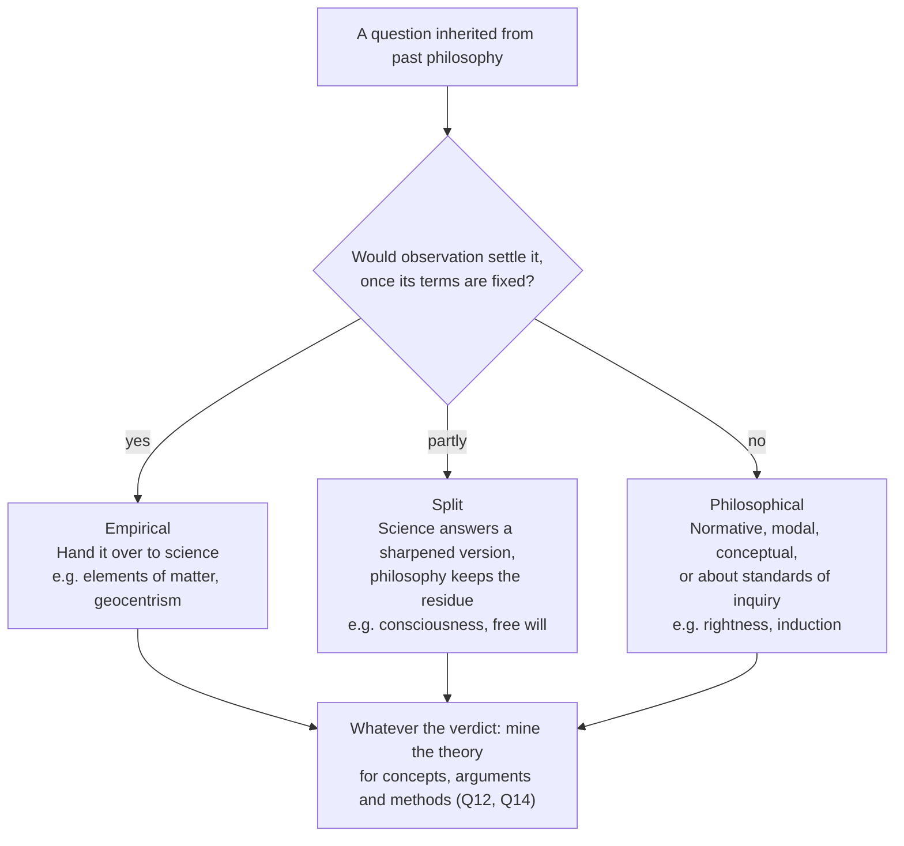
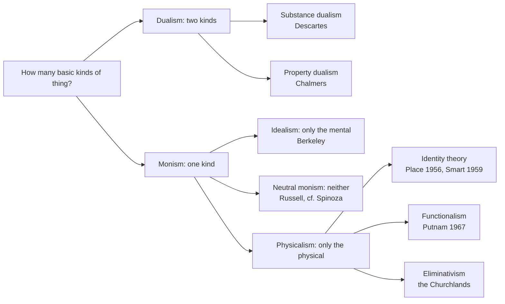
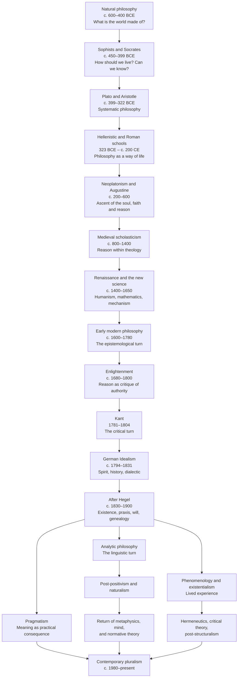

## What Is of True Value in the History of Philosophy

### What is the history of philosophy, and why does philosophy need it?

**Q1: What kind of inquiry is the history of philosophy: a branch of history, a branch of philosophy, or both?**

**A:** It is both, and its central methodological problem is how to combine two tasks that pull in different directions. **Historical reconstruction** asks what a text meant in its own setting; **rational reconstruction** asks whether its arguments work by our best current standards.

* **Two failure modes.** Collapse toward history alone and you get *antiquarianism*: accurate, but philosophically inert. Collapse toward rational reconstruction alone and you get *anachronism*: the past becomes a mirror for present opinions, or a gallery of early mistakes. Herbert Butterfield called the latter "Whig history" (1931): judging the past by how far it led to the present.
* **History of ideas versus history of philosophy.** Bernard Williams (preface to *Descartes: The Project of Pure Enquiry*, 1978) distinguished the history of ideas, which is history first and asks what a text meant, from the history of philosophy, which is philosophy first and asks what is true or coherent in it.
* **Rorty's four genres.** Richard Rorty ("The Historiography of Philosophy: Four Genres", 1984) distinguishes:
  * *rational reconstruction*, e.g. Strawson's *The Bounds of Sense* (1966) on Kant (risk: forcing old texts into current debates);
  * *historical reconstruction*, e.g. Skinner on Hobbes (risk: no verdict on truth);
  * *Geistesgeschichte*, which asks how philosophy's central questions came to be central, e.g. Hegel's *Lectures on the History of Philosophy* or MacIntyre's *After Virtue* (risk: a grand narrative that selects its evidence);
  * *doxography*, a catalogue of what each thinker held on fixed topics (risk: imposing headings the thinkers did not share), which Rorty treated as the degenerate genre.
* **Rorty's central claim.** Do rational and historical reconstruction both, but separately ([Rorty 1984](https://www.cambridge.org/core/books/truth-and-progress/historiography-of-philosophy-four-genres/2C0E4EF1D47F85F76D80B12EF32A3217)).
* **The current balance.** Christia Mercer argued in 2019 that contextualism had quietly replaced rational reconstruction among English-speaking historians of early modern philosophy; the claim is contested, which shows the debate is live ([Mercer 2019, via Daily Nous](https://dailynous.com/?p=25191)).

**Key terms used throughout:**

* ***Problemgeschichte*:** history organised by problems assumed to persist across epochs (Windelband, Nicolai Hartmann); see Q5.
* ***Begriffsgeschichte*:** history of how concepts change meaning and function (Joachim Ritter, Reinhart Koselleck); see Q4.
* ***Wirkungsgeschichte*:** reception history, how earlier readings shape how we read now (Gadamer); see Q6 and Q7.
* **Principle of charity:** interpret so the author comes out as rational as the text allows (N. L. Wilson, Quine, Davidson); see Q7.

**Q2: Does philosophy progress, and what follows for the relation between philosophy and its past?**

**A:** Philosophy progresses, but rarely by converging on answers. That is why its past remains part of the present debate in a way the past of physics does not.

* **Little convergence.** David Chalmers argues that there has been little collective convergence on philosophy's big questions, by comparison with the sciences ([Chalmers 2015](https://stafforini.com/works/chalmers-2015-why-isn-there/)).
* **Questions that leave.** Bertrand Russell (*The Problems of Philosophy*, 1912) observed that once definite knowledge of a subject becomes possible, the subject becomes a separate science, as natural philosophy became physics. Philosophy therefore looks unproductive partly by construction (see Q5).
* **Other forms of progress:**
  * *negative progress*, Chalmers's term: refuting views, as Gettier refuted knowledge as justified true belief;
  * *mapping logical space*: clarifying what the options are and what each costs;
  * *refining concepts and methods*: better distinctions and tools, such as modern logic;
  * *preserving partial truths*: Hegel's view that a refuted system is demoted to a partial moment rather than discarded (see Q12);
  * *tradition-relative superiority*: MacIntyre's account of a tradition proving itself by explaining why its rival failed (see Q15).
* **"Paradigm shifts" in philosophy.** Kuhn's term (1962) applies only loosely. Philosophy rarely has a single ruling paradigm; shifts change the questions asked, the methods used and the assumptions held, but older approaches usually survive beside newer ones.
* **Consequence.** Where questions have not converged, past positions remain live options rather than superseded stages. Wilfrid Sellars put it, adapting Kant, that philosophy without its history is, if not blind, at least dumb.

**Q3: Why should philosophers study the history of philosophy, and what can they gain from it?**

**A:** The history of philosophy should be understood not merely as a chronology of thinkers and schools, but as an **intellectual laboratory, a repository of conceptual tools, and an evolving network of philosophical problems and arguments**. Its value lies not simply in preserving past conclusions, but in revealing how philosophical questions arise, how theories are constructed, and how ideas develop through criticism and reinterpretation. Concretely, it offers six gains:

1. **The origins of our problems.** Knowing how a problem arose shows which of its assumptions are optional: Descartes' mind–body problem presupposes that matter is mere extension (see Q5).
2. **The genealogy of our concepts.** Concepts carry their history. Elizabeth Anscombe argued (1958) that the modern moral "ought" was a survival of a divine-law framework that had otherwise been abandoned.
3. **Alternatives to present assumptions.** Past frameworks show that current assumptions are not the only ones available; Bernard Williams ("Philosophy as a Humanistic Discipline", 2000) argued that philosophy needs history to see its own concepts as contingent.
4. **A laboratory of arguments.** Historical arguments, together with the objections they met, are tested cases of reasoning.
5. **Protection against reinvention.** Many "new" ideas have precedents (see Q15).
6. **Self-understanding.** Knowing where one's own approach comes from is a condition of using it critically (see Q15).

**The ultimate goal is to develop a coherent intellectual framework:** for each philosopher or philosophical tradition, identify the central problems, reconstruct the theoretical system and its arguments, situate them within historical debates, evaluate their strengths and limitations, and determine their lasting contributions to philosophical inquiry. Parts II to V take these tasks in order: identifying problems and other units (Part II), reconstructing and situating them (Part III), evaluating them (Part IV), and building on them (Part V).

### What does the history of philosophy study?

**Q4: What are the basic units of philosophical thought, and how are they related?**

**A:** Five units, at different levels of generality: **problems, concepts, arguments, methods and frameworks**. Each has its own history, and each can outlive the particular conclusions it first served (see Q12).

* **Their relations:**
  * a **framework** decides which problems look urgent and which are invisible;
  * a **problem** is formulated with **concepts**;
  * an **argument** connects concepts to answer a problem;
  * a **method** is a reusable way of producing and testing arguments;
  * texts, in their contexts, are the medium in which all five appear.
* **Their histories:** problem history (*Problemgeschichte*, Q5), concept history (*Begriffsgeschichte*), the history of arguments and methods (reconstruction, Q8), and contextual and reception history for frameworks and canons (Q6, Q7).

**Enduring problems:**

* **Being:** what exists, and what is it to exist? (Parmenides; Aristotle's "being as being")
* **Change and persistence:** how can a thing change and remain itself? (Heraclitus; the Ship of Theseus in Plutarch)
* **Universals:** are there properties shared by many things, and where are they? (Plato, Aristotle, Ockham's nominalism)
* **Knowledge:** what is knowledge, as opposed to true opinion? (Plato's *Theaetetus* and *Meno*)
* **Justification:** does every belief need a reason, and where does the chain end? (the Agrippan trilemma, preserved by Sextus Empiricus)
* **Mind:** how is thinking related to the body? (Aristotle's *De Anima*, Descartes)
* **Language:** how do words hook onto things? (Plato's *Cratylus*, Frege)
* **Ethics:** how should one live, and what makes actions right? (Socrates onward)
* **Politics:** what makes authority legitimate? (Plato, Hobbes, Locke, Rousseau)
* **Freedom:** is free action compatible with causal determination? (the Stoics, Augustine, Hobbes, Kant)

**Concepts and their afterlives** (where formed → how they live on):

* **Form and matter** (Aristotle) → structure-based metaphysics; theories of organisation.
* **Potentiality and actuality** (Aristotle) → dispositions and powers; modal metaphysics.
* **Substance and accident** (Aristotle; reworked by Descartes and Spinoza) → objects and properties; bundle theories.
* **Essence and existence** (Avicenna, Aquinas) → modal essentialism (Kripke; Kit Fine, 1994).
* **Truths of reason vs truths of fact** (Leibniz; Hume's "relations of ideas" vs "matters of fact") → Kant's analytic/synthetic; Quine's attack (1951); Kripke's necessary a posteriori.
* **Primary and secondary qualities** (Galileo, Locke) → Sellars's "scientific" vs "manifest" image.
* **Intentionality** (the Scholastics; revived by Brentano, 1874) → philosophy of mind; cognitive science.
* **Sense and reference** (Frege, 1892) → semantics; intension vs extension in logic and computing.
* **Autonomy** (Kant) → informed consent; political liberalism.
* **Social contract** (Hobbes, Locke, Rousseau) → Rawls (1971); game-theoretic accounts of cooperation.

**Argument forms:**

* **Reductio ad absurdum:** assume the opposite and derive a contradiction (Zeno against plurality and motion; now standard in logic and mathematics).
* **Regress argument:** show that a demand for grounds can never be met (Agrippa; Aristotle on demonstration → foundationalism vs coherentism vs infinitism).
* **Counterexample to an analysis:** find a case that fits the definition but not the concept (Socrates on piety and courage → Gettier, 1963).
* **Thought experiment:** imagine a case to test a principle (Gyges' ring in *Republic* II; Descartes' wax → Jackson's Mary, 1982).
* **Parity argument:** show the opponent's reasoning proves too much (Gaunilo's island against Anselm → "companions in guilt" arguments in metaethics).
* **Transcendental argument:** X is a condition of experience, so X holds (Kant → Strawson; debates since Stroud, 1968).

**Methods:**

* ***Elenchus* (Socrates):** test a proposed definition against the speaker's other beliefs.
* **Dialectic of puzzles (Aristotle):** set out reputable opinions and puzzles, then save as many as possible.
* ***Quaestio* or disputation (medieval schools; Aquinas):** objections, counter-authority, answer, replies to each objection. Its structure, strongest objections first and each answered, remains the best template for a disciplined philosophical essay.
* **Methodical doubt (Descartes):** suspend whatever can be doubted to find what cannot.
* **Genetic analysis of ideas (Locke, Hume):** trace each idea to its origin in experience.
* **Transcendental method (Kant):** ask what must be true for experience to be possible.
* **Dialectic (Hegel):** develop a concept until its one-sidedness forces a richer one.
* **Genealogy (Nietzsche, 1887; Foucault):** show how a value or practice came to be, to loosen its claim to necessity.
* **Phenomenological reduction (Husserl, 1913):** bracket existence claims to describe the structures of experience.
* **Logical analysis (Frege; Russell's "On Denoting", 1905):** reveal logical form beneath grammatical form.
* **Reflective equilibrium (Goodman, 1955; Rawls, 1971):** adjust principles and case judgements against each other until they cohere.

**Frameworks** (each decides which questions look natural and which look invisible):

* **Platonic:** an intelligible order behind appearances.
* **Aristotelian:** nature as teleological and knowable through its forms.
* **Mechanical philosophy (17th century):** matter in motion, no final causes.
* **Kantian critical philosophy:** the conditions of possible experience.
* **Hegelian historicism:** reason developing through history.
* **Positivism:** only empirical and logical knowledge counts.
* **Pragmatism:** meaning and truth tied to practice.
* **Phenomenology:** start from lived experience.
* **Naturalism:** philosophy continuous with science, as in Quine.

**Q5: Do philosophical problems persist across history, and how do they change or leave philosophy?**

**A:** Some continuity is real, but "the same problem" is a hypothesis to be earned, not assumed. Problems persist, transform, split, or pass to the sciences, and what decides their fate is what would settle them.

* **Against perennial problems.** R. G. Collingwood (*An Autobiography*, 1939) argued that Plato's *Republic* and Hobbes's *Leviathan* are not rival answers to one question about "the state", because the Greek polis and the modern state are different objects. Quentin Skinner (1969) called the error of crediting authors with views on topics they could not have addressed the "mythology of doctrines" (his other two mythologies are in Q7).
* **A test of continuity.** Can you state the problem without concepts the earlier thinker lacked? If yes, the continuity is real; if not, you have a family of related problems, and the differences are instructive.
* **Example.** Descartes' mind–body problem presupposes that matter is mere extension. For Aristotle the soul is the form of a living body, so the Cartesian interaction problem cannot arise; that difference is exactly why contemporary hylomorphists find him useful.

**How a problem can leave philosophy:**

1. **Answered:** observation settles it, as with whether the earth is at the centre of the cosmos.
2. **Dissolved:** a presupposition turns out false, so the question lapses, as debates over a "vital force" animating living matter ended once molecular biology showed none was needed.
3. **Transformed:** a vague question is made precise and the precise version is answered. Hilbert asked for a mechanical procedure to decide all mathematical statements (the *Entscheidungsproblem*); Church and Turing (1936) answered no, but only after defining "mechanical procedure" formally. Whether that definition captures the intuitive notion, the Church–Turing thesis, is not a theorem but a conceptual claim.
4. **Split:** science answers a sharpened version and leaves a philosophical residue, as with consciousness and free will.

**The deciding question is what would settle it.** If observation would settle it once its terms are fixed, it belongs to science; if it is normative, modal, conceptual, or about the standards of inquiry itself, it stays philosophical.

**Five tests for a philosophical residue**, when a question looks "answered by science":

1. Does it ask what *ought* to be, not what is? Then data alone will not close it.
2. Does it ask what *must* or *could* be (necessity, possibility, essence)? Observation reports only what is actual.
3. Is the dispute really about what a term should mean? Then more data will not resolve it.
4. Is it about the standards of inquiry themselves (what counts as evidence, explanation or knowledge)? Science cannot settle these without assuming some answer, though Quine's naturalised epistemology (1969) argues the circle is acceptable.
5. Did the science answer *the original* question, or a sharpened neighbour of it?

**Examples by status:**

* **Overtaken:** the basic elements of matter (Thales; Empedocles' four elements), though what "fundamental" means stays in the metaphysics of science; whether the earth is at the centre (Aristotle; Ptolemy).
* **Mostly overtaken:** whether there can be a vacuum (Aristotle denied it; Torricelli, 1643).
* **Overtaken in physical form:** whether physical space is Euclidean (Kant held it was, a priori; general relativity showed otherwise). The status of geometry as a priori was transformed, not settled.
* **Partly overtaken:** Molyneux's question to Locke (1688): would someone born blind and newly sighted recognise by sight a cube known by touch? Held et al. (2011) found newly sighted patients failed to match seen with felt shapes at first but learned within days; critics argue they may not yet have seen 3D shape well enough for the test to bear on the question ([Schwenkler 2012](https://pmc.ncbi.nlm.nih.gov/articles/PMC3485845)).
* **Mostly dissolved:** what life is (Aristotle's soul as form of a living body; vitalism), though defining life remains conceptual, for instance in astrobiology.
* **Split:** how consciousness relates to the brain (Descartes; Leibniz's mill, *Monadology* §17): neuroscience finds neural correlates, but why physical processes are accompanied by experience stays open. Whether there is free will (the Stoics to Kant): experiments address how decisions arise, but whether freedom is compatible with causation is conceptual.
* **Open:** what makes actions right, since facts inform moral judgement but cannot settle it alone (Hume's is–ought gap); whether induction is justified (Hume), which Bayesian tools reframe without dissolving; whether numbers exist (Plato).

**Q6: How are periods, schools and canons constructed, and how far should we rely on them?**

**A:** Periods, school labels and canons are historiographical constructions. They are indispensable for orientation, but they are hypotheses to be tested against the texts, not facts about the past.

* **Periods.** Labels such as "medieval", "Renaissance" and "early modern" were imposed later and carry evaluations: "Middle Ages" originally meant a gap between antiquity and its revival. Use them as rough coordinates; their boundaries overlap.
* **Schools.** The scheme of "Continental Rationalists versus British Empiricists" is largely a later textbook construction (Louis Loeb, *From Descartes to Hume*, 1981). The period's real debates crossed it: Leibniz's *New Essays on Human Understanding* answered Locke's *Essay* chapter by chapter.
* **Chronology and problem chains.** Organising history through interconnected chains of problems reveals logical continuities, conceptual transformations and enduring disagreements; chronology supplies the context those chains need. Neither alone suffices (see Q9).
* **Canons and reception.** Hans-Georg Gadamer (*Truth and Method*, 1960) argued that every reading stands inside a history of earlier readings (*Wirkungsgeschichte*). The canon is formed by what was translated, taught and anthologised: many late-20th-century analytic philosophers met Kant through Strawson's reading, and Aristotle reached the Latin West partly through Arabic commentators such as Avicenna and Averroes.
* **Neglected figures.** Recent scholarship has restored thinkers such as Elisabeth of Bohemia, Anne Conway, Margaret Cavendish and Émilie du Châtelet to the debates of their period.
* **"Western".** The label marks a tradition with porous borders: Greek philosophy was developed in Arabic in the Islamic world, and Latin scholasticism depended on Islamic and Jewish thinkers.
* **A practical rule.** Treat every label as a claim: ask who introduced it, what it groups together, and what it hides.

### How do we come to understand a past philosophical position correctly?

**Q7: How should we interpret a past philosophical text?**

**A:** Interpretation fixes what a view meant before anyone asks whether it is true. It requires recovering the question the text answered, what the author was doing in writing it, and what its key terms meant at the time.

1. **Recover the question.** Collingwood's logic of question and answer: a statement's meaning depends on the question it answers.
2. **Recover the act.** Skinner: ask what the author was *doing* (refuting, defending, provoking) and against whom. Identify the debates the text responded to and the assumptions available at the time.
3. **Avoid Skinner's two further traps** ("Meaning and Understanding in the History of Ideas", 1969):
   * the *mythology of coherence*, which forces a tidy system onto texts that were exploratory, revised or inconsistent;
   * the *mythology of prolepsis*, which reads a text through the significance it acquired only later.
4. **Read charitably.** Interpret so the author comes out as rational as the text allows; a charitable reading must still be supported by the text (see Q12 on the opposite error).
5. **Treat apparent absurdity as a clue.** Thomas Kuhn (preface to *The Essential Tension*, 1977) first found Aristotle's *Physics* absurd, until he realised that Aristotle's *kinēsis* meant change of every kind, including growth and alteration, not only movement through space. His maxim, paraphrased: when an important thinker seems absurd, ask how a sensible person could have written it; then passages you thought you understood may change meaning too.
6. **Watch for false friends** in key terms:
   * *eudaimonia*: not "happiness" but flourishing, a whole life going well rather than a feeling;
   * *aretē*: not "virtue" in the narrow moral sense but excellence of any kind, including a knife's or a horse's;
   * *ousia*: not "substance" as stuff but what a thing most fundamentally is;
   * *epistēmē*, *scientia*: not "science" in the modern sense but demonstrative knowledge from first principles;
   * *kinēsis*: not "motion" but any change: growth, alteration, locomotion;
   * *idea*: for Plato a mind-independent Form, for Locke any immediate object of thought;
   * *logos*: account, ratio, argument or rational principle, depending on context.
7. **Read the opponents and correspondents.** Descartes' *Objections and Replies* (1641), the Leibniz–Clarke correspondence (1715–16) and Elisabeth of Bohemia's letters to Descartes (1643) show what contemporaries found weak.
8. **Know the science of the period.** Locke worked with Boyle's corpuscular chemistry; Hume subtitled his *Treatise* as an attempt to bring the experimental method of reasoning into moral subjects; Kant took Newton's physics as the model of secure knowledge.
9. **Know your own horizon.** Gadamer argued that understanding always starts from inherited pre-judgements (*Vorurteile*). They cannot be eliminated, but they can be made explicit, and reception history (Q6) explains why some readings now look "obvious".

**Q8: How should we reconstruct a philosophical argument?**

**A:** Reconstruction makes an argument's structure explicit so that it can be assessed. It is the bridge between interpretation (Q7) and evaluation (Q11).

* **Standard form.** Write numbered premises, then the conclusion, and check whether it is valid.
* **Minimal missing premises.** If it is not valid, add the smallest premise that makes it so, preferring the version the author would most plausibly accept; charity constrains both validity and plausibility.
* **Equivocation.** Watch for a key word shifting meaning between premises. J. S. Mill's proof of utility (*Utilitarianism*, ch. 4) is the textbook case: critics since G. E. Moore have argued it slides from "desirable" as *able to be desired* to "desirable" as *worth desiring*.
* **Dialectical setting.** Record whom the argument is aimed at; a premise that is question-begging against one opponent may be common ground with another.
* **Formalisation, with its costs.** Formal reconstruction exposes structure, but it fixes one interpretation and can import assumptions. Alvin Plantinga's modal ontological argument (1974), for instance, depends on the modal system S5, in which whatever is possibly necessary is necessary.

**A worked example:** Descartes' argument for the real distinction of mind and body (*Meditation* VI). Q11 continues it with an assessment.

1. I can clearly and distinctly conceive my mind existing without my body.
2. Whatever I can clearly and distinctly conceive, God can bring about just as I conceive it.
3. If God can make A exist without B, then A and B are really distinct.
4. Therefore, mind and body are really distinct.

**Q9: How should we organise what we learn so that it yields understanding rather than memorisation?**

**A:** Organise knowledge around questions and arguments, not names. For each problem, build a map of the possible positions, the arguments that move people between them, and the concepts that define the space; then place each philosopher on that map, and use chronology to supply context.

* **The unit of understanding is the argument.** "Descartes was a dualist" is doxography. Understanding means knowing *why* he held it (the conceivability argument, and the argument that body is divisible while mind is not), *what it cost* (Elisabeth's question of how an unextended mind can move an extended body), and *what the alternatives were* (Hobbes's materialism in the Third Objections; Spinoza's single substance).
* **Understanding is contrastive.** For every thesis, ask "as opposed to what?" and "who denied it, and why?"
* **Map the logical space** before attaching names. In the mind–body problem, positions answer how many basic kinds of thing there are (one or two) and which (mental, physical, or neither):

**Each position with its signature argument and objection:**

* **Substance dualism (Descartes).** For: mind can be clearly conceived without body. Against: how do two utterly different substances interact?
* **Property dualism (Chalmers).** For: physically identical "zombies" without experience are conceivable. Against: mental properties seem to make no causal difference.
* **Identity theory (Place 1956, Smart 1959).** For: simplicity; mental states are brain states. Against: the same mental state could be realised in different physical systems (Putnam 1967).
* **Functionalism (Putnam).** For: mental states are defined by causal role, so many materials can realise them. Against: functional duplicates might differ in felt experience (inverted spectrum; Block's "China brain", 1978).
* **Eliminativism (the Churchlands).** For: everyday psychology is a failing theory, like alchemy. Against: denying beliefs seems to undercut the act of asserting it.
* **Idealism (Berkeley).** For: we never encounter anything but perceptions. Against: it makes the regularity of nature hard to explain without God.
* **Neutral monism (Russell 1921).** For: one underlying stuff appears as mental or physical depending on organisation. Against: the neutral stuff is hard to characterise without collapsing into one side.

Once the space is mapped, history becomes legible: which positions were invented when, which were unavailable to earlier thinkers, and which arguments moved the field.

**A reconstruction sheet** for every substantial text, which turns reading into notes you can compare across centuries:

1. **Question:** what problem is the author addressing, in their own formulation?
2. **Thesis:** one sentence.
3. **Argument:** numbered premises to the conclusion, implicit premises marked.
4. **Key concepts:** defined in the author's terms, false friends flagged.
5. **Opponents:** whom the text is written against.
6. **Strongest objection,** then the author's best reply.
7. **Legacy:** who took it up, transformed it, or refuted it.

**Reading practices:**

* **Primary text first, with one reliable guide;** then secondary literature that disagrees with that guide.
* **Read slowly and short.** A few pages read deeply teach more than a survey: Plato's *Meno*, Descartes' *Meditations*, Hume's *Enquiry* sections 4–7, Kant's *Prolegomena*, Frege's "On Sense and Reference".
* **Use problem-organised references as maps,** such as the *Stanford Encyclopedia of Philosophy*, alongside chronological reading.
* **Compare across epochs on purpose:** Plato's *Theaetetus* and Gettier on knowledge; Hobbes and Rawls on legitimacy; Augustine and Frankfurt on freedom of the will.

### How should past philosophy be judged?

**Q10: By what standards should past philosophy be judged?**

**A:** By five independent standards, each answered by a different question and different evidence. A view can score high on one and low on another, so judge each separately before forming an overall view.

1. **Historical significance.** How different would later thought, science or institutions be without it? Evidence: reception, influence, and what later thinkers took from it or reacted against.
2. **Rationality in context.** Given the evidence, concepts and instruments of its time, was it well supported? Evidence: the state of knowledge and debate at the time (Q7).
3. **Correctness now (theoretical value).** By current science, logic and philosophical argument, does it hold, and would a competent philosopher today defend a version of it? Evidence: current debate and how it fares against the best objections (Q11).
4. **Methodological value.** Can its way of asking or arguing be used on problems its author never considered? Evidence: whether the procedure transfers and still produces results.
5. **Heuristic value (fruitfulness).** Did it generate productive inquiry, even if wrong? Imre Lakatos called such a line of inquiry a "progressive research programme".

**Rationality in context and correctness now come apart in every combination:**

* **Well supported then, largely correct now:** Aristotle placing dolphins apart from fish, because they breathe air and bear live young.
* **Poorly supported then, largely correct now:** Aristarchus's heliocentrism (3rd century BCE); stellar parallax, the decisive evidence, was not observed until Bessel in 1838.
* **Well supported then, incorrect now:** Ptolemaic astronomy, the best predictive model for some 1,400 years; Kant's Euclidean space.
* **Poorly supported then, incorrect now:** Thales' claim that everything is water.

Two lessons follow. A view can be fully rational and false, so falsity alone is no charge against the thinker. And a view can be true but held for poor reasons, so later vindication does not make the earlier thinker right in the same sense: modern atoms are not Democritus's indivisible atoms.

**Where the standards diverge for whole systems** (illustrative judgements, to be argued with, not settled facts):

* **Aristotle's physics.** Significance very high; correctness low as physics; method medium. It dominated natural philosophy for two millennia, and its survey of predecessors' views and puzzles is still a model.
* **Descartes' *Meditations*.** Significance very high; correctness low for substance dualism but high for the sceptical problem; method high. Methodical doubt and the first-person starting point remain tools.
* **Spinoza's *Ethics*.** Significance medium–high; correctness medium; method mixed. His monism and theory of the emotions are revived; the geometric method set an ideal of rigour, but the definitions did most of the work.
* **Hegel's *Phenomenology*.** Significance very high; correctness and method contested. It shaped Marx, existentialism and critical theory; Brandom and McDowell revived it, others still dismiss it.
* **Logical positivism.** Significance high in the 20th century; correctness low; method high. The verification principle failed, partly by its own standard, while its demand for clarity and formal analysis of science endured.
* **Socrates' *elenchus*.** Significance high; correctness medium; method very high. His intellectualism about weakness of will is still debated, and refutation by counterexample is standard practice.
* **Hume's *Enquiry*.** High on all counts, a rare case where the standards align.

**Four mistakes to avoid:**

1. **Inferring truth from influence.** Aristotle's physics shaped natural philosophy for two millennia and is false as physics.
2. **Inferring no method from false conclusions.** Logical positivism's main thesis failed while its methods reshaped philosophy of science.
3. **Treating methods as neutral.** Cartesian doubt presupposes that a solitary first-person standpoint is the right place to start; Husserl's phenomenological reduction presupposes that essences can be grasped by reflection.
4. **Judging before interpreting.** Applying standard 3 before standards 1 and 2 have been settled by interpretation (Q7) is the root of anachronism.

**Using later knowledge as a standard:**

* **Science tests empirical premises, not conceptual claims.** Benjamin Libet's experiments (1983) on the timing of decisions bear on what happens in the brain; whether that threatens free will depends on a conceptual question about what freedom requires (Alfred Mele, *Free*, 2014).
* **"Modern logic" is plural.** Classical first-order logic is one standard among several; reading Hegel's talk of contradiction through paraconsistent logic (Graham Priest) gives a different verdict than reading it through classical logic.
* **The same humility applies to us.** Larry Laudan's "pessimistic meta-induction" (1981) notes that many successful past theories were later rejected, so "outdated" is always relative to a present that will itself be outdated.

**Q11: How should we assess whether an argument succeeds?**

**A:** Once an argument is reconstructed (Q8), assess its logical form, the truth of its premises, and its dialectical force. Philosophical arguments are rarely refuted outright, so assessment often ends in a comparison of costs rather than a verdict.

* **Validity:** does the conclusion follow?
* **Counterexample:** find a case where a premise is false.
* **Parity ("proves too much"):** build a parallel argument with an absurd conclusion, as Gaunilo's "perfect island" parodied Anselm's ontological argument.
* **Dialectical status:** does a premise assume what is in dispute (begging the question)?
* **The crux:** which single premise does the opponent most need to reject? Focus there.
* **Costs:** David Lewis held that philosophical theories are rarely refuted; instead each has a price, and we compare prices.

**The worked example continued** (Descartes' real distinction, Q8). The argument is valid, so assessment targets the premises. Antoine Arnauld (Fourth Objections) attacked premise 1: one can conceive a right-angled triangle without conceiving that it satisfies Pythagoras' theorem, yet the two cannot come apart, so Descartes' conception of mind may simply be incomplete. Premise 2, with God removed, became the modern debate over whether conceivability implies possibility (Kripke; Chalmers).

**Q12: What survives when a system's conclusions are superseded, and how can we avoid dismissing it wholesale?**

**A:** Separate a conclusion from the question it answered, the inference that produced it and the concepts it used; each can be judged on its own. Then treat the system as a structure of claims that support one another, find what the outdated conclusion actually supports and depends on, and keep what does not depend on it.

**What usually survives:**

1. **The problem.** Zeno's paradoxes of motion are standardly answered with the calculus of limits and Cantor's theory of the continuum, yet the questions they opened, such as whether infinitely many tasks can be completed in finite time, remain live (James Thomson, "Tasks and Super-Tasks", 1954).
2. **The argument form.** Descartes' vortex physics and pineal-gland account of interaction are gone, but his dream and evil-demon arguments survive as sceptical scenarios, rebuilt as Putnam's "brain in a vat" (1981).
3. **The concepts.** Aristotle's physics was replaced, but his distinction between efficient and final (functional) explanation still structures how biology talks about functions. Leibniz's theodicy is rarely held, but his "possible worlds" became the semantics of modal logic (Kripke, 1959–63).
4. **The method.** Kant's transcendental argument outlived most of his specific conclusions; Socrates' refutation of definitions by counterexample still drives Gettier's 1963 paper.
5. **The instructive failure.** Kant held that Euclidean geometry is synthetic a priori knowledge of space; non-Euclidean geometries and general relativity (1915) showed physical space need not be Euclidean. The failure forced a distinction between pure geometry (mathematics) and physical geometry (empirical), and Reichenbach (1920) reworked Kant's idea into "relativized" a priori principles, later developed by Michael Friedman (*Dynamics of Reason*, 2001).
6. **Correctness within a domain.** Hegel argued, in the introduction to his *Lectures on the History of Philosophy*, that refuting a philosophy shows its principle is one-sided, not empty: the system is demoted from an account of the whole to a partial moment. Carlo Rovelli argues that Aristotle's physics is a correct approximation of Newtonian physics for motion in fluids, in the same sense that Newton's theory approximates Einstein's ([Rovelli 2015, arXiv](https://arxiv.org/abs/1312.4057)).

**A procedure against wholesale dismissal:**

1. **Map the dependencies:** which claims are premises for which, and which are load-bearing.
2. **Classify the outdated element:** an *empirical premise* (Aristotle's celestial spheres), a *conclusion* drawn from otherwise reasonable premises (Kant on Euclidean space), or a *framework assumption* (Descartes' mechanism). Each fails differently and takes different things down with it.
3. **Trace both directions:** downstream, what falls with it; upstream, whether the premises behind it still look plausible, in which case the fault lies in one specific step.
4. **Test detachability:** can the argument be restated without the outdated element and still work?
5. **Ask what problem it solved:** if the problem survives, the system's response remains a candidate solution.
6. **Distinguish internal from external criticism:** failure by the system's own standards points to a structural flaw; failure only by ours may mark new evidence.

**Detachment and its cost.** P. F. Strawson's *The Bounds of Sense* (1966) separated what he called Kant's "analytical argument" about the conditions of possible experience from transcendental idealism, which he judged incoherent; the detached argument fuelled decades of work on transcendental arguments, starting with Barry Stroud's critique (1968). Henry Allison (*Kant's Transcendental Idealism*, 1983) replied that the idealism is essential and that Strawson's extraction changes what the argument proves. Detachment is a hypothesis about the system's structure, to be checked against the text.

**Dismissals later reversed:**

* **Aristotle's ethics.** After the Scientific Revolution moral philosophy turned to rules and principles; Anscombe's "Modern Moral Philosophy" (1958) urged a return to Aristotle, and virtue ethics (Foot, MacIntyre, Hursthouse) followed.
* **Hegel.** Russell and Moore's revolt against British Idealism around 1900 made Hegel a byword for obscurity in analytic philosophy; Sellars, Brandom and McDowell (*Mind and World*, 1994) later recovered Hegelian ideas about concepts and normativity.
* **Medieval philosophy.** Histories that jumped from Aristotle to Descartes missed medieval logic and semantics, whose theories of reference are now recognised as sophisticated.

**The opposite error is apologetics:** treating every failure as a misreading, so that the system becomes immune to criticism. A charitable reading must be supported by the text and must fit passages not used to build it; if it works only by ignoring half the evidence, it is advocacy, not interpretation.

**Worked cases:**

* **Aristotle.** Superseded: natural places, celestial spheres, much of his biology. Survives: virtue and practical wisdom; form and matter; syllogistic as a valid fragment of logic.
* **Descartes.** Superseded: vortex physics; the pineal gland. Survives: methodical doubt; the problem of the external world; analytic geometry.
* **Kant.** Superseded: Euclidean geometry and Newtonian physics as a priori; logic "complete since Aristotle". Survives: the transcendental argument; constitutive vs regulative principles; autonomy, as in Rawls and Korsgaard.
* **Leibniz.** Superseded: monads; pre-established harmony. Survives: possible worlds; identity of indiscernibles; sufficient reason; the dream of a logical calculus.
* **Hume.** Superseded: details of his associationist "science of man". Survives: the problem of induction; the is–ought gap; causation as regularity, now in Bayesian epistemology, metaethics and causal inference.
* **Democritus.** Superseded: specific atom shapes explaining tastes and colours. Survives: explaining visible properties by invisible microstructure.

Kant's confidence about logic is itself a lesson. In the preface to the second edition of the *Critique of Pure Reason* (1787) he said logic had not needed to advance since Aristotle; Frege's *Begriffsschrift* (1879) refuted that within a century, while leaving Aristotle's syllogistic standing as a correct, limited fragment.

## How does the study of past philosophy feed new philosophical work?

**Q13: How can we extend past arguments, and how can the necessary skills be trained?**

**A:** Extension asks what an argument's structure can do beyond its original use. It builds on reconstruction (Q8) and assessment (Q11), and like them it is trained by regular, specific exercises.

**Ways to extend an argument:**

* **Abstract the schema.** The regress argument applies to justification, explanation, reasons for action and metaphysical grounding alike.
* **Transfer it.** Apply the structure to a domain its author never considered.
* **Vary one premise.** Drop Kant's assumption that a priori principles are fixed, and you get Reichenbach's relativized a priori.
* **Cross it with a modern tool.** John Earman's *Hume's Abject Failure* (2000) re-examined Hume's argument about miracles with probability theory.

**A practice regimen:**

1. **Weekly:** reconstruct one short classic passage (three pages at most) in standard form.
2. **Weekly:** write the strongest objection to it and the author's best reply.
3. **Monthly:** write a 1,500-word critical note on one classic paper.
4. **Study model papers** (below) for how they set up a debate in a page or two.
5. **Argue with someone:** a reading group, a tutor, or Claude asked to defend the position you are attacking.
6. **Learn formal logic:** propositional and first-order logic, basic modal logic, and elementary probability for Bayesian epistemology. P. D. Magnus's free textbook *forall x* is a good start.

**Model papers, and the move each teaches:**

* **Gettier, "Is Justified True Belief Knowledge?" (1963):** refute an analysis with two counterexamples, in three pages.
* **Frankfurt, "Alternate Possibilities and Moral Responsibility" (1969):** refute a principle with a constructed case.
* **Thomson, "A Defense of Abortion" (1971):** grant the opponent's premise and still block the conclusion.
* **Nagel, "What Is It Like to Be a Bat?" (1974):** isolate what a theory leaves out.
* **Jackson, "Epiphenomenal Qualia" (1982):** build a knowledge argument on a thought experiment.
* **Quine, "Two Dogmas of Empiricism" (1951):** attack a distinction everyone presupposed.

**A reading sequence of primary texts:**

* **Ancient:** Plato's *Meno*, *Republic* and *Theaetetus*; Aristotle's *Physics* II, *De Anima* and *Nicomachean Ethics*.
* **Hellenistic and late antique:** Epictetus, Sextus Empiricus, Augustine.
* **Medieval:** Anselm, Aquinas, Ockham.
* **Early modern:** Descartes' *Meditations* with the *Objections and Replies*; then Hobbes, Spinoza, Locke, Leibniz, Berkeley, Hume.
* **Kant and the 19th century:** Kant's *Prolegomena* and *Critique of Pure Reason*; Hegel, Mill, Kierkegaard, Marx, Nietzsche.
* **20th century:** Frege, Russell, Husserl, Wittgenstein, Heidegger, Quine, Beauvoir, Rawls.
* **Guides:** read each with one guide, such as Anthony Kenny's *A New History of Western Philosophy* (2004–07), Peter Adamson's *History of Philosophy without any gaps*, or the *Stanford Encyclopedia of Philosophy*.

**Q14: How can philosophical concepts, methods and frameworks be applied beyond philosophy?**

**A:** In four ways, and knowing which one you are using keeps the application honest.

1. **Conceptual clarification** sharpens a term already in use: "cause" in epidemiology and machine learning, from Hume's regularities and Lewis's counterfactuals to Pearl's structural causal models.
2. **Foundational analysis** exposes what a method presupposes: interpretations of probability (Ramsey 1926, de Finetti 1937) behind Bayesian versus frequentist statistics.
3. **Normative evaluation** sets standards for right practice: the Belmont Report (1979) on research ethics, built on respect for persons, beneficence and justice.
4. **Formalisation** turns a vague question into a precise one: Hilbert's decision problem answered by Church and Turing (1936); Tarski's definition of truth (1933) founding model theory.

**By field:**

* **Science.** Philosophy of science supplies the questions scientists face whenever they argue about method: what separates science from pseudoscience (Popper, 1934); whether a hypothesis can be tested in isolation or only with auxiliary assumptions (Duhem, 1906; Quine); how theories change and whether successive theories are comparable (Kuhn, 1962); whether to believe in unobservable entities (the realism debate). These shape experimental design, the reading of evidence, and judgements of robustness.
* **Mathematics.** Logicism (Frege, Russell) tried to reduce mathematics to logic; formalism (Hilbert) treated it as rule-governed symbol manipulation; intuitionism (Brouwer) accepted only constructive proofs; Gödel's incompleteness theorems (1931) set limits on Hilbert's programme. Intuitionistic logic later met computation in the Curry–Howard correspondence, where proofs are programs and propositions are types; Martin-Löf's type theory and proof assistants such as Coq (now Rocq), Agda and Lean descend from this line. Whether numbers exist (Gödel's Platonism against Hartry Field's nominalism, 1980) remains open.
* **Computing and AI.** A line runs from Leibniz's dream of a reasoning calculus through Boole (1854) and Frege (1879) to Turing (1936). Knowledge representation borrowed from philosophical ontology: Aristotle's categories and Porphyry's tree of genus and species prefigure class hierarchies. Turing (1950) reframed "Can machines think?" as a testable question; Searle's Chinese Room (1980) argued that symbol manipulation is not understanding; the frame problem (McCarthy and Hayes, 1969) began in AI and became a philosophical problem about relevance. In algorithmic fairness, Kleinberg and colleagues (2016) and Chouldechova (2017) proved that several intuitive fairness criteria cannot all be met at once, except in special cases such as equal base rates or perfect prediction, which forces a normative choice no algorithm can make.
* **Literature.** Plato's critique of imitation (*Republic* X) and Aristotle's *Poetics* (plot, *mimesis*, *catharsis*) founded the theory of fiction. Hermeneutics, from Schleiermacher and Dilthey to Gadamer and Ricoeur, is a general theory of interpretation that literary study still uses. Analytic aesthetics asks what makes a statement true "in" a fiction (David Lewis, 1978) and treats fiction as rule-governed make-believe (Kendall Walton, 1990). Narrative identity links ethics and literature (MacIntyre, *After Virtue*, 1981; Ricoeur, *Oneself as Another*, 1990), and Martha Nussbaum's *Love's Knowledge* (1990) argues that some moral knowledge is available only in literary form.
* **Practical problems.** Law: legal positivism versus natural law (H. L. A. Hart, *The Concept of Law*, 1961), and theories of intention behind the mental element of crime. Medicine: Beauchamp and Childress (1979) organised clinical ethics around autonomy, beneficence, non-maleficence and justice. Public policy: cost–benefit analysis inherits utilitarian assumptions, and Rawls's difference principle offers a rival standard. Personal life: Stoic and Aristotelian ethics were designed as practical guides to living, and are read that way again.

**Historical resources with a second life:**

* **Stoic theory of emotions as judgements** → cognitive behavioural therapy; Albert Ellis and Aaron Beck both credited Epictetus.
* **Aristotle's practical wisdom (*phronēsis*)** → accounts of clinical and professional judgement.
* **Hobbes's state of nature** → game-theoretic models of cooperation and the prisoner's dilemma.
* **Leibniz's possible worlds** → modal logic; David Lewis's counterfactual theory of causation (1973).
* **Hume on causation** → counterfactual and structural models of causal inference (Judea Pearl, *Causality*, 2000).
* **Kant's constitutive principles** → the relativized a priori in philosophy of science.
* **Spinoza on the affects** → affective neuroscience (Antonio Damasio, *Looking for Spinoza*, 2003).

**Three cautions:**

1. **Application requires domain knowledge.** Pronouncements made from outside a field without its details are rightly ignored by practitioners.
2. **A label is not an analysis.** Calling something "Kantian" or "Foucauldian" adds nothing unless the concept changes what you can see or do.
3. **The traffic runs both ways.** Game theory reshaped social contract theory; cognitive science reshaped philosophy of mind; experimental philosophy tests intuitions empirically, as in Joshua Knobe's 2003 finding that judgements of intentional action depend on moral evaluation.

**Q15: How should philosophers situate their own work within the history of philosophy?**

**A:** Philosophical self-positioning is not primarily about identifying with or opposing particular historical figures or schools. It is about understanding how one's philosophical problems, concepts, assumptions, and arguments relate to existing intellectual traditions and contemporary debates.

This involves four questions:

1. **Problem:** What philosophical problem am I addressing, and how has it developed historically?
2. **Theoretical Context:** What existing theories attempt to solve this problem, and what are their strengths and limitations?
3. **Argumentative Contribution:** How does my approach extend, revise, challenge, or depart from existing arguments?
4. **Intellectual Lineage:** Which historical traditions, if any, help explain the origins, structure, or significance of my approach?

The aim is not to establish a philosophical identity through association with canonical thinkers, but to develop a clear understanding of one's theoretical commitments, intellectual debts, disagreements, and potential contributions. **Historical positioning is valuable insofar as it improves philosophical understanding, argumentative rigour, and theoretical innovation.**

**Three requirements that make positioning rigorous:**

1. **State the exact question.** Following Collingwood, a statement's meaning depends on the question it answers, so begin by stating yours precisely and checking whether your predecessors were asking the same one (Q5). If they were not, say how the questions differ; that difference is often the contribution.
2. **Explain why your rivals failed.** Alasdair MacIntyre (*Whose Justice? Which Rationality?*, 1988) argued that one tradition proves its superiority over another when it can explain, in its own terms, why the rival ran into the difficulties it did, and solve problems the rival could not. Do not merely note that earlier approaches fail; diagnose the assumption that made them fail, and show your view does not share it.
3. **Declare your presuppositions.** Apply Gadamer's point (Q7) to yourself: state the framework you bring, whether naturalist, formal or phenomenological.

**Two warnings:**

* **False novelty.** Search older literature before claiming an idea is new. Gettier-style cases have precedents in Russell's stopped-clock example (*Human Knowledge*, 1948) and in the 8th-century Buddhist philosopher Dharmottara.
* **Name-dropping.** A lineage claim such as "a broadly Kantian approach" is a thesis that needs an argument, not an appeal to authority.

**A positioning worksheet**, to answer for any paper or project:

1. **Problem:** what exactly is the question, in one sentence?
2. **History of the problem:** when did it arise, and how has its formulation changed?
3. **Main rival views:** what are the two to four standard answers?
4. **Shared assumption:** what do the rivals all take for granted?
5. **Diagnosis:** why do the rivals run into the difficulties they do?
6. **Contribution type:** do I extend, revise, challenge, or reframe?
7. **Lineage:** which tradition explains where my approach comes from?
8. **Debts:** whose concepts or arguments do I use?
9. **Disagreements:** whom do I reject, and on which premise?
10. **Presuppositions:** what am I assuming that a rival tradition would not?

### Sources and Further Reading

* R. G. Collingwood, *An Autobiography* (1939), chapters on the logic of question and answer.
* Quentin Skinner, "Meaning and Understanding in the History of Ideas", *History and Theory* 8 (1969): 3–53 ([record](https://publikationen.ub.uni-frankfurt.de/frontdoor/index/index/year/2008/docId/16706)).
* Richard Rorty, J. B. Schneewind and Quentin Skinner (eds.), *Philosophy in History* (Cambridge, 1984), especially Rorty's "Four Genres" and the essays by Charles Taylor and Alasdair MacIntyre ([Rorty chapter](https://www.cambridge.org/core/books/truth-and-progress/historiography-of-philosophy-four-genres/2C0E4EF1D47F85F76D80B12EF32A3217)).
* Bernard Williams, *Descartes: The Project of Pure Enquiry* (1978), preface; and "Philosophy as a Humanistic Discipline" (2000).
* Hans-Georg Gadamer, *Truth and Method* (1960), part II.
* Tom Sorell and G. A. J. Rogers (eds.), *Analytic Philosophy and History of Philosophy* (Oxford, 2005).
* Mogens Lærke, Justin E. H. Smith and Eric Schliesser (eds.), *Philosophy and Its History: Aims and Methods in the Study of Early Modern Philosophy* (Oxford, 2013).
* Christia Mercer, "The Contextualist Revolution in Early Modern Philosophy", *Journal of the History of Philosophy* 57 (2019): 529–548 ([discussion](https://dailynous.com/?p=25191)).
* David Chalmers, "Why Isn't There More Progress in Philosophy?", *Philosophy* 90 (2015): 3–31 ([abstract and PDF](https://stafforini.com/works/chalmers-2015-why-isn-there/)).
* Carlo Rovelli, "Aristotle's Physics: A Physicist's Look", *Journal of the American Philosophical Association* 1 (2015): 23–40 ([arXiv](https://arxiv.org/abs/1312.4057)).
* John Schwenkler, "On the Matching of Seen and Felt Shape by Newly Sighted Subjects" (2012) ([PMC](https://pmc.ncbi.nlm.nih.gov/articles/PMC3485845)).

## 13 Core Intellectual Threads of Western Philosophy

Being and Reality: `Metaphysics` and `Ontology`

* **Central Questions:** What exists? What constitutes reality? What is the ontological status of change, causation, necessity, possibility, and time?
* **Intellectual Genealogy:** Parmenides (the permanence of Being) and Heraclitus (change) → Plato (Forms and sensible particulars) → Aristotle (substance, form and matter, potentiality and actuality) → Avicenna and Aquinas (essence and existence) → Descartes (substance dualism), Spinoza (substance monism), Leibniz (monadology) → Kant (the limits of metaphysical knowledge) → Hegel (the dialectical relationship between thought and being), Schopenhauer (the will) → Heidegger (the renewed question of Being) → Quine (ontological commitment), David Lewis (modal realism), Whitehead (process metaphysics).

Knowledge and Skepticism: `Epistemology`

* **Central Questions:** How is knowledge possible? What justifies belief? What roles do experience, reason, perception, and testimony play in knowledge? Can philosophical skepticism be answered?
* **Intellectual Genealogy:** Plato (knowledge and opinion) → Aristotle (demonstration and first principles) → Pyrrho and Sextus Empiricus (skepticism) → Descartes (methodical doubt and foundations) → Locke (experience) and Leibniz (rational principles) → Hume (causation and induction) → Kant (a priori conditions of objective experience) → Reid (common-sense realism) → Husserl (intentionality and evidence), alongside Carnap, Quine, and Sellars (logical reconstruction, holism, and conceptual justification) → Gettier (the analysis of knowledge) → Sosa (virtue epistemology), Williamson (knowledge-first epistemology), Fricker (epistemic injustice).

Reasoning, Language, and Meaning: `Logic` and `Philosophy of Language`

* **Central Questions:** What makes an inference valid? How do words refer to the world? Is meaning determined by reference, truth conditions, linguistic use, or social practice?
* **Intellectual Genealogy:** Aristotle (syllogistic logic) and the Stoics, especially Chrysippus (propositional inference) → Ockham and Buridan (medieval logic and theories of supposition) → Boole and De Morgan (algebraic logic), Peirce (relational logic and semiotics) → Frege (quantification, sense and reference) → Russell (logical analysis and descriptions), early Wittgenstein (picture theory) → Tarski (formal truth), Carnap (logical syntax and semantics) → later Wittgenstein (language-games and rule-following) → Austin and Grice (speech acts and pragmatics) → Quine, Davidson, Kripke, and Brandom (translation, interpretation, reference, and inferential meaning).

**A Parallel Genealogy:**

Saussure (language as a system of differences) → Jakobson (structural linguistics) → Lévi-Strauss (structural analysis of culture) → Barthes and Lacan (signification and subjectivity) → Derrida (deconstruction and différance).

Mind, Consciousness, and Selfhood: `Philosophy of Mind`

* **Central Questions:** What is the relationship between mind and body? Can consciousness be explained through physical processes? What constitutes personal identity? Can artificial systems understand or have subjective experiences?
* **Intellectual Genealogy:** Plato and Aristotle (soul and living activity) → Augustine (inwardness and selfhood) → Avicenna (self-awareness) → Descartes (mind–body dualism), challenged by Princess Elisabeth on mind–body causation → Spinoza, Leibniz, Locke, and Hume (mind, perception, and personal identity) → Brentano (intentionality) → Husserl (structures of consciousness) → Heidegger (being-in-the-world), Merleau-Ponty (embodied perception) → Turing (machine intelligence), Putnam (functionalism), Searle (the Chinese Room), Dennett (naturalistic accounts of consciousness), Chalmers (the hard problem of consciousness).

Science, Mathematics, and Explanation: `Philosophy of Science and Mathematics`

* **Central Questions:** Why does science produce knowledge? How are theories tested? What are causation and laws of nature? How do mathematical truths differ from empirical propositions?
* **Intellectual Genealogy:** Aristotle (scientific demonstration and causal explanation) → Francis Bacon (empirical investigation), Galileo (mathematical experimentation), Newton (classical mechanics) → Hume (the problem of induction) → Kant (a priori conditions of natural science) → Whewell and Mill (discovery and induction) → Peirce (abduction, deduction, and induction) → Mach and Poincaré (scientific concepts and conventions) → Frege, Hilbert, Brouwer, Gödel, Church, and Turing (foundations of mathematics and computation) → Carnap, Reichenbach, and Hempel (confirmation and scientific explanation) → Popper (falsification) → Kuhn (paradigms and scientific revolutions) → Lakatos (research programmes), Feyerabend (methodological pluralism) → Hacking (experimental realism), van Fraassen (constructive empiricism).

## Goodness, Value, and Action: `Ethics` and `Practical Reason`

* **Central Questions:** What makes actions right or wrong? What constitutes a good life? What grounds moral obligations? Should conduct be evaluated through consequences, duties, character, or relationships?
* **Intellectual Genealogy:** Socrates and Plato (virtue and the Good) → Aristotle (virtue, practical wisdom, flourishing) → Epicurus (pleasure and tranquility), the Stoics (reason and virtue) → Aquinas (natural law and virtue) → Shaftesbury, Hutcheson, and Hume (moral sentiment) → Kant (duty and autonomy), Bentham (utility) → Mill (utilitarianism), Nietzsche (genealogical critique of morality) → Moore (analysis of goodness), Anscombe (criticism of modern moral philosophy) → Philippa Foot and MacIntyre (virtue ethics), Bernard Williams (integrity and moral psychology), Scanlon (contractualism), Parfit (reasons and population ethics), Korsgaard (Kantian constructivism) → Gilligan (care ethics), Nussbaum (capabilities and human flourishing).

Rights, the State, and Justice: `Political` and `Legal Philosophy`

* **Central Questions:** What legitimizes political authority? What are liberty, equality, and justice? Why does law bind? Which institutions can justify the exercise of power?
* **Intellectual Genealogy:** Plato and Aristotle (political community and justice) → Aquinas (natural law) → Machiavelli (political power) → Grotius (natural and international law) → Hobbes (sovereignty), Locke (rights), Montesquieu (separation of powers), Rousseau (general will) → Kant (right and republicanism), Hegel (ethical life and the state), Mill (liberty) → Rawls (justice as fairness) ↔ Nozick (libertarianism) → Hart (legal positivism) ↔ Dworkin (legal interpretivism), Raz (authority) → Sen and Nussbaum (capabilities), Pettit (non-domination), Fraser and Young (structural justice).

Domination, Ideology, and Emancipation: `Social Philosophy` and `Critical Theory`

* **Central Questions:** How do societies reproduce inequality? Why do individuals accept institutions that dominate them? How do economic structures, culture, knowledge, identity, and power interact? What justifies social criticism?
* **Intellectual Genealogy:** Rousseau (inequality and social dependence) → Hegel (recognition, labor, and social institutions) → Marx (alienation, capital, class, and ideology) → Nietzsche (genealogy of values), Freud (the unconscious and repression), Weber (rationalization and bureaucracy) → Lukács (reification), Gramsci (cultural hegemony) → Horkheimer, Adorno, and Marcuse (instrumental reason and Critical Theory) → Althusser (ideology and subject formation), alongside Foucault (discipline, biopolitics, governmentality) → Habermas (communicative rationality), Honneth (recognition), Fraser (redistribution and recognition) → Bourdieu (habitus, fields, symbolic power), Crenshaw (intersectionality), Charles Mills (racial domination).

God, Faith, and Transcendence: `Philosophy of Religion`

* **Central Questions:** Does God exist? What is the relationship between faith and reason? How does evil challenge theism? Can religious experiences generate knowledge? How does religion shape ethics and politics?
* **Intellectual Genealogy:** Xenophanes (criticism of anthropomorphic gods) → Plato and Aristotle (divine principles and the first mover) → Augustine (faith, grace, and will) → Al-Farabi, Avicenna, Anselm, Aquinas, and Maimonides (divine existence, attributes, and rational argument) → Descartes and Leibniz (God and metaphysics), Spinoza (God or Nature) → Hume (criticism of natural theology), Kant (limits of speculative reason and practical faith) → Schleiermacher (religious experience), Kierkegaard (existence and faith), Feuerbach (religious projection), Nietzsche (the death of God) → William James (religious experience), Buber (dialogical relations), Levinas (alterity and ethics), Plantinga (religious epistemology).

Beauty, Art, and Sensible Experience: `Aesthetics` and `Philosophy of Art`

* **Central Questions:** What is beauty? Can aesthetic judgments claim universal validity? How does art produce meaning? Does art represent reality, or can it create new forms of understanding?
* **Intellectual Genealogy:** Plato (imitation and beauty) → Aristotle (tragedy and poetics) → Plotinus (beauty and spiritual order) → Shaftesbury (harmony and beauty) → Baumgarten (sensory cognition and the discipline of aesthetics) → Hume (standards of taste), Kant (aesthetic judgment and the sublime) → Hegel (art and Spirit), Schopenhauer (aesthetic contemplation), Nietzsche (tragedy and life-affirmation) → Heidegger (art and truth), Benjamin (technological reproduction), Adorno (critical aesthetics), Merleau-Ponty (perception and painting) → Goodman (artistic symbols), Barthes (texts and photography), Deleuze (cinema and thought).

History, Culture, and Understanding: `Philosophy of History` and `Hermeneutics`

* **Central Questions:** Does history possess laws, purposes, or direction? How can past thinkers and texts be understood? Is interpretation inevitably shaped by language, tradition, and historical situation?
* **Intellectual Genealogy:** Vico (the historical knowledge of the human world) → Herder (language, cultural diversity, historical particularity) → Kant (the possibility of historical progress), Hegel (history and freedom) → Schleiermacher (general hermeneutics) → Dilthey (understanding and the human sciences) → Weber (the interpretation of social action) → Heidegger (understanding as a mode of existence) → Gadamer (historically effected consciousness and fusion of horizons) → Ricoeur (textual interpretation, narrative, and time); parallel critical developments include Benjamin (criticism of historical progress), Foucault (archaeology and genealogy), and Said (knowledge and colonial representation).

Human Existence, Freedom, and Meaning: `Existential Philosophy`

* **Central Questions:** How should human beings confront freedom, mortality, loneliness, suffering, and uncertainty? Where does meaning originate? What constitutes an authentic life? Can individuals create values?
* **Intellectual Genealogy:** Socrates (the examined life) → Epicurus and the Stoics (death, fate, and flourishing) → Augustine (will and inwardness) → Montaigne (self-reflection and mortality), Pascal (human finitude) → Kierkegaard (subjectivity, anxiety, and faith), Nietzsche (nihilism, revaluation, self-overcoming) → Heidegger (Dasein, being-toward-death, authenticity) → Jaspers (boundary situations), Sartre (freedom and responsibility), Beauvoir (situated freedom and the freedom of others), Camus (the absurd and revolt) → Arendt (action and beginnings), Murdoch (moral attention), Parfit (personal identity and what matters).

A Contemporary Convergence: `Technology`, `Artificial Intelligence`, and `the Future`

* **Central Questions:** Is technology a neutral instrument or a force that changes how reality is understood and society is organized? Can AI understand, act, or possess consciousness? What legitimizes algorithmic decision-making? What duties apply to future generations?
* **Intellectual Genealogy:** Aristotle (*Technē*, craft and practical activity) → Francis Bacon (science and control of nature) → Marx (machinery, labor, and capitalist production) → Heidegger (enframing) → Arendt (labor, work, and action), Jonas (responsibility in technological civilization) → Foucault (discipline and governmentality), Haraway (cyborgs and situated knowledge) → Turing (machine intelligence), Putnam and Dennett (functional and cognitive explanation), Searle (syntax and understanding), Chalmers (consciousness) → Nissenbaum (contextual integrity and privacy), Floridi (information ethics and digital environments), Bostrom (superintelligence and existential risk).

## The Historical Development and Paradigm Shifts of Western Philosophy

### Overview

Western philosophy has moved through a sequence of paradigm shifts over some 2,600 years. Each one is a fundamental transformation in the **questions asked**, the **methods used**, and the **assumptions held** by philosophers. "Paradigm" is borrowed loosely from Thomas Kuhn: philosophy rarely has a single ruling paradigm, and older approaches usually survive beside newer ones. Dates are approximate and periods overlap.

After Hegel the line splits into several traditions that develop side by side; the analytic and Continental branches begin to reconverge in contemporary philosophy.

### Natural Philosophy — From Mythological Explanations to Rational Inquiry

*c. 600–400 BCE.* Early natural philosophers sought to explain the natural world through rational principles rather than mythology. However, their inquiries often lacked systematic critical reflection and remained vulnerable to dogmatism.

**Paradigm shift.** *Questions:* from stories of what the gods did to what the world is ultimately made of (*archē*, the first principle) and how it changes. *Methods:* naturalistic explanation and argument in place of myth and divine genealogy. *Assumptions:* the cosmos (*kosmos*, an ordered whole) is intelligible to human reason.

1. `Thales` broke with mythological cosmology and attempted to **explain the world in terms of natural substances and processes**.
2. `Anaximander` rejected determinate, finite substances as the ultimate principle of reality and introduced the *apeiron* (the boundless or indefinite), marking an early movement toward **metaphysical abstraction**.
3. `Anaximenes` identified air as the underlying substance and explained change through **condensation and rarefaction**, an early attempt to derive qualitative differences from a single quantitative process.
4. `Pythagoras` and the Pythagorean tradition regarded numbers and mathematical relations as fundamental to reality, introducing the idea of **formal structure** as an explanatory principle.
5. `Xenophanes` criticised the anthropomorphic gods of Homer and Hesiod and drew a **distinction between knowledge and mere opinion**, anticipating later concern with the limits of human knowledge.
6. `Heraclitus` maintained that everything is subject to change and transformation, while **the underlying rational order (*logos*) governing change remains constant**.
7. `Parmenides` identified **Being** (*to eon*) as the fundamental object of philosophical inquiry, laying the foundations of ontology and metaphysics. He distinguished **Truth from Opinion, Being from Appearance, and Reason from Sense Perception**, establishing rational argumentation as a central method of philosophical inquiry.
8. `Zeno of Elea` further defended the priority of **reason over sensory experience**, employing paradoxes and rigorous arguments to challenge conventional assumptions about plurality and motion.
9. `Melissus of Samos` further developed the Eleatic conception of **eternal and unchanging Being**, arguing that reality is unlimited and without beginning or end.
10. `Empedocles` attempted to reconcile permanence with change. He maintained that the changing material world consists of four eternal and unchanging elements, or "roots." Two opposing forces, **Love and Strife**, govern their combination and separation, thereby accounting for the generation and destruction of things.
11. `Anaxagoras` introduced the concept of **Mind (*Nous*)** as a cosmic ordering principle. By distinguishing Mind from material constituents, he introduced a fundamental distinction between **the mental and the material**, incorporating an immaterial explanatory principle into natural philosophy.
12. `Leucippus` and `Democritus` developed **Atomism**, according to which reality consists of indivisible atoms moving through the void. Democritus also investigated the mechanisms of **sense perception and human knowledge** and contributed to the development of **ethical philosophy**.

### The First Major Turn — From Nature to Human Life and the Problem of Knowledge

*c. 450–399 BCE.* The focus of philosophical inquiry shifted toward human existence, moral conduct, and the justification of knowledge, giving greater prominence to **Ethics, Epistemology, and Metaphysics**.

**Paradigm shift.** *Questions:* from the nature of the cosmos to how one should live, what virtue and justice are, and whether objective knowledge is possible. *Methods:* rhetoric and public debate (the Sophists); questioning by definition and counterexample (Socrates). *Assumptions:* the contrast between nature (*physis*) and convention (*nomos*) becomes central: are moral norms natural, or merely agreed?

1. The `Sophists` and `Socrates`, despite their substantial philosophical differences, redirected attention toward human affairs, investigating questions concerning **justice, virtue, courage, piety, and the good life**, rather than concentrating exclusively on the fundamental principles of nature.
2. `Protagoras` advanced a form of **epistemological relativism**, maintaining that human judgments are relative to individual perception and experience. His position raised fundamental questions about the possibility of **objective truth and certain knowledge**, contributing to subsequent debates over relativism and skepticism.
3. `Gorgias` turned Eleatic argument against itself in *On Not-Being*, arguing that nothing exists, that if it did it could not be known, and that if known it could not be communicated. He developed **rhetoric as an art of persuasion**, raising the question of how argument differs from manipulation.
4. The Sophists' contrast between **nature (*physis*) and convention (*nomos*)**, pressed by `Antiphon` and by characters such as Callicles and Thrasymachus in Plato's dialogues, asked whether justice is natural or merely a human agreement serving the strong or the weak.
5. `Socrates` developed the ***elenchus***, examining interlocutors' definitions of the virtues through questioning and counterexample until their contradictions appeared. He held that **virtue is knowledge**, that no one does wrong knowingly, and that the unexamined life is not worth living. His trial and execution in 399 BCE made him the model of the philosopher who follows the argument wherever it leads.

### Classical Systematization — Plato and Aristotle

*c. 399–322 BCE.* Plato and Aristotle built the first comprehensive philosophical systems, integrating **metaphysics, epistemology, ethics, politics and the study of nature** into unified theories that set the agenda for the next two thousand years.

**Paradigm shift.** *Questions:* from separate inquiries into nature and conduct to how being, knowledge and the good fit together in one account. *Methods:* written dialogue and dialectic (Plato); systematic treatise, formal logic, demonstration and empirical research (Aristotle). *Assumptions:* reality has an intelligible structure, and genuine knowledge (*epistēmē*) grasps what is universal and necessary rather than particular and changing.

1. `Plato` answered both Heraclitus and Parmenides with the **theory of Forms**: changing sensible things participate in eternal, intelligible Forms, which alone are objects of knowledge. He distinguished **knowledge (*epistēmē*) from opinion (*doxa*)**, explained learning as recollection (*Meno*), and divided the soul into reason, spirit and appetite.
2. `Plato`'s *Republic* defined **justice** as each part of the soul and of the city performing its proper function, and argued for rule by philosophers who know **the Good**. He founded the Academy (c. 387 BCE), the model for later institutions of inquiry.
3. `Plato`'s later dialogues subjected his own theory to criticism: the *Parmenides* raised the **"Third Man" regress** against the Forms, and the *Theaetetus* tested and rejected several definitions of knowledge, setting the agenda for later epistemology.
4. `Aristotle` rejected separately existing Forms and located form within particular things. His metaphysics introduced **substance (*ousia*), form and matter, potentiality and actuality**, and the **four causes** (material, formal, efficient, final), making teleological explanation central to natural philosophy.
5. `Aristotle` created **formal logic** in the syllogistic of the *Prior Analytics*; his logical works were later collected as the *Organon*, the "instrument" of all inquiry. He divided knowledge into **theoretical, practical and productive sciences** and pursued extensive empirical research, above all in biology.
6. `Aristotle`'s ethics grounded the good life in **flourishing (*eudaimonia*)** achieved through virtues of character, each a mean between extremes, guided by **practical wisdom (*phronēsis*)**. His *Politics* described humans as political animals whose nature is realised in the community of the *polis*.

### Hellenistic and Roman Philosophy — Philosophy as a Way of Life

*323 BCE – c. 200 CE.* After Alexander's conquests weakened the independent city-state, philosophy turned toward the individual's peace of mind and the citizen of the world. The major schools treated philosophy as a **therapy for the soul and a practical art of living**.

**Paradigm shift.** *Questions:* from the ideal city to how an individual can achieve tranquillity (*ataraxia*) and freedom from distress. *Methods:* philosophy divided into **logic, physics and ethics**, with logic and physics serving ethics; daily spiritual exercises and memorable maxims. *Assumptions:* happiness depends on one's judgements and dispositions, which reason can correct, more than on external fortune.

1. The `Cynics`, above all `Diogenes of Sinope`, rejected wealth, status and social convention in favour of a life according to nature, turning the **nature–convention distinction** into a provocative way of life.
2. `Epicurus` combined Democritean atomism with an ethics of pleasure, understood as **the absence of bodily pain and mental disturbance (*ataraxia*)**. He argued that death is nothing to us, since when death is present we are not, and that fear of the gods is groundless. `Lucretius` carried the system to Rome in *On the Nature of Things*.
3. The `Stoics` (`Zeno of Citium`, `Chrysippus`) held that the cosmos is governed by a rational, providential ***logos***, that **virtue is the only good**, and that passions are mistaken judgements to be corrected. Chrysippus developed a **propositional logic** distinct from Aristotle's logic of terms.
4. The Roman Stoics `Seneca`, `Epictetus` and `Marcus Aurelius` made Stoicism a practical discipline: distinguish **what is in our power from what is not**, and regard all human beings as citizens of a single world (**cosmopolitanism**).
5. The `Sceptics` challenged the possibility of knowledge itself. `Pyrrho` recommended **suspension of judgement (*epochē*)** as the path to tranquillity; the Academic sceptics `Arcesilaus` and `Carneades` argued against Stoic claims to certainty; and `Sextus Empiricus` preserved the systematic arguments of Pyrrhonism, including the **Agrippan modes** of infinite regress, circularity and arbitrary assumption.

### Late Antiquity — Neoplatonism and the Christian Synthesis

*c. 200–600 CE.* Platonism was transformed into a comprehensive metaphysics of spiritual ascent, and Christian thinkers adopted it to articulate their faith, joining **Greek philosophy to biblical religion**.

**Paradigm shift.** *Questions:* from how to live well to how the soul returns to its divine source, and how revealed truth relates to reason. *Methods:* contemplative ascent, commentary on authoritative texts, and introspection. *Assumptions:* reality forms a hierarchy descending from a single transcendent principle, and the deepest truths are reached by turning inward and upward.

1. `Plotinus` described reality as emanating from **the One** through Intellect (*Nous*) and Soul down to matter, and portrayed philosophy as the soul's ascent and return to its source. His *Enneads* shaped Christian, Jewish and Islamic thought.
2. `Porphyry`'s *Isagoge*, an introduction to Aristotle's *Categories*, asked whether genera and species exist in reality or only in the mind, framing the **problem of universals** for the Middle Ages.
3. `Augustine of Hippo` united Platonism with Christianity under the principle **believe in order to understand** (*crede ut intelligas*). He answered scepticism with the argument that if I am deceived, I exist (*si fallor, sum*), anticipating Descartes, and explored **inner experience, the will, evil as the privation of good, and the nature of time** (*Confessions*, Book XI).
4. `Augustine`'s *City of God* interpreted history as the conflict between an earthly and a heavenly city, introducing a **linear, meaningful conception of history** into Western thought.
5. `Boethius` translated and commented on Aristotle's logic, transmitting it to the Latin West. In *The Consolation of Philosophy* he reconciled divine foreknowledge with human freedom through a conception of God's **eternity as timeless presence**.

### Medieval Philosophy — The Emergence and Development of Fundamental Philosophical Problems

*c. 800–1400.* Medieval philosophy developed several enduring philosophical questions, particularly concerning the relationship between **faith and reason, the existence and nature of God, universals and particulars, free will, and the foundations of knowledge and morality**.

**Paradigm shift.** *Questions:* how far reason can establish what faith holds, how universals exist, and how God's nature relates to the created world. *Methods:* the **scholastic method** of the universities: commentary on authoritative texts and the disputed question (*quaestio*), which sets objections against replies. *Assumptions:* faith and reason are compatible because both come from God; after the 12th-century recovery of his works, Aristotle is simply "the Philosopher".

1. `Anselm of Canterbury` described his project as **faith seeking understanding** (*fides quaerens intellectum*) and proposed the **ontological argument**: God, as that than which nothing greater can be conceived, must exist in reality and not only in the mind. `Gaunilo` replied with the parody of a perfect island.
2. `Peter Abelard` addressed the **problem of universals**, arguing that universality belongs to words and concepts rather than to things. His *Sic et Non* set conflicting authorities side by side, and his **ethics of intention** located moral worth in inner consent rather than outward acts.
3. Philosophers of the Islamic world preserved and extended Greek philosophy. `Al-Farabi` systematised Aristotelian logic and political philosophy; `Avicenna` (Ibn Sina) distinguished **essence from existence** and devised the "floating man" thought experiment for the soul's self-awareness; `Averroes` (Ibn Rushd) wrote authoritative commentaries on Aristotle and defended philosophy's independence from theology.
4. `Maimonides`, in *The Guide for the Perplexed*, reconciled Jewish scripture with Aristotelian philosophy and developed **negative theology**: God can be described only by what God is not.
5. The **recovery of Aristotle** in Latin translation during the 12th and 13th centuries, together with the rise of universities at Paris and Oxford, made scholasticism the dominant form of philosophy. The Paris condemnations of 1277 marked the tension between Aristotelian reason and Christian doctrine.
6. `Thomas Aquinas` produced the great synthesis of Aristotle and Christian theology. He held that **faith and reason cannot truly conflict**, offered the **Five Ways** to God's existence, developed the **distinction between essence and existence**, and grounded morality in **natural law** knowable by reason.
7. `John Duns Scotus` argued for the **univocity of being** (being is said in the same sense of God and creatures), introduced *haecceitas* ("thisness") as the principle of individuation, and emphasised the primacy of the will.
8. `William of Ockham` defended **nominalism**, holding that only particulars exist and universals are signs. He applied the principle of parsimony later called **Ockham's razor** and narrowed what reason could prove about matters of faith, loosening the scholastic synthesis.

### Renaissance and Scientific Revolution — Humanism, Nature, and the New Science

*c. 1400–1650.* The revival of classical learning, the Reformation, and the new astronomy and physics undermined the authority of scholastic Aristotelianism and opened **new conceptions of the human being and of nature**.

**Paradigm shift.** *Questions:* from what authorities say about nature to how nature actually works and how its laws can be known; from the soul's place in a divine order to human dignity and political power. *Methods:* philological recovery of ancient sources; mathematical description and controlled experiment. *Assumptions:* nature is written in mathematical language, and its workings are mechanical rather than purposive.

1. Renaissance humanists, from `Petrarch` to `Erasmus`, revived classical learning. `Pico della Mirandola`'s *Oration on the Dignity of Man* (1486) presented human beings as creatures who **shape their own nature through freedom**.
2. `Nicholas of Cusa` developed the idea of **learned ignorance** (*docta ignorantia*): finite reason approaches the infinite only by recognising its own limits.
3. `Niccolò Machiavelli`, in *The Prince* (written 1513), analysed **political power as it is actually exercised rather than as it ought to be**, separating political effectiveness from traditional moral and religious norms.
4. `Michel de Montaigne` revived ancient **scepticism**, after Sextus Empiricus appeared in Latin in 1562, and in his *Essays* made the self's own experience a subject of philosophical reflection.
5. `Copernicus` (1543), `Kepler` and `Galileo` overturned the earth-centred cosmos. Galileo held that the book of nature is written in the language of mathematics and distinguished **primary qualities** (shape, size, motion) from **secondary qualities** (colour, taste), which exist only in the perceiver.
6. `Hugo Grotius` grounded **natural law and the law of nations** in human reason and sociability, arguing that natural law would hold even if, impossibly, there were no God.

### The Beginning of Modern Philosophy — Rationalism, Empiricism, and Their Synthesis

*c. 1600–1780.* Philosophy took the knowing subject as its starting point and sought secure foundations for knowledge in an age of new science. The synthesis named in the heading came with Kant (see below).

**Paradigm shift.** *Questions:* from "what exists?" to "what can we know, and how?", often called the **epistemological turn**. *Methods:* methodical doubt, the analysis of ideas and the geometrical model of demonstration (rationalists); tracing every idea back to experience (empiricists). *Assumptions:* the mind knows the world only through its own ideas, so the theory of knowledge must come before metaphysics. The labels "rationalist" and "empiricist" are a later textbook scheme; the period's actual debates often crossed them.

1. Philosophers of this period increasingly sought to establish philosophy as a **systematic and rigorous discipline**, comparable in intellectual authority to the emerging natural sciences. **Systematic coherence** became a central philosophical aspiration, leading to the construction of comprehensive philosophical systems.
2. `Francis Bacon` rejected the separation of experience from reason and advocated their integration in the pursuit of knowledge. Although he made important contributions to **empirical inquiry and inductive methodology**, he did not develop a comprehensive philosophical synthesis of empiricism and rationalism.
3. `René Descartes` employed **methodological doubt**, suspending judgment on beliefs that could not withstand radical skepticism. Through the proposition **"I think, therefore I am" (*Cogito, ergo sum*)**, he established the thinking self as a foundation of certainty. His emphasis on reason and the search for indubitable foundations marked a decisive development in modern philosophy.
4. `Descartes'` **mind–body dualism** distinguished thinking substance (*res cogitans*) from extended substance (*res extensa*), generating the enduring **mind–body problem**. His philosophical framework also contributed to the modern distinction between **subject and object**, shaping subsequent debates in epistemology and metaphysics and influencing the philosophical developments that culminated in `Immanuel Kant` and `G. W. F. Hegel`.
5. `Elisabeth of Bohemia` pressed Descartes in their correspondence (1643) on how an unextended mind could move an extended body, formulating the **interaction problem** that still defines debates about dualism.
6. `Thomas Hobbes` developed a thoroughgoing **materialism and mechanism**, treating thought as motion in the body. In *Leviathan* (1651) he grounded political authority in a **social contract** by which individuals escape the war of every man against every man in the state of nature.
7. `Baruch Spinoza` argued, in the geometrical order of his *Ethics*, that there is only **one substance, God or Nature** (*Deus sive Natura*), of which thought and extension are two attributes. He held that everything follows necessarily, and that freedom consists in understanding that necessity.
8. `Gottfried Wilhelm Leibniz` conceived reality as composed of simple, mind-like substances (**monads**) coordinated by pre-established harmony. He formulated the **principle of sufficient reason**, distinguished truths of reason from truths of fact, described the actual world as the best of all **possible worlds**, and invented the calculus independently of Newton.
9. `John Locke` rejected innate ideas, holding that the mind begins as "white paper" and acquires all ideas from **sensation and reflection**. He defended the distinction between primary and secondary qualities, analysed **personal identity** through continuity of consciousness, and in the *Two Treatises of Government* (1689) grounded government in **natural rights and consent**.
10. `George Berkeley` argued that material substance is an incoherent notion and that for sensible things to be is to be perceived (*esse est percipi*), a position known as **immaterialism**.
11. `David Hume` traced all ideas to impressions and found no rational basis for **inductive inference** or necessary connection: causation is constant conjunction plus the habit of expectation. He argued that **"ought" cannot be derived from "is"**, treated the self as a bundle of perceptions, and grounded morality in sentiment. Kant credited Hume with interrupting his "dogmatic slumber".

### The Enlightenment — Reason, Society, and Progress

*c. 1680–1800.* Thinkers across Europe applied reason to religion, society and politics, criticising tradition and arbitrary authority in the name of **freedom, toleration and human progress**.

**Paradigm shift.** *Questions:* from the foundations of knowledge to the reform of society: what makes political power legitimate, and how institutions can secure liberty and welfare. *Methods:* public criticism, empirical study of society and history, and the encyclopaedic organisation of knowledge. *Assumptions:* human reason, freely and publicly exercised, leads to moral and social progress.

1. `Montesquieu`, in *The Spirit of the Laws* (1748), related laws to climate, custom and forms of government, and advocated the **separation of powers** as a safeguard of liberty.
2. `Voltaire` and the *Encyclopédie* of `Denis Diderot` and `Jean d'Alembert` (1751–72) campaigned for **religious toleration**, freedom of thought and the spread of useful knowledge.
3. `Jean-Jacques Rousseau` criticised civilisation as a source of inequality and dependence, and in *The Social Contract* (1762) grounded legitimate authority in the **general will** of free and equal citizens.
4. The Scottish Enlightenment developed **moral sense and sympathy theories** of ethics (`Francis Hutcheson`; `Adam Smith`'s *Theory of Moral Sentiments*, 1759), founded political economy (Smith's *Wealth of Nations*, 1776), and answered Humean scepticism with `Thomas Reid`'s **philosophy of common sense**.
5. `Mary Wollstonecraft`, in *A Vindication of the Rights of Woman* (1792), extended Enlightenment claims of reason and rights to women, arguing that their apparent inferiority came from the education denied them.

### Kant's Critical Philosophy — The Copernican Revolution in Philosophy

*1781–1804.* Kant sought to settle the conflict between rationalism and empiricism by examining reason itself: what it can know, what it ought to do, and what it may hope. This is the **synthesis** that the previous period's heading anticipates.

**Paradigm shift.** *Questions:* from how knowledge conforms to objects to how objects must conform to the conditions of our knowledge. *Methods:* **transcendental argument**, which asks what must be true for experience to be possible; a critique of reason carried out by reason. *Assumptions:* the mind actively structures experience, so we know things as they appear to us (**phenomena**), not as they are in themselves (**noumena**).

1. In the *Critique of Pure Reason* (1781; second edition 1787), `Immanuel Kant` argued that knowledge requires both **sensible intuition and concepts**: thoughts without content are empty, intuitions without concepts are blind. He compared his reversal of the relation between mind and object to Copernicus's reversal of earth and sun.
2. `Kant` identified **synthetic a priori** judgements, such as those of mathematics and the principle that every event has a cause, as necessary conditions of experience. Space and time are **forms of intuition**, and the **categories** (such as substance and causality) are forms of the understanding.
3. `Kant` argued that when reason goes beyond possible experience, to questions about the soul, the world as a whole, and God, it falls into illusions and **antinomies**. Traditional metaphysics therefore cannot be knowledge, though its ideas can regulate inquiry.
4. In the *Groundwork* (1785) and the *Critique of Practical Reason* (1788), `Kant` grounded morality in the **autonomy** of the rational will and the **categorical imperative**: act only on maxims you could will as universal law, and treat humanity always as an end, never merely as a means.
5. The *Critique of Judgment* (1790) analysed **aesthetic judgement** and purposiveness in nature. The essay "What Is Enlightenment?" (1784) defined enlightenment as humanity's emergence from **self-incurred immaturity**: the courage to use one's own understanding (*sapere aude*).

### German Idealism — Subject, Spirit, and History

*c. 1794–1831.* Kant's successors sought to overcome his dualisms, such as appearance and thing in itself or freedom and nature, by deriving all of reality from the **activity of reason or spirit**.

**Paradigm shift.** *Questions:* from the fixed conditions of experience to how reason develops through history, and how subject and object form a single whole. *Methods:* **dialectic**, in which a concept's internal contradictions drive it toward a richer one; systematic philosophy of the whole. *Assumptions:* the true is the whole, and reality is the self-unfolding of reason (spirit, *Geist*).

1. `Johann Gottlieb Fichte` rejected the thing in itself and grounded all knowledge in the **self-positing activity of the I**, giving idealism a practical foundation centred on freedom.
2. `F. W. J. Schelling` developed a **philosophy of nature** in which nature is visible spirit and spirit is invisible nature, and a philosophy of identity uniting subject and object in an absolute.
3. `G. W. F. Hegel`, in the *Phenomenology of Spirit* (1807), traced consciousness through a series of shapes, including the master–slave dialectic of **recognition**, up to absolute knowing. His **dialectical method** treats each position as a partial truth to be both overcome and preserved (*Aufhebung*).
4. `Hegel` interpreted **history as the progress of the consciousness of freedom** and, in the *Philosophy of Right* (1820), located freedom in the institutions of **ethical life** (*Sittlichkeit*): family, civil society and state. He also made the **history of philosophy itself philosophical**, treating past systems as necessary moments in the development of reason.

### After Hegel — Existence, Society, Will, and Science

*c. 1830–1900.* The breakdown of the Hegelian system led thinkers to challenge reason's claim to comprehend everything, from the standpoint of **the existing individual, social and economic life, the will, or empirical science**.

**Paradigm shift.** *Questions:* from the self-development of reason to what reason conceals or depends on: individual existence, class interests, the irrational will, the history of values. *Methods:* critique of ideology, genealogy, psychological unmasking, and the methods of the natural sciences. *Assumptions:* reason is not self-grounding; it is rooted in life, practice and history.

1. `Arthur Schopenhauer` reinterpreted Kant's thing in itself as a blind, striving **will**, producing a pessimistic philosophy in which art and the ascetic denial of the will offer release.
2. `Ludwig Feuerbach` argued that God is a **projection** of idealised human qualities, turning theology into anthropology.
3. `Karl Marx` turned Hegel's dialectic into **historical materialism**: material conditions and class struggle, not ideas, drive history. He held that philosophers had only interpreted the world when the point is to change it, and developed the critique of **ideology** and of capitalism.
4. `Søren Kierkegaard` attacked Hegel's system in the name of the **existing individual**, holding that truth is subjectivity and that faith requires a passionate leap beyond reason. He is regarded as the forerunner of existentialism.
5. `Auguste Comte` founded **positivism**, claiming that human thought passes through theological and metaphysical stages to a final positive, scientific stage; he also coined the word "sociology".
6. `John Stuart Mill` systematised inductive logic (*A System of Logic*, 1843), refined **utilitarianism** with qualitative distinctions among pleasures, and defended individual liberty through the **harm principle** in *On Liberty* (1859).
7. `Charles Darwin`'s *On the Origin of Species* (1859) undermined teleological explanation in biology and the special status of humanity, reshaping the philosophy of nature, ethics and the theory of knowledge.
8. `Friedrich Nietzsche` proclaimed the **death of God** and the coming crisis of nihilism, used **genealogy** to trace morality to relations of power and resentment, adopted **perspectivism** about truth, and called for a **revaluation of all values**.

### Pragmatism — Meaning, Truth, and Practice

*c. 1870–1950.* American philosophers tied the meaning of ideas to their **practical consequences** and treated inquiry as an ongoing, self-correcting activity rather than a search for certain foundations.

**Paradigm shift.** *Questions:* from what ideas copy or represent to what difference they make in experience and action. *Methods:* the **pragmatic maxim**; experimental, fallibilist inquiry. *Assumptions:* knowledge is a tool for resolving problems, and every belief remains open to revision.

1. `Charles Sanders Peirce` proposed that our conception of an object's practical effects is our whole conception of it (the **pragmatic maxim**, 1878). He defended **fallibilism**, defined truth as the opinion that inquiry would ultimately converge on, and developed a general theory of signs (**semiotics**).
2. `William James` popularised pragmatism, treating true ideas as those that **work** in guiding experience. He developed radical empiricism and wrote foundational work in psychology (*The Principles of Psychology*, 1890).
3. `John Dewey` treated thought as an instrument of **inquiry** for resolving problematic situations (instrumentalism), and connected philosophy to education and to **democracy as a way of life**.

### The Linguistic Turn — Logic, Language, and Analytic Philosophy

*c. 1879–1960.* Philosophers came to treat philosophical problems as **problems of logic and language**, using the new formal logic to clarify, reformulate or dissolve them. Richard Rorty's anthology *The Linguistic Turn* (1967) popularised the name.

**Paradigm shift.** *Questions:* from "what can we know?" to "what can we meaningfully say?", and how language relates to the world. *Methods:* **logical analysis** with modern quantificational logic; later, the analysis of ordinary language use. *Assumptions:* many traditional problems arise from misunderstanding the logic of our language, so clarifying meaning is philosophy's first task.

1. `Gottlob Frege` invented **modern logic** with quantifiers (*Begriffsschrift*, 1879), attempted to derive arithmetic from logic (**logicism**), rejected psychologism, and distinguished **sense from reference** (1892).
2. `Bertrand Russell` discovered the paradox in naive set theory (1901), developed the **theory of descriptions** ("On Denoting", 1905) as a model of philosophical analysis, and with `A. N. Whitehead` wrote *Principia Mathematica* (1910–13).
3. `G. E. Moore` defended common sense against idealism and argued in *Principia Ethica* (1903) that goodness is a simple, non-natural property, charging rival theories with the **naturalistic fallacy**.
4. `Ludwig Wittgenstein`'s *Tractatus Logico-Philosophicus* (1921) held that propositions picture possible facts, and that what cannot be said must be passed over in silence, drawing the **limits of meaningful language**.
5. The `Vienna Circle` (`Moritz Schlick`, `Rudolf Carnap`, `Otto Neurath`), with `A. J. Ayer` in Britain, developed **logical positivism**: a meaningful statement is either analytic or empirically verifiable, so traditional metaphysics is meaningless. They pursued a **unified science** grounded in logic and experience.
6. The later `Wittgenstein`, in *Philosophical Investigations* (1953), rejected his earlier view: **meaning is use** within language-games embedded in forms of life, and the private language argument challenged the idea of inner meanings knowable only to oneself.
7. **Ordinary language philosophy** at Oxford: `Gilbert Ryle` (*The Concept of Mind*, 1949) attacked the Cartesian "ghost in the machine" as a category mistake, and `J. L. Austin` developed **speech act theory**, showing that utterances perform actions as well as describe the world.

### The Phenomenological and Existential Turn — Lived Experience and Human Existence

*c. 1900–1960.* In parallel with analytic philosophy, a largely Continental tradition turned to the careful description of **lived experience** and of what it is to exist as a human being.

**Paradigm shift.** *Questions:* from how a detached subject knows objects to how the world shows up in experience, and what human existence is. *Methods:* **phenomenological description**, which brackets theoretical assumptions to describe experience as it is lived; hermeneutic interpretation of existence. *Assumptions:* consciousness is always consciousness of something (intentionality), and human beings are always already engaged in a world, not spectators of it.

1. `Edmund Husserl` founded **phenomenology** (*Logical Investigations*, 1900–01) with the call to return "to the things themselves". He analysed **intentionality**, introduced the **phenomenological reduction** (*epochē*), and later the concept of the **lifeworld** (*Lebenswelt*).
2. `Martin Heidegger`'s *Being and Time* (1927) revived **the question of the meaning of Being**, analysing human existence (*Dasein*) as **being-in-the-world**, structured by care, temporality and being-toward-death. He later criticised the Western metaphysical tradition for forgetting Being.
3. `Maurice Merleau-Ponty` (*Phenomenology of Perception*, 1945) placed the **lived body** at the centre of perception and meaning, undermining the split between mind and body.
4. `Jean-Paul Sartre` (*Being and Nothingness*, 1943) held that **existence precedes essence**: human beings have no fixed nature, are condemned to be free, and evade that freedom in **bad faith**.
5. `Simone de Beauvoir` (*The Second Sex*, 1949) argued that one is not born but becomes a woman, analysing how woman is constituted as **the Other**, and laid foundations for modern feminist philosophy.
6. `Emmanuel Levinas` made **ethics first philosophy**, grounding responsibility in the encounter with the face of the other person.

### Hermeneutics, Critical Theory, and Post-Structuralism — The Critique of the Subject

*c. 1930–1990.* Continental philosophy questioned the sovereign, self-transparent subject inherited from Descartes, examining how understanding, reason and identity are shaped by **tradition, language, society and power**.

**Paradigm shift.** *Questions:* from what the subject knows to how meaning, rationality and subjectivity are produced by history, language, social structures and power. *Methods:* interpretation (hermeneutics), critique of ideology and society, structural analysis, genealogy and deconstruction. *Assumptions:* there is no neutral, ahistorical standpoint; the subject is situated, and often decentred.

1. `Hans-Georg Gadamer`'s *Truth and Method* (1960) developed **philosophical hermeneutics**: understanding is always shaped by tradition and pre-judgements, and takes place as a **fusion of horizons**. `Paul Ricoeur` extended hermeneutics to narrative, metaphor and selfhood.
2. The **Frankfurt School** (`Max Horkheimer`, `Theodor Adorno`, `Herbert Marcuse`) developed **critical theory**, combining philosophy with Marx and Freud. Horkheimer and Adorno's *Dialectic of Enlightenment* (1944/1947) argued that instrumental reason turns into domination.
3. `Jürgen Habermas` reconstructed reason as **communicative rationality**, grounding the legitimacy of norms in free and equal discourse (*The Theory of Communicative Action*, 1981).
4. **Structuralism**, building on `Ferdinand de Saussure`'s *Course in General Linguistics* (1916), held that meaning arises from **differences within systems of signs**; `Claude Lévi-Strauss` applied the approach to myth and kinship.
5. `Michel Foucault` analysed how **power and knowledge** shape institutions and subjects, through archaeologies and genealogies of madness, the clinic, the prison (*Discipline and Punish*, 1975) and sexuality.
6. `Jacques Derrida` developed **deconstruction**, showing how texts undermine the hierarchical oppositions they rely on, and criticised the privileging of presence in Western metaphysics (*Of Grammatology*, 1967).
7. `Gilles Deleuze` built a philosophy of **difference and becoming** against identity and representation, and `Jean-François Lyotard` (*The Postmodern Condition*, 1979) defined postmodernity as **incredulity toward metanarratives**.

### Philosophy of Science and Naturalism — After Positivism

*c. 1930–1980.* The collapse of logical positivism led to new accounts of how science actually works, and to the view that **philosophy is continuous with science** rather than a foundation laid before it.

**Paradigm shift.** *Questions:* from the logical structure of an ideal science to how real science tests, changes and justifies its theories. *Methods:* logical analysis combined with the history and sociology of science; **naturalism**. *Assumptions:* there is no first philosophy prior to science, and no sharp boundary between truths of meaning and empirical knowledge.

1. `Karl Popper` replaced verification with **falsifiability** as the criterion separating science from non-science (*Logik der Forschung*, 1934), and defended an open, critical rationalism in politics (*The Open Society and Its Enemies*, 1945).
2. `W. V. O. Quine`, in "Two Dogmas of Empiricism" (1951), rejected the **analytic–synthetic distinction** and defended **holism**: our beliefs face experience as a whole, not one by one. He later proposed **naturalised epistemology** (1969), making the theory of knowledge part of empirical psychology.
3. `Wilfrid Sellars` attacked **the myth of the given**, the idea that experience supplies non-conceptual foundations for knowledge (1956), and contrasted the **manifest image** of humanity with the **scientific image**.
4. `Thomas Kuhn`'s *The Structure of Scientific Revolutions* (1962) described science as alternating between **normal science** within a paradigm and revolutions between incommensurable paradigms; it is the source of the phrase "paradigm shift".
5. `Imre Lakatos` (scientific research programmes) and `Paul Feyerabend` (*Against Method*, 1975) debated whether scientific change is rational, Feyerabend arguing that no fixed method governs science.

### The Return of Metaphysics, Mind, and Normative Theory

*c. 1950–2000.* As verificationism declined, analytic philosophers returned to the large traditional questions of **metaphysics, mind, knowledge, ethics and politics**, now equipped with formal tools.

**Paradigm shift.** *Questions:* from whether metaphysical and ethical claims are meaningful to which of them are true: what is necessary, what the mind is, what justice requires. *Methods:* conceptual analysis tested against intuitions and thought experiments, **reflective equilibrium**, and formal semantics such as modal logic. *Assumptions:* substantive philosophical theories are legitimate, and can be compared by their explanatory costs and benefits.

1. `Saul Kripke` (*Naming and Necessity*, lectures 1970) and `Hilary Putnam` developed **rigid designation** and the **necessary a posteriori**, reviving essentialism, while `David Lewis` defended **modal realism** about possible worlds.
2. `Edmund Gettier` (1963) showed that justified true belief is not sufficient for knowledge, launching decades of work on the **analysis of knowledge** and on externalist and reliabilist theories of justification.
3. In philosophy of mind, the **identity theory** (`U. T. Place`, `J. J. C. Smart`) and **functionalism** (`Putnam`, 1967) met powerful critics: `Thomas Nagel` ("What Is It Like to Be a Bat?", 1974), `John Searle`'s Chinese Room (1980) and `David Chalmers`' **"hard problem" of consciousness** (1995).
4. `John Rawls`'s *A Theory of Justice* (1971) revived **normative political philosophy**, deriving principles of justice from an original position behind a veil of ignorance; `Robert Nozick` (*Anarchy, State, and Utopia*, 1974) replied with a libertarian theory of rights.
5. `Elizabeth Anscombe` ("Modern Moral Philosophy", 1958), `Philippa Foot` and `Alasdair MacIntyre` (*After Virtue*, 1981) revived **virtue ethics**, while **applied ethics** (for example `Peter Singer`, *Animal Liberation*, 1975) brought philosophy to medicine, animals and global poverty.

### Contemporary Directions — Pluralism and Self-Scrutiny

*c. 1980–present.* No single paradigm dominates. Philosophy has become **methodologically plural, increasingly interdisciplinary, and more critical of its own assumptions, canon and methods**.

**Paradigm shift.** *Questions:* how social position shapes knowledge and justice, how minds relate to bodies, environments and machines, and what philosophy's own tools (intuitions, concepts, the canon) are worth. *Methods:* collaboration with the sciences, experiments on intuitions, formal modelling, and **conceptual engineering**. *Assumptions:* philosophical concepts and canons are revisable human products, and philosophy is continuous with other disciplines.

1. **Feminist philosophy** and the **critical philosophy of race** (for example `Judith Butler`, *Gender Trouble*, 1990; `Sally Haslanger`; `Charles Mills`, *The Racial Contract*, 1997) analyse how gender and race are socially constructed and how they shape knowledge and justice.
2. **Social epistemology** studies knowledge as a collective achievement and identifies forms of **epistemic injustice**, in which people are wronged as knowers (`Miranda Fricker`, *Epistemic Injustice*, 2007).
3. **Embodied, embedded and extended cognition** (`Francisco Varela`, `Evan Thompson` and `Eleanor Rosch`, *The Embodied Mind*, 1991; `Andy Clark` and `David Chalmers`, "The Extended Mind", 1998) brings phenomenological themes into cognitive science.
4. **Experimental philosophy** (for example `Joshua Knobe`) tests the intuitions that philosophical arguments rely on, and **conceptual engineering** (`Herman Cappelen`, *Fixing Language*, 2018) asks how concepts should be revised, not only analysed.
5. Bridges between traditions are being rebuilt: the **Pittsburgh neo-Hegelians** (`Robert Brandom`, `John McDowell`) read Hegel in analytic terms, and the recovery of **neglected figures**, especially women philosophers, together with growing engagement with non-Western traditions, is reshaping the canon itself.
6. The **philosophy of information, computation and artificial intelligence** asks whether machines can think or understand, how algorithmic decisions can be fair and accountable, and how AI systems can be aligned with human values.

## Resources

1. Adamson, Peter. *Byzantine and Renaissance Philosophy: A History of Philosophy Without Any Gaps*. Oxford University Press, 2022.
2. Adamson, Peter. *Medieval Philosophy: A History of Philosophy Without Any Gaps*. Oxford University Press, 2019.
3. Adamson, Peter. *Philosophy in the Islamic World: A History of Philosophy Without Any Gaps*. Oxford University Press, 2016.
4. Baldwin, Thomas, editor. *The Cambridge History of Philosophy, 1870–1945*. Cambridge University Press, 2003.
5. Beaney, Michael, editor. *The Oxford Handbook of the History of Analytic Philosophy*. Oxford University Press, 2013.
6. Becker, Kelly, and Iain D. Thomson, editors. *The Cambridge History of Philosophy, 1945–2015*. Cambridge University Press, 2019.
7. Connor, Steven, editor. *The Cambridge Companion to Postmodernism*. Cambridge University Press, 2004.
8. Copp, David, editor. *The Oxford Handbook of Ethical Theory*. Oxford University Press, 2006.
9. Disch, Lisa, and Mary Hawkesworth, editors. *The Oxford Handbook of Feminist Theory*. Oxford University Press, 2016.
10. Estlund, David, editor. *The Oxford Handbook of Political Philosophy*. Oxford University Press, 2012.
11. Humphreys, Paul, editor. *The Oxford Handbook of Philosophy of Science*. Oxford University Press, 2016.
12. Kenny, Anthony. *A New History of Western Philosophy*. Clarendon Press, 2012.
13. Lepore, Ernie, and Barry C. Smith, editors. *The Oxford Handbook of Philosophy of Language*. Oxford University Press, 2008.
14. Levinson, Jerrold, editor. *The Oxford Handbook of Aesthetics*. Oxford University Press, 2005.
15. Malpas, Jeff, and Hans-Helmuth Gander, editors. *The Routledge Companion to Hermeneutics*. Routledge, 2015.
16. McLaughlin, Brian P., Ansgar Beckermann, and Sven Walter, editors. *The Oxford Handbook of Philosophy of Mind*. Oxford University Press, 2009.
17. Moser, Paul K., editor. *The Oxford Handbook of Epistemology*. Oxford University Press, 2005.
18. Rush, Fred, editor. *The Cambridge Companion to Critical Theory*. Cambridge University Press, 2004.
19. *The Stanford Encyclopedia of Philosophy*. Edited by Edward N. Zalta and Uri Nodelman, Metaphysics Research Lab, Stanford University, <https://plato.stanford.edu/>. Accessed 23 Oct. 2026.
20. Vallor, Shannon, editor. *The Oxford Handbook of Philosophy of Technology*. Oxford University Press, 2022.
21. Wainwright, William J., editor. *The Oxford Handbook of Philosophy of Religion*. Oxford University Press, 2007.
22. Fosl, Peter S., and Julian Baggini. *The Philosopher's Toolkit: A Compendium of Philosophical Concepts and Methods.* 3rd ed., Wiley-Blackwell, 2020.
23. Lawhead, William F. *Voyage of Discovery: A Historical Introduction to Philosophy. 4th ed*., Cengage Learning, 2014.
24. Solomon, Robert C., et al. *Introducing Philosophy: A Text with Integrated Readings. 10th ed*., Oxford UP, 2012.
25. Thilly, Frank. *A History of Philosophy*. Henry Holt and Company, 1914.
