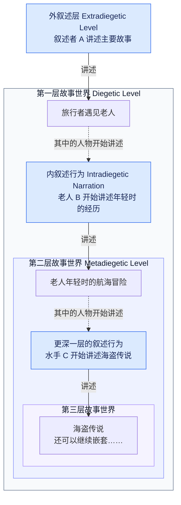

## 韩江《素食者》三部曲阅读笔记

### 故事梗概

《素食者》是韩国作家韩江于 2007 年发表的小说，由《素食者》《胎记》《树火》三部中篇小说构成，讲述了「金英惠」的不同人生阶段。

第一部《素食者》主要由「英惠丈夫」的视角叙述（典型的不可靠描述者，充满了主观感受和个人角度）。「英惠」的丈夫自述是一名利己主义者，他与「英惠」结婚的目的明确：看中了「英惠」在生活能力、家务劳动上的价值，特别满意她做的饭菜。丈夫只会在获取这种价值后正面表达对「英惠」的夸赞，比如穿上熨好的衬衫后；而他一旦没有被满足，则一定会暴跳如雷，对妻子不耐烦地恶语相向。

丈夫唯一介意的事情就是「英惠」不喜欢穿胸罩。婚姻持续了五年。一天早上，丈夫着急出门，不耐烦地催促；「英惠」一如往常慌张地手忙脚乱、后颈发烫。在切冷冻肉时，「英惠」不小心切到了手，还把刀的碎片混进了饭里。丈夫的再次辱骂反而使得妻子突然冷静、仿佛意识飘离了现实。

作品偶尔会切换叙述者，插入「英惠」第一人称的自述：当日夜里，自己（英惠）做了一个可怕的梦，梦境中进入满是悬挂肉块的工厂、以及不知是谁的、既熟悉又陌生的脸。

惊醒后，「英惠」对肉产生了恐惧：她把家里的肉全都扔掉，并且再也不吃肉、甚至害怕睡着；一段时间后，她因此营养不良、变得身体瘦削、皮肤干枯。丈夫散发的“肉味”也让「英惠」觉得难以亲近。

丈夫对「英惠」素食的行为大为恼怒。他并不想深入理解妻子的精神世界，只是觉得妻子给自己的生活带来了麻烦。在公司社长组织的员工夫妻聚餐中，「英惠」格格不入的素食习惯让丈夫觉得颜面扫地，还觉得所有人都注意到了妻子没穿胸罩，这全都让他尴尬极了。

于是丈夫觉得需要“采取一些措施了”，他不停地向妻子的娘家人控诉。而娘家人除了劝说「英惠」，还纷纷对丈夫表达歉意（就好像在说：“将一台故障的机器卖给你，真是对不起”）。特别是素来脾气暴躁、举止强横的「英惠父亲」，他第一次态度软下来，向丈夫说对不起。

时逢「英惠大姐」乔迁之喜、恰逢母亲生日，「英惠」一家在大姐聚会。丈夫在内心赞美大姐的事业兴隆，给大姐夫提供了成为画家的经济条件，还拥有高超的厨艺。

饭桌上，「英惠」的亲人用各种理由轮流劝说她不再坚持素食，但「英惠」都态度冷漠地拒绝了。父亲也尽力用和蔼的态度劝说，但在遭拒后辄即暴怒，用暴力强行向「英惠」的嘴中塞入肉食。「英惠」尽力抵抗，最后只能拿起刀猛刺向手腕。

将「英惠」送入医院后，丈夫只想远离这个“怪胎”；而母亲仍然不放弃，欺骗「英惠」说黑山羊汤是中药。「英惠」假意不知，喝下之后趁机带着吊瓶去厕所中呕吐，血液回流进了吊瓶，但丈夫对此无动于衷。

第二天，丈夫发现「英惠」消失了，经过一番寻找后，在医院的喷泉边找到了陌生的她——「英惠」赤裸上身，攥着一只被咬死的鸟，嘴角血迹斑斑。

第二部《胎记》主要使用第三人称内部聚焦的叙述方式，以「英惠大姐夫」为中心叙述，故事发生在《素食者》两年后，此时「英惠」已和丈夫离婚。姐夫是一位艺术家，但在事业上十分不顺，已经有一年多没有创作了。他和美丽能干的大姐结婚许久，却对她失去了兴趣。孩子是两人唯一的关系纽带；除此之外他们并无话讲。在看到孩子身上的胎记时，姐夫听说「英惠」的臀部上也曾有一块绿色的胎记。

某次演出后，姐夫被半裸的宣传海报激发出了强大的灵感，让他幻想创作一幅以自己和赤裸的、全身绘满花朵的「英惠」为主题的画。但他无法用模特代替「英惠」完成创作。从此之后，姐夫无法停止对「英惠」的幻想，深深地迷恋她，甚至产生性冲动并自慰。

姐夫以关心「英惠」身体为借口，登门拜访，还意外看到了「英惠」的裸体。「英惠」一如既往地非常平静。于是他大胆地向「英惠」提议做自己的裸体模特，出乎他意料的是，「英惠」平静地接受了。

影像中是排除一切欲望的肉体。这次拍摄让姐夫有了更进一步的拍摄打算；「英惠」则十分满意涂满花朵彩绘的身体，这让她摆脱了噩梦。于是姐夫找到一个英俊年轻的后辈，代替自己与「英惠」合拍。「英惠」并不拒绝与赤身裸体的陌生男子亲密接触，拍摄十分顺利。在最后，姐夫出人意料地提议让两人真的发生性行为。「英惠」不置可否，但后辈严词拒绝。

在不停地安抚后辈的语言中，拍摄勉强结束。「英惠」毫不讳言自己的性欲高涨；姐夫再也无法忍耐交媾的欲望，但却被拒绝。理由是让她产生欲望的是身体上的鲜花。

于是姐夫拜托旧情未泯的前女友也为自己绘满体绘，然后径直进入「英惠」的家，粗暴地与她发生了关系；之后，拍摄了两人身体交叠的影片。

姐夫醒来后，发现妻子来了，也已经从摄像机里发现了事情的始末。大姐尽量克制地告诉他们，她打了急救电话要送他们进精神病院检查。「英惠」张开满是鲜花的身体感受阳光和春风。姐夫看得呆了。

第三步《树火》仍然是以第三视角叙述，但叙述中心改为了大姐「金仁惠」。大姐是一个热衷利他的人，从小就有强烈的照顾好妹妹「英惠」的责任感。大姐在自己的店内初识大姐夫，见他总是满脸疲惫，便心生了靠自己的努力拯救他的想法。婚后，大姐夫从不将心思放在家中，甚至连孩子都怀疑自己没有父亲。家庭渐渐让大姐不堪重负。

她曾经以为自己得了绝症，时日无多；以此为契机，她开始审视自己的人生，却发现自己好像是个从未真正活过的孩子，一直在忍耐、迁就他人，咬牙坚持着过活。当她得知自己只不过得了小病，而来日方长，并没有使她感觉快乐。丈夫我行我素，孩子嗷嗷待哺，生活千篇一律——仅仅这样。但这些要她献祭整个人生，一直将贤妻良母和好姐姐“扮演”下去。

大姐夫和「英惠」的丑闻被发现后，两人都被送进精神病院。「英惠」进入隔离病房接受治疗；姐夫在确诊没有精神疾病后被拘留，然后被彻底驱逐出了家门。金家从此分崩离析。

大姐更忙碌了，现在她还要肩负起看望「英惠」、交付治疗费用的责任。「英惠」的身体状态每况愈下，也不肯吃药，背后生了褥疮，体重不足三十公斤，只能拜托病情稍轻的病友帮助照顾。她现在甚至不肯吃饭了，医生只能为她注射葡萄糖，身体上扎满了针孔。大姐独自照顾发高烧的孩子时，接到医生的电话说「英惠」在大雨天走失了。五天都没睡好的大姐分身乏术。晚上，护工在山里找到了她，她像被雨淋湿的大树一样一动不动的站在山坡上。

大姐痛恨这样不负责任地将生活毁掉的「英惠」，明明她一直如此尽心地照顾妹妹。小时候，她在父亲的威压下，分担母亲的家务，给烂醉的父亲煮醒酒汤。父亲稍不满意就会掌掴这对姐妹。是她自幼的卑怯，让她如此乖巧、懂事。她不禁反复拷问自己：“是自己的哪一步走错，才的生活变得如此不堪？”但好像哪一个选择都是悲剧收尾，这一切并不值得忍受。她忽然好像理解了自己丈夫和「英惠」的心情。自己丈夫可以为了一刻的解脱而放弃一切；「英惠」并不觉得死亡会失去什么；而她只是活着的幽灵，她早就死了。

「英惠」觉得自己彻底是一株植物了。医生决定从她的鼻孔插入胃管注射食物，以延续她的生机。「英惠」激烈地反抗，胃部大量出血，生机渺茫。大姐陪伴着「英惠」转院，在救护车上凝视窗外如火燃烧的树木。

### 写作分析

《素食者》最重要的艺术机制，是让一个试图摆脱暴力、甚至摆脱人类身份的女人，始终主要通过其他人的目光、欲望、恐惧与解释被呈现。读者可以看到，整个三部曲都以英惠为故事中心，但她从未成为叙述者和主要聚焦人物。读者必须要通过三个不同的人物理解她：《素食者》中，丈夫把她理解为破坏正常婚姻秩序的人；《胎记》中，姐夫通过艺术幻想与欲望认识她；《树火》中，仁惠则通过照护和自身痛苦逐渐尝试重新理解她。

下面详细分析作者使用

第一部《素食者》英惠的丈夫为第一人称叙述者，采用外叙述层的同故事叙述（Extradiegetic–Homodiegetic Narration）。丈夫既是故事的参与者，又以第一人称回顾婚姻生活及英惠的异常变化。叙述主要围绕丈夫的感知、记忆、判断与情绪展开，形成以他为中心的内部聚焦（Internal Focalization）。作品并未始终维持这一单一视角，而是在丈夫的叙述之间插入英惠独立的第一人称梦境、记忆与心理独白（First-Person Dream Narratives and Interior Monologues）。

丈夫的叙述具有明显的认知局限（Cognitive Limitations）与评价偏差（Evaluative Bias）。他主要依据自身的生活需要、婚姻期待和社会规范理解英惠，而英惠的独白却呈现出他无法充分认识的恐惧、创伤与自我异化。两种叙述之间的差异形成了叙事反讽（Narrative Irony），并使丈夫的叙述表现出一定程度的不可靠性（Narrative Unreliability）。

这种形式安排使读者既能够了解丈夫如何看待英惠，又能够通过英惠的直接表达发现其解释的不足。小说由此不仅呈现两人之间的情感疏离，也揭示了人物之间在知识、理解与叙述权力方面的不对称。

第二部《胎记》采用第三人称异故事叙述（Heterodiegetic Narration），而非传统意义上的全知叙述（Omniscient Narration）。叙述者位于外叙述层（Extradiegetic Level），并不作为人物参与故事，而是通过第三人称讲述事件。小说主要采用以英惠姐夫为中心的固定内部聚焦（Fixed Internal Focalization），叙事信息与人物的感知、记忆、欲望、想象和心理活动紧密联系。

作品通过心理叙述（Psycho-Narration）及贴近人物意识的思想呈现，使读者深入姐夫的内心世界，却不赋予读者对其他人物心理的同等了解。尤其是英惠的思想与动机，主要通过姐夫的观察、推测及其与英惠的对话间接呈现。

读者能够接近姐夫的心理，但他对英惠身体、欲望和艺术价值的理解始终受到自身欲望与认知局限的影响。作品由此形成叙事上的亲近与批评上的距离，使读者既能够理解姐夫的行为动机，又能够质疑他对自身行为的解释。

第三部《树火》同样采用外叙述层的异故事叙述，以仁惠为中心的内部聚焦。叙述者位于主要故事之外，并不作为人物参与事件，而是通过第三人称讲述英惠的病情变化、仁惠的照护经历及其逐渐展开的心理危机。叙事信息主要围绕她的感知、记忆、情绪、判断与意识活动组织。虽然叙述者并不局限于对人物外部行为的客观记录，但读者对英惠心理状态的了解，仍然主要依赖仁惠的观察、推测以及英惠的直接言语。

在意识呈现方面，作品广泛使用心理叙述（Psycho-Narration），由第三人称叙述者描述仁惠无法直接说出的恐惧、疲惫、自责与死亡念头。部分叙述还通过贴近人物心理的疑问、感叹和评价，使叙述者语言与人物意识相互渗透，呈现出接近**自由间接思想呈现（Free Indirect Thought Presentation）**的特征。

在时间结构上，《树火》通过反复的倒叙（Analepsis），将仁惠前往医院、照顾妹妹及陪同转院的当前事件，与童年家庭暴力、婚姻生活、丈夫的背叛和自身曾经的精神危机交织起来。过去与现在并非简单地依次排列，而是通过仁惠的记忆和心理联想形成联系，使读者逐渐认识到她与英惠之间深层的经验共性。

与《胎记》主要通过姐夫的艺术欲望呈现英惠不同，《树火》通过仁惠的痛苦、自我反省与照护行为，逐步改变读者对姐妹关系的理解。英惠仍然是重要的叙事对象，但仁惠的意识逐渐成为小说的心理与伦理中心。

这种叙事安排使作品从对英惠异常行为的观察，转向对生存、责任、关怀与自主性的复杂考察。仁惠虽然比其他人物更愿意理解英惠，却仍然无法完全进入妹妹的内心。小说因此保留了他者经验的不可完全知晓性，并通过结尾的开放性，将伦理判断留在持续的冲突之中。
英惠拒绝吃肉，此后拒绝某些身体关系，最终拒绝食物并相信自己能够依靠植物的方式生存。

但小说并没有将这些行为直接解释为一种完整、连贯的哲学立场。相反，三部分不断改变观察她的人：丈夫将她视为偏离正常生活的妻子，姐夫将她视为艺术与欲望的对象，姐姐则逐渐认识到她的痛苦与自身处境之间的联系。

由此形成一个更深的问题：

当一个人拒绝社会为她规定的生活方式时，周围的人究竟是在试图理解她，还是在用自己的需要重新定义她？

小说最值得研究的，不仅是英惠为什么选择成为植物，还包括：为什么读者始终无法完全进入她的意识，以及这种认知限制如何影响我们对自由、暴力、关怀和生命的判断。

《素食者》《胎记》《树火》三部曲分别以「英惠」丈夫、「英惠大姐夫」、「英惠大姐」的视角写作，但故事的主角却是「金英惠」：她在书中是彻头彻尾的客体——但她所做所为，皆是在拒绝成为客体化的人——也拒绝读者通过文字阅读她。

她“怪异地”拒绝吃肉，在周围人的眼里是如此的罪恶，仿佛只吃素菜的她就失去了一切价值——这些人全都是渴望吃肉的，他们需要「英惠」为他们烹饪肉食，他们眼中的的「英惠」是“服务价值”和“利他性”。我们大部分读者当然能体谅「英惠」当一个素食者，这是她的个人选择；但「英惠」的亲人不依不饶、咄咄逼人的模样让我们无法理解——这就和我们这一代人抗拒婚育、追求自我实现，却被接受多子多福观念的父母长辈无法理解一样；视频网站上父母花式逼婚、相亲角都是老年人为子女张罗婚姻的，充分彰显了这种代际冲突。

同样的，我们这个群体的人，一样会无法理解世界上发生的许多事，比如法国的罢工潮、朝韩人的格局小爱面子、日本职场的尊卑有序——我们不能理解，为什么他们不这样做，就会被整个体系所排挤。我们只是报以嘲笑。

“瞧瞧你的样子，你现在不吃肉，这世界上的人们就会吃掉你。”韩江写作时，提出了这样一个戏剧性问题：“我们能在多大程度上理解别人。”

> 客体化的人，总是从别人的角度审视自己，自我评价高度依赖外在目光：焦虑自己是否在社交场合应对得体，“做什么都像在台上表演”；外貌稍有与“范本”不符即内疚、羞耻，对自身体型或部位长期不满；对饥饿、疲劳、情绪波动等体内信号变迟钝，难以“住在”自己的身体里；自我价值感几乎全部绑定“我看起来如何”，认为只有别人的肯定才让自己有价值；如果陷入了困境、没有价值感，就会替别人辱骂自己、惩罚自己、甚至自残；习惯以“可被利用／展示的功能”看待自己与他人，亲密关系黏着度下降；遭受骚扰或歧视时，倾向先怪自己“没保持完美”。

许多读者拿本书与《82年的金智英》做对比。《82年的金智英》是一部特别的电影，由十几个小节构成，“盘点”了女性一生中所遭遇到的所有典型的“女性不友好的话语”；展示了这些幽灵一样的话语如何限制女性在世俗社会中的可能性、如何限制女性的个人发展。但我认为《素食者》这本书已经超脱了性别，讲述的是现代社会中全人类的困境。

> 现实中，男性也会被衡量“价值”，女性也会放任自己的情绪伤害他人。《素食者》的故事男女对换依然成立。

### 其他角色

「金英惠」的父亲和丈夫，遇到不顺心的大事小事都必然要大发雷霆，完全无法控制自己的脾气，并且毫不忌讳用暴力对待子女。他们都不想去理解女人和孩子的世界，只是单纯地把她们作为工具使用。在他们眼里，别人能给自己创造什么价值才是最本质的。他们不会尝试理解别人。

大姐「金仁惠」和她的孩子「智宇」，是习惯于曲意奉迎的客体。大姐从小在父亲的辱骂和掌掴中长大，“自觉地”帮助母亲分担家务，“自觉地”负起照顾妹妹的责任，从来不敢有自己的欲望；甚至最后她被塑造成了完全的“利他者”——她能为大姐夫分担工作、让他不再疲惫，这让她自己感觉有（被利用的）价值；“她自己能被利用”是她爱上大姐夫的契机。而「智宇」只有五六岁，就学会了给大人表演一个憨态可掬、笨手笨脚的孩童；他故意矮化自己、逗得大人哈哈大笑。可能许多人忘记了，自己的小时候也是这样“求生”。孩子的本性和成人的本性并无不同，只是缺了一点生活经验，成人完全可以和孩子们聊生死、爱情、生活真相；聊了，孩子们自然能懂。但“大人们“总是逼迫孩子表演“次等人”，表演“大人们”乐见的天真烂漫。

我们不知道「英惠」是怎样因为一个光怪陆离的梦变成了对抗生活的无意义的素食者，但大姐夫用更实际的生活轨迹诠释了这一点。他为了追求巅峰体验，甚至可以抛弃一切——他发现了“活过”和“不曾活过”的分野。

「英惠」在医院病床上说：“为什么不能死呢？”这和加缪所说“唯一的哲学问题，就是自杀”如出一辙。活着究竟值不值得？这个问题凌驾于一切问题。这本书并非讨论这个问题的可能解答，而是诱使人们“开始”思考这个问题，就像在结尾处的大姐「金仁惠」那样做的；并且这本书摆在人们面前的，是存在于东亚文化中的“契机”和“思考入口”。

### 

### 社会惯性

或许这不是这本书的重点之一，但我想谈谈人和社会的惯性。

人都生活在惯性上。社会制度的惯性，家庭生活的惯性，人们往往依循惯性，很少有人去反思生活。许多早已被技术革新、时代进步或社会变迁削弱合理性的事情，难逃惯性的人们依然不假思索地履行。

现在的东亚年轻人，从上学开始就开始了时刻紧绷的一生：怕输在起跑线上而疯狂补习，怕考不上好大学而进入“监狱式高中”，怕毕业失去应届生资格海投简历、练习面试，怕自己的履历有空档而贴钱实习，怕大龄不好结婚而四处相亲，怕当高龄产妇无法恢复身体……所有的人仿佛被灌输了一个理念：人就应该像时钟一样规律，到了某个时刻就该按部就班地完成任务，否则就是彻头彻尾的失败者，永劫不得翻身。

但这一切是“合理”的吗？80年代只要上了大学就意味着铁饭碗，可这种事早已过去。那现在的小孩儿还凑什么热闹？卷完了不还是拼爹拼资源吗？但是好像没别的路。

曾经的公务员是福利好干活少的代名词，北方父母总会希望自己的孩子进入体制。现实是，公考千百人争抢一个岗位，大部分人的备考时间都被完全浪费；并且现在的公职或许并不清闲。但人们仍然喜爱依循惯性，而不敢去权衡利弊。

> 一些上了岁数的人，甚至认为“自己拿主意”是罪恶的，蕴含着无穷的危险。，甚至认为“自己拿主意”是罪恶的，蕴含着无穷的危险。

21世纪初经济高速发展，各行各业急缺人才，许多人都被推上了颇有岗位；现在名校毕业、大厂经验的光环都已褪去，求职者卑微地争抢实习席位。好像没别的路。因为根据过去的惯性，就只有这几条人满为患的路。

这样的例子在世界上反复发生。股市涨了，人们就以为还要涨，纷纷高位买入；猪肉涨价了，家家户户就都养猪，第二年就供过于求，含泪贱卖……

人们还是用延续惯性代替思考、权衡，社会的转型也总是缓慢、滞后。观念分布式地深植于万千人的心中，没有谁可以一个个拔除；只有一群人渐渐代替一群人。人群中一定有敢于动脑的先行者，睁开眼、迈开腿体验这世界，然后思考、权衡，打破惯性。他们所必然遭遇的责难就是，肉食者对素食者的咄咄逼人。

## 叙事学相关：热奈特的叙述层、叙述者、叙述时间、聚焦理论

> 热奈特的五大分析范畴是 TENSE·时间（Order·时间，Duration·时长，Frequency·频率），MOOD·语式（Distance·距离，Focalization·聚焦），VOICE·语态（Time of Narrating·叙述时间，Narrative Levels·叙述层，Person·叙述者与故事的关系）

在法国叙事学家热奈特（Gérard Genette）的理论体系中，**叙述层（Narrative Level）、叙述者与故事的关系（Narrator's Relation to the Story）以及聚焦（Focalization）**是分析小说叙事方式的三个相互独立、又可以组合使用的维度。三者分别回答：叙述行为发生在哪一层？由谁讲述，他是否参与故事？故事中的信息通过谁的认知与感知被呈现？ 理解这三个问题，便可以避免将第一人称、第三人称、全知视角和有限视角混为一谈。

`叙述层（Narrative Level）`研究不同叙述行为与故事世界之间的层级关系。**外叙述层（Extradiegetic Level）**是讲述主要故事的叙述行为所处的层次，而被讲述的主要故事则构成第一层故事世界（Diegetic Level）。例如，一个人直接讲述自己过去的生活，尽管他参与了这些事件，讲述主要故事的叙述行为仍然处于外叙述层。因此，“外叙述层”并不意味着叙述者没有参与故事，而是说明他没有作为更高一层故事中的人物来承担这次叙述。

当主要故事中的某个人物进一步讲述另一段故事时，就出现了内叙述层（Intradiegetic Level）的叙述行为，而他所讲述的故事构成次级叙事（Metadiegetic Narrative），也称嵌入叙事（Embedded Narrative）。例如，一部小说讲述一名旅行者的经历，旅途中一位老人向他讲述自己年轻时的冒险。小说原本的叙述者属于外叙述层；老人作为第一层故事中的人物，承担了内叙述层的讲述行为；老人的冒险则构成次级叙事。如果冒险故事中的人物再次讲述另一个故事，叙述层还可以继续增加。

判断叙述层的关键是是否出现新的、具有独立叙述功能的讲述行为，而不是叙述时间或人称是否变化。倒叙（Analepsis）只是叙事时间的变化，不必然产生新的叙述层；人物之间的普通对话也不必然构成嵌入叙事。

与叙述层不同，`同故事与异故事叙述（Homodiegetic and Heterodiegetic Narration）`研究的是叙述者是否参与自己所讲述的事件。

同故事叙述（Homodiegetic Narration）是指叙述者也是其所讲述故事中的人物。他可以是主人公，也可以只是旁观者或见证者。例如，一名男子回顾自己的婚姻经历，或一名医生讲述自己参与见证的朋友的冒险，都属于同故事叙述。如果叙述者同时是故事的主要主人公，则可进一步称为自叙故事叙述（Autodiegetic Narration），它是同故事叙述的特殊类型。

**异故事叙述（Heterodiegetic Narration）**则指叙述者并不作为人物参与其所讲述的故事。例如，一名第三人称叙述者讲述某个家庭的生活，却从未作为人物出现在这些事件之中，就属于异故事叙述。必须注意，这种分类并不直接取决于语法上的人称：第一人称与第三人称属于语言表达形式，而同故事与异故事属于叙述者和故事之间的关系。虽然两组分类在常见小说中往往对应，但理论上不能将它们等同。

叙述层与同／异故事叙述相互独立，因此可以组合形成四种基本类型：

| 类型         | 英文术语                                   | 判定标准                      |
| ---------- | -------------------------------------- | ------------------------- |
| 外叙述层—同故事叙述 | Extradiegetic–Homodiegetic Narration   | 叙述者在外层讲述主要故事，并参与其中的事件     |
| 外叙述层—异故事叙述 | Extradiegetic–Heterodiegetic Narration | 叙述者在外层讲述主要故事，但不参与其中的事件    |
| 内叙述层—同故事叙述 | Intradiegetic–Homodiegetic Narration   | 主要故事中的人物进一步讲述自己参与的另一段故事   |
| 内叙述层—异故事叙述 | Intradiegetic–Heterodiegetic Narration | 主要故事中的人物进一步讲述自己没有参与的另一段故事 |

`聚焦（Focalization）`是热奈特为了区别叙述者身份与叙事信息的呈现方式而提出的概念。它研究的是：故事信息受到怎样的认知限制，以及叙述主要通过谁的经验、感知或知识来组织。 热奈特将叙述声音（Narrative Voice）与聚焦区分为“谁在讲述”（Who Speaks?）和“谁在感知”（Who Sees?）两个问题。不过，后一个问题并不只涉及视觉，还包括人物能够知道、理解和体验什么，以及叙述允许读者获得多少信息。

热奈特区分三种基本聚焦模式：

零聚焦（Zero Focalization）是指叙述不持续受到某个人物认知范围的限制。叙述者可以进入不同人物的内心，也可以交代任何单个人物不知道的事件、背景或信息。它通常与传统的全知叙述（Omniscient Narration）相联系，但零聚焦不意味着叙述者必须将所知的一切全部告诉读者，而是指叙事信息没有被固定在某一个人物的认知范围内。

**内部聚焦（Internal Focalization）**是指叙事信息主要受到某个人物的感知、知识和经验的限制。读者可以了解这个人物的思想和感受，却通常无法直接获得其他人物的内心经验。例如，一部第三人称小说虽然由故事外的叙述者讲述，但如果叙述主要围绕一个人物的意识展开，其他人物的动机只能通过其行为、言语和该人物的推测间接呈现，那么作品便主要采用内部聚焦。内部聚焦不等于第一人称叙述，第三人称异故事叙述同样可以采用内部聚焦。

**外部聚焦（External Focalization）**是指叙事主要呈现人物外部可观察的行为、语言、表情和动作，而不直接进入人物意识。叙述者可能写出一个人沉默、颤抖或离开房间，却不直接告诉读者他内心的想法。因此，外部聚焦接近一种观察式或摄影机式叙事（Camera-Eye Narration）。这里的“外部”指相对于人物意识的观察位置，不等于外叙述层（Extradiegetic Level）。两者所描述的是完全不同的关系。

热奈特还进一步区分内部聚焦的组织方式。**固定内部聚焦（Fixed Internal Focalization）**是指叙事持续主要通过同一人物的经验展开，聚焦固定；**变换内部聚焦（Variable Internal Focalization）**是指不同部分依次采用不同人物的视角，聚焦转移；**多重内部聚焦（Multiple Internal Focalization）**则是指同一事件通过不同人物的视角被反复呈现，从而展示不同的认识、记忆或判断，聚焦转移。

以韩江《素食者》为例，可以把三个维度结合起来分析。

| 作品    | 叙述层     | 叙述者类型                       | 聚焦方式              |
| ----- | ------- | --------------------------- | ----------------- |
| 《素食者》 | 主要为外叙述层 | 丈夫主导的同故事叙述，并插入英惠独立的第一人称意识片段 | 以丈夫为主，局部转向英惠的内心经验 |
| 《胎记》  | 外叙述层    | 异故事叙述                       | 主要以姐夫为中心的内部聚焦     |
| 《树火》  | 外叙述层    | 异故事叙述                       | 主要以仁惠为中心的内部聚焦     |

《胎记》尤其适合说明叙述声音与聚焦之间的区别。小说采用第三人称异故事叙述，叙述者并不参与所讲述的事件，但叙事主要围绕姐夫的感知、记忆、艺术幻想和欲望展开。因此，读者可以接近姐夫的内心，却无法同等程度地直接了解英惠的意识。叙述者不是姐夫，但姐夫是主要聚焦人物（Focal Character）。 同样，《树火》采用第三人称异故事叙述，却主要通过仁惠的意识呈现事件。两部小说的叙述者类型相似，聚焦人物却不同，由此产生了不同的叙事效果。

还需要区分聚焦限制与不可靠叙述（Unreliable Narration）。聚焦人物只能看到或理解部分事实，并不意味着叙述者必然不可靠。例如，《胎记》中姐夫对英惠的理解受到自身欲望的影响，但这种认知局限不能直接证明第三人称叙述者在误导读者。相反，第一部分的丈夫既是叙述者又是聚焦人物，他的价值判断和叙述选择直接影响读者获得的故事，因此才需要进一步讨论其叙述可靠性。

以后分析任何小说，都可以依次回答以下四个问题：

1. 叙述层（Narrative Level）： 这是直接讲述主要故事，还是主要故事中的某个人物在进一步讲述另一段故事？
2. 叙述者类型（Narrator Type）： 叙述者是否参与其所讲述的事件？如果参与，他是主人公还是见证者？
3. 聚焦（Focalization）： 叙事信息是否受到某个人物认知范围的限制？如果受到限制，聚焦于谁？视角是否发生变化？
4. 艺术功能（Narrative Function）： 这种叙事安排使读者获得或失去哪些信息？如何影响对人物、事件、主题和叙述可靠性的理解？

这套理论最重要的原则是：叙述层决定叙述行为的位置，同／异故事叙述决定叙述者与事件的关系，聚焦决定叙事信息的组织与限制方式。三者共同描述小说的叙事结构，却不应被混为同一个概念。

理论依据主要来自 Gérard Genette 的 Narrative Discourse: An Essay in Method（1980），以及 The Living Handbook of Narratology 中关于 [Narrative Levels](https://www-archiv.fdm.uni-hamburg.de/lhn/node/32/revisions/352/view.html?utm_source=chatgpt.com) 和 [Focalization](https://www-archiv.fdm.uni-hamburg.de/lhn/node/18/revisions/211/view.html?utm_source=chatgpt.com) 的专业综述。

