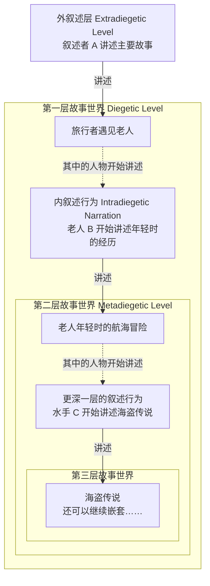
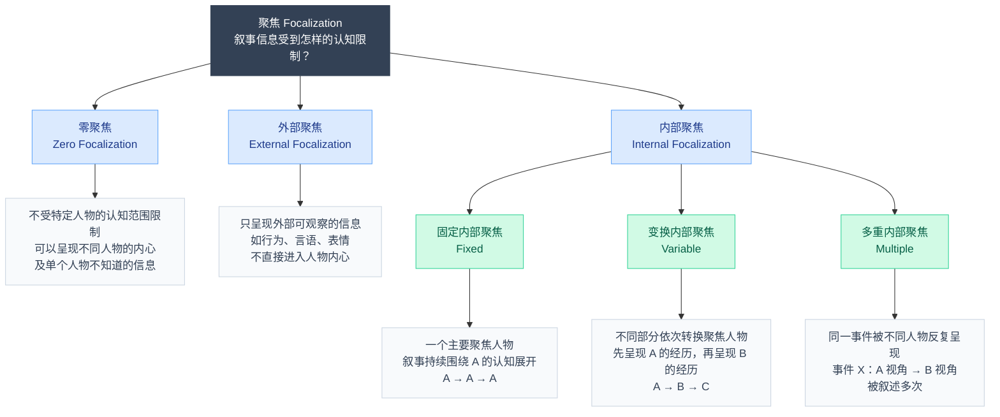

## 韩江《素食者》三部曲阅读笔记

### 故事梗概

《素食者》是韩国作家韩江于 2007 年发表的小说，由《素食者》《胎记》《树火》三部中篇小说构成，讲述了金英惠的不同人生阶段。

第一部《素食者》主要由英惠丈夫的视角叙述（典型的不可靠描述者，充满了主观感受和个人取向），语言日常、冷淡、以自我为中心。英惠的丈夫自述是一名利己主义者，他与英惠结婚的目的明确：看中了英惠在生活能力、家务劳动上的价值，尤其满意她做的饭菜。丈夫在叙述中，只会在获取了英惠提供的价值后表达对她的夸赞，比如穿上熨好的衬衫后；而他一旦没有被满足，必定会暴跳如雷，对妻子不耐烦地恶语相向。

丈夫唯一介意的事情就是英惠不喜欢穿胸衣。婚姻持续了五年。一天早上，丈夫着急出门，不耐烦地出言催促；英惠一如往常地手忙脚乱、后颈发烫。在切冷冻肉时，英惠不小心切伤了手，还把刀的碎片混进了饭里。丈夫的辱骂反而使得妻子突然冷静、仿佛意识飘离了现实。

作品偶尔会切换叙述者，插入英惠第一人称的自述：当日夜里，自己（英惠）做了一个可怕的梦，梦境中进入满是悬挂肉块的工厂、以及不知是谁的、既熟悉又陌生的脸。

惊醒后，英惠对肉产生了恐惧：她把家里的肉全都扔掉，并且再也不吃肉、甚至害怕睡着；一段时间后，她严重营养不良，身体瘦削、皮肤干枯。丈夫散发的“肉味”也让英惠觉得难以亲近。

丈夫对英惠的素食行为大为恼怒。他并不想深入理解妻子的精神世界，只是觉得妻子给自己的生活带来了麻烦。在公司社长组织的员工夫妻聚餐中，英惠拒绝吃肉，她的格格不入让丈夫觉得颜面扫地；他不禁觉得，聚餐的所有人甚至意到了妻子没穿胸衣，这实在太尴尬了。

于是丈夫觉得需要“采取一些措施了”，他不停地向妻子的娘家人控诉。而娘家人除了劝说英惠，还纷纷对丈夫表达歉意（就好像在说：“将一台故障的机器卖给你，真是对不起”）。变化最大的是素来脾气暴躁、举止强横的英惠父亲，他第一次态度软下来，低头向丈夫道歉。

时逢英惠大姐金仁惠乔迁之喜，又是英惠母亲生日，英惠一家在大姐聚会。丈夫在内心盛赞大姐把事业兴隆，给大姐夫提供了成为画家的经济条件，还拥有高超的厨艺。

饭桌上，英惠的亲人轮流劝说她别再坚持吃素了，但英惠一概态度冷漠地拒绝了。父亲一开始也压下脾气、以和蔼的态度劝说，但在遭拒后辄即暴怒，用蛮力强行向英惠的嘴中塞入肉食。英惠拼尽全力抵抗，最后只能拿起刀猛刺向手腕。

众人将英惠送入医院后，丈夫只想远离这个“怪胎”；而母亲仍然不放弃，欺骗英惠说黑山羊汤是中药。英惠假意不知，喝下之后趁机带着吊瓶去厕所中呕吐，血液回流进了吊瓶，但丈夫对此无动于衷。

第二天，丈夫发现英惠消失了，经过一番寻找后，在医院的喷泉边找到了陌生的她——英惠赤裸上身，攥着一只被咬死的鸟，嘴角血迹斑斑。

第二部《胎记》主要使用第三人称内部聚焦的叙述方式，以英惠大姐夫为中心叙述，语言高度视觉化。故事发生在《素食者》两年后，此时英惠已和丈夫离婚。姐夫是一位艺术家，但事业十分不顺，已经有一年多没有创作了。他和美丽能干的大姐结婚许多年，却对她失去了兴趣。孩子是两人唯一的关系纽带；除此之外他们并无话讲。在看到孩子身上的胎记时，姐夫听说英惠的臀部上也曾有一块绿色的胎记。

某次演出后，姐夫看到半裸的宣传海报，又联想到胎记，被激发出了强烈的创作灵感。他不断幻想创作一幅以自己和赤裸的、全身绘满花朵的英惠为主题的画。但他无法用模特代替英惠完成创作。从此之后，姐夫无法抑止对英惠的幻想，对她产生了深深的迷恋，甚至因此产生了性冲动并自慰。

姐夫以关心英惠身体为借口，登门拜访，意外看到了英惠的裸体。英惠则一如既往地平静。于是他大胆地提议英惠做自己的裸体模特；出乎他意料的是，英惠平静地接受了。

影像中是排除一切欲望的肉体。这次拍摄让姐夫有了更进一步的拍摄打算；英惠则十分满意涂满花朵彩绘的身体，这让她摆脱了噩梦。于是姐夫找到一个英俊年轻的后辈，代替自己与英惠合拍。英惠并不拒绝与赤身裸体的陌生男子亲密接触，拍摄十分顺利。在最后，姐夫出人意料地提议让两人真的发生性行为。英惠不置可否，但后辈严词拒绝。

在连连安抚后辈的话语中，拍摄勉强结束。英惠毫不讳言自己已经性欲高涨；姐夫也无法忍耐住和她交媾的欲望，但却被拒绝。理由是让她产生欲望的是身体上的鲜花。

于是姐夫拜托旧情未泯的前女友也为自己绘满体绘，然后径直进入英惠的家，粗暴地与她发生了关系；之后，拍摄了两人身体交叠的影片。

姐夫醒来后，发现妻子来了，也已经从摄像机里发现了事情的始末。大姐尽量克制地告诉他们，她打了急救电话要送他们进精神病院检查。英惠张开满是鲜花的身体感受阳光和春风。姐夫看得呆了。

第三步《树火》仍然是以第三视角叙述，但叙述中心改为了大姐金仁惠；这部分心理描写密集，回忆与当前事件交替，自然意象逐渐扩张。大姐是一个热衷利他的人，从小就有强烈的照顾好妹妹英惠的责任感。大姐在自己开的店内初识大姐夫；因为见他总是满脸疲惫，便心生了靠自己的努力拯救他的想法。婚后，大姐夫从不将心思放在家中，甚至连孩子都怀疑自己没有父亲。家庭渐渐让大姐不堪重负。

她曾经以为自己得了绝症，时日无多；以此为契机，她开始审视自己的人生，却发现自己好像是个从未真正活过的孩子，一直在忍耐、迁就他人，咬牙坚持着过活。医生告诉仁惠，她只不过得了小病，未来的人生还有很长；但她并没有因此感到宽慰或快乐。丈夫我行我素，孩子嗷嗷待哺，生活千篇一律——仅仅这样。但这些都要求她献祭整个人生，一直将贤妻良母和好姐姐的角色“扮演”下去。

大姐夫和英惠的丑事被发现后，两人都被送进精神病院。英惠进入隔离病房接受治疗；姐夫在确诊没有精神疾病后被拘留，再被彻底驱逐出了家门。金家从此分崩离析。

大姐更忙碌了，因为现在她还要肩负起看顾英惠、交付治疗费用的责任。英惠的身体状态每况愈下，也不肯吃药，背后生了褥疮，体重不足三十公斤，只能拜托病情稍轻的病友帮助照顾。她现在甚至不肯吃饭了，医生只能为她注射葡萄糖，身体上满是针孔。大姐独自照顾发高烧的孩子时，接到医生的电话，说英惠在大雨天走失了。可五天都没睡好的大姐分身乏术。晚上，护工在山里找到了她，她像被雨淋湿的大树一样一动不动的站在山坡上。

大姐痛恨这样不负责任地将生活毁掉的英惠，明明她一直这样坚忍努力，这样尽心地照顾妹妹。小时候，她在父亲的威压下，分担母亲的家务，给烂醉的父亲煮醒酒汤。父亲稍不满意就会掌掴这对姐妹。是她自幼的卑怯，让她如此乖巧、懂事。她不禁反复拷问自己：“是自己的哪一步走错，才的生活变得如此不堪？”但好像人生中的哪一个选择都会以悲剧收尾，这一切并不值得忍受。她忽然好像理解了自己丈夫和英惠的心情。自己丈夫可以为了一刻的解脱而放弃一切；英惠并不觉得死亡会失去什么；而她只是活着的幽灵，她早就死了。

英惠觉得自己彻底是一株植物了。医生决定从她的鼻孔插入胃管注射食物，以延续她的生机。英惠激烈地反抗，胃部大量出血，生机渺茫。大姐陪伴着英惠转院，在救护车上凝视窗外如火燃烧的树木。

### 写作分析

《素食者》最重要的艺术机制，是让一个试图摆脱暴力、甚至摆脱人类身份的女人，始终主要通过其他人的目光、欲望、恐惧与解释被呈现。读者可以看到，整个三部曲都以英惠为故事中心，但她从未成为叙述者和主要聚焦人物。读者必须要通过三个不同的人物理解她：《素食者》中，丈夫把她理解为破坏正常婚姻秩序的人；《胎记》中，姐夫通过艺术幻想与欲望认识她；《树火》中，仁惠则通过照护和自身痛苦逐渐尝试重新理解她。英惠拒绝吃肉，此后拒绝某些身体关系，最终拒绝食物并相信自己能够依靠植物的方式生存。但小说并没有将这些行为直接解释为一种完整、连贯的哲学立场。相反，作者不断改变观察她的人：丈夫将她视为偏离正常生活的妻子，姐夫将她视为艺术与欲望的对象，姐姐则逐渐认识到她的痛苦与自身处境之间的联系。

第一部《素食者》英惠的丈夫为第一人称叙述者，采用外叙述层的同故事叙述（Extradiegetic–Homodiegetic Narration）。丈夫既是故事的参与者，又以第一人称回顾婚姻生活及英惠的异常变化。叙述主要围绕丈夫的感知、记忆、判断与情绪展开，形成以他为中心的内部聚焦（Internal Focalization）。作品并未始终维持这一单一视角，而是在丈夫的叙述之间插入英惠独立的第一人称梦境、记忆与心理独白（First-Person Dream Narratives and Interior Monologues）。

丈夫的叙述并非因不诚实而不可靠地叙述，而是他具有明显的认知局限（Cognitive Limitations）与评价偏差（Evaluative Bias）。他选择英惠的重要理由，是她能够履行他所期待的妻子职责，也没有麻烦的要求。这是他对妻子的全部理解。因此，当英惠拒绝吃肉，他首先感受到的并不是她可能经历了什么，而是自己的生活秩序突然被打乱。他对这一变化最直接的反应，是要求她恢复正常，并不断计算其行为对自己工作、人际关系和社会形象的影响。这并不能仅仅用丈夫自私这一诉诸个人道德的视角解释，也应该被理解为“社会规范怎样成为衡量他人的标准”。

第一部插入的英惠独白和对梦境的阐述，为读者呈现出丈夫不知道的经验。梦境反复呈现屠宰、血、肉、牙齿、动物的眼睛，以及英惠对自己身体的恐惧；它们是片段化的、具有强烈感官特征的心理语言，并不是一套能够充分说明行为动机的理性陈述。因此，读者仍然不能消除围绕英惠的知识限制、不能完全理解她，但能看到普通生活与内部恐怖之间的断裂。读者无法将她简单归类为完全理性的反抗者、纯粹被动的受害者，或者只需通过医学术语解释的病人。

这两种叙述之间的差异形成了叙事反讽（Narrative Irony）：读者最初只能通过丈夫的声音认识英惠，但很快便能发现，他并没有充分理解自己描述的女人。这里丈夫的不可靠叙述（Unreliable Narration）主要表现为评价和理解上的偏差，而非其有意隐瞒或欺骗。这种形式安排使读者既能够了解丈夫如何看待英惠，又能够通过英惠的直接表达发现其解释的不足。小说由此不仅呈现两人之间的情感疏离，也揭示了人物之间在知识、理解与叙述权力方面的不对称。

第二部《胎记》采用第三人称异故事叙述（Heterodiegetic Narration），而非传统意义上的全知叙述（Omniscient Narration）。叙述者位于外叙述层（Extradiegetic Level），通过第三人称讲述事件。小说主要采用以英惠姐夫为中心的固定内部聚焦（Fixed Internal Focalization），叙事信息与人物的感知、记忆、欲望、想象和心理活动紧密联系。

作品通过心理叙述（Psycho-Narration）及贴近人物意识的思想呈现，使读者深入姐夫的内心世界，却不赋予读者对其他人物心理的同等了解。尤其是英惠的思想与动机，主要通过姐夫的观察、推测及其与英惠的对话间接呈现。例如，姐夫看到英惠的身体，并不只是看到一个有自己思想、经历和愿望的女人。他看到的是绿色的胎记、可以绘满花朵的皮肤、一种近乎植物的美，以及实现自己艺术构想的可能性。

表面看来，这是从压抑的家庭秩序转向具有自由意味的艺术创造。姐夫不断凝视、描绘和拍摄英惠的身体。他虽然多次试图理解英惠的表现，但这种理解始终受到自己的艺术野心与性欲支配，英惠的身体逐渐成为他能够安排和表现的审美对象（Aesthetic Object）。

英惠并未失去自主性和欲望，但也引出了新的问题：姐夫的艺术构想是否创造了英惠暂时能够接受的另一种身体存在方式，还是最终只提供了另一套将她客体化的语言？

作者通过第三人称内部聚焦呈现他的思想，这种安排既让读者深入他的欲望，又保留了一定的叙事距离，使读者既能够理解姐夫的行为动机，又能够质疑他对自身行为的解释，形成反差。读者可以进入艺术家的视觉经验，同时姐夫欲望的控制作用也暴露出来。

第三部《树火》同样采用外叙述层的异故事叙述，以仁惠为中心的内部聚焦。叙述者位于主要故事之外，通过第三人称讲述英惠的病情变化、仁惠的照护经历及其逐渐展开的心理危机。叙事信息主要围绕她的感知、记忆、情绪、判断与意识活动组织，并以此来再次认识英惠。

作品表面上仍然关注英惠的命运，但小说的大量篇幅实际上用于展开仁惠的内心经验。仁惠回忆家庭暴力、自己的婚姻、长期承担的责任，以及她曾经产生过的放弃生命的念头。文本逐渐呈现出“看待英惠的人自身也是受到伤害、充满矛盾的主体”这一信息。仁惠最终发现，自己与妹妹之间并非正常人与异常者、照顾者与被照顾者那么简单，她们可能是在相似的生存条件下，采取了截然不同的应对方式。英惠拒绝继续维持社会要求的生活；仁惠则长期通过忍耐、劳动和责任维持自己的生活。两姐妹形成一种人物对照（Character Foil），但她们并不是截然对立的象征。

在意识呈现方面，作品广泛使用心理叙述（Psycho-Narration），由第三人称叙述者描述仁惠无法直接说出的恐惧、疲惫、自责与死亡念头。部分叙述还通过贴近人物心理的疑问、感叹和评价，使叙述者语言与人物意识相互渗透，呈现出接自由间接思想呈现（Free Indirect Thought Presentation）的特征。

在时间结构上，《树火》通过反复的倒叙（Analepsis），将仁惠前往医院、照顾妹妹及陪同转院的当前事件，与童年家庭暴力、婚姻生活、丈夫的背叛和自身曾经的精神危机交织起来。过去与现在并非简单地依次排列，而是通过仁惠的记忆和心理联想形成联系，使读者逐渐认识到她与英惠之间深层的经验共性。

将三部曲综合来看，它们共同组成了不对称的多重聚焦（Asymmetrical Multiple Focalization），达成了展现“其他人怎样看待英惠，为什么不断误解她，以及这种理解失败如何与暴力相联系”这一艺术功能。每一个新部分不仅继续故事，还会改变读者对前一部分的认识。在第一部分，丈夫对英惠的梦境和行为极不理解，读者虽然能够察觉他的偏见，但仍缺少解释英惠经历的重要背景。第二部分进一步揭示她离婚后的生活，也使读者看见，英惠并没有完全失去欲望。她会对身体上的花朵产生积极反应，甚至主动希望花朵保留。第三部分则使许多此前零散的事实获得新的意义。仁惠回忆父亲长期对英惠实施暴力，也逐渐认识到自己曾经通过服从与承担责任适应同样的家庭环境。读者对第一部分家庭聚餐的理解发生变化：那并非一次偶然失控的家庭争执，而是长期权力关系的一次集中爆发。在第三部分中，英惠还明确表示，即使停止吃肉，梦中的面孔也并没有就此消失。这进一步阻止读者将最初的素食理解为一种已经获得成功的自我净化。

三个部分之间存在持续的追溯性重释（Retrospective Reinterpretation）：后来的信息不仅补充故事，还修正先前的意义。三部分构成一种逐步深化的问题结构：第一部分展示暴力如何被正常化；第二部分展示美与欲望如何可能掩盖暴力；第三部分则研究善意和照护本身能否摆脱暴力。这种写作手法也用来提出这样一个问题：当一个人拒绝社会为她规定的生活方式时，周围的人究竟是在试图理解她，还是在用自己的需要重新定义她？

《素食者》三部曲的主要艺术效果并不依赖某一种完全独创的技巧，而是依赖几种形式之间的特殊组合。尤其重要的是：叙事视角的持续转移、英惠经验的部分不可知性、动物与植物意象的变化，以及三部分不断升级的伦理冲突。这些安排共同把一个家庭内部的饮食冲突转化为关于人类生命与暴力的哲学问题。它最终揭示的是，人类的生活永远无法剥离暴力、冲突和伤害，也把这个无法解决的问题留给读者：如果人类的生存不可避免地与依赖、欲望和伤害联系在一起，那么一种不以支配为基础的生活究竟可能达到什么程度？

### 象征分析

作品最大的象征（Symbolism）就是“素食”和“变成植物”。

英惠的“素食”行为和反复出现的血腥梦境有关。梦境中最令她恐惧的，不只是动物被杀死，还有自己与杀戮之间的关系。在童年回忆中，父亲以残酷方式杀死一条咬过她的狗，而她最终也吃下狗肉。因此，拒绝吃肉可以理解为她试图切断与暴力之间联系的行动。但小说同时说明，这种切断并没有成功。

小说用了三个相反的意象（Imagery）来让这种象征拥有说服性：肉、血、脸。这让英惠认识到了生命之间的伤害关系。

英惠逐渐相信，人类和动物身体无法彻底摆脱暴力。她在梦境中尤其恐惧牙齿、手脚和身体器官可能成为伤害他者的工具。相比之下，她将乳房视为一种较少具有攻击性的身体部位。所以她采取的下一步行动就是“变成植物”，不再通过吃东西维持生命，也就拒绝了伤害其他生命；并且倒立、晒太阳、拒绝食物以及想象自己长出树根，拒绝保持具有攻击性的人体结构。然而，这种植物化愿望既具有抵抗意义，也具有严重的自我毁灭危险。她的非暴力的理想并未实现，而是转向了自身。

这种极端化的象征结构，追问了“人类是否可能在不参与伤害的情况下生存？”“一个人拒绝成为别人希望他成为的样子之后，究竟还能怎样活下去？”“他人放弃生命的愿望是否应该被尊重？”“其他人是否可能在不占有、不支配的情况下，真正关心他人？”这使小说获得了普通家庭伦理故事难以达到的哲学深度。

“胎记”这一象征，在姐夫想象中，代表某种原始的、尚未被社会秩序完全改造的生命痕迹。这种思想，或许是从追求“非常规生活”的英惠与已丧失生活激情的仁惠的对比中得来的。他认为英惠的身体纯洁、自然、不受通常的性欲支配。然而，他越是将她想象为摆脱欲望的存在，自身的欲望就越强烈。这形成了《胎记》的核心反讽：他试图通过英惠表现一种超越肉欲的美，却不断以肉欲性的方式占有和观看她。姐夫具有明显的工具化（Instrumentalisation）倾向和侵犯行为。

第二部的意象则转为了花与身体，暂时提供了摆脱普通人类身份的另一种想象，但这种想象又被姐夫的欲望利用。

第三部，树和火作为象征，在英惠眼里是转化为不伤害他人的生物的希望，但在仁惠眼里拥有可怕的生命力量。这两个意向的两面性，是选取它们的原因。

### 结局分析

《树火》让小说的伦理问题发生决定性变化。英惠在前两部中受到的是工具化凝视、暴力和控制。但仁惠真正关心英惠，希望她活下去，并长期承担照护责任，却依然无法完全理解妹妹。英惠将姐姐的劝说理解为另一种强迫，姐姐与其他试图控制自己的人并无区别。

但这部也揭示了，长期以来，仁惠和英惠一直都在相似的处境下生存，甚至下一代智宇也逃脱不了这个循环。仁惠并非完全健康、稳定、能够超然判断妹妹命运的人。她在童年通过顺从父亲、承担家庭责任避免冲突。成年后，她继续照顾丈夫、经营店铺、抚养孩子，并尽力解决妹妹的困境。这种长期适应让她能够在社会中维持生活，却也使她不断压抑自己的疲惫和痛苦。她甚至曾经同样产生过放弃生命的念头。

但姐妹二人的选择形成了深刻的对照：英惠拒绝既有生活秩序，仁惠尽力维持既有生活；英惠将暴力的恐惧转化为身体上的拒绝，仁惠将痛苦转化为忍耐与责任；英惠希望摆脱人类的生存方式，仁惠依赖日常行动维持自己和孩子的生命；英惠越来越无法参与通常的社会生活，仁惠看似能够正常生活，却长期承受内部崩溃；英惠生命面临消失，仁惠不断面对如何继续生活的问题。梦的功能也发生了转变：英惠的梦境展示了他人不能理解的恐惧，而仁惠的梦境则是她理解自身处境的方式。

这种对照不能简化为英惠是反抗者、仁惠是顺从者。仁惠最终同样开始质疑自己的生活方式，并在医院试图阻止进一步伤害英惠的行为。与此同时，英惠也并非毫无依赖；她需要姐姐、水、阳光以及其他生命条件。两姐妹的差异逐渐显露出共同的问题：人在无法摆脱暴力和痛苦的世界中，究竟如何继续生活？

小说结尾属于开放式结局（Open Ending）：仁惠在救护车中凝视树林，树木看上去既充满生命力，又具有令人不安的威胁性。她的目光仿佛等待回答，又仿佛表达抗议。它故意没有解决英惠的最终命运，也没有使仁惠获得确定的生命哲学。更重要的是，仁惠与英惠之间的关系并未得到彻底和解。仁惠仍然希望妹妹活下去，却开始理解妹妹的拒绝可能包含了自己过去不曾正视的经验。小说没有在自由与生命、关怀与控制之间宣布哪一个原则永远优先，而是让这些原则保持不可消除的紧张。韩江在 2023 年的访谈中谈到，结尾仁惠凝视树木的画面体现了作品持续等待回答、提出抗议的状态。

尤其值得注意，韩江明确表示，这部小说并非仅仅针对韩国父权社会的单一控诉，而同时涉及人类暴力、纯真的可能性、身体以及理解他人的困难。

### 其他角色

金英惠的父亲和丈夫，遇到不顺心的大事小事都必然要大发雷霆，完全无法控制自己的脾气，并且毫不忌讳用暴力对待子女。他们都不想去理解女人和孩子的世界，只是单纯地把她们作为工具使用。在他们眼里，别人能给自己创造什么价值才是最本质的。他们很少尝试理解别人，是对他人施加暴力的主体。

大姐金仁惠和她的孩子智宇，都是习惯于曲意奉迎的客体。大姐从小在父亲的辱骂和掌掴中长大，“自觉地”帮助母亲分担家务，“自觉地”负起照顾妹妹的责任，从来不敢有自己的欲望；甚至最后她被塑造成了完全的“利他者”——她能为大姐夫分担工作、让他不再疲惫，这让她自己感觉有（被利用的）价值；“她自己能被利用”是她爱上大姐夫的契机。而智宇表现出类似的成长路径：他只有五六岁，就学会了给大人表演一个憨态可掬、笨手笨脚的孩童；他故意矮化自己、逗得大人哈哈大笑。许多人可能忘记了，自己的小时候也在这样“求生”。孩子的本性和成人的本性并无不同，只是缺了一点生活经验，成人完全可以和孩子们聊生死、爱情、生活真相；孩子们自然能懂。但“大人们“总是逼迫孩子表演“次等人”，表演“大人们”乐见的天真烂漫。

我们不知道英惠是怎样因为一个光怪陆离的梦变成了对抗生活的无意义的素食者，但大姐夫用更实际的生活轨迹诠释了这一点。他为了追求巅峰体验，甚至可以抛弃一切——他发现了“活过”和“不曾活过”的分野。

英惠在医院病床上说：“为什么不能死呢？”这和加缪所说“唯一的哲学问题，就是自杀”如出一辙。活着究竟值不值得？这个问题凌驾于一切问题。这本书并非讨论这个问题的可能解答，而是诱使人们“开始”思考这个问题，就像在结尾处的大姐金仁惠那样做的；并且这本书摆在人们面前的，是存在于东亚文化中的“契机”和“思考入口”。

## 叙事学 Tips：热奈特的叙述层、叙述者、聚焦理论

> 热奈特的五大分析范畴是 TENSE·时间（Order·时间，Duration·时长，Frequency·频率），MOOD·语式（Distance·距离，Focalization·聚焦），VOICE·语态（Time of Narrating·叙述时间，Narrative Levels·叙述层，Person·叙述者与故事的关系）

在法国叙事学家热奈特（Gérard Genette）的理论体系中，**叙述层（Narrative Level）、叙述者与故事的关系（Narrator's Relation to the Story）以及聚焦（Focalization）**是分析小说叙事方式的三个相互独立、又可以组合使用的维度。三者分别回答：叙述行为发生在哪一层？由谁讲述，他是否参与故事？故事中的信息通过谁的认知与感知被呈现？ 理解这三个问题，便可以避免将第一人称、第三人称、全知视角和有限视角混为一谈。

`叙述层（Narrative Level）`研究不同叙述行为与故事世界之间的层级关系。**外叙述层（Extradiegetic Level）**是讲述主要故事的叙述行为所处的层次，而被讲述的主要故事则构成第一层故事世界（Diegetic Level）。例如，一个人直接讲述自己过去的生活，尽管他参与了这些事件，讲述主要故事的叙述行为仍然处于外叙述层。因此，“外叙述层”并不意味着叙述者没有参与故事，而是说明他没有作为更高一层故事中的人物来承担这次叙述。

当主要故事中的某个人物进一步讲述另一段故事时，就出现了内叙述层（Intradiegetic Level）的叙述行为，而他所讲述的故事构成次级叙事（Metadiegetic Narrative），也称嵌入叙事（Embedded Narrative）。例如，一部小说讲述一名旅行者的经历，旅途中一位老人向他讲述自己年轻时的冒险。小说原本的叙述者属于外叙述层；老人作为第一层故事中的人物，承担了内叙述层的讲述行为；老人的冒险则构成次级叙事。如果冒险故事中的人物再次讲述另一个故事，叙述层还可以继续增加。

判断叙述层的关键是是否出现新的、具有独立叙述功能的讲述行为，而不是叙述时间或人称是否变化。倒叙（Analepsis）只是叙事时间的变化，不必然产生新的叙述层；人物之间的普通对话也不必然构成嵌入叙事。

与叙述层不同，`同故事与异故事叙述（Homodiegetic and Heterodiegetic Narration）`研究的是叙述者是否参与自己所讲述的事件。

同故事叙述（Homodiegetic Narration）是指叙述者也是其所讲述故事中的人物。他可以是主人公，也可以只是旁观者或见证者。例如，一名男子回顾自己的婚姻经历，或一名医生讲述自己参与见证的朋友的冒险，都属于同故事叙述。如果叙述者同时是故事的主要主人公，则可进一步称为自叙故事叙述（Autodiegetic Narration），它是同故事叙述的特殊类型。

**异故事叙述（Heterodiegetic Narration）**则指叙述者并不作为人物参与其所讲述的故事。例如，一名第三人称叙述者讲述某个家庭的生活，却从未作为人物出现在这些事件之中，就属于异故事叙述。必须注意，这种分类并不直接取决于语法上的人称：第一人称与第三人称属于语言表达形式，而同故事与异故事属于叙述者和故事之间的关系。虽然两组分类在常见小说中往往对应，但理论上不能将它们等同。

叙述层与同／异故事叙述相互独立，因此可以组合形成四种基本类型：

| 类型         | 英文术语                                   | 判定标准                      |
| ---------- | -------------------------------------- | ------------------------- |
| 外叙述层—同故事叙述 | Extradiegetic–Homodiegetic Narration   | 叙述者在外层讲述主要故事，并参与其中的事件     |
| 外叙述层—异故事叙述 | Extradiegetic–Heterodiegetic Narration | 叙述者在外层讲述主要故事，但不参与其中的事件    |
| 内叙述层—同故事叙述 | Intradiegetic–Homodiegetic Narration   | 主要故事中的人物进一步讲述自己参与的另一段故事   |
| 内叙述层—异故事叙述 | Intradiegetic–Heterodiegetic Narration | 主要故事中的人物进一步讲述自己没有参与的另一段故事 |

`聚焦（Focalization）`是热奈特为了区别叙述者身份与叙事信息的呈现方式而提出的概念。它研究的是：故事信息受到怎样的认知限制，以及叙述主要通过谁的经验、感知或知识来组织。 热奈特将叙述声音（Narrative Voice）与聚焦区分为“谁在讲述”（Who Speaks?）和“谁在感知”（Who Sees?）两个问题。不过，后一个问题并不只涉及视觉，还包括人物能够知道、理解和体验什么，以及叙述允许读者获得多少信息。

热奈特区分三种基本聚焦模式：

零聚焦（Zero Focalization）是指叙述不持续受到某个人物认知范围的限制。叙述者可以进入不同人物的内心，也可以交代任何单个人物不知道的事件、背景或信息。它通常与传统的全知叙述（Omniscient Narration）相联系，但零聚焦不意味着叙述者必须将所知的一切全部告诉读者，而是指叙事信息没有被固定在某一个人物的认知范围内。

**内部聚焦（Internal Focalization）**是指叙事信息主要受到某个人物的感知、知识和经验的限制。读者可以了解这个人物的思想和感受，却通常无法直接获得其他人物的内心经验。例如，一部第三人称小说虽然由故事外的叙述者讲述，但如果叙述主要围绕一个人物的意识展开，其他人物的动机只能通过其行为、言语和该人物的推测间接呈现，那么作品便主要采用内部聚焦。内部聚焦不等于第一人称叙述，第三人称异故事叙述同样可以采用内部聚焦。

**外部聚焦（External Focalization）**是指叙事主要呈现人物外部可观察的行为、语言、表情和动作，而不直接进入人物意识。叙述者可能写出一个人沉默、颤抖或离开房间，却不直接告诉读者他内心的想法。因此，外部聚焦接近一种观察式或摄影机式叙事（Camera-Eye Narration）。这里的“外部”指相对于人物意识的观察位置，不等于外叙述层（Extradiegetic Level）。两者所描述的是完全不同的关系。

热奈特还进一步区分内部聚焦的组织方式。**固定内部聚焦（Fixed Internal Focalization）**是指叙事持续主要通过同一人物的经验展开，聚焦固定；**变换内部聚焦（Variable Internal Focalization）**是指不同部分依次采用不同人物的视角，聚焦转移；**多重内部聚焦（Multiple Internal Focalization）**则是指同一事件通过不同人物的视角被反复呈现，从而展示不同的认识、记忆或判断，聚焦转移。

以韩江《素食者》为例，可以把三个维度结合起来分析。

| 作品    | 叙述层     | 叙述者类型                       | 聚焦方式              |
| ----- | ------- | --------------------------- | ----------------- |
| 《素食者》 | 主要为外叙述层 | 丈夫主导的同故事叙述，并插入英惠独立的第一人称意识片段 | 以丈夫为主，局部转向英惠的内心经验 |
| 《胎记》  | 外叙述层    | 异故事叙述                       | 主要以姐夫为中心的内部聚焦     |
| 《树火》  | 外叙述层    | 异故事叙述                       | 主要以仁惠为中心的内部聚焦     |

《胎记》尤其适合说明叙述声音与聚焦之间的区别，它采用第三人称异故事叙述，叙述者并不参与所讲述的事件，但叙事主要围绕姐夫的感知、记忆、艺术幻想和欲望展开。因此，读者可以接近姐夫的内心，却无法同等程度地直接了解英惠的意识。叙述者不是姐夫，但姐夫是主要聚焦人物（Focal Character）。 同样，《树火》采用第三人称异故事叙述，却主要通过仁惠的意识呈现事件。两部小说的叙述者类型相似，聚焦人物却不同，由此产生了不同的叙事效果。

此处还需要区分聚焦限制与不可靠叙述（Unreliable Narration）。聚焦人物只能看到或理解部分事实，并不意味着叙述者必然不可靠。例如，《胎记》中姐夫对英惠的理解受到自身欲望的影响，但这种认知局限不能直接证明第三人称叙述者在误导读者。相反，第一部分的丈夫既是叙述者又是聚焦人物，他的价值判断和叙述选择直接影响读者获得的故事，因此才需要进一步讨论其叙述可靠性。

理论依据主要来自 Gérard Genette 的 Narrative Discourse: An Essay in Method（1980），以及 The Living Handbook of Narratology。