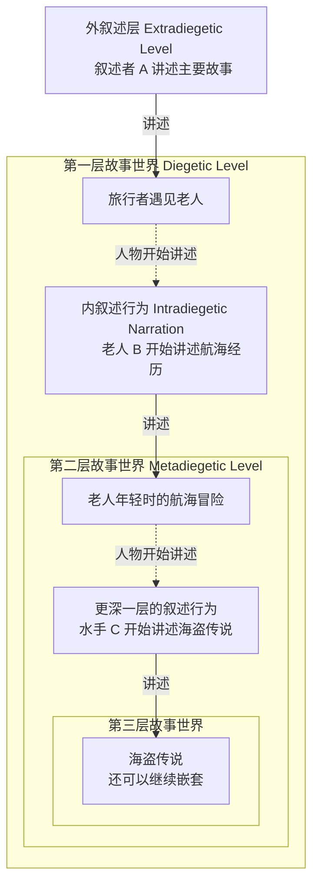
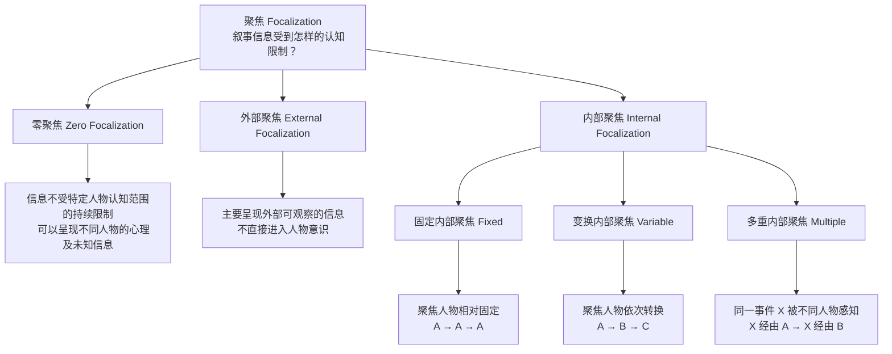

## 韩江《素食者》阅读笔记

### 故事梗概

《素食者》是韩国作家韩江于 2007 年发表的小说，由《素食者》《胎记》《树火》三部中篇小说构成，讲述了金英惠的不同人生阶段。

第一部《素食者》主要由英惠丈夫的视角叙述，语言日常、冷淡、以自我为中心。英惠的丈夫自述是一名利己主义者，他与英惠结婚的目的明确：看中了英惠在生活能力、家务劳动上的价值，尤其满意她做的饭菜。丈夫在叙述中，只会在获取了英惠提供的价值后表达对她的夸赞，比如穿上熨好的衬衫后；而他一旦没有被满足，经常会暴跳如雷，对妻子不耐烦地恶语相向。

丈夫唯一介意的事情就是英惠不喜欢穿胸衣。婚姻持续了五年。一天早上，丈夫着急出门，不耐烦地出言催促；英惠一如往常地手忙脚乱、后颈发烫。在切冷冻肉时，英惠不小心切伤了手，还把刀的碎片混进了饭里。丈夫的辱骂反而使得妻子突然冷静、仿佛意识飘离了现实。

作品偶尔会切换叙述者，插入英惠第一人称的自述：当日夜里，自己（英惠）做了一个可怕的梦，梦境中进入满是悬挂肉块的工厂、以及不知是谁的、既熟悉又陌生的脸。

惊醒后，英惠对肉产生了恐惧：她把家里的肉全都扔掉，并且再也不吃肉、甚至害怕睡着；一段时间后，她严重营养不良，身体瘦削、皮肤干枯。丈夫散发的“肉味”也让英惠觉得难以亲近。

丈夫对英惠的素食行为大为恼怒。他并不想深入理解妻子的精神世界，只是觉得妻子给自己的生活带来了麻烦，甚至不顾她的反抗，对其实施性暴力。在公司社长组织的员工夫妻聚餐中，英惠拒绝吃肉，她的格格不入让丈夫觉得颜面扫地；他不禁觉得，聚餐的所有人甚至意到了妻子没穿胸衣，这实在太尴尬了。

于是丈夫觉得需要“采取一些措施了”，他不停地向妻子的娘家人控诉。而娘家人除了劝说英惠，还纷纷对丈夫表达歉意（就好像在说：“将一台故障的机器卖给你，真是对不起”）。变化最大的是素来脾气暴躁、举止强横的英惠父亲，他第一次态度软下来，低头向丈夫道歉。

时逢英惠大姐金仁惠乔迁之喜，又是英惠母亲生日，英惠一家在大姐聚会。丈夫在内心盛赞大姐把事业兴隆，给大姐夫提供了成为画家的经济条件，还拥有高超的厨艺。

饭桌上，英惠的亲人轮流劝说她别再坚持吃素了，但英惠一概态度冷漠地拒绝了。父亲一开始也压下脾气、以和蔼的态度劝说，但在遭拒后辄即暴怒，用蛮力强行向英惠的嘴中塞入肉食。英惠拼尽全力抵抗，最后只能拿起刀猛刺向手腕。

众人将英惠送入医院后，丈夫只想远离这个“怪胎”；而母亲仍然不放弃，欺骗英惠说黑山羊汤是中药。英惠假意不知，喝下之后趁机带着吊瓶去厕所中呕吐，血液回流进了吊瓶，但丈夫对此无动于衷。

第二天，丈夫发现英惠消失了，经过一番寻找后，在医院的喷泉边找到了陌生的她——英惠赤裸上身，攥着一只有咬痕的死鸟，嘴角血迹斑斑。

第二部《胎记》主要使用第三人称内部聚焦的叙述方式，以英惠大姐夫为中心叙述，语言高度视觉化。故事发生在《素食者》两年后，此时英惠已和丈夫离婚。姐夫是一位艺术家，但事业十分不顺，已经有一年多没有创作了。他和美丽能干的大姐结婚许多年，却对她失去了兴趣。孩子是两人唯一的关系纽带；除此之外他们并无话讲。在看到孩子身上的胎记时，姐夫听说英惠的臀部上也曾有一块绿色的胎记。

某次演出后，姐夫看到半裸的宣传海报，又联想到胎记，被激发出了强烈的创作灵感。他不断幻想创作一幅以自己和赤裸的、全身绘满花朵的英惠为主题的画。但他无法用模特代替英惠完成创作。从此之后，姐夫无法抑止对英惠的幻想，对她产生了深深的迷恋，甚至因此产生了性冲动并自慰。

姐夫以关心英惠身体为借口，登门拜访，意外看到了英惠的裸体。英惠则一如既往地平静。于是他大胆地提议英惠做自己的裸体模特；出乎他意料的是，英惠平静地接受了。

姐夫希望影像中是排除一切欲望的肉体。这次拍摄让姐夫有了更进一步的拍摄打算；英惠则十分满意涂满花朵彩绘的身体，这让她摆脱了噩梦。于是姐夫找到一个英俊年轻的后辈，代替自己与英惠合拍。英惠并不拒绝与赤身裸体的陌生男子亲密接触，拍摄十分顺利。在最后，姐夫出人意料地提议让两人真的发生性行为。英惠不置可否，但后辈严词拒绝。

在连连安抚后辈的话语中，拍摄勉强结束。英惠毫不讳言自己已经性欲高涨；姐夫也无法忍耐住和她交媾的欲望，但却被拒绝。理由是让她产生欲望的是身体上的鲜花。

于是姐夫拜托旧情未泯的前女友也为自己绘满体绘，然后径直进入英惠的家，粗暴地与她发生了关系；之后，拍摄了两人身体交叠的影片。

姐夫醒来后，发现妻子来了，也已经从摄像机里发现了事情的始末。大姐尽量克制地告诉他们，她打了急救电话要送他们进精神病院检查。英惠张开满是鲜花的身体感受阳光和春风。姐夫看得呆了。

第三步《树火》仍然是以第三视角叙述，但叙述中心改为了大姐金仁惠；这部分心理描写密集，回忆与当前事件交替，自然意象逐渐扩张。大姐是一个热衷利他的人，从小就有强烈的照顾好妹妹英惠的责任感。大姐在自己开的店内初识大姐夫；因为见他总是满脸疲惫，便心生了靠自己的努力拯救他的想法。婚后，大姐夫从不将心思放在家中，甚至连孩子都怀疑自己没有父亲。家庭渐渐让大姐不堪重负。

她曾经以为自己得了绝症，时日无多；以此为契机，她开始审视自己的人生，却发现自己好像是个从未真正活过的孩子，一直在忍耐、迁就他人，咬牙坚持着过活。医生告诉仁惠，她只不过得了小病，未来的人生还有很长；但她并没有因此感到宽慰或快乐。丈夫我行我素，孩子嗷嗷待哺，生活千篇一律——仅仅这样。但这些都要求她献祭整个人生，一直将贤妻良母和好姐姐的角色“扮演”下去。

大姐夫和英惠的丑事被发现后，两人都被送进精神病院。英惠进入隔离病房接受治疗；姐夫在确诊没有精神疾病后被拘留，再被彻底驱逐出了家门。金家从此分崩离析。

大姐更忙碌了，因为现在她还要肩负起看顾英惠、交付治疗费用的责任。英惠的身体状态每况愈下，也不肯吃药，背后生了褥疮，体重不足三十公斤，只能拜托病情稍轻的病友帮助照顾。她现在甚至不肯吃饭了，医生只能为她注射葡萄糖，身体上满是针孔。大姐独自照顾发高烧的孩子时，接到医生的电话，说英惠在大雨天走失了。可五天都没睡好的大姐分身乏术。晚上，护工在山里找到了她，她像被雨淋湿的大树一样一动不动的站在山坡上。

大姐痛恨这样不负责任地将生活毁掉的英惠，明明她一直这样坚忍努力，这样尽心地照顾妹妹。小时候，她在父亲的威压下，分担母亲的家务，给烂醉的父亲煮醒酒汤。父亲稍不满意就会掌掴这对姐妹。是她自幼的卑怯，让她如此乖巧、懂事。她不禁反复拷问自己：“是自己的哪一步走错，才的生活变得如此不堪？”但好像人生中的哪一个选择都会以悲剧收尾，这一切并不值得忍受。她忽然好像理解了自己丈夫和英惠的心情。自己丈夫可以为了一刻的解脱而放弃一切；英惠并不觉得死亡会失去什么；而她只是活着的幽灵，她早就死了。

英惠觉得自己彻底是一株植物了。医生决定从她的鼻孔插入胃管注射食物，以延续她的生机。英惠激烈地反抗，胃部大量出血，生机渺茫。大姐陪伴着英惠转院，在救护车上凝视窗外如火燃烧的树木。

### 写作分析

《素食者》的核心叙事安排，是让英惠始终处于故事中心，却主要通过其他人物的观察、欲望与解释被呈现。英惠从拒绝吃肉，到拒绝某些身体关系，最终完全拒绝进食，并相信自己能够像植物一样生存。这一变化可以被理解为她试图摆脱暴力及既有人类生存方式的过程，但小说并未将其确立为一套完整、连贯的哲学主张。三部曲依次以丈夫、姐夫和仁惠为主要聚焦人物，分别呈现他们对英惠的不同理解：《素食者》中，丈夫将她视为破坏正常婚姻秩序的妻子；《胎记》中，姐夫通过艺术幻想与性欲认识她；《树火》中，仁惠则在照护妹妹的过程中，逐渐意识到两人痛苦经历之间的联系。英惠虽然始终是核心人物，却从未获得持续、完整的叙述主导权。三个部分不断改变读者认识英惠的途径，同时保留了她内心经验的部分不可知性。

第一部《素食者》采用以丈夫为主导的**外叙述层—同故事叙述**（Extradiegetic–Homodiegetic Narration）。丈夫既参与故事，又以第一人称回顾婚姻生活及英惠的变化。叙述主要围绕他的感知、记忆、判断与情绪展开，形成以他为中心的**内部聚焦**（Internal Focalization）。然而，小说并未始终维持这一叙述方式，而是在丈夫的讲述之间插入英惠独立的第一人称梦境、记忆和心理独白，使读者得以短暂接近她的内心经验。

丈夫的叙述具有明显的**认知局限**（Cognitive Limitations）与**评价偏差**（Evaluative Bias）。他选择英惠的重要原因，是她符合自己对妻子的期待：能够料理家务、满足日常需要，又不会提出过多要求。因此，当英惠拒绝吃肉时，他首先关注的并非妻子经历了什么，而是自己的生活秩序受到干扰。他要求英惠恢复正常，并不断考虑她的行为会如何影响自己的工作、人际关系和社会形象。丈夫的局限不仅体现为个人的自私与冷漠，也反映出他如何将社会对婚姻和妻子角色的规范，当作衡量、要求乃至支配他人的标准。

与丈夫的叙述形成对照的是英惠的独白。她的梦境反复出现屠宰、血肉、牙齿、动物的眼睛，以及对自身身体的恐惧。这些片段具有强烈的感官特征，却缺乏连贯的因果说明，使读者接触到丈夫无法理解的痛苦，又无法据此完全解释英惠的行为。丈夫所描述的日常婚姻生活，与英惠内心充满血腥和恐惧的经验之间，由此形成了鲜明的断裂。她既不能被简单理解为完全理性的反抗者，也不能被归结为被动的受害者或某种医学诊断所能穷尽的病人。

这种叙述安排产生了**叙事反讽**（Narrative Irony）：丈夫以自己的理解讲述英惠，读者却能借助英惠的独白，发现他的解释存在明显不足。因此，丈夫的**不可靠叙述**（Unreliable Narration）主要表现为理解和评价上的偏差，而不必然源于有意隐瞒或欺骗。两种叙述声音之间的信息差异，不仅呈现了夫妻之间的情感疏离，也揭示了人物在认知能力、解释权与叙述权力上的不对称。

第二部《胎记》转而采用第三人称的**外叙述层—异故事叙述**（Extradiegetic–Heterodiegetic Narration），并主要以英惠的姐夫为**固定内部聚焦**（Fixed Internal Focalization）的中心。叙述者不参与故事，却通过姐夫的感知、记忆、想象与欲望组织叙事信息。小说运用**心理叙述**（Psycho-Narration）等意识呈现方式，使读者能够深入他的内心，而英惠的思想与动机则主要通过他的观察、推测及两人的对话间接呈现。

这一叙述方式使姐夫的艺术构想与性欲成为读者认识英惠的重要媒介。在姐夫眼中，英惠不仅是一个具有独立经验与意愿的女人，更是绿色胎记、绘满花朵的皮肤、近乎植物的身体，以及能够实现其艺术理想的特殊对象。他不断凝视、描绘和拍摄英惠，按照自己的构想安排她的身体与最终影像。由此，英惠逐渐成为他的**审美对象**（Aesthetic Object），而这种**艺术凝视**（Artistic Gaze）也包含着将他人**客体化**（Objectification）的倾向。

然而，《胎记》并未将这段关系简化为单向的支配。英惠主动接受人体绘画，并对身上的花朵产生积极反应，似乎在这种艺术实践中获得了暂时摆脱普通身体经验的可能。与此同时，姐夫对她的理解始终受到艺术野心与性欲的影响，并最终越过了艺术创作与身体占有之间的界限。因此，问题不仅在于他的行为是否具有侵犯性，也在于这种艺术构想究竟为英惠提供了另一种身体存在的可能，还是以新的方式将她变成满足他人欲望的对象。

小说的艺术效果进一步强化了这种矛盾。细腻的视觉描写使读者也可能被人体花绘的美感吸引，但这种审美体验并不能消除影像创作中存在的权力关系。第三人称内部聚焦让读者接近姐夫的艺术想象和欲望，同时也使其自我解释的局限逐渐显露。读者因此既能够理解他的创作冲动，又有理由质疑他如何以艺术的名义理解和对待英惠。作品由此提出一个更复杂的问题：欣赏艺术之美，是否可能使人暂时忽略被观看者的独立经验与意愿？

第三部《树火》同样采用外叙述层的异故事叙述，但将内部聚焦的中心转向仁惠。小说通过她的感知、记忆与意识活动，呈现英惠的病情、照护过程及仁惠自身逐渐显露的心理危机。随着叙事展开，作品的重心不再只是英惠如何被他人理解，也转向了试图理解和照顾她的仁惠本人。

仁惠回忆童年遭受的家庭暴力、婚姻中的长期付出，以及自己曾经产生过的死亡念头。这些经历逐渐揭示出，照护者并非一个健康、稳定且能够超然判断他人命运的旁观者，而同样是受到伤害、充满矛盾的主体。仁惠开始意识到，她与英惠并不能简单地被划分为正常人与异常者、照顾者与被照顾者。两人经历了相似的家庭环境，却形成了截然不同的应对方式：英惠逐渐拒绝维持既有生活，仁惠则长期依靠忍耐、劳动与责任维持家庭和自身的生存。姐妹二人由此构成**对照人物关系**（Character Foil），但她们的差异并不意味着绝对对立。

在意识呈现方面，《树火》大量运用心理叙述，由第三人称叙述者呈现仁惠的疲惫、恐惧、自责与死亡念头。部分段落还通过贴近人物心理的疑问、感叹和评价，使叙述者的语言与人物意识相互交织，表现出接近**自由间接思想呈现**（Free Indirect Thought Presentation）的特征。在时间结构上，作品反复运用**倒叙**（Analepsis），将仁惠照顾妹妹、前往医院及陪同转院的当前事件，与童年家庭暴力、婚姻生活、丈夫的背叛及自身的心理危机交织起来。过去的经历不断进入当下的意识，使读者逐渐理解仁惠的行为动机，也重新认识她与英惠之间的经验联系。

从整体结构来看，三部曲呈现出以不同人物为中心的**变换内部聚焦**（Variable Internal Focalization），聚焦中心依次由丈夫转向姐夫和仁惠，同时伴随着第一人称同故事叙述向第三人称异故事叙述的转换。这种安排不仅展示了不同人物如何理解、误解或试图接近英惠，也使后续叙述不断改变读者对先前事件的认识。第一部分通过丈夫的叙述呈现英惠的异常行为与家庭冲突；第二部分进一步展现她离婚后的生活，使读者看到她并未完全失去欲望，也能够从人体花绘中获得积极体验；第三部分则通过仁惠的记忆，揭示姐妹长期经历的家庭暴力，以及她们在相似处境下形成的不同生存方式。

这种**追溯性重释**（Retrospective Reinterpretation）使后续信息不仅补充故事，还改变了先前事件的意义。例如，第一部分父亲强迫英惠吃肉的行为，在第三部分关于童年家庭暴力的回忆中，进一步显露出它与长期家庭权力关系之间的联系。同样，英惠后来表示，即使停止吃肉，梦中的面孔也没有消失，表明拒绝肉食并未真正消除她的恐惧。读者因而不能将素食简单理解为一次成功的自我净化，也无法把父亲的暴力视为孤立、偶然的失控。

三个部分由此形成了相互关联、又不断深化的问题结构：第一部分呈现暴力如何存在于被视为正常的家庭秩序之中；第二部分探索艺术美感与个人欲望如何可能遮蔽对他人的侵犯；第三部分则进一步追问，当关怀与延续生命的愿望遭遇另一个人的拒绝时，照护者应如何面对自身意愿与被照护者自主性之间的冲突。这些不同形式的关系并不能简单归入同一种暴力，但它们共同指向一个问题：当一个人拒绝他人期待的生活方式时，人们究竟是在尝试理解她，还是在按照自己的需要重新定义她？

《素食者》的艺术力量，来自叙述声音与聚焦中心的变化、英惠经验的部分不可知性、动物与植物意象的持续发展，以及三部分相互联系却无法轻易化解的伦理冲突。这些形式安排使一个始于饮食拒绝的家庭故事，逐渐展开为对身体、欲望、暴力与人类生存方式的追问。小说没有为这些问题提供确定的答案，而是将读者引向更深层的困境：如果人类的生存始终与依赖、欲望及伤害的可能性相伴，那么一种尽可能不以支配为基础的生活，究竟能够实现到什么程度？

### 象征分析

《素食者》的核心象征结构围绕拒绝肉食与植物化愿望展开。贯穿三部曲的肉、血、面孔、花朵和树木等**意象**（Imagery），不断建立起身体、暴力、欲望与生命之间的联系，使英惠的身体变化获得了超出情节本身的**象征意义**（Symbolic Meaning）。

第一部中，英惠拒绝肉食与反复出现的血腥梦境密切相关。梦境中令她恐惧的不仅是动物遭受杀戮的场景，还有自己与暴力之间无法摆脱的联系。童年时，父亲曾以残酷的方式杀死一条咬伤她的狗，而她最终也吃下了狗肉。这段经历使她既是暴力的见证者，也成为杀戮结果的分享者。因此，拒绝肉食可以理解为她试图切断自身与暴力之间联系的一种**象征性行动**（Symbolic Act）。然而，梦境并未随着饮食习惯的改变而消失，表明这种拒绝无法真正消除她的恐惧。

肉、血、牙齿和陌生而熟悉的面孔，构成了相互关联的感官意象。肉与血不断唤起身体遭受伤害的经验，牙齿使进食与攻击发生联系，而梦中难以辨认的面孔，则使英惠对自身是否参与暴力产生不安。这些意象并未形成一套明确的哲学论证，而是通过反复出现的感官经验，将她难以表达的恐惧具体化，也使拒绝肉食逐渐获得超出饮食选择本身的意义。

随着故事发展，英惠的拒绝从肉食进一步延伸到人类的身体及其生存方式。她尤其恐惧牙齿、手脚等可能成为伤害工具的身体部位，却将乳房视为相对不具有攻击性的存在。这种对身体的重新认识，使植物逐渐成为她想象中摆脱暴力的另一种生命形式。她倒立、接受阳光照射、想象身体长出树根，并最终拒绝通过进食维持生命，仿佛可以借此摆脱动物性身体与吞食行为。植物化愿望由此具有了抵抗暴力的象征意义，但这种想象与现实身体的生存条件存在不可消除的矛盾：她试图摆脱对其他生命的伤害，却使自己的身体逐渐走向衰竭。非暴力的愿望与自我毁灭的后果交织在一起，构成了这一象征最深刻的张力。

第二部《胎记》将象征的重心转向胎记、花朵与人体。英惠身上残留的绿色胎记，在姐夫的想象中成为一种原始、自然、尚未被社会秩序完全改变的生命痕迹。他将英惠的身体理解为某种接近植物、仿佛能够超越通常肉欲的存在，并试图通过人体绘画将这种想象转化为艺术。然而，他越是追求摆脱肉欲的身体之美，自己的性欲就越强烈。这形成了《胎记》的核心反讽：姐夫希望通过英惠表现超越肉体欲望的美，却不断以欲望的方式观看、安排和占有她的身体。

花朵意象使这一矛盾更加复杂。对英惠而言，绘在身体上的花朵似乎暂时缓解了梦境带来的恐惧，也使她获得了一种不同于普通人类身体的自我体验。对姐夫而言，花朵则成为实现艺术幻想和满足个人欲望的媒介。同一种身体图像因此承载了不同的意义：它既可能为英惠提供暂时的解脱，也可能成为他人将她**客体化**（Objectification）的工具。花朵并不单纯象征纯洁、自由或欲望，而是将这些相互冲突的经验联系在一起。

第三部《树火》进一步发展了植物意象。英惠相信自己能够像树木一样依靠阳光和水生存，将植物化视为摆脱人类生存方式的可能。然而，在仁惠的经验中，树木并不只是平静、纯洁的生命象征。结尾处，树林呈现出仿佛燃烧的视觉效果，既充满强烈的生命力，又带有令人不安的威胁感。树与火的意象在此相互交织，使植物不再能够被简单理解为暴力世界之外的避难所。对树木的不同认识，也呈现出姐妹二人面对生命时的不同处境：英惠试图成为植物，仁惠则仍然必须面对作为人继续生活的现实。

贯穿三部曲的象征由此形成了持续变化的意义结构：肉与血联系着伤害和恐惧，花朵使身体获得暂时转化的可能，树木则将植物化的愿望推向生命与死亡的边界。这些意象并非与某些抽象观念一一对应，而是随着人物经验与叙事结构的变化，不断产生新的含义。小说借此提出的问题也逐渐深化：人能否在不伤害其他生命的情况下生存？拒绝既有的身体与生活方式，是否真的意味着获得自由？当摆脱暴力的愿望最终危及自身生命时，抵抗、自主与自我毁灭之间的界限又应当如何理解？

### 结局分析

《树火》使小说的伦理冲突进一步复杂化。前两部分主要通过丈夫和姐夫的欲望、偏见与控制呈现英惠的处境；第三部分则将叙述中心转向长期照顾她的仁惠。与丈夫和姐夫不同，仁惠真切地关心妹妹，希望她能够活下去，并持续承担照护责任。然而，善意并不意味着她能够完全理解英惠。当仁惠试图劝说妹妹接受治疗和进食时，两人的意愿再次发生冲突：仁惠希望延续妹妹的生命，英惠则将这些干预体验为对自身意愿的强迫。小说由此将问题从明显的侵犯与控制，推进到关怀、生命与**身体自主权**（Bodily Autonomy）之间更难解决的伦理矛盾。

这一冲突又因姐妹二人的共同经历而变得更加复杂。仁惠并非能够超然判断妹妹命运的旁观者，她同样长期承受家庭暴力与生活压力。童年时，她通过顺从父亲、分担家务和照顾妹妹来减少冲突；成年后，她继续经营店铺、照顾丈夫与孩子，并承担妹妹的治疗和生活费用。这种适应方式使她得以维持日常生活，却也让她不断压抑自身的疲惫、欲望与痛苦。她甚至曾经产生过放弃生命的念头。因此，仁惠虽然能够维持社会意义上的正常生活，却并不比英惠更容易摆脱内心的困境。

姐妹二人由此形成深刻的**人物对照**（Character Foil）。英惠逐渐拒绝既有的生活秩序，仁惠则长期通过忍耐与责任维持生活；英惠将对暴力的恐惧转化为身体上的拒绝，仁惠则通过劳动与照护回应自身的痛苦；英惠试图摆脱人类的生存方式，仁惠却必须继续面对自己和孩子的生存需要。她们看似走向相反的方向，却都在追问现有的生活是否值得继续。梦境也参与了这种对照：英惠的梦呈现了难以向他人解释的恐惧，仁惠的梦与记忆则逐渐使她正视自己长期压抑的经验。

然而，这种对照不能简化为英惠代表反抗、仁惠代表顺从。仁惠并非始终接受既有秩序，她逐渐质疑自己长期承担的责任，并试图阻止医疗干预进一步伤害英惠。英惠也并非能够彻底摆脱他人和外部世界：即使她相信自己可以像植物一样生存，现实中的身体仍然依赖水、营养、照护和其他生命条件。两姐妹的选择因此都无法提供一种完整的出路。英惠的拒绝可能使她失去生命，仁惠的坚持则使她继续承受痛苦。两人共同面对的问题是：当生活无法彻底摆脱依赖、暴力与伤害的可能性时，人究竟应当如何继续活下去？

小说以**开放式结局**（Open Ending）收束这一矛盾。仁惠陪同妹妹转院，在救护车中凝视窗外的树林。那些树木仿佛燃烧着绿色的火焰，既呈现出强烈的生命力，也带有令人不安的威胁感。仁惠的目光仿佛在等待回答，又仿佛在表达抗议。小说没有交代英惠最终的命运，也没有使仁惠获得明确的答案，更没有让姐妹之间的矛盾得到彻底和解。仁惠仍然希望妹妹活下去，却开始意识到，妹妹的拒绝可能包含着自己过去未能正视的痛苦。她既无法完全接受英惠放弃生命的愿望，也不能再简单地以正常生活的标准要求妹妹。

因此，结尾并未在生命与自主、关怀与控制之间给出确定的价值排序，而是使这些原则保持紧张。仁惠最终没有选择放弃对妹妹的关怀，也没有获得足以解释和解决一切的生命哲学。她只是继续凝视着那个同时存在美与暴力的世界。

韩江在2023年的访谈中谈到，仁惠在结尾凝视树木的画面，体现了整部小说持续等待回答、提出抗议的状态。这也说明，《素食者》并不只是对韩国父权家庭的批判。家庭中的性别权力与身体控制固然重要，但小说还进一步追问人类暴力、纯真的可能性，以及人在理解他人和维持自身生命时面临的困境。

### 其他角色

英惠的父亲与丈夫具有鲜明的共同特征：他们都将自己的需求和期待视为理所当然，要求女性服从，并在这些要求受到挑战时诉诸暴力。尽管父亲主要依靠家长权威，丈夫则更多依靠婚姻中的性别规范，但两人的行为遵循着相似的权力逻辑：女性的价值取决于她们能否满足男性的期待，拒绝则意味着对既有秩序的破坏。暴力因此不仅是情绪失控的表现，也是维持支配关系、迫使他人服从的手段。

仁惠则体现了外部权力如何逐渐转化为个体对自身的要求。长期的顺从与付出不仅是她适应家庭环境的方式，也可能成为她理解自身价值的基础。她习惯于从他人的需要出发安排生活，并通过照顾、帮助和满足他人获得价值感。她对姐夫的感情也可以从这一角度理解：她不仅被他吸引，还希望通过自己的付出改善他的生活。她并非没有自己的欲望，而是逐渐习惯于通过满足他人的欲望来实现自己的价值。当服从和责任被内化为自我要求，外部的强迫便不再是维持这种生活方式的必要条件。

智宇的行为则使这种角色塑造呈现出跨代延续的可能。年幼的他已经懂得在成人面前表演笨拙、天真和憨态可掬，通过逗人发笑获得关注与认可。这种表现可以被理解为一种**自我矮化**（Self-Diminishment）：儿童主动将自己放在供成人欣赏和取乐的位置，以符合成人对儿童的期待。在重视长幼秩序、懂事与服从的东亚家庭文化中，这种现象尤其值得警惕。儿童不仅可能被要求服从，还可能逐渐学会扮演成人喜欢的形象，将获得认可与降低自身的主体地位联系起来。这种适应不必出于清醒的算计，也可能在长期互动中自然形成。儿童并非缺乏复杂情感与独立经验的次等主体，但成人常常更愿意接受他们天真、顺从、容易取悦的一面。智宇的表现因此引出了一个问题：他是否也在通过扮演成人期待的角色，学习仁惠曾经用以适应家庭权力关系的生存方式？这一联系仍需要更多文本证据确认，但它为理解家庭权力如何影响下一代提供了新的角度。

姐夫则代表了另一种生存取向：不再通过服从和责任维持日常生活，而是试图通过极端的艺术与感官经验重新感受到自身的存在。他在人体艺术创作中体验到久违的激情，甚至愿意为此抛弃原有的生活。这种对**巅峰体验**（Peak Experience）的追求，使他仿佛发现了“真正活过”与“只是维持生活”之间的区别。然而，强烈的生命体验并不必然意味着更真实、更有价值的生活。当他为了实现自我而忽视他人的主体性时，对自由和生命激情的追求，也可能转化为另一种支配。

这些人物呈现出不同的生存方式：父亲和丈夫通过控制他人维持秩序，仁惠通过满足他人的需要确认自身价值，智宇可能正在学习通过迎合成人期待获得认可，姐夫试图通过极端体验突破日常生活，而英惠最终走向对既有生活方式的全面拒绝。他们的选择并不等同，却共同揭示出个体与社会期待之间的复杂关系：人既可能通过服从获得安全，也可能通过支配获得权力，或者通过拒绝寻求自由；但这些选择又都可能使自己或他人陷入新的困境。

## 叙事学 Tips：热奈特的叙述层、叙述者与聚焦理论

在法国叙事学家热奈特（Gérard Genette）的理论体系中，**叙述层**（Narrative Level）、**叙述者与故事的关系**（Narrator's Relation to the Story）以及**聚焦**（Focalization），是分析小说叙事方式的三个相互独立、又可以组合使用的维度。三者分别回答：叙述行为发生在哪一层？叙述者是否参与所讲述的故事？叙事信息通过谁的感知与认知被呈现？这种区分有助于避免将第一人称、第三人称、全知视角和有限视角混为一谈。

### 叙述层（Narrative Level）

**叙述层**研究不同叙述行为与故事世界之间的层级关系。**外叙述层**（Extradiegetic Level）是讲述主要故事的叙述行为所处的层次，而被讲述的主要故事则构成**第一层故事世界**（Diegetic Level）。例如，一个人回顾自己的过去，尽管他参与了这些事件，讲述主要故事的行为仍然处于外叙述层。因此，外叙述层并不意味着叙述者没有参与故事，而是指这次讲述没有被设置为更高一层故事中的人物叙述行为。

当主要故事中的某个人物进一步讲述另一段故事时，便出现了**内叙述层**（Intradiegetic Level）的叙述行为，而他所讲述的故事则构成**次级叙事**（Metadiegetic Narrative），也称**嵌入叙事**（Embedded Narrative）。例如，一部小说讲述旅行者遇见老人的经历，老人随后向旅行者讲述自己年轻时的航海冒险。小说原本的叙述者处于外叙述层，老人则作为第一层故事中的人物，承担内叙述层的讲述行为；老人的航海冒险由此构成第二层故事。如果航海故事中的水手又讲述一段海盗传说，叙述层便进一步增加。

判断叙述层的关键，是是否出现了新的叙述行为及其所讲述的故事，而不是叙述时间或语法人称是否变化。**倒叙**（Analepsis）只是叙事时间顺序的变化，不必然产生新的叙述层；人物之间的普通对话也不必然构成嵌入叙事。尤其需要区分：内叙述层指发生在第一层故事世界中的讲述行为，而次级叙事是这一行为所讲述的第二层故事，两者并非同一概念。

### 叙述者与故事的关系（Narrator's Relation to the Story）

与叙述层不同，**同故事叙述**（Homodiegetic Narration）和**异故事叙述**（Heterodiegetic Narration）研究的是叙述者是否作为人物参与自己所讲述的故事。

**同故事叙述**是指叙述者也是其所讲述故事中的人物，可以是主人公，也可以是旁观者或见证者。例如，一个人回顾自己的婚姻，或一名医生讲述自己见证的朋友的冒险，都属于同故事叙述。如果叙述者同时是故事的主要主人公，则可以进一步称为**自叙故事叙述**（Autodiegetic Narration），它是同故事叙述的特殊类型。

**异故事叙述**则指叙述者并不作为人物参与其所讲述的故事。例如，一名叙述者讲述某个家庭的生活，却从未作为人物出现在这些事件之中，就属于异故事叙述。

这种分类并不直接取决于语法上的人称。第一人称与第三人称描述的是语言形式，而同故事与异故事描述的是叙述者和故事之间的关系。两者在常见小说中往往对应，但不能在理论上直接等同。

叙述层与叙述者类型相互独立，因此可以组合形成四种基本形式：

1. **外叙述层—同故事叙述**（Extradiegetic–Homodiegetic Narration）：叙述者在外叙述层讲述主要故事，同时也是故事中的人物，例如主人公回顾自己的经历。
2. **外叙述层—异故事叙述**（Extradiegetic–Heterodiegetic Narration）：叙述者在外叙述层讲述主要故事，但不参与其中的事件，例如不属于故事人物的第三人称叙述者。
3. **内叙述层—同故事叙述**（Intradiegetic–Homodiegetic Narration）：第一层故事中的人物进一步讲述自己参与的另一段故事，例如老人向旅行者讲述自己的航海冒险。
4. **内叙述层—异故事叙述**（Intradiegetic–Heterodiegetic Narration）：第一层故事中的人物进一步讲述自己没有参与的另一段故事，例如老人向旅行者讲述发生在自己出生之前的传说。

因此，叙述层回答“讲述行为处于哪一层”，同故事与异故事叙述回答“讲述者是否参与所讲述的事件”。二者可以自由组合，不能相互替代。

### 聚焦（Focalization）

**聚焦**是热奈特为区分叙述者身份与叙事信息的呈现方式而建立的分析概念。它研究叙事信息受到怎样的认知限制，以及叙述通过谁的感知、知识和经验组织故事。热奈特据此区分了“谁在讲述”（Who Speaks?）与“谁在感知”（Who Sees?）：前者属于**叙述声音**（Narrative Voice）的问题，后者属于聚焦的问题。不过，“谁在感知”并不限于视觉，还涉及人物能够知道、理解和体验什么，以及叙述允许读者获得哪些信息。

热奈特区分三种基本聚焦模式。

**零聚焦**（Zero Focalization）是指叙事信息不受某个人物认知范围的持续限制。叙述者可以呈现不同人物的内心，也可以交代任何单个人物都不知道的事件、背景或信息。它通常与传统的**全知叙述**（Omniscient Narration）相联系，但并不意味着叙述者必须将所有信息告诉读者，而是指叙述拥有超出特定人物认知范围的信息呈现能力。

**内部聚焦**（Internal Focalization）是指叙事信息主要受到某个人物的感知、知识和经验的限制。读者能够接近这个人物的心理活动，却通常无法直接获得其他人物的内心经验。例如，一部第三人称小说虽然由不参与故事的叙述者讲述，但如果叙述主要围绕某个人物的意识展开，其他人物的动机只能通过其行为、言语和该人物的推测间接呈现，那么作品便主要采用内部聚焦。内部聚焦不等于第一人称叙述，第三人称异故事叙述同样可以采用内部聚焦。

**外部聚焦**（External Focalization）则主要呈现人物外部可观察的行为、语言、表情和动作，而不直接进入人物意识。叙述者可以写出人物沉默、颤抖或离开房间，却不直接交代其内心想法。因此，外部聚焦接近一种观察式或**摄影机式叙述**（Camera-Eye Narration）。这里的“外部”指相对于人物意识的观察位置，与外叙述层并非同一概念。

热奈特还进一步区分了内部聚焦的三种组织方式。

**固定内部聚焦**（Fixed Internal Focalization）是指叙事持续主要通过同一人物的感知与经验展开，聚焦中心保持相对稳定。**变换内部聚焦**（Variable Internal Focalization）是指不同部分依次采用不同人物的聚焦中心，使读者通过不同人物的经验了解故事。**多重内部聚焦**（Multiple Internal Focalization）则强调同一事件通过不同人物的认知被反复呈现，从而揭示他们在感知、记忆和判断上的差异。

零聚焦、内部聚焦与外部聚焦是三种基本聚焦模式；固定、变换与多重则是内部聚焦的三种组织方式。其中，变换内部聚焦强调聚焦中心依次变化，多重内部聚焦则强调同一事件经由不同人物的认知被重复呈现。一部作品也可能在不同段落中采用不同的聚焦方式，因此不能仅凭某个局部特征就将整部小说归入单一类型。

### 《素食者》中的具体应用

《素食者》三部曲适合用来比较叙述者类型与聚焦方式之间的关系。

第一部《素食者》主要采用丈夫的第一人称同故事叙述，其讲述行为处于外叙述层，叙事信息主要受到丈夫的认知限制。然而，作品在他的讲述之间插入英惠独立的第一人称梦境与意识片段，使读者能够短暂接近丈夫无法理解的心理经验。因此，这一部分并非始终维持单一的叙述声音。英惠的独白也不能仅凭人称变化就被自动判定为内叙述层的嵌入叙事。

第二部《胎记》采用第三人称的外叙述层—异故事叙述，并主要以姐夫为**聚焦人物**（Focal Character）。叙述者并不参与故事，但叙事主要围绕姐夫的感知、记忆、艺术幻想和欲望展开。读者能够接近他的内心，却无法同等程度地直接了解英惠的意识。

第三部《树火》同样采用第三人称的外叙述层—异故事叙述，但将内部聚焦的中心转向仁惠。小说通过她的记忆、心理活动与照护经验呈现英惠的处境，使读者逐渐认识到姐妹之间更深层的经验联系。

三部曲整体上呈现出以不同人物为中心的**变换内部聚焦**，并伴随着叙述声音的转换。三位主要聚焦人物对英惠的认识各不相同，而她自身的经验始终只能被部分接近。由此可见，叙述者类型与聚焦方式虽然相互联系，却并不等同：同样采用第三人称异故事叙述的《胎记》和《树火》，可以因为聚焦人物不同而产生截然不同的叙事效果。

### 聚焦限制与不可靠叙述

还需要区分聚焦限制与**不可靠叙述**（Unreliable Narration）。聚焦人物只能获得部分信息，并不意味着叙述者必然不可靠。内部聚焦所形成的认知限制，首先是一种信息组织方式，而不可靠叙述则涉及叙述者的陈述、理解或评价是否与作品提供的其他证据存在值得注意的偏差。

例如，《胎记》中姐夫对英惠的理解受到自身欲望影响，但这种局限不能直接证明第三人称叙述者在误导读者。相反，第一部《素食者》的丈夫同时承担叙述者与主要聚焦人物的角色，他的价值判断和叙述选择直接影响读者获得的信息，因此可以进一步研究其理解与评价是否可靠。

判断不可靠叙述，需要比较叙述者的陈述、其他人物的表达以及作品提供的独立线索，而不能仅凭叙述者信息有限或存在主观立场便作出结论。

总而言之，叙述层决定讲述行为的位置，同故事与异故事叙述决定叙述者是否参与事件，聚焦则决定叙事信息如何受到限制和组织。三个维度既可以分别分析，也可以相互组合，从而更准确地解释小说的叙事结构及其艺术效果。

理论依据主要来自 Gérard Genette 的 Narrative Discourse: An Essay in Method（1980），以及 The Living Handbook of Narratology 中有关叙述层、叙述者与聚焦的研究。